# 高中物理可视化教学提升思维品质的研究

吴春良

(苏州市吴江盛泽中学,江苏 苏州 215200)

摘 要:将物理概念、规律、方法等进行可视化,在教学和问题解决中提升学生的思维品质;具体做法是:从物理实验、概念图、连续图、Excel数值模拟、图解法等手段入手,为学生搭建台阶,帮助学生主动建构知识,从而促进物理学科素养的形成.

关键词:可视化;思维品质

基金项目:本文系江苏省教育科学"十三五"规划重点资助课题"高中物理概念图教学促进思维品质的研究"(课题批准号:C-a/2016/02/16);苏州市教育科学"十四五"规划课题"可视化教学提升物理思维品质的研究"(课题批准号:2021/LX/02/170/05)的研究成果之一.

科学思维是物理学科核心素养之一,思维品质是思维能力强弱的反映,是个体思维活动中智力特征的表现.物理思维品质是人们在研究和解决物理问题以及学习物理知识的过程中逐步形成和发展的,并在这个过程中表现出来的、直接影响工作效率的个体智力特征,主要包括思维的深刻性、灵活性、批判性、独创性和敏捷性5个方面.而在物理概念、规律、方法的建构过程中,必然需要进行信息加工、逻辑推理和物理建模,也就是物理学科思维品质的发展过程.物理概念、规律、方法的建构或物理的问题解决是发展学生思维品质的有效途径,而应用可视化手段建构知识、解决问题过程是发展学生思维品质的重要手段.

## 1 抽象物理量的可视化教学———提升学生思维的深刻性

自组织理论认为,非平衡是有序之源.学生的思维之所以不断深化,是因为在大脑的认知过程中,原来认知结构的平衡状态被外来的刺激所打破,发生了“同化”或“顺应”过程,使认知结构得到充实或变革,从而达到新的水平和新的平衡.[1]通常而言,思维的深刻性指思维活动的广度、深度和难度,又叫抽象逻辑性.思维的深刻性主要表现为在智力活动中能够深入思考问题,善于概括归类,逻辑抽象性强;善于透过事物的现象抓住其本质和规律;能够开展系统的理解活动;善于预见事物的发展过程.显然,只有大脑的认知状态到达非平衡态,思维的深刻性才能表现出来.

高中物理中经常会碰到抽象的物理量,例如电场线、磁感线、压强、摩擦力方向等,学生在知识建构过程中会比较困难,从而使大脑的认知状态处于非平衡态.此时,利用物理实验或概念图教学等可视化手段,搭建台阶,使得学生的认知结构逐步发生“同化”或“顺应”,从而提升学生思维的深刻性品质.

例如,在进行电场线模拟教学时可采用如图1、2、3所示实验,通过带电的塑料丝模拟单个电荷、异种电荷、同种电荷的电场线,使其可视化;如图4所示,用水中的两个电极模拟匀强电场,使其可视化;如图5、6所示,用铁屑模拟条形磁铁和蹄形的磁感线,使其可视化;如图7所示,用毛刷的形变方向来显示摩擦力的方向;如图8所示,4个气球上面放一薄板,用气球支撑一位成年人,来显示压强的意义等等.通过物理实验手段,将抽象的物理量进行可视化,帮助学生透过事物的现象抓住其本质,建构知识,提升学生思维的深刻性品质.

图1 点电荷电场线模拟  
图2 同种电荷电场线模拟  

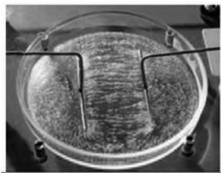  
图4 电极模拟匀强电场

图3 异种电荷 电场线模拟  
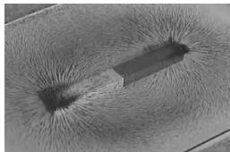  
图5 铁屑模拟磁感线1

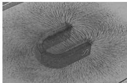  
图6 铁屑模拟磁感线2

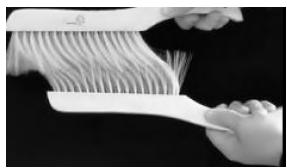

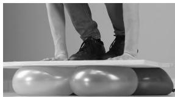  
图7 毛刷形变显示摩擦力方向  
图8 4个气球支撑一位成年人

在进行一些抽象物理量或规律教学时,也可以采用概念图的形式.例如,在进行”机械振动”教学时,可以采用如图9所示的概念图,帮助学生建构抽象的概念”机械振动”.

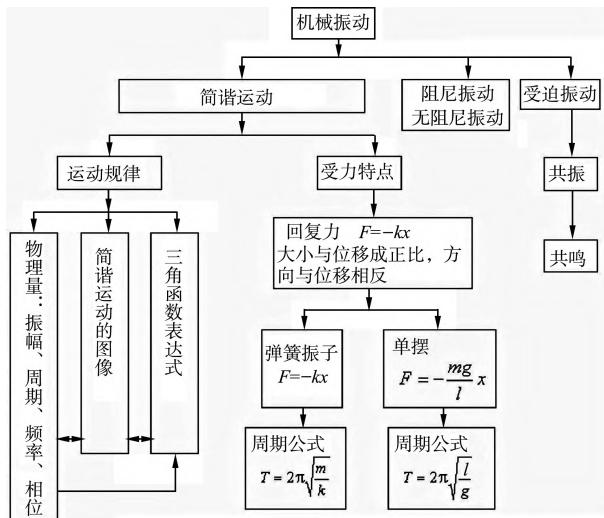  
图9 “机械振动”概念图

概念图可以以图解的方式,直观地、结构化地描述”机械振动”相关内容之间的相互关系.概念、命题、交叉连接和层级结构等4个概念图的特征,结构化地显示了”机械振动”的内涵和规律,将抽象的概念以可视化、结构化的形式展现出来,帮助学生主动建构物理概念,提升思维的深刻性品质.

## 2 多物理过程的可视化教学———提升学生思维的灵活性

很多物理规律或物理问题的解决要涉及复杂的物理过程,教学时需要将复杂物理过程按照关键位置及时间排序进行分解再展示出来,即可视化展现.在建构物理规律或问题解决的过程中,必然要调动学生思维的灵活性.思维的灵活性主要是指思维活动的灵活程度.思维的灵活性主要表现为:思维的起点比较灵活,能从不同角度、不同方向思考问题;思维的过程比较灵活,能用多种方法解决问题;迁移能力强,能够“举一反三”;善于组合分析,能够“运用自如”;而且思维的结果通常是合理且灵活的结论.灵活性集中表现在一题多解的变通性和新颖不俗的独特性.具有较强灵活性的人,不仅智力方向灵活,而且能够由分析到综合,再由综合到分析,灵活地进行“综合性的分析”,能够较全面地分析问题、思考问题以及解决问题.

情境1:如图10所示,绳子一端固定,另一端系着的小球从水平位置,由静止开始下落,做圆周运动.问,从 N 到 P 过程中,小球所受重力的瞬时功率是如何变化的?

由图可知,小球在任意位置(夹角为 θ),重力的

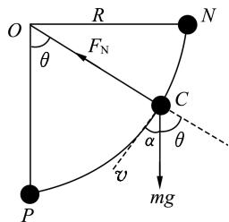  
图10 小球从水平位置开始做变速圆周运动

瞬时功率的表达式为 $P = m g \ \sqrt { 2 g R \mathrm { c o s } \theta \ \mathrm { s i n } ^ { 2 } \theta }$ ,很难从表达式判断重力瞬时功率的变化趋势,也很难看出极值位置.也有教师从初始位置(N 点)重力瞬时功率为0,末位置(P 点)重力瞬时功率为0,从而得出重力瞬时功率先变大后变小的规律.从推理来讲,这是不完备的,甚至可能是错误的,因为中间过程也是可以出现多个极值的,这样教学会给学生带来误导.

此类问题解决可以采用 Excel数值模拟可视化展现小球整个过程中小球功率的变化规律,如图11所示.此图可完整清楚地展示瞬时功率随角度的变化规律,同时可以看出极值位置.有助于学生对物理问题全面地分析.

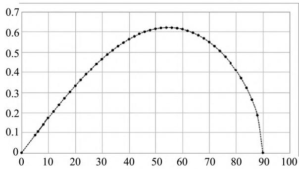  
图11 小球所受重力的瞬时功率随角度的变化规律

同时,也可以用这种方法研究绳子拉力、小球速度、小球加速度等物理量随角度变化的规律,以及不同质量的小球上述物理量随角度的变化规律.也就是从不同角度、不同方向,灵活而全面地思考问题,提升学生思维的灵活性品质.

## 3 物理模型的可视化教学———提升学生思维的独创性

物理模型是指研究和解决物理学问题时,舍弃次要因素,抓住主要因素,建立的概念模型.高中物理教学时,教师需要帮助学生将物理问题有效地建模,并将其可视化展现,从而提升学生思维的独创性.思维的独创性(或创造性)是指个体思维活动的创新精神(或创造性特征).独创性主要表现为:在实践中善于发现问题、思考问题;创造性地解决问题.独创性(或创造性)的实质是主体对知识经验或者思维材料进行高度的概括后所表现出来的集中而系统的迁移;能够进行新颖的组合分析,找出新颖的层次和交接点.

如图12,A为竖直平面内一个圆的最高点,B为最低点,圆的半径为 R,AB 为直径,从 A 点任意地作一根弦,可以证明任一物体从 A点静止起沿这样的任何光滑弦轨道滑下时,所需时间 t相同,都为 $t = { \sqrt { \frac { 4 R } { g } } }$ ;同样

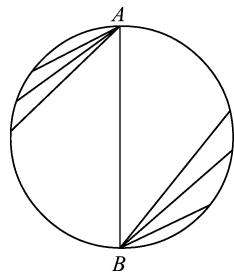  
图12 等时圆模型

地,任一物体在圆上任意一点从静止沿光滑弦轨道滑下到达最低点 B 的时间也都为 $t = { \sqrt { \frac { 4 R } { g } } }$ .因此这样的圆可称为”等时圆”.

将上述物理模型,制作成如图13所示的实物模型,现场演示,可视化展现和验证.也可以将该模型变式处理,即将钢圈转一个小角度演示,如图14所示发现3个小球不同时到达底部,即不等时了,这又是什么原因? 引发学生思考.在实践中,帮助学生构建等时圆模型,并将模型可视化展现,引导学生发现问题、思考问题并创造性地解决问题,提升学生思维的独创性.

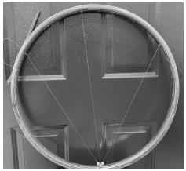  
图13 自制等时圆模型

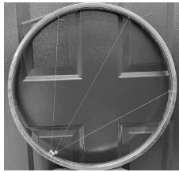  
图14 等时圆模型变形

## 4 思维方法过程的可视化教学———提升学生思维的敏捷性

解决问题的方法往往是抽象的,如果能够将抽象的思维过程用一定的方式呈现出来,将会使学生快速有效地理解和解决问题,提升学生思维的敏捷性.敏捷性是指思维活动呈现的一种正确而迅速的特征,它同时也反映了智力的敏锐程度.在处理和解决问题的过程中,思维的敏捷性主要表现为能在紧张的情形中积极思考、周密计划、正确判断、迅速制订方案或者得出结论.

情境2.如图15,半球形容器固定在地面上,容器内壁光滑,开始时,质量分布均匀的光滑球 A 和同种材质构成的质量分布均匀的光滑球 B 放在容器内处于平衡状态,位置关系如图中所示,已知容器、A、B 半径之比为6∶2∶1.一水平力 F 作用在 A 球上,且力 F 的延长线过 A 球球心,缓慢推动 A 直到 B 的球心与容器的球心 O 等高过程中,A 球对 B 球的弹力 $N _ { 1 }$ 及容器对 B 球的支持力 $N _ { 2 }$ 是如何变化的?

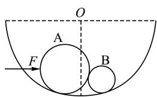  
图15 动态平衡问题

分析:对 B 球受力分析如图16所示,缓慢推动 A 球直到 B 的球心与容器的圆心 O 等高的过程中,三角形 OAB 边长恒定, $N _ { 1 }$ 和 $N _ { 2 }$ 的夹角不变,根据三力平衡作出矢量三角形如图17所示,从图17可以看出 B 球受到 A 球的弹力 $N _ { 1 }$ 逐渐增大,容器对 B 球的支持力 $N _ { 2 }$ 先增大后变小.将整个物理过程图形化展示出来,可以帮助学生快速地解决问题,提升学生思维的敏捷性.

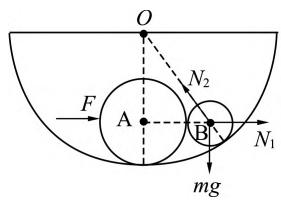  
图16 动态平衡问题

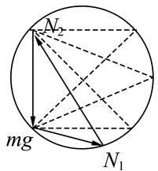  
图17 动态平衡问题

情境3.如图18所示,重力为 G 的电灯悬于两壁之间,OA 绳水平,OB 绳与竖直方向夹角为$4 5 ^ { \circ }$ ,保持O 点及绳OB 的位置固定不变,绳子重力不计,而将绳端 A 点向上移动(绳 OA 长度可调)过程中,OA 绳和OB 绳拉力变化的情况如何?

对灯泡受力分析后,抓住 OB 绳拉力方向不变 $, O A$ 绳拉力 $T _ { O A }$ 和 OB 绳拉力 $T _ { O B }$ 的合力与重力 $G$ 等大反向(保持不变),OA 绳拉力 $T _ { O A }$ 顺时针转动,可画出如图19所示的变化图形,便可得 OA绳拉力 $T _ { O A }$ 先减小后增大,OB 绳拉力 $T _ { O B }$ 一直减小.从学生角度看,可以将变化图形进行改进,将该物理方法可视化处理,过程如下.

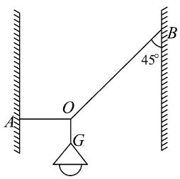  
图18 灯泡静止

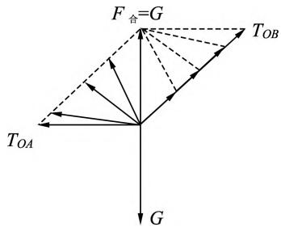  
图19 图解法展现变化过程

图20是将图19的过程进行分解展开,同时也是抓住了 OA 绳拉力 $T _ { O A }$ 和 OB 绳拉力 $T _ { O B }$ 的合力与重力G 等大反向这个关键点,将其大小用两虚线的距离确定,然后逐步展示 OA 绳拉力 $T _ { O A }$ 顺时针转动的过程,力的大小可以从拉力 $T _ { O A }$ 和拉力 $T _ { O B }$ 的长度判断出它们的变化规律.通过这种方法可以帮助学生将复杂的问题过程完整、清晰地展现出来,从而快速有效地解决问题,提升学生思维的敏捷性.

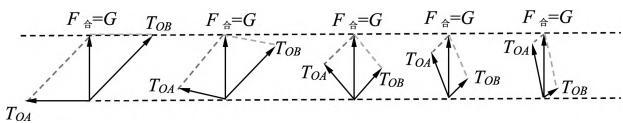  
图20 动态变化过程分解图

将抽象物理量、多物理过程、物理模型、思维方法过程可视化展现,帮助学生建构概念、规律,解决物理问题,帮助提升学生思维的深刻性、灵活性、独创性和敏捷性品质,促进学生物理素养的形成.

## 参考文献:

1 邢红军,刘利.物理教学促进学生思维品质的发展研究[J].课程·教材·教法,2013(7):97-102.

2 蔡钳,陈信余.解决问题过程中的"思维可视化尝试"[J].物理教师,2021(7):92-93.

3 段俊霞.高中生物理思维品质的检测研究[D].北京:首都师范大学,2013.

4 陈栋梁.初中物理概念图教学的研究[D].苏州:苏州大学,2007.

(收稿日期:2024 03 13)

## (上接第12页)

教材中的问题和任务设置重视素养立意,符合学业质量标准,能刻画不同学生学业成就的具体表现,进行真实、有效的综合评价.[7]任务创设联系实际、注重情境,帮助学生巩固、理解所学内容,促进学生深度学习,使学生的课下学习真正成为整个教学环节的一部分,确保其在向着核心素养发展的道路上稳步前进.

## 7 优化版式和插图设计,美目润心、育人化人

高质量的版式设计能够让教材更好地发挥育人功能.教材编写组对教材版式进行了精心设计,力图使教材版式既积极弘扬社会主义核心价值观、彰显时代精神,又符合初中学生年龄、心理认知和审美特点,体现健康向上的审美品质.版式设计最大限度地展现内容效果,形式灵活多样,与正文相得益彰,突出教材版面的一体化设计(图5).

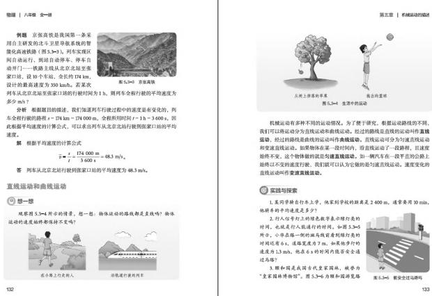  
图5 新教材第五章第3节"比较运动的快慢"部分页面展示

插图作为教材组成的一部分,紧密配合内容设置,使版式更加新颖、活泼,增加教材的趣味性,更加符合初中学生的心理特征.素材以具有时代特点的图片或制作精良的插画为主,与教材内容设置的情境协调一致,成为凸显情境化的有力抓手,并切实反映当今中国人民健康、积极的精神面貌,体现中华优秀传统文化和国家发展建设中取得的伟大成就.

综上,编修后的新教材以落实立德树人根本任务、发展学生核心素养为宗旨,遵循学生身心发展规律,培养学生学习物理的兴趣,养成科学思维习惯、求实的科学精神;贴近生活、社会,密切联系实际,引领学生认识科学、技术、社会、环境之间的关系;加强实验探究、实践活动和跨学科实践活动,培养学生的实践能力、问题解决能力和创新意识.希望广大教师在使用北师大北京版初中物理新教材的过程中,能将新教材的编写理念融入实际教学中,做好教材到教学的科学转化,促进学生核心素养的发展.

## 参考文献:

1 李春密.义务教育教科书 物理 八年级全一册[M].北京:北京师范大学出版社,2024.

2 中华人民共和国教育部.义务教育物理课程标准(2022年版)[S].北京:北京师范大学出版社,2022.

3 廖伯琴.义务教育物理课程标准(2022年版)解读[M].北京:高等教育出版社,2022.

4 李春密,苏明义.新版课程标准解析与教学指导 初中物理[M].北京:北京师范大学出版社,2022.

5 李春密,张霄.《义务教育物理课程标准(2022年版)》的变化分析[J].物理教师,2022,43(6):35-44.

6 谭琳,李春密.加强教学研究  促进物理课程有效实施———基于2022年版《义务教育物理课程标准》与2011年版的对比分析[J].物理教师,2022,43(7):42-45.

7 李春密.《义务教育物理课程标准(2022年版)》课程内容与教学实施的思考[J].物理教学探讨,2022,40(12):1-6,12.

(收稿日期:2024 08 28)