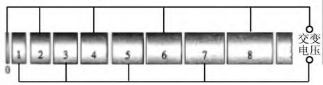
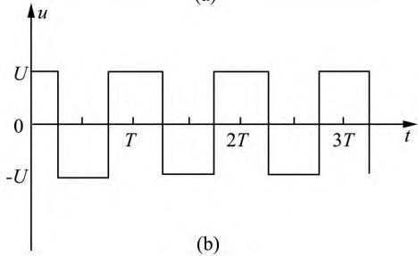
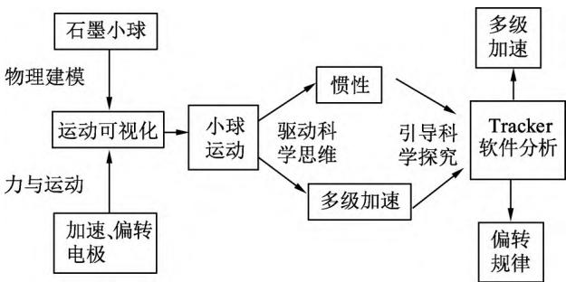
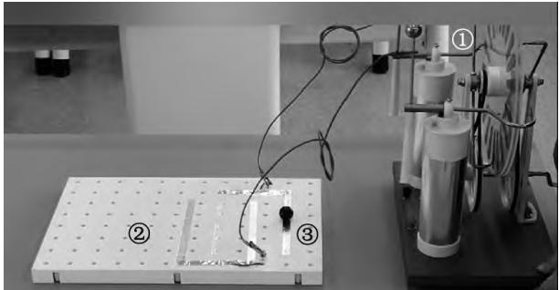
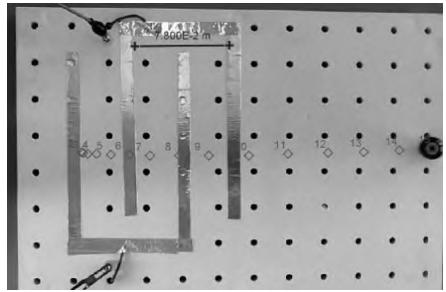
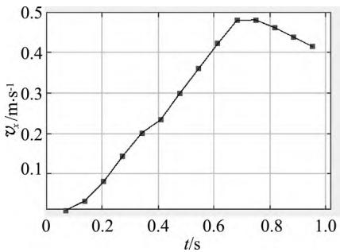
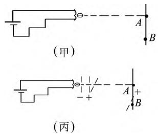
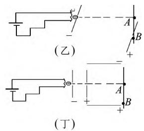
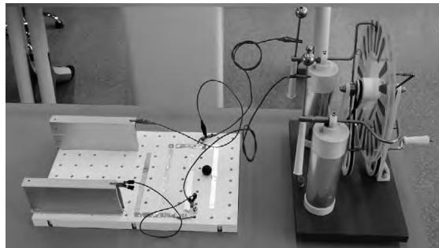
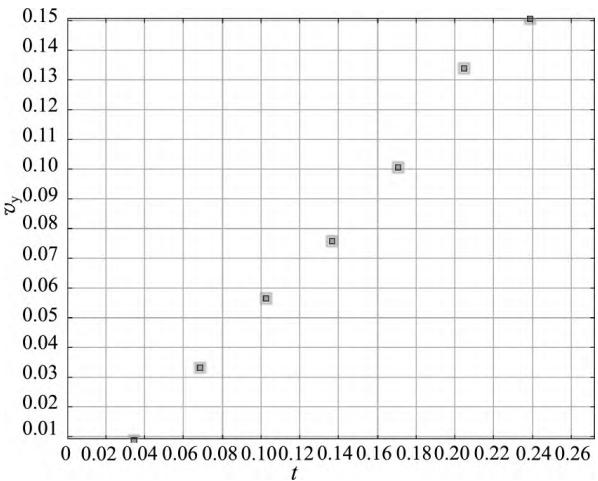

> 来源：MinerU 转换（stem-exact rebuild 2026-08-08）

# 高中物理实验可视化：价值、路径与实践

———以“带电粒子在电场中的运动”为例

李春胜 钟志鹏（无锡市玉祁高级中学 ，江苏 无锡 214000）

摘 要 ： 《普通高中物理课程标准（2017年版） 》强调了实验教学的重要性 ，关联高中物理有些章节中物体运动抽象的特点 实现物体运动的可视化 以有效呈现和学生亲身体验的方式助力提升学生科学思维品质和科学探究能力．以“带电粒子在电场中的运动”为例 从自制教具出发 围绕可视化的运动 结合 Tracker软件 将实验结果可视化 重视科学探究过程 有效提升学生的思维品质

关键词 ： 可视化 ； 自制教具 ； Tracker软件

《普通高中物理课程标准（2017年版2020年修订） 》在课程性质中强调物理学是“基于观察和实验”的自然学科 进一步凸显实验教学的价值.以人教版高中教材为例 ，演示实验近百个.这不仅是物理教学的本质 也是发展“科学思维”“科学探究”等学科核心素养的载体.在这些演示实验中有的是实验室配备的实验 有的则需要教师利用实验室的材料或者日常用品进行实验改进或者开发新的演示实验.《普通高中物理课程标准 （2017年版） 》还指出 演示实验是师生共同探讨问题的学习方式 也是体验性较强的学习方式.教师要尽可能多地开发出可视性强 证据性强 能引起学生浓厚兴趣的演示实验.基于此， 将复杂的实验 ， 抽象的物理规律通过可视化的实验现象呈现出来对师生来说都是一件很有意义的事.［1］

## 1 高中物理实验可视化的路径

## 1.1 以自制教具创新实验形式

实验课程资源不仅限于实验室现有的设备和仪器 也可以积极开发资源 创新实验 用日常的用品或实验室的一些材料开发出低成本高质量的自制教具 使实验现象可视化 让学生有更多亲历实验演示的机会.这不仅对课堂知识的讲授有极大的促进作用 也培养了学生的实验实践能力.例如人教版中“带电粒子在电场中的运动”这一节遇到最大的难题就是带电粒子的具体运动无法呈现 导致教学只能停留在理论层面的推导.空洞的内容 抽象的运动会大大降低学生的学习兴趣 教学效果也会受到一定影响.

## 1.2 以数字实验，优化表征方式

教材中介绍过一些软件 辅助学生探寻物理规律 例如传感器展示作用力和反作用力的关系.当一些物理现象很难真实呈现时 可利用信息数字化手段 实现现象的可视化 便于学生进行知识的探寻.例如带电粒子在电场中的运动首先带电粒子学生无法用肉眼观察到 其次带电粒子运动很快 ， 难以捕捉到 ， 导致带电粒子的运动规律只能全部停留在理论层面.课堂上可以将带电小球模拟成带电粒子 对带电小球的运动情况用手机拍成视频 ， 然后将视频导入到 Tracker软件 利用软件的跟踪功能可以看到带电粒子运动情况和运动轨迹.具体的运动规律可以利用软件自带功能进行定量分析 以 v t 图像的形式呈现给学生.［2］

## 2 高中物理实验可视化的实践

## 2.1 设计的出发点

课本上是以一道例题展示带电粒子在电场中的加速 具体题目如下.

如图1（a）所示 某装置中 多个横截面相同的金属圆筒依次排列 其中心轴线在同一直线上 圆筒的长度按照一定的规律依次增加.序号为奇数的圆筒和交变电源的一个极相连 序号为偶数的圆筒和该电源的另一个极相连.

交变电源两极间的电势差的变化规律如图1（b）所示.在 t＝0时 奇数圆筒相对偶数圆筒的电势差为正值 此时位于和偶数圆筒相连的金属圆板（序号为0）中央的一个电子 在圆板和圆筒1之间的电场由静止开始加速 沿中心轴线冲出圆筒1.

为使电子运动到圆筒与圆筒之间各个间隙中都能恰好使静电力的方向跟运动方向相同而不断加速 圆筒长度的设计必须遵照一定的规律.若已知电子的质量为 m 电子的电荷量为 e 电压的绝对值为 u 周期为 T 电子通过圆筒间隙的时间可以忽略不计.则金属圆筒的长度和它的序号之间有什么定量的关系？第 n 个金属圆筒的长度应该是多少？［3］

(a)  
  
图1 直线加速器、交变电流

例题很好地展示了带电粒子在电场中加速这一知识点 而且是现实中的真实情境 是一道非常好的题目.但笔者在教学实践中发现学生在理解该题时有几个难点

（1） 电子在运动过程中为什么不考虑重力 电子的运动会不会是曲线运动？

（2） 电子为什么经过圆筒间隙时都做加速运动？

（3） 电子为什么在圆筒内部做匀速运动？

（4） 交变电压的周期为什么不考虑电子在圆筒间隙的加速时间？尤其是学生还没学习过交变电流.

作为一线教师 笔者非常理解学生的疑惑 但细细分析不难发现所有的疑惑都指向一个问题 ：带电粒子的运动无法看清.受这道题的启发，笔者在后续的教学中设计了一个自制教具 ， 实现带电粒子可视化 力求打破学生的疑惑.

## 2.2 教学过程

## 2.2.1 情境创设，问题驱动

1990年我国在北京建设第一台高能粒子对撞机，用两个字概括它的特点 ：快、准.

师 ：用哪些方法能加速带电粒子？

生 用两块带异种电荷的平行板可以加速带电粒子.

师 ：该同学的回答很正确 学以致用.

设计意图 明确本节课内容与生活生产 科学技术息息相关 起点高 实用性强.提出的问题直击该节课的两个重要内容 分别对应的是带电粒子在电场中加速和带电粒子在电场中偏转 这不仅为新课的导出做好铺垫 ， 更在具体内容和思想方法上定好方向.

## 2.2.2 创新实验 聚焦探究

紧扣书本例题 以例题中的思想作为指导依据 创新设计了一个自制教具 并在课堂中设计好台阶让学生自己去研究 培养学生的创新能力和实验能力.设计思路如图2所示.

  
图2 教学思路设计图

基于此 设计的仪器应实现带电粒子运动可视化的功能； 仪器的原理简单 新颖 能提高学生的学习兴趣；仪器具有启发性 对驱动学生的科学思维有一定作用；增强仪器的可操作性，让学生能够参与活动，成品如图3所示.［4］

  
图3 带电粒子演示仪———加速部分

仪器介绍 ① 手摇发电机 （产生直流电）② 锡箔纸做成加速的电极板（获取简单） ， ③ 可带电的小球（带电粒子的可视化）.

实验现象 摇动发电机 放在锡箔纸上的小球开始运动.

## 师 ： （1） 小球是怎么被加速的？

（2） 小球为什么能够持续被加速？

（3）在该实验中小球被加速几次？

设计意图 该仪器原材料简易 电极看上去简单易懂 电场方向清晰 小球的电性在运动过程中发生改变.通过上述3个问题的指引 学生基本能够明白其原理.在此过程中培养了学生建模思想增强了对物理知识的应用能力.［5］

师 根据实际需要 生活中需要高能带电粒子 如果电子需要加速到 $4 \times 1 0 ^ { 5 } \ \mathrm { m / s }$ ，请根据例题中的数据计算在两极板间需要加多大的电压？

生 ：经过计算发现电压为2×1010 V.

师 ：用这个电压在实际应用中是否行得通？现在你是设计师 ，该怎么办？

生 ：电压太高，在操作中很危险.

师 该同学从实际生活出发 考虑到应用的安全问题 非常好.那我们该怎么获得那么大的速度呢？

生 ：多加速几次就可以.

设计意图 ：学生经过计算需要太大的电压 在实际生活生产中有诸多不便.继而从降压不降速的角度出发 为多级加速做好铺垫.学生根据观察并且结合所学知识 不难发现设计的仪器就是多级加速器 学生恍然大悟.

师 ：通过观察，确实能够看到小球由静止开始运动起来 有学生提出小球后续的运动到底是由于惯性还是被多级加速呢？

为了弄清带电小球的具体运动 保证创新实验的严谨性 借助了视频分析 Tracker软件．首先将拍摄的视频导入Tracker软件 并设置好初始位置 设置好步长 采用自动跟踪的方式 可以定性看出小球在电极间一直做加速运动 ，如图4所示.

  
图4 加速过程自动跟踪

更为精确的是可以从 v t 图像上直观看出小球的加速过程 如图5所示.

  
图5 加速过程 v t 图像

再逐帧播放视频并跟 v t 图像对比 很清晰看到小球速度与小球在电极间所处位置的对应关系.

结论 小球在电极间一直做加速运动 离开电极后 小球在阻力的作用下做减速运动.

师 ：刚才通过我们的探究 弄清了带电粒子可以被加速的事实 并且学习了加速的方法 解决了“快”的问题.那我们怎么实现带电粒子“准”的效果呢？也即控制带电粒子的轨迹.

生 ：物体的运动由受力情况决定的 要达到控制运动轨迹的效果只需要改变电场力的方向即可.

师 ：回答非常正确 那在自制仪器的基础上应做哪些调整呢？实验表明 炽热的金属丝可以发射电子，假设电子刚从金属丝射出时的速度为0形象地看成是一把电子枪 如图6（甲） 所示.请思考图6（乙） （丙） （丁）3幅图所示的方法 加速后的电子有可能击中 B 点吗？并根据实际生产生活需要，比较利弊.

  
图6 带电粒子偏转设计图

设计意图 ： 创设情境， 引导科学探究.该情境学生感兴趣 可以理论推导 得到结论； 也可以根据课堂上的自制教具进行调整创新 当堂演示效果.（乙）图和（丙） 图方法中的设计符合理论上的需求 但是在实际生活中 每次不可能因为目标位置的变化而把机器拆开调整电场的方向.这样基于证据得到相关结论并做出解释 ， 在探究的过程中相互交流 评估 培养学生良好的科学探究素养.

师 根据图（丁）中的设计思路 真的能够击中点吗？请同学上台用自制教具演示 ， 请同学们观看小球的运动 并及时提出调整建议（实验装置如图7所示）.

  
图7 带电粒子演示仪———加速偏转

生 ：学生上台演示 ，台下学生仔细观察.

设计意图 ：能否击中 B 点是多方面因素决定的 这个对学生而言有挑战.小球先加速运动 然后做曲线运动，影响小球偏转的因素是多方面的.虽然学生不一定能挑战成功 但对启发学生的思维有积极作用 培养学生对实验结果的分析有积极导向作用 也为小球的具体运动规律的分析做好了铺垫.

师 科学很严谨 探究得扎实.接下来我们仔细分析小球的具体运动 唯有找到运动规律才能灵活应用.加速部分我们在前半部分已经分析清楚了 接下来的重点则是小球的偏转运动.

步骤1 进行实验操作并且拍摄小球偏转运动的清晰视频.

步骤2 将视频导入 Tracker软件 根据跟踪功能观察小球的具体运动.

步骤3：根据跟踪的数据 ，利用软件自带功能 ，绘制 v t 图像 如图8所示.

得到结论 ： 带电粒子在沿电场方向做匀加速直线运动 在垂直电场方向做匀速直线运动.

师 ：根据运动规律 ，怎么调节才能击中 B 点？

生 ： 学生理论 与实践相结合， 有计划进 行调节.

设计意图 学生通过探究得到带电粒子的运动规律 明确影响轨迹的因素.通过让学生亲身参与调节仪器 首先是让学生对已探究到的运动规律灵活应用；其次是培养学生动手探究的习惯 培养学生的探究能力 最后是提高学生的学习兴趣通过自己的探究 自己去解决一个具体的问题 提高解决问题的信心和能力.

  
图8 沿电场方向 v t 图像

## 3 总结与反思

本节课的设计根据物理建模的理论 重视科学探究的过程 重在提升学生的思维品质.整堂课以自制教具为载体 紧扣可视化的运动效果 摆脱对抽象运动的简单处理 提高学生学习兴趣 借助视频分析软件 对可视化的运动进行分析 优化实验结果的表征方式.［6］

## 参考文献 ：

1 中华人民共和国教育部．普通高中物理课程标准（2017年版2020年修订） ［S］．北京 ：人民教育出版社 2020

2 张树国．利用视频分析软件Tracker分析弹簧振子的运动规律［J］．物理通报 ，2021（4） ：45－47

3 课程教材研究所 ，物理课程教材研究开发中心．普通高中教科书物理 （必修 3） ［M］．北京 人民教育出版社 ，2019

4 刘辉 ，汪志荣．组合式多功能电机教育的制作及运用［J］．物理教师 ，2021（4） ：47－49

5 管小庆 胡星．自制霍尔传感器自动控制装置［J］．物理教师 2022（8） ：44－48

6 许卫国．基于物理核心素养的教学案例研究［J］．物理教师 ，2021（8） ：28－30

（收稿日期 ：2022－12－15）
