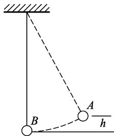
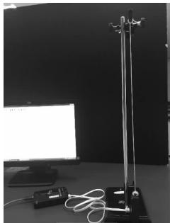
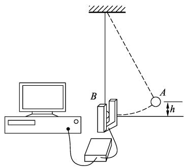
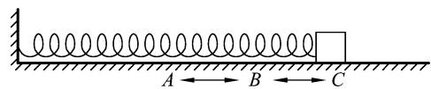
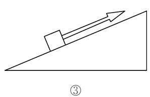
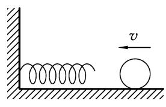
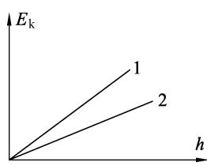
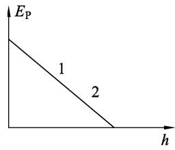
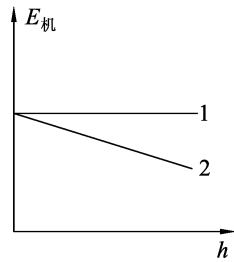

# 创设“问题链”驱动课堂 培养学生的科学思维品质——以“机械能守恒定律”教学为例

马云秀

（苏州工业园区星海实验中学，江苏 苏州 215021）

**摘 要**：以“机械能守恒定律”教学为例，根据高中物理课程标准的基本理念、课程总目标和物理核心素养的要求，探索以生活经验为基础，科学探究为核心，拓展应用为落点设计“问题链”驱动教学，探索培养学生科学思维品质的新路子．

**关键词**：科学思维；科学思维品质；问题链

科学思维品质是物理核心素养的重要内涵之一．发展学生的科学思维是高中物理教学的重要任务，也是物理教师的崇高追求．物理教师如何将学生的科学思维品质的培养贯穿于物理教学活动的全过程，是一个新的课题．问题是课堂的中心，教学离不开问题的设计．笔者尝试通过创设“问题链”，引导学生把物理课程中所形成的物理观念和科学思维用于分析、解决现实生活中的各种问题，在解决问题过程中进一步提高学生的探究能力，培养学生的科学思维品质．

## 1 “问题链”驱动教学与培养学生科学思维品质的关系

首先要厘清思维与问题的关系．关于思维的本质，不同研究者有不同的认识，其中杜威对思维过程的解释被奉为经典．杜威认为，思维的过程是一种事件的序列链．这一生产过程从反思开始移动到探究，再到批判性思维，最后得到比个人信仰和想象更为具体的“可以证实的结论”．思维不是自然发生的，但是它一定是由“难题和疑问”或“一些困惑、混淆或怀疑”引发的．观察者“手头的数据不会提供解决方案；它们仅仅能够给人启示”．而正是对“解决方案的需要”，维持和引导着反思性思维的整个过程；问题的本质决定了思考的结果，思考的结果控制着思维的过程．不难看出，杜威着重强调了问题之于思维的重要意义，思维的发生就是反思——问题生成——探究、批判——解决问题的过程．

其次，要厘清“问题链”和“问题链”驱动教学两个概念．所谓“问题链”，就是教师为了实现一定的教学目标，根据学生的已有知识或经验，针对学生学习过程中将要产生或可能产生的困惑，将教材知识转换成为层次鲜明、具有系统性的一连串的教学问题；是一组有中心、有序列、相对独立而又相互关联的问题．问题链是一个有机的教学整体，以链状结构环环相扣，体现问题间的能级增益和学科思维的推进深化．

“问题链”驱动教学不是教师问加上学生的答，而是师生双方围绕环环相扣的问题情境，进行多元的、多角度的、多层次的探索和发现．“问题链”驱动教学，是一种发展性教学，是指教师精心设计真实的驱动型问题，以问题贯穿整个教学过程，促使学生在设问和释问的过程中萌生自主学习的动机和欲望，在分析和解决问题的过程中，培养学生的探究意识，增加学生实践的机会，通过问题的解决，达到发展学生独立思考能力与科学思维品质的目的．

物理核心素养主要由“物理观念”“科学思维”“科学探究”“科学态度与责任”4个方面构成．而物理学科素养的核心是“科学思维”．“科学思维”是从物理学视角对客观事物的本质属性、内在规律及相互关系的认识方式；是基于经验事实建构理想模型的抽象概括过程；是分析综合、推理论证等方法的内化；是基于事实证据和科学推理对不同观点和结论提出质疑、批判、检验和修正，进而提出创造性见解的能力与品质．科学思维品质，就是指主体在解决问题时能正确选用符合认知规律的思维方式或方法进行思维，以及在思维过程中所表现出的对问题解决具有积极性意义的品质特征．

“问题链”驱动教学是提高学生科学思维品质的最重要、最有效的途径．“问题链”的设计是关系整个教学成败的关键．笔者尝试以“机械能守恒定律”教学为例，以生活经验为基础，科学探究为核心，拓展应用为落点设计“问题链”驱动教学，探索出培养学生科学思维品质的新路子，取得了较好的实践效果．

## 2 “问题链”驱动教学与培养学生的科学思维品质的案例教学与反思

### 2.1 以生活经验为基础设计情境性问题链，提升学生思维的自主性

问题链1．

问题1：在日常生活中有很多能量相互转化的实例，请同学们利用提供的器材设计一些物理过程，体现过程中有能量的转化．提供器材有：一端与小球相连接的弹簧，一端与金属小球相连接的细绳，一端与塑料球相连接的细绳，弹弓，纸片，塑料刻度尺．

学生活动：有的学生设置了单摆模型，有的学生设置了竖直弹簧振子模型，有的学生设置了弹弓弹射纸片的模型，有的学生运用弯曲的刻度尺弹射纸片，有的……

问题2：将小铁球用一根不易形变的悬线悬挂，将小球拉离平衡位置并静止释放．小球从释放处再摆至另一处最高点的过程中，有哪些能量参与转化，如何转化？

学生：下摆过程中重力势能转化为小球动能，上摆过程中动能转化为重力势能．

问题3：将小铁球和塑料球分别用一根不易形变的悬线悬挂，将两个小球均拉离平衡位置并静止释放．请仔细观察它们的摆动有什么不同特点．

学生：小铁球来回摆动高度不变，塑料球来回摆动的高度越来越低．

问题4：小球来回摆动的过程中动能和重力势能的总量，称之为机械能．那在摆动过程中，小铁球的机械能和塑料球的机械能是否变化？如何变化？为什么这样变化？

学生：小铁球的机械能不变，塑料球的机械能变小．……（至于机械能为什么这样变化，学生答不出来）

反思：问题链1从学生体验出发，建立机械能的概念，理解动能和势能可以相互转化，通过小金属球与塑料球对比实验，引发学生认知冲突，激活了学生的探究欲，促使学生进一步去认识和发现机械能守恒定律，这样的问题链实际上就是学生思维的启动链．事实证明，思维都是从直接经验的情境中发生的．在课堂的导入阶段教师根据教学内容，依据学生先前的生活经验和认知，创设情境，在学生知识的不全面，方法的不知道，先前经验的不了解等处精心设置疑问，使学生在心理上产生困惑（生疑），进一步想突破认知冲突（质疑），进而去发现、研究、探索（释疑），从而开启了学生的思维，培养了学生科学思维的自主性．

### 2.2 以科学探究为核心设计探究性问题链，提升学生思维的创造性

问题链2．

问题1：如图1所示，小金属球从一定高度A点静止释放，做变速圆周运动．大家初步判定从A点摆至B点过程中小球机械能的总量是保持不变的．能否定量说明呢？

学生1：用直尺放在A点所在水平高度，作为参照物，观察小球来回摆动是否到达同一高度．

  
图1

学生2：测量小球每次经过最低点B的速度，看大小是否总是相等，可以判断经过最低点的动能是否总是相同．

学生3：测量小球经过最低点的速度，算出小球的动能，判断小球从最高点A到最低点B减少的重力势能 $mgh$ 是否等于增加的动能．

问题2：同学们从不同角度进行定量判断小球的机械能守恒，非常好．根据学生3的方法，需要测量哪些物理量？需要哪些实验器材？机械能如何用测量量表示？

学生实验：实验装置如图2所示，选取最低点B所在的平面为零势面，用刻度尺量出A、B两点间的高度，如图3所示，用光电门测出小球经过B点的速度，验证在误差范围内减少的重力势能 $mgh$ 和增加的动能是否相等．实验数据见表1．

  
图2

  
图3

表1

<table><tr><td rowspan=1 colspan=1>实验次数</td><td rowspan=1 colspan=1> $t_1/\mathrm{s}$ </td><td rowspan=1 colspan=1>速度 $v/\mathrm{m}\cdot\mathrm{s}^{-1}$ </td><td rowspan=1 colspan=1>最低点动能 $E_{\mathrm{k}}/\mathrm{J}$ </td><td rowspan=1 colspan=1>初始的重力势能 $E_{\mathrm{p}}/\mathrm{J}$ </td></tr><tr><td rowspan=1 colspan=1>1</td><td rowspan=1 colspan=1>0.0140</td><td rowspan=1 colspan=1>1.39</td><td rowspan=1 colspan=1>0.97</td><td rowspan=1 colspan=1>0.98</td></tr><tr><td rowspan=1 colspan=1>2</td><td rowspan=1 colspan=1>0.0141</td><td rowspan=1 colspan=1>1.38</td><td rowspan=1 colspan=1>0.95</td><td rowspan=1 colspan=1>0.98</td></tr><tr><td rowspan=1 colspan=1>3</td><td rowspan=1 colspan=1>0.0142</td><td rowspan=1 colspan=1>1.37</td><td rowspan=1 colspan=1>0.94</td><td rowspan=1 colspan=1>0.98</td></tr><tr><td rowspan=1 colspan=1>4</td><td rowspan=1 colspan=1>0.0143</td><td rowspan=1 colspan=1>1.36</td><td rowspan=1 colspan=1>0.93</td><td rowspan=1 colspan=1>0.98</td></tr><tr><td rowspan=1 colspan=1>5</td><td rowspan=1 colspan=1>0.0144</td><td rowspan=1 colspan=1>1.35</td><td rowspan=1 colspan=1>0.92</td><td rowspan=1 colspan=1>0.98</td></tr><tr><td rowspan=1 colspan=1>6</td><td rowspan=1 colspan=1>0.0145</td><td rowspan=1 colspan=1>1.35</td><td rowspan=1 colspan=1>0.91</td><td rowspan=1 colspan=1>0.98</td></tr><tr><td rowspan=1 colspan=1>7</td><td rowspan=1 colspan=1>0.0145</td><td rowspan=1 colspan=1>1.35</td><td rowspan=1 colspan=1>0.91</td><td rowspan=1 colspan=1>0.98</td></tr><tr><td rowspan=1 colspan=1>8</td><td rowspan=1 colspan=1>0.0146</td><td rowspan=1 colspan=1>1.34</td><td rowspan=1 colspan=1>0.89</td><td rowspan=1 colspan=1>0.98</td></tr><tr><td rowspan=1 colspan=1>9</td><td rowspan=1 colspan=1>0.0147</td><td rowspan=1 colspan=1>1.33</td><td rowspan=1 colspan=1>0.88</td><td rowspan=1 colspan=1>0.98</td></tr><tr><td rowspan=1 colspan=1>10</td><td rowspan=1 colspan=1>0.0148</td><td rowspan=1 colspan=1>1.32</td><td rowspan=1 colspan=1>0.87</td><td rowspan=1 colspan=1>0.98</td></tr><tr><td rowspan=1 colspan=1>11</td><td rowspan=1 colspan=1>0.0149</td><td rowspan=1 colspan=1>1.31</td><td rowspan=1 colspan=1>0.86</td><td rowspan=1 colspan=1>0.98</td></tr><tr><td rowspan=1 colspan=1>12</td><td rowspan=1 colspan=1>0.0150</td><td rowspan=1 colspan=1>1.30</td><td rowspan=1 colspan=1>0.85</td><td rowspan=1 colspan=1>0.98</td></tr><tr><td rowspan=1 colspan=1>13</td><td rowspan=1 colspan=1>0.0151</td><td rowspan=1 colspan=1>1.29</td><td rowspan=1 colspan=1>0.83</td><td rowspan=1 colspan=1>0.98</td></tr><tr><td rowspan=1 colspan=1>14</td><td rowspan=1 colspan=1>0.0152</td><td rowspan=1 colspan=1>1.29</td><td rowspan=1 colspan=1>0.83</td><td rowspan=1 colspan=1>0.98</td></tr><tr><td rowspan=1 colspan=1>15</td><td rowspan=1 colspan=1>0.0153</td><td rowspan=1 colspan=1>1.28</td><td rowspan=1 colspan=1>0.82</td><td rowspan=1 colspan=1>0.98</td></tr><tr><td rowspan=1 colspan=1>16</td><td rowspan=1 colspan=1>0.0153</td><td rowspan=1 colspan=1>1.27</td><td rowspan=1 colspan=1>0.81</td><td rowspan=1 colspan=1>0.98</td></tr><tr><td rowspan=1 colspan=1>17</td><td rowspan=1 colspan=1>0.0154</td><td rowspan=1 colspan=1>1.27</td><td rowspan=1 colspan=1>0.80</td><td rowspan=1 colspan=1>0.98</td></tr><tr><td rowspan=1 colspan=1>18</td><td rowspan=1 colspan=1>0.0155</td><td rowspan=1 colspan=1>1.26</td><td rowspan=1 colspan=1>0.79</td><td rowspan=1 colspan=1>0.98</td></tr><tr><td rowspan=1 colspan=1>19</td><td rowspan=1 colspan=1>0.0156</td><td rowspan=1 colspan=1>1.25</td><td rowspan=1 colspan=1>0.78</td><td rowspan=1 colspan=1>0.98</td></tr><tr><td rowspan=1 colspan=1>20</td><td rowspan=1 colspan=1>0.0157</td><td rowspan=1 colspan=1>1.24</td><td rowspan=1 colspan=1>0.77</td><td rowspan=1 colspan=1>0.98</td></tr></table>

问题3：前面几组数据能够定量说明，在误差允许的范围内，小球A到B的过程中机械能总量保持不变．请大家理论证明，在不考虑阻力的情况下，小球摆动过程中机械能守恒．

证明：根据动能定理，有

$$
W _ { G } = \frac { 1 } { 2 } m v _ { 2 } ^ { 2 } - \frac { 1 } { 2 } m v _ { 1 } ^ { 2 } .
$$

根据重力做功与重力势能变化的关系，有

$$
W _ { G } = m g h _ { 1 } - m g h _ { 2 } ,
$$

可得

$$
\frac { 1 } { 2 } m v _ { 1 } ^ { 2 } + m g h _ { 1 } = \frac { 1 } { 2 } m v _ { 2 } ^ { 2 } + m g h _ { 2 } .
$$

说明：对于基础较差的学生可以设置问题，搭建脚手架，帮助学生思考．动能的增量与什么力做功有关，重力势能减少量与什么力做功有关．

问题4：实验数据也表明，小球在最低点的动能越来越小，小球的机械能不守恒了，说明机械能守恒是有条件的，这个条件是什么？

问题5：为什么把小铁球换成塑料球，在来回摆动过程中塑料球机械能明显不守恒呢？

师生探讨：塑料球所受阻力更大，不可忽略，阻力对球做了负功．

反思：问题链2有以下几个教学功能：（1）学生从不同角度设置实验说明小球在摆动过程中机械能总量不变，培养学生思维的灵活性；（2）问题的呈现过程，也是科学思维的过程，也是掌握科学思维方法的过程．通过问题链的思考，学生领悟了设计型实验的思考步骤：机械能与哪些物理量有关，要测量哪些物理量，需要什么实验器材，装置如何，数据如何处理等；（3）培养学生质疑精神，让学生明白特殊过程的结论不是规律，要探究一般过程也满足，那才是规律；（4）要理解机械能守恒的条件，光正面分析是远远不够的，只有通过问题正反两面思考，引导学生客观地考虑正反两方面的论据，才能让学生真正理解机械能守恒的条件．

将这样的问题链呈现在学生面前，学生虽然刚开始可能感到害怕，但他们通过对已学知识的分析，会发现自己可以解决，学生就会有热情去解决此问题．这种问题链有利于学生整合现有知识，主动去进行探索，建构新知识，掌握解决问题的方法；有利于启发学生积极主动、独立地去钻研，养成勇于探索的精神．像这样的问题链具有探究性，能激励学生积极思索，大胆设想，达到锻炼思维、发展智力目的．这样的问题链被视为“有效教学的核心”，它是培养学生科学思维品质的有效途径．

问题链3．

问题1：在只有重力做功的情况下，机械能是守恒的；同样作为势能的弹性势能也是机械能的一部分，是不是在只有弹力做功的情况下，机械能也守恒呢？

教师演示：与弹簧相连的滑块在气垫导轨上往复运动，如图4．

  
图4

问题2：滑块运动过程中能量如何转化？

问题3：动能和势能的总和是否保持不变？能不能类比重力做功情况证明系统机械能守恒？

教师适当加以辅助，再对弹簧与物块的运动过程简要分析，得出动能和势能的转化关系，并明确在只有弹力做功的系统中机械能是物体和弹簧共有的．

学生观察实验，并讨论怎样证明弹力做功的时候，弹性势能和动能之和为定值．

学生讨论后，很容易发现：只需把上面推导中的“重力做功”改成“弹力做功”就可以推出，任意两个状态的弹性势能和动能之和相等，即机械能守恒．

问题4：刚才得到的结论如何完整地表述？

问题5：机械能守恒定律的表达式怎么写？机械能守恒的对象是什么？机械能守恒的条件是什么？

问题6：只有重力或弹力做功，能否换成只受重力或弹力？

反思：问题链3较好地突破了教学难点，学生的知识在问题链的引导下，将有弹力做功的情况与有重力做功情况进行类比，形成了知识的迁移链，提高了思维活动的质量．

### 2.3 以拓展应用为落点设计诊断性问题链，提升学生思维的灵活性

问题链4．

问题1：下列实例中（除①外，都不计空气阻力），如图5，哪些情况机械能守恒？说明理由．

① 跳伞员利用降落伞在空中匀速下落；

② 抛出的篮球在空中运动；

③ 用绳拉着一个物块沿着光滑斜面匀速上滑；

④ 光滑水平面上运动的小球碰到一个弹簧，把弹簧压缩后，又被弹回来．

  
①

  
②

  
③

  
④

图5

反思：①、③两种情况培养学生的发散思维，两种情况都可以从两个角度去分析，一个角度是从机械能的总量分析，根据跳伞员匀速下落，物块匀速上滑动能不变，而高度改变，重力势能变化，机械能总量将发生改变；另一角度是从机械能守恒的条件分析，①中由于有空气阻力做功，③中由于有拉力做功．②符合机械能守恒条件．④强化对象，小球机械能不守恒，但小球和弹簧组成系统机械能守恒．

问题2：物体沿光滑斜面下滑机械能是否守恒？请定性画出物体动能、重力势能和机械能随下滑位移变化的图像．

问题3：物体沿粗糙斜面下滑机械能是否守恒？请定性画出物体动能、重力势能和机械能随下滑位移变化的图像，如图6～8．（注：图中1为斜面光滑，图中2为斜面粗糙的情况．）

  
图6

  
图7

  
图8

问题4：斜面光滑和粗糙两种情况下物体动能、重力势能和机械能随下滑位移变化有何相同和不同？为什么？

反思：这个问题链抓住了机械能守恒定律的得出过程，以及机械能守恒定律与其他功能关系的联系和区别，通过对比问题的探究让学生深刻理解动能的变化与合外力做功有关（两种情况合外力做功不同）、重力势能的改变与重力做功有关（与其他受力无关），只有重力做功时物体重力势能的减少量才等于动能的增加量，机械能守恒，斜面粗糙，物块重力势能的减少量大于动能的增加量，机械能不守恒．通过图像让学生更直观形象地理解重力势能和动能变化跟哪些因素有关，什么情况下才仅在在两者间转化，机械能守恒．通过问题链，学生对所学内容进行反思、归纳、整理而走出教材．反思及诊断有利于学生弄清结论成立的前提，并能提高学生分析问题、解决问题的能力．研究表明，围绕教学内容中的“三点一处”（即重点、难点、疑点和易错处），精心设计一些具有针对性的问题链，诱使学生反思，诱使学生充分展示思维，暴露错误思维和差异思维，然后进行教学会诊，使学生在纠错和比较中，建构知识，培养技能，发展思维．事实上，允许学生犯错误也是对其求异思维的保护和创新思维的培养．通过对失败原因的探讨及错误思维过程的反思，可提高学生的思维的自我监控能力，有助于培养学生科学思维品质．

参考文献：

1 王后雄．“问题链”的类型及教学功能——以化学教学为例［J］．教育科学研究，2010（5）：50－54．

2 钱毓平．高中物理课堂教学“问题链”的设计原则及其实验初探［J］．物理教师，2016（10）：32－34．

3 沈伟云．基于科学思维品质发展的实验教学策略研究［J］．物理教师，2016（9）：14－16．

（收稿日期：2017-03-10）
