# 基于学习心理和认知建构的逻辑确立学习进阶*

**——理论推演和实验探究并重建构机械能守恒定律的实然路径**

杨远萍　高翔

（山东省青岛第一中学　山东青岛　266002）

文章编号：1002-218X(2020)09-0001-07　　中图分类号：G632.4　　文献标识码：B

**摘　要**：通过实验探究形成"系统性"和"条件性"的认识，体验守恒的含义；通过逻辑推理形成机械能守恒定律的表达，从变式的形态中体验守恒是变与不变的对立与统一的思维。基于实验测定对数据实施探究，通过测量结果证实机械能守恒定律的科学性，实验和理论的自洽使得定律充满着科学的意蕴，在形成机械能守恒定律过程中同步建构能量观、系统观和守恒观。

**关键词**：认知建构；学习进阶；物理教学

机械能守恒定律是物理学重要的规律之一，它在建构"功是能量转化的量度"链条中处于较上位的位置。它指出若外力和非保守内力都不做功，或质点组在只有保守内力做功的条件下，质点组内部的机械能相互转化，但总的机械能保持不变。它为耗散力做功引起机械能向内能转化这一认知奠定基础，上位发展就是能量转化与守恒定律。

在建构机械能守恒定律的过程中，基于实验的探究和逻辑推理形成对系统的认识不断深化，基于众多类别的能量转化和转移现象的条件分析，使得定律的"条件性"得到深刻体验。在转化和转移的过程中，通过逻辑推理得到的变式表达，使我们深刻理解"守恒　变与不变的对立与统一"的辩证思考，使得"状态＝另一状态"量度过程变化的表述呈现出简洁的美。在形成认知中建构着能量观、系统观和守恒观，分析与归纳、演绎与推理、模型的建构和综合运用数学工具表达物理过程的方式渗透其中，科学思维参与认知建构的过程，使得机械能守恒定律比一般物理规律肩负着更多物理观念、科学思维、科学探究和科学态度与责任培育的重任，凸显机械能守恒定律建构的教学意义就尤为突出。

《普通高中物理课程标准（2017年版）》在【内容要求】表述为"2.1.4　通过实验，验证机械能守恒定律。理解机械能守恒定律，体会守恒观念对认识物理规律的重要性。能用机械能守恒定律分析生产生活中的有关问题。"内容要求对"通过实验"形成机械能守恒定律的学习方式做了明确的界定，那就是必须通过实验探究来实现认知的建构。

机械能守恒定律作为经典物理学重要的定律，必须通过分类实验现象观察和分析，通过数据的测量和对数据的探究，形成动能、势能和机械能变化的图像，运用解析法把测量数字演变成图形，借用经验公式形成函数解析式，进而形成定量表达。再经过后续的实验验证，证明分类枚举的物理事实具有客观性，比较全面呈现物理世界依存的规律。通过数学推演形成函数表达，实验探究和逻辑推理并重成为建构物理定律的必由路径。

《课程标准》这一表述本意是指通过初中学习已建立了机械能守恒定律，但初中建构的知识只是对物理事实的归纳和总结，是定性的描述而非定量计算。机械能守恒定律是高中物理学习第一次建构的守恒定律，实验探究和理论推演都必须经过能量转化和能量转移诸多物理事实的体验和分析，通过对变式的理解形成事实意义上变与不变对立统一的认识。

教材编写虽然也是体验"动能与势能的相互转化"，但其编写依然是定性分析而非实验探究，逻辑推理形成机械能守恒定律只是针对只有重力做功的情况下系统减少的重力势能转化为单体的动能这一形式，这种编写不符合机械能守恒定律建构的逻辑性，削减了机械能守恒定律研究对象和内容表述的全面性。鉴于对课程标准表述的认识和新版教材只是用动能定理针对只有重力做功问题的单一推导就形成普遍性使用的机械能守恒定律的不足，解构教材并重组教学资源，诊断学习进阶的起点，依据定律建构的逻辑确立学习进阶的路径就成为教学必然。

## 一、教材的解构和基于《课程标准》研读下学习目标的设计

基于课程标准的要求，基于学习心理和机械能守恒定律建构的逻辑，解构教材以此确立适合学情的教学目标，优化和整合教学资源，依据学习的进程确立合适的进阶路径，这是实现有效教学的唯一形态。章节标题从"机械能"改为"机械能守恒定律"，旨在凸显这一规律统领全章并主导该章节认知建构的层阶。在教材结构上将"追寻守恒量"放在该节，使得教材逻辑更加紧密。新版教材将"能量转化与守恒定律"不再列为一课节，只是在"机械能守恒定律"课节形成后，进行扩展形成对广义守恒的理解。本章的主线是通过做功的表达形成对应的能量概念的描述，像通过重力做功定义重力势能，弹簧弹力做功定义弹性势能，通过合力做功定义动能，再通过只有重力或弹簧弹力做功定义机械能，形成机械能守恒定律。

### 1．解构教材的逻辑结构

教材的逻辑结构如图 1 所示。

### 2．评析教学主题下内容的设计进而确立教学目标

**（1）追寻守恒量**

新教材将 2004 年版教材第一节"追寻守恒量"放在这一课节列为第一个主题，其用意是借助伽利略斜面实验，爬升的高度和释放点等高形成"记忆"的认识。学生通过初中的学习业已形成动能、重力势能和弹性势能的认识，了解决定这些能量的因素和机械能守恒定律定性的表述，通过现象观察和分析将学生的经验性认识上升为"能量—机械能"从属概念的认识上来，为下面逻辑推理形成"动能和势能相互转化"的认识做好铺垫。

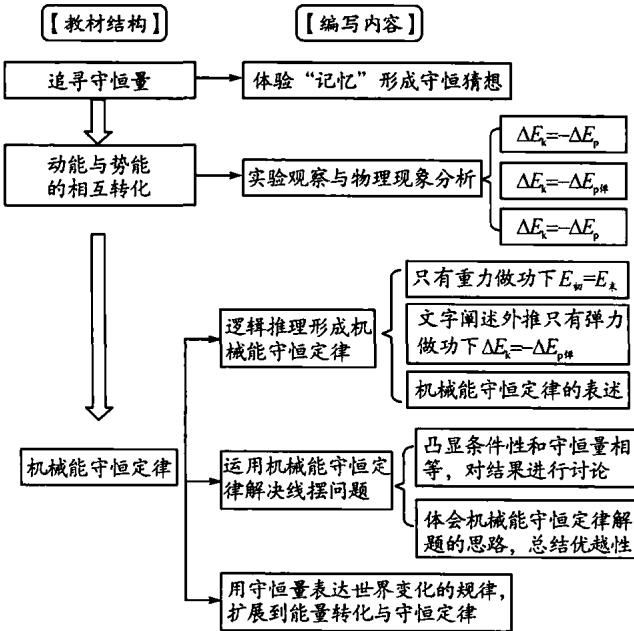  
图 1

机械能章节认知建构的主线是"功是能量转化的量度"，机械能守恒定律的建构也是沿袭这一路径。相较于旧教材，追寻守恒量并未向化学能、内能、电磁能、原子能等更广阔的能量背景延伸，因此该教学主题的教学目标定位在"通过实验观察和现象的分析，认识'记忆'实质上是机械能保持不变，通过逻辑推理形成变化是动能和势能的相互转化"。

**（2）基于"动能与势能的相互转化"事实的分析形成守恒的认识**

通过观察和实验形成动能和势能相互转化的物理事实只是对有限事实的枚举，是不完全归纳，虽契合学生的先验经验也符合学生的认知习惯，但通过不完全归纳形成的认识是不全面的。

教材针对"单体沿光滑斜面上滑和下滑"的问题，编写了沿光滑斜面上滑和滑下后再编写竖直上抛运动，从"基于现象视角进行定性分析"和"凸显机械能守恒定律条件性"两个角度审视不太科学，有同一层次重复的嫌疑。如果仅从定性分析动能和重力势能的相互转换角度看，这种逻辑应该舍弃。笔者认为，较为科学的方式应该是"自由落体运动—抛体运动—沿光滑曲面的运动"，这不仅体现物理情境的递进发展，而且为逻辑推理的设计和实验探究做好对应。

对于弹性势能和动能的相互转化。教材只是用文字阐述物体的动能和弹簧弹性势能相互转化，通过"跳板跳水"图片形成弹性势能和跳水运动员机械能增加这一转化关系的认识。比较几种版本的教材，人教版教材存在缺失物体的机械能和弹簧弹性势能相互转化、不同单体机械能相互转移的物理事实，文字阐述缺失，物理图景不足的问题。

新教材在"思考与讨论"给出一重物在黏性较大的液体中由静止下落这一实验事实，形成黏性液体对物块下落时的阻力做功的认识，通过比对认识只有重力做功 $\Delta E_{\mathrm{k}}=-\Delta E_{\mathrm{p}}$ 才成立。通过重力势能转化成什么形式的能的探究，形成系统耗散的机械能转化为黏性液体和物块的内能这一认识，为"能量守恒定律"的思考作了伏笔。通过对教材编写结构的分析和对学生认知建构的思维层级解构看，"动能与势能的相互转化"这一主题的编写不够科学，表现为物理事实呈现的无序性和实证意义的物理情景和示意图的缺失。

**（3）逻辑推理形成"机械能守恒定律"论证的片面与缺失**

机械能守恒定律是课节教学的重点，其条件性和表达式的多样性是教学的难点。作为课节的中心内容，教材通过四个环节推进这一认知的形成。

环节1　教材简明扼要提出探究的问题——"动能与势能的相互转化是否存在某种定量的关系？"这对于教学的探究性具有示范的效能；

环节2　运用动能定理对物体沿光滑曲面下滑形成 $\frac{1}{2}mv_{2}^{2}+mgh_{2}=\frac{1}{2}mv_{1}^{2}+mgh_{1}$ 表达。通过"等式左边为物体末状态动能与势能之和，等式右边为物体初状态动能与势能之和。"的表述给出 $E_{初}=E_{末}$，即 $\Delta E=0$。用不变这一单一表述替代守恒，有以偏概全之嫌疑。

环节3　为深化认知，教材只是用"同样可以证明，在只有弹力做功的系统内，动能和弹性势能相互转化时总的机械能也保持不变。"给出机械能守恒定律的表述，这种不完全归纳思维下的逻辑推理与机械能守恒定律的科学地位不匹配。这一话题相较于教材"思考与讨论"让学生自主探究物体沿光滑曲面上升这一过程来提高规律成立的普适性，在此环节的编写显得不足！

环节4　教材以"它是力学中的一条重要定律，是普遍的能量守恒定律在力学范围内的表现形式。"这一精辟的阐述，指出机械能守恒定律的价值和地位，同时也指出与能量守恒定律的关系。教材用"图8.4-4　滑雪者沿斜面下滑"图片和文字的阐述指出机械能守恒定律的条件性，教学补白的空间是向"系统受到外力，外力做功的代数和为零"的发展补白空间，这一环节教学的重心应该是机械能守恒定律的条件性的表达。

编写的典例示范是运用机械能守恒定律求解线摆最低点的速度，它是绳约束下系统重力势能和摆动能的转化问题。结合生活实际对典例结果进行讨论，并对如何使用机械能守恒定律解决问题的方法进行总结，列出与运用牛顿运动定律求解问题进行比较，在此环节教材的编写显得精当。但分析课后"练习与应用"题目类型的设计。在例题的典型性和问题诠释的全面性不能同时兼顾的现实下，教材是否以"思考与讨论"的方式呈现这两类问题？这样不但让教材丰满，而且使得探究更具有深刻性！

通过对教材编写结构的剖析，我们发现人教版教材在建构机械能守恒定律和使用机械能守恒定律解决问题中缺失"转化"和"转移"认知建构的设计，这使得"守恒"中"变与不变的对立与统一"这一哲学的蕴意失色，使得机械能守恒定律表述的形式只有"相等"这一不变的表达，没有 $\Delta E_{\mathrm{k}}=-\Delta E_{\mathrm{p}}$"转化"和 $\Delta E_{A}=-\Delta E_{B}$"转移"的推演。尽管课后"练习与应用"题目中有所设计，但作为物理规律的完整性我们不能奢求再通过第二节课进一步形成机械能守恒定律，这无疑损伤了物理规律建构的完整性。为此这一教学主题的教学目标制定为：

（1）能运用动能定理推导机械能守恒定律，理解 $E_{初}=E_{末}$、$\Delta E_{\mathrm{k}}=-\Delta E_{\mathrm{p}}$ 和 $\Delta E_{A}=-\Delta E_{B}$ 的物理意义，体验并能说出守恒的物理意义；

（2）在逻辑推理中体会机械能守恒定律的条件性、统一性、相对性和标量性；

（3）基于探究的目的设计探究机械能守恒的实验，科学处理数据并证实猜想的合理性；

（4）能运用机械能守恒定律解决生产和生活中问题，运用守恒定律进行定性分析和定量计算，理解守恒定律对研究和解决问题的重要意义。

## 二、基于学习心理和认知建构的逻辑确立学习进阶的路径

目标导向下的教学设计应呈现"实验探究"和"逻辑推理"两条主线，每一种方式都必须在任务驱动下通过学生的体验才能达到教学设定的目标。对于机械能守恒定律要形成只有重力做功、只有弹簧的弹力做功和只有重力和弹簧的弹力做功三类情况下，动能和重力势能的相互转化、动能和弹性势能的相互转化、重力势能、弹性势能和动能的相互转化三类情况的分析，在实验探究中呈现如此多的探究实验，给教学带来较大的负担。

鉴于初中业已形成定性描述的机械能守恒定律，实验探究形成机械能守恒的认识、逻辑推理形成机械能守恒定律的表达式和演示实验的探究化来证实机械能守恒定律的普适性就成为教学的必然。为此教学设计就体现为物理事实的分类枚举、实验探究（数据测定和数据分析）和逻辑推理三个环节。各环节的教学目标分别对应体验机械能守恒、逻辑推理形成机械能守恒定律的表达和数据探究实证机械能守恒定律的科学性，教学流程设计的结构如图 2 所示。

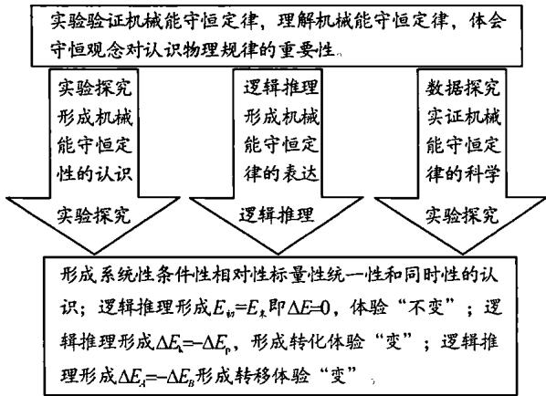  
图 2　教学结构流程图

### 1．通过实验探究形成机械能守恒定性描述的进阶设计

依据课程标准的要求，遵从学习心理和认知建构的逻辑，分类实验的定性探究形成机械能守恒的认识是第一阶段的教学任务，教师应通过探究问题的形成、探究方案的设计、实验探究的操作、数据的测量和数据的探究形成认知。在一节课中不可能完全实施四类情况的逐一探究，只有呈现具体的物理实验事实，通过定性分析，逐步理解系统包括的范围，体会"条件性"和"守恒"的含义。这一阶段的学习目标聚焦于"通过实验观察和现象分析形成机械能守恒认识"上，切合进阶的观察与实验体现为如下层阶：

**进阶1　单体与地球组成的系统机械能守恒的实验探究**

只有重力做功下动能和重力势能的相互转化是第一层阶，进阶路径如下：

层级1：竖直上抛运动的上升与下落过程的定性分析，突出在只受重力或只有重力做功的条件下 $\Delta E_{\mathrm{k}}=-\Delta E_{\mathrm{p}}$ 和 $\Delta E_{\mathrm{p}}=-\Delta E_{\mathrm{k}}$ 的相互转化性，体验到机械能不变和动能与势能的相互转化的统一构成守恒；

层级2：自制教具伽利略摆，不断改变挡线点的位置观察摆球依然摆到对侧等高度处，通过频闪照相呈现 $\Delta E_{\mathrm{k}}=-\Delta E_{\mathrm{p}}$ 和 $\Delta E_{\mathrm{p}}=-\Delta E_{\mathrm{k}}$ 的变化现象，缩短"物"与"理"的间隔。突出受其他力但只有重力做功条件性的认识，为教材设计的例题提供物理情景，为后续接入速度传感器测定最低位置的速度和最大摆角探究机械能守恒奠定基础。

**进阶2　单体与和弹簧组成的系统机械能守恒的实验探究**<!-- 存疑：原刊标题两处均排印为"单体与和弹簧" -->

水平方向的弹簧振子往复性振动是探究弹簧弹性势能向振子动能转化的设计。目的是理解单体、地球和弹簧组成的系统遵从"机械能不变"和系统内动能和弹性势能的相互转化的"变"。通过频闪照相或者速度传感器呈现振子途经不同位置处动能的变化，通过弹簧形变量体现弹性势能的变化，寻求两种变化量之间的关系。也可以采用气垫导轨并接位移传感器或速度传感器连入计算机，通过图像呈现 $E_{\mathrm{p}}-x$ 和 $E_{\mathrm{k}}-x$ 变化，在图像上观察任意位置处 $E_{\mathrm{k}}+E_{\mathrm{p}}=C$ 保持不变，通过测量观察到 $\Delta E_{\mathrm{k}}=-\Delta E_{\mathrm{p弹}}$ 和 $\Delta E_{\mathrm{p弹}}=-\Delta E_{\mathrm{k}}$ 的相互转化，体验到"守恒是变与不变的对立与统一"。也可以改变振子质量进行引申性探究，如图 3 所示呈现为这一实验探究进行观察的进阶。

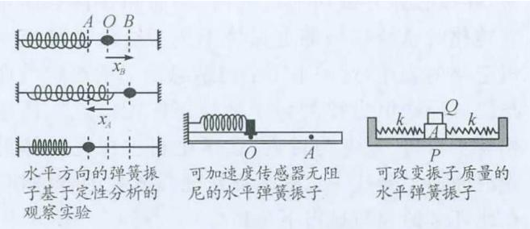  
图 3

**进阶3　多体组成的系统机械能守恒的实验探究**

多体组成的系统依照连接体速率的关系和上升与下降的高度的差异划分如图 4 所示的三个递进的层级。观察与定性分析"阿特伍德机"实验，让学生自主探究层层递进的层阶，形成多体组成的系统中内力做功为零，只有系统受到重力做功这一条件性的认识，形成系统 $\Delta E_{\mathrm{k}}=-\Delta E_{\mathrm{p}}$ 转化的体验，再从系统内机械能转移的角度体验 $\Delta E_{A}=-\Delta E_{B}$ 的内涵，真实理解系统内机械能守恒不变和变化中转化和转移的含义，实验探究如图 4 所示。

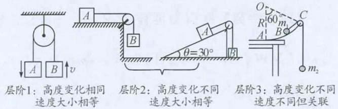  
图 4

**进阶4　单体与和弹簧组成的系统机械能守恒的实验探究**<!-- 存疑：原刊标题排印如此 -->

在形成 $E_{初}=E_{末}$、$\Delta E_{\mathrm{k}}=-\Delta E_{\mathrm{p}}$ 和 $\Delta E_{A}=-\Delta E_{B}$ 的认识后，设计竖直方向弹簧振子的振动，探究系统动能的增量来源于弹性势能和重力势能的变化，形成势能和动能相互转化的认识，确立 $\Delta E_{\mathrm{k}}=-\Delta E_{\mathrm{p}}=-(\Delta E_{\mathrm{p重力势能}}+\Delta E_{\mathrm{p弹性势能}})$ 的表达是这一层阶的目的，如图 5 所示：

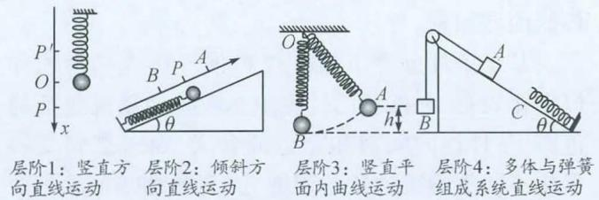  
图 5

通过上述层阶的推进，基于实验观察和体验性探究形成机械能守恒的认识，对系统的范围、守恒的条件性和守恒的含义有了深刻的理解。其中伽利略摆、水平方向弹簧振子、阿特伍德机和竖直方向的弹簧振子的实验观察是实验探究进阶的阶点，各层阶的进阶实验只是提供物理图景让学生自主探究，以此理解系统性和条件性，认识守恒的表达。

### 2．基于"转化"和"转移"的分类逻辑推理形成机械能守恒定律的表达

分析进阶的起点，遵从认知建构的逻辑确立进阶的路径，以任务驱动的方式让学生经过逻辑推理形成机械能守恒定律的表达，通过展示学习成果实施合作性评价，在互助性学习中推进"守恒"的深刻理解，把握系统性、条件性、表达式的多样性的意义。为实现这一目标，逻辑推理形设定了如下层阶：<!-- 存疑：原刊排印如此 -->

**层阶1：单体与地球这一系统机械能守恒的理论探究**

这一层阶定位在只有重力做功的条件下形成 $E_{初}=E_{末}$ 的表达，通过表达式的变形获得 $\Delta E=0$ 的理解及 $\Delta E_{\mathrm{k}}=-\Delta E_{\mathrm{p}}$"变"的体验。在教学方式上通过学习小组呈现学习结果，在互助性评价中促进"变与不变的对立与统一就是守恒"的理解。如图 6 所示呈现的是从直线运动到曲线运动，从无支持力到有支持力（约束的弹力）但不做功的呈递进阶。

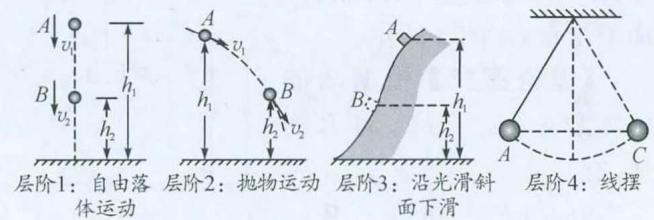  
图 6

**层阶2：弹簧和单体组成的系统机械能守恒定律的理论探究**

对 $W_{弹}=-\Delta E_{\mathrm{p}}$ 表达式的意义和用 $E_{\mathrm{p}}=\frac{1}{2}k\Delta x^{2}$ 表示弹性势能是新近建立的认知，还未固化到学生的思维体系中，综合运用动能定理、弹簧弹力做功和弹性势能的关系及弹性势能的表达式进行逻辑推理是形成只有弹簧弹力做功时，机械能守恒定律表达式的主要方式。引导学生进行理论探究过程就成为教学的必然。呈现为如下环节：

【动画模拟实验】观察水平方向弹簧振子往复性运动，展示频闪照相两个时刻图片，如图 7 所示，标注各时刻振子运动状态和弹簧拉伸长度。

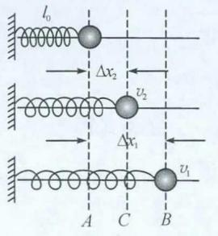  
图 7

【理论探究】根据 $W_{弹}=-\Delta E_{\mathrm{p}}$ 和 $E_{\mathrm{p}}=\frac{1}{2}k\Delta x^{2}$，得到

$$W_{弹}=-\Delta E_{\mathrm{p}}=-\left(\frac{1}{2}k\Delta x_{2}^{2}-\frac{1}{2}k\Delta x_{1}^{2}\right)$$

$$W_{弹}=\frac{1}{2}mv_{2}^{2}-\frac{1}{2}mv_{1}^{2}$$

则

$$W_{弹}=\frac{1}{2}mv_{2}^{2}-\frac{1}{2}mv_{1}^{2}=\frac{1}{2}k\Delta x_{1}^{2}-\frac{1}{2}k\Delta x_{2}^{2}$$

变形得

$$\frac{1}{2}mv_{1}^{2}+\frac{1}{2}k\Delta x_{1}^{2}=\frac{1}{2}mv_{2}^{2}+\frac{1}{2}k\Delta x_{2}^{2}$$

即 $E_{初}=E_{末}$ 或 $\Delta E=0$

**层阶3：连接体组成的系统机械能守恒定律的理论探究**

【播放"阿特伍德机"实验视频】观测连接体经过两个光电门时的速度，能表征连接体减少的重力势能和动能的增量，如图 8 所示。

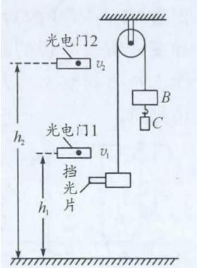  
图 8

【理论探究】根据动能定理 $W_{合}=E_{\mathrm{k末}}-E_{\mathrm{k0}}$，对 B 物体，有

$$m_{B}g(h_{2}-h_{1})-W_{F}=\frac{1}{2}m_{B}v_{2}^{2}-\frac{1}{2}m_{B}v_{1}^{2}\tag{①}$$

对 A 物体，有

$$W_{F}-m_{A}g(h_{2}-h_{1})=\frac{1}{2}m_{A}v_{2}^{2}-\frac{1}{2}m_{A}v_{1}^{2}\tag{②}$$

两式相加，得

$$-(\Delta E_{\mathrm{p}B}-\Delta E_{\mathrm{p}A})=\Delta E_{\mathrm{k}A}+\Delta E_{\mathrm{k}B}$$

即

$$\Delta E_{\mathrm{k}}=-\Delta E_{\mathrm{p}}$$

【结论1】将 A 和 B 视为一个系统，系统减少的重力势能等于系统动能的增加。

由①式得

$$W_{F}=-m_{B}g(h_{1}-h_{2})-\left(\frac{1}{2}m_{B}v_{2}^{2}-\frac{1}{2}m_{B}v_{1}^{2}\right)=-\Delta E_{B}\tag{③}$$

由②式得

$$W_{F}=m_{A}g(h_{2}-h_{1})+\left(\frac{1}{2}m_{A}v_{2}^{2}-\frac{1}{2}m_{A}v_{1}^{2}\right)=\Delta E_{A}\tag{④}$$

所以

$$-\Delta E_{B}=\Delta E_{A}$$

【结论2】A 和 B 组成一个系统，系统内一个物体的机械能减少等于另一个物体机械能的增加，但系统总的机械能保持不变。

**层阶4：重力和弹簧的弹力都做功下探究系统机械能守恒**

【播放实验视频】观测竖直方向弹簧振子的往复性运动，如图 9 所示，读取振子经过两个光电门时的速度、距离水平面的高度和弹簧的形变量。分别表征重力势能、弹性势能和振子动能的变化。

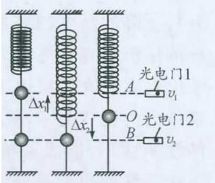  
图 9

【理论探究】根据动能定理 $W_{合}=\frac{1}{2}mv_{2}^{2}-\frac{1}{2}mv_{1}^{2}$，得 $W_{合}=W_{G}+W_{弹}$。因为 $W_{G}=mg(h_{1}-h_{2})$，$W_{弹}=E_{\mathrm{p}1}'-E_{\mathrm{p}2}'$，得

$$E_{\mathrm{p}1}'+mgh_{1}+\frac{1}{2}mv_{1}^{2}=E_{\mathrm{p}2}'+mgh_{2}+\frac{1}{2}mv_{2}^{2}$$

$$E_{\mathrm{p}1}'+E_{\mathrm{p}1}+E_{\mathrm{k}1}=E_{\mathrm{p}2}'+E_{\mathrm{p}2}+E_{\mathrm{k}2}$$

所以 $E_{初}=E_{末}$，即 $\Delta E=0$；变式可得

$$E_{\mathrm{p}1}'-E_{\mathrm{p}2}'=mgh_{1}-mgh_{2}-\frac{1}{2}mv_{2}^{2}+\frac{1}{2}mv_{1}^{2}$$

表示为 $E_{\mathrm{p}1}'-E_{\mathrm{p}2}'=-\Delta E_{\mathrm{p}}-\Delta E_{\mathrm{k}}$，即 $\Delta E_{\mathrm{p}}'=-\Delta E_{振子}$。

【结论】只有重力和弹簧弹力做功下系统的机械能保持不变，振子机械能的减少量等于弹簧弹性势能的增加量。

基于条件分类下通过逻辑推理形成机械能守恒定律表达，在推理的过程中不断领会系统包括的范围、条件性的限制和守恒的含义，通过逻辑变换形成不同类型表达式的理解，深刻洞悉守恒就是变与不变的对立与统一这一认识，不断加深"不变""转化"和"转移"的理解，机械能守恒定律的表述因此才会从数量的表达中透射出灵动的意蕴。

### 3．数据探究的实证性增加了机械能守恒定律的科学性

通过实验探究形成"系统性"和"条件性"的认识，在实验中体验守恒的意蕴；通过逻辑推理形成机械能守恒定律的表达，形成了守恒定律的表达。基于测定形成的数据探究，证实了机械能守恒定律建构和表达的科学性，这是第三个阶段的教学任务。三个维度的实践体现出实验探究和理论探究并重的逻辑，在逐层深入的过程中，物理观念、科学思维、科学方法和态度与责任得以深化。因此，通过录制的实验微课，展示实验操作的片段和数据探究的过程与结果，形成事实印证的结论就成为实际教学的必然。

呼应第一阶段的教学设计呈现为如下递进的层阶，针对层阶1和层阶2对应的"只有重力"或"只有弹力"做功下单体机械能守恒数据研究较为简单，本文不再赘述，下面只详细说明相对复杂的层阶3和4，即较为复杂的系统机械能守恒的数据结果。

**层阶3：只有重力做功下连接体组成的系统机械能守恒的数据探究**

探究多个物体组成的系统在只有重力做功下系统动能的增量和势能减小量间的关系，进而理解"系统只受重力做功"条件性的扩展和系统内物体间机械能的转移是这探究目标。阿特伍德机是实验的首选。

实验装置如图 10 所示，质量分别为 100 g 和 200 g 的两个钩码绕过定滑轮构成连接体，在底座上固定位移传感器，$m_{1}$ 上固定发射端。系统重力势能减少量 $\Delta E_{\mathrm{p}}=(m_{2}-m_{1})g\Delta h$ 和系统动能增加量 $\Delta E_{\mathrm{k}}=\frac{1}{2}(m_{1}+m_{2})v_{2}^{2}-\frac{1}{2}(m_{1}+m_{2})v_{1}^{2}$。测量数据如表 1 所示：

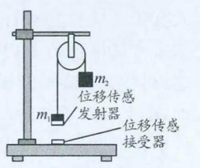  
图 10

表 1
<table><tr><td rowspan=1 colspan=1>次数</td><td rowspan=1 colspan=1>1</td><td rowspan=1 colspan=1>2</td><td rowspan=1 colspan=1>3</td><td rowspan=1 colspan=1>4</td><td rowspan=1 colspan=1>5</td></tr><tr><td rowspan=1 colspan=1>高度差 $\Delta h$/m</td><td rowspan=1 colspan=1>0.230 2</td><td rowspan=1 colspan=1>0.281 6</td><td rowspan=1 colspan=1>0.332 1</td><td rowspan=1 colspan=1>0.389 0</td><td rowspan=1 colspan=1>0.437 5</td></tr><tr><td rowspan=2 colspan=1>速度 $v$/(m/s)</td><td rowspan=1 colspan=1>0.405 517</td><td rowspan=1 colspan=1>0.357 23</td><td rowspan=1 colspan=1>0.358 974</td><td rowspan=1 colspan=1>0.335 234</td><td rowspan=1 colspan=1>0.328 492</td></tr><tr><td rowspan=1 colspan=1>1.272 727</td><td rowspan=1 colspan=1>1.380 282</td><td rowspan=1 colspan=1>1.500 00</td><td rowspan=1 colspan=1>1.624 309</td><td rowspan=1 colspan=1>1.709 302</td></tr><tr><td rowspan=1 colspan=1>重力势能减少量 $\Delta E_{\mathrm{p}}$/J</td><td rowspan=1 colspan=1>0.225 2</td><td rowspan=1 colspan=1>0.275 5</td><td rowspan=1 colspan=1>0.324 9</td><td rowspan=1 colspan=1>0.380 6</td><td rowspan=1 colspan=1>0.428 1</td></tr><tr><td rowspan=1 colspan=1>系统动能增加量 $\Delta E_{\mathrm{k}}$/J</td><td rowspan=1 colspan=1>0.218 3</td><td rowspan=1 colspan=1>0.266 7</td><td rowspan=1 colspan=1>0.318 2</td><td rowspan=1 colspan=1>0.378 9</td><td rowspan=1 colspan=1>0.422 1</td></tr><tr><td rowspan=1 colspan=1>$\varepsilon=\frac{\left|\Delta E_{\mathrm{p}}-\Delta E_{\mathrm{k}}\right|}{\Delta E_{\mathrm{p}}}\times 100\%$</td><td rowspan=1 colspan=1>3.06%</td><td rowspan=1 colspan=1>3.19%</td><td rowspan=1 colspan=1>2.06%</td><td rowspan=1 colspan=1>0.45%</td><td rowspan=1 colspan=1>1.40%</td></tr></table>

【误差分析】每次测量的系统动能增加量 $\Delta E_{\mathrm{k}}$ 总小于系统重力势能减少量 $\Delta E_{\mathrm{p}}$，这是因为在实验中存在空气阻力、细绳与滑轮之间及滑轮与轴间摩擦力的影响，滑轮的质量无法忽略且转动的动能也是主要的原因。

【结论】多个物体组成的系统在系统所受的重力做功的情况下，系统动能的增量等于系统重力势能的减少量，或系统内一个物体的机械能减少等于另一个物体机械能的增加，系统总的机械能保持不变。

**层阶4：只有重力和弹簧的弹力做功的条件下，系统机械能守恒的数据探究**

在竖直弹簧的下端悬挂一钩码，将位移传感器的发射端安装在钩码的底部。钩码正下方固定位移传感器的接收端连入计算机。将砝码向下拉至某一位置由静止释放，在 DIS 运行环境下记录弹簧振子位移随时间变化的图像。设定平衡位置为弹簧弹性势能和振子重力势能零参考面，从 $y-t$ 图像可获得 $E_{\mathrm{p}}-t$、$E_{\mathrm{p弹}}-t$ 和 $E_{\mathrm{k}}-t$ 图像。将这三个图像放置在同一坐标中，得到任意时刻 $E=E_{\mathrm{p}1}'+E_{\mathrm{p}1}+E_{\mathrm{k}1}$，从而验证振子和弹簧组成的系统机械能是否守恒。

由于简谐振动是后续学习的内容，对描迹法形成振子位移时间图像理解存在困难，且需要换算成振子的重力势能和弹簧弹性势能的表达，该装置不适合实验探究。演示实验探究化的要义是实验原理简洁易于理解，为了使实验更加贴近学生的经验世界，如图 11 所示的实验装置可获得如下实证的实验测量，通过数据探究形成结论。测量和探究的数据如表 2 所示。

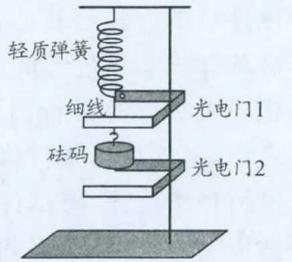  
图 11

表 2
<table><tr><td rowspan=1 colspan=1>$v_{1}$/(m/s)</td><td rowspan=1 colspan=1>$v_{2}$/(m/s)</td><td rowspan=1 colspan=1>$E_{\mathrm{k}1}$/J</td><td rowspan=1 colspan=1>$E_{\mathrm{k}2}$/J</td><td rowspan=1 colspan=1>$E_{\mathrm{p}1}'$/J</td><td rowspan=1 colspan=1>$E_{\mathrm{p}2}'$/J</td><td rowspan=1 colspan=1>$E_{1}$/J</td><td rowspan=1 colspan=1>$E_{2}$/J</td><td rowspan=1 colspan=1>相对误差</td></tr><tr><td rowspan=1 colspan=1>0.2620</td><td rowspan=1 colspan=1>0.2499</td><td rowspan=1 colspan=1>0.0017</td><td rowspan=1 colspan=1>0.0016</td><td rowspan=6 colspan=1>0.0084</td><td rowspan=6 colspan=1>0.00264</td><td rowspan=1 colspan=1>0.0274</td><td rowspan=1 colspan=1>0.0280</td><td rowspan=1 colspan=1>−0.0217</td></tr><tr><td rowspan=1 colspan=1>0.2426</td><td rowspan=1 colspan=1>0.1763</td><td rowspan=1 colspan=1>0.0015</td><td rowspan=1 colspan=1>0.0008</td><td rowspan=1 colspan=1>0.0272</td><td rowspan=1 colspan=1>0.0272</td><td rowspan=1 colspan=1>0.0000</td></tr><tr><td rowspan=1 colspan=1>0.2608</td><td rowspan=1 colspan=1>0.2088</td><td rowspan=1 colspan=1>0.0017</td><td rowspan=1 colspan=1>0.0011</td><td rowspan=1 colspan=1>0.0274</td><td rowspan=1 colspan=1>0.0275</td><td rowspan=1 colspan=1>−0.0036</td></tr><tr><td rowspan=1 colspan=1>0.2852</td><td rowspan=1 colspan=1>0.2145</td><td rowspan=1 colspan=1>0.0021</td><td rowspan=1 colspan=1>0.0012</td><td rowspan=1 colspan=1>0.0278</td><td rowspan=1 colspan=1>0.0276</td><td rowspan=1 colspan=1>0.0072</td></tr><tr><td rowspan=1 colspan=1>0.2144</td><td rowspan=1 colspan=1>0.1996</td><td rowspan=1 colspan=1>0.0012</td><td rowspan=1 colspan=1>0.0010</td><td rowspan=1 colspan=1>0.0269</td><td rowspan=1 colspan=1>0.0274</td><td rowspan=1 colspan=1>−0.0184</td></tr><tr><td rowspan=1 colspan=1>0.2541</td><td rowspan=1 colspan=1>0.2141</td><td rowspan=1 colspan=1>0.0016</td><td rowspan=1 colspan=1>0.0012</td><td rowspan=1 colspan=1>0.0273</td><td rowspan=1 colspan=1>0.0276</td><td rowspan=1 colspan=1>−0.0109</td></tr></table>

【误差分析】弹簧的实际质量使得系统机械能应包括弹簧重心位置变化具有重力势能和动能，同时由于空气阻力的影响弹簧振子做的是阻尼振动。弹簧振子无法在竖直方向振动，经过光电门时测得速度就偏离真实值。

【结论】弹簧振子组成的系统机械能包括振子的动能 $E_{\mathrm{k}}$、重力势能 $E_{\mathrm{p}}$ 和弹簧的弹性势能 $E_{\mathrm{p}}'$，弹簧振子在弹性限度内竖直方向往复性振动系统的机械能守恒。

定律是以客观存在的物理事实为依据，通过对物理事实的分析与归纳来形成，因此探究机械能相互转化的分类实验就成为建构机械能守恒定律的主要途径。但要对所有类别的转化和转移逐一进行探究也不符合教学实际，因此确立定性实验探究形成机械能守恒认识、逻辑推理形成机械能守恒表达和数据探究佐证机械能守恒定律的科学性就成为建构机械能守恒定律递进的三个环节。这三个环节从不同的角度对建构定律起着推动认知建构的任务，通过体验性探究不断理解着系统的范围、定律成立的条件、描述的相对性、统一性、同时性和标量性。逐步建构着"守恒就是变与不变的对立与统一"的认识，在认知建构的过程中同步发展着物理观念和科学思维，因此，实验探究和逻辑推理并重是建构机械能守恒定律的必有路径。

## 参考文献

[1] 刘晟，刘恩山．学习进阶：关注学生认知发展和生活经验[J]．教育学报，2012(4)：15．

[2] 黄育红，周文飞，张锁宾，杨宗立，袁贽．简谐振动实验中相关物理量间的关系与能量守恒的研究[J]．大学物理实验，2016(10)：27-28．

[3] 许国梁，束炳如．中学物理教学法[M]．北京：高等教育出版社，1981：344-351．

[4] 梁旭．物理观念的结构与形成过程探究[J]．中学物理教学参考，2018(5)：22-26．

---

\* 基金项目：中国教育学会"十三五"教育科研规划课题《基于核心素养提升的物理教材开发与教学设计研究》，课题编号：1713160008B；山东省十三五教学研究重点课题《学习进阶理论下基于学情分析框架的教学设计研究》，课题编号：2018JXZ1050。
