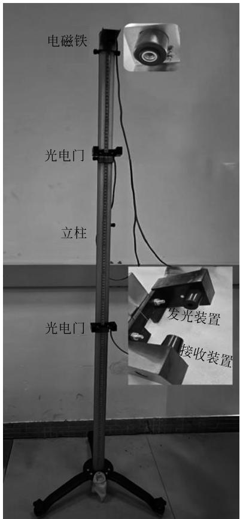
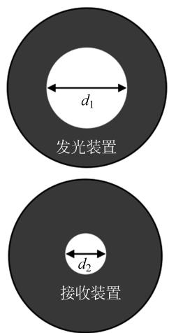
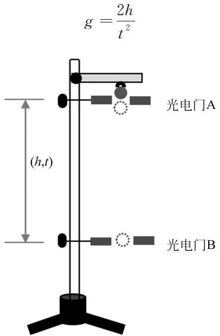
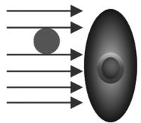
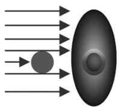
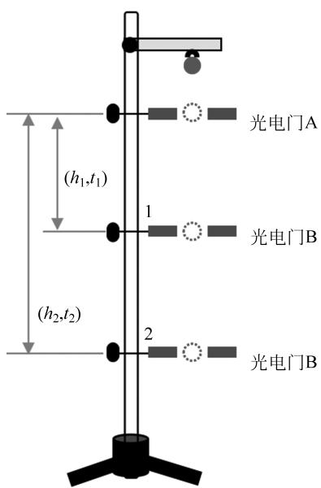
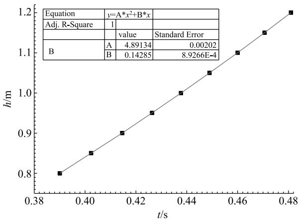
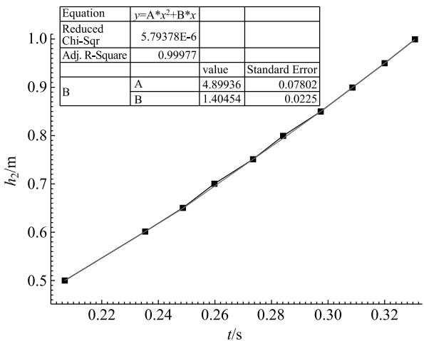

# 光电门计时方式对落球法测量重力加速度的影响

张凌语 翁存程(福建师范大学物理与能源学院,福建 福州 350117)

## 摘 要

大学物理实验中通常采用落球法测量重力加速度,目前普遍认为电磁铁的剩磁和空气的阻力是影响该方法测量的主要因素,而光电门计时方式对测量的影响却一直被忽视。本论文研究了光电门计时方式对落球法测量重力加速度的两种方式的影响。研究表明了光电门计时方式对方式一的影响较大,增大小球下落的高度,测量误差会稍微减小,但是百分误差依然大于 6%。光电门计时方式对方式二的影响较小,上方的光电门的位置距离小球下落的位置大于 3.00cm,百分误差小于 0.17%,光电门计时方式的影响可以被忽略。

关键词 重力加速度;落球;光电门;测量

# INFLUENCE OF PHOTOELECTRIC GATE TIMING MODE ON MEASUREMENT OF GRAVITATIONAL ACCELERATION BY FALLING BALL METHOD

ZHANG Lingyu WENG Cuncheng (College of Physics and Energy, Fujian Normal University, Fuzhou, Fujian 350117)

Abstract In university physics experiments, the falling ball method is commonly used to measure the acceleration due to gravity. It is widely believed that the residual magnetism of electromagnets and air resistance are the main factors affecting the measurement using this method, while the impact of the photoelectric gate timing method has always been over-looked. This paper studies the influence of the photoelectric gate timing method on two ways of measuring the acceleration due to gravity using the falling ball method. The study shows that the photoelectric gate timing method has a significant impact on method one, increasing the height from which the ball falls will slightly reduce the measurement error, but the per-centage error is still greater than 6%. The photoelectric gate timing method has a smaller im-pact on method two; when the position of the above photoelectric gate is more than 3.00cm away from the position where the ball falls, the percentage error is less than 0.17%, and the impact of the photoelectric gate timing method can be neglected.

Keywords gravitational acceleration; falling ball; photoelectric gate; measurement

仅受到重力作用的物体在下落时具备的加速度叫重力加速度。重力加速度在生产生活的多个领域中都有着广泛的应用。高峰设计了一款可在加速度环境下研究动物身体变化的可变重力加速度的动物离心测试设备[1]。应用重力勘察技术研究区域地貌和勘察固体矿藏[2]。应用井眼内三轴微重力测量技术开发盐下储层油田[3]。利用流动重力观测技术观测复杂地带的重力场时变异常信号,还可以对地震地点进行准确的中期预测[4]。应用卫星重力测量技术获得地球资源的分布和变化情况[5]。

测量重力加速度的方法有落球法、单摆法、气垫导轨法、复摆法等,这些方法融入现代技术和智能软件能使重力加速度的测量更加方便。张顺等利用智能手机测量自制复摆转动的偏转角和角速度来测量重力加速度,测量误差为 0.17%[6]。黄膺达等设计了通过图像采集与处理的单摆创新实验,借助 openCV 的图像处理功能测量重力加速度[7]。

测量重力加速度是大学物理实验中一个基础的力学实验,主要采用落球法进行测量。目前,普遍认为电磁铁的剩磁和空气的阻力是影响该方法测量误差的主要因素[8]。俞晓明等利用落球法测量北京地区的重力加速度,结果显示剩磁和空气阻力引起的误差小于0.17%[9]。然而,光电门计时方式引起的误差却通常被忽视。本论文主要研究光电门计时方式对落球法测量重力加速度的影响。

## 1 实验原理

如图1所示,自由落体实验仪主要由底座、立柱、2 个光电门、计时器、电磁铁、电源等构成。通过电磁铁的通电和断电吸住和释放铁质小球,光电门测量小球下落的时间,立柱上的刻度尺测量两光电门之间的距离。光电门由发光装置和接收装置构成,发光装置和接收装置的横截面如图2所示,利用游标卡尺分别测量得到的光电门出光孔直径 $d_1$ 和接收孔直径 $d_2$ 分别为 3.00mm 和 0.98mm。发光装置正对着接收装置,发光装置发射的光照射接收装置的接收孔。接收装置接收光强变化的光信号,并将其转换为电信号,计时器对电信号进行处理并根据电信号的变化进行计时。这种计时与接收到的最大光强有关,缓慢地将一刀片紧贴着接收孔从上往下移动遮挡接收孔,刀片几乎遮挡住整个接收孔时计时器才开始计时(计时器上显示1)。因此,为了便于分析光电门计时方式对测量的影响,可以认为自由落体实验仪采用如下计时方式:小球刚好完全挡住上接收装置的接收孔即刚好没有光线进入接收孔时开始计时,小球刚好完全挡住下接收装置的接收孔时停止计时,从而测量得到小球在这 2 个光电门之间下落的时间。

  
图1 自由落体实验仪及其附件的实物图

  
图2 光电门的发光装置和接收装置的横截面示意图

通常采用初速度为0和不为0两种方式测量重力加速度。俞晓明等研究表明剩磁和空气阻力对测量的影响很小[9],因此在下文理论推导和实验过程中忽略了它们的影响,但是实验还会进一步证实它们的影响可以忽略。

## 1.1 方式一:初速度 $\mathbf { V _ { 0 } }$ 为0

初速度 $V _ { \mathrm { 0 } }$ 为0的方式测量重力加速度的原理如图3所示。调节光电门 A 的位置直到小球刚好挡住光电门 A 的接收装置的接收孔的上边沿的光,如图4(a)所示。在不考虑一切误差的情况下,重力加速度满足如下关系式

$$
g = \frac { 2 h } { t ^ { 2 } }\tag{1}
$$

  
图3 $V _ { 0 }$ 为0的方式测量重力加速度的原理图

  
(a)

  
(b)  
图4 光电门接收装置的接收孔与小球相对位置示意图  
(a) 小球下落前的相对位置;(b) 小球刚好挡光的相对位置

其中,h 和t 分别为小球在两光电门之间下落的高度和对应的时间,$g$ 是重力加速度。h 的值通常大于50.00cm 即下落时间大于316ms,那么 h 的测量相对误差很小。然而,小球从初速度为0下落1mm 大约需要14ms,导致光电门计时方式引起的误差很大。为了便于描述,将小球下落过程中从小球刚好挡住接收装置的接收孔上边沿的光到刚好无光线进入接收孔(如图4(b)所示)这段时间称为挡光时间。光电门 A 和 B 的挡光时间分别为 $\Delta t _ { 1 }$ 和 $\Delta t _ { 2 }$ 。根据光电门的计时方式,小球下落的时间应改为 $t + \Delta t _ { 1 } - \Delta t _ { 2 }$ 。另外,小球在光电门 A 位置的速度远小于在光电门 B 位置的速度,那么 $\Delta t _ { 1 }$ 的值远大于 $\Delta t _ { 2 }$ 的值,也就是 $\Delta t _ { 2 }$ 可以忽略。在这种情况下,式(1)可改写为

$$
g \approx \frac { 2 h } { \left( t + \Delta t _ { 1 } \right) ^ { 2 } }\tag{2}
$$

小球在光电门 A 处的挡光过程为自由落体运动,因此 $\Delta t _ { 1 }$ 遵循

$$
\Delta t _ { 1 } = \sqrt { \frac { 2 d _ { 2 } } { g } }\tag{3}
$$

式(2)可改写为 h-t 函数

$$
h \approx \frac { 1 } { 2 } g \left( t + \Delta t _ { 1 } \right) ^ { 2 }\tag{4}
$$

由于 t 的值远大于 $\Delta t_1$ 的值,式(4)可以近似简化为

$$
h \approx \frac { 1 } { 2 } g t ^ { 2 } + g t \Delta t _ { 1 }\tag{5}
$$

从式(5)可知,h-t 函数是一个二次函数。

根据以上分析,小球在光电门 A 位置的速度远小于在光电门 B 位置的速度,导致在这两个位置的挡光时间 $\Delta t _ { 1 }$ 和 $\Delta t _ { 2 }$ 的差值较大,而且挡光时间 $\Delta t_1$ 相对于 t 值不可忽略,因此 $\Delta t_1$ 对测量的影响较大不可忽略, $\Delta t _ { 2 }$ 对测量的影响可忽略。另外,通过测量光电门接收孔的直径,然后利用自由落体运动公式计算得到 $\Delta t _ { 1 }$ 的值,最后修正 t的值 $( t - \Delta t _ { 1 } )$,可消除光电门计时方式对测量的影响。

## 1.2 方式二:初速度 $\mathbf { V _ { 0 } }$ 不为0

初速度 $V _ { 0 }$ 不为0的方式测量重力加速度的原理如图5所示。首先,光电门 A 固定在立柱上端,靠近电磁铁。然后,光电门 B 固定在立柱1位置,与光电门 A 相距 $h _ { 1 }$ ,对应的小球下落时间为$t _ { 1 }$ 。最后,光电门 B 下移固定在立柱2位置,与光电门 A 相距 $h _ { 2 }$ ,对应的下落时间为 $t _ { 2 }$ 。在不考虑一切误差的情况下,根据自由落体运动公式有

$$
h _ { 1 } = v _ { 0 } t _ { 1 } + \frac { 1 } { 2 } { g t _ { 1 } } ^ { 2 }\tag{6}
$$

$$
{ h _ { \ 2 } } = { v _ { 0 } } { t _ { 2 } } + \frac { 1 } { 2 } { g { t _ { 2 } } ^ { 2 } }\tag{7}
$$

  
图5 $\mathrm { { V } _ { 0 } }$ 不为0的方式测量重力加速度的原理图

其中, $\boldsymbol { v } _ { 0 }$ 为小球在光电门 A 位置的瞬时速度。

联立式(6)和式(7),得

$$
g = { \frac { 2 { \Big ( } { \frac { h _ { 2 } } { t _ { 2 } } } - { \frac { h _ { 1 } } { t _ { 1 } } } { \Big ) } } { t _ { 2 } - t _ { 1 } } }\tag{8}
$$

考虑光电门计时方式的影响,式(8)应改写为

$$
g = \frac { 2 \Big ( \frac { h _ { 2 } } { t _ { 2 } + \Delta t _ { 1 } - \Delta t _ { 2 1 } } - \frac { h _ { 1 } } { t _ { 1 } + \Delta t _ { 1 } - \Delta t _ { 2 2 } } \Big ) } { t _ { 2 } - t _ { 1 } + \Delta t _ { 2 2 } - \Delta t _ { 2 1 } }\tag{9}
$$

其中, $\Delta t _ { 1 }$ 为小球在光电门 A 位置的挡光时间,$\Delta t _ { 2 1 }$ 和 $\Delta t _ { 2 2 }$ 分别为光电门B在立柱1和2位置的挡光时间。通常光电门 A和B距离较远, $\Delta t _ { 2 1 }$ 和$\Delta t _ { 2 2 }$ 的值远小于 $\Delta t _ { 1 }$ 的值且可忽略,那么式(9)可近似为

$$
\begin{array} { c } { g \approx \frac { 2 \left( \displaystyle \frac { h _ { 2 } } { t _ { 2 } + \Delta t _ { 1 } } - \frac { h _ { 1 } } { t _ { 1 } + \Delta t _ { 1 } } \right) } { t _ { 2 } - t _ { 1 } } } \\ { = 2 \frac { h _ { 2 } t _ { 1 } - h _ { 1 } t _ { 2 } + ( h _ { 2 } - h _ { 1 } ) \Delta t _ { 1 } } { \left( t _ { 2 } - t _ { 1 } \right) \left( t _ { 2 } + \Delta t _ { 1 } \right) \left( t _ { 1 } + \Delta t _ { 1 } \right) } } \end{array}\tag{10}
$$

另外,两光电门的间距 $h _ { 1 }$ 和 $h _ { 2 }$ 足够大即 $t _ { 1 }$ 和 $t _ { 2 }$ 的值远大于 $\Delta t _ { 1 }$ 的值,那么式(10)可以进一步近似为

$$
g \approx 2 \frac { h _ { 2 } t _ { 1 } - h _ { 1 } t _ { 2 } + ( h _ { 2 } - h _ { 1 } ) \Delta t _ { 1 } } { ( t _ { 2 } - t _ { 1 } ) t _ { 2 } t _ { 1 } }\tag{11}
$$

当光电门 A 的位置和光电门 B 的1位置保持不变且仅改变光电门 B的2位置,那么 $t _ { 1 }$、$h_1$ 和 $\Delta t_1$ 的值保持不变。另外,光电门 A 的位置距离小球下落点较远, $\Delta t _ { 1 }$ 的值很小可忽略。最后, $t _ { 1 }$ 和 $t _ { 2 }$ 的值远大于 $\Delta t _ { 1 }$ 的值即 $h _ { 1 }$ 和 $h _ { 2 }$ 足够大。在这种情况下,式(11)可以改写为

$$
\begin{array} { l } { \displaystyle h _ { 2 } \approx \frac { g t _ { 1 } t _ { 2 } ^ { 2 } } { 2 ( t _ { 1 } + \Delta t _ { 1 } ) } + \frac { 2 h _ { 1 } - g t _ { 1 } ^ { 2 } } { 2 ( t _ { 1 } + \Delta t _ { 1 } ) } t _ { 2 } + \frac { h _ { 1 } \Delta t _ { 1 } } { t _ { 1 } + \Delta t _ { 1 } } } \\ { \displaystyle \approx \frac { g t _ { 2 } ^ { 2 } } { 2 } + \frac { 2 h _ { 1 } - g t _ { 1 } ^ { 2 } } { 2 t _ { 1 } } t _ { 2 } } \end{array}\tag{12}
$$

从式(12)可知,h2-t2 函数也是一个二次函数。

根据以上分析,小球在光电门 A 和 B 位置的挡光时间 $\Delta t _ { 1 }$ 和 $\Delta t _ { 2 }$ 远小于小球在这两个光电门之间下落的时间 t,那么光电门的挡光时间不影响测量。

## 2 实验

调节自由落体实验仪底座三个旋钮直到重锤线与立柱平行即立柱竖直。电子秤称小球的质量为 7.05g,千分尺测小球的直径为 11.975mm。小球下落的时间取 5 次下落的平均值,当地重力加速度为 $9.79144\mathrm { { m } / \mathrm { { s } ^ { 2 } } }$

## 2.1 方式一:仅改变光电门 B的位置

电磁铁吸住小球,光电门 A 移至小球下方。接着,上下调节光电门 A 直到小球刚好挡住接收装置的接收孔的上边沿的光(见图4(a)),记录光电门 A 的位置。然后,光电门 B 移至距离光电门 A 为 $h = 80.00 \mathrm { { c m } }$ 处,释放小球,记录小球下落时间 t。最后,把光电门 B 依次往下移5.00cm,重复上一步骤。根据式(1)和表1的实验数据,计算得到不考虑挡光时间影响的重力加速度 $g$ 。利用式(5)对实验数据进行拟合,如图6所示。

表1 方式一:实验数据
<table><tr><td>h/cm</td><td>t/ms</td><td> $g / ( \mathrm { m } / \mathrm { s } ^ { 2 } )$ </td><td>百分误差/%</td></tr><tr><td>80.00</td><td>390.11</td><td>10.51</td><td>7.4</td></tr><tr><td>85.00</td><td>402.50</td><td>10.49</td><td>7.2</td></tr><tr><td>90.00</td><td>414.60</td><td>10.47</td><td>6.9</td></tr><tr><td>95.00</td><td>426.35</td><td>10.45</td><td>6.8</td></tr><tr><td>100.00</td><td>437.77</td><td>10.436</td><td>6.6</td></tr><tr><td>105.00</td><td>448.93</td><td>10.420</td><td>6.4</td></tr><tr><td>110.00</td><td>459.84</td><td>10.404</td><td>6.3</td></tr><tr><td>115.00</td><td>470.50</td><td>10.390</td><td>6.1</td></tr><tr><td>120.00</td><td>480.94</td><td>10.376</td><td>6.0</td></tr><tr><td>拟合值  $g$ </td><td></td><td>9.7827</td><td></td></tr></table>

  
图6 $h - t$ 曲线及拟合结果

从表1可知,计算得到的 $g$ 值误差超过6%,说明挡光时间对测量影响较大。根据图6,拟合值等于 $g = 2 A = 9.78268$ ,与实际值(9.79144)吻合,误差仅为0.089%,说明挡光时间是影响测量的主要因素,剩磁和空气阻力的影响很小。另外,$B = g\Delta t _ { 1 } = 0.14285$ ,根据式(3),计算得到 $d _ { 2 } = 1.0430\mathrm{mm}$ ,近似等于实际测量值 $d _ { 2 } = 0.98\mathrm{mm}$ ,进一步说明了挡光时间是影响测量的主要因素,剩磁和空气阻力的影响很小。实验结果也说明了可以通过测量光电门接收孔的直径 $d _ { 2 }$ ,然后计算得到 $\Delta t _ { 1 }$ 的值,最后小球下落的时间修正为 $t - \Delta t _ { 1 }$ ,就可消除光电门计时方式对测量的影响。

## 2.2 方式二:仅改变光电门 A的位置

将光电门 A 移至距离小球下落位置为 $h _ { 0 } = 1.00\mathrm{cm}$ 处,光电门 B 移至距离光电门 A 为 $h _ { 1 } = 50.00\mathrm{cm}$ 处,记录小球下落的时间 $t _ { 1 }$ 。接着,将光电门 B 移至距离光电门 A 为 $h _ { 2 } = 100.00 \mathrm { { c m } }$ 处,记录小球下落时间 $t _ { 2 }$ 。然后,将光电门 A 依次移至距离小球下落位置为 $h _ { 0 } = 2.00\mathrm{cm}、3.00\mathrm{cm}$、4.00cm、5.00cm、10.00cm、15.00cm、20.00cm,光电门 B 的位置保持不变,重复以上步骤。最后,利用式(8)计算重力加速度。

从表2可知,光电门 A 距离小球下落位置越远,挡光时间对测量的影响越小,当 $h _ { 0 }$ 为3.00cm时百分误差仅为0.17%,因此 $h _ { 0 }$ 大于 $3 \mathrm { c m }$ 就可以忽略挡光时间的影响。

表2 方式二:仅改变光电门A的位置:实验数据
<table><tr><td> $h _ { 0 } / \mathrm { c m }$ </td><td> $h _ { 1 } / \mathrm { c m }$ </td><td> $t _ { \mathrm { 1 } } / \mathrm { m s }$ </td><td> $h _ { 2 } / \mathrm { c m }$ </td><td> $t _ { \mathrm { 2 } } / \mathrm { m s }$ </td><td> $g / ( \mathrm { m } / \mathrm { s } ^ { 2 } )$ </td></tr><tr><td>1.00</td><td>50.00</td><td>304.23</td><td>100.00</td><td>436.02</td><td>9.864</td></tr><tr><td>2.00</td><td>49.00</td><td>273.54</td><td>99.00</td><td>405.72</td><td>9.817</td></tr><tr><td>3.00</td><td>48.00</td><td>254.43</td><td>98.00</td><td>386.61</td><td>9.809</td></tr><tr><td>4.00</td><td>47.00</td><td>240.08</td><td>97.00</td><td>372.24</td><td>9.809</td></tr><tr><td>5.00</td><td>46.00</td><td>228.29</td><td>96.00</td><td>360.50</td><td>9.802</td></tr><tr><td>10.00</td><td>40.00</td><td>176.50</td><td>90.00</td><td>308.80</td><td>9.799</td></tr><tr><td>15.00</td><td>35.00</td><td>144.27</td><td>85.00</td><td>276.53</td><td>9.796</td></tr><tr><td>20.00</td><td>30.00</td><td>116.96</td><td>80.00</td><td>249.08</td><td>9.792</td></tr></table>

## 2.3 方式二:仅改变光电门B的2位置

为了忽略挡光时间的影响,光电门 A 与小球下落位置的间距为 10.00cm。接着,光电门 B 固定在距离光电门 A 为 $h _ { 1 } = 30.00 \mathrm { c m }$ 处,记录小球下落的时间 $t _ { 1 }$ 。然后,将光电门 B 移至距离光电门 A 为 $h _ { 2 } = 50.00 \mathrm { c m }$ 处,记录小球下落的时间$t _ { 2 }$ 。最后,仅仅移动光电门 B 的2位置,依次往下移动5.00cm,重复以上步骤。利用式(12)对表3的实验数据进行拟合,如图7所示。

表3 方式二:仅改变光电门B的2位置:实验数据
<table><tr><td> $h _ { 1 } / \mathrm { c m }$ </td><td> $t _ { \mathrm { 1 } } / \mathrm { m s }$ </td><td> $h _ { 2 } / \mathrm { c m }$ </td><td> $t _ { \mathrm { 2 } } / \mathrm { m s }$ </td><td> $g / ( \mathrm { m } / \mathrm { s } ^ { 2 } )$ </td></tr><tr><td rowspan="10">30.00</td><td rowspan="10">144.01</td><td>50.00</td><td>207.18</td><td rowspan="10">9.799</td></tr><tr><td>60.00</td><td>235.13</td></tr><tr><td>65.00</td><td>248.59</td></tr><tr><td>70.00</td><td>259.89</td></tr><tr><td>75.00</td><td>273.61</td></tr><tr><td>80.00</td><td>284.37</td></tr><tr><td>85.00</td><td>297.43</td></tr><tr><td>90.00</td><td>308.76</td></tr><tr><td>95.00</td><td>319.87</td></tr><tr><td>100.00</td><td>330.80</td></tr></table>

根据图7,拟合值 $g = 2 A = 9.79872$ ,与实际值吻合,误差仅为0.074%,说明光电门计时方式不影响测量结果,空气阻力的影响也很小。

  
图7 $h _ { 2 } - t _ { 2 }$ 曲线及拟合结果

## 3 结语

本文从理论和实验上研究了光电门计时方式对落球法测量重力加速度的两种方式的影响。研究显示,小球在光电门 A 和 B 位置的速度存在差异,导致小球在这两个位置的挡光时间 $\Delta t _ { 1 }$ 和 $\Delta t _ { 2 }$ 存在差值,此差值相对于小球在这两个光电门之间下落的时间 t 可忽略,那么光电门计时方式就不会影响重力加速度的测量。

对于方式一,小球在光电门 A 位置的速度远小于在光电门 B 位置的速度,导致在这两个位置的挡光时间 $\Delta t _ { 1 }$ 和 $\Delta t _ { 2 }$ 的差值较大,而且 $\Delta t _ { 1 }$ 的值相对于 t 值不可忽略,因此 $\Delta t _ { 1 }$ 对测量的影响较大。研究也表明了,利用游标卡尺或移测显微镜测量光电门接收孔的直径,然后利用自由落体运动公式计算得到 $\Delta t _ { 1 }$ ,最后将小球在两光电门之间下落的时间修正为 $t - \Delta t _ { 1 }$ ,这样可以消除光电门计时方式对测量的影响。另外,增大两光电门的间距即提高 t 值,加速度测量误差会稍微减小,但是相对误差依然大于6%。最后,实验也说明了剩磁和空气阻力对测量的影响很小。

对于方式二,小球的挡光时间 $\Delta t _ { 1 }$ 和 $\Delta t _ { 2 }$ 也存在差异,但是只要 $\Delta t _ { 1 }$ 的值远小于 t 的值,那么光电门的计时方式就可以近似不影响测量。实验显示,光电门 A 与小球下落位置的间距大于3.00cm,加速度测量的百分误差小于0.17%,光电门计时方式对测量的影响可忽略。

实际上,光电门计时方式对方式一测量的影响与计时器的计时方式有关,还与小球的初位置有关。计时器接收到的光信号的强度低于设置的阈值时开始计时,也就是小球刚好遮挡住光电门的接收装置的接收孔时计时器才开始计时。将小球刚好挡住接收孔上边沿照射光(光电门发光装置照射的光)的位置作为小球下落的初位置,导致小球遮挡接收孔的这段下落时间没有被计时,而且小球在这段时间内下落的速度很小,从而引起较大的测量误差。

在实验中,学生会发现采用方式一测量误差较大,而方式二误差小。在教师引导下,通过对比分析这两种方式,学生初步发现误差与初速度、初位置有关。教师讲解计时器的工作原理及对时间测量的影响,引导学生通过实验探究计时方式对测量的影响。学生通过刀片遮挡接收孔验证计时器的计时方式;测量接收孔的直径,计算小球挡光时间并修正小球在两光电门之间下落的时间,重新计算加速度及误差,验证光电门计时方式是引起测量误差的主要原因。通过这种方式探究测量误差的机制,增强了学生学习物理实验的兴趣,提高教学效果,创建师生共同讨论、协作探究的良好教学氛围,又能培养学生科学探究的精神和严谨的科学思维,从而达到人才培养的目的。

## 参 考 文 献

[1] 高峰.可变重力加速度动物离心测试设备研究[D].西安:西安石油大学,2022.
GAO F. The study of animal centrifugal test equipment with variable gravity acceleration[D]. Xi'an: Xi'an Shiyou University, 2022. (in Chinese)

[2] 杨建岭.重力勘查在铁矿勘探中的应用分析[J].中国金属通报,2021(10):90-91.
YANG J L. Analysis of the application of gravity exploration in iron ore exploration[J]. China Metal Bulletin, 2021(10):90-91. (in Chinese)

[3] 郭永峰.巴西盐下储层应用“3轴微重力测井”新技术监测水驱流向[J].中国石油企业,2021(4):67-67.
GUO Y F. The new technology of "3-axis micro-gravity logging" is employed in the subsalt reservoirs in Brazil for monitoring the flow direction of water flooding[J]. China Petroleum Enterprise, 2021(4):67-67. (in Chinese)

[4] 王伟力,郑兵,郝洪涛,等.四川地区流动重力观测及其在地震预测中的应用[J].大地测量与地球动力学,2024,44(1):89-94.
WANG W L, ZHENG B, HAO H T, et al. Mobile gravity observation and application of earthquake prediction in Sichuan[J]. Journal of Geodesy and Geodynamics, 2024, 44(1):89-94. (in Chinese)

[5] 田晓龙,张夏青,万永世,等.卫星重力测量应用及其标准建设研究[J].中国标准化,2023(10):106-109,118.
TIAN X L, ZHANG X Q, WAN Y S, et al. Research on the application and standards construction of gravity measurement satellite[J]. China Standardization, 2023(10):106-109,118. (in Chinese)

[6] 张顺,肖帅,曹静,等.利用智能手机和自制复摆测量重力加速度[J].大学物理实验,2022,35(5):109-112.
ZHANG S, XIAO S, CAO J, et al. Measurement of gravitational acceleration based on smartphone and self-made compound pendulum[J]. Physical Experiment of College, 2022, 35(5):109-112. (in Chinese)

[7] 黄膺达,王旗.基于图像处理的单摆测量重力加速度实验的研究[J].大学物理实验,2020,33(5):11-14.
HUANG Y D, WANG Q. Measurement of gravity acceleration by single pendulum based on image processing[J]. Physical Experiment of College, 2020, 33(5):11-14. (in Chinese)

[8] 韩晨希.自由落体法测量重力加速度实验装置的改进[J].物理实验,2018,38(5):59-61.
HAN C X. Improvement on the measurement of gravitational acceleration using free falling movement device[J]. Physical Experiment, 2018, 38(5):59-61. (in Chinese)

[9] 俞晓明,崔益和,陈飞,等.考虑空气阻力、浮力用落球法精确测定重力加速度的研究[J].物理与工程,2010,20(5):26-28.
YU X M, CUI Y H, CHEN F, et al. Accurate measurement of the acceleration due to gravity using falling ball with the consideration of air drag and buoyancy[J]. Physics and Engineering, 2010, 20(5):26-28. (in Chinese)

[10] 林彦嘉,林鹏.用改进的落体法测量重力加速度[J].大学物理实验,2021,34(3):36-39.
LIN Y J, LIN P. Measurement of gravity acceleration by improved falling body method[J]. Physical Experiment of College, 2021, 34(3):36-39. (in Chinese)

[11] 朱端兴,曹正东.落球法测定重力加速度实验的改进[J].大学物理实验,2002,15(3):26-29.
ZHU D X, CAO Z D. The improvement of measure acceleration of gravity by free-fall[J]. Physical Experiment of College, 2002, 15(3):26-29. (in Chinese)

---

(上接第199页)

## 参 考 文 献

[1] 樊代和,魏云,刘其军,等.基于"课程思政"的大学物理实验课程教学案例探讨——以迈克耳孙干涉实验为例[J].物理与工程,2022,32(1):175-178,183.
FAN D H, WEI Y, LIU Q J, et al. Discussion on "Ideological and political Education in Curriculum" in College Physics Experiment Courses—Taking Michelson interferometer experiment as an example[J]. Physics and Engineering, 2022, 32(1):175-178,183. (in Chinese)

[2] 周诗韵,岑剡,乐永康.实验课程中激发学生探究仪器科学热情的案例[J].物理与工程,2021,31(5):124-128.
ZHOU S Y, CEN Y, LE Y K. Teaching cases that inspire students' enthusiasm for instrumental science in college physics experiment[J]. Physics and Engineering, 2021, 31(5):124-128. (in Chinese)

[3] 李莉,张师平,裴艺丽,等.基于反溯教学法的物理实验课程思政建设的探索[J].物理与工程,2023,33(4):85-94.
LI L, ZHANG S P, PEI Y L, et al. Exploration of ideological and political construction of college physics experiment course based on retroactive teaching method[J]. Physics and Engineering, 2023, 33(4):85-94. (in Chinese)

[4] 张春玲,刘玉斌,文小青,等.O-AMAS助力大学物理实验课程思政——以碰撞实验为例[J].物理实验,2021,41(3):21-25+31.
ZHANG C L, LIU Y B, WEN X Q, et al. Ideological and political education of college physics experiment assisted by O-AMAS effective teaching method—Taking collision experiment as an example[J]. Physic Experimention, 2021, 41(3):21-25+31. (in Chinese)

[5] 庄娟,李雪春,秦颖,等."近代物理实验"教学过程中的课程思政[J].物理与工程,2021,31(Z1):99-102.
ZHUANG J, LI X C, QIN Y, et al. Ideology and politics in the teaching process of modern physics experiment[J]. Physics and Engineering, 2021, 31(Z1):99-102. (in Chinese)

[6] SINGH S P, BURGESS G, SINGH J. Performance comparison of thermal insulated packaging boxes, bags and refrigerants for single-parcel shipments[J]. Packaging Technology & Science, 2008, 21:25-35.

[7] 陈霞,孙太宇,何宇飞,等.基于LED的光量子理论测量普朗克常量[J].物理与工程,2023,33(5):41-45.
CHEN X, SUN T Y, HE Y F, et al. Measurement of Planck constant based on LED quantum theory[J]. Physics and Engineering, 2023, 33(5):41-45. (in Chinese)

[8] 张映辉,陈宝玖,殷燕.结合物理实验讲授唯物辩证法的3个典型案例[J].物理实验,2020,40(3):27-30.
ZHANG Y H, CHEN B J, YIN Y. Three typical cases of teaching materialistic dialectics in combination with physics experiments[J]. Physic Experimention, 2020, 40(3):27-30. (in Chinese)