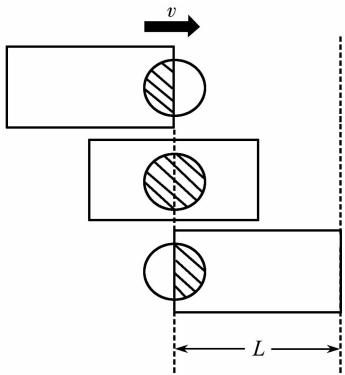
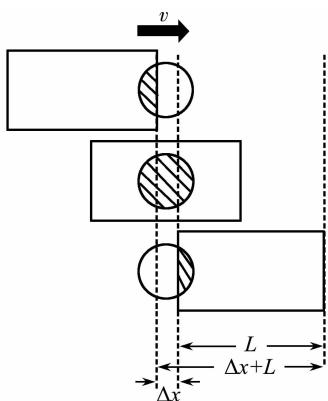
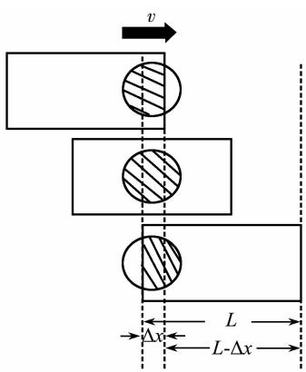
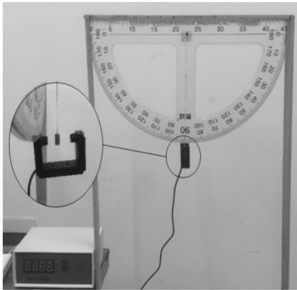

# 光电门验证机械能守恒定律的误差修正

王 刚 徐晓梅

（云南师范大学物理与电子信息学院 云南 昆明 650500）

（收稿日期 ：2021 06 23）

摘 要 ：利用光电门验证机械能守恒定律的实验中 瞬时速度测量的准确性是决定实验成功的关键．文章通过对光电计时器的计时原理深入分析 提出两种测量“有效遮光宽度”的方法 提高光电门测量瞬时速度的精确度 对光电门验证机械能守恒定律的实验进行误差修正

关键词 ：光电计时器 误差修正 验证机械能守恒

利用光电计时器与单摆运动相结合不仅可以通过定量的计算验证机械能守恒 还可以定性地观察到实验守恒现象．同时也与人教版《物理 · 必修2》圆周运动方面的知识有所结合 既提高了学生动手实验的积极性 也达到了课标中所强调的自主设计和动手实验的目标要求［1］．但是笔者在进行此实验时发现实验结果存在着较大误差 无法作为教具进行正常的教学使用．通过查阅资料发现 利用光电门进行瞬时速度测量时 遮光宽度越窄 测出的平均速度越接近瞬时速度 测量的系统误差就越小．但由于遮光宽度变窄 光电计时器的精度问题将导致测量时间的相对误差变大．为了解决这一矛盾 ，提高实验测量精度 本文从光电计时器计时原理出发 通过提出两种简单测量“有效遮光宽度”的方法 对光电门验证机械能守恒定律的实验进行误差修正

## 1 光电计时系统误差原理分析

光敏电阻的阻值会随着光照强度的增加而减小 将光敏电阻与光照孔正对制成光电门 假设遮光片向右运动时，遮挡住了光照孔射向光敏电阻的光 ，光敏电阻阻值变大 光电管两端的电压发生变化．如果遮光片最右端遮光面积达到某一数值时 电压变化达到所对应的阈值， 促使后面电路“翻转” ， 产生“计”的信号 开始计时； 遮光片离开后 恢复光照孔射向光敏电阻的光 当遮光片最左端遮光面积再次达到此数值时 电压再次达到阈值 促使后面电路“翻转” 产生“停”的信号 完成一次计时［2］．根据遮光面积达到阈值电压的大小分下列3种情况讨论

## 1．1 遮光面积为50％达到阈值电压

如图1所示 遮光片向右运动的过程中 其最右端到达光照孔正中间时刻 遮光面积达到50％ 电压达到所对应的阈值开始计时 ； 遮光片继续向右运动，直至其最左端到达光照孔正中间时刻 ，遮光面积达到50％，电压再次达到所对应的阈值，计时结束．可知遮光片宽度为 $L$， 测量值 $v _ { 1 } = \frac { L } { t }$ ； 遮光片有效遮光宽度为 $L$， 理论值 $v _ { 2 } = \frac { L } { t }$ ，测量值 $v _ { 1 }$ 等于理论值 $v _ { 2 }$ ，没有系统误差

  
图1 遮光等于50％达到阈值

## 1．2 遮光面积小于50％达到阈值电压

如图2所示，遮光片向右运动的过程中 ，其最右端第一次距离光照孔正中间 $\frac { \Delta x } { 2 }$ 时刻，遮光面积介于$0 \sim 5 0$ ％之间某一定值时 电压达到所对应的阈值开始计时 遮光片继续向右运动 直至其最左端第二次到达距离光照孔正中间 $\frac { \Delta x } { 2 }$ 时刻，遮光面积再次介于$0 \sim 5 0$ ％之间某一定值 电压达到所对应的阈值计时结束．可知挡光片宽度为 $L$，测量值

$$
v _ { 1 } = \frac { L } { t }
$$

挡光片有效遮光宽度为 $L + \Delta x$ ，理论值

$$
\ v _ { 2 } = \frac { L + \Delta x } { t }
$$

测量值 $v _ { 1 }$ 小于理论值 $v _ { 2 }$ ，存在系统误差，由此带来的误差估算为

$$
\frac { v _ { 2 } - v _ { 1 } } { v _ { 1 } } = \frac { \frac { L + \Delta x } { t } - \frac { L } { t } } { \frac { L } { t } } = \frac { \Delta x } { L }
$$

有效遮光宽度为

$$
L _ { \text {有效} } = L + \Delta x
$$

  
图2 遮光小于50％达到阈值

## 1．3 遮光面积大于50％达到阈值电压

如图3所示，遮光片向右运动的过程中 ，其最右端第二次距离光照孔正中间 $\frac { \Delta x } { 2 }$ 时刻，遮光面积介于50％～100％之间某一定值时 ，电压达到所对应的阈值开始计时；挡光片继续向右运动 ，直至其最左端第一次到达距离光照孔正中间 $\frac { \Delta x } { 2 }$ 时刻，遮光面积再次介于50％～100％之 间 某 一 定 值， 电压达到所对应的阈值计时结束．可知挡光片宽度为 $L$，测量值

$$
v _ { 1 } = \frac { L } { t }
$$

遮光片有效遮光宽度为 $L - \Delta x$ ，理论值

$$
\ v _ { 2 } = \frac { L - \Delta x } { \ t }
$$

测量值大于理论值 存在系统误差 由此带来的误差估算为

$$
\frac { v _ { 2 } - v _ { 1 } } { v _ { 1 } } = \frac { \displaystyle \frac { L - \Delta x } { t } - \frac { L } { t } } { \displaystyle \frac { L } { t } } = - \frac { \Delta x } { L }
$$

有效遮光宽度为

$$
L _ { \text {有效} } = L - \Delta x
$$

  
图3 遮光大于50％达到阈值

综上分析可得到有关光电计时系统误差的3个认识 ：

（1）遮光片遮光面积的阈值恰好等于50％ 不存在系统误差 大于50％ 测量值大于理论值 小于50％ 测量值小于理论值

（2）测量瞬时速度时 需要将平均速度作为瞬时速度 理论上需要遮光宽度越窄越好 但遮光条的遮光宽度要使得遮光面积达到阈值才能有计时反应 ，也就是说实际遮光片的遮光宽度并不是越窄越好 ，存在着极限值

（3）遮光片遮光面积的阈值与遮光片的宽度对实验结果存在影响 它们之间具有下面关系 有效遮光长度 $L _ { \text {有效} } = L - \Delta x$ 或 $L _ { \text {有效} } = L + \Delta x$ ， $\Delta x$ 与遮光面积阈值有关 对于确定的光电计时器来说是一个定值

## 2 两种测量“有效遮光宽度”的方法

对光电计时器计时原理的误差分析可知 有效遮光宽度为 $L _ { \text {有效} } = L - \Delta x$ 或 $L _ { \text {有效} } = L + \Delta x$ ，且对于确定的光电计时器来说 $\Delta x$ 是一个定值 只与遮光片的遮光面积阈值有关．若知道通过光电门的确定理论速度与遮光时间 ，可以利用公式 $L _ { \text {有效} } = v _ { \text {理论} } t$ 求解“有效遮光宽度”．下面介绍两种测量“有效遮光宽度”的方法

## 2．1 单摆的简谐振动求“有效遮光宽度”

小铅条做单摆运动时 当摆角 $\theta \leqslant 5 ^ { \circ }$ ， 小铅条受重力 G及拉力 F 作用在平衡位置附近做简谐振动 ，得到位移表达式为

$$
\scriptstyle x = A \sin ( \omega t + \phi )\tag{1}
$$

对位移表达式求导得到速度表达式为

$$
\scriptstyle \operatorname { v } = A \omega \cos ( \omega t + \phi )\tag{2}
$$

由 $\omega { = } \frac { 2 \pi } { T }$ 可知，当小铅条运动到最低点时 ，瞬时速度达到最大值，对应速度为

$$
\ v _ { \mathrm { m a x } } = A \ { \frac { 2 \pi } { T } }\tag{3}
$$

如图4所示 将小铅条从偏离竖直方向3°所对应的位置自由释放 R 为定点到铅条中点距离 本次实验 $R = 0 . 2 3 \ \mathrm { m }$ ， 振幅 $A = 0 . 0 1 2 \ 0 \ \mathrm { m }$ ，光电计时器测得两次通过光电门时间为475．4ms 计算 $T = 0 . 9 5 1 \ \mathrm { s }$ ，遮光时间为 $57.4 \ \mathrm{ms}$ ，由式（3）计算出来的铅条的“有效遮光宽度” $L _ { \text {有效} } = 4 . 5 6 \ \mathrm { m m }$

  
图4 验证机械能守恒定律实验仪器

## 2．2 前测数据求“有效遮光宽度”

如图4所示 将透明半圆量角器平行固定 利用支架材料，保证量角器平面与水平面垂直 ，且圆心与90°刻度处连线保证竖直．将光电传感器的光电门固定在量角器 $9 0 ^ { \circ }$ 刻度处 使固定在圆心的细线悬挂的铅条与量角器之间无摩擦，且使铅条中心正对光电门

在实验正式开始之前 将铅条从细线对应角度为 $\theta _ { 1 }$ 的某一高度由静止释放 利用光电计时器 读取铅条在量角器 $9 0 ^ { \circ }$ 刻度处的遮光时间 $t$ ，利用直尺测得细线长度为 $R _ { 1 }$ ，铅条长为 $R _ { 2 }$ ，可知有效转动半径 $R = R _ { 1 } + \frac { R _ { 2 } } { 2 }$ ；细线对应角度为 $\theta _ { 1 }$ ，圆心角为 $\theta = 9 0 ^ { \circ } - \theta _ { 1 }$ ，利用角度几何关系算出高度变化 $\Delta h = R ( 1 - \cos \theta )$ ，并计算减少的重力势能 理论上减少的重力势能应该等于增加的动能 ， 由此可以求出通过光电门真实理论速度 $v _ { \text {理论} }$ ，利用有效遮光宽度公式 $L _ { \text {有效} } = v _ { \text {理论} } t$ ，求解“有效遮光宽度”．本次前测数据中 $\theta = 6 0 ^ { \circ }$ ，多次测量平均时间 $t = 3 . 0 5 \ \mathrm { m s }$ ， 圆心到铅条中心距离 $R = 0 . 2 3 \ \mathrm { m }$ ，测得“有效遮光宽度” $L _ { \text {有效} } = 4 . 5 8 \ \mathrm { m m }$

两种方法测量小铅条的“有效遮光宽度”基本一致 在求解出“有效遮光宽度”的同时 再次验证了实际遮光宽度并不是遮光条本身的宽度

## 3 利用“有效遮光宽度”对实验误差的修正

利用“有效遮光宽度”对光电门验证机械能守恒进行误差修正 实验所用仪器如图4所示 将实验分为以下几个步骤 ：

（1）将图4所示实验仪器放置水平桌面上 使铅条竖直静止时，细线对应 $9 0 ^ { \circ }$ 刻度， 利用直尺测得细线长度 $R _ { 1 } = 0 . 2 2 5 \ \mathrm { m }$ ，铅条长 $R _ { 2 } = 0 . 0 1 \ \mathrm { m }$ ， 铅条宽度 $L = 5 . 1 0 \ \mathrm { m m }$ ，可知小铅条单摆半径 $\scriptstyle R = R _ { 1 } + { \frac { R _ { 2 } } { 2 } }$ ， $R = 0 . 2 3 \ \mathrm { m }$ ，根据铅条密度可知铅条质量 $m = 2 . 3 2 \times 1 0 ^ { - 3 } \ \mathrm { k g }$

（2）将铅条从细线对应角度为 $\theta$ 的某一高度由静止释放 利用第二种方法测得“有效遮光宽度” $L _ { \text {有效} } = 4 . 5 8 \ \mathrm { m m }$

（3）分别将铅条从左端 $1 0 ^ { \circ } , \ 2 0 ^ { \circ } , 3 0 ^ { \circ } , 4 0 ^ { \circ } , 5 0 ^ { \circ }$ 圆心角对应高度由静止开始释放 分别测量对应光电门所记录时间 $t _ { 1 } , t _ { 2 } , t _ { 3 } , t _ { 4 } , t _ { 5 }$ ；利用 $v _ { \text {测量} } = \frac { L } { t }$ ，分别求出光电门修正前的瞬时速度 ； 利用 $v _ { \text {理论} } = \frac { L _ { \text {有效} } } { t }$ 分别求出修正后的瞬时速度 ；利用几何关系 $\Delta h = R ( 1 - \cos \theta )$ 分别求出铅条由静止释放点到光电门竖直高度差 $h _ { 1 } , h _ { 2 } , h _ { 3 } , h _ { 4 } , h _ { 5 }$

（4）根据所测数据 ，计算出从释放点到光电门重力势能减少量 $\Delta E _ { \mathrm { p } }$ 与铅条到达两光电门的动能 $\Delta E _ { \mathrm { k } }$ ，利用公式 $\eta = \frac { \Delta E _ { \mathrm { p } } - \Delta E _ { \mathrm { k } } } { \Delta E _ { \mathrm { p } } } \times 1 0 0 \%$ 求解修正前后的相对误差百分比 ，分析比较误差的大小

<!-- 注：PDF 原文此处因排版跨页（"下转第104页/上接第100页"）混入了同期刊物另一篇文章（关于军事化大学物理实验）的内容及6条无关参考文献，与本文无关，已删除以保持本文完整性。本文参考文献仅含文末张勇、赵世武两条。 -->

（5）分别将测出的数据填入表格， 如表1所示（昆明地区重力加速度约为 $g = 9 . 7 9 \ \mathrm { m } / \mathrm { s } ^ { 2 }$）。

表1 修正前后实验误差百分比
<table><tr><td rowspan=1 colspan=1>序号</td><td rowspan=1 colspan=1>高度差 $h / \mathrm { m }$ </td><td rowspan=1 colspan=1> $\Delta E _ { \mathrm { p } } /$  $( \times 1 0 ^ { - 4 } \mathrm { J } )$ </td><td rowspan=1 colspan=1>遮光时间 $t / \mathrm { m s }$ </td><td rowspan=1 colspan=1>修正前 $E _ { \mathrm { k 1 } } /$  $( \times 1 0 ^ { - 4 } \mathrm { J } )$ </td><td rowspan=1 colspan=1>修正前误差百分比/%</td><td rowspan=1 colspan=1>修正后 $E _ { \mathrm { k 2 } } /$  $( \times 1 0 ^ { - 4 } \mathrm { J } )$ </td><td rowspan=1 colspan=1>修正后误差百分比/%</td></tr><tr><td rowspan=1 colspan=1>1</td><td rowspan=1 colspan=1>0.003494</td><td rowspan=1 colspan=1>0.793 59</td><td rowspan=1 colspan=1>17.5</td><td rowspan=1 colspan=1>0.98520</td><td rowspan=1 colspan=1>-24.14</td><td rowspan=1 colspan=1>0.79453</td><td rowspan=1 colspan=1>-0.110</td></tr><tr><td rowspan=1 colspan=1>2</td><td rowspan=1 colspan=1>0.013871</td><td rowspan=1 colspan=1>3.1505</td><td rowspan=1 colspan=1>8.8</td><td rowspan=1 colspan=1>3.896 2</td><td rowspan=1 colspan=1>-23.84</td><td rowspan=1 colspan=1>3.142 2</td><td rowspan=1 colspan=1>0.263</td></tr><tr><td rowspan=1 colspan=1>3</td><td rowspan=1 colspan=1>0.030814</td><td rowspan=1 colspan=1>6.9987</td><td rowspan=1 colspan=1>5.9</td><td rowspan=1 colspan=1>8.6674</td><td rowspan=1 colspan=1>-23.84</td><td rowspan=1 colspan=1>6.9902</td><td rowspan=1 colspan=1>0.121</td></tr><tr><td rowspan=1 colspan=1>4</td><td rowspan=1 colspan=1>0.053 810</td><td rowspan=1 colspan=1>12.2220</td><td rowspan=1 colspan=1>4.5</td><td rowspan=1 colspan=1>14.8990</td><td rowspan=1 colspan=1>-21.90</td><td rowspan=1 colspan=1>12.0160</td><td rowspan=1 colspan=1>0.169</td></tr><tr><td rowspan=1 colspan=1>5</td><td rowspan=1 colspan=1>0.082159</td><td rowspan=1 colspan=1>18.6610</td><td rowspan=1 colspan=1>3.6</td><td rowspan=1 colspan=1>23.2810</td><td rowspan=1 colspan=1>-24.76</td><td rowspan=1 colspan=1>18.7760</td><td rowspan=1 colspan=1>-0.616</td></tr></table>

由表格数据分析可知 误差修正前 实验中小铅条增加的动能远远大于减少的重力势能 且相对误差超过20％．对实验误差修正后 相对误差大大减少 降低至1％以下 甚至更小 说明利用“有效遮光宽度”对光电门验证机械能守恒的误差修正方法是正确的

## 4 总结

通过对光电计时器计时原理的分析 在本实验中光电计时器测量瞬时速度时 会“吞掉”部分遮光条的宽度 从而使测量值变大 造成较大的系统误差．利用“有效遮光宽度”对瞬时速度修正后 不仅使得单摆验证机械能守恒实验得到推广与应用 ， 还可利用该修正方法对光电计时器的其他实验进行误差分析与修正

## 参 考 文 献

1 张勇 ，章林．用单摆验证机械能守恒定律的实验设计与反思［J］．物理教学 ，2018，40（6） ：21～22，56

2 赵世武．气垫导轨实验中系统误差分析和修正［J］．淮北煤师院学报（自然科学版） 2003（1） ：66～69