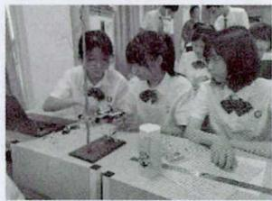
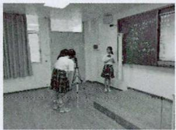
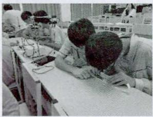
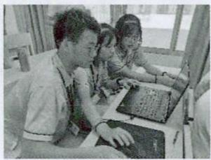
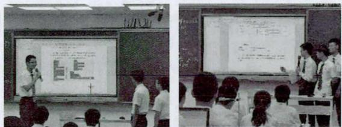
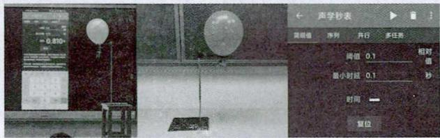
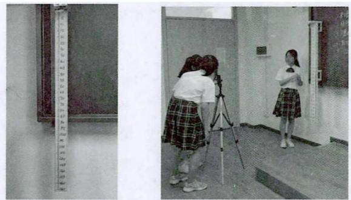
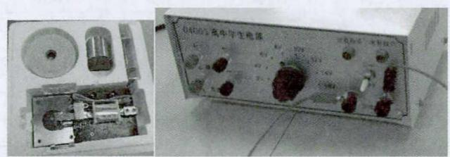
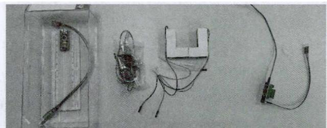
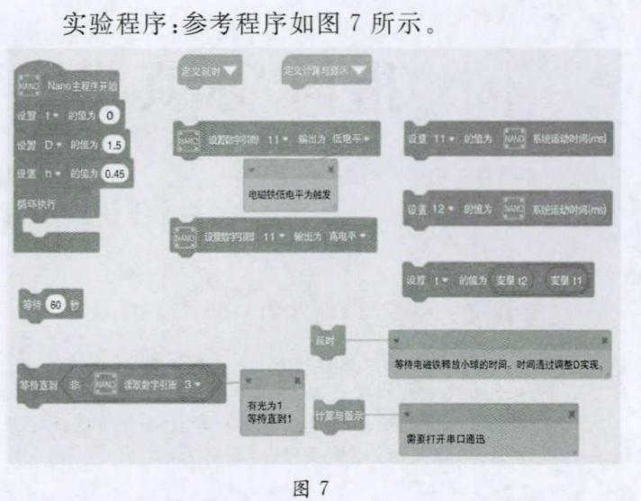

# 创设融合信息技术的情境式实验探究课堂

——以“实验：测量重力加速度”为例

肖亮松

（ 广 东 汕 头 华 侨 中 学 广 东 汕 头 5 1 5 0 0 0 ）

文 章 编 号 l 〇 〇 2 － 2 1 8 X 2 0 2 1 1 0 － 0 0 2 1 － 0 3

中 图 分 类 号 G 6 3 2 ． 4 1

文 献标识码 B

摘 要 以 “ 我 为 火 星 探 测 器 设 计 实 验 方 案 ” 为 情 境 以 “ 测 量 重 力 加 速 度 ” 为 主 题 介 绍 了 融 合 信 息 技 术 的 情 境 式 实 验探 究 课 案 例 通 过 四 个 信 息 化 物 理 实 验 方 案 增 强 了 学 生 物 理 实 验 方 案 的 多 样 性 提 高 了 学 生 的 实 验 能 力

关 键词 情 境 式 实 验探 究 项 目 式 学 习 思 政 一 体 化 学 科 融 合

202 1 年 6 月 3 日 国 务 院 印 发 全 民 科学 素 质行动规划 纲要 2021 — 2035 指 出 教 师要 变革 教 学 方式倡导教师利 用探究 式 启 发 式 等 教 学方式 保 护 学 生的 好奇心 激发学 生 的 求 知 欲 及 想 象 力 让学 生 的 个性得 以 发展 同 时 教 师要 积极 促进 信息技 术 与科学教育 的 深度 融 合 因 此 在 教 学 过 程 中 教 师 设 计 融合信息 技术 的情境式实验课非 常必要

## 一、现状与背景

在 落体运 动 平抛运 动 单摆运动 重 力 加速度 和 匀 变 速直线运动是重要 的 物理 概 念 和 规律 它们 在高 中 物 理 知 识体 系 中 具有 非 常 重要 的 地 位 随着新一轮课程改革 的进行 教师都重 视对学 生 实验操作 动手能力 的 培 养 也 能 够 为 学 生 提供实 验探 究 空间 但是 大 多数教师仍停 留 在“ 使用 电 磁打点 计时 器进行打点 利 用 刻 度 尺 测 量 并 计 算 ” 的 阶 段 显 然 现有 的 实验方式虽 然 能 够 满 足 基本 的 物 理 实 验 探 究 要求 培养学生 的实验动手能力 但是 随 着科 学技术 的发展 现代社会对学生的动手探究能力 提 出 了更高 的要求 这就需要教师拓展现有的实验方式和实验情境

普通高 中 物理课程标 准 2017 年 版 对 教学 提出 建议 教学 中 应该重视培养学生 的 科学探究 能力 和信息技术应用 能力 探索 融合信息 技术 和 物 理教学可 以 利 用手机 电 脑等信息技 术工具 快速 便捷地 帮助学生解 决某些物 理 问 题［ 1 ］

可见 利 用 信息 技 术 丰 富 物 理 实验方式 可 以 提高课堂效率 拓 宽 学 生 视 野 同 时 创 设 问 题情 境 利用项 目 式学 习 的 方式 能够更好地增 强学生 的 学 习 效果 提高学生 的 科学素养 因 此 融合信息 技 术 积极创 设学 习 情境 为 学 生 提 供 实 验 演 示 案 例 给 予 学 生动 手操作 、 分享成果 的空 间 ， 至关重要

## 二、思考与设计

本案例以“我为火星探测器设计实验方案”为情境，以“测量重力加速度”为主题，让学生在具体的情境任务中进行探究、合作学习与分享。学生可以在潜移默化中了解实验的要素，学会通过所学知识和实验目的选取恰当的实验方案，在交流与合作中共享实验资源，对自己和同学的设计方案进行合理评价。案例最后教师介绍了火星的相关内容，既呼应了“我为火星探测器设计实验方案”这一情境，也与思政课相融合，有利于勉励学生学习载人航天精神，增强学生的历史使命感。

## 1 ． 创 设 问 题 情境

学 生 活动 在教 师的 引 导下 结合火 星着 陆 车 的情境 思考 如 何在火 星表面测 量重 力 加速度

教师 活 动 展示 中 国 火 星 探 测 器 “ 祝 融 号 ” 登 陆火 星 的情境 通过提 问 引 导学生 思 考如 何测 量火 星上的 重力 加速度

设计意 图 展示科技成就 启 发学生思考

## 2 ． 明 晰 实 验 原 理

学 生 活 动 回 顾 与 重 力 加 速 度 相 关 的 概 念 和 原理 明 确 实验原理 为科学高效地完成实验做好铺垫

教师 活 动 引 导学生 回顾匀变速直线运动的规律自 由 落体运动的规律 平抛运动 的规律 避免知识误区

设计意 图 理论铺垫 增强科学性

## 3 ． 演 示 实 验 范 例

学 生 活动 学 生 观察并 记 录 一 个 完 整 实 验所需的 要 素 并且跟 随 老 师 的 操 作 体 验 一 个 实 验 的 操 作过程 ， 讨论实 验过程 中 的 重点 和 难点 。

教师 活 动 教 师演示 “基于声 学秒表测 量 重 力 加速度测 量 ” 的 实 验 过 程 通 过 实 际 操 作 展 示 整 个 实验过程 给学生 提供规 范 演 示 并 且 讲述 完 整 实 验 应该具有 的 要 素 包 括 实 验 原 理 待 测 量 测 量 方 法 测量数据 测 量结果 和 总 结 同 时 讲 解 关 于 百 分误 差的 概念

设计 意 图 通过一体机投屏 演示 实验方法 启 发学生思考 。

## 4 ． 学 生 分 组 实 验

学 生 活 动 如 图 1 所示 学生 行选择 实验器 材和 实验方法 设计实验方案 通 过组 内 合作 组 间 共享资 源 的 方式 完成实 验 撰写实 验报告 利 用 及 时 通 信软件上传实验 阶段性数据 组 内 分工 和 实验报告 （ 组间 分 享 ）

  
图 1

教师 活 动 教师根据学生所学 知 识 结合课 程要求 提前准 备三个信息化辅助 实验方案

实验方 案 1 基 于 视 频 逐 帧 播 放 的 重 力 加 速 度测 量 ；

实验方案 2 利 用 信息 技 术 高 效 处 理 打 点 计 时 器数据 ；

实验方案 3 基于 mind+ 的开源编程实验

教 师通过指 导 和 观察帮 助学生 完 成实验 挑 选 出完 成度 比较符合预期 的小组 为 接下 来 的 分享 活 动 做准备 。

设计 意 图 丰 富 实 验 分 析 方法 将 传 感 器 智 能硬件 摄像 机 图 形化编 程 视频 与 数 据 处 理 等 数字化设备 与技术 引 人物理课堂 丰 富 实验方式 利 用 信息技术提高传统实验效率

## 5 ． 提 交 与 展 示 成 果

学 生 活 动 如 图 2 所示 四 个 小 组 的 学 生上 讲 台介绍 自 己 的实验过 程 、 实 验 数 据 实 验 结 果 及 误 差 分析 回 答其他学生 的 提 问 ， 在教 师 的 启 发下 改进 自 己

的 实验方案 。

  
图 2

教师 活 动 挑选 出 具有代 表 性 的 作 品 由 对应 小组 的 学生展示 己 的 实 验 记 录 实 验结 果 以 及 对 实验方法提 出 的 改进或优化迁 移 的 思 考 最后 教 师 对各个方案 进行点评 和 启 发改进

设 计 意 图 利 用 通 信工 具使 线 下 成 果 得 以 进 行线上实 时 分 享 借 助 一 体 机 大 屏 进 行 展 示 交 流 与分享 。

## 6 ． 总 结 与 升 华

教师鼓励学生要 向 航 天工 作 者学 习 以 载人航天精神 鼓舞 己 鼓励学生把科学 的 火 种 带 到 社会各个角 落 。

最后对本节课 内 容进行总 结 鼓励学生 不管是否能够上 台 展示 不 管 实 验结 果 是 否 符 合 预 期 都应 该秉持尊重事实 严谨细致 的 科学态 度 同 时 介绍 火 星相关 内 容 勉励学 生 学 习 载 人 航 天 精 神 增 强 历史 使命感 与思政课高 度融合

设计 意 图 总结本节课学 习 容 通过沉浸式学习 让学生 体会载人航天精 神 鼓励学生立志报 国

## 三、本案例的创新点

## 1 ． 器 材 创 新

为更好地提 高 学生 的 信息技 术应 用 能力 体现新课标 中 关于“ 积极 探索信息技术 与 物理教学 的 深度 融合” 建议 本案 例对实验器材进行改进创新

实 验方案 1 基 于声学秒表测 量重力 加 速度

思路 利 用 声 音 完 成计 时 器 开 启 和 结束 拓 展 实验 的方式 。

器 材 声 学 秒表 a 铁 架 台 气 球 重 物 小 刀如 图 3 所 示 。

原理 自 由 落体运动 的 规律

  
图 3

实 验 方 案 2 基 于 视频 逐 帧 播 放 的 重 力 加 速 度测量组合

思 路 利 用 视频逐 帧记录 相 同 时 间 间 隔 的 位 置

器材 带 电 磁 铁 和 标 尺 的 支 架 三脚 架 和 平 板 电脑 视频播 放 软 件 如 图 4 所示

原理 利 用 逐差法来测 量重 力 加 速度

  
图 4

实 验 方 案 3 信 息 技 术 高 效 处 理 打 点 计 时 器数 据

思 路 利 用 数据处理软件高效处理数据

器材 打点 计 时 器 套 装 学 生 电 源 数 据 处 理 软件 如 图 5 所 示

原理 利 用 逐 差法测 量重力 加速度

  
图 5  
数据处理 如 表 1 所示

表 1 逐 差 法 测 量 重 力 加 速 度
<table><tr><td rowspan=1 colspan=1></td><td rowspan=1 colspan=1>x0</td><td rowspan=1 colspan=1>x1</td><td rowspan=1 colspan=1>x2</td><td rowspan=1 colspan=1>x3</td><td rowspan=1 colspan=1>x4</td><td rowspan=1 colspan=1>x5</td><td rowspan=1 colspan=1>x6</td></tr><tr><td rowspan=1 colspan=1>测量值/m</td><td rowspan=1 colspan=1>0</td><td rowspan=1 colspan=1>0.0315</td><td rowspan=1 colspan=1>0.0675</td><td rowspan=1 colspan=1>0.1010</td><td rowspan=1 colspan=1>0.1495</td><td rowspan=1 colspan=1>0.1965</td><td rowspan=1 colspan=1>0.2360</td></tr><tr><td rowspan=1 colspan=1></td><td rowspan=1 colspan=1></td><td rowspan=1 colspan=1>S1</td><td rowspan=1 colspan=1>S2</td><td rowspan=1 colspan=1>S3</td><td rowspan=1 colspan=1>S4</td><td rowspan=1 colspan=1>S5</td><td rowspan=1 colspan=1>S6</td></tr><tr><td rowspan=1 colspan=1>计算值/m</td><td rowspan=1 colspan=1></td><td rowspan=1 colspan=1>0.03</td><td rowspan=1 colspan=1>0.04</td><td rowspan=1 colspan=1>0.03</td><td rowspan=1 colspan=1>0.05</td><td rowspan=1 colspan=1>0.05</td><td rowspan=1 colspan=1>0.04</td></tr></table>

实 验 方 案 4 基 于 m i n d ＋ 的 开 源 编 程 实 验组 合

思路 程 序 开 启 计 时 器 同 时 释放 小 球 光 电 门 结束计时 。

器材 铁 架 台 自 制 光 电 门 继 电 器 nano 单 片机 电 磁铁 铁球 如 图 6 所示

原理 自由落体运动的规律

  
图6

## 2 ． 平 台 创 新

将 研 究 报 告 电 子 化 ， 利 用 即 时 通 信平 台 相 互 交流 融合物理 信息技术 语文 等学科 充分利 用 学生所学知 识 实现信息 化 智 慧 化 解 决 生 活 中 遇 到 的 实际 问 题

## 四、教学总结

## 1 以 学 生 为 主 体 推 进体 验式 沉 浸 式 学 习

本案 例 以 学生为 主体 学生在 明 确 实验设计 的 基本流程 和 注 意事 项 后 置 身 在 “ 我 为 火 星 探 测 器 设 计实验方案 ” 的 情境 中 围 绕 “ 测 量 重 力 加 速 度 ” 这 一 主题 根据所学 内 容设 计 实 验 方 案 实 施 实 验 最 后 分享实验成 果 案 例 中 教师 的 任 务 就 是结合课程标 准和课程 标 创 设 情 境 提 供 符 合 学 生 特 点 的 学 习 资源 发挥 引 导作用 引 导学生在情境 中 发现问题 查阅 资料 合作探究 得 出 结论并科学评估 通过这种体验式项 目 式 沉浸式的学 习 学生 的 主体地位得 以 提高 学习兴趣得到激发 有利于全面提高学生的核心素养

## 2 ． 利 用 信 息技 术 丰 富 实 验 方 式

本案 例 利 用 打 点 计 时 器 逐 帧播 放 以 及 编 程 工具 研究匀 变速直线 运 动 的 规 律 利 用 信息 技 术 实 现实验成果 的 共享 丰 富 了 物理实 验方式 这种 在 教 学内 容 中 引 人基于信息技术 解决学科 问 题 的方法 有 利于丰 富学 习 方式 教学方式 交流方式

## 3 ． 巧 妙 融 合 思 政 内 容 ， 增 强 学 生 的 使命 感

以 载 人航天事业 为背景 在 物 理实 验 中 设 置学 习情境 在 实践 中 提高学生对党 的 科技 事业 的认 同 感 和使命感 提高 学生 的责任意识 引 导学生 树立 “ 为 中 华民族伟大 复兴不懈奋斗 ” 的坚定信念

## 参考文献

［ 1 ］ 中 华 人 民 共 和 国 教 育 部 ． 普 通 高 中 物 理 课 程 标 准 （ 2 0 1 7年 版 ） M 北 京 人 民 教 育 出 版 社 20 1 8 2

本 文 编 辑 ： 郭 晓 丹 付 杰
