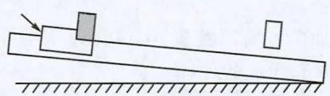
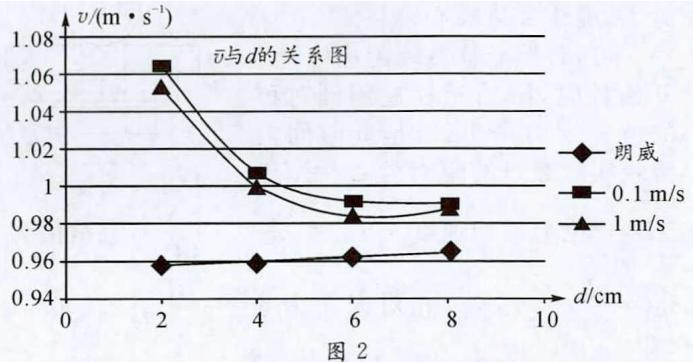
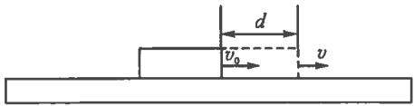
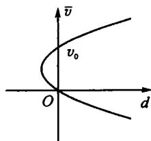
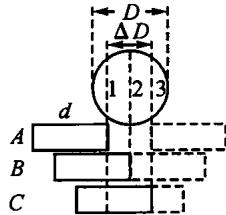
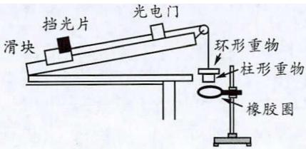
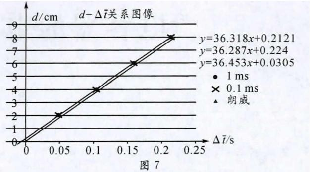
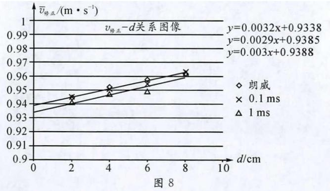

# 利 用 光 电 门 测 量 瞬 时 速 度 的 误 差 分 析 及 修 正

张 传 兵

（浙 江 省 杭 州 第 十 四 中 学 浙 江 杭 州 3 1 0 0 0 6）

文 章 编 号 ： 1 0 0 2 - 2 1 8 X（2 0 2 2）1 2 - 0 0 5 7 - 0 3

中 图 分 类 号 ： G 6 3 2 ． 4 1

文 献 标 识 码 ： B

摘 要 ： 在 用 光 电 门 测 量 物 体 运 动 的 瞬 时 速 度 时 ， 采 用 条 形 挡 光 条 模 式 会 产 生 比 较 大 的 误 差 ， 原 因 是 光 敏 管 阈 值 导 致挡光时间内滑块滑过的距离与挡光条宽度不相符，为获得准确结论，需要对挡光宽度进行误差修正。通过改变挡光条的 宽 度 来 测 量 做 匀 速 直 线 运 动 的 物 体 的 速 度 ， 可 测 出 光 电 门 挡 光 宽 度 的 误 差 修 正 值 ， 理 论 和 实 践 证 明 此 测 量 方 法 和 修正 方 法 是 可 行 的 。

关 键 词 ： 极 限 法 ； 光 电 门 ； 瞬 时 速 度 ； 误 差 修 正

## 一 、 问 题 的 提 出

中学物理实验中常利用光电门来测量瞬时速度。为了使学生理解瞬时速度是平均速度的极限，采用标准配置的条形挡光片（宽度分别为 8 cm、6 cm、4 cm 和 2 cm），逐渐减小挡光片的宽度，测量出平均速度，希望通过实验得到平均速度的极限值。实验装置简图如图 1 所示。

图 1

实验中，将气垫导轨左端调高，将挡光片右侧和滑块右侧对齐安装。每次释放滑块时，其右端距光电门中心距离 Z 约为 55 cm。实验采用 J0201-1 型数字计时器，时基分别选择 0.1 ms 和 1 ms，功能选择 $\mathrm{S}_1$ 挡。数据记录如表 1 所示。

表 1
<table><tr><td rowspan=2 colspan=1>挡光片宽度 $d / \mathrm { c m }$ </td><td rowspan=1 colspan=3>挡光时间/s</td><td rowspan=2 colspan=1>平均时间 $\Delta t / { \mathbf s }$ </td><td rowspan=2 colspan=1>平均速度 ${ \overline { { v } } } { = } { \frac { d } { \Delta t } }$  $/ ( \mathbf { m } \cdot \mathbf { s } ^ { - 1 } )$ </td></tr><tr><td rowspan=1 colspan=1>1</td><td rowspan=1 colspan=1>2</td><td rowspan=1 colspan=1>3</td></tr><tr><td rowspan=2 colspan=1>8</td><td rowspan=1 colspan=1>0.0808</td><td rowspan=1 colspan=1>0.0808</td><td rowspan=1 colspan=1>0.0807</td><td rowspan=1 colspan=1>0.080 8</td><td rowspan=1 colspan=1>0.990 5</td></tr><tr><td rowspan=1 colspan=1>0.0810</td><td rowspan=1 colspan=1>0.0810</td><td rowspan=1 colspan=1>0.0810</td><td rowspan=1 colspan=1>0.0810</td><td rowspan=1 colspan=1>0.9877</td></tr><tr><td rowspan=2 colspan=1>6</td><td rowspan=1 colspan=1>0.0605</td><td rowspan=1 colspan=1>0.0605</td><td rowspan=1 colspan=1>0.0605</td><td rowspan=1 colspan=1>0.0605</td><td rowspan=1 colspan=1>0.9917</td></tr><tr><td rowspan=1 colspan=1>0.0610</td><td rowspan=1 colspan=1>0.0610</td><td rowspan=1 colspan=1>0.0610</td><td rowspan=1 colspan=1>0.0610</td><td rowspan=1 colspan=1>0.9836</td></tr><tr><td rowspan=2 colspan=1>4</td><td rowspan=1 colspan=1>0.0397</td><td rowspan=1 colspan=1>0.0397</td><td rowspan=1 colspan=1>0.0398</td><td rowspan=1 colspan=1>0.0397</td><td rowspan=1 colspan=1>1.0067</td></tr><tr><td rowspan=1 colspan=1>0.0400</td><td rowspan=1 colspan=1>0.0400</td><td rowspan=1 colspan=1>0.0400</td><td rowspan=1 colspan=1>0.0400</td><td rowspan=1 colspan=1>1.0000</td></tr><tr><td rowspan=2 colspan=1>2</td><td rowspan=1 colspan=1>0.0188</td><td rowspan=1 colspan=1>0.0188</td><td rowspan=1 colspan=1>0.0188</td><td rowspan=1 colspan=1>0.0188</td><td rowspan=1 colspan=1>1.063 8</td></tr><tr><td rowspan=1 colspan=1>0.0190</td><td rowspan=1 colspan=1>0.0190</td><td rowspan=1 colspan=1>0.0190</td><td rowspan=1 colspan=1>0.0190</td><td rowspan=1 colspan=1>1.0526</td></tr></table>

从数据可知，随着挡光片宽度的减小，平均速度并没有趋近于一定值，于是笔者采用朗威系统中的光电门（可记录到 0.01 ms）再次进行测量，数据见表 2。

表 2
<table><tr><td rowspan=2 colspan=1>挡光片宽度d/cm</td><td rowspan=1 colspan=3>挡光时间/s</td><td rowspan=2 colspan=1>平均时间 $\Delta t / { \mathsf s }$ </td><td rowspan=2 colspan=1>平均速度 ${ \overline { { v } } } { = } \frac { d } { \Delta t }$  $/ ( \mathbf { m } \cdot \mathbf { s } ^ { - 1 } )$ </td></tr><tr><td rowspan=1 colspan=1>1</td><td rowspan=1 colspan=1>2</td><td rowspan=1 colspan=1>3</td></tr><tr><td rowspan=1 colspan=1>8</td><td rowspan=1 colspan=1>0.0829</td><td rowspan=1 colspan=1>0.082 9</td><td rowspan=1 colspan=1>0.0827</td><td rowspan=1 colspan=1>0.0829</td><td rowspan=1 colspan=1>0.9656</td></tr><tr><td rowspan=1 colspan=1>6</td><td rowspan=1 colspan=1>0.0624</td><td rowspan=1 colspan=1>0.0624</td><td rowspan=1 colspan=1>0.0624</td><td rowspan=1 colspan=1>0.0624</td><td rowspan=1 colspan=1>0.9617</td></tr><tr><td rowspan=1 colspan=1>4</td><td rowspan=1 colspan=1>0.0417</td><td rowspan=1 colspan=1>0.0417</td><td rowspan=1 colspan=1>0.0417</td><td rowspan=1 colspan=1>0.0417</td><td rowspan=1 colspan=1>0.9588</td></tr><tr><td rowspan=1 colspan=1>2</td><td rowspan=1 colspan=1>0.020 9</td><td rowspan=1 colspan=1>0.020 9</td><td rowspan=1 colspan=1>0.020 9</td><td rowspan=1 colspan=1>0.020 9</td><td rowspan=1 colspan=1>0.958 3</td></tr></table>

将三次测量的速度 $\bar{v}$ 和挡光宽度 $d$ 的关系以图像的形式呈现，如图 2 所示，笔者发现：利用数字计时器测量的平均速度随挡光片宽度的减小而变大，而利用朗威系统测量的平均速度随挡光片宽度的减小而减小，为什么会出现这样的差异？下面就此问题来进行分析。

图 2

## 二 、 平 均 速 度 $\bar{v}$ 与 挡 光 片 宽 度 的 关 系

由于挡光片与滑块右端对齐，即每次滑块右端到达光电门时开始计时，挡光片左端通过光电门时停止计时。设滑块右端到达光电门时速度为 $v_0$，结束挡光时其速度为 $v$，滑块滑动时的加速度为 $a$，如图 3 所示。

  
图 3

理论测量值 $\overline { { \boldsymbol { v } } } = \frac { d } { \Delta t } = \frac { \boldsymbol { v } + \boldsymbol { v _ { 0 } } } { 2 }$，又 $v ^ { 2 } - v _ { 0 } ^ { 2 } = 2 a d$，可得

$$
( \overline { { { v } } } - \frac { v _ { 0 } } { 2 } ) ^ { 2 } - \frac { { v _ { 0 } } ^ { 2 } } { 4 } = \frac { 1 } { 2 } a d\tag{①}
$$

易知①式对应的曲线为对称轴为 $\overline { { \pmb { v } } } = \frac { \pmb { v } _ { 0 } } { 2 }$、开口向右的抛物线，如图 4 所示。根据实验，$\bar{v} > v_0$，故理论上测量图线为图 4 中 $\bar{v} > v_0$ 部分，即平均速度会随挡光片宽度的减小而减小。

图 4

可将①式进一步化为

$$
\overline { { v } } = \frac { v _ { 0 } } { 2 } + \sqrt { \frac { { v _ { 0 } } ^ { 2 } } { 4 } + \frac { 1 } { 2 } a d } \quad ( \overline { { v } } > v _ { 0 } )
$$

又 $v _ { 0 } ^ { 2 } = 2 a l$ ， 有

$$
\overline { { v } } = { \frac { v _ { 0 } } { 2 } } + { \sqrt { { \frac { a l } { 2 } } + { \frac { 1 } { 2 } } a d } } = { \frac { v _ { 0 } } { 2 } } + { \sqrt { { \frac { a l } { 2 } } } } \cdot { \sqrt { 1 + { \frac { d } { l } } } }
$$

当 $d { \ll } l$ 时 ， 有

$$
\overline { { v } } \approx \frac { v _ { 0 } } { 2 } + \sqrt { \frac { a l } { 2 } } \cdot ( 1 + \frac { d } { 2 l } ) = \sqrt { \frac { a } { 8 l } } d + v _ { 0 }\tag{②}
$$

即 $\bar { \boldsymbol { v } }$ 与 $d$ 为一次函数关系，斜率为正。可见，利用数字计时器测量的结果与理论不符，而利用朗威系统光电门测量的结果与理论近似。

## 三 、 光 电 门 计 时 误 差 分 析

由光电门计时原理可知，挡光片进入挡光区域时，挡光面积需要达到一定值才会触发计时电路，即光敏管有一定的遮光阈值。此阈值会导致在计时时间内滑块运动的距离并不等于挡光片的宽度，从而引起测量误差。如图 5 所示，设光敏管能接收到光的有效圆面直径为 $D$，虚线 2 过圆心，则：

（1）若挡光片右端到达位置 1 开始计时，则挡光片左侧到对称的位置 3 时结束计时，此时间内滑块实际经过的距离为 $\Delta x = d +$

图 5

$\Delta D$，理论上平均速度为 $\overline { { v } } _ { 理 } = \frac { \Delta x } { \Delta t } = \frac { d + \Delta D } { \Delta t }$，测量值为 $\overline { { v } } _ { 测 } = \frac { d } { \Delta t }$，$\overline { { v } } _ { 测 } < \overline { { v } } _ { 理 }$，相对误差为 $\delta = \frac { \Delta D } { d + \Delta D } \times 1 0 0 \%$。当 $d$ 愈小、$\Delta D$ 愈大时，相对误差愈大。

（2）若挡光片右端到达 2 位置开始计时，则挡光片左侧到位置 2 结束计时，此时间内滑块实际经过的距离为 $\Delta x = d$，理论平均速度为 $\overline { { v } } _ { 理 } = \frac { d } { \Delta t }$，测量值为 $\overline { { v } } _ { 测 } = \frac { d } { \Delta t }$，$\overline { { v } } _ { 测 } = \overline { { v } } _ { 理 }$。

（3）若挡光片右端到达位置 3 开始计时，则挡光片左侧到对称的位置 1 结束计时，此时间内滑块实际经过的距离为 $\Delta x = d - \Delta D$，理论平均速度为 $\overline { { v } } _ { 理 } = \frac { d - \Delta D } { \Delta t }$，测量值为 $\overline { { v } } _ { 测 } = \frac { d } { \Delta t }$，$\overline { { v } } _ { 测 } > \overline { { v } } _ { 理 }$，相对误差为 $\delta = \frac { \Delta D } { d - \Delta D } \times 1 0 0 \%$。当 $d$ 愈小、$\Delta D$ 愈大时，相对误差愈大。

由此可知，用两种不同器材得到的实验结果不一致的原因可能是由 $\Delta D$ 引起的，且 $d$ 愈小这种影响愈明显。为减小误差，可对挡光片宽度进行修正，修正值为 $\pm \Delta D$。

理论上用数字计时器测量出的速度应随着挡光片宽度的减小而减小，而实验结果却随着挡光片宽度的减小而增大，故本实验中出现的是上述第（3）种情况。

## 四 、 $\Delta D$ 的 实 验 测 定 及 误 差 修 正

### （一） 实 验 测 定 $\Delta D$ 的 原 理

#### 1 ． 理 论

滑块做匀速直线运动，其速度理论值为 $\overline { { v } } _ { 理 } = \frac { \Delta x } { \Delta t }$，令 $\Delta { x } = d - \Delta { D }$，则有

$$
d = \overline { { v } } _ { 理 } \ \Delta t + \Delta D
$$

若保持 $\overline { { v } } _ { 理 }$ 恒定，改变挡光片宽度 $d$，获得 $d$ 与 $\Delta t$ 的关系图，其截距为 $\Delta D$。

#### 2 ． 实 验 测 定

设计如图 6 所示装置，可以在改变挡光片宽度进行测量时保持 $\overline { { v } } _ { 理 }$ 不变。

图 6

**实验原理** 将气垫导轨一端适当垫高，可使滑块在柱形重物的牵引下匀速滑动。若在柱形重物上方放置一环型重物，则滑块会在重物的牵引下加速运动。当重物经过一固定的橡胶圈时，柱形重物穿过橡胶圈，而环形重物被橡胶圈截留，此后滑块做匀速运动。若每次释放滑块时初始位置固定，则能保证滑块最后做匀速运动时速度相同。

**实验步骤** ①为保证滑块质量不变，将所有规格挡光片均安装在滑块上，但每次只有一块能有效挡光；②将滑块与柱形重物通过导轨上定滑轮与细绳相连，并在柱形重物下方适当位置固定一橡胶圈；③垫高气垫导轨一端，反复调节气垫导轨直至滑块和柱形重物能匀速运动；④在柱形重物上方放置一环形重物，在合适位置释放滑块，多次测量滑块匀速通过光电门时的挡光时间并记录；⑤改变挡光片宽度，将滑块从同一位置释放，记录挡光片的宽度及通过光电门的时间，多次测量取平均值，实验数据如表 3 所示。

表 3
<table><tr><td rowspan=2 colspan=1>d/cm</td><td rowspan=1 colspan=2>0.1 ms</td><td rowspan=1 colspan=2>1 ms</td><td rowspan=1 colspan=2>朗威</td></tr><tr><td rowspan=1 colspan=1> $\Delta \bar { t } / { \mathsf s }$ </td><td rowspan=1 colspan=1> ${ \boldsymbol { v } } _ { \mathbf { d } }$  $/ ( \mathbf { m } \cdot \mathbf { s } ^ { - 1 } )$ </td><td rowspan=1 colspan=1> $\Delta \bar { t } / { \bf s }$ </td><td rowspan=1 colspan=1> ${ \pmb v } _ { \pmb { \mathrm { w } } }$  $/ ( \mathbf { m } \cdot \mathbf { s } ^ { - 1 } )$ </td><td rowspan=1 colspan=1> $\Delta t / { \mathsf s }$ </td><td rowspan=1 colspan=1> $\overline { { \boldsymbol { v } } } _ { \mathrm { z } }$  $/ ( \mathbf { m } \cdot \mathbf { s } ^ { - 1 } )$ </td></tr><tr><td rowspan=1 colspan=1>8</td><td rowspan=1 colspan=1>0.2139</td><td rowspan=1 colspan=1>0.374</td><td rowspan=1 colspan=1>0.2140</td><td rowspan=1 colspan=1>0.374</td><td rowspan=1 colspan=1>0.2186</td><td rowspan=1 colspan=1>0.366</td></tr><tr><td rowspan=1 colspan=1>6</td><td rowspan=1 colspan=1>0.1599</td><td rowspan=1 colspan=1>0.375</td><td rowspan=1 colspan=1>0.1600</td><td rowspan=1 colspan=1>0.375</td><td rowspan=1 colspan=1>0.1636</td><td rowspan=1 colspan=1>0.367</td></tr><tr><td rowspan=1 colspan=1>4</td><td rowspan=1 colspan=1>0.1039</td><td rowspan=1 colspan=1>0.385</td><td rowspan=1 colspan=1>0.1043</td><td rowspan=1 colspan=1>0.383</td><td rowspan=1 colspan=1>0.1091</td><td rowspan=1 colspan=1>0.367</td></tr><tr><td rowspan=1 colspan=1>2</td><td rowspan=1 colspan=1>0.0488</td><td rowspan=1 colspan=1>0.410</td><td rowspan=1 colspan=1>0.0490</td><td rowspan=1 colspan=1>0.409</td><td rowspan=1 colspan=1>0.0539</td><td rowspan=1 colspan=1>0.371</td></tr></table>

将实验所得数据用 Excel 软件作图，如图 7 所示，可得到数字计时器的 0.1 ms 挡、1 ms 挡，及朗威系统的 $d$ 与 $\Delta t$ 的关系式分别为 $d = 36.318 \Delta t + 0.2121$，$d = 36.287 \Delta t + 0.224$，$d = 36.453 \Delta t + 0.0305$，由此可知，三种情况下的修正值 $\Delta D$ 分别近似为 2.1 mm，2.2 mm，0.3 mm。

图 7

### （二） 误 差 修 正

对表 3 中的实验数据进行修正，修正公式为 $\overline { { v } } _ { 修 正 } = \frac { \Delta x } { \Delta t } = \frac { d - \Delta D } { \Delta t }$，修正后数据如表 4 所示。

表 4

<table><tr><td rowspan=2 colspan=1> $d / \mathrm { c m }$ </td><td rowspan=1 colspan=3>0.1 ms</td><td rowspan=1 colspan=3>1 ms</td><td rowspan=1 colspan=3>朗威</td></tr><tr><td rowspan=1 colspan=1> $\Delta \bar { t } / { \mathsf s }$ </td><td rowspan=1 colspan=1> $\overline { { \boldsymbol { v } } } _ { 测 }$  $/ ( \mathbf { m } \cdot \mathbf { s } ^ { - 1 } )$ </td><td rowspan=1 colspan=1> $\overline { { \boldsymbol { v } } } _ { 修 正 }$  $/ ( \mathbf { m } \cdot \mathbf { s } ^ { - 1 } )$ </td><td rowspan=1 colspan=1> $\Delta \bar { t } / { \mathsf s }$ </td><td rowspan=1 colspan=1> $\overline { { \boldsymbol { v } } } _ { 测 }$  $/ ( \mathbf { m } \cdot \mathbf { s } ^ { - 1 } )$ </td><td rowspan=1 colspan=1> $\overline { { \boldsymbol { v } } } _ { 修 正 }$  $/ ( \mathbf { m } \cdot \mathbf { s } ^ { - 1 } )$ </td><td rowspan=1 colspan=1> $\Delta \bar { t } / { \mathsf s }$ </td><td rowspan=1 colspan=1> $\overline { { \boldsymbol { v } } } _ { 测 }$  $/ ( \mathbf { m } \cdot \mathbf { s } ^ { - 1 } )$ </td><td rowspan=1 colspan=1> $\overline { { \boldsymbol { v } } } _ { 修 正 }$  $/ ( \mathbf { m } \cdot \mathbf { s } ^ { - 1 } )$ </td></tr><tr><td rowspan=1 colspan=1>8</td><td rowspan=1 colspan=1>0.213 9</td><td rowspan=1 colspan=1>0.374</td><td rowspan=1 colspan=1>0.364</td><td rowspan=1 colspan=1>0.2140</td><td rowspan=1 colspan=1>0.374</td><td rowspan=1 colspan=1>0.364</td><td rowspan=1 colspan=1>0.218 6</td><td rowspan=1 colspan=1>0.366</td><td rowspan=1 colspan=1>0.365</td></tr><tr><td rowspan=1 colspan=1>6</td><td rowspan=1 colspan=1>0.159 9</td><td rowspan=1 colspan=1>0.375</td><td rowspan=1 colspan=1>0.362</td><td rowspan=1 colspan=1>0.160 0</td><td rowspan=1 colspan=1>0.375</td><td rowspan=1 colspan=1>0.361</td><td rowspan=1 colspan=1>0.163 6</td><td rowspan=1 colspan=1>0.367</td><td rowspan=1 colspan=1>0.365</td></tr><tr><td rowspan=1 colspan=1>4</td><td rowspan=1 colspan=1>0.103 9</td><td rowspan=1 colspan=1>0.385</td><td rowspan=1 colspan=1>0.363</td><td rowspan=1 colspan=1>0.104 3</td><td rowspan=1 colspan=1>0.383</td><td rowspan=1 colspan=1>0.364</td><td rowspan=1 colspan=1>0.1091</td><td rowspan=1 colspan=1>0.367</td><td rowspan=1 colspan=1>0.364</td></tr><tr><td rowspan=1 colspan=1>2</td><td rowspan=1 colspan=1>0.0488</td><td rowspan=1 colspan=1>0.410</td><td rowspan=1 colspan=1>0.365</td><td rowspan=1 colspan=1>0.0490</td><td rowspan=1 colspan=1>0.409</td><td rowspan=1 colspan=1>0.364</td><td rowspan=1 colspan=1>0.053 9</td><td rowspan=1 colspan=1>0.371</td><td rowspan=1 colspan=1>0.365</td></tr></table>

由表 4 中数据可知，经修正后由不同宽度挡光片测得的速度值在误差允许范围内相同。

对表 1、表 2 中的数据进行修正，修正公式为 $\overline { { v } } _ { 修 正 } = \frac { \Delta x } { \Delta t } = \frac { d - \Delta D } { \Delta t }$，修正数据如表 5 所示。

表 5
<table><tr><td rowspan=2 colspan=1> $d / \mathbf { c m }$ </td><td rowspan=1 colspan=3>0.1 ms</td><td rowspan=1 colspan=3>1 ms</td><td rowspan=1 colspan=3>朗威</td></tr><tr><td rowspan=1 colspan=1> $\Delta \bar { t } / { \mathsf s }$ </td><td rowspan=1 colspan=1> $\overline { { \boldsymbol { v } } } _ { 测 }$  $/ ( \mathbf { m } \cdot \mathbf { s } ^ { - 1 } )$ </td><td rowspan=1 colspan=1> $\overline { { \boldsymbol { v } } } _ { 修 正 }$  $/ ( \mathbf { m } \cdot \mathbf { s } ^ { - 1 } )$ </td><td rowspan=1 colspan=1> $\Delta \bar { t } / { \bf s }$ </td><td rowspan=1 colspan=1> $\overline { { \boldsymbol { v } } } _ { 测 }$  $/ ( \mathbf { m } \cdot \mathbf { s } ^ { - 1 } )$ </td><td rowspan=1 colspan=1> $\overline { { \boldsymbol { v } } } _ { 修 正 }$  $/ ( \mathbf { m } \cdot \mathbf { s } ^ { - 1 } )$ </td><td rowspan=1 colspan=1> $\Delta \bar { t } / { \bf s }$ </td><td rowspan=1 colspan=1> $\overline { { \boldsymbol { v } } } _ { 测 }$  $/ ( \mathbf { m } \cdot \mathbf { s } ^ { - 1 } )$ </td><td rowspan=1 colspan=1> $\overline { { \boldsymbol { v } } } _ { 修 正 }$  $/ ( \mathbf { m } \cdot \mathbf { s } ^ { - 1 } )$ </td></tr><tr><td rowspan=1 colspan=1>8</td><td rowspan=1 colspan=1>0.080 8</td><td rowspan=1 colspan=1>0.990 5</td><td rowspan=1 colspan=1>0.962 8</td><td rowspan=1 colspan=1>0.081</td><td rowspan=1 colspan=1>0.9877</td><td rowspan=1 colspan=1>0.961 5</td><td rowspan=1 colspan=1>0.082 85</td><td rowspan=1 colspan=1>0.965 6</td><td rowspan=1 colspan=1>0.962 0</td></tr><tr><td rowspan=1 colspan=1>6</td><td rowspan=1 colspan=1>0.060 5</td><td rowspan=1 colspan=1>0.9917</td><td rowspan=1 colspan=1>0.954 7</td><td rowspan=1 colspan=1>0.061</td><td rowspan=1 colspan=1>0.983 6</td><td rowspan=1 colspan=1>0.948 8</td><td rowspan=1 colspan=1>0.062 39</td><td rowspan=1 colspan=1>0.961 7</td><td rowspan=1 colspan=1>0.956 9</td></tr><tr><td rowspan=1 colspan=1>4</td><td rowspan=1 colspan=1>0.039 7</td><td rowspan=1 colspan=1>1.0067</td><td rowspan=1 colspan=1>0.950 3</td><td rowspan=1 colspan=1>0.040</td><td rowspan=1 colspan=1>1.000 0</td><td rowspan=1 colspan=1>0.9470</td><td rowspan=1 colspan=1>0.041 72</td><td rowspan=1 colspan=1>0.9588</td><td rowspan=1 colspan=1>0.9517</td></tr><tr><td rowspan=1 colspan=1>2</td><td rowspan=1 colspan=1>0.0188</td><td rowspan=1 colspan=1>1.063 8</td><td rowspan=1 colspan=1>0.9447</td><td rowspan=1 colspan=1>0.019</td><td rowspan=1 colspan=1>1.052 6</td><td rowspan=1 colspan=1>0.9410</td><td rowspan=1 colspan=1>0.02087</td><td rowspan=1 colspan=1>0.958 3</td><td rowspan=1 colspan=1>0.943 9</td></tr></table>

再次作出 $\overline { { v } } _ { 修 正 }$ 与 $d$ 的关系图像，如图 8 所示。结合②式可知，图中截距为光电门所在处滑块的瞬时速度，在 1 ms、0.1 ms、朗威三种模式下获得的平均速度极限值为 0.934 m/s，0.939 m/s，0.939 m/s，在误差允许范围内三者结论一致。可见，上述实验测量修正量 $\Delta D$ 的方法是正确的。

图 8

## 五 、 结 语

采用数字计时器 $\mathrm{S}_1$ 挡进行平均速度测量时存在比较大的误差，其误差是由光敏管阈值引起的，若不修正，教学效果不好，甚至结果与事实背道而驰。本文给出了修正值的测量方法，但测量修正量 $\Delta D$ 仍耗时耗力，在课堂教学中显然时间不允许，在讲解修正原理时学生会比较难理解，故建议任课教师在教学中用极限法测量瞬时速度时，采用数字计时器 $\mathrm{S}_2$ 挡，利用 "U" 形挡光片来消除 $\Delta D$ 的影响。

## 参 考 文 献

［1］ 龚赛军．瞬时速度的实验研究［J］．物理实验，2006，26（12）：25-27．

［2］ 方武增．利用光电门测瞬时速度的改进方法［J］．实验教学与仪器，2016（3）：25-26．

［3］ 张锁宾，黄育红，袁贽，等．条形挡光片测速的误差分析及修正方法［J］．大学物理，2017，36（6）：73-77．

（本文编辑：王一鸣　郭晓丹）