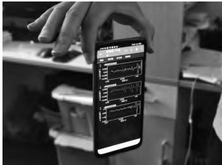
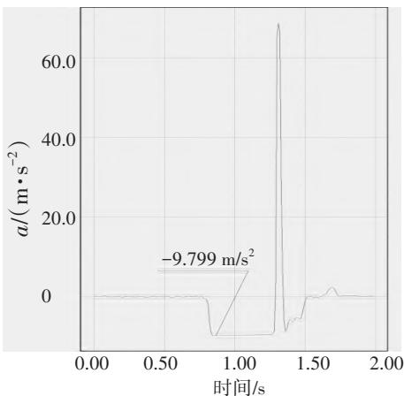

# 利用智能手机测量当地重力加速度

张怀华

（焦作市第十一中学，河南焦作 454000）

摘 要：列举了利用手机物理工坊（Phyphox）测量当地重力加速度实验中的常见不当操作，分析了加速度-时间图象中不合理、不正常数值出现的原因，给出了利用Phyphox测量当地重力加速度的规范操作方法。

关键词：Phyphox；加速度；时间；智能手机；重力加速度

DOI：10.19935/j.cnki.1004-2326.2025.04.045

引用格式：张怀华.利用智能手机测量当地重力加速度［J］.实验教学与仪器，2025，42（04）：130-131.

手机物理工坊（Phyphox）整合了智能手机内置的各种传感器，并附带有大量的科学实验样例，还能利用蓝牙与Arduino开发板交换数据，极大地拓展了其在科学探究领域的适用范围。在手机浏览器中搜索关键词“手机物理工坊”或者“Phyphox”，安装后即可使用。世界各地的师生利用Phyphox开展了丰富多彩的居家科学探究实验［1\~3］。

## 1　问题的提出

初次接触Phyphox的师生，开展的第一个探究实验常常是测量当地的重力加速度，但是很多师生在首次利用Phyphox测量重力加速度时，往往得到这样的结果：当平托手机的双手突然放开后，Phyphox测得的手机加速度会从0突然增大至大于17.8 m/s2，然后又迅速减小至9.8 m/s2左右，继而逐渐减小至8.6 m/s2左右。实验测得的重力加速度与当地重力加速度相差太大。产生这些问题是师生对Phyphox的原理不了解，对自由落体运动的苛刻条件认识不够导致的。

## 2　常见问题归类分析

利用智能手机传感器测量重力加速度实验是人教版高中物理必修第一册中特意安排的体验性实验，详细介绍了智能手机与三维空间坐标系的对应关系［4］。师生在利用智能手机测量当地重力加速度时，为了方便观测和操作，常常用两只手托着手机，让手机屏幕水平朝上；此时重力加速度方向与z轴负方向一致，可以利用z轴方向上的加速度-时间图象读取重力加速度的值。

## 2.1　双手托机，水平释放

水平托举手机的双手突然下沉时，负压作用和手掌汗液、油脂对手机背面的黏附力，会导致手机下落瞬间的加速度大于重力加速度；手机与手脱离后水平下落，迎风

面积大，空气阻力大，其加速度值小于重力加速度。

## 2.2　四指持机，水平释放

用4根手指捏着手机四角突然水平释放时，虽然避免了手掌下沉导致的负压作用，但是手指上的汗液和油脂有黏性，4个手指很难同时与手机分离，从而导致手机在空中侧翻；即便是稍微的侧翻，也会导致重力加速度在z轴上的分量明显减小。

上述两种测量方法都会导致重力加速度测量值明显偏离真实值，这不仅为实验数据分析带来许多不便，也降低了智能手机实验的可信度。很多师生无奈之下，只能采用其他相对复杂的实验方案测量重力加速度［5\~7］。

## 3　正确操作，示范展示

在利用Phyphox测量重力加速度的实验中，对实验有显著影响的5个因素是手掌负压、汗液和油脂黏性、手机迎风面积、手机侧翻、操作干扰，只要精心设计实验方案，巧妙避开这5个方面，就能达到理想的实验效果。

## 3.1　延迟实验，定时运行

为了防止在启动实验和停止实验时手指点按手机屏幕按键干扰实验，需要设置启动延迟和定时运行。在做好手机缓冲防护的前提下，打开Phyphox软件，运行“加速度（不含g）”实验样例，进入“图表”页面，点按y轴线性加速度图表左上角的箭头，将y轴线性加速度图表扩展至全屏。点按手机实验页面右上方的“…”按钮，调出功能拓展菜单，点击“定时运行”菜单项，进入“定时运行”页面；勾选“执行定时运行”选项，设置“启动延迟”时间为3 s，设置“实验时长”为2 s；最后按“确认”按钮，完成设置。该操作方便，能减少干扰。

## 3.2　手指持机，竖直释放

清洁手指，用拇指和食指从手机顶部自然地捏住手机的前后两侧，确保手机屏幕朝向自己，手机长边竖直。这种方式能够将空气阻力对实验的影响减小到极致。笔者测得实验用手机厚度为10 mm、宽度为80 mm、长度为150 mm，当手机长边竖直释放时，迎风面积仅为水平释放时的1/15。这种方式还将手指黏性导致的侧翻力矩减小为原来的1/15，极大地抑制了在下落过程中的侧翻现象。

如果利用图1的方式释放手机，手指黏性导致的侧翻力矩减小为原来的1/2左右，不能很好地抑制侧翻现象。

  
图1　不当释放方式

用手指轻轻点按手机屏幕上的“运行”按钮，进入倒计时读秒状态；当手机屏幕上出现加速度-时间图象时，迅速弹开拇指和食指，手机就会沿竖直方向自由落下，Phyphox自动完成加速度数据采集和图象绘制，并在程序运行2 s之后自动停止。

## 3.3　操作得当,曲线理想

由于“清洁手指”极大地减弱了油脂黏附力，“手指持机”极大地减弱了侧翻力矩，“长边竖直”极大地减弱了迎风面积，“定时运行”极大地减弱了操作干扰，手机运动环境和加速度测量条件都与自由落体运动十分吻合，可以得到非常理想的如图2所示的加速度-时间关系图象。

图2中手机在自由下落过程中对应的加速度-时间关系图象的斜率几乎为零，这意味着手机在自由下落过程中加速度基本不变。点按手机页面下方的“选取数据”按钮，然后点击加速度-时间图象中的水平部分，可得手机在自由下落过程中的加速度为9.799 m/s2。资料显示，笔者当地的重力加速度为9.796 m/s2，此次测量的相对误差为0.03%，测量结果十分可靠。

在课堂教学中，可以把智能手机屏幕信息投射到大屏幕上，师生可以通过大屏幕实时监控智能手机实验的进程，亲眼见证手机自由下落和缓冲过程中的加速度-时间图象的生成和变化规律，并对特殊时刻的加速度进行

  
图2　理想加速度图象

现场测量和比对。

## 4　结语

智能手机实验可以打破学校实验教学的时空限制，是学校实验教学的有益补充，师生可以依托智能手机随时随地开展个性化的科学探究实验。智能手机实验可以极大地降低数据获取和分析的技术门槛，让师生有机会专注于对科学探究实验本质的思考。

基金项目：2021年河南省基础教育教学研究项目“Phyphox 在中学物理实验探究活动中应用研究”，编号：JCJYC2106zy073。

作者简介：张怀华（1974—），男，正高级教师，研究方向：高中物理教育教学，E-mail：huaihua\_zhang@sina.com。

## 参考文献

［1］ 王亚芳，高义，陈倩，等.利用手机Phyphox软件开展居家实验的实践［J］.实验室研究与探索，2022，41（01）：249-253.

［2］ 刘仕飞，王骋.线上物理实验教学综述［J］.教育与装备研究，2021，37（12）：6-9.

［3］ 王槿，朱江，李文华，等.启发式的多层次居家物理实验设计探索［J］. 物理实验，2020，40（04）：31-37.

［4］ 人民教育出版社，课程教材研究所，物理课程教材研究开发中心.普通高中教科书物理必修第一册［M］.北京：人民教育出版社，2019.

［5］ 王锦辉，孙存英，周红，等.利用智能手机磁传感器研究单摆运动［J］. 大学物理，2021，40（03）：33-37.

［6］ 王可畏，阮诗森，邓文武，等.利用手机光传感器测量重力加速度［J］.中学物理教学参考，2021，50（26）：62-64.

［7］ 官邦贵，高海涛，左绪忠，等.利用弹簧振子在竖直方向做简谐振动实验测量重力加速度［J］.韶关学院学报，2021，42（06）：28-32.
