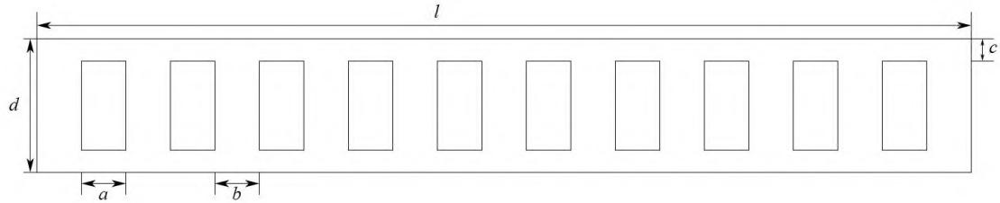
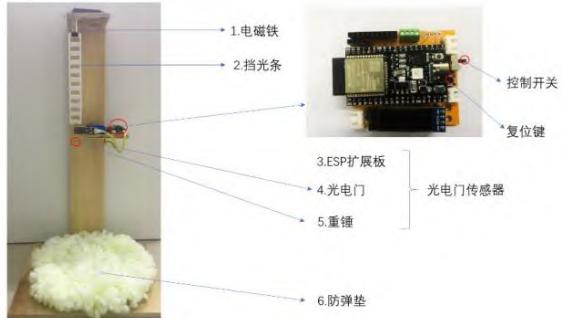
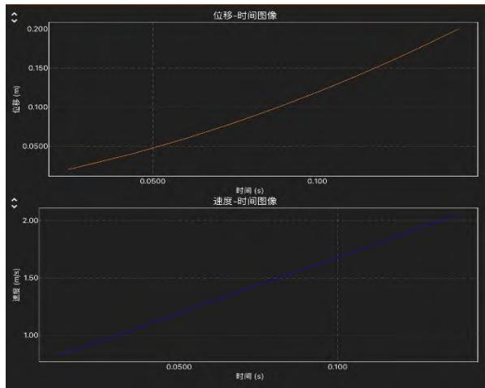
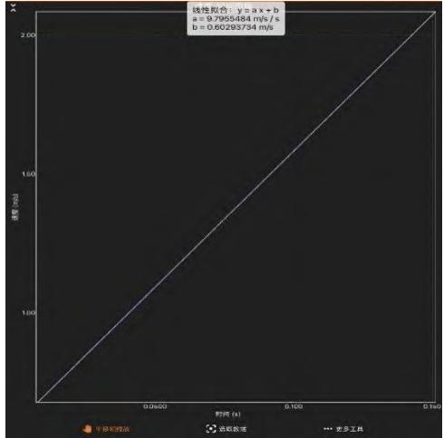
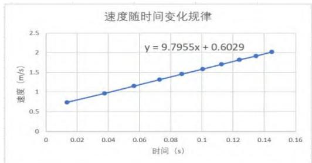
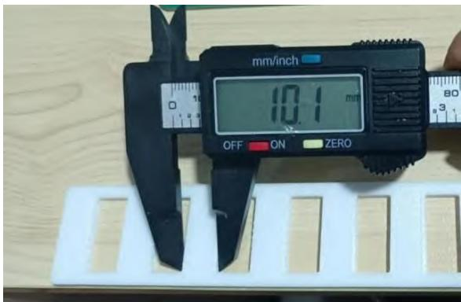

# 基于 Phyphox 和 MicroPython 的中学物理实验创新——以“测量重力加速度”为例

陈海涛1，倪钰朋1，李红梅1，翁浩峰2

（1. 云南师范大学物理与电子信息学院，云南 昆明 650500；2. 宁波中学，浙江 宁波 315000）

摘 要：信息技术与物理课堂教学的深度融合满足了课程标准对物理科学探究多元化的需求以及教师在教学中重视数字实验和创新实验的要求。在减少实验成本、降低实验误差的原则下，本文以“测量重力加速度”为例，利用 Phyphox和 MicroPython设计基于人教版教材高中物理必修一“自由落体运动”实验的创新方案。该创新方案相较于传统实验，测量结果误差更小，操作更简洁便利，数据处理更准确简单。

关键词：Phyphox；MicroPython；实验创新

## 一、引言

## 1. 课程标准对物理实验教学的要求

物理学基于观察与实验建构物理模型，应用数学等工具，通过科学推理和论证，形成系统的研究方法和理论体系。根据物理课程的性质，中学物理教师在开展高中物理教学时应把科学探究活动置于教学的重要地位，尤其是在物理实验教学中，要以物理实验为依托，培养学生发现并提出问题的能力以及探究能力。《普通高中物理课程标准（2017 年版）》（2020年修订）指出，教师应努力提高科学探究的质量，一方面科学探究活动的方式应多样化，另一方面应加强科学探究的真实性。[1]

## 2. 教材中“研究自由落体运动规律”的实验

“研究自由落体运动的规律”是人教版高中物理必修一第二章第四节“自由落体运动”的重要内容。新课标对该部分课程内容的要求是：通过实验，认识自由落体运动规律。学生之前经历过“探究小车速度随时间变化的规律”，掌握了打点计时器的使用方法，能通过测量纸带上各计数点间距离计算平均速度，再根据逐差法分析各计数点间小车运动的平均速度随时间变化的规律。教材中“研究自由落体运动的规律”采用相同的实验思路，用打点计时器、纸带以及不同质量的重锤等装置进行。纸带由自由下落的重锤牵引，打点计时器随即在纸带上打出相应的计数点，通过测量计数点之间的间隔计算平均速度，根据逐差法进一步分析重锤在自由下落过程中速度随时间变化的规律，从而得出自由落体运动的规律。

## 二、“测量重力加速度”实验的创新方案

2019年 2月中共中央、国务院印发的《中国教育现代化 2035》指出：加快信息化时代教育变革，统筹建设一体化智能化教学、管理与服务平台。利用现代技术加快推动人才培养模式改革，实现规模化教育与个性化培养的有机结合[2]。随着信息技术的发展，传感器、智能手机软件等信息技术手段逐渐走进中学物理课堂。

Phyphox 软件目前被广泛运用于物理教学之中，包括对弹簧振子振动的分析、对重力加速度的测量、对声音频率的表征等方面。MicroPython 是一款开源的、易于使用的电子原型开发平台，其设计目的是让非电子信息类专业人士也能运用单片机轻轻松松地设计出良好的人机互动作品。MicroPython 是运行在微控制器硬件之上的完全的 Python 编译器和运行系统，除了包含选定的核心 Python 库外，还可以访问低层硬件模块，如控制 LED、LCD 显示器、读取电压等。[3]使用 MicroPython 驱动 ESP32 单片机并连接各种传感器模块，再将传感器采集到的数据通过蓝牙发送到 Phyphox 软件界面进行显示，即可设计出丰富的中学物理创新实验。

在教材实验方案的基础上，“测量重力加速度”的实验方案不断得到改进和创新，比如，“微电流传感器测量重力加速度”[4]、“单摆法测量重力加速度”等。本文将结合 Phyphox 和 MicroPython 技术手段对该实验进行创新。

## 1. 实验原理

以规格为 a=0.0100 m、b=0.0100 m、c=0.0020 m、d=0.0100 m、l=0.2100 m 的等间距挡光条（如图 1所示）代替教材实验中的重锤以及纸带。由电磁铁控制该等间隔镂空的挡光条自由下落，在下落过程中挡光条密封部分将对光电门产生遮挡，随即光电门开始计时，直至镂空部分下落到光电门位置，光电门停止计时。由于挡光条是等间隔镂空，因此根据公式 $\nu = { \frac { x } { t } }$ 可知，在该装置中只需要获取各个密封部分遮挡光电门的时间即可快速获得在挡光条中各个密封部分的平均速度。使用杜邦线连接 ESP32单片机与光电门传感器，MicroPython 将驱动 ESP32单片机运行，光电门传感器进行数据采集并将数据通过蓝牙发送到 Phyphox软件，呈现物体运动速度随时间变化的图像。

  
图 1 挡光条

将实验设计原理转化为计算机代码，基于 Thonny 软件编写 Python 代码，重要代码片段展示如下：

<!-- 存疑：图中 MicroPython 代码的 OCR 结果严重失真，具体代码以原 PDF 图示为准。
\begin{array} { c } { { \mathrm { d e f ~ g e t t i m e ( V ) { : } } } } \\ { { \mathrm { \# d i j _ { \mathbb { H } } ^ { \mathbb { H } } ] \mathbb { H } \# \mathbb { H } \index { { \mathbb { W } \mathbb { f } } _ { \mathbb { T } } } \index { { \mathbb { X } \mathbb { K } } } _ { | } \# U } \mathbb { H } \mathbb { H } \mathbb { I } \index { { \mathbb { X } \mathbb { X } } } _ { \mathbb { X } } \equiv \index { { \mathbb { X } \mathbb { V } } } _ { \mathbb { L } } \mathbb { H } \index { { \mathbb { X } } } _ { \mathbb { H } } ^ { \mathbb { H } } \mathbb { H } \index { { | \mathbb { H } | } } } } \\ { { \mathrm { \ g l o b a l ~ t m s t a r t } } } \\ { { \mathrm { t m s t a r t - t i m e . t i c k s \_ u s ( \omega ) } } } \end{array}
-->

上述编写好的代码命名为“main.py”通过数据线下载到 ESP32 单片机上并拔出数据线，只依赖ESP32 单片机使用蓝牙通信进行数据传输。

## 2. 实验器材

实验装置如图 2 所示。雪弗板 1 块、光电门传感器 1 个、ESP32 单片机 1 个、ESP32 扩展板 1 块、安装 Phyphox 的智能手机 1部、计算机 1台、杜邦线若干、六角铜柱螺丝若干、木板、电钻 1 个、重锤 1 个、挡光条 1 个以及防弹垫 1 张。

  
图 2 实验装置图

## 3. 实验步骤

第一步，组装实验装置。依据实验原理将a=0.0100 m、b=0.0100 m、c=0.0020 m、d=0.0100 m、l=0.2100m 的挡光条放在电磁铁上。用智能手机扫描Phyphox二维码并连接上ESP32单片机的蓝牙信号。拨动 ESP32 扩展板上面的开关按钮，红色灯亮起说明实验已经准备好。触发电磁铁开关让挡光条做自由落体运动，光电门传感器开始工作。

第二步，采集实验数据。在挡光条下落的同时，ESP32 单片机将光电门传感器采集到的数据通过蓝牙发送到 Phyphox 界面进行显示。Phyphox 实时显示位移-时间图像以及速度-时间图像，如图 3 所示。

  
图 3 数据采集完成后 Phyphox软件界面

第三步，处理并分析实验数据。方法一，直接利用Phyphox软件中的线性拟合功能拟合出速度-时间图像的斜率，即重力加速度的大小。方法二，点击Phyphox 中的导出数据按钮将数据导出为 Excel 格式发送到电脑用 Excel 软件打开，引导学生通过公式 v=at求解物体做自由落体运动的加速度。两种数据处理方式分别如图 4所示。

  
图 4 分别使用 Phyphox 和 Excel 手段对数据进行拟合

## 4. 实验数据

表 1 单次实验数据展示
<table><tr><td rowspan=1 colspan=1>挡光宽度(m)</td><td rowspan=1 colspan=1>时间(s)</td><td rowspan=1 colspan=1>速度(m/s)</td><td rowspan=1 colspan=1>拟合重力加速度(m/s²)</td></tr><tr><td rowspan=1 colspan=1>0.01</td><td rowspan=1 colspan=1>0.0135105</td><td rowspan=1 colspan=1>0.740165</td><td rowspan=10 colspan=1>9.7955</td></tr><tr><td rowspan=1 colspan=1>0.01</td><td rowspan=1 colspan=1>0.0374005</td><td rowspan=1 colspan=1>0.9634376</td></tr><tr><td rowspan=1 colspan=1>0.01</td><td rowspan=1 colspan=1>0.0564475</td><td rowspan=1 colspan=1>1.153735</td></tr><tr><td rowspan=1 colspan=1>0.01</td><td rowspan=1 colspan=1>0.07271251</td><td rowspan=1 colspan=1>1.316222</td></tr><tr><td rowspan=1 colspan=1>0.01</td><td rowspan=1 colspan=1>0.08716149</td><td rowspan=1 colspan=1>1.459534</td></tr><tr><td rowspan=1 colspan=1>0.01</td><td rowspan=1 colspan=1>0.100334</td><td rowspan=1 colspan=1>1.582028</td></tr><tr><td rowspan=1 colspan=1>0.01</td><td rowspan=1 colspan=1>0.112513</td><td rowspan=1 colspan=1>1.707067</td></tr><tr><td rowspan=1 colspan=1>0.01</td><td rowspan=1 colspan=1>0.123865</td><td rowspan=1 colspan=1>1.820167</td></tr><tr><td rowspan=1 colspan=1>0.01</td><td rowspan=1 colspan=1>0.1345745</td><td rowspan=1 colspan=1>1.917362</td></tr><tr><td rowspan=1 colspan=1>0.01</td><td rowspan=1 colspan=1>0.1447365</td><td rowspan=1 colspan=1>2.021631</td></tr></table>

实验数据如上表 1所示。通过查阅资料，昆明当地重力加速度值为 $9 . 7 8 9 1 ~ \mathrm { m } / \mathrm { s } ^ { 2 }$ 。运用线性拟合得到的重力加速度值是 $9 . 7 9 5 5 \mathrm { m } / \mathrm { s } ^ { 2 }$ ，相对误差很小，为 0.065%。

## 5. 重复检验实验

重复多次实验时不用完全重复上述所有实验步骤，只需按下 ESP 传感器的复位按钮即可重新运行ESP32 单片机并等待实验。清除 Phyphox 端显示的数据并准备记录下次实验的数据，多次重复该步骤测量得出的数据并计算重力加速度。实验数据及处理如表 2所示。

表 2 多次重复获得实验数据
<table><tr><td rowspan=1 colspan=1>实验次数</td><td rowspan=1 colspan=1>测得重力加速度 $\mathrm { ( m } / \mathrm { s } ^ { 2 } \mathrm { ) }$ </td><td rowspan=1 colspan=1>多次测量取平均值 $\mathrm { ( m } / \mathrm { s } ^ { 2 } \mathrm { ) }$ </td><td rowspan=1 colspan=1>相对误差</td></tr><tr><td rowspan=1 colspan=1>1</td><td rowspan=1 colspan=1>9.7955</td><td rowspan=4 colspan=1>9.7761</td><td rowspan=4 colspan=1>0.13%</td></tr><tr><td rowspan=1 colspan=1>2</td><td rowspan=1 colspan=1>9.7673</td></tr><tr><td rowspan=1 colspan=1>3</td><td rowspan=1 colspan=1>9.7737</td></tr><tr><td rowspan=1 colspan=1>4</td><td rowspan=1 colspan=1>9.7679</td></tr></table>

经过四次重复实验得到重力加速度的平均值为9.7761 m/s2。与昆明当地的重力加速度值比较可知，实验误差为 0.13%，相比于传统实验方案产生的误差要小得多。

## 6. 误差分析

  
图5 使用数字千分尺测量3D打印出实际的挡光条宽度

考虑到昆明的重力加速度理论参考值是一个平均值，不同地方存在细微差别，实验结果可能更加精确。经分析可知，误差主要来源包括两部分：一是挡光条下落时受到空气阻力，在下落过程中的加速度不完全由重力决定；二是由于 ESP32 单片机的电路有响应时间，这个响应时间会导致测量结果存在一定的误差；三是通过 3D 打印得到的等间距挡光条与设计的理想图样尺寸存在偏差，导致经过光电门的距离发生偏差，从而影响该段挡光条下落的平均速度的测量。挡光条的偏差如上图 5 所示。

## 三、 创新之处

## 创新点一：实验误差偏小

教材中传统的实验方案优点在于便捷性、简单及易操作性。然而传统的实验方案中不可避免会导致实验误差偏大，原因如下：(1)由于交流电频率或电火花打点计时器本身的不稳定性可能导致其打点频率不稳定；(2)纸带下落与限位孔、墨盘必然存在摩擦；(3)电火花打出的点迹过大，造成学生测量存在误差[5]。相较于传统实验，本文的实验创新方案有效减少了误差来源，并且从实验数据来看，该实验结果的误差更小。

## 创新点二：信息技术与物理实验的结合

目前，DISLab（Digital Information System Lab）数字化信息系统实验室被许多学校引进，其基本的构造包括传感器、数据采集器和计算机软件，其基本原理是由数据采集器采集传感器上的数据，并传输到电脑上通过软件显示出来。[6]因此，从实验构造和基本原理来看，本文的实验创新可以达到与DI-SLab 相同的效果。而相比于 DISLab 数字化信息系统实验室，本文采取的实验方案具有以下优势：(1)教学成本更低。MicroPython 成本低，通常完成一个实验只需花费 100 元人民币左右。(2)实现功能更全面。MicroPython 完全能够实现 DISlab 的各项功能，在此基础上还可以通过软件反过来控制一些动作器

<!-- 以下为跨页拼入相邻文章的参考文献，已删除。 -->

件，加上其构建于开放源代码，可以实现许多 DISLab 无法实现的功能。(3)编写难度更低，普通学生学习一周左右就可以上手。[7]由此看来，利用 MicroPython 进行 DISLab 的开发，能够创造出更加丰富、定制化的实验。

## 创新点三：适用多个实验

该套实验装置，除了可以用于“测量某地重力加速度”的实验之外，还可以用于“验证机械能守恒定律”、“探究小车速度随时间变化关系”等实验中。换言之，该套装置适用于需要多次测量相同物体运动速度的实验。

作为新时代的物理教师，有必要乘上信息技术的“快车”，在丰富物理课堂教学的同时，为学生搭建多平台、提供多视角的问题解决方案，全面培养和提升学生的核心素养。

## 参考文献：

[1] 普通高中物理课程标准[M]. 北京：人民教育出版社,中华人民共和国教育部,2018.

[2] 教育部.中共中央、国务院印发《中国教育现代化2035》[EB/OL]. http://www.moe.gov.cn/jyb\_xwfb/ s6052/ moe\_838/201902/t20190223\_370857html,2019-02-2.

[3] BELL C. How to Program in MicroPython. In: Micro-Python for the Internet of Things[M]. CA, USA: Berkeley,2017.

[4] 朱国斌,唐安琪,袁海泉等.基于 DIS 系统的测量重力加速度实验开发二例[J]. 湖南中学物理,2014,29(09):57-59.

[5] 林钦,宋静.“测量自由落体运动加速度实验”的误差分析与教学建议[J].物理教师,2015,36(06):52-53+55.

[6] 翁浩峰.DISLab 在法拉第电磁感应定律定量实验中的应用[J]. 物理通报,2012(08):83-85.

[7] 陈冀轩. 基于 MicroPython的中学创客课程设计与探究[J].中国现代教育装备，2020(16):64-68.DOI:10.13492/j.cnki.cmee.2020.16.024.

