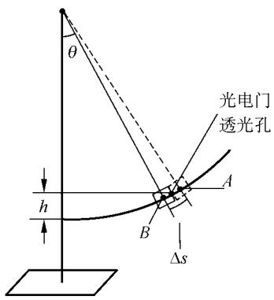
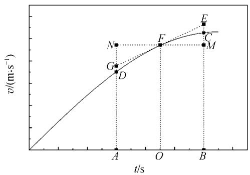

# 对光电门测得的瞬时速度的误差分析

基础教育研究

周 勇‚李更磊‚郑小平

（华中师范大学 物理科学与技术学院‚湖北 武汉430079）

摘 要：以"摆球法验证机械能守恒定律"实验为例，通过2种方法分析了由光电门测得的摆球瞬时速度的误差．得出了在中学一些实验中由光电门测得的物体的瞬时速度值小于它的实际值的结论．

关键词：平均速度；瞬时速度；光电门；误差

中图分类号：O311

文献标识码：A

文章编号：1005-4642（2009）01-0024-03

## 1 引 言

尽管有些文献已经提出了可以准确测量［1］或推算［2］瞬时速度的方法，但为了简便起见，实验上通常还是采用近似的方法来获得物体瞬时速度．最常见的测量物体的瞬时速度的仪器有打点定时器和光电门．打点定时器是用某一段时间内的平均速度来近似（当然在某些特殊情况下，这种“近似”并不会带来误差，例如在匀加速运动中）代替某一时刻的瞬时速度，而光电门是用某一段时间内的平均速度来近似代替某一点处的瞬时速度．由于打点定时器的可靠性相对较差，现在很多实验室都采用光电门来测量物体的速度．

用光电门测得的物体瞬时速度也只是近似值，存在系统误差，下面通过2种方法来具体分析在“摆球法验证机械能守恒定律”［3］实验中通过光电门测得的摆球的瞬时速度的误差．

## 2 平均速度与瞬时速度

平均速度 $\overline{v}$ 的定义是物体在某段时间 $\Delta t$ 内运动的位移 $\Delta s$ 与这段时间的比值，即 $\overline { \mathbf { v } } = \frac { \Delta s } { \Delta t }$，它表示的是物体在 $\Delta s$ 这段位移内运动的平均快慢程度［4，5］．如果要反映物体在某一点的运动速度，这时就只能用瞬时速度 v 表示．瞬时速度是平均速度在 $\Delta t \to 0$ 时的极限值，即 $v = \lim _ { \Delta t \to 0 } \frac { \Delta s } { \Delta t } = \frac { \mathrm { d } s } { \mathrm { d } t }$．在数学上，瞬时速度 v（t）是位移 s（t）的一阶导数，它可精确地反映出物体在各个时刻的运动状态．

## 3 光电门测量物体的瞬时速度的原理

光电门是物理实验中经常用到的一种精度较高的光敏器件．当它的挡光孔没有被挡光时，光电门不计时；当有物体经过它的挡光孔时，光电门开始计时；当物体离开挡光孔时，挡光结束，光电门停止计时．利用光电门的这种功能，如果已知运动物体的挡光长度 $\Delta s$，通过记录该物体遮挡光路的时间 $\Delta t$，即可以得出物体在挡光过程中运动的平均速度 $\overline { \mathbf { v } } = \frac { \Delta s } { \Delta t }$．

在很多物理实验中，例如在“摆球法验证机械能守恒定律”［5］的实验中，需要知道运动的物体在某一点处的瞬时速度．然而在实际操作过程中，$\Delta t \to 0$ 是不可能实现的．因此，实验中通常用物体在通过某点附近的一个极短的时间段里的平均速度来近似的代替它在这点的瞬时速度，光电门的用途之一就是运用这种原理来测量物体在某一点处的瞬时速度．

## 4 对光电门测得的瞬时速度的误差分析

在“摆球法验证机械能守恒定律”的实验中，摆球在某一高度 h 处的速度 v实验 就是用光电门来测得的，下面首先通过示意图（图1）来对实验中测得的小球在 h 高度处的速度 v实验 和它在这点的实际速度 v实际 进行一些说明，然后分别从摆球的运动方程以及它的 v-t 图出发对 v实验 和 v实际 二者的大小关系进行比较，从而得出光电门在这种情况下测得的瞬时速度的误差．

  
图1 实验示意图

## 4．1 摆球的测量速度v 实验与实际速度v实际

圆柱形摆球（图1中用小矩形来表示）的直径为 $\Delta s$．当摆球的左边缘刚好接近光电门透光孔时，挡光开始，光电门开始计时；直到摆球的右边缘刚好离开光电门透光孔时，挡光结束，光电门停止计时．如果将这段时间记为 $\Delta t$，那么根据光电门测量物体运动瞬时速度的原理可知：

$$
v_{\text{实验}} = \overline { \mathbf { v } } = \frac { \Delta s } { \Delta t } ,
$$

即光电门测得的瞬时速度 v实验 实际上是图1中摆球处于虚线位置（A 点）时的质心点与它处于实线位置（B 点）时的质心点这两点之间一段的平均速度 $\overline{v}$．而摆球在 h 高度处的实际速度 v实际 应该是它的质心点刚好在光电门的透光孔处时的速度，即在 $\Delta s$ 的中点位置处的速度．

## 4．2 利用运动方程分析测得瞬时速度的误差

实验中，假设每次所取得 h 都不是很大，这时摆球的运动可以近似看成是简谐运动．设其运动方程为

$$
x = A \cos ( \omega t ) , \tag{1}
$$

则相应的速度方程为

$$
v = - \omega A \sin ( \omega t ) . \tag{2}
$$

由 $( 1 ) \sim ( 2 )$ 式可得摆球在某一位置 x 处时，$x$ 与 $v \left( x \right)$ 存在以下关系：

$$
x ^ { 2 } = A ^ { 2 } - \frac { v ^ { 2 } ( x ) } { \omega ^ { 2 } } . \tag{3}
$$

设摆球在 A，B 两点对应的时间分别为 $t _ { A } = t - \frac { \Delta t } { 2 }$，$t _ { B } = t + \frac { \Delta t } { 2 }$，则有：

$$
v_{\text{实验}} = \overline { \mathbf { v } } = \frac { 1 } { \Delta t } \left[ x \left( t + \frac { \Delta t } { 2 } \right) - x \left( t - \frac { \Delta t } { 2 } \right) \right] . \tag{4}
$$

当摆球的质心在光电门透光孔处时，对应的 x（为了区别，用 $\widetilde { x }$ 表示）为

$$
\widetilde { x } = \frac { 1 } { 2 } \left[ x \left( t + \frac { \Delta t } { 2 } \right) + x \left( t - \frac { \Delta t } { 2 } \right) \right] , \tag{5}
$$

将（1）式分别代入 $( 4 ) \sim ( 5 )$ 式并消去 t，结合（3）式，做适当变形后可得：

$$
v_{\text{实验}} ^ { 2 } = \left( \frac { \sin \left( \omega \frac { \Delta t } { 2 } \right) } { \omega \frac { \Delta t } { 2 } } \right) ^ { 2 } \left[ v ^ { 2 } ( \widetilde { x } ) - \widetilde { x } ^ { 2 } \omega ^ { 2 } \tan ^ { 2 } \left( \omega \frac { \Delta t } { 2 } \right) \right] . \tag{6}
$$

从（6）式可以看出，仅当 $\Delta t \to 0$ 时，由实验测得的摆球的瞬时速度 v实验 才与摆球在 $\widetilde{x}$ 的实际速度 $v ( \widetilde { x } )$ 相等；当 $\Delta t \neq 0$ 时，$v_{\text{实验}} < v ( \widetilde { x } )$．也就是说，通过光电门测得的摆球的瞬时速度是小于它的真实速度的．

以上将摆球的运动近似看成是简谐运动，从它的运动方程出发，推导了由实验测得的瞬时速度与它的实际速度之间的关系．下面将从摆球的 v-t 图出发来分析和推导这种关系．

## 4．3 利用v-t 图分析测得瞬时速度的误差

摆球（在图1中的轨迹上）自上而下摆动过程中，速度不断增大，而影响速度大小的切向加速度（a切 = g sin θ）不断减小，因此在这个过程中，摆球的 v-t 图大致如图2所示．A，B 之间的时间间隔为 $\Delta t$，O 点是 AB 的中点，因此，把摆球在 O 时刻对应的速度 $v _ { F }$ 记为 v中时．辅助线 EG 是过点 F 且与 v-t 图相切的直线，其他4条辅助线分别是与 x 轴和 y 轴平行的直线．由 v-t 图的物理意义可知：

$$
\overline { \mathbf { v } } \Delta t = \Delta s = S _ { A B C D } , \tag{7}
$$

  
图2 速度分析图

又

$$
v_{\text{中时}} \Delta t = S _ { A B M N } , \tag{8}
$$

而

$$
S _ { A B M N } = S _ { A B E G } , \tag{9}
$$

$$
S _ { A B C D } < S _ { A B E G } , \tag{10}
$$

故

$$
S _ { A B C D } < S _ { A B M N } . \tag{11}
$$

由（7）～（11）式可得

$$
\overline { \mathbf { v } } < v_{\text{中时}} . \tag{12}
$$

若将摆球在 $\Delta s$ 的中点处（即光电门透光孔处）的速度记为 v中位，则 v实际 = v中位，而由图2很容易得出

$$
v_{\text{中时}} < v_{\text{中位}} , \tag{13}
$$

由（12）～（13）式可得

$$
\overline { \mathbf { v } } < v_{\text{中时}} < v_{\text{中位}} , \tag{14}
$$

所以

$$
v_{\text{实验}} < v_{\text{实际}} . \tag{15}
$$

从上述分析可以得出结论：在“摆球法验证机械能守恒定律”实验中，用光电门测得的摆球在某点的瞬时速度比它在这点的实际速度偏小．

这种方法从物体运动的 v-t 图出发，利用图线的物理意义，同样得出了在“摆球法验证机械能守恒定律”实验中，用光电门测得的摆球在某点的瞬时速度小于它在这点的实际速度的结论．与第一种方法相比，这种方法更直观，便于理解，一般中学生就能掌握，并且在分析运动学类相关问题时可以得到广泛的应用．

## 5 结束语

在以“摆球法验证机械能守恒定律”实验为例分析由光电门测得的摆球的瞬时速度的误差时，在第一种方法（4.2部分）中，将小球的运动近似为简谐运动．在中学的一些物理实验中，物体除了做简谐运动之外最常见的运动是作匀变速直线运动．在匀变速直线运动中，上述的2种方法同样可以用来分析光电门（或打点定时器）测得的物体瞬时速度的误差．事实上，在匀变速直线运动中由光电门测得的物体在某点的瞬时速度值比它在这点的实际值同样也是要偏小的［6］．

## 参考文献：

［1］ Rochon P‚Gauthier N．Induction transducer for recording the velocity of a glider on an air t rack ［ J ］ Am．J．Phys．‚1982‚50：84-86

［2］ Chen H．A note on the study of uniformly acceler-ated motion ［J］．Am．J．Phys．‚1954‚22：253-254

［3］ 蔡晓明．机械能守恒定律验证实验的突破－－－也谈朗威 DISLab 数字实验系统的应用［J］．物理教师，2007，28（6）：35-36．

［4］ 赵凯华，罗蔚茵．新概念物理教程 ·力学 ［ M ］．北京：高等教育出版社，1995：18-23

［5］ 邓华，仲扣庄．用 DIS 探究瞬时速度和平均速度的关系［J］．物理教师，2007，28（5）：37-38

［6］ Denardo B‚Wong S‚Alpha．Errors due to average velocity ［J］．Am．J．Phys．‚1989‚57：528-534

# Analyzing the errors in instantaneous velocity measured with photogate timer

Z HOU Yong‚LI Geng-lei‚Z HENG Xiao-ping

（College of Physical Science and T echnology‚Central China Normal U niversity‚Wuhan 430079‚China）

Abstract： With the example of the experiment of validating the conservation law of mechanical energy using single pendulum‚the errors in the instantaneous velocity of the pendulum measured with photogate timer are analyzed with tw o methods．T he conclusion is that the values of the instantaneous velocity measured with photogate timer in some experiments are smaller than the real ones

Key words： average velocity；instantaneous velocity；photogate timer；error

（责任编辑：郭　伟）