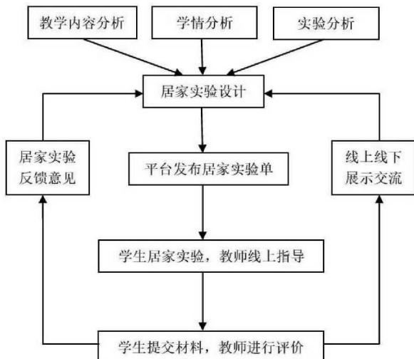
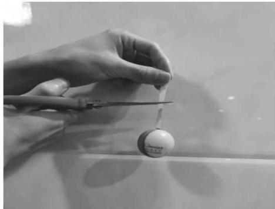
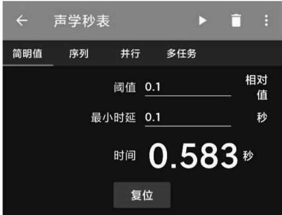

# 高中物理居家实验的设计与研究

# ——以”重力加速度测量”为例

张华杰 黄志高＊

福建师范大学物理与能源学院

摘 要：居家实验是物理课外实验的一种形式，可以激发学生的学习兴趣，培养学生的物理学科核心素养，是学校物理实验教学的有效补充。文章对物理居家实验进行相关介绍，设计高中物理居家实验的开展流程，并以”测量重力加速度”为例加以分析。

关键词：高中物理；居家实验；重力加速度；Phyphox

物理是一门以实验为基础的学科，物理实验在培养学生的物理学科核心素养中发挥重要的作用。随着新冠疫情爆发，许多教学从线下变成了线上，相对于理论课，物理实验教学面临着更大的困难，而物理居家实验为实验教学带来了新的模式和思路［1］。近些年来涌现了许多物理居家实验的研究，但从目前来看，物理居家实验的研究更多是集中在大学阶段，初中阶段也有较多的简单趣味小实验，而高中生相比于初中生具有更强的逻辑思维能力以及自主探究能力，通过自主进行实验操作、数据处理、得出结论等环节，能更好地促进他们的学科能力、创新思维能力、实践操作能力的发展，同时让学生体会物理的乐趣。可见对高中物理居家实验的开展进行研究十分必要。

随着信息化时代的到来，互联网平台使得师生之间的交流更加密切，教师可以利用网络平台来开展居家实验，另一方面，智能手机集成了多种高精度、高灵敏度的传感器，使得测量结果更准确、操作更方便［2］。因此，智能手机成为学生进行居家实验的好助手。

## 1 物理居家实验的概念及特点

物理居家实验是物理课外实验的一种形式。它是指学生在教师的指导下，利用生活中易获得的物品、智能手机和互联网等，在家中或室外场所自主地进行的一类实验。它具有这样的特点：①简便性：居家实验的材料应该是生活中容易获得的物品，且实验不宜过于复杂；②趣味性：利用生活用品搭建的实验或者对生活现象进行研究，具有趣味性，易激发学生的学习兴趣；③科学性：居家实验同样蕴含着丰富的物理原理，能够促进学生对知识的理解；④开放性：居家实验的选材和方案并不固定，学生可以根据现实情况形成自己的实验方案。

## 2 开展物理居家实验的意义

## 2.1 深化学生对知识的理解

在学校的实验教学中，许多学生按着既定的实验步骤来完成实验操作，并未仔细思考实验过程中所涉及的物理原理。而物理居家实验是教师根据教学内容进行设计的，学生通过自主的居家实验，及时将知识内化，完善自己的认知。并且学生可以自主选择实验器材，构思新的实验方案，灵活应用知识，加强物理学科的理论知识［3］。

## 2.2 促进学生物理学科核心素养的发展

居家实验作为学校实验的有效补充，在一定程度上可以弥补学校实验教学的不足。许多教师和学生认定学习物理实验是为考试提供服务，仅是提升成绩的工具［4］。并且由于实验课时不够充足，许多学生在实验课上往往是按部就班地完成实验操作，缺少自己的思考。而物理居家实验为学生提供更多的自主探究机会，学生可以根据自己现有的材料形成自己的实验方案，同时思考解决在实验中遇到的各类问题。可见，高中物理居家实验具有重要的意义，它能激发学生科学探究的兴趣，引导学生发展科学探究能力，形成科学思维，养成勇于创新、锐于进取的科学精神［5］。

## 2.3 提高学生学习物理的兴趣

高中物理的知识体系较复杂，许多学生学习起来常常感到吃力，也因此逐渐失去学习物理的兴趣，而物理居家实验利用生活中常见的物品来进行实验或者对生活中的某个物理现象进行探究，可以让学生体会物理与生活的融合，并且学生在居家实验中进行充分的自主探究，可以激发学生的好奇心和求知欲，调动学生的学习积极性和学习兴趣，进而强化学习的内部动机［6］。

## 3 开展物理居家实验的流程

高中物理居家实验的开展流程如图1所示，首先教师要对教学内容、学情、相关实验进行一个综合的分析，以便更好地进行居家实验的设计。教师应积极进行居家实验的设计，逐渐形成一个"高中物理居家实验库"，并确保实验的可行性、安全性等，以便更好地根据教学内容发布合适的居家实验；接着教师根据教学进度在网络平台发布居家实验单，居家实验单的设计要给出实验参考方案，同时应留给学生充分的思考余地；然后学生进行居家实验，实验以学生自主探究为主，同时教师要提供线上指导；学生完成实验后在网络平台提交居家实验单等材料，教师根据材料对学生进行有效评价；最后教师根据居家实验的开展情况进行线上或者线下的展示交流，并获得学生对该居家实验的反馈意见，以便更好地改进实验设计以及居家实验的开展。

  
图1 高中物理居家实验开展流程

## 4 以"重力加速度测量"为例开展居家实验

## 4.1 前期分析

自由落体运动是匀变速直线运动的一个特例，是教学的重点。同时在《普通高中物理课程标准（2017年版2020年修订）》也提出了"了解空气阻力对落体运动的影响"的活动建议［8］。在之前匀变速直线运动章节的学习中，学生已经具备一定的实验操作理论知识，具有记录实验数据、绘制图像的能力［2］。通过"重力加速度测量"实验，并探究空气阻力对落体运动的影响，可以对所学的知识进行复习和巩固，同时感受生活中的自由落体运动，体会物理实验的乐趣。

Phyphox软件是一款可以进行物理数据测量的APP，近些年已经较广泛地应用于物理实验教学，是助力学生开展居家实验的好助手。Phyphox软件中的声学秒表测量功能，精确度可达到0.001s级别，非常有助于自由落体运动的时间测量。

## 4.2 居家实验设计

测量重力加速度的方法较多，例如自由落体法、单摆测重力加速度等，由于本实验是安排在学生学习自由落体运动时开展的，因此选择自由落体法来测量。可根据 $\scriptstyle { \pmb { g } } = { \frac { 2 h } { t ^ { 2 } } }$ 进行测量，因此只需测出物体做自由落体运动的高度h和时间t，便可计算出当地的重力加速度。在设计家庭实验时，要提出参考方案，让学生有思路可循。但同时要给学生留有充分的思考余地，鼓励学生参考丰富的网络资源，根据自己家中不同的取材条件灵活设计自己喜欢的方案来完成实验，这样他们的思维也能更加活跃、开放，有助于促进学生个性化和差异化的发展［7］<!-- 存疑：PDF此处显示为"？"，据上下文推断为参考文献［7］ -->。此案例设计的居家实验单如表1所示。

表1 "重力加速度测量"居家实验单

**高中物理居家实验单**

实验项目：重力加速度测量　　班级：　　　姓名：

1．实验目的：

（1）测量当地的重力加速度 $\pmb { g }$

（2）探究空气阻力对落体运动的影响

2．实验原理：由 $h { = } \frac { 1 } { 2 } g t ^ { 2 }$ 可知 $\scriptstyle { \pmb { g } } = { \frac { 2 h } { t ^ { 2 } } }$，测出物体自由下落的高度h和时间t，便可计算出当地的重力加速度。Phyphox软件中的声学秒表能够测量两个响亮声音信号间的时间间隔，物体下落撞击地面会有一个声音，因此只需在物体自由下落时再制造一个声音，便可由声学秒表测出物体自由下落的时间t。

3．参考方案：

（1）实验器材：智能手机、乒乓球、网球、小玻璃球、剪刀、卷尺、强力胶、纸条

（2）实验步骤：

①将纸条绕乒乓球一周，并用强力胶粘好以防止脱落，同时预留出一小段纸条可以将乒乓球悬挂，将其放置在一定高度，用卷尺测得高度h，打开Phyphox软件的声学秒表并启动，用剪刀将纸条剪断，剪的时候应用力一些，使得剪刀手柄碰撞发出的声音可以让Phyphox软件检测到，通过声学秒表测得物体下落时间t；

②根据 $\scriptstyle { g = { \frac { 2 h } { t ^ { 2 } } } }$ 计算当地重力加速度，并重复实验取平均值以减小误差；

③利用网球和玻璃球重复①②的步骤来进行重力加速度测量。

4．我设计的方案：

（1）实验器材：

（2）实验步骤：

5．实验数据及处理：

6．实验结论：

7．实验反思：

8．意见反馈：

9．教师点评：

## 4.3 实验过程

教师将所选的高中物理居家实验单上传到QQ群等网络平台，供班级同学下载并进行实验探究。在学生进行自主探究的过程中，教师也可通过QQ或微信与学生保持联系，为学生提供线上指导，包括实验思路引导、实验结果的理论分析，保障实验能够有效进行，引导学生用生活中常见的物品代替实验器材，形成自己的实验方案，培养学生将理论知识和实践相结合的能力。实验装置如图2所示，第一次测量时间如图3所示。

重复5次实验，所得实验数据如表2所示，经数据处理可知由乒乓球测得的重力加速度平均值 $\mathrm { \pmb { g } } { = } 9 . 4 2 \ \mathrm { \ m } / \mathrm { s } ^ { 2 }$ ，当地的重力加速度为 $9.789\ \mathrm{m/s^{2}}$，测量的相对误差为3.89%；利用网球进行实验所获得的数据如表3所示，经数据处理可知由网球测得的重力加速度平均值 $\scriptstyle { \mathsf { g } = 9 . 6 6 \ { \mathsf { m } } / \mathsf { s } ^ { 2 } }$ ，测量的相对误差为1.32%；利用小玻璃球进行实验所获得的数据如表4所示，经数据处理可知由小玻璃球测得的重力加速度平均值$\scriptstyle { g = 9 . 7 6 \ m / \mathrm { s } ^ { 2 } }$ ，测量的相对误差为0.30%。由实验结果可知，乒乓球受空气阻力的影响最大，而网球和小玻璃球受到的空气阻力影响较小，可见，空气阻力对密度较小的物体的落体运动会产生较大的影响。

  
图2 实验装置

  
图3 第一次测量时间

表2 乒乓球自由落体实验数据
<table><tr><td rowspan=1 colspan=1>高度 h/m</td><td rowspan=1 colspan=1>次数</td><td rowspan=1 colspan=1>自由落体时间t/s</td><td rowspan=1 colspan=1>自由落体加速度 $\mathbf { g } / \mathbf { m } \cdot \mathbf { s } ^ { - 2 }$ </td></tr><tr><td rowspan=5 colspan=1>1.60</td><td rowspan=1 colspan=1>1</td><td rowspan=1 colspan=1>0.583</td><td rowspan=1 colspan=1>9.41</td></tr><tr><td rowspan=1 colspan=1>2</td><td rowspan=1 colspan=1>0.582</td><td rowspan=1 colspan=1>9.44</td></tr><tr><td rowspan=1 colspan=1>3</td><td rowspan=1 colspan=1>0.584</td><td rowspan=1 colspan=1>9.38</td></tr><tr><td rowspan=1 colspan=1>4</td><td rowspan=1 colspan=1>0.583</td><td rowspan=1 colspan=1>9.41</td></tr><tr><td rowspan=1 colspan=1>5</td><td rowspan=1 colspan=1>0.581</td><td rowspan=1 colspan=1>9.47</td></tr></table>

表3 网球自由落体实验数据
<table><tr><td rowspan=1 colspan=1>高度h/m</td><td rowspan=1 colspan=1>次数</td><td rowspan=1 colspan=1>自由落体时间 t/s</td><td rowspan=1 colspan=1>自由落体加速度 $g / \mathbf { m } ^ { * } \mathbf { s } ^ { - 2 }$ </td></tr><tr><td rowspan=5 colspan=1>1.60</td><td rowspan=1 colspan=1>1</td><td rowspan=1 colspan=1>0.575</td><td rowspan=1 colspan=1>9.68</td></tr><tr><td rowspan=1 colspan=1>2</td><td rowspan=1 colspan=1>0.580</td><td rowspan=1 colspan=1>9.51</td></tr><tr><td rowspan=1 colspan=1>3</td><td rowspan=1 colspan=1>0.573</td><td rowspan=1 colspan=1>9.74</td></tr><tr><td rowspan=1 colspan=1>4</td><td rowspan=1 colspan=1>0.574</td><td rowspan=1 colspan=1>9.71</td></tr><tr><td rowspan=1 colspan=1>5</td><td rowspan=1 colspan=1>0.575</td><td rowspan=1 colspan=1>9.67</td></tr></table>

表4 玻璃球自由落体实验数据
<table><tr><td rowspan=1 colspan=1>高度 h/m</td><td rowspan=1 colspan=1>次数</td><td rowspan=1 colspan=1>自由落体时间t/s</td><td rowspan=1 colspan=1>自由落体加速度 $\mathbf { g } / \mathbf { m } ^ { \bullet } \mathbf { s } ^ { - 2 }$ </td></tr><tr><td rowspan=5 colspan=1>1.60</td><td rowspan=1 colspan=1>1</td><td rowspan=1 colspan=1>0.574</td><td rowspan=1 colspan=1>9.71</td></tr><tr><td rowspan=1 colspan=1>2</td><td rowspan=1 colspan=1>0.575</td><td rowspan=1 colspan=1>9.67</td></tr><tr><td rowspan=1 colspan=1>3</td><td rowspan=1 colspan=1>0.571</td><td rowspan=1 colspan=1>9.81</td></tr><tr><td rowspan=1 colspan=1>4</td><td rowspan=1 colspan=1>0.572</td><td rowspan=1 colspan=1>9.78</td></tr><tr><td rowspan=1 colspan=1>5</td><td rowspan=1 colspan=1>0.571</td><td rowspan=1 colspan=1>9.81</td></tr></table>

## 4.4 实验评价

在实验结束后，教师需对学生的实验过程及结果进行有效评价，以确保居家实验真实促进学生物理核心素养的发展。对于利用参考方案进行实验的学生，教师要对其实验过程、实验数据、实验结论、实验反思等进行评价。而对于利用自己设计的实验方案进行实验的同学，教师要对方案进行点评，表扬实验设计的创新性、实验结果的准确性。同时，教师也要针对实验误差以及学生在实验中遇到的问题与同学进行充分讨论，以便学生更好地理解实验过程，同时有利改进居家实验的设计。

## 5 结语

该实验设计取材方便，实验材料都是生活中非常容易获得的物品，方便学生居家进行重力加速度的测量并亲身体会空气阻力对物体落体运动的影响，体验物理实验的乐趣。新冠疫情的爆发使得越来越多的教师开展物理居家实验的研究，但物理居家实验的作用不仅仅在于疫情期间缓解物理实验教学的困境，物理居家实验可以很好地培养学生的动手操作能力、自主探究能力，促进学生物理学科核心素养的发展，丰富物理实验教学的方式，因此值得广大教师对高中物理居家实验的开发与实践进行研究。

## 参考文献：

［1］王亚芳，高义，陈倩，等．利用手机Phyphox软件开展居家实验的实践［J］．实验室研究与探索，2022，41（1）：249-253．

［2］殷永娟．利用Phyphox助力物理实验教学——以"加速度的测量、探究"为例［J］．物理之友，2021，37（1）：35-37．

［3］郑填，任一凡，王路．线上教学新探构建"家庭物理实验室"——以"测量物质折射率"实验设计为例［J］．物理教学探讨，2022，40（6）：56-58．

［4］陈艳艳．高中物理家庭实验的开发与实践研究［J］．数理化解题研究，2018（27）：49-50．

［5］巴春玲，汤金波．基于家庭物理实验培养学生学科核心素养［J］．福建教育，2022（15）：51-53．

［6］刘苏祥．新课改下高中物理实验教学模式的探索与评价研究［J］．中学物理，2015，33（3）：28．

［7］宋怀彬，江卫东，王仕玉．网络环境下初中物理探究体验式家庭实验的开发与实践［J］．物理教学，2021，43（3）：33-35，42．

［8］中华人民共和国教育部．普通高中物理课程标准（2017年版2020年修订）［S］．北京：人民教育出版社，2020：75-76．

［9］曹阳，张轶炳．基于现代信息技术的物理实验对比研究——以"测量重力加速度"为例［J］．中学物理，2019，37（13）：29-32．

［10］秦平力，余雪里，张昱．"互联网+"背景下大学物理实验教学创新与探索［J］．物理通报，2019（9）：100-103，109．