# 平均速度近似为瞬时速度造成系统误差的多方法研究———以倾斜气垫导轨法测量重力加速度实验设计为例

宋艳敏 王吉昌 王一凡 于永江 马晓光(鲁东大学物理与光电工程学院,山东 烟台 264025)

## 摘 要

匀变速直线运动加速度计算公式应用中,最基本的物理观念是几个物理量之间存在着”一一对应”关系。在倾斜气垫导轨法测量重力加速度实验中,滑块运动的瞬时速度无法准确测量,只能用平均速度代替,造成了公式应用中要求的物理量之间的”一一对应”关系被破坏,产生了无法克服的系统误差。本文设计了匀加速和匀减速直线运动两种实验情境,分别用控制变量法、数学解析法和图像法等多种方法研究了不同实验情境的系统误差,将系统误差分析与物理观念构建建立了联系,分析了挡光片宽度 d、加速情境滑块静止释放时离第一个光电门的距离 L、减速情境滑块静止时离第二个光电门距离 M、两光电门间距 S 和气垫导轨倾角θ 等参量对该系统误差的影响,研究表明:d、S、L 或 M 参量对该系统误差都有影响;d 值的大小是造成该系统误差的主要因素;θ 参量无影响;应用公式(1)计算重力加速度值更精确。

关键词 物理观念;平均速度;瞬时速度;系统误差

# MULTI-METHOD RESEARCH ON SYSTEM ERROR CAUSED BY AVERAGE SPEED APPROXIMATE TO INSTANTANEOUS SPEED —TAKING THE EXPERIMENTAL DESIGN OF MEASURING GRAVITY ACCELERATION BY INCLINED AIR CUSHION GUIDE RAIL METHOD AS AN EXAMPLE

SONG Yanmin WANG Jichang WANG Yifan YU Yongjiang MA Xiaoguang (School of Physics and Optoelectronics, Ludong University, Yantai, Shandong 264025)

Abstract In the application of the acceleration calculation formula of uniform linear motion, the most basic physical concept is that there is a one-to-one correspondence relationship between several physical quantities. In the experiment of measuring the acceleration of gravity by the inclined air cushion guide rail method, the instantaneous velocity of the slider movement cannot be measured accurately, and can only be replaced by the average velocity, which causes the one-to-one correspondence relationship between the physical quantities required in the application of the formula to be destroyed, resulting in insurmountable systematic error. In this paper, two experimental scenarios of uniform acceleration and uniform deceleration linear motion are designed, and the systematic errors of different experimental scenarios are studied by various methods such as control variable method, mathematical analysis method and image method. The system error analysis is connected with the construction of the physical concept, and the influence of parameters such as the width d of the light barrier is analyzed, the distance L from the first photogate when the acceleration situation slider is released at rest, the distance M from the second photoelectric gate when the slider is stationary in the deceleration scenario, the distance S between the two photogates and the inclination angle θ of the air cushion guide rail to the system error is analyzed. The research shows that the parameters of d, S, L or M all affect the system error: the value of d is the main factor causing the system error; the θ parameter has no effect; the application of formula (1) to calculate the acceleration of gravity is more accurate.

Keywords physical concepts; average speed; instantaneous speed; systematic error

物理学研究离不开物理实验,物理实验中都会存在误差,误差分为系统误差和随机误差。系统误差与随机误差不同,往往是有迹可循的,它通常遵循一定的规律,由此可见,只要找到系统误差产生的原因和规律,就可以采取相应的措施减少或者是消除系统误差。分析研究系统误差是实验工作一个重要组成部分,在各种各样的物理实验中,人们为消除系统误差做出了很多努力。［1-3］从实验环节上来讲,可以从以下两个环节来消除系统误差:第一,消除产生系统误差的根源。在测量之前,要求测量者对可能产生系统误差的环节作仔细的分析,从根源上消除。第二,在测量过程中限制和消除系统误差。对于固定不变的系统误差,在测量过程中常常采用抵消法、交换法和对称观测法等加以限制和消除。［4］减小系统误差主要考虑测量方法、测量仪器、测量环节和测量人员等四个因素。［5］文献[6]报道了气垫导轨实验中,由于测量仪器的因素,瞬时速度无法直接测量,不得不利用平均速度替代瞬时速度,必然会造成系统误差,并对该误差进行研究,但受篇幅限制,该文献仅研究了气垫导轨测量重力加速度实验中加速运动的实验情境,该实验中计算加速度的公式有两个,即公式(1)和公式(2),文献也仅讨论公式(1)的应用。

$$
a = \frac { v _ { 2 } ^ { 2 } - v _ { 1 } ^ { 2 } } { 2 S }\tag{1}
$$

$$
a = \frac { v _ { 2 } - v _ { 1 } } { t _ { 1 2 } }\tag{2}
$$

本文将在气垫导轨实验仪器上,设计匀加速直线运动和匀减速直线运动两种情境,并对实验中两个加速度计算公式进行全面讨论,开展解析法、控制变量法和图像法等多方法研究,重点解决运动学物理观念的"一一对应"问题,即运动学公式(1)应用中要注意的某一段时间物体运动的位移起点与初速度、终点与末速度必须是一一对应的关系,或运动学公式(2)应用中某一段时间的起始时刻与初速度、终点时刻与末速度必须是一一对应的关系,这种一一对应关系在理论教学应用中只是泛泛而论,而在本实验情境下,这种一一对应关系被打破,表现为系统误差,对运动学物理观念的构建定能发挥积极作用。

## 1 实验情境设计

气垫导轨实验装置是由导轨、滑块以及两个光电门组成,实验中导轨喷射出的压缩空气与滑块之间形成气垫,滑块可以无摩擦运动,图1是实验装置图。

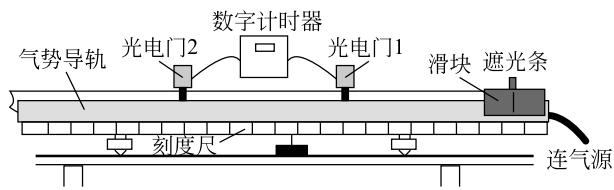  
图1 气垫导轨实验装置图

光电门是由聚光灯泡和光电管组成,立在导轨的一侧。光电门与数字毫秒计相连,通过光路是否遮挡影响光电管电路导通与否,输出信号使数字毫秒计开始或停止计时。固定在滑块上的 U 形挡光片实现光路遮挡,两个前沿的间距为 d,如图2所示。工作时滑块携带 U 形挡光片向右运动,挡光片第一前沿通过光电门1挡住光路,数字毫秒计开始计时,第二前沿通过光电门再次挡住光路,计时结束,这样记录了滑块通过光电门1的时间 $t _ { 1 }$ ;同样可以记录 U 形挡光片通过光电门2的时间 $t _ { 2 }$ 。另外,当 U 形挡光片第一前沿通过光电门1,数字毫秒计开始计时,再通过光电门2停止计时,这样记录滑块通过两个光电门所用的时间 $t _ { 1 2 }$。

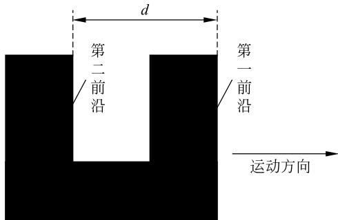  
图2 U 形挡光片装置示意图

气垫导轨法测量重力加速度实验中,长度为 l的气垫导轨先调整为水平,再左端垫高 h,构造出一个与水平面夹角为 θ 的斜面,创建一个加速下滑情境,滑块距离第一个光电门为 L 处静止释放,携带着宽度为 d 的挡光片一起做加速直线运动,如图3所示。也可以创建一个减速上升的实验情境如图4,这时是气垫导轨右边垫高 h,让滑块初速度较大,从左向右减速向上滑动,分别经过两个光电门,并且停止时离第二个光电门距离为 M。设$a$ 表示滑块运动的加速度,实验中惯用的处理方法是测得 $t _ { 1 }$、$t _ { 2 }$ 和 $t _ { 1 2 }$ 以及两光电门之间的距离 S,用滑块通过两个光电门位置处的平均速度 ${ \overline { { v _ { 1 } } } } = { \frac { d } { t _ { 1 } } }$ 和$\overline { { v _ { 2 } } } = \frac { d } { t _ { 2 } }$ 分别表示瞬时速度 $\boldsymbol { v } _ { 1 }$ 和 $\boldsymbol { v } _ { 2 }$ 。那么滑块运动的加速度可以用上文公式(1)或公式(2)分别计算。

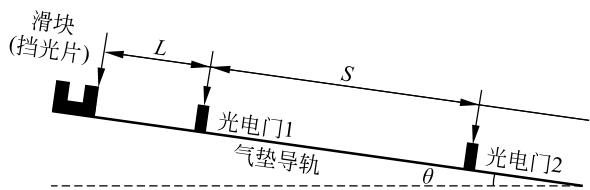  
图3 匀加速直线运动实验情境示意图

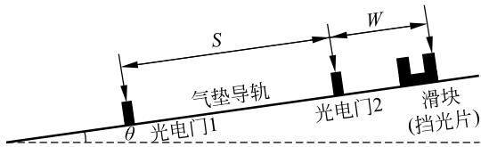  
图4 匀减速直线运动实验情境示意图

当地的重力加速度计算用公式(3)表示,h 和 l 由实验测得,在 h 比较小的情况下 sinθ 可表示为 $h / l$ 。另外,加速运动取正号,减速运动取负号。

$$
g = \pm { \frac { a } { \mathrm { s i n } \theta } }\tag{3}
$$

根据瞬时速度定义,该实验设计中直接测量滑块通过光电门的瞬时速度是很困难的,不得不用平均速度替代瞬时速度,虽然 d 比较小,对应的 t 也很短,公式(1)(2)用平均速度代替瞬时速度的处理方法也会带来无法克服的系统误差。

## 2 系统误差分析 解析法

## 2.1 匀加速直线运动

## 2.1.1 位移 S 和时间间隔 $t _ { 1 2 }$ 的系统误差分析

图5(a)表示了滑块在匀加速直线运动过程中几个关键时刻点对应的空间位置、时间和速度演化图像［6］,图5(b)是对应的 $v - t$ 图。为了便于分析,将挡光片两个前沿上各取一个点 $O _ { 1 }$ 和 $O _ { 2 }$。设0时刻, $O _ { 1 }$ 点静止,其速度 $v = 0$ ,$O _ { 1 }$ 点离光电门1点的距离为 $L$ ;$t _ { 0 }$ 时刻 $O _ { 1 }$ 点运动到光电门1点,设运动速度为 $v _ { 1 0 }$ ;$t _ { 0 } + t _ { 1 }$ 时刻 $O _ { 2 }$ 点运动到光电门1点,运动速度为 $v _ { 1 t 1 }$ ;在 $t _ { 0 } \to t _ { 0 } + t _ { 1 }$ 时间内,$O _ { 1 }$ 点位移为 $d$ ,用时 $t _ { 1 }$ ,实验中用 $t _ { 1 }$ 时间段的平均速度近似的表示 $O _ { 1 }$ 点通过光电门1的瞬时速度 $v _ { 1 }$ ,根据匀变速直线运动规律,理论上 $O _ { 1 }$ 点的瞬时速度等于 $v _ { 1 }$ 的时刻应该在 $t _ { 0 } + 0.5 t _ { 1 }$ 时刻;$O _ { 1 }$ 点通过光电门1到2的时间间隔为 $t _ { 1 2 }$ ;在 $t _ { 0 } + t _ { 1 2 }$ 时刻 $O _ { 1 }$ 点通过光电门2,$t _ { 0 } + t _ { 1 2 } + t _ { 2 }$ 时刻 $O _ { 2 }$ 点通过光电门2,滑块通过光电门2用时为 $t _ { 2 }$ ,在 $t _ { 2 }$ 时间段内 $O _ { 1 }$ 点通过光电门2的瞬时速度等于平均速度 $v _ { 2 }$ 应该在 $t _ { 0 } + t _ { 1 2 } + 0.5 t _ { 2 }$ 时刻, $t _ { 0 } + 0.5 t _ { 1 } \to t _ { 0 } + t _ { 1 2 } + 0.5 t _ { 2 }$ 这两个时刻 $O _ { 1 }$ 点的位移用 $S _ { 理论 }$ 表示,可以表示为

$$
S _ { 理论 } = \frac { a _ { 真 } ( t _ { 0 } + t _ { 1 2 } + 0.5 t _ { 2 } ) ^ { 2 } - a _ { 真 } ( t _ { 0 } + 0.5 t _ { 1 } ) ^ { 2 } } { 2 }\tag{4}
$$

本讨论中加速度作为一个客观量用 $a _ { 真 }$ 表示,

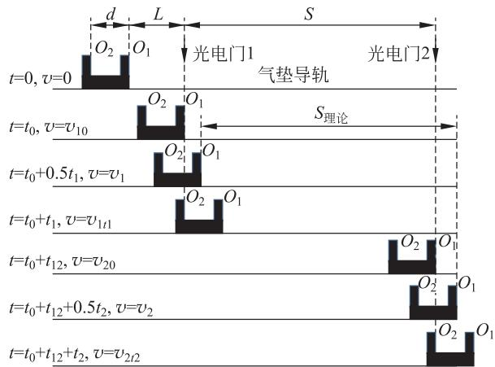

(a)  
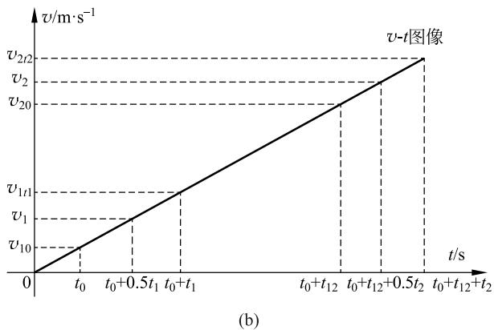  
图5  
(a) 滑块运动过程中的空间、时间和速度演化示意图;(b) 滑块运动过程中的 v-t 图

$a _ { 真 } = g _ { 真 } \sin \theta$ ,其中 $g _ { 真 }$ 为当地重力加速度值。另外,实验测量中 S 的大小是两个光电门之间的距离,图5中可以看出

$$
S = \frac { a _ { 真 } ( t _ { 0 } + t _ { 1 2 } ) ^ { 2 } - a _ { 真 } { t _ { 0 } } ^ { 2 } } { 2 }\tag{5}
$$

比较式(4)和式(5),发现 S 不等于 $S _ { 理论 }$ ,而且 S 小于 $S _ { 理论 }$ ,导致应用公式(1)计算的加速度 $a _ { 1 }$ 值偏大。显然,应用公式(1)计算加速度时不可避免的系统误差主要是由位移 S 不等于 $S _ { 理论 }$ 造成的。在此,运动学公式(1)应用中物体运动位移的起点与初速度、终点与末速度必须是一一对应的物理观念,由于平均速度的近似被打破,表现为系统误差。

严格意义上,应用公式(1)计算 $O _ { 1 }$ 运动的加速度应该表示为

$$
a _ { 理论 } = \frac { { v _ { 2 } } ^ { 2 } - { v _ { 1 } } ^ { 2 } } { 2 S _ { 理论 } }\tag{6}
$$

在测量中滑块通过两个光电门所用的时间间隔为 $t _ { 1 2 }$ 。理论上滑块瞬时速度由 $v _ { 1 } \to v _ { 2 }$ 对应的两个时刻之间的时间间隔应该是 $t _ { 1 2 理论 }$ ,表示为

$$
\begin{array} { r l } & { t _ { 1 2 理论 } = ( t _ { 0 } + t _ { 1 2 } + 0 . 5 t _ { 2 } ) - ( t _ { 0 } + 0 . 5 t _ { 1 } ) } \\ & { \qquad = t _ { 1 2 } + 0 . 5 t _ { 2 } - 0 . 5 t _ { 1 } } \end{array}\tag{7}
$$

显然 $t _ { 1 2 }$ 不等于 $t _ { 1 2 理论 }$ ,所以用公式(2)计算的加速度 $a _ { 2 }$ 会造成不可避免的系统误差。式(7)中可以看出,测量值 $t _ { 1 2 }$ 大于 $t _ { 1 2 理论 }$ ,导致加速度间接测量值 $a _ { 2 }$ 偏小。在此,运动学公式(2)应用中该段时间的起始时刻与初速度、终点时刻与末速度必须是一一对应的关系也是由于平均速度近似被打破,也是表现为系统误差。

理论上,滑块(或 $O _ { 1 }$ 点)运动的加速度利用公式(2)应该表示为

$$
a _ { 理论 } = \frac { v _ { 2 } - v _ { 1 } } { t _ { 1 2 理论 } }\tag{8}
$$

## 2.1.2 重力加速度相对误差解析表达式

根据匀加速直线运动规律,可知:

$$
v _ { 1 } = a _ { 真 } ( t _ { 0 } + 0 . 5 t _ { 1 } )\tag{9}
$$

$$
v _ { 2 } = a _ { 真 } ( t _ { 0 } + t _ { 1 2 } + 0 . 5 t _ { 2 } )\tag{10}
$$

将公式(9)、公式(10)代入公式(1)整理得

$$
a _ { 1 } = \frac { ( g \sin \theta ) ^ { 2 } \left[ ( t _ { 0 } + t _ { 1 2 } + 0 . 5 t _ { 2 } ) ^ { 2 } - ( t _ { 0 } + 0 . 5 t _ { 1 } ) { } ^ { 2 } \right] } { 2 S }\tag{11}
$$

将 $t _ { 0 } = \sqrt { \frac { 2 L } { g \sin \theta } }$ ,$t _ { 1 } = \sqrt { \frac { 2 ( L + d ) } { g \sin \theta } } - \sqrt { \frac { 2 L } { g \sin \theta } }$ ,$t _ { 1 2 } = \sqrt { \frac { 2 ( L + S ) } { g \sin \theta } } - \sqrt { \frac { 2 L } { g \sin \theta } }$ ,$t _ { 2 } = \sqrt { \frac { 2 ( L + S + d ) } { g \sin \theta } } - t _ { 0 } - t _ { 1 2 } = \sqrt { \frac { 2 ( L + S + d ) } { g \sin \theta } } - \sqrt { \frac { 2 ( L + S ) } { g \sin \theta } }$ 分别代入式(6)和式(11)整理得:

$$
\begin{array} { l } { a _ { 理论 } = \frac { v _ { 2 } ^ { 2 } - v _ { 1 } ^ { 2 } } { 2 S _ { 理论 } } = \frac { g _ { 真 } \sin \theta \left[ ( t _ { 0 } + t _ { 1 2 } + 0 . 5 t _ { 2 } ) ^ { 2 } - ( t _ { 0 } + 0 . 5 t _ { 1 } ) ^ { 2 } \right] } { ( t _ { 0 } + t _ { 1 2 } + 0 . 5 t _ { 2 } ) ^ { 2 } - ( t _ { 0 } + 0 . 5 t _ { 1 } ) ^ { 2 } } } \\ { \equiv g _ { 真 } \sin \theta \quad\quad\quad\quad\quad\quad\quad\quad(12) } \end{array}
$$

$$
a _ { 1 } = g _ { 真 } \sin \theta \cdot \frac { ( \sqrt { L + S } + \sqrt { L + S + d } ) ^ { 2 } - ( \sqrt { L } + \sqrt { L + d } ) ^ { 2 } } { 4 S }\tag{13}
$$

将式(13)代入式(3)得

$$
g _ { 1 } = g _ { 真 } \cdot \frac { ( \sqrt { L + S } + \sqrt { L + S + d } ) ^ { 2 } - ( \sqrt { L } + \sqrt { L + d } ) ^ { 2 } } { 4 S }\tag{14}
$$

实验中测量的重力加速度 $g _ { 1 }$ 的相对误差可以表示为

$$
\delta _ { 1 } = \frac { g _ { 1 } - g _ { 真 } } { g _ { 真 } } 1 0 0 \% = \left[ \frac { ( \sqrt { L + S } + \sqrt { L + S + d } ) ^ { 2 } - ( \sqrt { L } + \sqrt { L + d } ) ^ { 2 } } { 4 S } - 1 \right] 1 0 0 \%\tag{15}
$$

将公式(7)(9)(10)代入公式(8)整理得

$$
a _ { 理论 } = \frac { v _ { 2 } - v _ { 1 } } { t _ { 1 2 理论 } } = \frac { a _ { 真 } ( t _ { 0 } + t _ { 1 2 } + 0 . 5 t _ { 2 } ) - a _ { 真 } ( t _ { 0 } + 0 . 5 t _ { 1 } ) } { t _ { 1 2 } - 0 . 5 t _ { 1 } + 0 . 5 t _ { 2 } } = a _ { 真 } \equiv g _ { 真 } \sin \theta\tag{16}
$$

将公式(9)(10)代入公式(2)整理得

$$
a _ { 2 } = \frac { v _ { 2 } - v _ { 1 } } { t _ { 1 2 } } = \frac { g _ { 真 } \sin \theta \left[ \sqrt { 2 ( L + S + d ) } + \sqrt { 2 ( L + S ) } - \sqrt { 2 ( L + d ) } - \sqrt { 2 L } \right] } { 2 \sqrt { 2 ( L + S ) } - 2 \sqrt { 2 L } }\tag{17}
$$

加速度测量值 $a _ { 2 }$ 的相对误差也等于重力加速度测量值的相对误差,可以表示为

$$
\delta _ { 2 } = \frac { g _ { 2 } - g _ { 真 } } { g _ { 真 } } 1 0 0 \% = 0 . 5 \times \left\{ \frac { [ \sqrt { ( L + S + d )  } - \sqrt { ( L + d ) } ] } { \sqrt { ( L + S )  } - \sqrt { L } } - 1 \right\} 1 0 0 \%\tag{18}
$$

从式(15)和式(18)都可以看出,在相对误差表达式中只有 $L$、$S$ 和 d 三个参量,没有倾角 θ 参量,可见,本实验测量重力加速度的相对系统误差,仅与 L、S 和 $d$ 三个参量大小有关,与导轨的倾角 θ 的大小无关。

## 2.2 匀减速直线运动

## 2.2.1 位移 S 和时间间隔 $t _ { 1 2 }$ 的系统误差分析

图6(a)表示了滑块在匀减速直线运动过程中几个关键时刻点对应的空间位置、时间和速度演化图像,图6(b)是对应的 v-t 图。让滑块以较大的初速度向上做匀减速直线运动,设0时刻, $O _ { 1 }$ 点过光电门1,瞬时速度为 $v _ { 1 0 }$ ;$t _ { 1 }$ 时刻 $O _ { 2 }$ 点运动到光电门1点,设瞬时速度为 $v _ { 1 t 1 }$ ;在 $0 \to t _ { 1 }$ 时间内,$O _ { 1 }$ 点位移为 $d$ ,用时为 $t _ { 1 }$ ,实验中用 $t _ { 1 }$ 时间段的平均速度近似的表示 $O _ { 1 }$ 点通过光电门1的瞬时速度 $v _ { 1 }$ ;理论上 $O _ { 1 }$ 点的瞬时速度为 $v _ { 1 }$ 的时刻应该在 $0.5 t _ { 1 }$ 时刻; $O _ { 1 }$ 点通过两个光电门所用的时间间隔 $t _ { 1 2 }$ ;在 $t _ { 1 2 }$ 时刻 $O _ { 1 }$ 点通过光电门2,$t _ { 1 2 } + t _ { 2 }$ 时刻 $O _ { 2 }$ 点通过光电门2,滑块通过光电门2用时为 $t _ { 2 }$ ,在 $t _ { 2 }$ 时间段内 $O _ { 1 }$ 点通过光电门2的瞬时速度等于平均速度 $v _ { 2 }$ 应该在 $t _ { 1 2 } + 0 . 5 t _ { 2 }$ 时刻, $0 . 5 t _ { 1 } \to t _ { 1 2 } + 0 . 5 t _ { 2 }$ 这两个时刻 $O _ { 1 }$ 点的位移大小用 $S _ { 理论 }$ 表示,可以表示为

$$
\begin{array} { r } { S _ { 理论 } = v _ { 1 0 } \left( t _ { 1 2 } + 0 . 5 t _ { 2 } \right) - v _ { 1 0 } \left( 0 . 5 t _ { 1 } \right) + } \\ { \frac { a _ { 真 } \left( t _ { 1 2 } + 0 . 5 t _ { 2 } \right) ^ { 2 } - a _ { 真 } \left( 0 . 5 t _ { 1 } \right) ^ { 2 } } { 2 } } \end{array}\tag{19}
$$

假定滑块运动初速度方向为正方向,那么 $a _ { 真 }$ 为负值,表示方向与正方向相反。图6中可以看出

$$
S = v _ { 1 0 } t _ { 1 2 } + \frac { a _ { 真 } ( t _ { 1 2 } ) ^ { 2 } } { 2 }\tag{20}
$$

比较式(19)和式(20),发现S不等于 $S _ { 理论 }$ ,导致应用公式(1)计算加速度时不可避免的系统误差也是由位移 S 不等于 $S _ { 理论 }$ 造成的。

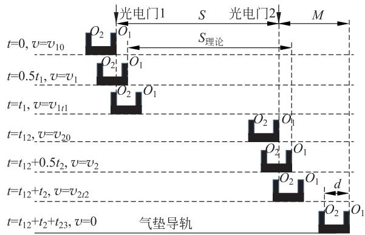

(a)  
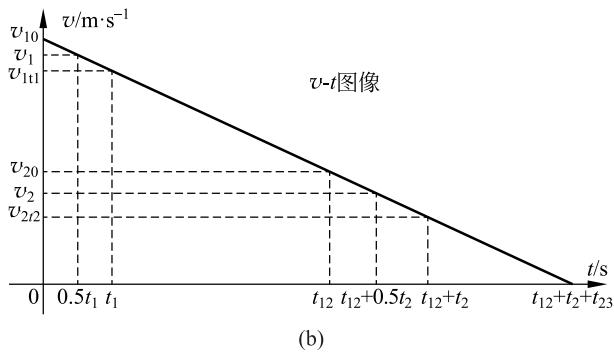  
图6  
(a) 滑块运动过程中的空间、时间和速度演化示意图;(b) 滑块运动过程中的 v-t 图

理论上,应用公式(1)和公式(2)计算 $O _ { 1 }$ 运动的加速度公式也分别与式(6)和式(8)相同。

在测量中滑块通过两个光电门所用的时间间隔为 $t _ { 1 2 }$ 。理论上滑块瞬时速度由 $v _ { 1 } \to v _ { 2 }$ 对应的两个时刻之间的时间间隔应该是 $t _ { 1 2 理论 }$ ,公式表达与式(7)相同。由式(7)可以看出,加速运动情境下,测量值 $t _ { 1 2 }$ 小于 $t _ { 1 2 理论 }$ ,导致应用公式(2)计算加速度间接测量值 $a _ { 2 }$ 偏大,与加速情况相反。

## 2.2.2 重力加速度相对误差解析表达式

根据匀减速直线运动规律,可知:

$$
v _ { 1 } = v _ { 1 0 } + a _ { 真 } ( 0 . 5 t _ { 1 } )\tag{21}
$$

$$
v _ { 2 } = v _ { 1 0 } + a _ { 真 } ( t _ { 1 2 } + 0 . 5 t _ { 2 } )\tag{22}
$$

假设 $O _ { 2 }$ 点过光电门2后到滑块静止用时为 $t _ { 2 3 }$ ,可知 $v _ { 1 0 } = - a _ { 真 } ( t _ { 1 2 } + t _ { 2 } + t _ { 2 3 } )$

又根据图6(b)可知

$$
( M - d ) = \frac { 1 } { 2 } ( - a _ { 真 } ) t _ { 2 3 } ^ { 2 } ,\ 得\ t _ { 2 3 } = \sqrt { \frac { 2 ( M - d ) } { - a _ { 真 } } } ,
$$

$$
\begin{array} { c } { { M = \displaystyle \frac { 1 } { 2 } ( - a _ { 真 } ) ( t _ { 2 } + t _ { 2 3 } ) ^ { 2 } ,\ 得\ t _ { 2 } = \sqrt { \displaystyle \frac { 2 M } { - a _ { 真 } } } - } } \\ { { \sqrt { \displaystyle \frac { 2 ( M - d ) } { - a _ { 真 } } } , } } \end{array}
$$

$$
M + S = \frac { 1 } { 2 } ( - a _ { 真 } ) ( t _ { 1 2 } + t _ { 2 } + t _ { 2 3 } ) ^ { 2 } ,\ 得\ t _ { 1 2 } =
$$

$$
\sqrt { \frac { 2 ( M + S ) } { - a _ { 真 } } } - \sqrt { \frac { 2 M } { - a _ { 真 } } } ,
$$

$$
M + S - d = \frac { 1 } { 2 } ( - a _ { 真 } ) ( t _ { 1 2 } + t _ { 2 } + t _ { 2 3 } - t _ { 1 } ) ^ { 2 } ,
$$

$$
\ 得\ t _ { 1 } = t _ { 1 2 } + t _ { 2 } + t _ { 2 3 } - \sqrt { \frac { 2 ( M + S - d ) } { - a _ { 真 } } } =
$$

$$
\sqrt { \frac { 2 ( M + S ) } { - a _ { 真 } } } - \sqrt { \frac { 2 ( M + S - d ) } { - a _ { 真 } } }
$$

将式(21)(22)代入式(1)和式(6)整理得

$$
a _ { 1 } = \frac { - g _ { 真 } \sin \theta } { 4 S } \left[ \left( \sqrt { ( M + S ) } + \sqrt { ( M + S - d ) } \right) ^ { 2 } - \left( \sqrt { M } + \sqrt { ( M - d ) } \right) ^ { 2 } \right]\tag{23}
$$

$$
a _ { 理论 } = a _ { 真 } \equiv - g _ { 真 } \sin \theta\tag{24}
$$

式(23)代入式(3)得

$$
g _ { 1 } = \frac { g _ { 真 } } { 4 S } \left[ \left( \sqrt { ( M + S ) } + \sqrt { ( M + S - d ) } \right) ^ { 2 } - \left( \sqrt { M } + \sqrt { ( M - d ) } \right) ^ { 2 } \right]\tag{25}
$$

实验中测量的重力加速度 $g _ { 1 }$ 的相对误差可以表示为

$$
\delta _ { 1 } = \frac { g _ { 1 } - g _ { 真 } } { g _ { 真 } } 1 0 0 \% = \left[ \frac { \left( \sqrt { ( M + S ) } + \sqrt { ( M + S - d ) } \right) ^ { 2 } - \left( \sqrt { M } + \sqrt { ( M - d ) } \right) ^ { 2 } } { 4 S } - 1 \right] 1 0 0 \%\tag{26}
$$

将公式(21)、公式(22)、公式(7)代入公式(8)整理,结果与式(24)相同。将公式(21)、公式(22)代入公式(2)整理得

$$
a _ { 2 } = 0 . 5 a _ { 真 } \left( 1 + \frac { \sqrt { M + S - d } - \sqrt { M - d } } { \sqrt { M + S } - \sqrt { M } } \right)\tag{27}
$$

加速度测量值 $a _ { 2 }$ 的相对误差也等于重力加速度测量值的相对误差,可以表示为

$$
\delta _ { 2 } = 0 . 5 \left( \frac { \sqrt { M + S - d } - \sqrt { M - d } } { \sqrt { M + S } - \sqrt { M } } - 1 \right) 1 0 0 \%\tag{28}
$$

从式(26)和式(28)都可以看出,在相对误差表达式中只有 M、S 和 d 三个参量,没有倾角 θ 参量,表明本实验测量重力加速度的相对系统误差,仅与 M、S 和 d 三个参量大小有关,与导轨的倾角 θ 的大小无关。

## 3 系统误差分析 控制变量及图像描绘法

## 3.1 匀加速直线运动

设定滑块静止释放时离第一个光电门的距离 $L = 20.00\mathrm{cm}$,两个光电门之间的间距 $S = 40.00\mathrm{cm}$,只改变 U 形挡光片的宽度 d 的大小,根据式(12)和式(15),数值模拟了 d 值变化对重力加速度测量相对误差的影响,变化曲线如图7(a)所示。结果发现 d 越小,重力加速度测量的相对误差的绝对值越小,反之越大。在理论上分析其主要原因是 d 越小,根据式(4)和式(5)计算出的平均速度越接近瞬时速度标准值,造成的误差影响自然减小,这样可以推断出实验中要尽量选用宽度 $d$ 较小的 U 形挡光片。

两个光电门间距 $S = 40.00\mathrm{cm}$,U 形挡光片的宽度 $d = 1.000\mathrm{cm}$,改变滑块静止释放时离第一个光电门的间距 L 的大小,图7(b)描绘了 L 值对重力加速度测量相对误差影响的变化规律。结果发现 L 越大,所计算的重力加速度相对误差绝对值越小,反之越大,图像可以看出当 L 取值大于 $20.00\mathrm{cm}$ 后,本参数对系统误差就影响比较小了,这样实验探究时 L 取值一般要大于等于 $20.00\mathrm{cm}$,与实验指导教材要求相符［7］。

设定滑块静止释放时离第一个光电门的距离 $L = 20.00\mathrm{cm}$,以及 U 形挡光片的宽度 $d = 1.000\mathrm{cm}$,改变两个光电门间距 S,图7(c)绘制 S 值对重力加速度测量相对误差影响的规律曲线,我们发现 S 越小,对重力加速度测量的相对误差绝对值越大,反之越小。这样就明显表现出,只要实验条件允许,实验中要尽量增大两个光电门的间距。

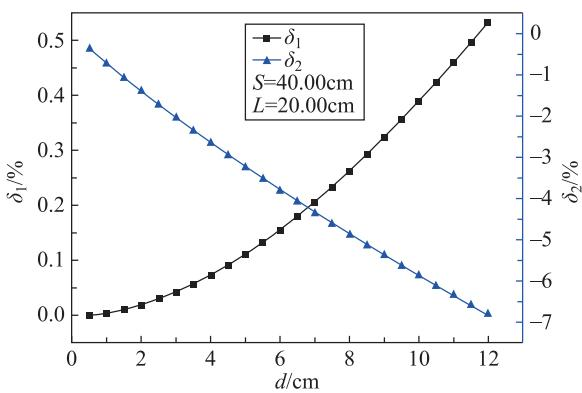  
(a)

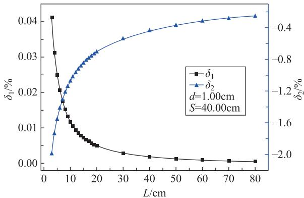  
(b)

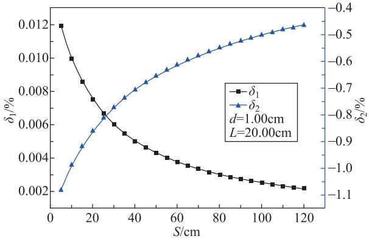  
(c)  
图7  
(a) d 值对重力加速度测量值相对误差的影响;(b) L 值对重力加速度测量值相对误差的影响;(c) S 值对重力加速度测量值相对误差的影响

通过图7还可以发现,同等条件下 $\delta _ { 1 }$ 始终为正值,$\delta _ { 2 }$ 始终为负值,说明同样一组实验数据,使用公式(1)计算的重力加速度比真值偏大,公式(2)计算偏小。图7的(a)(b)和(c)纵向比较还发现,实验中影响系统误差的主要因素是挡光片的宽度 d。另外,选择 $S = 40\mathrm{cm}$,$L = 20.00\mathrm{cm}$ 和 $d = 1.000\mathrm{cm}$ 一组数据,代入式(15)和式(18)计算发现重力加速度的相对误差分别等于 $0.005\%$［6］和 $-0.7\%$,可见,在用气垫导轨法测量加速度时应用公式(1),结果更精确。

## 3.2 匀减速直线运动

设定匀减速直线运动滑块静止时离光电门2的距离为 $M = 20.00\mathrm{cm}$,两个光电门之间的间距 $S = 40.00\mathrm{cm}$,只改变 U 形挡光片的宽度 d 的大小,根据式(26)和(28),数值模拟了 d 值变化对重力加速度测量相对误差的影响,变化曲线如图8(a)所示。结果发现 d 越小,重力加速度测量的相对误差值越小,反之越大。

两个光电门间距 $S = 40.00\mathrm{cm}$,U 形挡光片的宽度 $d = 1.000\mathrm{cm}$,改变匀减速直线运动滑块静止时离光电门2的距离 M 大小,图8(b)描绘了 M 值对重力加速度测量相对误差影响的变化规律。我们发现 M 越大,所计算的重力加速度相对误差绝对值越小,反之越大,但 M 取值大于 $20.00\mathrm{cm}$ 后,本参数对系统误差就影响比较小了。

设定匀减速直线运动滑块静止时离光电门2的距离 $M = 20.00\mathrm{cm}$,以及 U 形挡光片的宽度 $d = 1.000\mathrm{cm}$,改变两个光电门间距 S,绘制 S 值对重力加速度测量相对误差影响的规律曲线,如图8(c)所示。我们发现 S 越小,对重力加速度测量的相对误差越大。这样提示我们,只要实验条件允许,实验中要尽量增大两个光电门的间距。

通过图8还可以发现,同等条件下 $\delta _ { 1 }$ 和 $\delta _ { 2 }$ 始终为正值,在匀减速直线运动情境中,使用式(1)和式(2)计算的重力加速度比真值都偏大,但使用公式(1)计算的实验结果更精确,且影响系统误差的主要因素仍然是也是挡光片的宽度 d。

## 4 结论

不考虑空气阻尼的理想情况下,在倾斜气垫导轨法测量重力加速度实验情境中,由于用平均速度近似的替代瞬时速度,造成了匀变速直线运动加速度计算公式应用中要求的物理量之间的”一一对应”关系的物理观念被打破,必然产生了无法克服的系统误差,该系统误差可知、可控。挡光片宽度 d、加速情境滑块静止释放时离第一个光电门的距离 L 或减速情境滑块静止时离光电门2的距离 M、两光电门间距 S 等三个参量对该系统误差都有影响,d 值的大小对该系统误差的影响最大,且 d 值越大影响越大,L 和S 值对该系统误差的影响次之,它们均是数值越大影响越小;导轨倾角 θ 对该系统误差没有影响;在加速运动实验情境中,用公式(1)计算的重力加速度的值比真值偏大,用公式(2)计算的重力加速度的值比真值偏小,应用公式(1)计算重力加速度值更精确。在减速运动实验情境中,用两个公式计算的重力加速度的值比真值都偏大,但用公式(1)计算的重力加速度值更接近真值。

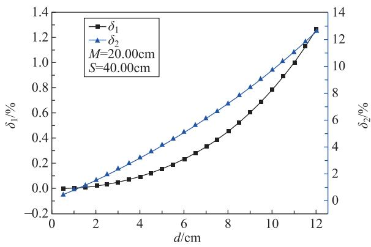  
(a)

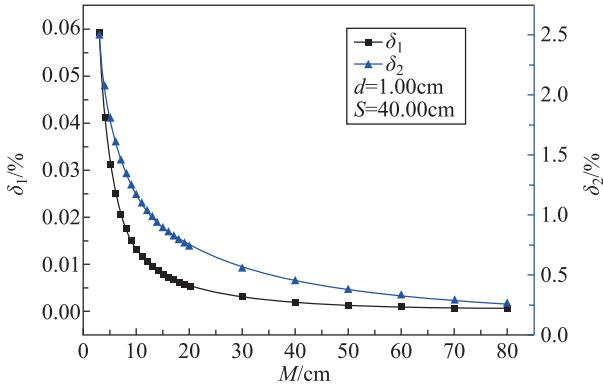  
(b)

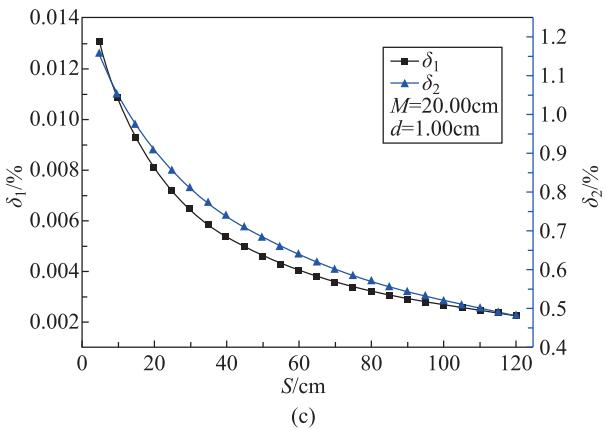  
图8  
(a) d 值对重力加速度测量值相对误差的影响;(b) M 值对重力加速度测量值相对误差的影响;(c) S 值对重力加速度测量值相对误差的影响

## 参 考 文 献

[1] HU J G, CHEN X, WANG L Y, et al. Systematic error suppression scheme of the weak equivalence principle test by dual atom interferometers in space based on spectral correlation[J]. Chinese Physics B, 2020, 29(11): 230-235.

[2] 朱栋,徐晗,周寅,等.基于扩展卡尔曼滤波算法的船载绝对重力测量数据处理[J].物理学报,2022,71(13):159-167. ZHU D, XU H, ZHOU Y, et al. Data processing of shipborne absolute gravity measurement based on extended Kalman filter algorithm[J]. Acta Phys. Sin. 2022, 71(13): 159-167. (in Chinese)

[3] 朱明宇,陈艺欣,陈敏,等.密立根油滴实验中温度因素的影响:理论考量与实验校准[J].物理与工程,2023,33(1):128-133. ZHU M Y, CHEN Y X, CHEN M, et al. Influence of temperature in the oil-drop experiment: theoretical consideration and experimental correction[J]. Physics and Engineering, 2023, 33(1): 128-133. (in Chinese)

[4] 杨述武,孙迎春,沈国土.普通物理实验(1)[M].北京:高等教育出版社,2015.

[5] 千承辉,陈长松.基于平衡法的重力加速度测量装置[J].仪表技术与传感器,2014,10:19-21,27. QIAN C H, CHEN C S. Design of gravitational acceleration measuring device based on balance method[J]. Instrument Technique and Sensor, 2014, 10: 19-21, 27. (in Chinese)

[6] 赵佳乐,张嘉禾,于永江.气垫导轨测量重力加速度实验系统误差分析[J].物理与工程,2022,32(3):105-109. ZHAO J L, ZHANG J H, YU Y J. Analysis of the systematic errors on measurement of gravity acceleration by air track[J]. Physics and Engineering, 2021, 32(36): 105-109. (in Chinese)

[7] 吴泳华,霍剑青,浦其荣.面向21世纪课程教材 大学物理实验 第1册[M].北京:高等教育出版社,2005.