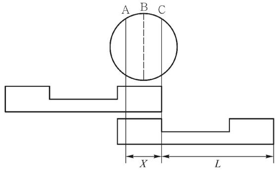
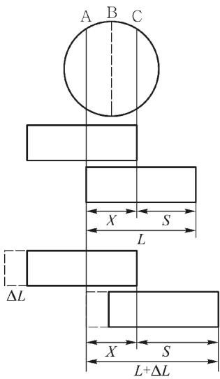
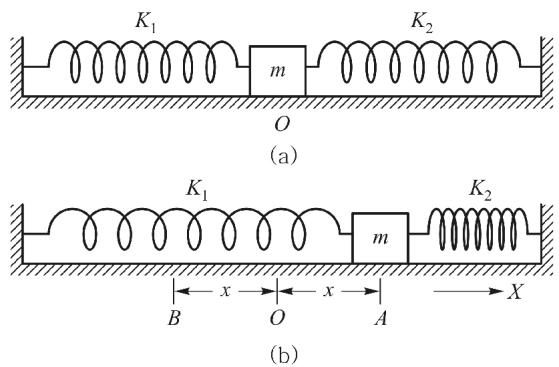

# 条形挡光片测速的误差分析及修正方法

张锁宾，黄育红，袁赟，周文飞，张宗权( 陕西师范大学 物理学与信息技术学院，陕西 西安 710119)

摘要:在利用气垫导轨装置及配件进行的各类实验中，速度作为一个基本的待测量，其准确测量有着重要的意义．通常利用 MUJ－6B 通用计数器记录不同类型挡光片经过光电门的遮光时间，用游标卡尺测得遮光距离从而得到速度值．本文从光电计时原理分析了使用 U 形挡光片、计时方式 2 不会出现系统误差，而使用条形挡光片、计时方式 1 会出现较大系统误差的原因．我们进一步利用气垫导轨上两弹簧连接滑块做简谐振动模型的理论公式推导出条形挡光片遮光时被光电门 “吞掉”的宽度，进而得到了速度的修正公式．此外，通过气垫导轨上的动量守恒实验从另外一个角度验证了速度修正方法的正确性．

关键词:条形挡光片; U 形挡光片; 速度修正; 光电计时

中图分类号: O 4－34

文献标识码: A

文章编号: 1000-0712( 2017) 06-0073-05

【DOI 】10．16854 /j．cnki．1000-0712．2017．06．018

在普通物理实验中，利用气垫导轨装置可进行数十种实验，其中大部分实验需直接或间接得到速度的测量值．速度大小通常用装有不同类型挡光片的滑块经过光电门时其遮光距离与遮光时间之比值得到．所得测量值为滑块通过该段距离的速度平均值，一般来说，挡光片的宽度越窄，速度测量值越接近滑块通过光电门的瞬时速度，测量也越准确．然而挡光片的宽度不能无限小，受制于光电门的灵敏度，其宽度通常在1～10 mm 之间．此外，气垫导轨实验中选用条形挡光和 U 形挡光片引入的系统误差截然不同，通用计数器设置为计时 1 模式还是计时 2模式与实验内容密切相关，对误差也有很重要的影响．早在 1982 年时，黄仁忠［1］就综合分析了气垫导轨上的实验误差，并从仪器参数方面解释了引起光电计时误差的原因;1985 年朱常全［2］提出条形挡光片测速误差是由光电管的离散性造成，并分析了误差产生的过程; 1989 年王教方［3］、 2000 年高立晟等［4］、2003 年赵世武［5］、 2007 年葛宇宏［6］也都不同程度地分析了使用条形挡光片测量速度引起误差的原因，提倡使用 U 形挡光片进行测速从而消除系统误差，但他们都未给出系统误差定量修正的理论公式．本文拟通过分析光电计时原理，得出条形挡光片产生较大系统误差的原因，利用简谐振动模型的理论公式，定量地给出气垫导轨上条形挡光片测速的修正公式，并利用导轨上的动量守恒实验进行验证，从而证明该方法的正确性与普遍性

## 1 从光电计时原理分析挡光片的计时误差

在实验中，利用光电门和通用计数器构成的光电转换系统将实验测量数据显示在屏幕上．在单边式结构的光电门中，光敏管和聚光灯泡呈上下安装，灯泡点亮时正好照在光敏管上，而光敏二极管的电阻在有光照和无光照时变化很大，有光照时电阻为几千、几十千欧，无光照时电阻为兆欧级．因此，当装有挡光片的滑块经过光电门时，投射于光电管的光被挡光片遮挡时，会引起电阻及光电管两端的电压变化，当其电压达到一定阈值时，就促使后面的门控制电路“翻转”产生“计”信号开始计时，而在逐渐恢复光照时，门控制电路再次 “翻转”产生 “停”信号，从而完成一次计时过程．根据具体的实验需求，通常选择条形挡光片、计时模式 1 或 U 形挡光片、计时模式2 的组合方式．条形挡光片经过光电门选计时1模式为 “逢遮必计”，U 形挡光片经过光电门选计时2 模式则为“间隔遮光计数”［7］，当然也可选择条形挡光片、计时模式2 或U 形挡光片、计时模式1 的组合方式进行，此时情况就稍微复杂一些．

下面从光电计时原理分析 U 形挡光片采用计时模式2 不会产生系统误差的原因．如图 1 所示，圆形代表光敏管的端面，从 A、B、C 三个字母处下拉的直线将其端面分为几部分．假设遮光阈值面积是 80%，也就是说当挡光片遮光达到光敏管端面面积的 80%时，对应的控制电路就会翻转计时．图中 U 形挡光片从左向右滑动遮光，当其右翼的右端到达C 处时触发计时，当其左翼的最右端到达 C 处时停止计时，L 为挡光片宽度，亦为有效遮光长度，用此长度除以遮光时间得到的速度值不会产生系统误差，因此一般情况下推荐使用U 形挡光片、计时2 的模式进行实验

  
图 1 U 形挡光片计时 2 遮光示意图

对条形挡光片、计时 1 的模式而言，如图 2 所示，条形挡光片从左往右运动，当条形挡光片最右端到达 C 处时触发计时，假设遮光阈值面积是 80%，因此当条形挡光片的最左端运动到 A 处时便会停止计时．此时挡光片的有效遮光宽度为 S，而不是挡光片的原长 L．由于光电管的端面是无法测量和计算的，因此，在一般实验中，通常用游标卡尺测量挡光片宽度，用测量的宽度值除以遮光时间便得到速度值，因此会产生很大的系统误差，其误差估算为$\frac { v _ { L } - v _ { S } } { v _ { L } } = \frac { \displaystyle \frac { L } { t } - \frac { S } { t } } { \displaystyle \frac { L } { t } } = \frac { L - S } { L } = \frac { X } { L }$ ，其中 $v _ { L }$ 为常规方法测量的速度值，$v _ { s }$ 为理论( 实际) 速度值，L 为挡光片宽度，S 为实际的有效遮光宽度，t 为挡光片经过光电门的遮光时间，X 参量的值等于( L－S) ．若挡光片宽度增加 $\Delta L$，实际的遮光距离 S 会变大，X 保持不变，可形象地理解为光电门 “吞掉”的宽度，可以看出，若实验中采用的挡光片宽度越大，由此造成的实验误差也就越大，一般实验中采用 10 mm 的条形挡光片，高精度要求的实验中挡光片宽度最小可以达到1 mm．理论上，若遮光面积等于 50%时，X=0，系统误差消失，若遮光面积小于 50%，则 X 为负值，会使有效遮光宽度变长，但一般情况下，光电管的遮光面积会大于50%，因此常规方法测量的速度值 $v _ { L }$ 要比实际的速度值 $v _ { s }$ 大，这也是系统误差的来源

综上所述，若某实验中仅需测量速度值时，推荐使用U 形挡光片、计时2 的模式．但是 U 形挡光片的遮光宽度总体大于条形挡光片的宽度，在测量瞬时速度时也会引入较大的误差，而条形挡光片的宽度可以做到很小，这就使得测量的平均速度可以很好地近似为瞬时速度．此外，有些实验中需要同时测量周期 计数和速度值，而通用计数器记录周期和计数都需要条形挡光片，为避免实验误差，若在同一个实验中记录周期用条形挡光片，而测量速度用 U 形挡光片的话，就会改变整个系统的质量，也是一种不妥的做法．因此对条形挡光片测量速度进行修正是非常有必要的

  
图 2 条形挡光片计时 1遮光示意图

## 2 利用简谐振动理论修正条形挡光片的速度

在气垫导轨上利用两个劲度系数不同的弹簧将滑块连接起来，滑块处于平衡位置，将滑块拉开一定的振幅A，不考虑空气阻力和导轨黏滞阻力时，滑块做简谐振动，如图3 所示

  
图 3 气垫导轨上简谐振动示意图

此时滑块的运动方程可写为

$$
\frac { \mathrm { d } ^ { 2 } x } { \mathrm { d } t ^ { 2 } } + \frac { K _ { 1 } + K _ { 2 } } { m } x = 0\tag{1}
$$

其解为 $x = A \sin \left( \ \omega t + \theta \right)$ ，其 中 ${ \omega } ^ { 2 } = \frac { K _ { 1 } + K _ { 2 } } { m } , { \omega } t + { \theta } =$ $\arcsin { \frac { x } { A } } .$ ．对位移 x 的表达式求导并运算得速度的表达式

$$
v = A \cos ( { \omega t + \theta } ) \omega = \omega \sqrt { A ^ { 2 } - x ^ { 2 } } = \frac { 2 \pi } { T } \sqrt { A ^ { 2 } - x ^ { 2 } }\tag{2}
$$

式( 2) 表示滑块在任意位置处的理论( 实际) 速度，所以

$$
v _ { \text{理论} } = v _ { s } = \frac { 2 \pi } { T } \sqrt { A ^ { 2 } - x ^ { 2 } }\tag{3}
$$

将式( 3) 代入速度误差式中得

$$
\frac { v _ { _ { L } } - v _ { _ { S } } } { v _ { _ { L } } } = \frac { \displaystyle \frac { L } { t } - \frac { 2 \pi } { T t } \sqrt { A ^ { 2 } - x ^ { 2 } } } { \displaystyle \frac { L } { t } } = \frac { X } { L }\tag{4}
$$

式中，L 为条形挡光片的宽度，t 为条形挡光片经过位于 x 处光电门所用的时间，T是滑块做简谐振动的周期，A 为振幅．上述物理量 $L , t , x , T , A$ 可通过实验进行测量，利用式( 4) 可求得光电门 “吞掉”的长度 X，由于对固定的光电管而言，X 的值保持不变，且利用简谐振动实验可以较为容易地确定 X值，因此在后续的综合实验中，根据 X 值可求得任意宽度的条形挡光片其速度的修正值 $v _ { s } = \left( 1 - \frac { X } { L } \right) v _ { L }$．

利用图3 所示的装置进行简谐振动实验，将平衡位置( x= 0) 处与光电门 1 相连的通用计数器 1 设为周期档，将滑块拉开振幅A=20．00 cm 后放开，滑块做简谐振动，记录 10 个周期所用时间为17．287 s，求平均值得到周期T的值为1．728 7 s．在 $x = 1 0 . 0 0 \ \mathrm { c m }$ 处放置光电门2 和通用计数器2，此时将两个通用计数器均设为计时1 模式，再次拉开滑块至振幅A 处，滑块通过平衡位置和任意位置 x 处光电门时挡光片的遮光时间分别记为 $t _ { 0 }$ 和 $t _ { x }$ ，实验测量数据见表1．用电子天平称量滑块的质量为239．66 g，用游标卡尺测量条形挡光片的宽度 L 为5 mm，测得弹簧 1 的质量为14．79 g，弹簧 2 的质量 14．30 g，系统总的等效质量$m = \left( m _ { \text{滑} } + 1 / 3 \, m _ { \text{弹} } \right) = 249.36 \ \mathrm{g}.$ 利用 $v _ { L 0 } = L / t _ { 0 }$ 求得滑块通过平衡位置处的测量速度， $v _ { S 0 } = \left( 1 - \frac { X } { L } \right) v _ { L 0 }$ 为滑块通过平衡位置处的修正速度， $X _ { 0 }$ 为平衡位置处光电门“吞掉宽度”的参量， $S _ { 0 }$ 为滑块经过平衡位置处挡光片的有效遮光宽度．任意位置处相关物理量的计算过程与平衡位置处的相似，不再赘述，平衡位置和任意位置处计算的所有结果列于表1

表 1 滑块通过光电门的时间测量及相关  
物理量的计算结果
<table><tr><td> $t _ { 0 } / \mathrm { m s }$ </td><td> $v _ { L 0 } / \mathrm { m } \cdot \mathrm { s } ^ { - 1 }$ </td><td> $v _ { S 0 } / \mathrm { m }  \cdot \mathrm { ~ s } ^ { - 1 }$ </td><td> $X _ { 0 } / \mathrm { m m }$ </td><td> $S _ { 0 } / \mathrm { m m }$ </td></tr><tr><td> $4 . 6 6$ </td><td> $1 . 0 7 3 \ 0$ </td><td>0.726 9</td><td> $1 . 6 1 2 \mathrm { ~ } 8$ </td><td>3.387 2</td></tr><tr><td> $t _ { x } / \mathrm { m s }$ </td><td> $v _ { L x } / \mathrm { m } \cdot \mathrm { s } ^ { - 1 }$ </td><td> $v _ { S x } / \mathrm { m } ^ { \vphantom { \vphantom { \ d } } } \cdot \mathrm { s } ^ { - 1 }$ </td><td> $X _ { x } / \mathrm { m m }$ </td><td> $S _ { x } / \mathrm { m m }$ </td></tr><tr><td>4.18</td><td> $1 . 1 9 6 2 $ </td><td>0.629 5</td><td>2.368 8</td><td>2.631 2</td></tr></table>

## 3 动量守恒实验对速度修正的检验

根据动量守恒定理，一个系统不受外力或所受外力之和为零时，这个系统的总动量保持不变．在气垫导轨实验中，若忽略掉空气阻力及气体黏滞阻力，两个滑块在导轨上进行碰撞的过程满足动量守恒定律的条件，即 $m _ { 1 } v _ { 1 } + m _ { 2 } v _ { 2 } = m _ { 1 } v _ { 1 } ^ { \prime } + m _ { 2 } v _ { 2 } ^ { \prime }$ ，其中 $m _ { 1 }$ 和 $m _ { 2 }$ 分别为两个滑块的质量， $v _ { 1 }$ 和 $v _ { 2 }$ 分别为碰撞前两个滑块的初速度， $\boldsymbol { v } _ { 1 } ^ { \prime }$ 和 $\boldsymbol { v } _ { 2 } ^ { \prime }$ 分别为碰撞后两个滑块的末速度．为简化实验，令滑块 2 静止在导轨上，滑块 1以初速 $v _ { 1 }$ 与滑块2 发生完全非弹性碰撞，则动量守恒式可写为 $m _ { 1 } v _ { 1 } = \left( m _ { 1 } + m _ { 2 } \right) v _ { \mathrm { c } }$ ，其中 $v _ { \mathrm { c } }$ 表示碰撞后两个滑块的共同速度

利用气垫导轨、 MUJ－6B 通用计数器、 光电门、弹簧、游标卡尺、 焦利氏秤、 电子天平和滑块等进行动量守恒实验．在调平的导轨上放置两个滑块，其质量分别为 0．220 42 kg 和 0．242 28 kg，在导轨上安装两个光电门，滑块 1 通过光电门的遮光时间用 $t _ { 1 }$ 表示，滑块 1 与滑块 2 发生完全非弹性碰撞后通过光电门的遮光时间用 $t _ { \mathrm { c } }$ 表示，用条形挡光片的宽度5 mm除以遮光时间就可分别得到滑块的碰前速度 $v _ { 1 }$ 和共同速度 $v _ { \mathrm { c } }$ ，由此计算出碰前系统总动量 $p _ { 1 }$ 和碰后系统总动量 $p _ { \mathrm { ~ c ~ } }$ 的值，实验测量和相应的计算结果记录于表 2 中．从表 2 可以看出，三次实验中碰撞前后系统动量的百分误差 $\varepsilon _ { p }$ 均在 20%以上，动量显然不守恒．进一步利用条形挡光片速度修正公式 $v _ { S } = \left( 1 - \frac { X } { L } \right) v _ { L }$ 对滑块碰前初速度和碰后共同速度进行修正后，得到系统动量的百分误差均在 3%以下，三次实验中动量百分误差最小仅为 0．304%，考虑到实际实验中不可避免存在各种可能的误差，外界环境对实验结果也有一定的影响，因此在误差允许的范围内，可近似认为修正速度后的情况满足动量守恒条件，这也从另外一个角度验证了速度修正公式的正确性．

表 2 条形挡光片速度修正前、后动量守恒实验的数据记录
<table><tr><td></td><td></td><td> $t _ { \mathrm { 1 } } / \mathrm { m s }$ </td><td> $v _ { 1 } / \mathrm { m } \cdot \mathrm { s } ^ { - 1 }$ </td><td> $t _ { \mathrm { { c } } } / \mathrm { { m s } }$ </td><td> $v _ { \mathrm { c } } / \mathrm { m } \cdot \mathrm { s } ^ { - 1 }$ </td><td> $p _ { 1 } / \mathrm { k g } { \bullet } \mathrm { m } ^ { \bullet } \mathrm { s } ^ { - 1 }$ </td><td> $p _ { \mathrm { c } } / \mathrm { k g } { \bullet } \mathrm { m } ^ { \bullet } \mathrm { s } ^ { - 1 }$ </td><td> $\varepsilon _ { p } / \%$ </td></tr><tr><td>修</td><td>1</td><td>18.26</td><td>0.671 14</td><td>7.45</td><td>0.273 82</td><td>0.162 60</td><td>0.126 70</td><td>22.079</td></tr><tr><td>正</td><td>2</td><td>14.73</td><td>0.821 02</td><td>6.09</td><td>0.339 44</td><td>0.198 92</td><td>0.157 06</td><td>21.044</td></tr><tr><td>前</td><td>3</td><td>20.96</td><td>0.571 43</td><td>8.75</td><td>0.238 55</td><td>0.138 45</td><td>0.110 38</td><td>20.274</td></tr><tr><td>修</td><td>1</td><td>18.26</td><td>0.353 18</td><td>7.45</td><td>0.185 50</td><td>0.085 57</td><td>0.085 83</td><td>0.304</td></tr><tr><td>正</td><td>2</td><td>14.73</td><td>0.432 05</td><td>6.09</td><td>0.229 95</td><td>0.104 68</td><td>0.106 40</td><td>1.643</td></tr><tr><td>后</td><td>3</td><td>20.96</td><td>0.300 71</td><td>8.75</td><td>0.161 60</td><td>0.072 86</td><td>0.074 77</td><td>2.621</td></tr></table>

## 4 结束语

本文从光电计时原理分析了挡光片通过光电门计时的误差，结果表明，使用 U 形挡光片、计时方式 2 不会出现系统误差，而使用条形挡光片、计时方式 1 会出现较大的系统误差，测量滑块的速度值较实际速度有较大偏差．U 形挡光片、计时方式 2 虽然不会出现系统误差，但是其遮光宽度总体大于条形挡光片的遮光宽度，在测量瞬时速度时会引入较大的误差，而条形挡光片的宽度可以做到很小，这就使得测量的平均速度可以很好地近似为瞬时速度．此外，在涉及周期和计数测量时，条形挡光片是最佳的选择． 我们进一步利用气垫导轨上简谐振动模型的理论公式推导出条形挡光片遮光时被光电门 “吞掉”的宽度X，它是表征对应光电门的一个重要参量，进而得到了速度的修正公式 $v _ { S } = \left( 1 - \frac { X } { L } \right) v _ { L }$．利用此公式可方便地求出不同规格的挡光片通过该光电门时的速度修正值．通过气垫导轨上的动量守恒实验对本文提出的速度修正方法进行了检验，结果表明速度未经修正时系统的动量百分误差高达20%以上，速度修正后动量百分误差很小，这也从另外一个角度说明了条形挡光片通过光电门时速度测量值的修正是正确的．

## 参考文献:

［1］ 黄仁忠．气垫导轨实验误差综合分析［J］．抚州师专专刊，1982，2: 88-96．

［2］ 朱常全．气垫导轨上条形挡光片的测速误差［J］．吉首大学学报，1985，1: 27-29．

［3］ 王教方．气垫导轨上挡光片的使用［J］．山东建材学院学报，1989，3( 2) : 60-61

［4］ 高立晟，庄步科．光电计时系统的误差分析［J］．山东师大学报( 自然科学版) ，2000，15( 2) : 201-203

［5］ 赵世武．气垫导轨实验中系统误差分析与修正［J］．淮北煤师院学报，2003，24( 1) : 66-69．

［6］ 葛宇宏．气体粘滞阻力和光电计时仪器引起的系统误差及修正［J］．大学物理实验，2007，20( 3) : 69-71．

［7］ 黄育红，苗锟，王璐．流体中运动物体瞬时加速度测量的改进［J］．物理通报，2010，4: 55-57

# Error analysis and correction method of measured speed with strip light barrier

ZHANG Suo-bin，HUANG Yu-hong，YUAN Yun，ZHOU Wen-fei，ZHANG Zong-quan ( School of Physics and Information Technology，Shaanxi Normal University，Xi'an，Shaanxi 710119，China)

Abstract: In all kinds of experiments using air track with accessories and spare parts，whether direct or indirect measurement，velocity is a basic physical quantity to be determined and the accurate measurement of velocity is of great significance． Universal counter MUJ－ 6B is often used to record the blackout time as different type of light barrier passes through the optical gate，while the vernier caliper is used to measure the blackout distance，then the value of velocity is obtained． From the viewpoint of the principle of photoelectric timing，this article analyzes the reason that there is no systematic error with U－shape light barrier using timing mode 2，while there is great systematic error with strip light barrier using timing mode 1． Moreover，the "swallowed" width of strip light barrier by photoelectric gate is deduced by using the theoretical formula of harmonic vibration model which is realized by two springs and a slider moving on the air track． Hence，the modified formula of velocity is obtained，which is tested and verified by the experiment of momentum conservation on the air track． Therefore，the proposed velocity correction method is tested to be reliable from another aspect．

Key words: strip light barrier; U－shape light barrier; velocity correction; photoelectric timing

( 上接 40 页)

the classroom，the virtual instrument is used for the experiment teaching，which is useful to explain the difficulty of teaching and improve the teaching quality effectively． The sharing of the application ( EXE) of the virtual simulation experiment on the campus network provides autonomous learning space for students． It is also used for informationized teaching for college physics experiment．

Key words: DC bridge; LabVIEW; visual instrumentation; informationized teaching

( 上接 65 页)

# Constructing college physics teaching team and promoting college physics teaching

Ci-Ren-Ni-Ma1，NING Chang-chun1，CHEN Tian-lu1，ZHANG Hui-jie2，WANG Ya-ping2， LIU Mao-yuan1，GAO qi1

( 1．Physics Department，School of Science，Tibet University，Lhasa，Tibet 850000，China; 2． Experimental Center，School of Science，Tibet University，Lhasa，Tibet 850000，China )

Abstract: This paper introduces the meaning and practice method of college physics teaching team，as well as the function and value of college physics teaching team in college physics teaching． For the teaching reform of college physics，it is a new attempt．

Key words: college physics; college physics teaching team; teaching reform

# 关于召开2017 年大学物理及大学物理实验在线开放课程群建设研讨会的通知

为深入贯彻 《教育信息化“十三五”规划》和 《教育部关于加强高等学校在线开放课程建设应用与管理的意见》( 教高 〔2015〕3 号) 精神与要求，推进教学内容及教学模式改革 探索信息技术与教育教学深度融合的课程体系重塑，促进高校物理在线开放课程建设创新与应用共享，有效提高课程教学质量，深圳大学和高等教育出版社定于 2017 年7 月23—25 日在深圳联合召开 2017 年大学物理及大学物理实验在线开放课程群建设研讨会．本次会议旨在回顾与总结高校从精品课程到精品开放课程的建设历程，聚焦当今大学物理 大学物理实验在线开放课程的建设现状，促进高校间通过协同创新和集成创新方式建设满足不同教学需要 不同学习需求的在线开放课程或在线开放课程群．在现有建设成果的基础上，深入交流有关高校在大学物理及实验教学改革 教学实践 资源和课程建设等方面的经验和成果，研讨具有中国特色的在线开放课程群建设的创新与实践，探索在现代信息技术平台上建设和共享优质教学资源 普及数字课程出版 提高教学质量的新思路，为高校创新人才培养作出新贡献

欢迎高校教师参加本次会议，会议详情请与会议联系人联系

联系方式: 高等教育出版社物理分社: 李 颖 010－58556214，liying6@ hep．com．cn

王 硕 010－58582022，wangshuo@ hep．com．cn