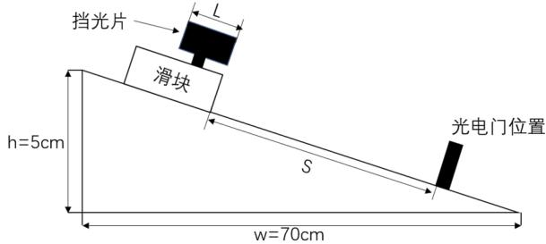
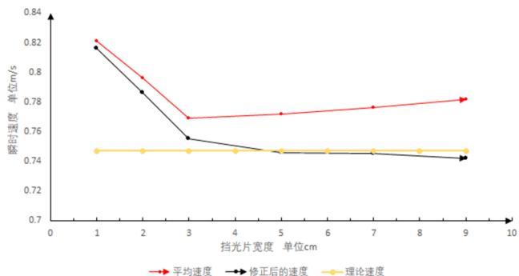
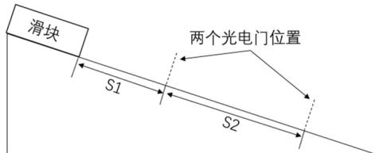

# 气垫导轨上瞬时速度的测量与修正

陈学梅 强晓明 高石平 陈紫怡（合肥师范学院 物理与材料工程学院 ，安徽 合肥230601）

［摘 要］ 测量瞬时速度时 ，用挡光片通过光电门的平均速度代替瞬时速度 ，引入系统误差是不可避免的 通过简单的力学公式推导得一个修正公式 可以消除挡光片宽度所来的系统误差 同时 为了回避瞬时速度的测量误差而导致加速度的测量误差 推导出一个新的加速度测量 大大提高了实验结果的精度

［关键词］ 挡光片 瞬时速度 平均速度

［中图分类号］ O4－33

［文献标识码］ A

［文章编号］ 1674－2273（2020）06－0055－03

气垫导轨是力学实验中一种较为精密的仪器它是利用气垫对滑块产生的漂浮作用 极大地减小由于滑动摩擦引起的误差 利用气垫导轨可进行数十种实验 例如 验证牛顿第一定律 测定重力加速度 验证动量守恒和机械能守恒等一些力学实验其中大部分实验需要直接或间接获得瞬时速度的测量值 因此 瞬时速度是气垫导轨实验测量的关键一般来说，挡光片的宽度越窄 ，速度测量越是接近滑块通过光电门的瞬时速度 测量也是越准确 但是事实并非如此 由于受到光电门的灵敏度的影响 挡光片的宽度也不能太小 此外 通用的计时器设置不管是计时1模式还是计时2模式 都会产生误差尽管在早期，黄仁忠［1］ 王教方［2］ 葛宇宏［3］ 就综合分析了条形挡光片和 U型挡光片引入的系统误差提倡使用 U 型挡光片进行测速， 从而减小系统误差 很多研究者都做过平均速度代替瞬时速度的误差分析 但是他们都没有指出挡光片的宽度所带来的系统误差并进行修正［4－5］ 。 另外，学生在学习过程中普遍认为测量的速度就是瞬时速度 ， 基本没有考虑对实验过程用平均速度代替瞬时速度所引起的误差。

本文拟通过简单的理论公式推导 得到一个可以用挡光片宽度修正的瞬时速度公式 并选用一系列不同宽度的挡光片进行测量并进行对比分析

## 1 瞬时速度的测定与分析

运动物体在某时刻或者某位置的速度 ，叫做瞬时速度 依据物体的运动规律 ， 它等于位矢的一阶导数，也就是 $\vec { v } = \operatorname* { l i m } _ { \Delta t \to 0 } \frac { \Delta \vec { r } } { \Delta t } = \frac { d \vec { r } } { d t }$ 在直线运动中即 $v = \operatorname* { l i m } _ { \Delta t \to 0 } { \frac { \Delta s } { \Delta t } }$ 因此，在气垫导轨实验中 ，滑块到达光电门的瞬时速度 v ，都是以到达该点后继续前进L距离的平均速度 v 来代替的 显然 在非匀速运动中一般来说 L值越小 平均速度越接近瞬时速度 误差越小。 在各种实际条件综合影响下的实测情况究竟如 何？本 文 用 气 垫 导 轨 （ 气 垫 导 轨 L－QG－T－1200／5．8）及 MUJ－6B通用计时器进行了一些测试与分析。

如图1所示 气垫导轨两支脚间距为70cm 一端垫高5cm，挡光片前沿距光电门为S＝40cm。 根据气垫导轨一端支起的高度和两支脚的间距 由公式 v＝槡 2as ， a＝gsinθ ，推得滑块前沿到达光电门的瞬时速度为0．747m／s 用一系列不同宽度的条形挡光片进行了测试与分析 结果如表1所示

  
图1 气垫导轨示意图

表1 不同宽度的挡光片通过光电门的时间
<table><tr><td>挡光片宽度</td><td></td><td></td><td> $\Delta t \ : \ : ( \mathrm { m s } )$ </td><td></td><td></td><td></td><td>平均值</td><td>平均速度  $\overline { { v } } \ ( \mathrm { m / s } )$ </td><td>绝对误差  $\Delta v \ : ( \mathrm { m s ) }$ </td><td>相对误差</td></tr><tr><td>L=1cm</td><td>12.18</td><td>12.17</td><td>12.18</td><td>12.17</td><td>12.17</td><td>12.17</td><td>12.17</td><td>0.821</td><td>0.074</td><td>10%</td></tr><tr><td>L=2cm</td><td>25.13</td><td>25.13</td><td>25.13</td><td>25.13</td><td>25.13</td><td>25.14</td><td>25.13</td><td>0.796</td><td>0.049</td><td>6.5%</td></tr><tr><td>L=3cm</td><td>39.00</td><td>39.06</td><td>39.04</td><td>39.02</td><td>38.98</td><td>38.99</td><td>39.02</td><td>0.769</td><td>0.022</td><td>2.9%</td></tr><tr><td> $\mathrm { L } { = } 5 \mathrm { c m }$ </td><td>64.81</td><td>64.78</td><td>64.73</td><td>64.79</td><td>64.66</td><td>64.72</td><td>64.75</td><td>0.772</td><td>0.025</td><td>3.3%</td></tr><tr><td> $\mathrm { L } { = } 7 \mathrm { c m }$ </td><td>90.05</td><td>90.14</td><td>90.27</td><td>90.19</td><td>90.22</td><td>90.20</td><td>90.17</td><td>0.776</td><td>0.029</td><td>3.8%</td></tr><tr><td> $\mathrm { L } { = } 9 \mathrm { c m }$ </td><td>114.96</td><td>115.02</td><td>115.01</td><td>115.19</td><td>115.13</td><td>115.05</td><td>115.07</td><td>0.782</td><td>0.035</td><td>4.6%</td></tr></table>

从以上分析可以看出 在使用不同挡光片通过光电门时 测量精度最高的既不是最窄的挡光片 也不是最宽的挡光片 而是宽度 $\mathrm { L } { = } 3 \mathrm { c m }$ 时的挡光片同时 还做了一些挡光片宽度小于1cm 的测试实验 发现计时器已经无力准确测量时间 相对误差迅速偏大 根据分析 一方面 可能与使用的计时1模式引起的系统误差相关［6］ ；另一方面 主要是由于光电门的灵敏度所引起的计时误差导致的 挡光片宽度增大到L＝3cm时 相对误差有所减小 但依然存在一定的误差；并且随着宽度增加 相对误差逐渐增大 如果以这个测量的平均速度的值来代替瞬时速度，再进行后续其他的测量 ，必然会给实验结果带来很大的系统误差 因此 需要寻找一种新的测量途径 本小组通过大量的实验测量及理论推导作了以下工作。

## 2 瞬时速度的修正

如图1所示 一个斜放的气垫导轨 滑块上挡光片的前沿距光电 门距离为S 挡光片的宽度为 L设挡光片前沿到达光电门用了时间 $t _ { 0 }$ 经过光电门用了时间 t ，根据运动学方程，可得方程组 ：

$$
S = \frac { 1 } { 2 } a t _ { 0 } ^ { 2 }\tag{1}
$$

$$
S + L = \frac { 1 } { 2 } a ( t + t _ { 0 } ) ^ { 2 }\tag{2}
$$

由（1）式得 $a = \frac { 2 S } { t _ { 0 } ^ { 2 } }$

代入（2）式有

$$
\begin{array} { l } { S + L = \frac { S ( t _ { 0 } + t ) ^ { 2 } } { t _ { 0 } ^ { 2 } } L t _ { 0 } ^ { 2 } - 2 S t t _ { 0 } - S t ^ { 2 } = 0 } \\ { \ } \\ { { t _ { 0 } } = \frac { 2 S t + \sqrt { ( 2 s t ) ^ { 2 } + 4 L S t ^ { 2 } } } { 2 L } } \\ { \ } \\ { { = \frac { S t ( 1 + \sqrt { 1 + \frac { L } { S } } ) } { L } } } \end{array}
$$

因此，挡光片前沿到达光电门时瞬时速度为 ：

$$
v = a t _ { 0 } = \frac { 2 S } { t _ { 0 } } = \frac { 2 S } { S t ( 1 + \sqrt { 1 + \frac { L } { S } } ) } = \frac { 2 } { 1 + \sqrt { 1 + \frac { L } { S } } } \cdot \frac { L } { t } = \beta \cdot \overline { { v } }\tag{3}
$$

这里的 $\beta = \frac { 2 } { 1 + \sqrt { 1 + \displaystyle \frac { L } { S } } }$ ， 可 以 称 之 为 修 正 系 数。显然当 $L \to 0$ 时 ， $\beta \to 1 , \ v \to { \overline { { v } } }$ 按照上述公式 当挡光片的宽度较大时 加上修正系数即可

以此修正公式计算测量结果 得到表2数据

表2 修正前后的速度对比
<table><tr><td>挡光片的宽度  $L ~ ( \mathbf { \theta } _ { c m } )$ </td><td>1</td><td>2</td><td>3</td><td>5</td><td>7</td><td>9</td></tr><tr><td>平均速度  $( \ m / s \ )$ </td><td>0.821</td><td>0.796</td><td>0.769</td><td>0.772</td><td>0.776</td><td>0.782</td></tr><tr><td>修正系数  $\beta$ </td><td>0.994</td><td>0.987</td><td>0.980</td><td>0.970</td><td>0.960</td><td>0.906</td></tr><tr><td>修正后  $\upsilon \ ( \ m / s \ )$ </td><td>0.816</td><td>0.785</td><td>0.753</td><td>0.748</td><td>0.745</td><td>0.742</td></tr><tr><td>修正前相对误差</td><td>10%</td><td>6.5%</td><td>2.9%</td><td>3.3%</td><td>3.8%</td><td>4.6%</td></tr><tr><td>修正后相对误差</td><td>9.2%</td><td>5.1%</td><td>0.8%</td><td>0.1%</td><td>0.2%</td><td>0.6%</td></tr></table>

由表2的数据及图2的对比可以看出 ， 经过公式修正后 瞬时速度的相对误差大大减小 非常接近理论值 验证了上文推导的修正公式的正确性 测量瞬时速度时 不用担心大宽度的挡光片测量的瞬时速度所带来的系统误差 可以用修正系数消除宽度所带来的误差 同时 推荐在瞬时速度测量中 使用宽度 $\mathrm { L } { = } 5 \mathrm { c m }$ 的挡光片做实验 再加上修正 误差极小 以上推导的修正公式都是力学中的最基本公式 简单明了 修正系数计算应用也简单快捷 可以很好地推广到实验中 便于学生做实验处理数据使用。

  
图2 实测的平均速度和修正后的速度对比图

## 3 加速度公式的修正

在气垫导轨的实验中 常需要测量滑块作匀加速运动时的加速度 测量加速度的公式为 ： $2 a S = v _ { t } ^ { 2 }$ $- \ : v _ { o } ^ { 2 }$

而实验中用平均速度代替瞬时速度 势必会带来系统误差 所以 同样可以采取公式推导来进行修正。

  
图3 气垫导轨示意图

根据图3可得方程组 ： $\upsilon _ { o } = \sqrt { 2 a S _ { 1 } } ~ , S _ { 2 } = \upsilon _ { o } t +$ ${ \frac { 1 } { 2 } } a t ^ { 2 }$

可以解出

$$
a = \frac { 2 S _ { 2 } + 4 S _ { 1 } \pm 4 \sqrt { S _ { 1 } ^ { 2 } + S _ { 1 } S _ { 2 } } } { t ^ { 2 } }
$$

根据题意应该4S1± $4 \sqrt { S _ { 1 } ^ { 2 } + S _ { 1 } S _ { 2 } } < 0$

所以

$$
a = \frac { 2 S _ { 2 } + 4 S _ { 1 } - 4 \sqrt { S _ { 1 } ^ { 2 } + S _ { 1 } S _ { 2 } } } { t ^ { 2 } }
$$

该公式与通常使用的公式进行比较 测量操作简单 测量精度较高 在使用的气垫导轨上一般取$\mathrm { S } _ { 1 } = 3 0 \mathrm { c m } , \mathrm { S } _ { 2 } = 6 0 \mathrm { c m }$ 测量效果较好

## 4 结语

本文通过一些基本的力学运动公式 推导出一个可以适用于大宽度的挡光片来测量瞬时速度 成功地化解了大宽度挡光片测量所带来的系统误差并且实验测量的数值经过修正后和文章推导的理论值非常吻合 同时发现 并非越窄的挡光片测量的平均速度就越接近瞬时速度 一方面可能与采用的条形挡光片有关 另外一方面是计时器的计时误差所致 为了回避瞬时速度的测量误差而导致加速度的测量误差 推导出一个新的加速度测量 大大提高了实验结果的精度 相对与姚萍组［4］ 的误差修正本文的修正方法更为简单易懂 ，误差分析更为简便

## ［ 参 考 文 献 ］

［1］ 黄仁忠．气垫导轨实验误差综合分析［J］．抚州师专专刊 ，1982（2） ：88－96

［2］ 王教方．气垫导轨上挡光片的使用［J］．山东建材学院 ，1989，3（2） ：60－61

［3］ 葛宇宏．气体粘滞阻力和光电计时仪器引起的系统误差及修正［J］．大学物理实验 ，2007，20（3） ：69－71

［4］ 姚萍．气垫导轨上瞬时速度的测量与修正［J］．兴义民族师范学报 ，2014（5） ：112－115

［5］ 何崇荣．用平均速度代替瞬时速度的误差分析［J］．物理通报 ，2018（7） ：48－49

［6］ 张锁宾．条形挡光片测速的误差分析及其修正方法［J］．大学物理 ，2017，36（6） ：73－76

（责任编辑 董 萍）