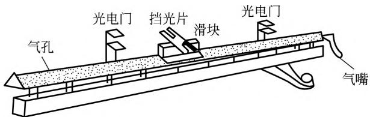
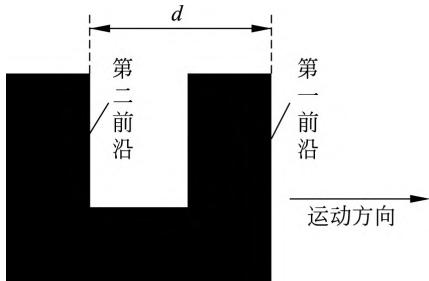
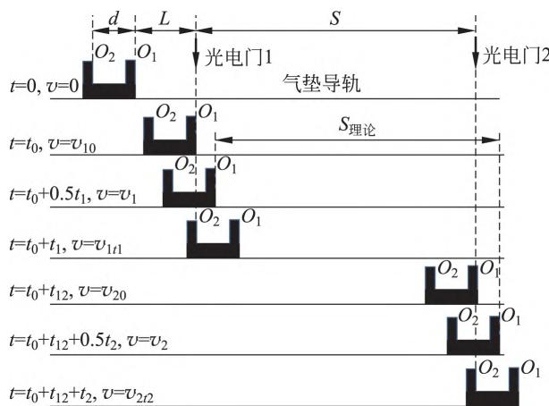
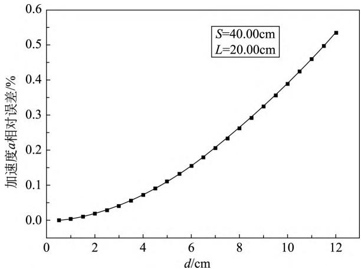
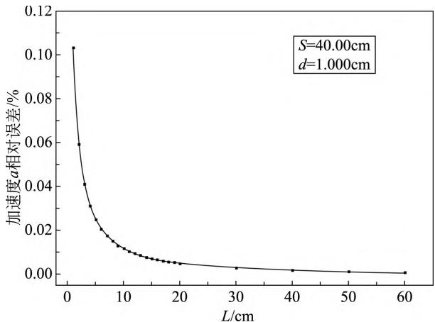
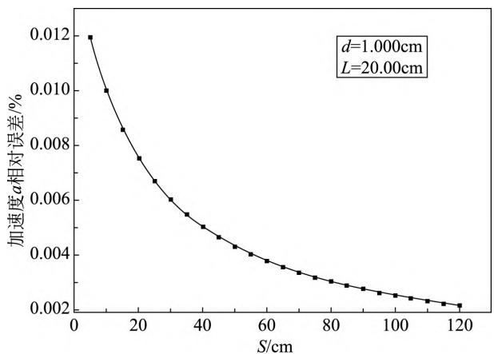

# 气垫导轨测量重力加速度实验系统误差分析

赵佳乐 张嘉禾 于永江（鲁东大学物理与光电工程学院 ，山东 烟台 264025）

## 摘 要

气垫导轨测量重力加速度实验中，由于滑块运动的瞬时速度用平均速度代替的理论近似，给加速度测量带来了无法消除的系统误差。本文用控制变量法，研究了挡光片宽度 d、滑块静止释放时离第一个光电门的距离 L、两光电门间距 S 和气垫导轨倾角 θ 等四个参量对该系统误差的影响。研究表明，d 值的大小对该系统误差的影响最大，且 d 值越大影响越大；L 对该系统误差的影响次之，且 L 值越大影响越小；S 值的影响较小，也是 S 值越大影响越小；不考虑滑块运动阻力的理想情况下，θ 对该系统误差没有影响；该近似导致了重力加速度的测量值比真值偏大；实验中 d、L 和 S 取值分别小于 1cm、大于 20cm 和大于 40cm，将是减小该系统误差较好的参数取值。

关键词 气垫导轨；重力加速度；系统误差；误差分析

# ANALYSISOFTHESYSTEMATICERRORSON MEASUREMENTOFGRAVITYACCELERATIONBYAIRTRACK

ZHAOJiale ZHANGJiahe YUYongjiang

（SchoolofPhysicsandOptoelectronicEngineering， LudongUniversity， Yantai， Shandong264025）

Abstract Intheexperimentofmeasuringtheaccelerationofgravityontheairtrack，thethe－ oreticalapproximation thattheinstantaneousvelocityoftheslidermovementisreplacedby theaveragevelocity， bringsaninevitablesystematicerrortotheaccelerationmeasurement．In thispaper，thecontrolvariablemethodisusedtostudytheinfluenceoffourparametersonthe systemerrorsuchasthewidthofthelightbarrierd，thedistanceLbetweenthefirstphotoe－ lectricgateandthepositionwherethesliderisreleased，thedistanceSbetweenthetwopho－ toelectricgates， andtheinclinationangleθoftheairtrackguide．Studyresultsshowthatthe valueofdhasthegreatestimpactonthesystemerror， andthelargerthed ， thegreaterthe impact； Lhasthesecondtheimpactonthesystemerror， andthelargertheL， thesmaller theimpact； Shasasmallerimpactonthesystemerror， andthelargertheS ，thesmallerthe impact；intheidealcasewithoutconsideringtheresistanceoftheslidermovement， θhasno effectonthesystemerror； thisapproximationcausesthemeasuredvalueofgravitationalac－ celerationtobelargerthanthetruevalue．Intheexperiment，itisabetterchooseofparame－ terstoreducethesystemerrorthatvaluesofd ， L， andS arelessthan1cm， greaterthan 20cmandmorethan40cmrespectively

Keywords airtrack； gravityacceleration； systematicerrors； erroranalysis

重力加速度是一个很重要的物理量，测量它的方法有很多，如单摆法、气垫导轨法、干涉法、用 DIS 系统测量法和全信息声发射仪的快速测量法等［1－4］。其中用气垫导轨测量重力加速度实验，知识运用比较综合，用到了运动学也用到了动力学方面知识，成为很多学校必开设的一项大学物理实验之一。

气垫导轨实验装置是由导轨、滑块以及两个光电门组成，实验装置如图1所示。导轨由长度 1．5～2m 的三角形中空铝制材料构成，在导轨两侧表面各有两排直径极小的喷气孔，导轨表面的小孔喷出的压缩空气会在滑块和导轨之间形成一层极薄的空气膜即气垫，气垫会托起滑块，避免了滑块滑动时与导轨之间产生滑动摩擦，营造一个近似无摩擦的实验环境。影响气垫导轨实验的因素比较多，人们也做了很多讨论［5－11］，如导轨由于长时间使用导致变形不平整，影响滑动流畅性产生的误差；滑块滑动过程中受到空气阻力影响产生的误差；计时装置的光电转换系统不等时也会导致计时出现误差；滑块在运动中和导轨之间由于气流的相对运动而产生的一种黏滞性阻力而导致的误差。这些误差都可以通过提高仪器的精度一一减少或消除。但是，在气垫导轨上测量重力加速度实验中，由于通过实验测量滑块的瞬时速度是不可能的，因此在理论基础方面，做了一个用测量的平均速度代替瞬时速度的理论近似，这样的理论近似必将产生无法消除的系统误差。

  
图1 气垫导轨实验装置图

气垫导轨上测量重力加速度实验，是先测量滑块运动加速度，再间接获得当地重力加速度，可见，测量滑块的运动加速度是实验中关键的第一步。本文以气垫导轨上测量滑块运动加速度为例，分析由于瞬时速度用平均速度替代的理论近似产生的误差，用控制变量法研究实验中如何设置相关参数来降低此类误差。

## 1 气垫导轨测量重力加速度实验概述

实验中首先将导轨调整为水平，然后一端垫高，调整导轨与水平面方向的夹角为 θ，两个光电门之间的距离为 S，在第一个光电门后方距离为 L 处，让滑块从静止开始，自由滑落，依次通过光电门1和光电门2。图2为 U 形挡光片示意图，两个前沿的间距为 d，它固定在滑块上与其一起运动，当滑块携带 U 形挡光片向右运动时，挡光片第一前沿通过光电门挡住光路，数字毫秒计开始计时，第二前沿通过光电门再次挡住光路时，计时结束，这样可以记录滑块通过该光电门的时间；它先后通过光电门1和光电门2，就可以分别记录时间 $t _ { 1 }$ 和 $t _ { 2 }$；另外，当 U 形挡光片第一前沿通过光电门1时，数字毫秒计开始计时，再通过光电门2时停止计时，这样可以记录滑块通过两个光电门所用的时间间隔 $t _ { 1 2 }$。

  
图2 U形挡光片装置示意图

一般 U 形挡光板的宽度 d 比较窄，实验中理论近似挡光板宽度 d 和通过两个光电门的时间 t1 和 t2 分别相比的平均速度作为滑块通过两个光电门时的瞬时速度 $\boldsymbol { v } _ { 1 }$ 和 $\mathrm { ~ \textit ~ { ~ v ~ } ~ } _ { 2 }$，即

$$
v _ { 1 } = \frac { d } { t _ { 1 } }\tag{1}
$$

$$
v _ { 2 } = \frac { d } { t _ { 2 } }\tag{2}
$$

滑块运动的加速度 a 可以根据式（3）求得，再根据式（4）求得重力加速度 $g$。便于操作，实验中要求 θ 角度比较小，这时 sinθ 可以用 tanθ 代替。

$$
a = \frac { v _ { 2 } ^ { 2 } - v _ { 1 } ^ { 2 } } { 2 s }\tag{3}
$$

$$
g = { \frac { a } { \sin \theta } }\tag{4}
$$

## 2 系统误差分析

根据实验计时系统原理，滑块在运动过程中，我们将几个关键的时刻点滑块所对应的空间、时间和速度演化用图3表示出来，为便于分析，将挡光片两个前沿上各取一个点 O1 和 $O _ { 2 }$，用它们的运动规律代替滑块的运动规律。设0时刻， $O _ { 1 }$ 点静止，其速度 $v = 0$， $O$ 1点离光电门1点的距离为 $L$； $t _ { 0 }$ 时刻 $O _ { 1 }$ 点运动到光电门1点，设运动速度为 $\boldsymbol { v } _ { 1 0 }$； $t _ { 0 } + t _ { 1 }$ 时刻 $O _ { 2 }$ 点运动到光电门1点，设运动速度为 $\boldsymbol { v } _ { 1 t 1 }$；在 $t _ { 0 } \to t _ { 0 } + t$ 1时间内，O1点位移为 $d$，用时为 $t _ { 1 }$，实验中用 $t _ { 1 }$ 时间段的平均速度式（1）近似的表示 O1点通过光电门1的瞬时速度 $\boldsymbol { v } _ { 1 }$，根据匀变速直线运动规律，理论上 $O _ { 1 }$ 点的瞬时速度为 $\boldsymbol { v } _ { 1 }$ 的时刻应该在 $t _ { 0 } + 0 . 5 t$ 1时刻；同样，O1点通过光电门2的瞬时速度 $\boldsymbol { v } _ { 2 }$ 应该在 $t _ { 0 } + t _ { 1 2 } + 0 . 5 t$ 2时刻，这两个时刻 $O _ { 1 }$ 点的位移用 $S _ { \text{理论} }$ 表示，如图3所示。图3中可以看出 S 不等于 $S _ { \text{理论} }$，理论上，滑块（或 $O _ { 1 }$ 点）运动的加速度应该表示为

$$
a _ { \text{理论} } = \frac { v _ { 2 } ^ { 2 } - v _ { 1 } ^ { 2 } } { 2 S _ { \text{理论} } }\tag{5}
$$

显然，应用式（3）计算加速度时的系统误差主要是由位移 S 不等于 $S _ { \text{理论} }$ 造成的。

  
图3 滑块运动过程中的空间 时间和速度演化示意图

## 3 各变量对系统误差影响

本讨论中，加速度 a 作为一个客观量， 用 $a _ { \text{真} }$ 表示， $a _ { \text{真} } = g \sin \theta$ ，其中 g 为重力加速度。

根据匀加速直线运动规律 ，可知，

$$
v _ { 1 } = a _ { \text{真} } ( t _ { 0 } + 0 . 5 t _ { 1 } )\tag{6}
$$

$$
v _ { 2 } = a _ { \text{真} } ( t _ { 0 } + t _ { 1 2 } + 0 . 5 t _ { 2 } )\tag{7}
$$

$$
\displaystyle { S _ { \text{理论} } = \frac { a _ { \text{真} } \ ( t _ { 0 } + t _ { 1 2 } + 0 . 5 \ t _ { 2 } ) ^ { 2 } - a _ { \text{真} } \ ( t _ { 0 } + 0 . 5 \ t _ { 1 } ) ^ { 2 } } { 2 } }\tag{8}
$$

将式（6） （7）代入式（3）整理得

$$
a = \frac { ( g \sin \theta ) ^ { 2 } \left[ ( t _ { 0 } + t _ { 1 2 } + 0 . 5 \ t _ { 2 } ) ^ { 2 } - ( t _ { 0 } + 0 . 5 \ t _ { 1 } ) ^ { 2 } \right] } { 2 s }\tag{9}
$$

将式（6） （7） （8）代入式（5）整理得

$$
\begin{array} { r l r } {  { a _ { \text{理论} } = \frac { v _ { 2 } ^ { 2 } - v _ { 1 } ^ { 2 } } { 2 S _ { \text{理论} } } } } \\ & { } & { = \frac { g \sin \theta [ ( t _ { 0 } + t _ { 1 2 } + 0 . 5 \ t _ { 2 } ) ^ { 2 } - ( t _ { 0 } + 0 . 5 \ t _ { 1 } ) ^ { 2 } ] } { ( t _ { 0 } + t _ { 1 2 } + 0 . 5 \ t _ { 2 } ) ^ { 2 } - ( t _ { 0 } + 0 . 5 \ t _ { 1 } ) ^ { 2 } } } \\ & { } & { \equiv g \sin \theta \quad \quad \quad ( 10 ) } \end{array}
$$

加速度 a 的相对误差可以表示为

<!-- 存疑：此处的 δ 相对误差中间推导式 OCR 严重失真，公式内符号（t、S、a理论 等）被误识为 \widehat{\mathbf{t}}_{\mathrm{B}}、\partial\mathbf{t}\overline{S} 等乱码，无法从 MD 与 PDF 双向可靠还原；其物理含义可由下文式（11）及代入步骤重建，详见紧随其后的"代入上式整理得"段。 -->

$$
\begin{array} { r l } & { \frac { \partial } { \partial x } = - \frac { 4 \pi n } { \sqrt { 2 \pi \mathbf { S } } } \frac { 1 } { 2 } \partial \mathbf { t } \overline { { S } } } \\ & { = - \frac { \widehat { \mathbf { t } } _ { \mathrm { B } } ( \mathbf { t } _ { \mathrm { B } } + \mathbf { t } _ { \mathrm { B } } + \mathbf { t } _ { \mathrm { B } } ; \boldsymbol { t } _ { \mathrm { B } } ) - ( \mathbf { t } _ { \mathrm { B } } + \mathbf { t } _ { \mathrm { B } } + \mathbf { t } _ { \mathrm { B } } ; \boldsymbol { t } _ { \mathrm { B } } ) } { 2 \Delta \mathbf { t } } - \frac { \widehat { \mathbf { t } } _ { \mathrm { B } } ( \mathbf { t } _ { \mathrm { B } } + \mathbf { t } _ { \mathrm { B } } ; \boldsymbol { t } _ { \mathrm { B } } ) } { 2 \Delta \mathbf { t } } } \\ & { - \frac { \widehat { \mathbf { t } } _ { \mathrm { B } } ( \mathbf { t } _ { \mathrm { B } } + \mathbf { t } _ { \mathrm { B } } + \mathbf { t } _ { \mathrm { B } } ; \boldsymbol { t } _ { \mathrm { B } } ) - ( \mathbf { t } _ { \mathrm { B } } + \mathbf { t } _ { \mathrm { B } } ; \boldsymbol { t } _ { \mathrm { B } } ) - \frac { 1 } { 2 } | \widehat { \mathbf { t } } _ { \mathrm { B } } ( \mathbf { t } _ { \mathrm { B } } + \mathbf { t } _ { \mathrm { B } } ; \boldsymbol { t } _ { \mathrm { B } } ) | } { 2 \Delta \mathbf { t } } } \\ &  - \{ \frac  \widehat { \mathbf { t } } _ { \mathrm { B } } ( \mathbf { t } _ { \mathrm { B } } + \mathbf { t } _ { \mathrm { B } } ; \boldsymbol { t } _ { \mathrm { B } } ) - \widehat { \mathbf { t } } _ { \mathrm { B } } ( \mathbf { t } _ { \mathrm { B } } + \mathbf { t } _ { \mathrm { B } } ; \boldsymbol { t } _ { \mathrm { B } } ) - \frac  \widehat { \mathbf { t } } _ { \mathrm { B } } ( \mathbf { t } _  \mathrm  \end{array}
$$

代入上式整理得

$$
\delta = \biggl [ \frac { \left( \sqrt { L + S } + \sqrt { L + S + d } \right) ^ { 2 } - \left( \sqrt { L } + \sqrt { L + d } \right) ^ { 2 } } { 4 s } - 1 \biggr ] \cdot 100\% \tag{11}
$$

从式（11）可以看出，不考虑滑块运动阻力的理想情况下，影响加速度测量的系统误差因素只有 L、S 和 d 三个参量，与导轨的倾角 θ 无关。

## 4 系统误差分析

设定滑块静止释放时离第一个光电门的间距 L＝20．00cm，两个光电门之间的间距为 40．00cm，改变 U 形挡光片的宽度 d 的大小，描绘了 d 值对加速度测量相对误差的影响变化曲线如图4所示。结果发现 d 越小，加速度测量的相对误差越小，反之越大。主要原因是，d 越小，根据式（1）和式（2）计算出的平均速度越接近瞬时速度，造成的误差影响自然减小。这样可以说，实验中要尽量选用宽度 d 较小的挡光片。

  
图4 d 值对加速度测量相对误差的影响

设定两个光电门间距 S＝40．00cm，U 形挡光片的宽度 $d { = } 1 . 0 0 0 \mathrm { c m }$，改变滑块静止释放时离第一个光电门的间距 L 的大小，我们发现 L 越小加速度测量的相对误差越大，反之越小，图5描绘了 L 值对加速度测量相对误差影响的变化规律。图像可以看出当 L 取值大于 20．00cm 后，系统误差就比较少了，这样，学生做实验时 L 取值一般要大于等于 20．00cm，与实验指导教材要求相符［12］。

  
图5 L 值对加速度测量相对误差的影响

图6描绘了 S 值对加速度测量相对误差影响的规律曲线。设定滑块静止释放时离第一个光电门的间距 L＝20．00cm，U 形挡光片的宽度 d＝1．000cm，改变两个光电门间距 S，我们发现 S 越小，对加速度测量的相对误差越大，反之越小，这样可以说，只要实验条件允许，实验中要尽量增大两个光电门的间距。在图6中，结合实验设备条件，选择一个比较优化的变量组合，如 $S = 4 0 \mathrm { c m }$、$L = 2 0 . 0 0 \mathrm { c m }$、$d = 1 . 0 0 0 \mathrm { c m }$，发现重力加速度的相对误差很小，等于 0．005％。

  
图6 S 值对加速度测量相对误差的影响

综合分析图4、图5和图6加速度测量相对误差值，我们发现它们依次减少了1个数量级，这就说明本实验中影响系统误差的主要因素是挡光片的宽度 d，再就是滑块静止释放时离第一个光电门的间距 L，两个光电门间距的大小 S 对加速度测量相对误差的影响最小。另外，相对误差都为正值，根据式（11）可知实验测量结果比当地重力加速度的真实值要偏大。

## 5 结论

综上，在气垫导轨测量重力加速度实验中，一是挡光片宽度 d、滑块静止释放时离第一个光电门的距离 L、两光电门间距 S 等三个参量对该系统误差都有影响，d 值的大小对该系统误差的影响最大，且 d 值越大影响越大；L 对该系统误差的影响次之，且 L 值越大影响越小；S 值的影响较小，也是 S 值越大影响越小；二是理想情况下气垫导轨倾角 θ 对该系统误差没有影响；三是本实验中用平均速度代替瞬时速度导致了重力加速度的测量值比真值偏大；四是实验中 d、L 和 S 取值分别小于 1cm、大于 20cm 和大于 40cm，将是减小该系统误差较好的参数取值。

## 参 考 文 献

［1］ 王中元．单摆法测重力加速度的系统误差计算与分析［J］．湖北师范大学学报（自然科学版） ，2019，169（3） ：86－89．WANG Z Y．The systematic error analysis and calculation on measurement of gravity acceleration by single pendulum［J］．Journal of Hubei Normal University， 2019， 169（3） ： 86－89．（in Chinese）

［2］ 胡梦楠 ，李红蕙 ，白在桥．干涉法测量重力加速度［J］．大学物理 ，2018，37（7） ：75－79．HU M N，LI H H，BAI Z Q．Measurment of gravitational acceleration via laser interferometr［J］．College Physics，2018， 37（7） ： 75－79．（in Chinese）

［3］ 李辉 闫向宏 亓鹏 等．利用全信息声发射仪实现恢复系数与重力加速度的快速测量［J］．物理与工程 ，2018，28（2） ：53－57．LI H，YAN X H，QI P，et al．Measurement the restitution coefficient and the acceleration of gravity quickly by using acoustic hologrphy emission signal transmitter［J］．Physics and Engineering， 2018， 28（2） ： 53－57．（in Chinese）

［4］ 曾银标 陈浩．一种用 DIS系统测量重力加速度的方法［J］．物理通报 ，2016，35（1） ：66－68．ZENG Y B， CHEN H．A method of measuring gravity acceleration using DIS system ［J］．Physics Bulletin， 2016，35（1） ： 66－68．（in Chinese）

［5］ 任佳琪 李飞祥 彭雪城 等．挡光片的宽度和振幅对阻尼振动半衰期测量的影响［J］．物理实验 ，2020，40（3） ：43－47．REN J Q，LI F X，PENG X C，et al．Influence of light barrier width and amplitude on half-life period measurements of damping vibration［J］．Physics Experimentstion， 2020， 40（3） ：43－47．（in Chinese）

［6］ 盖双旗．关于气垫导轨实验中光电计时系统误差研究实验的探索［J］．大学物理 ，2011，30（6） ：24－27．GAI S Q．Exploration for teaching method of an air track experiment with system error caused by photoelectric timer［J］．College Physics， 2011， 30（6） ： 24－27．（in Chinese）

［7］ 高立晟 庄步科．光电计时系统的误差研究［J］．山东师范大学学报 ：自然科学版 ，2000，15（2） ：201－203．GAO L S， ZHUANG B K．Research on the error of photoelectric timing system［J］．Journal of Shandong Normal University： Natural Science， 2000， 15（2） ： 201－203．（in Chinese）

［8］ 孙鹏．在气垫导轨上测加速度的系统误差［J］．教学仪器与实验 ，1989，5（6） ：10－12．SUN P．System error of acceleration measurement on air cushion rail［J］．Teaching Instruments and Experiments， 1989， 5（6） ： 10－12．（in Chinese）

［9］ 马葭生．气垫导轨上测重力加速度实验中系统误差的修正［J］．大学物理 ，1985，1（9） ： 27－28．MA J S．Correction of system error in the experiment of measuring gravity acceleration on air cushion rail［J］．College Physics， 1985， 1（9） ： 27－28．（in Chinese）

［10］ 郑发农．气轨实验的实验误差剖析 ［J］．大学物理实验 ，2000，13（1） ：66－68．ZHENG F N．Analysis of experimental errors in the air track experiment［J］．Physical Experiment of College， 2000， 13（1） ： 66－68．（in Chinese）

［11］ 宋兆丽 刘长捷．利用气垫导轨提高刚体转动惯量测量精确度［J］．大学物理实验 ，1997，10（3） ：42－44．SONG Z L， LIU C J．The improvement on the accuracy of measuring potational inertia of rigid body with air track［J］．Physical Experiment of College， 1997， 10（3） ： 42－44．（in Chinese）

［12］ 吴泳华 ，霍剑青 ，浦其荣．面向21世纪课程教材大学物理实验第1册［M］．2版．北京 ：高等教育出版社 ，2005