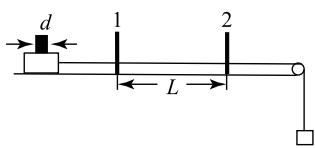
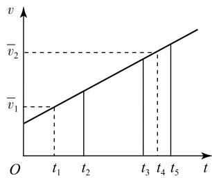
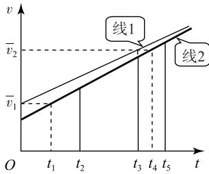
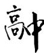
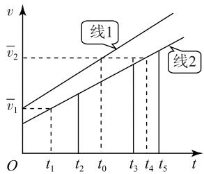
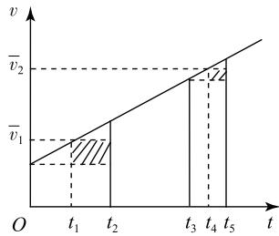

# 用光电门测加速度的两种方案误差分析

山东 宋 宝1 柳玉梅2

## 1 两种实验方案

光电门(包括数字计时器)是研究物体运动情况的常用仪器,可以用它来间接测量做匀变速直线运动物体的加速度,其测量加速度的方案主要有两种,现作简要介绍

如图1 所示,1 和 2 是两个光电门,物体上固定一块宽度为 d 的遮光片,当物体通过光电门时,数字计时器测得

  
图1

遮光片经过光电门1 和 2 的时间分别为 $\Delta t _ { 1 } \setminus \Delta t _ { 2 }$ ,则遮光片通过光电门1 和 2 的平均速度为 $\bar { v } _ { 1 } = \frac { d } { \Delta t _ { 1 } }$ $\overline { { v } } _ { 2 } = \frac { d } { \Delta t _ { 2 } }$ ,这里用平均速度来表示物体(遮光片)通过光电门时的瞬时速度

方案一 若数字计时器测得遮光片从挡住光电门1 到挡住光电门2 所用的时间为 t,则物体运动的加速度 $\boldsymbol { a } _ { \mathrm { 测 } } = \frac { \overline { { \boldsymbol { v } } } _ { 2 } - \overline { { \boldsymbol { v } } } _ { 1 } } { t } = \frac { \displaystyle \frac { d } { \Delta t _ { 2 } } - \frac { d } { \Delta t _ { 1 } } } { t }$

方案二 若测得两个光电门之间的距离为 L,则物体运动的加速度 $a _ { \mathrm { 测 } } = \frac { \overline { { v } } _ { 2 } ^ { 2 } - \overline { { v } } _ { 1 } ^ { 2 } } { 2 L } = \frac { ( \frac { d } { \Delta t _ { 2 } } ) ^ { 2 } - ( \frac { d } { \Delta t _ { 1 } } ) ^ { 2 } } { 2 L }$

上述两种方案均存在系统误差,下面对误差产生的原因进行分析

## 2 误差产生原因分析

以遮光片挡住光电门1 作为计时起点,物体实际

运动的 $v - t$ 图象如图2 所示．$0 \sim t _ { 2 } \dots t _ { 3 } \sim t _ { 5 }$ 时间内,遮光条分别通过光电门1 和 $2 , t _ { 1 } \setminus t _ { 4 }$ 分别为这两段时间的中间时刻．所以, $t _ { 2 } = \Delta t _ { 1 } , t _ { 5 } - t _ { 3 } =$ $\Delta t _ { 2 }$ ．根据匀变速直线运

  
图2

动的规律,物体在一段时间内的平均速度等于中间时刻的瞬时速度,因此 $, { \overline { { v } } } _ { 1 } , { \overline { { v } } } _ { 2 }$ 是遮光片分别通过光电门1 和 2 中间时刻的瞬时速度,即 $t _ { 1 } \setminus t _ { 4 }$ 时刻的速度

用加速度的定义式计算加速度时,与速度变化量$\bar { \boldsymbol { v } } _ { 2 } - \bar { \boldsymbol { v } } _ { 1 }$ 对应的时间为 $t _ { 4 } - t _ { 1 }$ ,而 $t = t _ { 3 } \ne t _ { 4 } - t _ { 1 }$ ,因此,方案一产生的误差是速度变化量与时间不对应引起的

用位移与速度关系计算加速度时,与初、末速度$\overline { { v } } _ { 1 } \mathrm { ~ } \ 、 \overline { { v } } _ { 2 }$ 对应的位移为 $t _ { 1 } \sim t _ { 4 }$ 时间内的位移,而这段时间内的位移与 $0 \sim t _ { 3 }$ 时间内的位移(两个光电门之间的距离 L)并不相等,因此,方案二产生的误差是初、末速度与位移不对应引起的

找到了误差产生的原因,下面通过理论分析,得出两种方案加速度的真实值,并对测量值和真实值关系进行分析

## 3 加速度的真实值及测量值与真实值关系

## 1)方案一分析过程

要得到加速度的真实值,需要将速度变化量与时间对应起来,包括两种思路．思路1:找到与速度变化量 $\bar { \boldsymbol { v } } _ { 2 } - \bar { \boldsymbol { v } } _ { 1 }$ 对应的时间;思路2:找到与时间 t 对应的速度变化量

由思路1可得 $a _ { \mathrm { 真 } } = \frac { \overline { { v } } _ { 2 } - \overline { { v } } _ { 1 } } { t _ { 4 } - t _ { 1 } } = \frac { \displaystyle \frac { d } { \Delta t _ { 2 } } - \frac { d } { \Delta t _ { 1 } } } { t - \displaystyle \frac { \Delta t _ { 1 } } { 2 } + \displaystyle \frac { \Delta t _ { 2 } } { 2 } } .$

由思路2可得,计时起点速度

$$
v _ { 1 } = \frac { d } { \Delta t _ { 1 } } - a _ { \mathrm { 真 } } \cdot \frac { \Delta t _ { 1 } } { 2 } .\tag{①}
$$

$t _ { 3 }$ 时刻速度

$$
v _ { 2 } = \frac { d } { \Delta t _ { 2 } } - a _ { \mathrm { 真 } } \cdot \frac { \Delta t _ { 2 } } { 2 } .\tag{②}
$$

由

$$
a _ { \mathrm { 真 } } = \frac { v _ { 2 } - v _ { 1 } } { t } .\tag{③}
$$

由式①~③得 $a _ { \mathrm { 真 } } = \frac { \displaystyle \frac { d } { \Delta t _ { 2 } } - \frac { d } { \Delta t _ { 1 } } } { \displaystyle t - \frac { \Delta t _ { 1 } } { 2 } + \frac { \Delta t _ { 2 } } { 2 } } ,$

对比方案一加速度的测量值与真实值,由于${ \Delta t _ { 1 } > \Delta t _ { 2 } }$ ,知 $t > t - \frac { \Delta t _ { 1 } } { 2 } + \frac { \Delta t _ { 2 } } { 2 }$ ,所以 $a _ { \mathrm { 测 } } { < } a _ { \mathrm { 真 } }$

为了更为直观地反映加速度测量值与真实值的关系,作出与加速度测量值、真实值对应的 $v - t$ 图象如图3 所示．线1 在 0 时刻对应的速度为 $\overline { { v } } _ { 1 }$ ,在 $t _ { 3 }$ 时刻对应的速度为 $\overline { { \boldsymbol { v } } } _ { 2 }$ ,因此,线1 斜率与加速度测量值对应;线2 在 $t _ { 1 }$ 时刻对应的速度为 $\overline { { \boldsymbol { v } } } _ { 1 }$ ,在 $t _ { 4 }$ 时刻对应的速度为 $\overline { { \boldsymbol { v } } } _ { 2 }$ ,因此,线2 斜率与加速度真实值对应,可见$a _ { \mathrm { 测 } } < a _ { \mathrm { 真 } }$

  
图3

## 2)方案二分析过程

要得到加速度的真实值,需要将初、末速度与发生位移对应起来,包括两种思路．思路1:找到与初、末速度 $\overline { { \boldsymbol { v } } } _ { 1 } \setminus \overline { { \boldsymbol { v } } } _ { 2 }$ 对应的位移;思路2:找到与两个光电门之间的距离 L 对应的初、末速度

由思路1可得, $0 \sim t _ { 1 }$ 时间内物体的位移

$$
x _ { 1 } = \frac { ( \displaystyle \frac { d } { \Delta t _ { 1 } } - a _ { \mathrm { 真 } } \cdot \frac { \Delta t _ { 1 } } { 2 } ) + \frac { d } { \Delta t _ { 1 } } } { 2 } \cdot \frac { \Delta t _ { 1 } } { 2 } .\tag{④}
$$

$t _ { 3 } \sim t _ { 5 }$ 时间内物体的位移

$$
x _ { 2 } = \frac { ( \displaystyle \frac { d } { \Delta t _ { 2 } } - a _ { \mathrm { 真 } } \cdot \frac { \Delta t _ { 2 } } { 2 } ) + \frac { d } { \Delta t _ { 2 } } } { 2 } \cdot \frac { \Delta t _ { 2 } } { 2 } .\tag{⑤}
$$

$$
a _ { \mathrm { 真 } } = \frac { ( \frac { d } { \Delta t _ { 2 } } ) ^ { 2 } - ( \frac { d } { \Delta t _ { 1 } } ) ^ { 2 } } { 2 ( L - x _ { 1 } + x _ { 2 } ) } .\tag{⑥}
$$

由式④\~⑥得

$$
a _ { \mathrm { 真 } } = \frac { 2 \sqrt { 4 L ^ { 2 } + \frac { ( \Delta t _ { 1 } ^ { 2 } - \Delta t _ { 2 } ^ { 2 } ) ^ { 2 } d ^ { 2 } } { \Delta t _ { 1 } ^ { 2 } \Delta t _ { 2 } ^ { 2 } } } - 4 L } { \Delta t _ { 1 } ^ { 2 } - \Delta t _ { 2 } ^ { 2 } } .
$$

由思路2可得

$$
a _ { \mathrm { 真 } } = \frac { v _ { 2 } ^ { 2 } - v _ { 1 } ^ { 2 } } { 2 L } .\tag{⑦}
$$

结合式①、②、⑦可得

$$
a _ { \mathrm { 真 } } = \frac { 2 \sqrt { 4 L ^ { 2 } + \frac { ( \Delta t _ { 1 } ^ { 2 } - \Delta t _ { 2 } ^ { 2 } ) ^ { 2 } d ^ { 2 } } { \Delta t _ { 1 } ^ { 2 } \Delta t _ { 2 } ^ { 2 } } } - 4 L } { \Delta t _ { 1 } ^ { 2 } - \Delta t _ { 2 } ^ { 2 } } .
$$

将方案二加速度测量值表达式与式⑥ 进行对比,由于 $x _ { 2 } - x _ { 1 } = \frac { 1 } { 8 } a _ { \mathrm { 真 } } ( \Delta t _ { 1 } ^ { 2 } - \Delta t _ { 2 } ^ { 2 } ) > 0$ ,知 $L { < } L - x _ { 1 } +$ $x _ { 2 }$ ,所以 $a _ { \mathrm { 测 } } > a _ { \mathrm { 真 } }$

作出与加速度测量值、真实值对应的 $v - t$ 图象如图4 所示．线1 斜率与加速度测量值对应,线2 斜率与加速度真实值对应．线1 在 $0 \sim t _ { 0 }$ 时间内,图象与坐标轴所围成的面积数值为 L,线2 在 $t _ { 1 } \sim t _ { 4 }$ 时间内,图象与坐标轴所围成的面积数值为 $L - x _ { 1 } + x _ { 2 }$ ,且 $L <$

$L - x _ { 1 } + x _ { 2 }$ ．根据数学知识,要达到上述要求,需 $t _ { 0 } < t _ { 4 } - \frac { \Delta t _ { 1 } } { 2 }$ ,即线1 的斜率大于线2 的斜率,即 $a _ { \mathrm { 测 } } > a _ { \mathrm { 真 } }$

  
图4

通过以上分析可以看出,方案一的误差分析运算量小,过程简单,而方案二的误差分析运算量大,过程复杂．对方案二的误差分析不但耗时费力,而且学生不易掌握．因此在高中阶段,方案二的误差分析多为定性分析．可以结合 $v - t$ 图象进行如下分析,方便快捷

如图5 所示,用 $t _ { 1 } \sim t _ { 2 }$ 之间阴影部分的面积,表示遮光条通过光电门1 时 $t _ { 1 } \sim t _ { 2 }$ 与 $0 \sim t _ { 1 }$ 时间内位移的差值,用 $t _ { 4 } \sim t _ { 5 }$ 之间阴影部分的面积,表示遮光条通过光电门2 时 $t _ { 4 } \sim t _ { 5 }$ 与 $t _ { 3 } \sim t _ { 4 }$ 时间内位移的差值．阴影部分面积减小,说明随着时间的推移,匀加速直线运动在一段相等的位移上,中间时刻逐渐向中间位置靠近,从而得出 $t _ { 1 } \sim t _ { 4 }$ 时间内位移大于两个光电门之间的距离 L,所以 $a _ { \mathrm { 测 } } > a _ { \mathrm { 真 } }$

  
图5

综上所述,光电门(包括数字计时器)测量加速度的方案主要有两种,两种方案均存在系统误差．方案一产生的误差是速度变化量与时间不对应引起的,方案二产生的误差是初、末速度与位移不对应引起的．基于规律运用一定要明确研究过程的基本思想,确定了两种方案求解加速度真实值的基本思路,得出了用实验数据表示的两种方案对应加速度的真实值,讨论了加速度测量值与真实值的关系,并通过 $v - t$ 图象进行了直观呈现．由于方案二定量的误差分析过程比较复杂,结合 $v - t$ 图象对实验误差进行了定性分析,从而大大降低了方案二误差分析的难度

(作者单位:1．淄博齐盛高级中学
2．淄博市张店区齐德中学
)