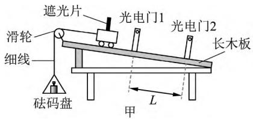
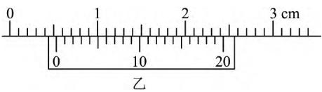
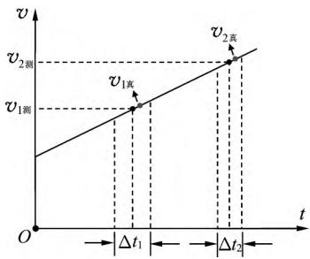
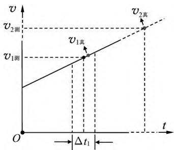
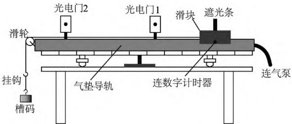
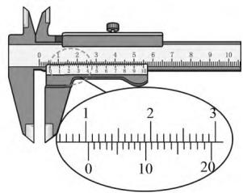
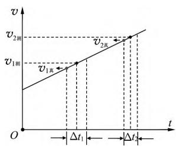
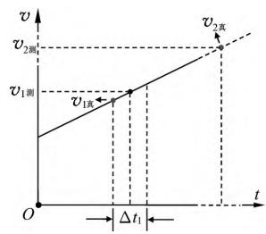
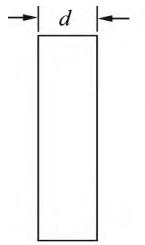
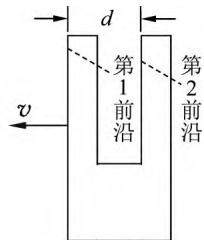

<!-- 精校说明：本文原 MinerU 输出公式几乎全部识别为花体乱码（67 个公式块），且第 3 页把同期刊另一篇关于"正弦式交变电流有效值"的文章片段（"对称性可知…"至"6 深入思考"小节，及其参考文献廖伯琴/人教社/彭立君/赵坚 4 条）误并入本文。本次精校对照 PDF 原文（pdftoppm 250dpi 渲染 + 视觉模型逐页识别 + pypdf 文本提取三路交叉核对），重写全部公式 LaTeX，剔除非本文内容，补全基金项目、参考文献上标位置和图号。原 md 中两块独立大公式（理论分析推导 ΔE_k真 / 极限法论证 / 拓展应用速度增量）经视觉识别重建。仍可能存在个别符号细节出入，已用 <!-- 存疑 --> 或 <!-- PDF亦模糊 --> 标注。-->

<!-- 文献元信息：吴梦雷. 用光电门测量动能增量的误差分析[J]. 物理教师, 2022, 43(9): 62, 65-66. -->

·问题讨论·

# 用光电门测量动能增量的误差分析

吴梦雷

（江苏省扬州中学，江苏 扬州 225009）

摘 要：用光电门测量气垫导轨上滑块的瞬时速度，通常是用平均速度代替瞬时速度，从而导致动能增量出现系统误差. 利用 $v-t$ 图像可以比较方便地进行误差分析，极限思维的引入则可以显著降低问题解决的难度.

关键词：气垫导轨；光电门；误差分析

基金项目：本文系"以科学思维为先导的'非主流'实验教学研究"（课题批准号：B-b/2020/02/233）项目研究成果.

## 1 问题的提出

在力学研究中，为减小摩擦阻力对物体运动的影响，经常用到气垫导轨. 滑块的瞬时速度可以通过气垫导轨配套的光电门、数字计时器进行测量. 由于 $v = \lim_{\Delta t \to 0} \dfrac{\Delta x}{\Delta t}$，一般认为挡光片挡光时间越短，即挡光片越窄，测量越精准. 但更严谨的理论研究表明，光电门测瞬时速度的精确度还受到滑块通过光电门时的初速度 $v_0$、加速度 $a$、挡光片宽度 $d$ 及其之间的共同关系的影响［1］，在实验过程中，还发现精确度受到光电门灵敏度的影响.［2］ 在高中物理实验教学中，由于一般都是用 $\bar{v} = \dfrac{d}{\Delta t}$ 近似表示瞬时速度，所以普遍存在一定的系统误差. 本文以 2022 年江苏省某市高三二模试卷第 11 题为例，探讨挡光片宽度对动能增量的影响.

原题. 用天平测量小车和挡光片的总质量 $M$、砝码盘的质量 $m_0$；用游标卡尺测量挡光片的宽度 $d$，游标卡尺的示数如图 1（乙）所示；按图 1（甲）所示安装好实验装置，用刻度尺测量两光电门之间的距离 $L$. 不考虑挡光片宽度的影响，滑块动能的增量为 $\Delta E_{\mathrm{k1}}$；考虑挡光片宽度的影响，滑块动能增量为 $\Delta E_{\mathrm{k2}}$，则 $\Delta E_{\mathrm{k1}}$ ____ $\Delta E_{\mathrm{k2}}$（选填"＞""＝"或"＜"）.

  
图 1

本题的参考答案是"＞". 原题没有给出解析，网上能搜到的答案认为"不考虑挡光片宽度的影响，意思是可以将挡光片压缩为中心线附近一根极细的棒，得到的速度是 $v_{x/2}$，考虑挡光片宽度的影响，用 $\dfrac{d}{\Delta t}$ 算出来的是 $v_{t/2}$. 由于 $v_{x/2} > v_{t/2}$，因此 $\Delta E_{\mathrm{k1}} > \Delta E_{\mathrm{k2}}$". 该解答有点答非所问，题目要求比较的是动能增量 $\Delta E_{\mathrm{k}}$，并非速度 $v$，两者不可混为一谈.

## 2 理论分析和论证

原题中"不考虑挡光片宽度的影响"这一表述，不同人有不同的解读. 有人像前面那样理解为"将挡光片压缩为中心线附近一根极细的棒"，也有人理解为"不用考虑误差，直接将 $\dfrac{d}{\Delta t}$ 视为滑块经过光电门的瞬时速度". 两种解读，得出的结论截然相反，前者认为测的是 $v_{x/2}$，后者认为测的是 $v_{t/2}$. 这里我们不纠结孰是孰非，统一用 $v_{\text{测}}$、$v_{\text{真}}$ 表示.

### 2.1 理论分析

设滑块的质量为 $m$，在气垫导轨上下滑时，加速度大小为 $a$，挡光片的宽度为 $d$，滑块通过光电门 1 的挡光时长为 $\Delta t_1$，通过光电门 2 的挡光时长为 $\Delta t_2$. 则有 $v_{1\text{测}} = \dfrac{d}{\Delta t_1}$，$v_{2\text{测}} = \dfrac{d}{\Delta t_2}$，$v_{\text{测}}$ 实为两段加速过程的平均速度.

如图 2 所示，根据 $v_{\text{测}} = \bar{v} = v_{\frac{\Delta t}{2}}$，可知两段加速过程初始时刻的瞬时速度大小分别为 $v_{1\text{测}} - a \cdot \dfrac{\Delta t_1}{2}$ 和 $v_{2\text{测}} - a \cdot \dfrac{\Delta t_2}{2}$，末时刻的瞬时速度大小分别

  
图 2

为 $v_{1\text{测}} + a \cdot \dfrac{\Delta t_1}{2}$ 和 $v_{2\text{测}} + a \cdot \dfrac{\Delta t_2}{2}$. $v_{\text{真}}$ 则是挡光片的几何中心通过光电门的瞬时速度，即 $v_{\text{真}} = v_{x/2}$. 根据 $v_{x/2} = \sqrt{\dfrac{v_{\text{初}}^2 + v_{\text{末}}^2}{2}}$，可知

$$
\begin{aligned}
v_{1\text{真}} &= \sqrt{\dfrac{\left(v_{1\text{测}} - a \cdot \dfrac{\Delta t_1}{2}\right)^2 + \left(v_{1\text{测}} + a \cdot \dfrac{\Delta t_1}{2}\right)^2}{2}}, \\
v_{2\text{真}} &= \sqrt{\dfrac{\left(v_{2\text{测}} - a \cdot \dfrac{\Delta t_2}{2}\right)^2 + \left(v_{2\text{测}} + a \cdot \dfrac{\Delta t_2}{2}\right)^2}{2}}, \\
\Delta E_{\mathrm{k}\text{测}} &= \dfrac{1}{2} m \left(v_{2\text{测}}^{\,2} - v_{1\text{测}}^{\,2}\right), \\
\Delta E_{\mathrm{k}\text{真}} &= \dfrac{1}{2} m \left(v_{2\text{真}}^{\,2} - v_{1\text{真}}^{\,2}\right) \\
&= \dfrac{1}{2} m \left[ \left(v_{2\text{测}} - a \cdot \dfrac{\Delta t_2}{2}\right)^2 + \left(v_{2\text{测}} + a \cdot \dfrac{\Delta t_2}{2}\right)^2 - \left(v_{1\text{测}} - a \cdot \dfrac{\Delta t_1}{2}\right)^2 - \left(v_{1\text{测}} + a \cdot \dfrac{\Delta t_1}{2}\right)^2 \right] / 2 \cdot 2 <!-- 存疑：此处视觉识别难以确认根号内的归并细节，下行为化简结果，较确定 --> \\
&= \dfrac{1}{2} m \left( v_{2\text{测}}^{\,2} - v_{1\text{测}}^{\,2} \right) - \dfrac{1}{8} m a^2 \left( \Delta t_1^{\,2} - \Delta t_2^{\,2} \right) \\
&= \Delta E_{\mathrm{k}\text{测}} - \dfrac{1}{8} m a^2 \left( \Delta t_1^{\,2} - \Delta t_2^{\,2} \right).
\end{aligned}
$$

因为 $\Delta t_1 > \Delta t_2$，所以 $\Delta E_{\mathrm{k}\text{测}} > \Delta E_{\mathrm{k}\text{真}}$. 故题中"不考虑挡光片宽度的影响"这一表述指的应该是"不用顾及误差，直接将 $\dfrac{d}{\Delta t}$ 视为滑块经过光电门的瞬时速度".

### 2.2 论证

上述理论分析虽严谨，但耗时太多，在考试过程中，可利用"极限法"极大加快解题速度. 在原题图 1（甲）中，令光电门 1 位置不动，假设 $L \to \infty$，即光电门 2 离光电门

  
图 3

1 很远. 此时，图 1 中第 2 段加速过程 $\Delta t_2$ 的左右边界线将靠得很近，对应的梯形将变得非常"苗条"，以保证面积与左侧的第 1 个梯形相等，$v_{t/2}$ 和 $v_{x/2}$ 对应的点也会非常接近，如图 3 所示. 因此，近似有 $v_{2\text{测}} = v_{2\text{真}}$，$E_{\mathrm{k2}\text{测}} = E_{\mathrm{k2}\text{真}} = E_{\mathrm{k2}}$.

$$
\begin{aligned}
\Delta E_{\mathrm{k}\text{测}} &= E_{\mathrm{k2}} - E_{\mathrm{k1}\text{测}} = E_{\mathrm{k2}} - \dfrac{1}{2} m v_{1\text{测}}^{\,2}, \\
\Delta E_{\mathrm{k}\text{真}} &= E_{\mathrm{k2}} - E_{\mathrm{k1}\text{真}} = E_{\mathrm{k2}} - \dfrac{1}{2} m v_{1\text{真}}^{\,2}.
\end{aligned}
$$

因为 $v_{1\text{测}} < v_{1\text{真}}$，所以 $\Delta E_{\mathrm{k}\text{测}} > \Delta E_{\mathrm{k}\text{真}}$，与前面的结论一致.

### 2.3 拓展应用

利用上述分析、论证的思路，还可以研究速度增量的误差.

（2021 年江苏卷第 11 题）小明利用如图 4 所示的实验装置验证动量定理. 将挡光条安装在滑块上，用天平测出挡光条和滑块的总质量 $M = 200.0\,\mathrm{g}$，槽码和挂钩的总质量 $m = 50.0\,\mathrm{g}$. 实验时，将滑块系在绕过定滑轮悬挂有槽码的细线上. 滑块由静止释放，数字计时器记录下挡光条通过光电门 1 和 2 的挡光时间 $\Delta t_1$ 和 $\Delta t_2$，以及这 2 次开始挡光的时间间隔 $\Delta t$，用游标卡尺（图 5 所示）测出挡光条宽度，计算出滑块经过两光电门速度的变化量 $\Delta v$（图 5 所示）.

  
图 4

  
图 5

设滑块在气垫导轨上加速时，加速度大小为 $a$，挡光片的宽度为 $d$. 依题意，有

$$
\begin{aligned}
v_{1\text{测}} &= \dfrac{d}{\Delta t_1},\quad v_{2\text{测}} = \dfrac{d}{\Delta t_2}, \\
v_{1\text{真}} &= v_{1\text{测}} - a \cdot \dfrac{\Delta t_1}{2},\quad v_{2\text{真}} = v_{2\text{测}} - a \cdot \dfrac{\Delta t_2}{2}, \\
\Delta v_{\text{测}} &= v_{2\text{测}} - v_{1\text{测}}, \\
\Delta v_{\text{真}} &= v_{2\text{真}} - v_{1\text{真}} = \left(v_{2\text{测}} - v_{1\text{测}}\right) + \dfrac{1}{2} a \left(\Delta t_1 - \Delta t_2\right).
\end{aligned}
$$

因为 $\Delta t_1 > \Delta t_2$，所以 $\Delta v_{\text{测}} < \Delta v_{\text{真}}$（如图 6 所示）.

我们可以继续用"极限法"校验上述结论. 令光电门 1 位置不动，假设光电门 2 离光电门 1 很远，则有 $v_{2\text{测}} = v_{2\text{真}} = v_2$，如图 7 所示.

$$
\Delta v_{\text{测}} = v_2 - v_{1\text{测}},\quad \Delta v_{\text{真}} = v_2 - v_{1\text{真}}.
$$

因为 $v_{1\text{测}} > v_{1\text{真}}$，所以 $\Delta v_{\text{测}} < \Delta v_{\text{真}}$，故用此装置验证动量定理时，存在一定的系统误差.

  
图 6

  
图 7

## 3 结语

虽然用条形挡光片通过光电门测量物体的动能增量、速度增量非常便捷，精度也比较高，但是受制于光电门中光敏元件的反应速度，实验中常采用 U 型挡光片.［3］

当滑块向左运动时，数字计时器将记录第 1 前沿开始挡光至第 2 前沿开始挡光之间的时间间隔，$d$ 的大小如图 8 所示，以便进一步提升测量精度.

  
条形

  
U 形  
图 8

## 参考文献：

1 陈泽武．用光电门测瞬时速度的精确度分析［J］．物理教师，2018（2）：83－85.

2 陈雪梅等．气垫导轨上瞬时速度的测量与修正［J］．合肥师范学院学报，2020（11）：55－57.

3 姚萍等．气垫导轨上瞬时速度的测量与修正［J］．兴义民族师范学院学报，2014（10）：112－115.

（收稿日期：2022－04－13）

<!-- 页脚：第 43 卷第 9 期 2022 年 物理教师 PHYSICS TEACHER Vol.43 No.9 (2022) -->

<!-- 本文页码：第 62 页（第 1-2 页）→ 第 65-66 页（第 3 页"上接第 62 页"开始）. 第 2 页末"下转第 65 页"，第 3 页"上接第 62 页"接续第 3 节"结语". -->

<!-- 遗留存疑：
1. 第 2.1 节大块公式推导中，从根号内合并到 "1/2 m(v2测² - v1测²) - 1/8 ma²(Δt1² - Δt2²)" 的中间步骤（视觉识别用 <!-- 存疑 --> 标注的那一行），原 PDF 此处版式跨多行，中间归并细节未能完全确认；最终化简结果与 pypdf 文本提取一致，可信赖。
2. 摘要中 "v-t 图像" 的连字符在原 md 写作 "τv-t"，已据 PDF 修正为 "v-t"。
3. 原题填空处的下划线（PDF 中是空线"____"）已用 Markdown 下划线占位保留。
4. 图片 assets/8c6ffb254718bcedd61b94b0acc6f39459c4f76c39411e124dd8107a0175cd62.jpg 和 assets/6098657a6e4740befcfe2069a27580e2e11fb950b1104c71e31f8706f70bbf9c.jpg 属于同期刊另一篇文章（关于正弦式交变电流有效值），原 MinerU 输出误并入本文，已剔除。如需保留可到原 PDF 第 3 页顶部取回。
-->
