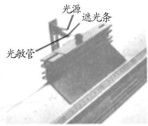

# 用平均速度代表瞬时速度的误差分析对2015年高考浙江理综卷第15题的再分析

何崇荣

（武汉市黄陂区第一中学 湖北 武汉 430300）

张永恒

（钟祥市旧口镇罗集第一初级中学 湖北 荆门 431900）

张 黎

（武汉市黄陂区第三中学 湖北 武汉 430317）

（收稿日期 ：2017－09－14）

摘 要 ：对2015年高考浙江理综卷第15题中涉及到的用较短时间内的平均速度代表瞬时速度的误差做了定量的分析

关键词 ：光电门 瞬时速度 遮光条

## 1．题目

【题目】（2015年高考浙江卷第15题） 如图1所示，气垫导轨上滑块经过光电门时 ，其上的遮光条将光遮住，电子计时器可自动记录遮光时间 Δt ， 测得遮光条的宽度为 $\Delta x$ ， 用 $\frac { \Delta x } { \Delta t }$ 近似代表滑块通过光电

门时的瞬时速度，为使 $\frac { \Delta x } { \Delta t }$ 更接近瞬时速度，正确的措施是（ ）A．换用宽度更窄的遮光条 B．提高测量遮光条宽度的精确度 C．使滑块的释放点更靠近光电门 D．增大气垫导轨与水平面的夹角

  
图1 题图

## 2．网上主流解析

平均速度近似等于瞬时速度 ，应用了极限思想 ，即在 $\Delta t \to 0$ 的情况下 $\frac { \Delta x } { \Delta t }$ 近似看做平均速度 所以要使得 $\frac { \Delta x } { \Delta t }$ 更接近通过光电门的瞬时速度， 需 要 缩短通过时间， 即换用宽度更窄的遮光条， 选项 A 正确；提高测量遮光条宽度的精度 ，不能缩短 $\Delta t$ ，选项B错误；使滑块的释放点更接近光电门 ，则 $\Delta t$ 变长，选项C错误 增大气垫导轨与水平面的夹角 在滑块的释放点距离光电门比较近的情况下 ， 不能明显缩短 $\Delta t$ 选项D不可行．于是正确答案为选项 A

## 3．对网上解析的商榷

缩短遮光条通过光电门的时间 $\Delta t$ ， 一定能使$\frac { \Delta x } { \Delta t }$ 更接近滑块通过光电门时的瞬时速度吗？

另外4个选项的讨论 笔者觉得讨论前提是其他条件不变，并不像选项D中分析的，还要考虑滑块的释放点距离光电门的远近 要不然都无法分析

## 4．问题解决

设滑块在气垫导轨上做匀加速直线运动 滑块下滑的初始位置距光电门的距离为 $x _ { 0 }$ 加速度为 $a$ 经过光电门时的速度为 v ，则

$$
\Delta x = v \Delta t + { \frac { 1 } { 2 } } a \Delta t ^ { 2 }\tag{1}
$$

而

$$
v ^ { 2 } = 2 a x _ { 0 }\tag{2}
$$

以 $\frac { \Delta x } { \Delta t }$ 表示遮光条通过光电门的平均速度 ， 我们把这个速度当做是遮光条刚好到达光电门的瞬时速度，而整 个 滑 块 运 动 情 况 相 同 ， 可 以 将 滑 块 看 做 质点，于是可以用 $\frac { \Delta x } { \Delta t }$ 来表示滑块到达光电门的瞬时速度．记这个速度为滑块到达光电门时速度的测量值，用 $\cdot \cdot ^ { \prime }$ 表示，则

$$
v ^ { \prime } = { \frac { \Delta x } { \Delta t } } = v + a \frac { \Delta t } { 2 }
$$

那么测量的绝对误差

$$
\Delta = v ^ { \prime } - v = a ~ \frac { \Delta t } { 2 }
$$

相对误差

$$
\delta = \frac { \Delta } { v } = \frac { v ^ { ' } - v } { v } = \frac { a \Delta t } { 2 v }\tag{3}
$$

联立式（1） ～ （3） 解得

$$
\delta = \frac { 1 } { 2 } \Big ( \sqrt { \frac { \Delta x } { x _ { \scriptscriptstyle 0 } } + 1 } - 1 \Big )\tag{4}
$$

由式（4） 可知 ：只要越满足 $\Delta x \ll x _ { \mathrm { ~ 0 ~ } }$ ，那么相对误差越小 即 $\frac { \Delta x } { \Delta t }$ 越接近滑块通过光电门时的瞬时速度

换用宽度更窄的遮光条，即 $\Delta x$ 越小，则相对误差越小；使滑块的释放点更靠近光电门 ，即 $x _ { 0 }$ 减小，则相对误差增大；增大气垫导轨与水平面的夹角 ，在其他条件不变的情况下 ，对相对误差没有影响，所以并不是说遮光条通过光电门的时间越短 ， $\frac { \Delta x } { \Delta t }$ 就 越接近滑块通过光电门时的瞬时速度．提高测量遮光条宽度的精确度 ， 这个不一定能使 $\frac { \Delta x } { \Delta t }$ 更接近滑块通过光电门时的瞬时速度 ，原因如下 ：

一方面 提高遮光条宽度的测量精度后 遮光条宽度的测量值较原来偏大 偏小都有可能；

另一方面，还要考虑时间的测量精确度 ，如果宽度测量的精确度超过时间测量的精确度 则也不能提高瞬时速度测量值 $\frac { \Delta x } { \Delta t }$ 的精确度
