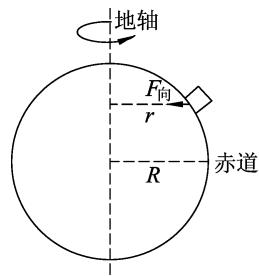
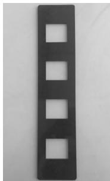
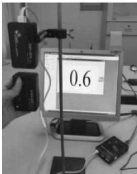
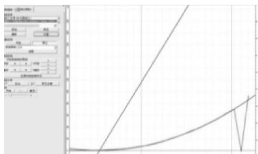
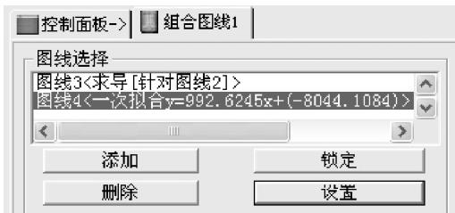
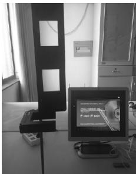
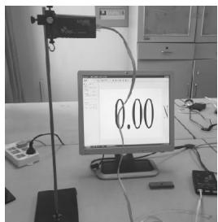
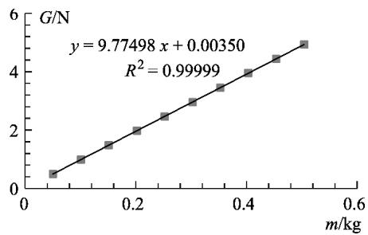

# 重力加速度 3 种 DIS 实验设计方法比较研究

倪 敏 陈 舟（上海师范大学数理学院 ，上海 200234）

摘 要 ： 计算出实验地重力加速度的理论值 设计3种DIS实验测量方法．根据实验结果 结合物理实验教学研究3种实验方法对于学生物理思维的培养

关键词 ： 落体法 ； 重力加速度 ； DIS实验

生活中的很多现象是由万有引力造成的．万有引力的作用效果可以分为两部分 一部分为物体随地球做圆周运动提供向心力 另一部分就是重力．物体由于地球的吸引而受到的力叫做重力 G，方向竖直向下．地球表面附近的物体受重力作用 地球重力作用的空间范围就是重力场．研究重力场主要是为了解决以下3个问题： （1） 借地球表面的重力值来研究重力位 了解地球形状； （2） 借局部的重力值来研究局部重力位的变化 研究地质构造 勘探矿床；（3） 借地球表面重力值的变化情况，研究地下物质分布和大地构造［1］．重力场模型在地球科学 空间科学 军事 大地测量等很多尖端科学领域都有广泛应用

本文围绕重力加速度DIS实验测定进行了理论分析和实验研究．首先从重力加速度的理论值入手 计算出实验所在地的重力加速度．然后实验方面选用DIS仪器 设计了3种方法进行测量．通过将理论值与实验值进行比较 分析误差来源 并将3种方法进行比较 结合中学物理实验教学 培养学生的物理思维．DIS在实验方面有着很多传统实验所不具备的优势 同时DIS仪器在中学已逐步推广 因此本研究对物理师范生实验教学技能的培养和中学物理实验教学具有一定的参考价值

## 1 理论计算

不同地区的重力加速度的数值通常是不同的 它主要受纬度和海拔高度等因素影响

在高中阶段， 讨论重力加速度时一般忽略地球自转 认为物体所受重力近似等于物体受到的万有引力 得到

$$
\scriptstyle { \left\{ \begin{array} { l l } { m g = G { \frac { M m } { R ^ { 2 } } } } \\ { m g ^ { \prime } = G { \frac { M m } { ( R + h ) ^ { 2 } } } } \end{array} \right. }\tag{1}
$$

$$
\frac{g'}{g} = \frac{R^2}{(R+h)^2}.\tag{2}
$$

式中 $g'$ 表示离地面高度为 $h$ 处的重力加速度，$g$ 表示地球表面的重力加速度，$R$ 表示地球半径．因此重力加速度会随着离地球表面距离的增大而减小．如图1所示 由于地球自转 静置在地球表面的物体都会随之做圆周运动 向心力由

  
图1 地球自转示意图

万有引力的分力提供．设物体质量为 m 转动半径为 r 地球自转的角速度为 $\omega$ 根据向心力公式 F＝$m { \omega } ^ { 2 } r$ 可知在角速度相同的情况下 随着半径的增大，向心力也会增大．根据相关资料，在海平面上 ，赤道处因地球自转导致的误差为0．53％ 对结果影响甚微 因此在一般计算中可以忽略地球自转［2］．一般情况下 ， 赤道附近重力加速度最小 ， 越靠近南 北两极重力加速度就越大 ，最大值与最小值之差约为1／300［3］．因此重力加速度的大小与所在位置的海拔和纬度都相关

为了精确地给出实验所在位置的重力加速度 这里采用1980年国际大地测量与地球物理协会推荐的公式

$$
\begin{array} { c } { { g _ { \varphi } { = } 9 . ~ 7 8 0 3 2 7 ( 1 { + } 0 . ~ 0 0 5 3 0 2 4 4 \sin ^ { 2 } \varphi ^ { - } } } \\ { { 0 . ~ 0 0 0 0 0 5 8 5 \sin ^ { 2 } 2 \varphi ) ( \mathrm { m / s } ^ { 2 } ) . } } \end{array}\tag{3}
$$

式中 $\varphi$ 代表物体所在的纬度．式（1）称作正常重力公式 它建立在两个条件之上 ： （1） 地球是一个椭球且质量分布具有轴对称性 ； （2） 所在位置接近海洋面［4］

大地测量学家在忽略重力加速度随经度变化的前提下 推导出重力加速度随高度的变化计算公式为［5］

$$
\begin{array} { c } { { \frac { \mathrm { d } g } { \mathrm { d } h } { = } - 3 . \ 0 8 7 6 9 \times 1 0 ^ { - 6 } ( 1 - } } \\ { { 0 . \ 0 0 1 4 4 3 7 \sin ^ { 2 } \varphi ) ( \mathrm { s } ^ { - 2 } ) . } } \end{array}\tag{4}
$$

从而得到任意纬度 任意海拔处的重力加速度的理论值可表示为

$$
g _ { \varphi h } = g _ { \varphi } + g _ { h } .\tag{5}
$$

上海位于北纬 $31°11.5 ^ { \prime }$ 平均海拔为2．8m左右 代入式（3） ～ （5） 计算得到上海地区的重力加速度 $g { \approx } 9 . \ 7 9 4 1 9 ~ \mathrm { m / s } ^ { 2 }$ ．查阅资料 上海地区实测重力加速度为

$g _ { \text{上海} } = 9 . 7 9 4 ~ \mathrm { m / s } ^ { 2 }$［6］，符合理论计算

## 2 实验原理

## 2．1 位移传感器法

物体做自由落体运动时 忽略空气阻力 物体在只受重力的情况下从静止开始下落 ， 取下落时初始位置为坐标原点并取向下为正方向 其运动规律符合公式 $s = \frac { 1 } { 2 } g t ^ { 2 }$ ．式中 $s$ 表示 $t$ 时刻物体所在位置 $t$ 为所用时间 $g$ 表示重力加速度．由于自由落体运动是物体在竖直方向上做初速度为0的匀加速直线运动， 因此在上述推导中可不写出矢量符号

将位移传感器的接收器固定在铁架台上 使发射器和接收器端口正对， 发射器在重力作用下做自由落体运动 画出发射器运动时的 s－t 图像通过曲线拟合得出函数方程．对时间求一次导数得到 ${ \frac { \mathrm { d } s } { \mathrm { d } t } } { = } g t$ ，即发射器的速度， 画出 v－t 图像， 斜率即为重力加速度

## 2．2 光电门传感器法

物体 做 自 由 落 体 运 动 时 运 动 方 程 为 s ＝${ \frac { 1 } { 2 } } g t ^ { 2 }$ ．选取运动过程中两个点， 设两点间距为 d，通过两点的速度为 $\mathcal { V } _ { 1 }$ 和 $\mathrm { { \mathcal { V } } _ { 2 } }$ ， 时间间隔为 t， 得到$g = \frac { ( \ b { v _ { 2 } } ^ { 2 } - { \ b { v _ { 1 } } } ^ { 2 } ) } { 2 d }$

让图2所示的挡光片做自由落体运动，5个挡光部分会先后经过光电门传感器 得到5个挡光时间 t．设透明部分和挡光部分的宽度皆为 L，取相邻两个时间为一组， 分别设为 $t _ { 1 } \setminus t _ { 2 }$ ， 将挡光部分通过光电门传感器的平均速度近似看成瞬时速度 ，即${ \boldsymbol { v } } _ { 1 } = { \frac { L } { t _ { 1 } } } , { \boldsymbol { v } } _ { 2 } = { \frac { L } { t _ { 2 } } }$ ．挡光片透明部

  
图2 挡光片

分的宽度 L 就是物体在此期间通过的路程．因此重力加速度的公式为

$$
g { = } \frac { \Big ( { \frac { L } { t _ { 2 } } } \Big ) ^ { 2 } - \Big ( { \frac { L } { t _ { 1 } } } \Big ) ^ { 2 } } { 2 { \times } 2 L } .\tag{6}
$$

每次实验可测得5个挡光时间 选取前两个和后两个进行处理 可得到两组实验数据

## 2．3 力传感器法

物体在地球表面受到重力 用符号 G 表示 方向竖直向下．重力又可以用物体的质量和重力加速度的乘积表示 ${ \cal G } = m g$ ．因此重力加速度也可以用重力除以质量来表示 即

$$
g = { \frac { G } { m } } .\tag{7}
$$

## 3 实验过程及测量结果

## 3．1 位移传感器法

（1） 按图3放置实验仪 器 打 开 DIS 软件，选择通用软件；

（2） 选择“组合图线” 点击“添加” 设定 $x$ 轴为时间， $y$ 轴为 $s _ { 1 }$ ；

  
图3 位移传感器法装置图

（3） 打开发射器电源开关 使发射器与接收器端口正对， 数据调零．点击 “开始” ， 使发射器做自由落体运动 得到 s－t 图像．实验结束点击“停止” 关闭发射器开关（注意在下方垫上垫子 防止发射器摔坏） ；

（4） 选择“X缩放” ， 将图线在横轴上放大 ， 选取自由落体部分的图像进行二次拟合 发现拟合图线与实验图线基本重合 表明位移与时间成二次方．对拟合图线求导 得到一条直线 即速度与时间成线性关系；

（5）对求导图线进行线性拟合 读出拟合图线的方程 如图4 图5所示 由此得到拟合图线的斜率为 $9 9 2 . \ 6 ( \mathrm { c m } / \mathrm { s } ^ { 2 } )$ 也就是实验时的重力加速度$g { = } 9 . 9 2 6 ( \mathrm { m } / \mathrm { s } ^ { 2 } )$

  
图4 求导图函数线性拟合

  
图5 拟合图线的方程

## 3．2 光电门传感器法

（1） 按图6放置实验仪器 打开通用软件 将光电门传感器接入数据采集器第一通道；

（2） 用刻度尺测量出挡光片空白部分和挡光部分的宽度 L；

  
图6 光电门传感器法装置图

（3） 将间隔改为0．001s，点击“开始” ， 开始自动采集数据；

（4） 让挡光片通过光电门传感器做自由落体运动 记录5个挡光时间 点击“变量”添加变量 $t _ { 2 }$ 将 $t _ { 1 }$ 第2和第5行的数据分别粘贴到 $t _ { 2 }$ 的第1和第4行中，并重复此步骤4次；

（5） 本实验中 $L = 5 ~ \mathrm { c m }$ 代入公式（6） 得到 $g$ 的表达式为 $\frac { \Big ( \frac { 0 . \ 0 5 } { t _ { 2 } } \Big ) ^ { 2 } - \Big ( \frac { 0 . \ 0 5 } { t _ { 1 } } \Big ) ^ { 2 } } { 0 . \ 2 }$ ， 计算出重力加速度．实验数据如图7所示；

（6） 计算得到平均值 $\overline { { g } } = 9 . \ 6 9 7 \ \mathrm { m / s ^ { 2 } }$ ， 相 对 误差 $\eta = 1 . \ 0 \%$

<table><tr><td rowspan=1 colspan=1></td><td rowspan=1 colspan=1>t1</td><td rowspan=1 colspan=1>t2</td><td rowspan=1 colspan=1>g=((0.05/t2)^2-(0.05/t1)^2)/0.2</td></tr><tr><td rowspan=1 colspan=1>1</td><td rowspan=1 colspan=1>0.04259</td><td rowspan=1 colspan=1>0.02767</td><td rowspan=1 colspan=1>9.435</td></tr><tr><td rowspan=1 colspan=1>2</td><td rowspan=1 colspan=1>0.02767</td><td rowspan=1 colspan=1>0</td><td rowspan=1 colspan=1></td></tr><tr><td rowspan=1 colspan=1>3</td><td rowspan=1 colspan=1>0.02198</td><td rowspan=1 colspan=1>0</td><td rowspan=1 colspan=1></td></tr><tr><td rowspan=1 colspan=1>4</td><td rowspan=1 colspan=1>0.01889</td><td rowspan=1 colspan=1>0.01666</td><td rowspan=1 colspan=1>10.006</td></tr><tr><td rowspan=1 colspan=1>5</td><td rowspan=1 colspan=1>0.01666</td><td rowspan=1 colspan=1>0</td><td rowspan=1 colspan=1></td></tr><tr><td rowspan=1 colspan=1>6</td><td rowspan=1 colspan=1>0.04090</td><td rowspan=1 colspan=1>0.02726</td><td rowspan=1 colspan=1>9.349</td></tr><tr><td rowspan=1 colspan=1>7</td><td rowspan=1 colspan=1>0.02726</td><td rowspan=1 colspan=1>0</td><td rowspan=1 colspan=1></td></tr><tr><td rowspan=1 colspan=1>8</td><td rowspan=1 colspan=1>0.02181</td><td rowspan=1 colspan=1>0</td><td rowspan=1 colspan=1></td></tr><tr><td rowspan=1 colspan=1>9</td><td rowspan=1 colspan=1>0.01877</td><td rowspan=1 colspan=1>0.01658</td><td rowspan=1 colspan=1>9.992</td></tr><tr><td rowspan=1 colspan=1>10</td><td rowspan=1 colspan=1>0.01658</td><td rowspan=1 colspan=1>0</td><td rowspan=1 colspan=1></td></tr><tr><td rowspan=1 colspan=1>11</td><td rowspan=1 colspan=1>0.04578</td><td rowspan=1 colspan=1>0.02842</td><td rowspan=1 colspan=1>9.512</td></tr><tr><td rowspan=1 colspan=1>12</td><td rowspan=1 colspan=1>0.02842</td><td rowspan=1 colspan=1>0</td><td rowspan=1 colspan=1></td></tr><tr><td rowspan=1 colspan=1>13</td><td rowspan=1 colspan=1>0.02242</td><td rowspan=1 colspan=1>0</td><td rowspan=1 colspan=1></td></tr><tr><td rowspan=1 colspan=1>14</td><td rowspan=1 colspan=1>0.01918</td><td rowspan=1 colspan=1>0.01685</td><td rowspan=1 colspan=1>10.047</td></tr><tr><td rowspan=1 colspan=1>15</td><td rowspan=1 colspan=1>0.01685</td><td rowspan=1 colspan=1>0</td><td rowspan=1 colspan=1></td></tr><tr><td rowspan=1 colspan=1>16</td><td rowspan=1 colspan=1>0.04323</td><td rowspan=1 colspan=1>0.02780</td><td rowspan=1 colspan=1>9.485</td></tr><tr><td rowspan=1 colspan=1>17</td><td rowspan=1 colspan=1>0.02780</td><td rowspan=1 colspan=1>0</td><td rowspan=1 colspan=1></td></tr><tr><td rowspan=1 colspan=1>18</td><td rowspan=1 colspan=1>0.02210</td><td rowspan=1 colspan=1>0</td><td rowspan=1 colspan=1></td></tr><tr><td rowspan=1 colspan=1>19</td><td rowspan=1 colspan=1>0.01898</td><td rowspan=1 colspan=1>0.01672</td><td rowspan=1 colspan=1>10.014</td></tr><tr><td rowspan=1 colspan=1>20</td><td rowspan=1 colspan=1>0.01672</td><td rowspan=1 colspan=1>0</td><td rowspan=1 colspan=1></td></tr><tr><td rowspan=1 colspan=1>21</td><td rowspan=1 colspan=1>0.04300</td><td rowspan=1 colspan=1>0.02778</td><td rowspan=1 colspan=1>9.437</td></tr><tr><td rowspan=1 colspan=1>22</td><td rowspan=1 colspan=1>0.02778</td><td rowspan=1 colspan=1>0</td><td rowspan=1 colspan=1></td></tr><tr><td rowspan=1 colspan=1>23</td><td rowspan=1 colspan=1>0.02204</td><td rowspan=1 colspan=1>0</td><td rowspan=1 colspan=1></td></tr><tr><td rowspan=1 colspan=1>24</td><td rowspan=1 colspan=1>0.01890</td><td rowspan=1 colspan=1>0.01669</td><td rowspan=1 colspan=1>9.881</td></tr><tr><td rowspan=1 colspan=1>25</td><td rowspan=1 colspan=1>0.01669</td><td rowspan=1 colspan=1>0</td><td rowspan=1 colspan=1></td></tr></table>

图7 光电门传感器法实验数据

## 3．3 力传感器法

（1） 按图8放置实验仪器 打开通用软件 将力传感器接入数据采集器第一通道并调零

（2） 用电子天平测出10个钩码的质量；

（3） 将一个钩码挂在力传感器的挂钩上 静止后点击“点击记录” ， 记录下 $F _ { 1 }$ ， 即钩码的重力 G，输入钩码质量（单位kg） ；

（4） 将剩余钩码依次挂在前一个钩码下 ，重复步骤（4） 得到10组实验数据 如图9所示；

（5） 根据数据做 G－m 图像， 如图10所示， 得到 $g { = } 9 . 7 7 5 ~ \mathrm { m / s } ^ { 2 }$ ，相对误差 $\eta = 0 . \ 2 \%$

图8 力传感器法装置图  

<table><tr><td rowspan=1 colspan=1>计算表格</td><td rowspan=1 colspan=1>F1</td><td rowspan=1 colspan=1>m</td></tr><tr><td rowspan=1 colspan=1>1</td><td rowspan=1 colspan=1>0.50</td><td rowspan=1 colspan=1>0.0502</td></tr><tr><td rowspan=1 colspan=1>2</td><td rowspan=1 colspan=1>0.99</td><td rowspan=1 colspan=1>0.1010</td></tr><tr><td rowspan=1 colspan=1>3</td><td rowspan=1 colspan=1>1.48</td><td rowspan=1 colspan=1>0.1512</td></tr><tr><td rowspan=1 colspan=1>4</td><td rowspan=1 colspan=1>1.98</td><td rowspan=1 colspan=1>0.2021</td></tr><tr><td rowspan=1 colspan=1>5</td><td rowspan=1 colspan=1>2.46</td><td rowspan=1 colspan=1>0.2521</td></tr><tr><td rowspan=1 colspan=1>6</td><td rowspan=1 colspan=1>2.96</td><td rowspan=1 colspan=1>0.3026</td></tr><tr><td rowspan=1 colspan=1>7</td><td rowspan=1 colspan=1>3.45</td><td rowspan=1 colspan=1>0.3529</td></tr><tr><td rowspan=1 colspan=1>8</td><td rowspan=1 colspan=1>3.95</td><td rowspan=1 colspan=1>0.4033</td></tr><tr><td rowspan=1 colspan=1>9</td><td rowspan=1 colspan=1>4.44</td><td rowspan=1 colspan=1>0.4535</td></tr><tr><td rowspan=1 colspan=1>10</td><td rowspan=1 colspan=1>4.93</td><td rowspan=1 colspan=1>0.5040</td></tr></table>

图9 力传感器法实验数据

  
图10 G－m 关系图

## 4 测量结果分析与讨论

## 4．1 测量结果对比分析

重力加速度 $g$ 的测量精确度直接影响着很多尖端科学的发展 为了准确测量重力加速度的值物理学家们不断探索新的方法．就中学实验教学的要求来看 目前已有的实验条件符合中学物理实验教学的实际需求 ， 而本文所阐述的三种实验方法 各有利弊 具体情况分析如下

## （1） 位移传感器法

位移传感器法测得重力加速度 $g { = } 9 . 9 2 6 ~ \mathrm { m / s } ^ { 2 }$ 相对误差 $\eta = 1 . \ 3 \%$．由于在实验中位移大小由位移传感器进行测量 因此必须保持位移传感器的发射器竖直下落 水平方向的移动或偏转会导致实验结果产生误差；其次 由于空气阻力的存在 发射器会受到向上的阻力 使实验结果偏小；第三 在实验过程中要自主选择物体做自由落体运动部分的曲线，因此选择的区域对结果也存在一定的影响

## （2） 光电门传感器法

根据光电门传感器法实验结果 计算得到重力加速度 $g { = } 9 . \ 6 9 7 \ \mathrm { m / s } ^ { 2 }$ ，相对误差 $\eta = 1 . \ 0 \%$ ．对于存在的误差 这里推测来源主要有以下几点

a．在理论推导中用到瞬时速度， 但在实验中用平均速度代替瞬时速度 ，会引入一定的误差 ；

b．释放挡光片的时候 操作不当导致在挡光过程中挡光部分的不等于 L，从而产生误差；

c．挡光片宽度 时间等相关参数的测量上由于仪器精度而依然存在一定的误差 ；

d．由于空气阻力的存在 ， 挡光片受到的合力小于 mg，使测得的重力加速度值偏小

## （3） 力传感器法

力传感器法中通过做图 线性拟合等 得到重力加速度 $g = 9 . 7 7 5 \ \mathrm { m / s ^ { 2 } }$ ， 相对误差 $\eta = 0 . \ 2 \%$．可以看出 用力传感器法测得的重力加速度需要测量质量和重力两个物理量 所得结果误差最小 究其原因 与之前的两种方法相比 其属于静态测量 避免了动态测量中操作及环境所带来的影响其误差主要来源是仪器的精度所致

对上述设计的3种 DIS实验的测量原理 器材 方法及误差来源进行归纳和对比［7］ 如表1所示

表1 重力加速度3种DIS实验测定方法的比较
<table><tr><td rowspan=1 colspan=1>实验方法</td><td rowspan=1 colspan=1>实验原理</td><td rowspan=1 colspan=1>实验仪器</td><td rowspan=1 colspan=1>测量物理量</td><td rowspan=1 colspan=1>相对误差</td><td rowspan=1 colspan=1>误差来源</td></tr><tr><td rowspan=1 colspan=1>位移传感器法</td><td rowspan=1 colspan=1> $s = \frac { 1 } { 2 } g t ^ { 2 }$ </td><td rowspan=1 colspan=1>位移传感器、铁架台</td><td rowspan=1 colspan=1>位移与时间的图像</td><td rowspan=1 colspan=1> $\eta = 1 . \ 3 \%$ </td><td rowspan=1 colspan=1>空气阻力、位移传感器发射端偏转、图像的选取</td></tr><tr><td rowspan=1 colspan=1>光电门传感器法</td><td rowspan=1 colspan=1> $g = \frac { v _ { 2 } ^ { 2 } - v _ { 1 } ^ { 2 } } { 2 d }$ </td><td rowspan=1 colspan=1>光电门传感器、挡光片、铁架台</td><td rowspan=1 colspan=1>挡光片透明部分和挡光部分宽度、通过光电门的时间</td><td rowspan=1 colspan=1> $\eta = 0 . \ 9 9 \%$ </td><td rowspan=1 colspan=1>公式推导、空气阻力、挡光片偏转、相关参量测量的精度</td></tr><tr><td rowspan=1 colspan=1>力传感器法</td><td rowspan=1 colspan=1> $g { = } \frac { G } { m }$ </td><td rowspan=1 colspan=1>力传感器、铁架台、砝码、电子天平</td><td rowspan=1 colspan=1>钩码质量、重力</td><td rowspan=1 colspan=1> $\eta = 0 . \ 2 \%$ </td><td rowspan=1 colspan=1>相关参量的精度</td></tr></table>

综合以上3种实验方法 可以发现在测量方面 前两种实验方法分别用到位移传感器和光电门传感器 利用物体在重力作用下做自由落体运动来测量重力加速度．这两种方法都是动态测量前者利用DIS系统， 依靠电脑绘出自由落体的 s－t图像， 并对其进行曲线拟合 求导等， 由计算机直接计算出重力加速度的数值 体现了现代科学技术在物理测量中的运用．后者改变了传统实验中瞬时速度不易测量的问题 使得整个实验更直观这两种方法在操作上都需要一定的技巧 ， 保证物体稳定地下落不发生偏转．第3种实验方法应用重力的定义 测量物体在静止时的重力和质量 避免了物体在运动过程中很多的不确定因素 原理简单， 操作方便．因此在重力加速度的测定上 ， 静态的力传感器法相对而言更精确

## 4．2 教学讨论

从课堂教学来看 位移传感器法利用计算机作图 拟合图线等功能， 充分结合图形， 能直观地观察到物体做自由落体运动时的物理图像 了解物理图像的意义 弱化数学计算 让学生将更多的时间运用在物理公式 实验的理解上 培养学生的物理思维 增强学生数形结合的能力 但是求导、线性拟合等操作对于中学生而言在理解上有困难 教师要对学生多关注 落实物理思想 避免发生学生会操作但不理解的问题 ； 光电门传感器法从定义出发 原理简单 实验过程形象直观 在公式推导 理解等方面更易被中学生所接受 ，便于让学生从定义的角度充分理解重力加速度的物理意义 但是用平均速度代替瞬时速度存在误差 必须要让学生理解能代替的原因及条件 ； 静态的力传感器法相对动态方法而言 测量结果最为精确 此方法主要运用到力学的知识．前两种方法属于运动学， 后一种方法属于动力学范畴 ， 在实际教学中 将3种方法相结合 不仅可以让学生知道测量重力加速度的方法 角度不唯一 还可以让学生充分理解重力加速度在物理学中沟通了运动学和动力学 起到了桥梁的作用

## 5 结语

DIS实验在中学物理教学中已经开始普及．对于物理量的测量已不仅局限于传统实验 ，DIS实验的便捷性 直观性已经使其逐步成为中学教学的主要实验手段．本实验中 DIS实验的优势已明显展露．首先 对于传统实验中不便于直接测量的瞬时速度，DIS实验利用短时间内的平均速度代替 近似测量 同时 DIS实验利用计算机对于数据强大的处理能力， 充分体现了物理中 $s-t$ 图像的意义与作用 自动利用设置好的公式对数据进行运算 降低了对于数学能力的要求．DIS实验相比传统实验 有着许多无法取代的优势 将会成为中学实验教学的主流

本文设计的3种重力加速度测量方法各有所长 ，分别从动力学和运动学两个角度进行测量 同时对实验数据进行了简单的处理与分析验证了结论的正确性．3种方法的综合使用 既能开拓学生思维 ， 又能相互比较 ， 让学生对重力加速度的测量和其在物理学中的地位有一个更深入的了解

<!-- 以下为同期《物理教师》杂志其他文章片段（PDF跨页转换误并入本文），非本文内容 -->

（1） 弹簧规格的挑选是本实验成功与否的关键要尽量相同 即使规格相同也难免有细微差别 笔者经多种渠道采购各种型号弹簧 初步筛选出100多条 再反复试验 挑出最理想的10条供实验之用

（2） 弹簧劲度系数大小要合适 偏软为宜 保证小车以合适的速度通过光电门 劲度系数太大 压缩困难 特别是当增加到3条4条时 弹力很大 固定杆很难固定滑块 由于非共点力产生向下的分力 迫使滑块与气垫导轨挤压 阻力增加 影响实验精度

（3） 光电门离滑块距离要合适 ， 若离太近， 滑块速度还未稳定 若离太远 由于阻力 滑块的速度已有所损失

（4） 挡光片宽度合适 以1cm宽较为理想 光电门的测量精度有限 太宽太窄都不理想 太宽速度不准确，太窄时间不准确

本实验原理清晰 思想方法独特 数据分析简洁 尤其精度达到ms数量级 学生惊讶高中实验也可以做到这个程度．可以作为教材实验基础上的一个课外补充性实验进行展示 能拓宽学生视野 激发学习兴趣 提升学生物理核心素养中的科学探究意识 科学思想方法 形成科学思维大有裨益

参考文献 ：

1 王辉．对“探究功与物体速度变化关系”实验的改进［J］．物理教师，2011（11） ：34－37

2 蔡锦曦．“探究功与物体速度变化的关系”教学设计［J］．中学物理教学参考 ，2008（10） ：30－32

（收稿日期 ：2018－10－25）

<!-- 以上为“探究功与物体速度变化关系”相关实验文章 -->

---

<!-- 以下为另一篇同期文章（柯恩达效应/伯努利原理演示实验），非本文内容 -->

柯恩达效应减弱 气流向盒子周围散开 只有极少量气流到达蜡烛火焰 因此难以吹灭蜡烛．受到现行课程目标与课程内容等限定 初中教材不涉及流体实验的原理 也不需要学生了解伯努利方程， 只要求定性认识流速与压强的关系．教师不能满足于教材对实验现象的笼统解释应当通过严谨的理论分析 明确科学理论的适用范围和条件， 从更高层面把握物理概念和规律的本质特征 游刃有余地处理各种教学疑难问题

参考文献 ：

1 中华人民共和国教育部．义务教育物理课程标准［S］．北京 ：北京师范大学出版社，2011： 28－29

2 尤爱惠．利用生活用品自制教具改进“气体流速与压强关系”实验［J］．物理教师 ，2015（5） ：39－41

3 刘磊．趣味物理实验在中学物理教学中的应用［D］．武汉 ： 华中师范大学 2016

4 刘大有．伯努利方程应用中的若干个问题［J］．力学与实践 ，1991（4） ：62－63

5 黄鑫亮．基于科恩达效应的移动摄像头视野清洁研究［D］．哈尔滨 ： 哈尔滨工程大学 ，2016

6 黄桦．教科书中伯努利原理演示实验的误解与正解［J］．物理教学 2017（4） ：20－22

（收稿日期 ：2018－05－03）

<!-- 以上为“伯努利原理演示实验”文章 -->

## 参考文献 ：

1 方俊．重力测量与地球形状学（上册） ［M］．北京 ： 科学出版社 ，1965：13，24－28，48－54

2 徐卫华．任意高处重力加速度值计算的再思考［J］．物理教师 ，2011，32（7） ：45－46

3 张兆奎 ， 缪连元 ， 张立．大学物理实验［M］．北京 ： 高等教育出版社 ，2001：82

4 于凤军．地球自转、形状和重力加速度随纬度的变化［J］．大学物理 ，2013，32（6） ：14－17

5 李庆忠 ，刘乃华 ， 黄大伦．重力加速度值的计算及实际应用［J］．计量技术，2001（4） ：11－15

6 徐日新 ，章逸民．中学物理简明手册［M］．杭州 ： 浙江人民出版社 ，1980：27－29

7 狄逸焕 ，倪敏．DIS验证机械能学恒定律实验的设计与研究<!-- 存疑：应为"机械能守恒定律"，PDF原文/pypdf提取均作"学恒"，疑排印错误 -->［J］．物理教师，2018，39（1） ：51－53

（收稿日期 ：2018－08－08）