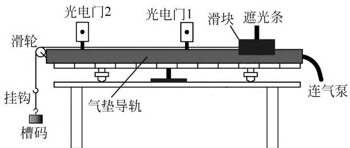
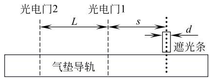

# 验证牛顿第二定律实验中关于光电门测速的一种系统误差分析

邵 云(南京晓庄学院电子工程学院,江苏 南京 211171)

## 摘 要

本文推导出在验证牛顿第二定律的实验中遮光条中心通过两个光电门时的准确速率,以及滑块加速度的严格结果。分析显示,这些严格准确的结果与通常实验中以平均速率代替瞬时速率的测量结果在量值上几乎没有区别,即实验中的通常做法所带来的系统误差几乎为零。但是在定性的性质上,速率的测量值会略微小于其准确值,而加速度的测量值则会略微大于其准确值。为充实内容,本文又推理出以遮光条的宽度,以及其两段位移所表达的测量加速度的相对误差,并据此判断出相对误差随各参量的变化趋势。虽然本文在本质上属于理论性的研究,对于实际实验的参考价值不大,但是其理论上的参考价值仍是客观存在的,对大中学相关内容的教学以及学生科学素养的培养具有一定的帮助。

关键词 遮光条;光电门;瞬时速率;加速度;系统误差

# ANALYSIS OF A KIND OF SYSTEMATICAL ERROR ABOUT USING PHOTOELECTRIC GATES TO MEASURE VELOCITIES IN THE EXPERIMENT OF VERIFYING NEWTON'S SECOND LAW

## SHAO Yun

(School of Electronic Engineering, Nanjing Xiaozhuang College, Nanjing, Jiangsu 211171)

Abstract This paper derives the accurate velocity of the center of the shading strip passing through two photoelectric gates in the experiment to verify Newton's second law, and the strict result of the slider's acceleration is also deduced. The analysis shows that these strictly accurate results are almost indistinguishable in magnitude from the measurement results obtained in common experiments where average velocity is used instead of instantaneous velocity, that is, the systematic error brought by the usual practice in experiments is almost zero. However, in terms of qualitative nature, the measured velocity is slightly less than its accurate value, while the measured acceleration is slightly greater than its accurate value. To enrich the content, this paper further infers the relative error of the measured acceleration expressed by the width of the light-blocking strip and its two segments of displacement, and judges the trend of the relative error with the changes of various parameters based on this. Although this paper is essentially a theoretical study and has little reference value for actual experiments, its theoretical reference value objectively exists, and it should be of some help for the teaching of related content in universities and middle schools as well as the cultivation of scientific literacy.

Key words shading strip; photoelectric switch; instantaneous rate; acceleration; systematical error

无论在高中物理还是在大学物理中,验证牛顿第二定律的气垫导轨实验都是一个十分基础而重要的内容。在该实验中,人们通常是使用遮光条(或 U 形挡光片,下同)通过光电门过程中的平均速率来代表滑块在此时刻的瞬时速率,这样做所带来的系统误差确实很小,看上去也理所当然。但是,如果进一步追究该做法在实验中的理论实质的话,就会发现它事实上存在着一个不起眼的但却又是原则性的理论缺陷:遮光条通过光电门的时间区间中点的瞬时速率,即平均速率,并不是遮光条通过光电门时的位移区间中点的瞬时速率,即准确速率(注:"准确"二字在本文是理论上正确的意思,非指真实,下同),而后者才是该实验真正所需要的。尽管这种以时间中点瞬时速率代替位移中点瞬时速率的做法所带来的系统误差是极小的,但是其性质上的问题则是客观存在的,不应置之不理,何况某些地方的高考模拟试卷已经定性地考查到了这个问题［1］。

## 1 遮光条中心在通过两个光电门时的严格准确的瞬时速率

如图 1 所示,设滑块与遮光条的总质量为 M,槽码及挂钩的总质量为 m,遮光条的宽度为 $d$ ,遮光条通过光电门 1、2 的短暂时间分别为 $\Delta t _ { 1 } 、 \Delta t _ { 2 }$ ,两光电门之间的距离则为 L。于是遮光条也即滑块在经过 1、2 两个光电门时的平均速率或说测量速率分别为

$$
v _ { 1 测 } = \frac { d } { \Delta t _ { 1 } }\tag{1}
$$

  
图 1 验证牛顿第二定律的气垫导轨实验装置

$$
v _ { 2 测 } = \frac { d } { \Delta t _ { 2 } }\tag{2}
$$

它们更精确的定义是遮光条的中心在通过这两个光电门时 $( \Delta t _ { 1 } , \Delta t _ { 2 }$ 内)的平均速率。然而,这两个平均速率,究其本质,并不是遮光条中心在通过这两个光电门时的瞬时速率。从匀加速直线运动的特点不难分析出:两个平均速率分别是遮光条的中心在 $\Delta t _ { 1 }$ 和 $\Delta t _ { 2 }$ 时间区间中点的瞬时速率,而两个准确的瞬时速率则是遮光条中心在它的两个 d 位移中点(也即两光电门位置)的瞬时速率;显然,时间区间中点的瞬时速率要小于位移区间中点的瞬时速率。

设气垫导轨上滑块准确的加速度为 $a _ { 准 }$ ,则根据式(1)、式(2)及相关知识可得,遮光条的前缘在通过 1、2 两个光电门时的瞬时速率分别为 $\frac { d } { \Delta t _ { 1 } } -$ $a _ { 准 } \frac { \Delta t _ { 1 } } { 2 }$ 、 $\frac { d } { \Delta t _ { 2 } } - a _ { 准 } \frac { \Delta t _ { 2 } } { 2 }$ ,遮光条的后缘在通过 1、2 两个光电门时的瞬时速率则分别为 $\frac { d } { \Delta t _ { 1 } } + a _ { 准 } \frac { \Delta t _ { 1 } } { 2 }$ 、 $\frac { d } { \Delta t _ { 2 } } + a _ { 准 } \frac { \Delta t _ { 2 } } { 2 }$ 。于是,根据匀加速直线运动位移中点的瞬时速率公式可知,遮光条中心在通过这两个光电门时准确的瞬时速率分别为

$$
v _ { 1 准 } = \sqrt { \frac { \Big ( \displaystyle \frac { d } { \Delta t _ { 1 } } - a _ { 准 } \frac { \Delta t _ { 1 } } { 2 } \Big ) ^ { 2 } + \Big ( \displaystyle \frac { d } { \Delta t _ { 1 } } + a _ { 准 } \frac { \Delta t _ { 1 } } { 2 } \Big ) ^ { 2 } } { 2 } }\tag{3}
$$

$$
v _ { 2 准 } = \sqrt { \frac { \Big ( \displaystyle \frac { d } { \Delta t _ { 2 } } - a _ { 准 } \frac { \Delta t _ { 2 } } { 2 } \Big ) ^ { 2 } + \Big ( \displaystyle \frac { d } { \Delta t _ { 2 } } + a _ { 准 } \frac { \Delta t _ { 2 } } { 2 } \Big ) ^ { 2 } } { 2 } }\tag{4}
$$

式(3)、式(4)经整理可得

$$
v _ { 1 准 } = \sqrt { \left( \frac { d } { \Delta t _ { 1 } } \right) ^ { 2 } + \left( a _ { 准 } \frac { \Delta t _ { 1 } } { 2 } \right) ^ { 2 } }\tag{5}
$$

$$
v _ { 2 准 } = \sqrt { \left( \frac { d } { \Delta t _ { 2 } } \right) ^ { 2 } + \left( a _ { 准 } \frac { \Delta t _ { 2 } } { 2 } \right) ^ { 2 } }\tag{6}
$$

对比式(5)、式(6)与式(1)、式(2)显然可见, $v _ { 1 准 } >$ $v _ { 1 测 } , v _ { 2 准 } > v _ { 2 测 }$ 。

## 2 滑块准确的加速度大小 $a _ { 准 }$ 及 $v _ { 1 准 }$ 与 $v _ { 2 准 }$ 的最终结果

根据式(5)、式(6)及两光电门之间的距离 L,并运用匀加速直线运动的加速度知识可得,滑块准确的加速度大小应为

$$
\begin{array} { r l } & { a _ { \mathfrak { A } } = \frac { v _ { 2 \mathfrak { A } \mathbb { E } } ^ { 2 } - v _ { 1 \mathfrak { A } \mathbb { E } } ^ { 2 } } { 2 L } } \\ & { = \frac { d ^ { 2 } \left[ \frac { 1 } { \left( \Delta t _ { 2 } \right) ^ { 2 } } - \frac { 1 } { \left( \Delta t _ { 1 } \right) ^ { 2 } } \right] - a _ { \mathfrak { A } \mathbb { E } } ^ { 2 } \left[ \frac { \left( \Delta t _ { 1 } \right) ^ { 2 } - \left( \Delta t _ { 2 } \right) ^ { 2 } } { 4 } \right] } { 2 L } } \end{array}\tag{7}
$$

式(7)变形得

$$
\begin{array} { r l } & { \left[ \frac { ( \Delta t _ { 1 } ) ^ { 2 } - ( \Delta t _ { 2 } ) ^ { 2 } } { 4 } \right] a _ { \ast \ast } ^ { 2 } + 2 L a _ { \ast \ast } - } \\ & { d ^ { 2 } \left[ \cfrac { 1 } { ( \Delta t _ { 2 } ) ^ { 2 } } - \cfrac { 1 } { ( \Delta t _ { 1 } ) ^ { 2 } } \right] = 0 } \end{array}\tag{8}
$$

式(7)显然为一关于 $a _ { 准 }$ 的一元二次方程,解之并整理可得

$$
a _ { \nparallel } = \frac { 4 L \left[ \sqrt { 1 + \frac { d ^ { 2 } } { 4 L ^ { 2 } } \Big ( \frac { \Delta t _ { 1 } } { \Delta t _ { 2 } } - \frac { \Delta t _ { 2 } } { \Delta t _ { 1 } } \Big ) ^ { 2 } } - 1 \right] } { \left( \Delta t _ { 1 } \right) ^ { 2 } - \left( \Delta t _ { 2 } \right) ^ { 2 } }\tag{9}
$$

式(9)便是本实验中滑块严格、准确的加速度结果。

将式(9)代入式(5)、式(6),即得遮光条中心在通过两个光电门时其准确的瞬时速率的最终表达式:

$$
v _ { 1 准 } = \sqrt { \left( \frac { d } { \Delta t _ { 1 } } \right) ^ { 2 } + \frac { 4 L ^ { 2 } \left( \Delta t _ { 1 } \right) ^ { 2 } \left[ \sqrt { 1 + \frac { d ^ { 2 } } { 4 L ^ { 2 } } \left( \frac { \Delta t _ { 1 } } { \Delta t _ { 2 } } - \frac { \Delta t _ { 2 } } { \Delta t _ { 1 } } \right) ^ { 2 } } - 1 \right] } { \left[ \left( \Delta t _ { 1 } \right) ^ { 2 } - \left( \Delta t _ { 2 } \right) ^ { 2 } \right] ^ { 2 } } }\tag{10}
$$

$$
v _ { 2 准 } = \sqrt { \left( \frac { d } { \Delta t _ { 2 } } \right) ^ { 2 } + \frac { 4 L ^ { 2 } \left( \Delta t _ { 2 } \right) ^ { 2 } \left[ \sqrt { 1 + \frac { d ^ { 2 } } { 4 L ^ { 2 } } \left( \frac { \Delta t _ { 1 } } { \Delta t _ { 2 } } - \frac { \Delta t _ { 2 } } { \Delta t _ { 1 } } \right) ^ { 2 } } - 1 \right] } { \left[ \left( \Delta t _ { 1 } \right) ^ { 2 } - \left( \Delta t _ { 2 } \right) ^ { 2 } \right] ^ { 2 } } }\tag{11}
$$

从式(9)~式(11)可见,准确的速率与加速度大小的表达式要远比通常的测量量表达式复杂,出乎意料! 若将实验中测得的 $d , L , \Delta t _ { 1 } , \Delta t _ { 2 }$ 一起代

入式(9)~式(11),则得在理论上严格而准确的 $a _ { 准 } , v _ { 1 准 } , v _ { 2 准 }$ 值。

## 3 通常测得的加速度大小 $a _ { 测 }$ 及其系统误差

鉴于在通常的实验中有 $\frac { d ^ { 2 } } { 4 L ^ { 2 } }$ ≪1且 $\frac { \Delta t _ { 1 } } { \Delta t _ { 2 } } - \frac { \Delta t _ { 2 } } { \Delta t _ { 1 } }$ 为有限值成立,因此可以利用如下常见的泰勒展开近似式

$$
\lim _ { x \to 0 } ( 1 + x ) ^ { \alpha } \approx 1 + \alpha x + \frac { \alpha ( \alpha - 1 ) } { 2 } x ^ { 2 }
$$

(α 为某常数,保留到 2 阶小量)

将式(9)进行近似展开,经计算整理后得

$$
\begin{array} { r } { a _ { \mathfrak { A } } \approx \frac { 1 } { 2 L } \left[ \left( \frac { d } { \Delta t _ { 2 } } \right) ^ { 2 } - \left( \frac { d } { \Delta t _ { 1 } } \right) ^ { 2 } \right] \cdot \quad } \\ { \left[ 1 - \frac { d ^ { 2 } } { 1 6 L ^ { 2 } } \left( \frac { \Delta t _ { 1 } } { \Delta t _ { 2 } } - \frac { \Delta t _ { 2 } } { \Delta t _ { 1 } } \right) ^ { 2 } \right] } \end{array}\tag{12}
$$

式(12)便是本实验中滑块加速度的较精确的近似结果。如此展开,是为了方便接下来的误差分析。

众所周知,本实验中滑块加速度的测量结果表达式为

$$
a _ { \mathfrak { M } } = \frac { v _ { 2 \mathfrak { M } } ^ { 2 } - v _ { 1 \mathfrak { M } } ^ { 2 } } { 2 L }\tag{13}
$$

将式(1)、式(2)代入式(13)即得

$$
a _ { \mathfrak { M } } = \frac { 1 } { 2 L } \left[ \left( \frac { d } { \Delta t _ { 2 } } \right) ^ { 2 } - \left( \frac { d } { \Delta t _ { 1 } } \right) ^ { 2 } \right]\tag{14}
$$

对比式(12)、式(14)便得

$$
a _ { \mathbb { A } } \approx a _ { \mathbb { M } } \left[ 1 - \frac { d ^ { 2 } } { 1 6 L ^ { 2 } } \Big ( \frac { \Delta t _ { 1 } } { \Delta t _ { 2 } } - \frac { \Delta t _ { 2 } } { \Delta t _ { 1 } } \Big ) ^ { 2 } \right]\tag{15}
$$

可见 $a _ { 测 }$ 实际上是 $a _ { 准 }$ 的 0 级近似,且有 $a _ { 准 } < a _ { 测 }$ ,即通常以平均速率替代的做法会导致加速度的测量结果偏大。从式(15)又可见 $a _ { 测 }$ 相对于 $a _ { 准 }$ 的相对误差为

$$
\frac { a _ { \mathfrak { A } \mathfrak { A } } - a _ { \mathfrak { A } } } { a _ { \mathfrak { A } } } \approx \frac { d ^ { 2 } } { 1 6 L ^ { 2 } } \Big ( \frac { \Delta t _ { 1 } } { \Delta t _ { 2 } } - \frac { \Delta t _ { 2 } } { \Delta t _ { 1 } } \Big ) ^ { 2 }\tag{16}
$$

不难看出,式(16)所表达的相对误差值实际上是极小的,譬如如常规般设 $\Delta t _ { 1 } = 2 \Delta t _ { 2 }$ (即设 $v _ { 2 测 } =$ $2 v _ { 1 测 } ) , d = 0 . 0 1 0 \mathrm { m } , L = 0 . 4 0 0 \mathrm { m }$ ,将这些数据代入式(16)便得

$$
\frac { a _ { \mathfrak { M } } - a _ { \mathfrak { M } } } { a _ { \mathfrak { M } } } \approx 8 . 8 \times 1 0 ^ { - 5 }\tag{17}
$$

可见尽管在理论性质上 $a _ { 准 }$ 与 $a _ { 测 }$ 之间存在着显著的差异,见式(15),但是在本实验的具体数值上,$a _ { 准 }$ 与 $a _ { 测 }$ 之间几乎没有差别! 不难看出,其中的缘由便在于 d≪L。

## 4 用位移所表达的 $a _ { 测 }$ 与 $a _ { 准 }$ 之间严格的相对误差及其变化趋势

上一节的式(16)是在 $\frac { d ^ { 2 } } { 4 L ^ { 2 } } \ll 1$ 的前提下,用 $d , L , \Delta t _ { 1 } , \Delta t _ { 2 }$ 所表示的 $a _ { 测 }$ 与 $a _ { 准 }$ 之间相对误差的近似表达式。本节将采用遮光条的两段位移 s、L以及宽度d(参见图 2),来表示 $a _ { 测 }$ 与 $a _ { 准 }$ 之间严格的相对误差,并对相对误差随 s、L、d 这 3 个参量的变化趋势进行判断。

  
图 2 遮光条在气垫导轨上的位移示意图

图 2 中的 s 表示的是遮光条在初始静止时其中心到第 1 个光电门的距离,此也即遮光条的第 1 段位移。从图 2 中不难看出,遮光条通过第 1 个光电门所花的时间

$$
\Delta t _ { 1 } = \sqrt { \frac { 2 ( s + d / 2 ) } { a _ { 准 } } } - \sqrt { \frac { 2 ( s - d / 2 ) } { a _ { 准 } } }\tag{18}
$$

通过第 2 个光电门所花的时间

$$
\Delta t _ { 2 } = \sqrt { \frac { 2 ( L + s + d / 2 ) } { a _ { 准 } } } - \sqrt { \frac { 2 ( L + s - d / 2 ) } { a _ { 准 } } }\tag{19}
$$

于是,按照式(1)与式(2),即得遮光条在通过这两个光电门时的测量速度分别为

$$
\begin{array} { r l } { v _ { 1 测 } = \displaystyle \frac { d } { \sqrt { \frac { 2 ( s + d / 2 ) } { a _ { 准 } } } - \sqrt { \frac { 2 ( s - d / 2 ) } { a _ { 准 } } } } } & { } \\ { = \displaystyle \frac { \sqrt { 2 a _ { 准 } } } { 2 } \Big ( \sqrt { s + \frac { d } { 2 } } + \sqrt { s - \frac { d } { 2 } } \Big ) } \end{array}\tag{20}
$$

$$
v _ { 2 测 } = \frac { \sqrt { 2 a _ { 准 } } } { 2 } \Big ( \sqrt { s + L + \frac { d } { 2 } } + \sqrt { s + L - \frac { d } { 2 } } \Big )\tag{21}
$$

根据这两个测量速度,即可求得测量加速度为

$$
\begin{array} { l } { { a _ { 测 } = \displaystyle \frac { v _ { 2 测 } ^ { 2 } - v _ { 1 测 } ^ { 2 } } { 2 L } } } \\ { { = \displaystyle \frac { a _ { 准 } } { 2 L } \left[ L + \sqrt { ( s + L ) ^ { 2 } - \frac { d ^ { 2 } } { 4 } } - \sqrt { s ^ { 2 } - \frac { d ^ { 2 } } { 4 } } \right] } } \end{array}\tag{22}
$$

于是, $a _ { 测 }$ 相对于 $a _ { 准 }$ 的相对误差则为［2,3］

$$
\frac { a _ { 测 } - a _ { 准 } } { a _ { 准 } } = \frac { \sqrt { ( s + L ) ^ { 2 } - d ^ { 2 } / 4 } - \sqrt { s ^ { 2 } - d ^ { 2 } / 4 } } { 2 L } - \frac { 1 } { 2 }\tag{23}
$$

此即由遮光条的位移 s、L 以及宽度d 所表达的测量加速度的严格的相对误差。

不难证明式(23)右边 $> 0$ (本文省略),即 $\frac { a _ { 测 } - a _ { 准 } } { a _ { 准 } } > 0$ ,也即测量加速度 $a _ { 测 }$ 总是大于准确的加速度 $a _ { 准 }$ ———这一点在上文式(16)中已得到局部的印证。同时也不难看出,式(23)右边是 3 个独立变量 s、L、d 的三元函数,将它分别对 s、L、d求偏导,即可判断出相对误差 $\frac { a _ { 测 } - a _ { 准 } } { a _ { 准 } }$ 随这3个独立变量的变化趋势。经计算、论证可求得

$$
\frac { \partial } { \partial s } \left( \frac { a _ { 测 } - a _ { 准 } } { a _ { 准 } } \right) = \frac { 1 } { 2 L } \left[ \frac { s + L } { \sqrt { ( s + L ) ^ { 2 } - d ^ { 2 } / 4 } } - \frac { s } { \sqrt { s ^ { 2 } - d ^ { 2 } / 4 } } \right] < 0
$$

$$
\frac { \partial } { \partial L } \left( \frac { a _ { 测 } - a _ { 准 } } { a _ { 准 } } \right) = \frac { 1 } { 2 L ^ { 2 } } \left[ \frac { ( s + L ) L } { \sqrt { ( s + L ) ^ { 2 } - d ^ { 2 } / 4 } } + \sqrt { s ^ { 2 } - d ^ { 2 } / 4 } - \sqrt { ( s + L ) ^ { 2 } - d ^ { 2 } / 4 } \right]
$$

$$
= \frac { 1 } { 2 L ^ { 2 } } \left[ \sqrt { s ^ { 2 } - d ^ { 2 } / 4 } - \frac { s L + s ^ { 2 } - d ^ { 2 } / 4 } { \sqrt { ( s + L ) ^ { 2 } - d ^ { 2 } / 4 } } \right] < 0
$$

$$
\frac { \partial } { \partial d } \left( \frac { a _ { 测 } - a _ { 准 } } { a _ { 准 } } \right) = \frac { 1 } { 8 L } \left[ \frac { d } { \sqrt { s ^ { 2 } - d ^ { 2 } / 4 } } - \frac { d } { \sqrt { ( s + L ) ^ { 2 } - d ^ { 2 } / 4 } } \right] > 0
$$

可见测量加速度的相对误差 $\frac { a _ { 测 } - a _ { 准 } } { a _ { 准 } }$ 将随 s、L 单调递减,且随 d 单调递增,即遮光条的两段位移 s、L 越大,测量加速度的相对误差会越小;而遮光条的宽度 d 越大,测量加速度的相对误差则会越大。这就是说,增大 s、L 而减小 d,理论上可以减小本文所讨论的这项系统误差。这些结论其实从物理思想上也能够了解个大概。不过,在现实的实验中,受光电门的计时精度以及 d 的测量精度的影响,s、L 并不能设置得太大,同样 d 也不能设置得太小。

## 5 结语

本文从理论上较严格地推导出,在验证牛顿第二定律的实验中,遮光条中心在通过两个光电门时其准确的瞬时速率 $v _ { 1 准 }$ 和 $v _ { 2 准 }$ ,见式(10)、式(11),以及滑块准确的加速度 $a _ { 准 }$ ,见式(9)及式(12)。通过计算和对比发现,以上 3 个严格的准确值与实验中所使用的测量值 $v _ { 1 测 }$ 、 $v _ { 2 测 }$ 、 $a _ { 测 }$ 之间的差距实际上微乎其微,即实验中以平均速率代替瞬时速率的通常做法所带来的理论系统误差几乎为零。分析其中原因,则在于 $d \ll L$ ,该误差几乎为零当属情理之中。尽管如此,从定性的角度看,以遮光条在通过光电门的时间中点的瞬时速率代替位移中点的瞬时速率,会导致速率的测量值 $v _ { 1 测 }$ 、 $v _ { 2 测 }$ 略微偏小,见式(10)、式(11),而加速度的测量值 $a _ { 测 }$ 则略微偏大,见式(15)。

为了充实文章的内容,本文进一步推理出用遮光条的两段位移 s、L,以及宽度 d 所表达的 $a _ { 测 }$ 与 $a _ { 准 }$ 之间严格的相对误差式(23),并通过求偏导的方法论证得出相对误差随 s、L 单调递减,而随 $d$ 单调递增的结论。可以验证,式(23)与式(9)、式(14)本质是一致的。

虽然本文在本质上属于理论性的研究,对于实际实验的参考价值其实并不大,但是本文所获得的结论式(9)~式(12)、式(15)~式(17)、式(23),以及相应的推理过程,既可以为相关内容的教学与考试［1］提供一些参考,也可以为相关的理论研究,譬如 d 并非远小于 L 的情形[参见式(9)与式(23)]等,提供一些依据及参考。此外,本文的理论研究较为独特,这也可以为国内其他一些相似的文献［1-4］提供一些有益的补充。另外,经调查发现,本文的内容将有助于提升部分中学物理教师的相关认知,同时有助于培养科学严谨的治学精神。

需要指出的是,倘若本实验是利用 $a = { \frac { \Delta v } { \Delta t } }$ 这个原始的公式来测量加速度,那么当把 $\Delta v$ 取作 $v _ { 2 测 } - v _ { 1 测 }$ 时, $\Delta t$ 只需取为两个时间中点之间的时间间隔(注:前提是通过光电计时器能够测得),即可以避免本文以上这种理论上的系统误差。另外,倘若本实验是采用 U 形挡光片来测量瞬时速率,则相应的系统误差情况与上文完全一致———只需将 d 理解成 U 形挡光片的两个平行前沿之间的间距即可［4］。

## 参 考 文 献

[1] 吴梦雷.用光电门测量动能增量的误差分析[J].物理教师,2022,43(9):61-62,65.
WU M L. Error analysis of measuring kinetic energy increment using photoelectric gates[J]. Physics Teacher, 2022, 43(9): 61-62, 65. (in Chinese)

[2] 赵佳乐,张嘉禾,于永江.气垫导轨测量重力加速度实验系统误差分析[J].物理与工程,2022,32(3):105-109.
ZHAO J L, ZHANG J H, YU Y J. Analysis of the systematic errors on measurement of gravity acceleration by air track[J]. Physics and Engineering, 2022, 32(3): 105-109. (in Chinese)

[3] 杨述武.气轨上加速度的测量与挡光片的宽度[J].物理实验,1982,2(2):62-63.
YANG S W. Width of the light barrier and the measurement of acceleration on the air cushion track[J]. Physics Experimentation, 1982, 2(2): 62-63. (in Chinese)

[4] 宋艳敏,王吉昌,王一凡,等.平均速度近似为瞬时速度造成系统误差的多方法研究———以倾斜气垫导轨法测量重力加速度实验设计为例[J].物理与工程,2023,33(4):133-140.
SONG Y M, WANG J C, WANG Y F, et al. Multi-method research on system error caused by average speed approximate to instantaneous speed—Taking the experimental design of measuring gravity acceleration by inclined air cushion guide rail method as an example[J]. Physics and Engineering, 2023, 33(4): 133-140. (in Chinese)