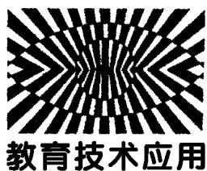
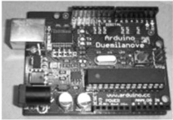
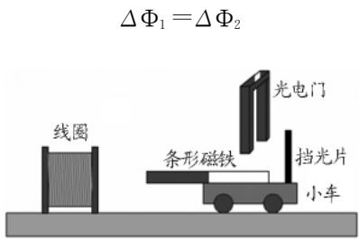
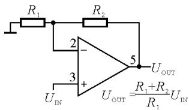
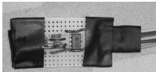
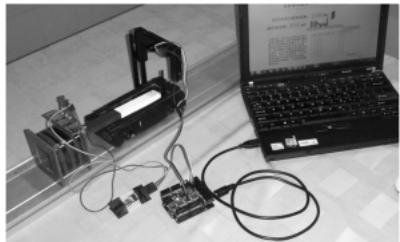
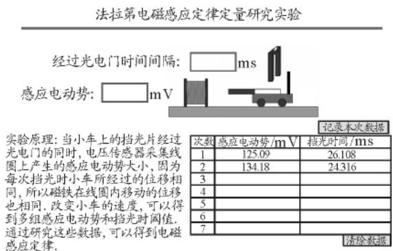

# DISLab在法拉第电磁感应定律定量实验中的应用

翁浩峰

（浙江省宁波中学 浙江 宁波 315100）

（收稿日期 ：2011－11－14）

摘 要 ：介绍了基于 Arduino 和 Flash 的 DISLab 实验及其在法拉第电磁感应定律定量实验中的应用

关键词 ： Arduino Flash 传感器 DISLab Flash 课件 电磁感应定律 实验

## 1 Arduino Flash DISLab 简介

Arduino（图1）是一块基于开放源代码的 USB 接口 Simple i／o 接口板（包括12通道数字 GPIO，4通道 PWM 输出，6～8通道10bit ADC 输入通道），且具有使用类似 Java、C 语言的 IDE 集成开发环境，它的主要运算部件为一单片机（如 Atmega168）．Arduino 发送的数据可以通过电脑终端一个名为 Serproxy 的串口代理软件转化为 Flash 可识别的数据

  
图1

Adobe Flash 是一个非常流行的动画制作软件，常常用于物理课件的制作，近几年发展很快，现在已经可以用 Flash 来制作软件．在本实验中制作的课件可以接收来自 Arduino 的数据

DISLab(Digital Information System Lab)即数字化信息系统实验室 其基本的构造是传感器 数据采集器和计算机软件．基本原理是由数据采集器采集传感器上的数据 ， 并传输到电脑上通过软件显示出来

（关于 Arduino ， Flash ， DISLab 的更多内容参阅文献［1］和［2］）

## 2 电磁感应定律定量研究实验原理

法拉第电磁感应定律 闭合电路中感应电动势的大小 跟穿过这一电路的磁通量的变化率成正比即

$$
\mathrm { E } { = } \frac { \Delta \Phi } { \Delta \mathrm { t } }
$$

如果闭合电路是一个匝数为 N的线圈 并且穿过每匝线圈的磁通量总相同 则线圈的感应电动势为

$$
\mathrm { E = N } \frac { \Delta \Phi } { \Delta \mathrm { t } }
$$

要定量研究电磁感应定律 则需要测量磁通量的变化量 ΔΦ 和时间间隔 $\varDelta { \sf t } .$ ．由于磁通量变化量 ΔΦ 较难测量 笔者设定每次变化的 ΔΦ 都相同 在这种情况下改变时间间隔 Δt， 通过研究E与 Δt的关系，从而得出电磁感应定律．由此笔者设计了如下的实验

在条形磁铁进入线圈的过程中 线圈中的磁通量会发生变化 从而产生感应电动势．如果磁铁在线圈中从相同的位置开始移动相同的位移 那么 线圈中的磁通量变化量 ΔΦ 则相同

如图2所示 将一条形磁铁平放于小车上 小车上再固定一挡光片．移动小车 当挡光片刚挡住光电门开始计时，到挡光片刚离开光电门停止计时 ，便可以得到这段过程的时间 $\varDelta \mathrm { t } _ { 1 }$ ．同时 磁铁在线圈中移动了一段位移 ， 线圈中的磁通量的变化量为 ΔΦ1保持线圈与光电门位置以及条形磁铁和挡光片在小车上的位置不变 ，重复实验，可得第二次实验的时间 $\varDelta \mathrm { t } _ { 2 }$，线圈磁通量变化量为 ΔΦ2．由于两次条形磁铁都是从相同的位置开始移动相同的位移，所以 ΔΦ1＝ΔΦ2

  
图2 测量线圈磁通量的变化量

接下去测量这段时间内感应电动势大小．虽然这个时间很短 但是感应电动势却不是一个恒定值所以 不能用任意一个时刻的值来代替．在法拉第电磁感应定律中 感应电动势

$$
\mathrm { E } { = } \frac { \Delta \Phi } { \Delta \mathfrak { t } }
$$

此式为 Δt时间内的平均值．如果将 Δt再分割成n段的话，则有

$$
\begin{array} { r } { \mathrm { E } = \left( \cfrac { \Delta \Phi _ { \mathrm { 1 } } } { \cfrac { \Delta \mathrm { t } } { n } } + \cfrac { \Delta \Phi _ { \mathrm { 2 } } } { \cfrac { \Delta \mathrm { t } } { n } } + \cfrac { \Delta \Phi _ { \mathrm { 3 } } } { \cfrac { \Delta \mathrm { t } } { n } } + \cdots + \cfrac { \Delta \Phi _ { \mathrm { n } } } { \cfrac { \Delta \mathrm { t } } { n } } \right) \frac { 1 } { \mathrm { n } } = } \\ { \cfrac { \mathrm { E } _ { \mathrm { 1 } } + \mathrm { E } _ { \mathrm { 2 } } + \mathrm { E } _ { \mathrm { 3 } } + \cdots + \mathrm { E } _ { \mathrm { n } } } { \mathrm { n } } } \end{array}
$$

由上可得 如果在时间 Δt内多测几个感应电动势的值 然后 再对这些取平均值 就可以得到 Δt内的感应电动势大小了

根据

$$
\mathrm { E } { = } \frac { \Delta \Phi } { \Delta \mathfrak { t } }
$$

可得

$$
\Delta \Phi { = } \mathrm { E } \Delta \mathrm { t }
$$

因为每次 ΔΦ 相等 所以 EΔt也相等．在测得了多组时间和感应电动势的值后 再对每组求乘积 如果每组乘积相等 则可得到法拉第电磁感应定律

改变线圈匝数 N 并保持装置原位置不变 重复实验．可得到在新的匝数下的时间和感应电动势的乘积．对不同匝数下测得的时间和感应电动势的乘积进行对比 可得感应电动势与匝数的关系

## 3 电磁感应定律定量 DISLab 实验设计

## 3．1 传感器及单片机程序设计

根据上述原理可知 实验需要测量的量有两个即挡光时间和挡光时的电压平均值．前者可以用光电门并通过 Arduino 的数字信号输入端采集， 后者则可以直接通过 Arduino 中的模拟信号输入端采集．Arduino 的模拟信号输入端能采集的最大电压为5V 得到的最大的数字信号为1024即1024对应5V 电压，最小1对应约为5mV 的电压， 所以，Arduino 的模拟信号输入端只能精确到5mV．而本实验中感应电动势大小为100mV左右，直接用 Arduino 来读取误差太大 ， 故需要将采集到的感应电动势的值线性放大后再输入 Arduino

下面是电压放大电路模块的设计

  
图3 电压线性放大原理图

  
图4 自制电压放大模块实物图

放大电路使用 Lm358P 集成运放 加上电阻构一个电压线性放大模块 ，原理图如图3，自制电压放大模块实物图 如图4所示

电压放大模块中的 R1 用1kΩ 电阻，R2 用10kΩ电阻，这样放大倍数为11倍．因为输入的感应电动势约为100mV，经过放大后达到1000mV，用精度为5mV 的 Arduino 模拟信号输入端来采集 ， 误差0．5％

之后 需要通过对 Arduino 进行编程 实现将采集到的时间值和电压值发送到电脑端的功能

端的主要代码（略）

主程序大约每100 $\mu s$ 运行一遍 在每次运行时都检测光电门有无挡光 如果挡光 则开始计时．在计时时 程序继续每 $1 0 0 ~ \mu s$ 运行一遍．当检测到光电门无挡光时则结束计时 得到整个挡光的时间．同时 当开始计时后 程序每运行一遍就会读取一个电压值 并将这些电压值累加 当计时结束 对累加的电压值求平均，得到一个平均电压．因为程序每执行一遍需要 $1 0 0 ~ \mu s$ 左右 所以 计算得到的挡光时间也会有约100 $\mu s$ 的误差．由于每次挡光时间大概有几十毫秒， 所以， 挡光时间的误差约为0．5％．图5为实验装置实物图

  
图5 实验装置实物图

## 3．2 Flash 课件部分设计

软件部分利用 Adobe Flash 来开发 最后生成 swf 动画课件．因为具体代码较多， 这里不再列出图6为课件界面

  
图6 法拉第电磁感应定律定量研究实验课件界面

当移动小车正向通过光电门时 课件中的小车也会移动．当 Arduino 端发送数据时， 课件中会实时显示在对应的方框内．点击记录数据按钮 可以将此次数据记录在表格中．当移动小车反向通过光电门时 课件中的小车也会回到原来位置 并且方框中的数据同时清零．移动小车反复经过光电门 ，就可以记录多组时间和感应电动势的数据

记录完后 将表格中的数据复制 并粘贴到 Excel 表格中，利用 Excel 来进行数据处理，表1，2为某次实验数据

表1 线圈匝数为8N对应的实验数据
<table><tr><td rowspan=1 colspan=1>感应电动势 $\operatorname { E } / m V$ </td><td rowspan=1 colspan=1>挡光时间 t/ms</td><td rowspan=1 colspan=1>E·t/mV· ms</td></tr><tr><td rowspan=1 colspan=1>125.09</td><td rowspan=1 colspan=1>26.108</td><td rowspan=1 colspan=1>3 265.85</td></tr><tr><td rowspan=1 colspan=1>134.18</td><td rowspan=1 colspan=1>24.316</td><td rowspan=1 colspan=1>3 262.721</td></tr><tr><td rowspan=1 colspan=1>93.72</td><td rowspan=1 colspan=1>34.684</td><td rowspan=1 colspan=1>3 250.584</td></tr><tr><td rowspan=1 colspan=1>65.09</td><td rowspan=1 colspan=1>49.92</td><td rowspan=1 colspan=1>3 249.293</td></tr><tr><td rowspan=1 colspan=1>87.36</td><td rowspan=1 colspan=1>37.368</td><td rowspan=1 colspan=1>3 264.468</td></tr><tr><td rowspan=1 colspan=1>120.09</td><td rowspan=1 colspan=1>27.26</td><td rowspan=1 colspan=1>3 273.653</td></tr></table>

表2 线圈匝数为16N对应的实验数据
<table><tr><td rowspan=1 colspan=1>感应电动势 E/mV</td><td rowspan=1 colspan=1>挡光时间 $\mathrm { t } / m s$ </td><td rowspan=1 colspan=1>E·t/mV· ms</td></tr><tr><td rowspan=1 colspan=1>109.18</td><td rowspan=1 colspan=1>58.232</td><td rowspan=1 colspan=1>6 357.77</td></tr><tr><td rowspan=1 colspan=1>195.54</td><td rowspan=1 colspan=1>32.504</td><td rowspan=1 colspan=1>6 355.832</td></tr><tr><td rowspan=1 colspan=1>203.72</td><td rowspan=1 colspan=1>31.104</td><td rowspan=1 colspan=1>6 336.507</td></tr><tr><td rowspan=1 colspan=1>175.54</td><td rowspan=1 colspan=1>36.22</td><td rowspan=1 colspan=1>6 358.059</td></tr><tr><td rowspan=1 colspan=1>141.45</td><td rowspan=1 colspan=1>45.176</td><td rowspan=1 colspan=1>6 390.145</td></tr><tr><td rowspan=1 colspan=1>198.72</td><td rowspan=1 colspan=1>31.868</td><td rowspan=1 colspan=1>6 332.809</td></tr></table>

从实验数据可以看到 在同样匝数下 感应电动势和挡光时间的乘积为一定值．如果将线圈匝数增大一倍 感应电动势和挡光时间的乘积也增大一倍由此可以得到法拉第电磁感应定律（实际实验结果误差要大于实验装置理论误差 ， 可能由于每次移动小车时，小车会有垂直运动方向的微小运动）

## 4 基于 Arduino 和 Flash 的 DISLab 实验展望

基于 Arduino 和 Flash 的 DISLab 实验拥有市场上 DISLab 的功能 却可以在 Flash 课件中显示并处理数据 实现了传感器与课件的完美结合．另外 由于市场上的 DISLab 硬件及软件功能往往都已经内置 甚至具体的实验界面都是固定的 虽然大大方便了教师的使用 ， 但也存在无法制作个性化实验的弊端．笔者的这套 DISLab 实验可以开发更多自己设计的实验 ， Flash 课件端的界面也可以自己设计，并且与动画完美结合．在科技日新月异的今天，教师已不能仅用一只粉笔讲到底了 ，如何有效地利用现在新的技术来辅助教学已经成为每个教师都应该思考的问题

## 参 考 文 献

1 翁浩峰．利用 Arduino 和 Flash 开发 DISLab．物理教师2010（3） ：45

2 翁浩峰．在 Flash 课件中使用传感器．物理通报 2010（6） ：35