# Pocket DisLab——基于 ESP32 与Phyphox 的无线力传感器

文\_苏 翔/西南大学银翔实验中学

## ■ 研究背景

人教版高中物理新教材有“静摩擦力的大小随拉力的变化”“用力传感器探究作用力和反作用力的关系”等力学实验，实验中采用的是国内某知名品牌的力传感器，搭配相应的电脑专用软件使用。

经济条件较好的学校可以通过采购各类数字化实验仪器，建设各类智能功能室，满足部分学生开展自主数字化探究实验。然而，在广大的农村中小学，办学经费有限，学校场馆配套不足，很难让学生体验到信息技术与中学物理等实验类学科的深度融合，不利于农村地区中小学生的全面发展。

作者参与并负责重庆市青少年创新后备人才培养雏鹰计划第十一期“基于 Phyphox 技术的中学物理移动实验开发与应用”项目，立项了市、区级关于自制数字化实验器材的多项课题，通过近几年的深入研究，发现利用 ESP32 芯片与Phyphox APP 可以较好地解决上述问题，实现数字化实验的低成本化、便携化、无线化。

## ■ 研究思路

通过应变梁（图 1）压阻效应将压力或拉力等信号转换成电信号，利用 HX711 模块内部 ADC 将数据输出给 ESP32（图 2）处理，ESP32再通过低功耗蓝牙 BLE 将测量到的

力的大小与方向在 Phyphox中进行实时显示，进而完成一款自制的无线力传感器，从而实现力的大小和方向的测量。

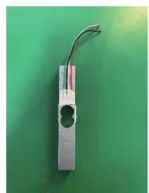  
图1  应变梁

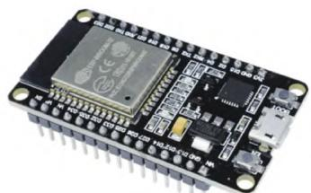  
图 2  ESP32 模块

其 中， 用 作 数 据 呈 现 的Phyphox又名“手机物理工坊”（图3），是由德国亚琛工业大学在2016年发行的一款免费手机应用软件，该应用包含加速度传感器、磁力传感器、陀螺仪等29种内置功能，同时还提供 了 PhyphoxBle 的 Arduino 库 文件，支持外接传感器二次开发。

## ■ 硬件原理与搭建

## ■ 原理

如图 4 所示，应变梁压阻效应的原理为：当某一桥臂的电阻应变片受力发生形变时，其电阻会发生变化，电桥失去平衡，即输出电压不为零，此时可通过输出电压的大小确定电阻应变片受力的大小，从而达到称重与测力的目的。

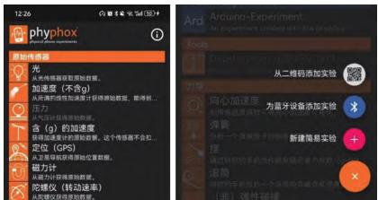  
图 3  Phyphox 界面

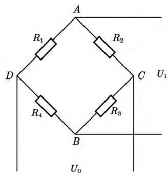  
图4  力电转换电路

## ■ 硬件搭建

初步架构如图 5 所示。从图中能看到核心部件 ESP32 模块、HX711 模块，以及应变梁的布局。ESP32 模块作为主控核心，是整个传感器数据处理与传输的“大脑”，负责接收 HX711 模块传来的数据，并通过蓝牙将处理后的数据发送至手机应用软件。HX711 模块则承担着关键的数据采集与初步处理任务，它将应变梁因受力产生的微弱电信号进行放大和模数转换，为 ESP32提供易于处理的数字信号。详细电路设计如图6所示。

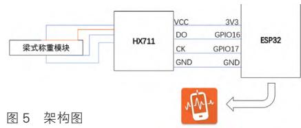

图 5 架构图

电源部分 充电电路给电池充电，电池为整个系统供电。经稳压管稳压后，为各模块提供稳定电压。磁珠 L1 用于抑制电源上的高频噪声和尖峰干扰，还具有吸收静电脉冲的能力。减少相互干扰。三极管 Q1用于控制稳压电路的输出，当不需要稳压电路工作时，使其处于不连接状态。

传感器部分 传感器采用惠斯通电桥结构，当有力作用时，电桥中电阻值发生变化，使电桥失衡，输出与力大小成比例的微弱电压信号。

信号处理部分 电桥输出的微弱电压信号，先经过 1 千欧电阻和0.1 微法电容组成的滤波电路进行初步滤波，滤除高频噪声后的信号再输入到 HX711 芯片的 INNA 和INNB 引脚。HX711 是高精度 24 位A/D 转换器，将模拟信号转换为数字 信 号， 通 过 DOUT 和 PD\_SCK引脚与 ESP32 通信，把数字信号传输给 ESP32。

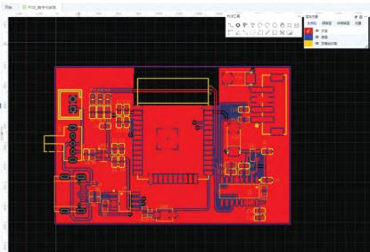  
图 7  EDA 设计

显示部分 ESP32 对接收的数字信号进行处理后，一方面可进行数据存储、分析等操作；另一方面将处理结果传输给LCD进行显示，LED可同时用于指示系统工作状态等。

利用国产软件“嘉立创 EDA”开展电子设计自动化（EDA）设计，如图 7 所示。嘉立创 EDA 是一款功能强大的国产电子设计自动化软件，在硬件搭建过程中发挥着重要作用。使用嘉立创 EDA 进行设计时，首先要在软件中创建新的工程，并选择合适的电路板尺寸和形状。然后，从元件库中调用 ESP32、HX711 模块，以及各种电阻、电容等元件，按照详细电路设计图进行布局。布局完成后进行布线操作，依据电路原理连接各元件引脚。

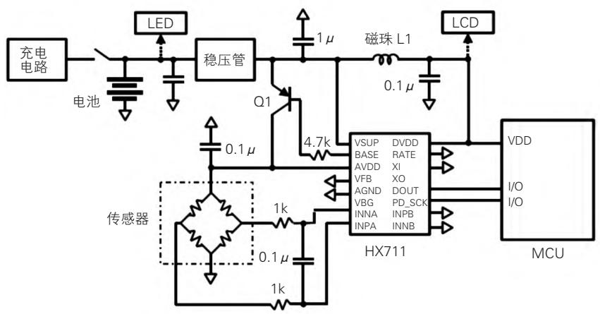  
图6  电路设计

焊接 PCB 电路板如图 8 所示。焊接时，先在 PCB 板的焊盘上涂抹适量助焊剂，有助于提高焊接质量。对于较小的元件，如电阻、电容，可使用镊子夹住元件引脚，将其准确放置在焊盘上，再用电烙铁加热引脚和焊盘，使焊锡丝熔化并均匀附着在引脚和焊盘之间，形成良好的焊点。焊接 ESP32 和 HX711 等芯片时，由于引脚间距较小，操作难度较大，需格外小心。

3D 打印传感器外壳，设计如图 9 所示。

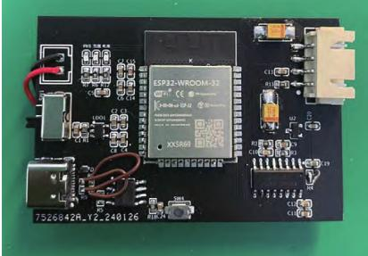

图 8 焊接 PCB 电路板  
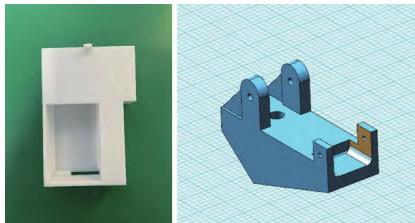  
图9  3D打印外壳

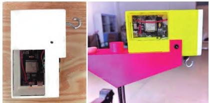

图10  独立的力传感器  
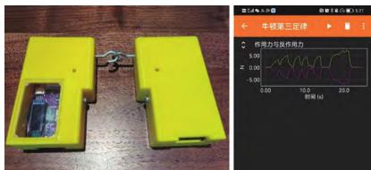  
图11  牛顿第三定律演示

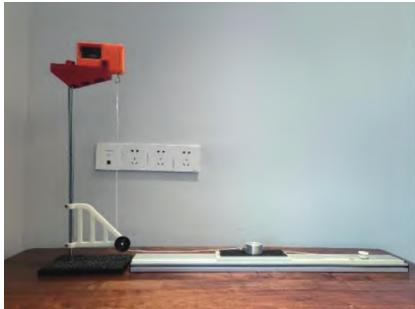

图12  摩擦力突变演示  
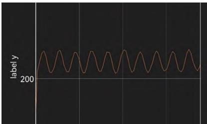

图13  单摆拉力演示  
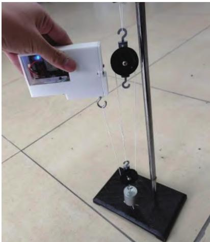  
图14  滑轮组演示

3D 打印传感器外壳不仅能保护内部电子元件，还能使传感器更具整体性和美观性。在设计外壳时，充分考虑了内部元件的尺寸和布局，确保外壳能紧密包裹元件，同时方便操作和连接。使用 3DONE 建模软件，根据内部元件的尺寸创建外壳模型。

成品（如图 10 所示）将各个部件有机整合在一起，外观简洁、紧凑。经过测试，该传感器能准确测量力的大小和方向，并通过蓝牙将数据稳定传输至手机应用，实现了预期的功能，为后续的物理实验提供了可靠的测量工具。

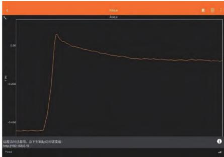

## ■ 程序设计

限于篇幅，这里只展示主程序。

```cpp
#include <phyphoxBle.h>
#include <HX711.h>       // 引入 HX711 库
#include <BLEDevice.h>   // 添加对 ESP32 BLE 库的支持

const int doutPin = 16;
const int pdSckPin = 4;
HX711 scale;

void setup()
{
  const float calibration_factor = -3280.0; // 根据您的 HX711 传感器进行调整
  setCpuFrequencyMhz(240);
  BLEDevice::init("ESP32_1");              // 设置自定义蓝牙设备名
  PhyphoxBLE::start();                      // 启动 Phyphox BLE 服务
  scale.begin(doutPin, pdSckPin);           // 初始化 HX711 对象
  scale.set_scale(calibration_factor);      // 设置校准因子
  scale.tare();                             // 归零
}

void loop()
{
  float weight = scale.get_units() * 10;
  PhyphoxBLE::write(weight);                // 将重量值发送给 Phyphox 应用
}
```

## ■ 无线实验效果展示

通过手机蓝牙向 Phyphox 添加实验，将 2 个自制的力传感器对拉，可以看到 2 个力的大小相等，方向相反（图 11），验证了牛顿第三定律，演示效果非常明显。

缓慢拉木块，可以看到静摩擦力逐渐增大，当拉动的一瞬间，静摩擦力突变为滑动摩擦力，摩擦力会突然减小（图12）。

在力传感器下方悬挂一个 200 g的钩码，让其初始偏角小于 5°，摆动起来，其运动近似可视为简谐振动（图13）。

在力传感器下方通过细绳连接滑轮组，还可以探究滑轮组不同绕线方式对拉力的影响（图14）。

## ■ 创新点

本装置造价低廉，整装置成本不到 50 元。采用了目前非常流行的国产开源硬件 ESP32 为开发平台，制作简单，编程模块化，方便调用。

采用手机应用软件 Phyphox作为数据呈现装置，摆脱了传统数字化实验需要专门的实验电脑、专门的数字化实验室等不便。同时，该传感器使用蓝牙无线传输数据，免去了主控与数据线的复杂连接，使得数字化实验的门槛大幅降低，有利于广大农村地区学校使用。

自制无线力传感器不仅可以验证牛顿第三定律、单摆中绳子拉力变化、静摩擦力到滑动摩擦力突变等多种需要力传感器的数字化实验，还可以根据教师的不同需求开发出更多应用场景。

该项目获得第 38 届全国青少年科技创新大赛科技辅导员科技教育创新成果竞赛一等奖■
