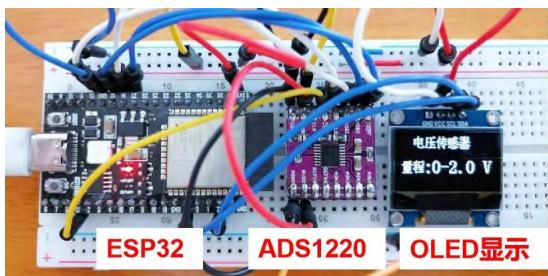
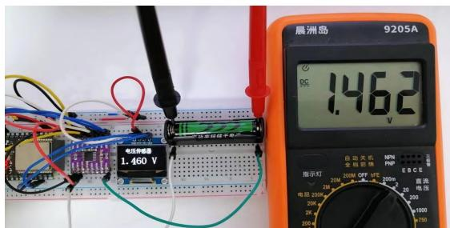
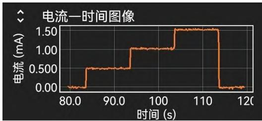
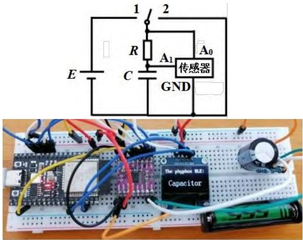
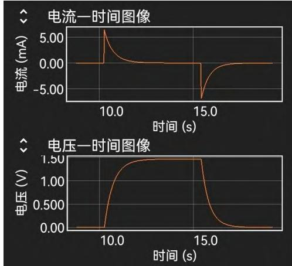
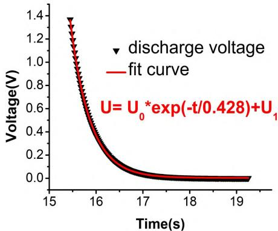
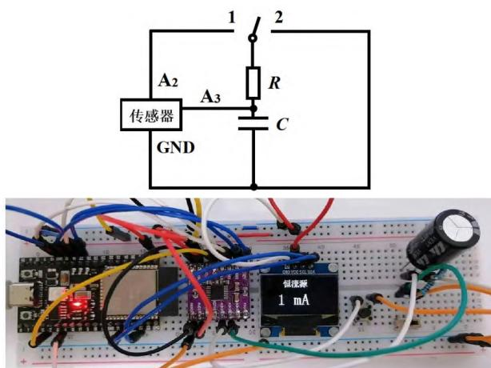
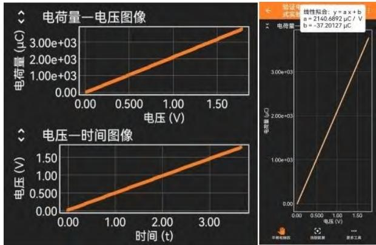

# 低成本 DIS 实验的实践研究——以电容器的实验探究为例

杨燕琨1，朱启侨2

（1湛江经济技术开发区第一中学，2湛江市霞山区教师发展中心，广东 湛江 524000）

摘 要：基于 ESP32单片机和ADS1220模数转换模块制作具有恒流输出功能的电压传感器。利用这套低成本的 DIS实验装置结合 phyphox软件监测电容器的充、放电过程和定量探究电容器极板电量与所加电压的关系。

关键词：DIS 实验；低成本；电容器；恒流源

“电容器与电容”是粤教版高中物理教材（2019年版）必修第三册第二章第 1节的内容，其中对电容器的实验探究是本节课的难点。教材采用三个案例来探究电容器的特点，分别是“观察电容器充、放电现象”“用传感器在计算机上观察电容器充、放电过程”和“探究电容器极板电量 Q 与所加电压 U的关系”[1]。由于后面两个案例涉及RC电路的瞬态过程和电荷量的测量问题，往往需要借助于商用DIS实验系统才能实现[2]。但是 DIS 实验系统价格高昂，普及率不高，导致在实验教学时，教师往往只能口头讲解这部分内容，教学效果不佳。因此，自制一款低成本的 DIS 实验装置完成教材中的实验教学任务是非常必要的。

## 一、具有恒流功能的电压传感器的制作

## 1. 设计思路

ADS1220是一款模数转换芯片，它可以同时检测4路电压且具有可编程恒流输出功能，利用ESP32单片机驱动其工作并与 phyphox 软件结合使用就能轻松监测电容器的充、放电过程。由于芯片可开发成恒流源，根据公式：

$$
q = I \times t\tag{1}
$$

只要准确记录其给电容器充电的电流大小及时间，就能换算出电容器两端的电荷量，该方式可巧妙避开电荷量测量的难题。充电的同时监测电容器两端

电压，就能快速定量探究电容器极板电量 $\mathcal { Q }$ 与所加电压 U的关系。整套实验装置的材料花费只需要几十元，非常适合普通学校使用。

## 2. 制作材料

一块 5.5 cm × 16.5 cm、830 孔的面包板，一块ESP32 单片机，一个 ADS1220模数转换模块，一块0.96寸 OLED 屏幕，一节干电池，杜邦线若干。

## 3. 硬件连接

  
图 1 电压传感器实物图

ADS1220 供电引脚 DVDD 和 AVDD 通过杜邦线连接 ESP32 的 3V3 针脚；接地引脚 AGND 和DGND 接 ESP32 的 GND 针脚；MOSI、MISO、SCLK、CS 和 DRDY 引脚分别和 ESP32 的 12、13、14、15 和 27 号 IO 端口相连。ADS1220 的 A0、A1、A2、A3 引脚和 GND 端形成四路高精度电压传感器和两个恒流源，实验者可根据实际需要选用这些功能。OLED 屏幕的 GND、VCC、SCL、SDA 分别接单片机的 GND、3V3、21和 22端口用于显示实验数据。最终完成连接的装置实物如图 1所示。

## 4. 电压和电流传感器的实现

在 ArduinoIDE 中编写程序驱动，在调用一些成熟的库函数后，通过简单的几句代码单片机就能驱动 ADS1220 实现电压和电流传感器功能。如图 2所示，使用校准后的电压传感器测量一节干电池两端电压为 1.460V，其精准度与数字万用表的测量结果可比拟。

  
图2 电压传感器测量一节干电池电压

由于 ADS1220 不能直接测量电路中的电流大小，可先测量电路中定值电阻两端的电压，再通过欧姆定律换算成电流即可。

## 5. 可编程恒流源

ADS1220拥有两个独立的可编程恒流输出功能，其恒流大小也可以通过编程控制。图 3所示代码实现 A2 端口阶跃性输出大小分别为 0.5 mA、1mA 和 1.5 mA 且时长都为 10s 的恒定电流。使用phyphox软件监测该实验过程，结果如图 4所示。

adc.idac1 routing(3) # A2端恒流输出   
adc.idac current(5) # 0.5 mA恒流   
time.sleep(10)   
adc.idac current(6) # 1.0 mA恒流   
time.sleep(10)   
adc.idac current(7)   
time.sleep(10)   
adc.idac1\_routing(0)  
图 3 恒流输出代码

  
图 4 恒流输出实验结果

测试结果表明，装置的恒流输出具有高稳定性和高精度，为后续电容器的恒流充电实验奠定了基础。使用万用表测量设定为 1mA 的电流值最终为1.016 mA，误差只有 1.6 %。

## 二、使用自制 DIS 实验装置实验探究电容器的

特点

## 1. 用传感器观察电容器充、放电过程

使用一节干电池、一个三脚拨码开关、一个2200μF的电解电容、一个 200Ω电阻和若干杜邦线按电路图在面包板上连接电路（如图 5）。

  
图 5 电容器充、放电实验电路图和实物图

将传感器的 A1端并联接到电容器的正极，A0端并联接到电阻的正极，GND 并联接到电阻的负极。设置 A1端的测量值为电容器两端的电压，A0端的值减 A1端的值除电阻即为电路中的电流，其绝对值表示电流大小，正负号显示电流的流动方向。

电路连接完成后运行实验装置，先使拨码开关与 2 连接，打开手机端phyphox 软件连接 ESP32 蓝牙，此时 phyphox 开始显示电容器的电流和电压数值。拨动开关与 1 相连对电容器进行充电；待充电完成后再把拨码开关接回 2 进行电容器放电。phyphox 就可以绘制出电容器完整的充、放电时电压、电流随时间变化的图像了。如图 6 是某次实验的结果，该图像与教材中的参考图像基本一致。

  
图6 电容器充、放电过程数据曲线

根据理论分析，RC电路中的电容器在充、放电过程中，其电压和电流随时间呈 e指数变化[3]。以放电过程的电压变化为例，其大小满足公式：

$$
U = U _ { 0 } \times \exp ( \frac { - t } { R \times C } )\tag{2}
$$

将 phyphox 的数据导出，使用 origin 软件对充电过程数据进行指数拟合分析（如图 7所示），得到$R \times C = 0 . 4 2 8$ ，万用表测得串入电路中的电阻值实际为 199Ω，可算出电容值 $C = 2 1 5 1 ~ \mu \mathrm { F }$ ，与标称值$2 2 0 0 \mu \mathrm { F }$ 的误差只有 2.2 %。说明该 DIS 实验装置能有效“观察”到电容器充、放电过程。

  
图 7 电容器放电过程中电压的数据拟合结果

二、用恒流源探究电容器极板电量 Q 与所加电压 U的关系

  
图 8 恒流源探究电容器极板电量与电压的关系

探究电容器极板电量与所加电压的关系的多是使用“半分法”进行探究，电荷量大小需要通过积分的方式计算得到，过程比较繁琐，课堂实验效果不佳。由于研究自制了有恒流输出电压传感器，因此就能方便地进行这项探究了。在电流恒定的情况下，充入电容器的电荷量大小等于电流大小乘以充电时间，并且该计算过程可以通过编程让单片机实现，不需要实验后期处理，极大提高了实验效率。

首先，按图 8 连接电路，此时 ${ \bf A } _ { 2 }$ 端口编程设置为 1 mA 恒流输出，电压传感器 ${ \bf A } _ { 3 }$ 直接测量电容器两端电压。探究过程的操作步骤与上一个实验类似，拨动开关给电容器充电，phyphox 软件记录 $U ^ { - } t$ 图像和 Q-U图像，如图 9 所示。

  
图9 电容器恒流充电实验结果

可以看到，两个图像都是经过原点的，说明恒流充电过程中电容器两端的电压随时间均匀增加，其电荷量与所加电压成正比。使用phyphox 程序的线性拟合工具测得 $\mathcal { Q } \ – U$ 图像的斜率 $k = 2 1 4 1 ~ \mu \mathrm { C } / \mathrm { V }$ 即 $2 1 4 1 ~ \mu \mathrm { F }$ ，与该电容器标称值 $2 2 0 0 \mu \mathrm { F }$ 的误差只有2.7%，这样也验证了电容的定义式， $C = { \frac { Q } { U } }$

## 三、结束语

基于 ESP32 和 ADS1220 模块自制的无线电压传感器灵敏度高，且具有恒流输出功能，结合phyphox 软件可以帮助师生高效完成对电容器进行实验探究的教学任务。由于这套 DIS 装置具有低成本、便于携带、操作简单的特点，普通中学也具有将其开展为学生数字化分组实验的条件，为低成本DIS 实验的开发可行性与教育资源共享和公平提供了借鉴案例。

## 参考文献：

[1] 熊建文. 普通高中教科书物理必修第三册[M]. 广州：广东教育出版社，2019.

[2] 胡星，耿书娟. 源于生活的电容器充放电进阶实验[J]. 湖南中学物理，2021，36(04)：65-67.

[3] 李云天. 用Tracker视频分析软件研究电容器的充放电过程[J]. 物理通报，2023(12)：143-147.
