> 来源：MinerU 转换（stem-exact rebuild 2026-08-08）

# 例谈巧用计算机软件辅助新时代中学物理教学

许敬川 贾华 解远领 （天津市耀华中学 天津 300040）

摘要 将现代信息技术与物理课堂整合是高中物理新课标提出的理念，在中学物理教学中可以恰当应用 Origin、GeoGebra、Excel 等软件，并发挥好这些软件的优势，从而使物理课堂生动、形象，让物理规律的发现更加有据、自然，有效提升学生核心素养。

关键词 新课标 物理 信息技术 软件 数据 分析 规律

文章编号 1002－0748（2019）3－0009

中图分类号 G633.7

文献标识码 B

## 一、引言

2017 版《普通高中物理课程标准》的基本理念中有这样的叙述："通过多样化的教学方式，利用现代信息技术，引导学生理解物理学的本质，整体认识自然界，形成科学思维习惯。增强科学探究能力和解决实际问题的能力。"利用现代信息技术，就离不开使用强大的计算机软件辅助物理教学：有些软件把实验收集的数据进行分析处理，得出实验结论；有些软件配合数学手段把抽象问题形象化，进而可能发现一些新的规律；有些软件还能利用数据分析能力鉴题、解题、探究物理规律。

不同软件的优势不同：Origin 软件统计、图形、绘制功能强大；Excel 软件极其易用，数据统计、分析功能强大，适合小样本数据初步分析；GeoGebra 软件是集成了"几何""代数""微积分"功能的动态数学软件。下面举出笔者在物理教学过程中针对不同类型问题应用不同软件的案例。

## 二、相关教学案例

## 1．"探究弹性势能的表达式"

"探究弹性势能的表达式"利用的是定性实验探究和理论探究相结合的方法。定性实验探究让同学得到了弹簧弹性势能与哪些因素有关的感性认识，但缺乏数据支撑，不能得到有充分说服力的精细认知，理论探究又过于抽象，使学生被动获得结论。笔者在处理这节课时采用了定量探究环节，装置如图 1 所示。

将气垫导轨调整到水平，滑块在正常工作下的水平气垫导轨上运动时所受的阻力可忽略。使弹簧拉伸，滑块由静止释放，当拉着滑块的弹簧恢复原长时，弹簧初始状态下的弹性势能全部转化为此时滑块的动能，而此时遮光片恰好通过光电门，软件计算出此时的动能，就得到了刚释放滑块时弹簧的弹性势能。滑块总体质量和遮光片宽度已经测量好：$m = 0.2563 \mathrm{kg}$，$d = 0.01 \mathrm{m}$，遮光片通过光电门的时间为 $t$（由计时装置采集），滑块动能 $E_{\mathrm{k}} = \dfrac{1}{2}mv^{2} = \dfrac{1}{2}m\left(\dfrac{d}{t}\right)^{2} = 0.5 \times 0.2563 \times (0.01/t)^{2}$，$E_{\mathrm{p}} = E_{\mathrm{k}}$，数据处理用软件 Origin。

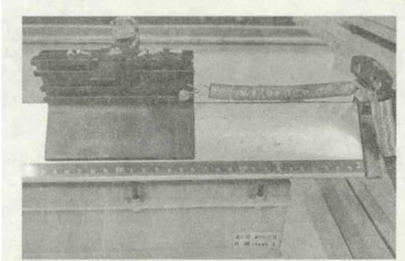
图 1

第一项　弹性势能和形变量的关系探究：

（1）对于 7 种不同的形变量 $x$，逐步采集并输入 7 组关于 $t$ 的实验数据。

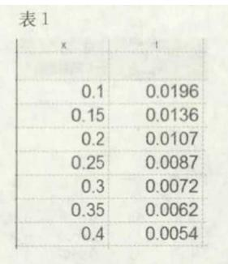
表 1

（2）在关于 $E_{\mathrm{k}}$ 的列设置中输入动能的函数"$E_{\mathrm{k}} = 0.5 \times 0.2563 \times (0.01/t)^{2}$"，软件计算得到各组 $E_{\mathrm{k}}$ 的值。

（3）在关于 $E_{\mathrm{p}}$ 的列设置中输入 $E_{\mathrm{p}}$ 的函数，软件计算得到各组 $E_{\mathrm{p}}$ 的值。

（4）设置 $E_{\mathrm{p}}$ 为因变量、$x$ 为自变量，软件绘出 $E_{\mathrm{p}} - x$ 图象。

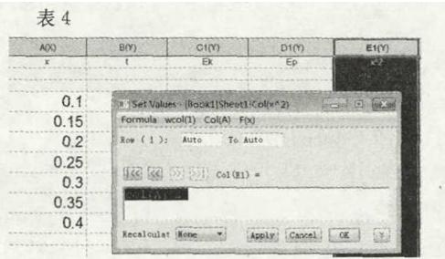
表 2

| x | t | Ek | Ep |
|---|---|---|---|
| 0.1 | 0.0196 | 0.03336 | 0.03336 |
| 0.15 | 0.0136 | 0.06929 | 0.06929 |
| 0.2 | 0.0107 | 0.11193 | 0.11193 |
| 0.25 | 0.0087 | 0.16931 | 0.16931 |
| 0.3 | 0.0072 | 0.2472 | 0.2472 |
| 0.35 | 0.0062 | 0.33338 | 0.33338 |
| 0.4 | 0.0054 | 0.43947 | 0.43947 |

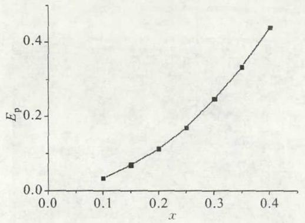
图 2

（5）同学们猜想为二次函数后，用二次函数进行拟合，发现拟合线基本和原线重合。

（6）根据拟合结果，如果想更直观感知 $E_{\mathrm{p}}$ 和 $x$ 的关系，需要进一步绘出 $E_{\mathrm{p}}$ 关于 $x^{2}$ 的关系图象，看是否为直线。

（a）输入 $x^{2}$ 的函数，软件计算各组 $x^{2}$ 的结果。

（b）设置 $E_{\mathrm{p}}$ 为因变量和 $x^{2}$ 为自变量，软件绘出 $E_{\mathrm{p}} - x^{2}$ 图象。

| x | t | Ek | Ep | x² |
|---|---|---|---|---|
| 0.1 | 0.0196 | 0.03336 | 0.03336 | 0.01 |
| 0.15 | 0.0136 | 0.06929 | 0.06929 | 0.0225 |
| 0.2 | 0.0107 | 0.11193 | 0.11193 | 0.04 |
| 0.25 | 0.0087 | 0.16931 | 0.16931 | 0.0625 |
| 0.3 | 0.0072 | 0.2472 | 0.2472 | 0.09 |
| 0.35 | 0.0062 | 0.33338 | 0.33338 | 0.1225 |
| 0.4 | 0.0054 | 0.43947 | 0.43947 | 0.16 |

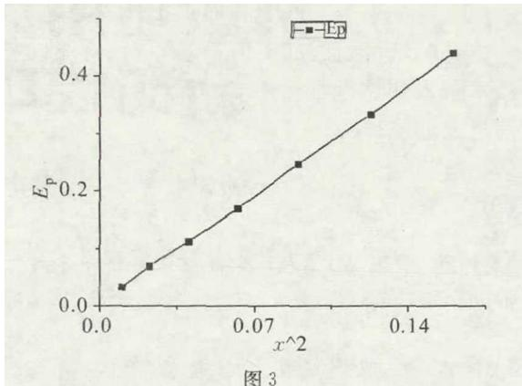
图 3

（7）同学们看到线性函数后，用线性函数进行拟合，发现拟合线基本和原线重合，且过原点。

第二项　弹性势能和劲度系数的关系探究（相应操作过程类似第一项，图片省略）：

（1）分别对 5 个原长相同、已知劲度系数（各不相同）的弹簧拉伸相同的长度，同学逐步输入 5 组实验中关于 $t$ 的数据。

（2）在关于 $E_{\mathrm{k}}$ 的列设置中输入动能的函数"$E_{\mathrm{k}} = 0.5 \times 0.2563 \times (0.01/t)^{2}$"，软件计算得到各组 $E_{\mathrm{k}}$ 的值。

（3）在关于 $E_{\mathrm{p}}$ 的列设置中输入 $E_{\mathrm{p}}$ 的函数，软件计算得到各组 $E_{\mathrm{p}}$ 的值。

（4）设置 $E_{\mathrm{p}}$ 为因变量、$k$ 为自变量，软件绘出 $E_{\mathrm{p}} - k$ 图象。

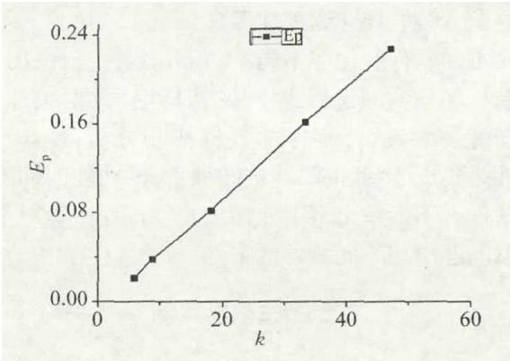
图 4

（5）同学们看到线性函数后，用线性函数进行拟合，发现拟合的红线基本和黑线重合，且过原点。根据以上定量实验得出结论：$x$ 一定，$E_{\mathrm{p}} \propto x^{2}$；$x$ 一定，$E_{\mathrm{p}} \propto k$。

在定性探究让学生得到感性认识的基础上，再通过定量探究，收集数据并作出图象，让实验结果更形象、直观、有说服力，并且还能锻炼学生"化曲为直"等思想方法。通过这样的实验探究学习也培养了学生核心素养中的科学精神。在这个过程中 Origin 软件的统计、图形和绘制功能功不可没。可见信息技术作为信息整理和加工工具主要培养学生获取信息、分析信息、加工信息的能力。有效地把信息技术融入到物理学科中，为学生在物理学习创造信息化环境，使信息技术成为学生发现、认知和解决问题的工具，既培养了学生的科学实验与探究的核心素养，又提高了学生的学习效果。

## 2．学习电场能的属性

电势是一个抽象的概念，尤其是同种或异种电荷周围电场的电势分布，如果直接根据电场线绘出等势面，或者直接用理论分析电势分布的特点，学生会感觉很抽象，因此我们有义务让学生获得感官认识。笔者在教学中用到了 GeoGebra 软件。打开软件并选择 3D 绘图区后，在输入区输入函数 $f(x, y) = kq_{1}\big[(x-3)^{2} + y^{2}\big]^{-0.5} + kq_{2}\big[(x+3)^{2} + y^{2}\big]^{-0.5}$，相当于在 $(3, 0, 0)$ 和 $(-3, 0, 0)$ 分别固定两个电荷 $q_{1}$ 和 $q_{2}$，并且取无穷远处为零电势点，$f(x, y)$ 即为 $xy$ 平面上各点电势的表达式。令其在图象 $z$ 轴显示，在绘图区插入滑动条并编辑滑动条的参数，两滑动条分别代表 $kq_{1}$ 和 $kq_{2}$，参数范围均为 $[-10, 10]$。

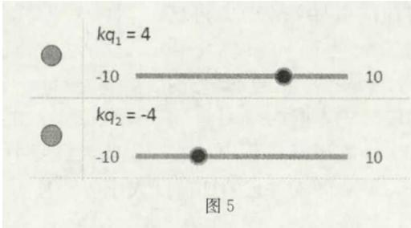
图 5

拨动滑动条，若分别取 $kq_{1} = 4$ 和 $kq_{2} = -4$，得到如图所示的 $xy$ 平面上各点电势的 3D 图象以及通过添加交线方程得到沿 $x$ 轴的电势分布。

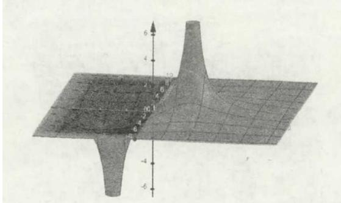
（a）

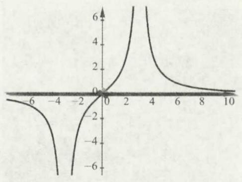
（b）

图 6

因为滑动条的范围可设置，并且 $kq_{1}$ 和 $kq_{2}$ 的值可以动态调节，所以我们可研究同种电性或异种电性、相同电量或不同电量的两个场源点电荷的周围电场的电势分布，并让学生形象感知，并可得出一些结论加深对电势标量叠加的理解，如"随着正电荷电量的增加，各点电势均升高；随着负电荷电量的增加，各点电势均降低"等等。

笔者注意到，当 $kq_{1} = 5$ 和 $kq_{2} = -2$ 时，得到如图所示 3D 图及其沿 $z$ 轴负方向的俯视图。

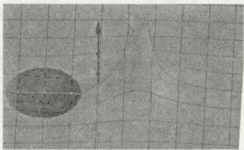
（a）

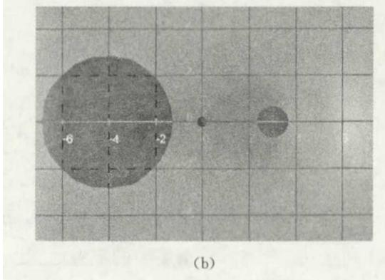
（b）

图 7

当 $kq_{1} = 2$ 和 $kq_{2} = -5$ 时，得到如图所示 3D 图及其沿 $z$ 轴负方向的俯视图。

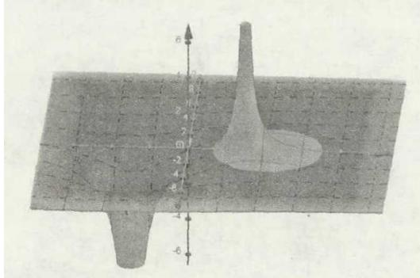
（a）

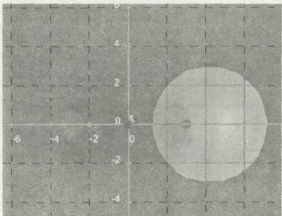
（b）

图 8

从图中可看出，在非等量异种电荷的电荷量小的电荷一侧会有一个包含电荷的圆形零势面。考虑到 $q_{1}$ 和 $q_{2}$ 的位置不变而三维立体坐标系可整体绕 $x$ 轴在 $360^{\circ}$ 范围内旋转，所以可推导这个零势面其实是一个球面。笔者进而进行理论证明：设 $d > 0$，在 $(d, 0, 0)$ 和 $(-d, 0, 0)$ 分别固定两个异种电荷，电荷量绝对值分别为 $q_{1}$ 和 $q_{2}$（$q_{2} < q_{1}$），并且取无穷远处为零势点，$kq_{1}\big[(x-d)^{2} + y^{2}\big]^{-0.5} - kq_{2}\big[(x+d)^{2} + y^{2}\big]^{-0.5} = 0$（关注的为 $xy$ 平面上的零电势点），即

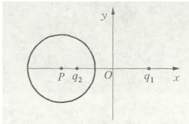
图 9

$$
\left[ x + \left( d + \frac { 2 q _ { 2 } ^ { 2 } d } { q _ { 1 } ^ { 2 } - q _ { 2 } ^ { 2 } } \right) \right] ^ { 2 } + y ^ { 2 } = \left( \frac { 2 q _ { 1 } q _ { 2 } d } { q _ { 1 } ^ { 2 } - q _ { 2 } ^ { 2 } } \right) ^ { 2 }
$$

可见这是一个圆的方程，圆心坐标为 $\left[ -\left( d + \dfrac{2q_{2}^{2}d}{q_{1}^{2} - q_{2}^{2}} \right), \ 0 \right]$，半径为 $\dfrac{2q_{1}q_{2}d}{q_{1}^{2} - q_{2}^{2}}$。所以可以得到结论：两个异种电荷，相距为 $2d$，电荷量绝对值分别为 $q_{1}$ 和 $q_{2}$（$q_{2} < q_{1}$），该电场中的零势面是一个半径为 $\dfrac{2q_{1}q_{2}d}{q_{1}^{2} - q_{2}^{2}}$ 的球面，球心位于两个电荷的连线上且处于小电量电荷的外侧，与它相距为 $\dfrac{2q_{2}^{2}d}{q_{1}^{2} - q_{2}^{2}}$，小电量电荷和大电量电荷分别处于球面内外。把这些结论再反扣进前面的 3D 图及其沿 $z$ 轴负方向的俯视图中，一目了然。

可见 GeoGebra 软件可以让抽象的电势概念形象成图，使得学生的理解有了抓手，并且利用软件强大的"几何"与"代数"功能，通过动态调节参数，使学生灵活、全方位了解物理概念和规律。若教师发挥主观能动性充分挖掘，有时还能够发现理论推导等方法难以发现的问题和规律。需要指出的是，教师并不是利用计算机软件单纯地活跃课堂氛围，而是充分发挥其实效，这需要教师做大量的研究、探索与实践的工作。教师在常规教学工作中，要不断积累经验，与时俱进，多参与新的技术、学术课题研究，积极挖掘有用信息与技术充实自己，有能力充分利用现代教育工具，让学生在生动的情境中自由汲取知识营养。

## 3．高中物理习题

有一类题，如果不仔细分析，很容易选错，就算发现问题，如果借助常规手段分析也有很大难度。笔者在教学过程曾遇到过这样一道题。

题目　物块 A 和 B 用绕过定滑轮的轻绳相连，A 的质量为 $m$，B 的质量为 $2m$。A 穿在光滑竖直固定的长直杆上，滑轮与杆间的距离为 $l$。将 A 移到与滑轮等高处由静止释放，不考虑绳与滑轮间的摩擦，则下列说法中正确的是（　）

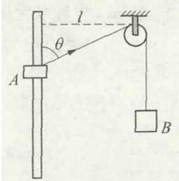
图 10

（A） A 在下降过程中加速度先变大后变小

（B） A 刚释放时它的加速度大小等于重力加速度 $g$

（C） 当 A 在下降过程中速度达到最大时，A 与 B 速度大小之比为 2：1

（D） 当 A 的机械能最小时，B 的重力势能最大

关于这道题的答案，几乎所有资料给的都是 BCD。关注 C 选项，若 C 选项正确，即认为物块 A 达到最大速度即处于平衡状态时，$\theta$ 角为 $60^{\circ}$，此时 $v_{A}\cos 60^{\circ} = v_{B}$，对 A 有：$T\cos 60^{\circ} = mg$，所以 $T = 2mg$，即此时 $T = m_{B}g$，所以 C 选项默认为物块 B 此时也处于平衡状态。根据两物体组成的系统机械能守恒，有

$$
mgl\cot\theta = \dfrac{1}{2}mv^{2} + \dfrac{1}{2}(2m)\left(\dfrac{v}{\cos\theta}\right)^{2} + 2mg\left(\dfrac{l}{\sin\theta} - l\right)
$$

所以

$$
v^{2} = \dfrac{2gl\left(\cot\theta - \dfrac{2}{\sin\theta} + 2\right)}{1 + 2\cos^{2}\theta}
$$

这时我们令 $k = \dfrac{\cot\theta - \dfrac{2}{\sin\theta} + 2}{1 + 2\cos^{2}\theta}$，当 $k$ 取到极大值时，A 物体的速度最大，但是用数学方法直接分析 $k$ 何时取到极大值有很大的难度。

下面我们用 Excel 软件证明一下，如图 11 所示。

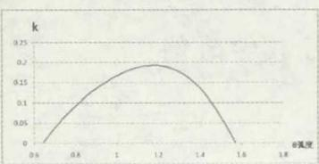
图 11

让 $\theta$ 角在 $(0.000001, 1.57)$ 之间以每 $0.01$ 弧度递增取值，并在 B2 单元格设置函数：$f(x) = (1/(\mathrm{TAN}(\mathrm{A2})) - 2/\mathrm{SIN}(\mathrm{A2}) + 2)/(1 + (2*\mathrm{COS}(\mathrm{A2})*\mathrm{COS}(\mathrm{A2})))$，得到 B2 单元格的函数值为 $0.333333$，然后下拉得到所有自变量 $\theta$ 角的对应函数值，并作出图象。直接观察发现 $\theta$ 在 $1.2$ 弧度左右时 $k$ 取到极大值，回到数据表格中，观察 $\theta = 1.18$ 弧度时 $k$ 取到极大值，这个角要大于 $60^{\circ}$。所以本题中的 A 最大速度出现在 $\theta = 1.18$ 弧度 $\approx 68^{\circ}$，$T\cos 68^{\circ} = mg$，所以 $T \neq 2mg$，所以此时 B 并不处于平衡状态，此时二者速度比等于 $1:\cos 68^{\circ} \neq 2:1$，C 选项错误，错误的本质原因是认为二者同时达到最大速度。

通过这个案例，可以发现常规方法和手段不好处理的问题，而利用 Excel 软件的易用［2］、小样本数据的统计、分析功能强大的特点，可以有效解决，得到正确的结论，并且可以鉴题，剔除一些人们误认为正确的错解。

## 三、结论

现代信息技术已经深度融合进中学教学，有效地利用各种计算机软件辅助物理教学是中学物理教师必须研究和实践的重要课题。针对不同的教学内容和问题，要合理选择最合适的软件，达到高效。比如对于强调数据收集与分析，最后需要用图象呈现物理量间关系的实验或者问题，最好选用统计、图形、绘制功能强大的 Origin 或者 DataStudio 等等；对于抽象的物理问题，在其原理中往往蕴藏了代数与几何的属性，通过软件的代数与几何功能可以把物理问题形象化，这时可以选用 GeoGebra 或者 Matlab 等等；对于小样本的数据初步分析，比如研究物理题目的自洽性、鉴别隐含在物理问题中的错误、研究物理极值等问题时，可以选用最简单易用的 Excel 等等。总之，使用这些软件辅助物理教学，可以进行物理实验数据的整理和分析、可以创设物理情境、可以演示物理技能与方法、可以配合数学手段把抽象物理问题形象化等等，使物理概念和规律的呈现更生动直观，有效地促进学生的感知、理解和消化，提高了教学效果和学习效率，有效培养了学生的核心素养。利用好软件还可以方便解决其他方法难以解决和发现的问题，用于鉴题、解题，真正地不给学生错题和错误答案，这也是很关键的。

本文例谈的使用计算机软件只是信息技术应用的一个层面，信息技术不只是辅助教师传授知识的手段，也是服务于他们物理教学的得心应手的教学媒体，是更好地进行全人素质教育的工具；对于学生来说，信息技术则是学习知识和提高技能的有力工具。将信息技术与物理整合在一起，既培养学生物理素养，又培养学生的信息能力，实现新课标中提出的”利用现代信息技术，引导学生理解物理学的本质，整体认识自然界，形成科学思维习惯，增强科学探究能力和解决实际问题的能力”理念。

## 参考文献

［1］ 谷雅葱. 普通高中物理课程标准（2017 年版）[M]. 北京：人民教育出版社，2018：2—3.

［2］ 王兵兵. Excel 在高中物理实验教学中的应用[J]. 技术物理教学，2008，16(3)：40—41.

<!-- 存疑：PDF 第 5 页末出现”上接第 64 页”开始的另一篇文章评析段落及独立的参考文献（叶奕乾《心理学》等），属本页跨栏串入的非本文内容，已按精校要求剔除，仅保留本文正文与本文参考文献。 -->