> 来源：MinerU 转换（stem-exact rebuild 2026-08-08）

· 现代教学技术 ·

# 信息技术助力高中物理试题讲评可视化

———以Python为例

崔北元1 李金良2 孙梅芳2

（1．蚌埠第三中学 ，安徽 蚌埠 233000； 2．蚌埠田家炳中学 ，安徽 蚌埠 233010）

摘 要 分析信息技术助力试题讲评的研究背景以及实践价值 并通过丰富运动问题讲评方法 视频演示物理电磁场规律 依托传感器测定分力等策略 提升高中物理教学质量 促进高中生物理思维良性发展

关键词 ： 信息技术 ； 物理教学 ； 可视化

## 1 高中物理试题讲评现状

试题讲评对帮助学生强化正确的思维习惯纠正共性错误 弥补教学缺漏 优化学生思维品质具有重要作用．［1］而图形 图像是物理试题中的重要组成部分 传统的试卷讲评依靠的是教师的手势 随意的画图 不规范的演示等去帮助学生理解 效果得不到保证．利用信息技术手段 将试题可视化，让学生更直观地理解题目 ，能够加深学生的记忆，培养科学探究能力，形成科学态度和科学精神

## 2 Python 编程语言简介

Python是一种广泛使用的解释型高级编程语言 近几年随着大数据 人工智能 机器学习等领域的 发 展， Python 越 来 越 受 到 大 家 的 青 睐Python提供了完善的库 覆盖了网络 GUI 数据库等内容 许多功能有现成的库可以调用 数据处理系统的各个组成部分都可以由 Python提供的工具来实现．最重要的是 通过Python编写的程序可以打包为独立的可执行文件 方便在各种环境下运行．这使得Python在完全实现 Matlab功能的基础上更胜一筹 成为数据处理系统开发新的选择．［2］

本文所涉及的程序主要利用了 Python扩展包中的 Matplotlib绘图模块和PyQt5图形用户界面模块．在处理数据绘图问题时 需要有完备 可交互的图形界面的支持 ，而 Matplotlib是一个Python的2D绘图库 通过 Matplotlib开发者可以用简短的代码绘制直方图 散点图 折线图等 ［3］ 可以很容易地绘制物理图像 对不便于实验演示的物理情境进行动画模拟．熟练地画图是解决物理问题的一项基本技能，这里的图包括 v－t、U－I 等各类图像，也包括画物理题中所蕴含的情境 ，尤其以追及相遇问题 复杂的电磁场运动问题等较为典型．这些能力的培养如果能结合相对应的能够交互的程序或动画 能一定程度上增强学生的体验及空间想象能力 会达到事半功倍的效果．Python扩展包中的 Matplotlib模块和PyQt5模块有丰富的绘图函数 可以很容易根据物理试题绘制相关的情境．［4］

## 3 动画模拟物理试题情境———以电磁场为例

## 3．1 电磁场课程教学

在“电磁场”课程的教学过程中 需要用到大量的数学语言描述物理现象 ， 课程特点表现为数学公式复杂 物理过程抽象等．［5］ 因此教师在为学生讲解电磁学试题时 可以使用动画模拟技术 充分结合信息技术 为学生进行演示 以此助力学生深度了解电磁学环境下物体的运动规律

## 3．2 动画模拟试题实例

例 1．（2017年江苏省高考题）一台质谱仪的工作原理如图1所示．大量的甲 乙两种离子飘入电压为 $U _ { 0 }$ 的加速电场 其初速度几乎为0，经过加速后 ，

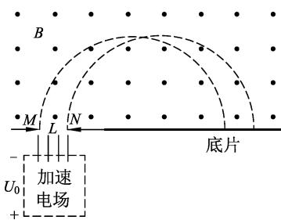  
图1 质谱仪的工作原理

通过宽为 L 的狭缝MN 沿着与磁场垂直的方向进入磁感应强度为 B 的匀强磁场中 ， 最后打到照相底片上.已知甲 乙两种离子的电荷量均为＋q，质量分别为 $2 m$ 和m 图1中虚线为经过狭缝左 右边界 M N 的甲种离子的运动轨迹.不考虑离子间的相互作用.［6］

（2）在答题卡的图中用斜线标出磁场中甲种离子经过的区域 ，并求该区域最窄处的宽度 d

这 是 2017 年江苏省高 考 物 理卷最后一题， 原题有3问 本文仅分析第2问．图 2是参考答案 中 给 出的甲种离 子 经 过

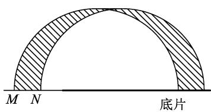  
图2 甲种离子经过的区域

的区域 但是这个最窄处比较小 部分学生难以确定何处最窄以及如何求解这一宽度．因此，笔者借助Python编程破解学生对上述问题的认知困扰

程序执行后的效果如图3所示， 容易看出最窄处位于黑色区域的正中间

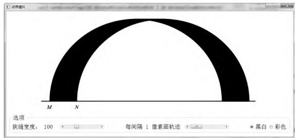  
图3 较窄的狭缝（连续）

如果每隔5个像素绘制一条轨迹 ， 则可画出不连续的效果．若再将狭缝宽度增大，会更容易看出何处是离子经过区域的最窄处 ， 程序执行结果如图4所示

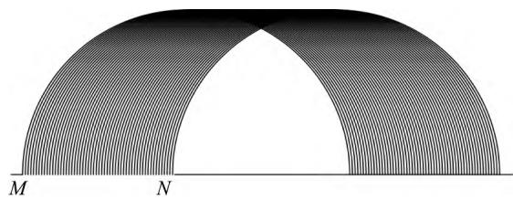  
图4 较宽的狭缝1

为便于观察和计算 ， 可以用彩色画笔画出离子经过的区域 并标出辅助线 如图5所示

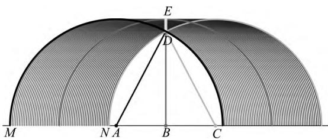  
图5 较宽的狭缝2

图5中从左到右3条较粗的圆弧分别为经过狭缝左边缘 中间 右边缘离子的轨迹， A B C3点分别为其圆心 最窄处标记为 DE 显然 DE＝BE－BD ，BE为轨迹圆半径， 记 为 $r _ { 1 } , B D =$ $\sqrt { A D ^ { 2 } - A B ^ { 2 } } , A B { = } A C / 2 { = } L / 2$ ，由此得出最窄宽度 $d = r _ { 1 } - \sqrt { { r _ { 1 } } ^ { 2 } - \Big ( \frac { L } { 2 } \Big ) ^ { 2 } }$ ， 解 得 $d = \frac { 2 } { B } \sqrt { \frac { m U _ { \mathrm { 0 } } } { q } } \cdot \sqrt { \frac { 4 m U _ { \mathrm { 0 } } } { q B ^ { 2 } } - \frac { L ^ { 2 } } { 4 } } .$

由此可见 借助计算机编程可以动态显示带电粒子的运动情况 使物理题情境可视化 助力学生深刻认知物理题情境 解决问题事半功倍 从而进一步培养了学生的思维能力和解决问题的能力

## 4 运动状况探究

情境可视化讲评实际上是在信息技术辅助下，将原本抽象的试题情境以交互动画的方式直观演示呈现出来 将抽象的静态图转换为动态形式 从而在讲评中加深学生的理解 降低解题难度.以如下试题为例.

例2.两辆可视为质点的汽车分别在同一条平直道路上同向行驶 某时刻汽车甲关闭发动机做初速度为20m／s 加速度大小为2 $\mathrm { m } / \mathrm { s } ^ { 2 }$ 的匀减速直线运动 汽车乙在汽车甲前方 $\Delta x = 1 6 \mathrm { ~ m ~ }$ 处 以10m／s的速度匀速行驶.请判断两辆车能否相遇若能相遇求出相遇的时刻 若不能相遇求出两车的最近距离.

教师在对此题目进行讲解时 利用Python软件为两辆车的行驶情景进行动画演示 ， 从而更直观地判断两辆车的运动情况.如图6所示为动画模拟例题情景的一幅截图 ，图6（a） （b）分别为两车的 v－t 图像和x－t 图像 图6（c）为通过两个不同颜色的方块模拟两车运动的动画 3幅动态画面相互对应 可以通过拖动时间轴显示各个时刻两车的位置及对应的 v－t 图像、x－t 图像.相对于静止画面 动态图不仅更能吸引学生的注意力 也能很好地锻炼学生的空间想象力及加深对此类问题的理解程度.

另外 在软件中只需调整 Δx 参数的数值（例如 Δx 分别取16m 25m 40m） 便会出现两车“相遇2次”“相遇1次”“未相遇”等情形 如图7所示.指导学生结合3种场景的动态画面，对不同条件下两车的 x－t 图像及其位置关系进行分析 可深入理解两车相遇或不相遇的条件.结合动态画面通过对两车运动的时间与位移的关联性加以把控，可使学生后期解答同类运动问题时 ，能够快速回想起动态图，从而梳理好解题流程.［4］

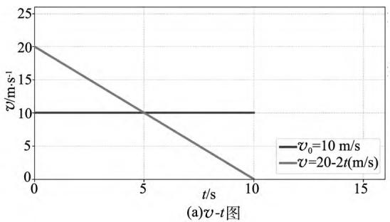  
(a) v-t图

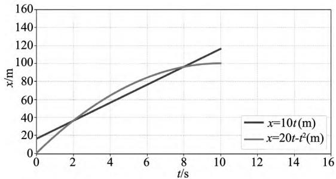  
(b) x-t图

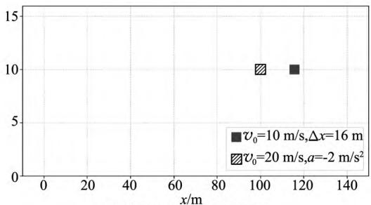  
(c) 模拟两车运动的动画图

图6 Δx＝16m时两车的运动情况  
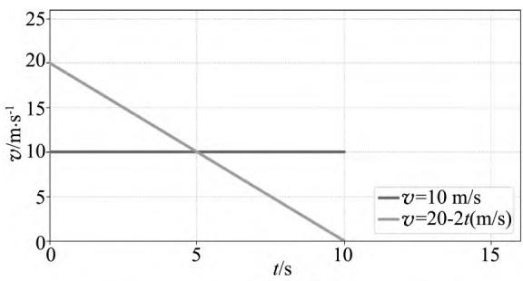  
(a) v-t图

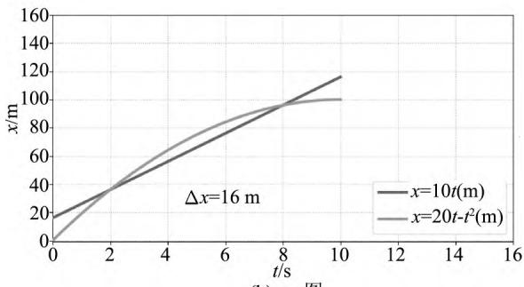  
(b) x-t 图

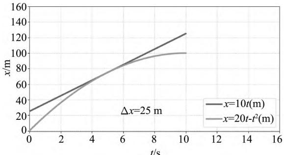  
(c) x-t图

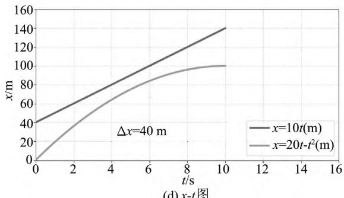  
(d) x-t图  
图7 追车相遇问题 v－t 图及 x－t 图

## 5 实验数据分析

## 5.1 Python与单片机结合的自制数字化实验装置

Python是一种功能强大的编程语言 不仅可对物理情境进行可视化转化 还能与单片机结合定制数字化实验 可以直接进行相关的实验操作从而加强学生的学习兴趣 进而提高对理论知识的认知 概念的理解 以强化教学效果.同时 对于培养学生的自学能力 创新能力都有重要的意义.［7］下面以验证“平行四边形定则”实验为例，介绍Python与单片机在自制数字化实验方面的应用.

## 5.2 Python与单片机的应用———以“平行四边形定则”为例

斜面上重力的分解是高中物理中最典型的关于“平行四边形定则”应用实例 本例是以此验证“平行四边形定则”的.如图8所示 将一小车置于斜面上 并用平行于斜面的细绳固定于斜面顶部的挡板上.在斜面和挡板上分别安装力传感器 用于测量小车对斜面的压力和细绳对挡板的拉力.另外 ，在斜面上安装角度传感器（陀螺仪传感器）用于测量斜面的倾角.3个传感器与 Arduino单片机相连 单片机采集3个数据后再通过无线传输的方式发送到电脑中 ， 电脑利用 Python编写的上位机进行数据处理并绘制相应的图形如图9所示.

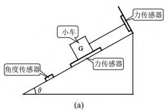

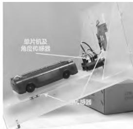

图8 斜面上重力的分解原理图  
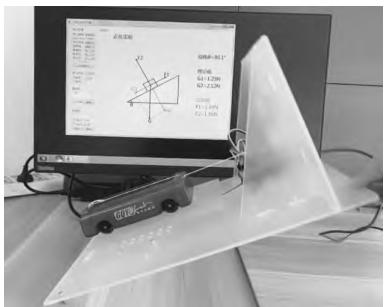  
图9 斜面上重力的分解实物图（硬件及软件部分）

如图10所示，由平行四边形定则可得 ， 重力的两个分力分别为 $G _ { 1 } = G \mathrm { s i n } \theta , G _ { 2 } = G \mathrm { c o s } \theta .$ 由于小车处于平衡状态 ， 所以拉力 $F { = } G _ { 1 } { = } G { \mathrm { s i n } } \theta$ ， 支持力 $N { = } G _ { 2 } { = } G \mathrm { c o s } \theta .$ 实验中 ， $G _ { 1 }$ 和 $G _ { 2 }$ 由平行四边形定则算出（利用角度传感器测得斜面倾角 ， 但与两个力传感器的测量值无关） 拉力 F 和支持力的大小由两个力传感器直接测出（与平行四边形定则无关） ，如果在误差允许的范围内 ， $F { = } G _ { 1 }$ $N { = } G _ { 2 }$ 即测量值等于理论值 即可验证平行四边形定则.

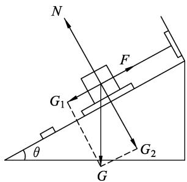  
图10 静止于斜面上的物体重力的分解

## 5.3 实时数据采集处理，揭示物理规律

如图11所示为斜面倾角15.0°时的实验情况，已知小车的质量 $m = 0 . 2 5 ~ \mathrm { k g }$ ，由平行四边形定则算出的两分力分别为 $G _ { 1 } = G { \mathrm { s i n } } \theta = 0 . 2 5 \times 9 . 8 \times \sin 1 5 ^ { \circ } \mathrm { N } { \approx } 0 . 6 3 \ \mathrm { N } , G _ { 2 } { = } G \mathrm { c o s } \theta { \approx } 2 . \ 3 7 \ \mathrm { N }$ .而由两个力传 感 器 测 得 的 $F _ { 1 }$ 和 $F _ { 2 }$ 分 别 为 0.67 N 和2.31N 两组对应数据几乎相等.

传统的实验方式在机械重复的数据测量和处理上费时费力 另外这种不连续的数据处理方式难以观察到实验过程中所蕴含的规律 例如在本实验中斜面角度变化时两个分力的变化情况.本案例中的实验数据全部由传感器测量 因此可以自动且连续地对数据进行处理 而且每秒钟可采集上百组数据 特别适合呈现及揭示动态平衡问题中所蕴含的物理规律.

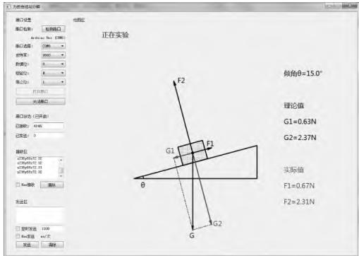  
图11 Python编写的上位机数据  
处理结果（斜面倾角为15.0°）

## 6 结语

在高中物理试题讲评过程中 若教师能在信息技术辅助下 有效应用情景可视化模式开展讲评工作 既能培养浓厚的探究兴趣 又能加深学生对试题内容的理解 使之在脑海中构建完善的物理思维体系.据此 从运动问题 电磁场运动 力的分解等具体试题的讲评阶段 为高中生打造优质的可视化讲评环境 从而符合新时代高中物理学科教学要求.

## 参考文献 ：

1 张云霞．九年级英语试卷讲评课如何高效［J］．新课程（中学版） 2016（2） ：137

2 刘雪琳 章钰琪 董爱国．基于Python的物理实验数据处理系统设计与实现［J］．实验技术与管理 ， 2021， 38（3） ：74－78

3 陈海深 ，叶其思 ， 宋善炎．物理实验“可视化”的探索与实践［J］．物理教师 ，2021，42（11） ：47－54

4 陈雨红．“新课标”背景下高中物理情境下试题的教学策略分析［J］．考试周刊 ，2021（45） ：123－124

5 马天磊 ，曾庆山 ，罗勇 ，等．基于可视化案例的“电磁场”课程教学改革与实践［J］．电气电子教学学报 ， 2020，42（3） ：30－33

6 张绍兵 ， 高亚浩 ， 向宗泽 ， 等．2019年高考物理备考专题———电磁学部分［J］．中学物理教学参考 ，2019（1） ：84－100

7 徐志江 ，饶晨 ， 徐红 ， 等．MicroPython用于单片机实验教学新模式的设计与研究［J］．计算机教育 2019（3） ：164－168

（收稿日期 ：2022－02－12）