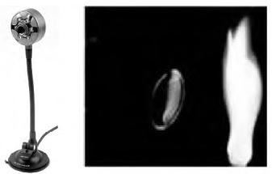
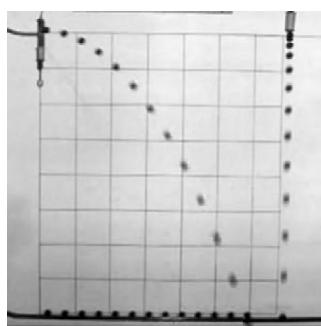
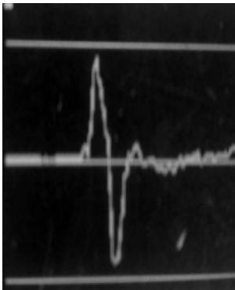
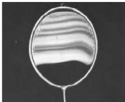
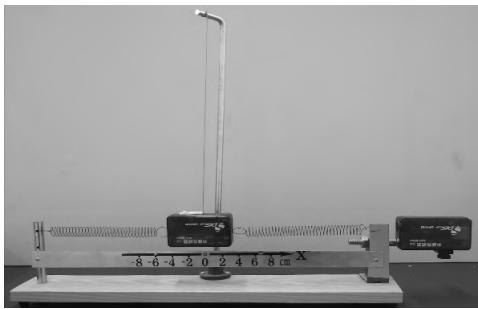
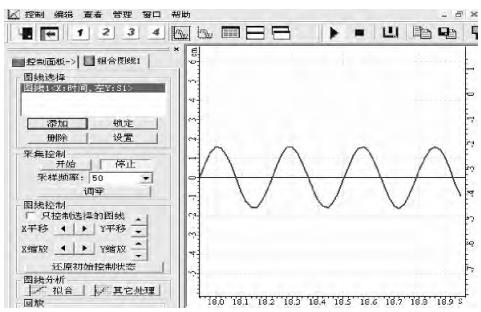
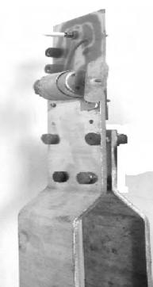
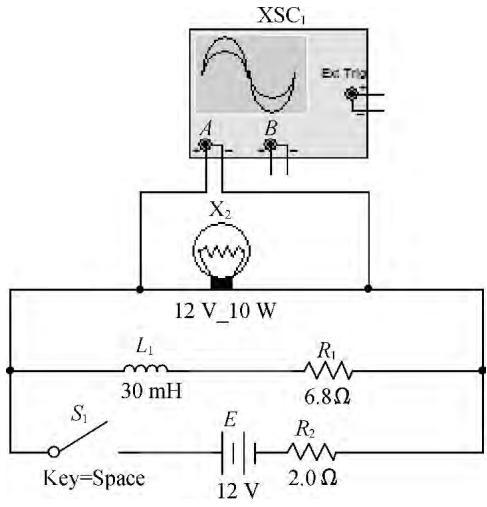
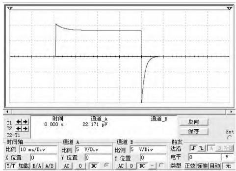

> 来源：LIT-0052_原文.pdf；2026-08-12 依据二次 MinerU OCR 与 PDF 第 3 页版面复核精校。PDF 同页后接另一篇文章，已排除。

·现代教学技术·

# 借助新技术提升高中物理实验演示效果

裘思远

（杭州萧山区第二高级中学，浙江杭州 311251）

## 摘要

本文以新技术、新装备、新材料在物理实验中的几个应用为例，思考和探究物理演示实验的发展，将新的科技应用到物理教学中，改进物理实验，提高实验效果，从而达到提高物理教学水平的目的。

关键词：信息技术；演示实验

## 1 利用小型数码产品使实验演示便捷、直观

随着技术发展，各种数码产品已经走入普通家庭，例如数码相机、手机。同时，这些数码产品的功能越来越多，那么在高中物理实验中能否运用这些功能呢？

### 1.1 数码相机的使用

现在数码相机已经是家庭生活的必需品，不但可以拍照，还可以摄影。但是一般我们只把它用于拍摄生活照片；如果有心，还可以用在物理实验探索上[1]。例如，可以用数码相机研究平抛运动的轨迹。

利用数码相机将小球的平抛运动过程记录下来，将得到的录像通过电脑和投影仪投影到黑板上，在播放器中按帧播放实验录像，在黑板上标记小球所在的位置，将各点用平滑曲线连接，就得到小球平抛运动的轨迹。由于相邻两帧照片之间的时间间隔相等，均为 1/30 s，只要测量相邻小球位置的水平位移，就很容易判断小球做平抛运动时在水平方向上的运动特点。同时，测量相邻小球位置的竖直位移，也能得到小球在竖直方向上的运动特点，如图 1 所示。

  
图 1

### 1.2 手机的使用

随着手机技术不断发展，手机的功能越来越多，需要各种传感器作为技术支撑，其中包括重力、声音和磁传感器等。手机最大的优点是方便携带，在物理教师眼中，手机就是一个很好的移动物理实验平台，可以在具体情境中随手做实验。

例如，在研究“超重和失重”时，以“huaweip6”手机为例，在安卓系统下安装“Tricorder”应用软件。手机小巧灵活，而且安装有重力传感器，能够对失重和超重现象进行研究。首先打开手机中的“重力”功能，就可以观察时间和重力的图线。将手机从肩部快速举起，就会得到图 2 所示的图线。在起立过程中，手机先向上加速后向上减速，即先超重后失重；结合图线可以看到，重力传感器数值先增大后减小。

  
图 2

### 1.3 摄像头的使用

在物理演示实验中，有些实验所显示的现象变化比较微小，或者有些实验只能在特定视角下观察到明显现象。通过摄像头可以将实验现象更加清晰地展示在课堂上。

例如，在研究肥皂膜的薄膜干涉实验时，在酒精灯灯芯上撒一些食盐，灯焰就能发出明亮的黄光。把铁丝圈在肥皂水中蘸一下，让它挂上一层薄薄的液膜，把这层液膜当成平面镜，用它来观察灯焰的像。在实验演示过程中，通过摄像头观察并将现象投影到大屏幕上，可以让全体学生观察到清晰的干涉条纹。通过调整摄像头方位，也可以转换观察视角，使学生更容易进入情境。

  
图 3

## 2 运用 DIS 数字化实验系统使实验过程可视化

传统物理实验一般靠学生用眼观察、用笔记录、用纸计算、用表作图。但是很多时候，由于物理过程变化过快、物理现象细微难辨、数据处理繁琐，在课堂中进行实验演示既影响观察效果，又耽误教学时间，还可能造成较大的实验误差。使用 DIS 数字化实验后，教学效果大大提高，因为它能够通过图像、表格等呈现手段将实验过程“可视化”。

例如，在研究弹簧振子振动周期时，由于振子在振动过程中速度比较快，如果学生仅观察振子的来回振动，意义不大，因为无法获悉振动过程中的关键物理量，如回复力、位移和速度的变化。如果利用 DIS 实验系统，就可以将位移发射器用同一根绳子悬挂起来作为弹簧振子，如图 4（a）所示，并在它的两端连接弹簧，在弹簧的两端连接力学传感器，显示弹力的变化，这样就可以实时显示振子在振动过程中位移和回复力随时间的变化关系，如图 4（b）所示。

  
（a）

  
（b）  
图 4

## 3 应用新能源材料使实验演示与时俱进

新能源，特别是绿色能源符合环保理念，越来越受到人们重视，如太阳能、热能和风能等。伴随这些产业发展，各种新兴材料也逐步出现在大众视野中[2]。利用这些材料，结合高中物理教学需要，可以开发一些实验。

选修 3-3 和选修 2-2 教材都提到了“半导体制冷技术”的材料。这种半导体制冷材料可以在电子市场中购买得到，将半导体制冷片与两块铝板制作成实验装置，如图 5 所示。例如，在演示温差热机时，可以将实验装置的两块铝板分别放入一杯热水和一杯冷水中。当半导体制冷片两端存在一定温差（一般为 40～80 ℃）时，半导体制冷片两端会产生一定的电流，装置中的风扇就会转动起来。

  
图 5

这个实验可以说明热力学第二定律的第二种表述：“不可能从单一热源吸收热量并把它用来全部做功，而不引起其他变化。”我们把这样的实验装置称为热机。把两块铝板分别插入一杯热水和一杯冷水中，片刻后可以看到风扇转动起来，说明内能可以转化为其他形式的能。随着时间推移，风扇转速逐渐变慢，最后停止转动。此时再用手试水温，发现冷水变热、热水变冷，两者的温差消失。通过以上实验可以说明，只有单一热源的热机是不可能存在的。

## 4 使用电路仿真软件模拟实验探究过程

对于物理实验，应用 Flash 对实验过程和实验现象进行动画模拟，可以使物理过程清晰地展示在学生面前。但是动画模拟只是展示物理过程，缺少实验探究。在电子电路软件中，有许多虚拟仿真软件能够模拟物理实验的探究过程，这里以 Multisim 9 为例进行介绍。

Multisim 9 电路仿真实验是高中物理新课程教学中一种有效的实验方法，操作步骤简易，效果也较好。例如，如图 6（a）所示，这是在 Multisim 9 中建立电路以研究自感现象。XSC1 是示波器，它显示小灯泡 X2 两端电压的变化，R2 是电源的内阻。开关初始时断开；当闭合和断开开关时，示波器会显示 X2 两端的电压变化，如图 6（b）所示。随着开关闭合，X2 先变亮后变暗，最后稳定在一定亮度。随着开关断开，X2 突然变亮后又熄灭；还可以观察到开关断开时电压反向，说明开关断开后，流过 X2 的电流方向与原来相反。

  
（a）

  
（b）  
图 6

实验是物理新课程改革的重要环节，是落实物理课程目标、全面提高学生科学素养的重要途径，也是新课程改革的重要资源。作为一名新时代的物理教师，应根据课程标准要求安排足够的学生实验和演示实验，最大限度地利用实验室现有器材，充分开发和利用实验室的丰富课程资源，鼓励学生主动做课外实验。

## 参考文献

[1] 杨杰. 数码相机在物理教学中的运用[J]. 物理教师，2006（8）。

[2] 赵力红. 新课程新实验新认识——新课程高中物理实验的开发与教学研究[J]. 教学仪器与实验，2008（12）。
