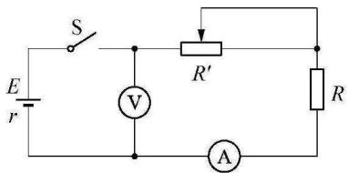
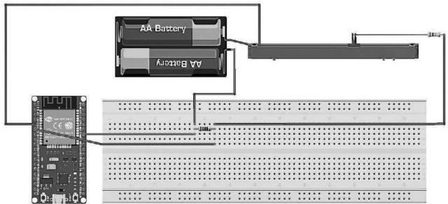
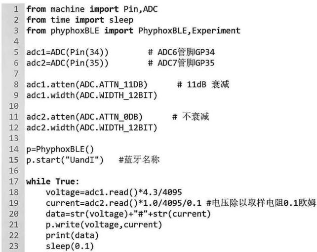
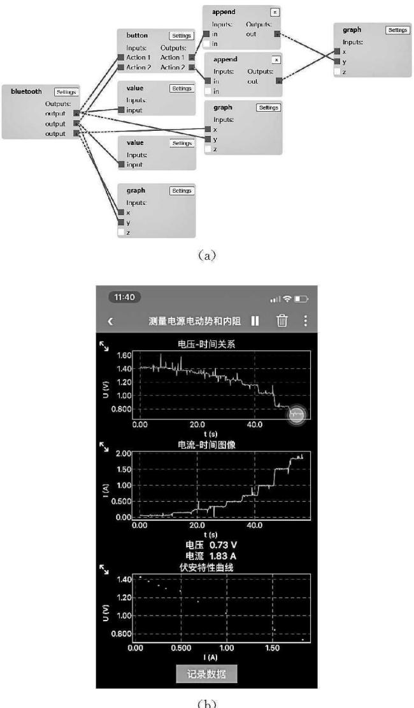
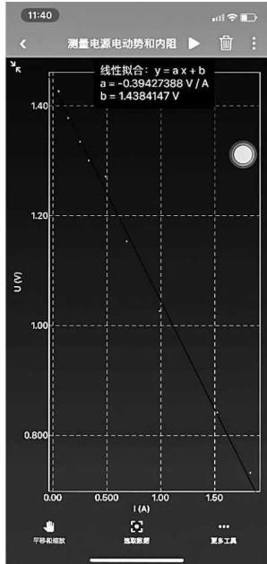
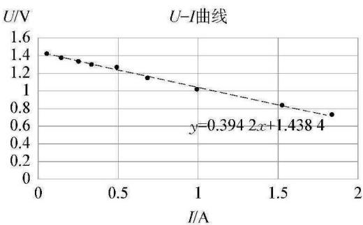

> 来源：MinerU 3.4.4 二次 OCR 转换并依据本地 PDF 逐页精校（2026-08-12）。PDF 跨栏处有相邻文章残留，已删除与本文无关的页眉、段落和参考文献。

# 利用 ESP32 和 Phyphox 软件实现电源电动势和内阻的无线测量

顾振兴（上海交通大学附属中学，上海 200439）

摘要：电源电动势和内阻的测量是高中物理中非常重要的一个实验，利用 ESP32 芯片和 Phyphox 软件可以搭建一套无线快速测量系统，快速方便地测量并处理实验数据，得出电源的电动势和内阻。

关键词：ESP32；Phyphox；测量电源电动势和内阻；STEM

文章编号：1002-0748（2024）1-0026

中图分类号：G633.7

文献标识码：B

## 1 引言

电源电动势和内阻的测量是高中物理课程标准要求学生必做的测定性实验[1]。传统的实验做法是利用电压表和电流表测量电源两端电压和电路中的电流，描点后拟合成直线，求得电源的电动势和内阻。但是因为电池长时间的大电流供电会导致其参数发生变化，而电流较小也会使内阻发生剧烈变化[2]，所以这个实验的电流不能太小，而且要求快速测量。如果依次读取电压表和电流表的数据再记录到纸上，会花不少时间，一定程度上也会影响实验结果的精确程度。另一方面，新版普通高中物理课程标准[3]也要求我们积极探索信息技术在物理教学中的应用。当下智能手机已经普及，利用手机软件 Phyphox 和 ESP32 芯片开发板，就可以自制电压传感器和电流传感器，并将结果无线传输给手机中的 Phyphox 软件，记录数据、显示图像，甚至直接拟合得出结果。

Phyphox 是由德国亚琛工业大学第二物理研究所开发的一款免费手机软件。Phyphox 软件通过调用手机的内置传感器，包括计时器、速度传感器、加速度传感器、磁力传感器进行相应的数据测量，因此仅利用手机就可以进行很多有趣的实验。此外，它还支持外部传感器获得的数据通过蓝牙传输给手机，数据可以在软件中显示及处理[4]。

ESP32 是乐鑫信息科技推出的一块集成了 Wi-Fi、蓝牙的芯片，相当于一块单片机（微电脑），价格便宜，而且兼容各种传感器，可以用于采集各种传感器的数据，并通过蓝牙发送给其他设备。

## 2 实验原理

本实验仍然采用伏安法测电源的电动势 $E$ 及内阻 $r$。根据闭合电路欧姆定律：$U=E-Ir$。将待测电池接入电路（见图 1），改变外电阻，用电压传感器和电流传感器测量不同工作状态下的外电压 $U$ 和电流 $I$，并作出 $U-I$ 图线，由图线分析得出电源电动势 $E$ 和内阻 $r$。

  
图 1 伏安法测电源电动势和内阻电路原理图

## 3 实验系统的设计与搭建

实验系统的硬件部分有待测电池、滑动变阻器、保护电阻、开关、导线，以及一块 ESP32 开发板和一台智能手机。电路原理图如图 2 所示，图中并没有设置保护电阻，是为了利用这套无线测量系统快速测量电池的短路电流。ESP32 芯片中有模拟/数字转换模块（ADC），经过校准后可以直接用来测量电压，如果并联上已知阻值的小电阻就可以用来测量电流。手机端的 Phyphox 支持自己编辑实验界面，可以作为数据显示和分析的终端。

  
图 2 利用 ESP32 测电源参数的电路示意图

### 3.1 利用 ESP32 板载的模拟/数字转换模块制作数字电压表和电流表

ESP32 自带的 ADC 模块的精度为 12 位，即它可以将模拟电压值（从 0 到最大值）分成 $2^{12}=4096$ 份，转换为一个 12 位的二进制数。例如不进行任何衰减的话，最大电压如果是 1 V，那么 0.1 V 对应的十进制数是 $\frac{0.1}{1}\times4095=409$（取整），对应的二进制数就是 110011001。若要用于实验测量，还需要用高精度的电压表进行校准和修正。

数字电流表的制作与电压表的制作几乎相同，只是多了一个阻值较小的取样电阻。具体的做法就是将小电阻串联到待测电路中，将上述制作好的电压表并联到小电阻两端，测量小电阻上的电压，由欧姆定律 $I=\frac{U}{R}$ 即可求得电路中的电流。

笔者采用 MicroPython 来编写 ESP32 的执行程序，因为 Python 语言相对容易理解，输入固件后，只需几句语言，就可以获取 ESP32 两个 ADC 引脚的输出。另外，因为要将数据通过蓝牙传输给手机中的 Phyphox，因此还要借助 Phyphox 官方提供的库——PhyphoxBLE，里面也有几个简单的例子。主程序如图 3 所示，其主要功能是将 ESP32 芯片的 34 号引脚和 35 号引脚的信号（分别作为电压表和电流表）传输给手机中的 Phyphox 软件。最后，将程序命名为 `main.py` 上传至 ESP32。

  
图 3 烧录到 ESP32 的参考 Python 程序

### 3.2 编写 Phyphox 端软件界面

在浏览器中输入网址 <https://phyphox.org/editor/>，进入软件在线编辑器，添加实验信息，新建图像、数值和按钮，在 analysis 选项卡中通过模块化编程搭建联系，如图 4 所示，创建实验专用软件，将 ESP32 采集的实验数据通过蓝牙传输给手机的 Phyphox 软件端，实时显示、记录并处理数据。实验界面主要包含电压随时间变化、电流随时间变化以及伏安特性曲线三张图表，显示电压值和电流值，以及一个记录电压和电流数据的按钮，如图 4 所示。

  
图 4 实验软件界面

编写完软件界面后，可以将文件发送给手机，也可以生成二维码，打开手机 Phyphox 扫描后就可以进入上述实验界面。为了方便后续实验，我们可以在 Phyphox 中收藏测量电源电动势和内阻的实验。

## 4 实验过程

按照原理图连接好电路，给 ESP32 供电后，它会不断测量电压和电流，并将数据通过蓝牙（如图 3 中蓝牙的名字为“UandI”）传输给手机端的 Phyphox。在 Phyphox 中找到名为“测量电源电动势和内阻”的实验，选择名字为“UandI”的蓝牙，运行实验，就能实时显示电压和电流随时间的变化。待到电压值和电流值比较稳定时，点击记录数据按钮，记下一组电压和电流值。移动滑动变阻器的滑片改变接入电路的阻值，会发现电压和电流值都会发生变化，等到稳定后，再次记录数据。实验中共记录了 9 组电流和电压值，发现线性关系很好，可以直接在软件中拟合，如图 5 所示。也可以将数据导出，利用 Excel 图表绘图拟合，如图 6 所示，得到电源的电动势约为 1.44 V，内电阻约为 0.39 Ω。

  
图 5 利用 Phyphox 拟合直线

  
图 6 导出数据用 Excel 拟合直线

## 5 小结

利用 ESP32 和 Phyphox 搭建的电源电动势和内阻测量系统有以下优点：

（1）测量快速。在实验时，只需要移动滑动变阻器，在电流和电压值稳定时，按下按钮记录数据，就可以快速地完成实验。电学实验的快速测量非常关键，尤其是电流较大时，随着放电时间增加，电池的内阻会发生变化，因此在大电流时，测量一定要快速。

（2）数据实时显示，且数据处理方便。Phyphox 本身提供数据拟合功能，我们也可以将数据以表格形式导出到电脑，再进行处理，十分方便。

（3）价格低廉。智能手机如今已经普及，只要是具备蓝牙功能的智能手机即可，安卓或者苹果系统都可以下载 Phyphox 软件。而 ESP32 的价格也不高，通常只需要 20 元左右，相比成套的 DIS 系统，这个几乎已经可以算免费了。尤其是在教育信息化的背景下，一些经济欠发达地区在教育经费有限的情况下，就可以采用价格相对低廉的 ESP32 和 Phyphox 实现物理教学和实验的信息化。

（4）有利于培养学生科学探究的核心素养。相比于高度集成化的 DIS 系统，从头开始搭建一套数字化物理实验系统，需要学生主动探究；在探究过程中，除了物理学科本身，还需要科学、技术、工程、数学等多学科的融合，这一过程也就实现了 STEM 教育。

当然，利用 ESP32 和 Phyphox 测量电源电动势和内阻，也有一些不足。例如 ESP32 本身附带的模拟/数字转换模块（ADC）精度和稳定性不够好，如果要做更精密的实验，可以外加专门的 ADC 传感器，如 ADS1120 就能满足大多数物理实验中电压、电流的测量要求。

另外，这次搭建的测量系统并未用到外加的传感器，我们完全可以给 ESP32 加上位移传感器、光电门传感器、力传感器、温度传感器、磁传感器等，从而搭建各种物理实验平台。

## 参考文献

[1] 赖佳颖. 基于物理实验能力培养的高中测定性实验教学思考[J]. 物理教学，2021(8)：37-40.

[2] 李川. 干电池内阻及电动势测量中忽视的一个问题[J]. 黔西南民族师范高等专科学校学报，2002(3)：70-71.

[3] 中华人民共和国教育部. 普通高中物理课程标准（2017 年版 2020 年修订）[S]. 北京：人民教育出版社，2020.

[4] 王亚芳，高义，陈倩，等. 利用手机 Phyphox 软件开展居家实验的实践[J]. 实验室研究与探索，2022(1)：249-253.
