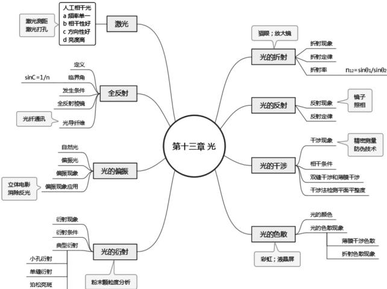
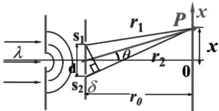
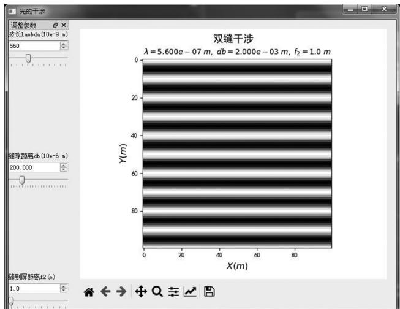
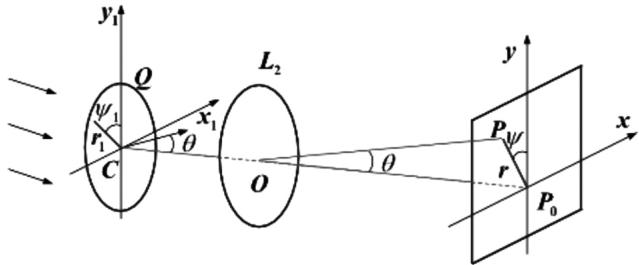
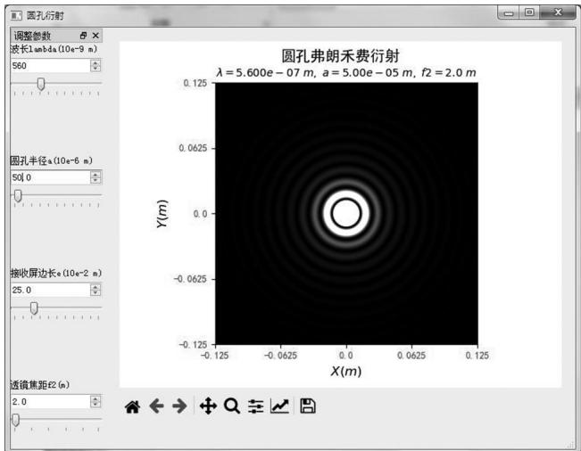
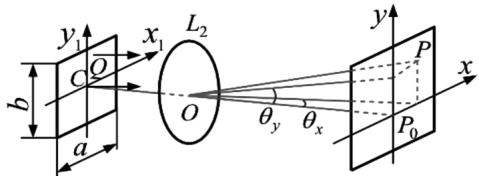
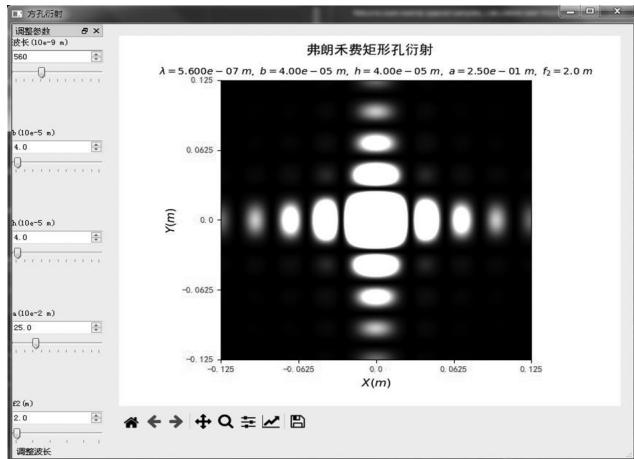
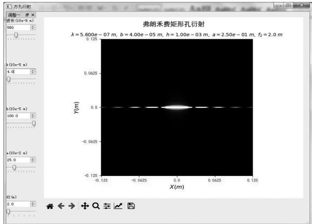

> 来源：MinerU 转换（stem-exact rebuild 2026-08-08）

DOI: 10． 19392 /j． cnki． 1671-7341． 202118022

# 可视化技术在高中物理学习中的应用实践

王诗龙 孙 昭

南京外国语学校仙林分校 江苏南京 210023

摘 要:针对中学物理知识概念抽象 实验手段有限以及学生接受不同表现形式知识的能力存在个体差异等情况，将可视化技术应用于学习过程，通过对抽象知识具体化 形象化，丰富传播形式，便于不同类型的学生以自己擅长的途径理解知识 首先采用思维导图对光学知识进行了归纳整理，从整体上掌握知识脉络，并为后续有侧重点的复习打下基础 其次，介绍了利用 Python 开源编程语言实现的典型光学干涉和衍射图像仿真模型，可以直观观察到这些现象，并可以方便调整影响参数，将抽象的原理公式与影响结果的图像联系起来。 利用计算机技术将知识可视化，可以便于教师教学和学生学习，使抽象的课本文字形象化，有利于知识更有效地传播，并可通过学生亲自参与调动其学习的兴趣和主动性

关键词: 知识可视化; 光学; 思维导图; Python

中图分类号: G632

## 一、可视化对中学物理学习的意义

中学物理是重点基础学科，但因其概念抽象，对学生的理解力 想象力 实验能力等提出了较高要求，使得物理知识的讲授和学习都存在一定困难。 从学习心理学的角度，由于每个学生的生长环境 经历等个体差异，不同学生对知识的接受方式、接受速度、擅长能力等都有差别，大部分对于形象化的内容接受力较快，而抽象理解能力较为欠缺。 同时，现行教材和辅导书绝大部分是以文字编排形式进行知识描述，虽也有增加了趣味性、实践性，但信息密度高，多数学生有本能的抵触心理。 因此，采用知识可视化技术，将抽象的物理概念和规律转化为具象的图形、影像等，采取听觉、视觉、语言 触觉等多种表现形式传播知识，使学生从感性和直观性上获取多种形式的外部刺激，从而培养学习兴趣，构建物理思维，再逐渐完成从具体到抽象的提升过程，是一个有效的教学和学习途径 现代科学技术的进步使这种知识可视化成为可能。 采用计算机工具将物理知识进行可视化仿真成为当前教学研究的一个热点，例如对于概念、规律类知识，可以采用各类中类型的图示化方法; 对于模型类知识，可以利用信息技术和视觉隐喻; 对于实验类知识，有各种多媒体技术 手机软件等可以实现［1］

本文在高中物理课程的光学学习中，应用思维导图和Python 语言尝试对知识进行可视化，以帮助记忆、增强理解。

## 二、思维导图在光学知识学习中的应用

光学是中学物理学习中的难点之一，知识点多，内容抽象，定性知识较多，晦涩难懂，尤其物理光学，如干涉、衍射等更不容易理解。人教版《高中物理选修 3-4》用文字、示意图、应用案例等形式介绍了几何光学和物理光学的相关知识，但对于中学生而言，仍显得知识密度大、感性认识不足。思维导图又称为心智图，是一种对知识概念加深理解和记忆的有效工具。通过制作思维导图，可以对信息归纳分类、建立知识网络、启发诱导思考［2］。

在学习过程中，笔者首先利用思维导图梳理了该章节的知识点，并通过信息检索，尽量给出各个原理的常见或者直观的应用实例，以提高学习兴趣、帮助记忆。 绘图软件采用免费的 Mindmaster，如图 1 所示 。

  
图1 光学知识思维导图

一方面可以在学习过程中理清思路，另一方面，也作为以后复习时能够更快地对照检查，发现薄弱点，有针对性地复习。

## 三、光学现象的可视化仿真

近年来，国内在光学知识可视化方面做了很多研究［3-5］，但大多使用的工具如 matlab，mathematica 等版权昂贵，一般中学生难以方便地获取。 Python 是一种解释性、开源、易于学习的编程语言，非常适用于初学者。 同时，Python 是免费的，但功能强大，可以跨平台运行。 2018 年，教育部将 Python列入全国计算机等级考试科目，促进了该编程语言在国内的普及。 目前 Python 在网站开发、金融分析、大数据挖掘、网络爬虫等多个领域有着非常广泛的应用［6］。 同时，Python 语言网上社区活跃，资源众多，利于自学。 对中学生稍加训练，可以实现自我开发可视化场景，提高其成就感，同时也有利于提升学习知识的主动性

## ( 一) 双缝干涉原理及其仿真

当一束单色光投射到一块有两条距离很近的狭缝的不透光挡板上，狭缝将光束分成两个光源，其频率、相位和振动方式相同，两个光源在挡板后的区域相遇叠加，产生干涉现象。

对于单色光入射的双缝干涉，其原理示意图如图2 所示。

  
图2 双缝干涉原理示意图

当 d≫λ、r≫d 时，投射到屏上的光强为：

$$
{ \mathrm { I } } { = } 4 I _ { 0 } \cos ^ { 2 } \frac { \Delta \varphi } { 2 }\tag{1}
$$

条纹间距为:

$$
\Delta x = \frac { r_0 } { d } \lambda\tag{2}
$$

式中：I 为接收屏上的光强，I₀ 为接收屏中心位置光强，Δφ 为相位差，Δφ = (d sin θ/λ)2π，d 为狭缝间距，λ 为波长，r₀ 为挡板到成像屏的间距，θ 为衍射角。

仿真模型采用开源的 Python 软件包 Anaconda3 实现，程序界面使用了 PyQt5 图形化界面工具包以及 numpy、 matplotlib、math 、 sys 等扩展库［8］，采用 Anaconda3 自带的 Spyder 集成开发环境编程。 完成后的界面如图3 所示。

  
图3 双缝干涉仿真模型界面

调整左边的参数，可以观察明暗相间条纹的变化。 与文献［3］对比，形成的条纹类似。

## ( 二) 圆孔衍射原理及其仿真

由于很多光学仪器采用了圆形镜片，而衍射现象会影响成像效果，因此圆孔衍射现象研究非常广泛。 衍射现象一般分为菲涅尔衍射( 近场衍射) 和弗朗禾费衍射( 远场衍射) 。本文以后者为例，探讨 Python 在光学仿真中的应用。

弗朗禾费圆孔衍射原理示意图如图4 所示［9］。

  
图4 弗朗禾费圆孔衍射原理示意图

在极坐标( r，ψ) 下，P 点的光强为:

$$
\mathrm { I } = I _ { 0 } \left[ \frac { 2 J _ { 1 } ( x ) } { x } \right] ^ { 2 }\tag{3}
$$

$$
x { = } \frac { 2 \pi a } { \lambda } { \sin } \theta\tag{4}
$$

式中，I₀ 为光轴上点的光强度，J₁(x) 为一阶贝塞尔函数，a 为圆孔半径，θ 为衍射角，λ 为入射光波长。

中央光斑( 第一暗环) 的直径为 D，P 点的位置由衍射角θ 来确定。 如果屏上 P 点距离中心 O 点的距离为 r( r =fsinθ) ，则中央光斑的直径 D 为:

$$
D = 2 f \mathrm { s i n } \theta = 1 . 2 2 ~ \frac { \lambda f } { a }\tag{5}
$$

艾里光斑的半径为:

$$
r _ { 0 } = 1 . 2 2 ~ \frac { \lambda f } { 2 a }\tag{6}
$$

同样，用 Python 进行编程，得到仿真模型的界面如图 5所示。

  
图5 弗朗禾费圆孔衍射仿真模型界面

调整波长和圆孔半径可以观察到: 波长越短 圆孔半径越大，衍射图样半径越小，因此在显微镜中用短波长的可以提高分辨率，而天文望远镜均采用大口径镜片

## ( 三) 矩形孔衍射原理及其仿真

当光线穿过圆形小孔，形成明暗相间的圆形光斑，直观上还比较容易想象。 其实，光线通过矩形孔也会发生衍射，但其图像不容易理解。 本文建立了矩形孔衍射的仿真模型。

方孔( 矩形孔) 衍射原理图如图6。

  
图6 矩形孔衍射原理示意图

设矩形孔的宽和高分别为 b 和 h，光源为平面波，则 P 点的光强可以简写为:

$$
\begin{array} { c } { { I ( { \bf \omega } P ) = I _ { 0 } \Big ( \frac { \mathrm { s i n } \alpha } { \alpha } \Big ) ^ { 2 } \Big ( \frac { \mathrm { s i n } \beta } { \beta } \Big ) ^ { 2 } } } \\ { { \alpha = \frac { \pi b } { \lambda } \mathrm { s i n } \theta _ { x } , \beta = \frac { \pi h } { \lambda } \mathrm { s i n } \theta _ { y } } } \\ { { \sin \theta _ { x } = \frac { x } { f _ { 2 } } , \mathrm { s i n } \theta _ { y } = \frac { y } { f _ { 2 } } } } \end{array}\tag{7}
$$

式中，I(P) 为 P 点的光强， $. I _ { 0 }$ 为光轴线上 $\mathrm { { P _ { 0 } } }$ 的光强， $\theta _ { x } \cdot \theta _ { \gamma }$ 分别为x和 方向的衍射角，λ 为光波长， $\mathbf { , f } _ { 2 }$ 为透镜 $\mathrm { L } _ { 2 }$ 的焦距

仿真结果如图7 所示。

  
图7 弗朗禾费矩形孔衍射仿真模型界面

由图7 可以看出: 中央集中了大部分光能，并以其角半宽度的大小来衡量衍射效应的强弱。 如果矩形孔的 b 和 h不相等，则沿着 x 轴和 y 轴相邻暗点的间距不同。 当 h＞b，沿着y 轴比沿着x 轴的暗点间距稠密。 同时，波长越长，衍射效应越显著; 波长越短，衍射效应越可以忽略，因此，几何光学是波动光学当 λ→0 时的极限。 当 b＜＜h 时，矩形孔变为狭缝，此时入射光线在 y 方向上的衍射效应可以忽略，其图样变为狭缝衍射。 如图8 所示。

  
图8 b=0．25h 时的矩形孔衍射图样

次极大光强计算表明，矩形孔的情况比圆孔情况大三倍左右，因此，圆孔可以使光强更集中在中心位置［8］。

以上仿真模型均可通过调整光线波长 矩形孔尺寸等参数，可以直观观察干涉或衍射图样的变化过程，从而理解各参数对光学效应的影响。 同时也可以输入课后作业中的参数，辅助演示作业的结果。

## 四、结语

利用编程语言等可视化工具，将物理原理还原为可视化、直观化的场景，可以克服物理实验教学中的场地、设备限制，并且能够更加方便调整控制参数，观察结果变化 尤其对于光学实验，要求仪器精密、调节仔细、准备工作量大，而采用计算机仿真可以事先开发好程序，在课堂上与实验同步演示 对比，既可以与实验结果互相印证，也可以增加知识的表现形式，提高学习兴趣和主动性。

## 参考文献

［1］陈锋．中学物理知识可视化的分类及应用研究［D］．石河子大学，2018．

［2］朱加强．光学知识应用思维导图的教学实践［J］．中学物理教学参考，2019，48（12）：28-29．

［3］周洪伟．应用 Matlab 可视化助推高中物理教学的探索［J］．丽水学院学报，2020，42（5）：116-120．

［4］陈学文，张家伟，姚雪，时澄，吴思韵．基于 Mathematica 的光的干涉实验的仿真模拟［J］．实验技术与管理，2020，37（9）：165-169．

［5］崔海瑛，吴春梅，赵大伟，王馨玉．牛顿环实验的 MATLAB 仿真［J］．大庆师范学院学报，2016，36（3）：14-16．

［6］许洪云，陈朝焰．新工科背景下 Python 教学探讨与实践［J］．计算机时代，2021（2）：96-98．

［7］姚启钧．光学教程［M］．北京：高等教育出版社，2002．

［8］Vasudevan Lakshminarayanan，Hassen Ghalila，Ahmed Ammar，L. Srinivasa Varadharajan．Understanding Optics with Python［M］．佛罗里达：CRC 出版社，2017．

［9］郁道银，谈恒英．工程光学［M］．北京：机械工业出版社，2016．

\* 通讯作者: 高建忠。
