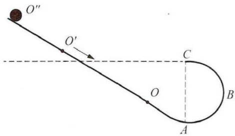
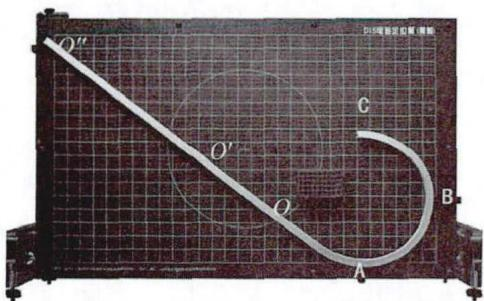
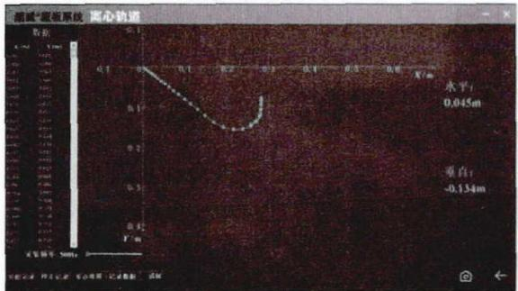
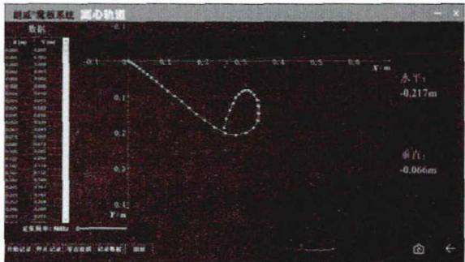
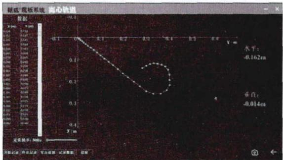
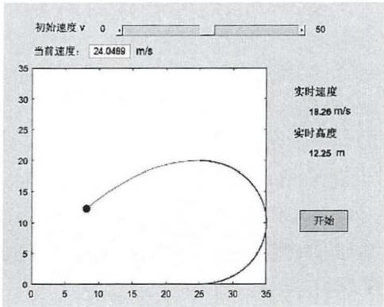
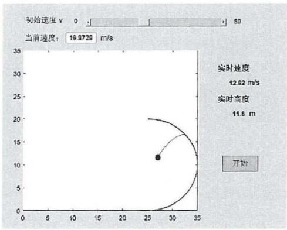
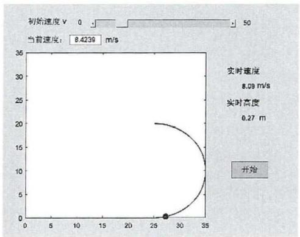
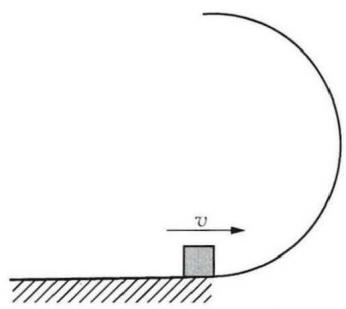
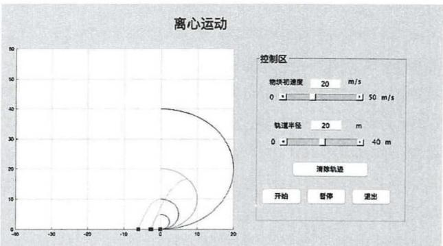

> 来源：LIT-0055_原文.pdf；2026-08-12 依据二次 MinerU OCR 结果精校。PDF 本地仅附本文至“下转第 39 页”处，未附第 39 页续文；同一 PDF 后续为相邻文章，已排除。

# 基于 DIS 和 MATLAB 的物理问题可视化实践

——以“离心运动”教学为例

孙慧乐金鑫（扬州大学江苏 225009)成海英\*\*（上海电子信息职业技术学院 上海 201411）

摘要：运用DIS离心轨道实验器与电磁定位板、信号源配合，进行了离心运动实验，实现了对离心现象的观察、数据测量以及轨迹显示。并利用MATLAB 软件的图形用户界面，设计了有交互功能的离心运动虚拟仿真实验。以“离心运动”为例，通过虚实结合动态地、科学地、定量地展示实验过程与结果的可视化实践，有效地辅助了课堂教学，解决了传统教学中演示实验过程短暂、不容易观察、规律展示不直观等问题。

关键词：离心运动；DIS 魔板；MATLAB 软件；可视化教学

文章编号 1002-0748(2023)6-0033

中图分类号 G633·7

文献标识码 B

## 1 引言

离心运动是圆周运动中一种较为复杂的运动形式，在圆周运动中具有十分重要的地位。教育部2017年发布的普通高中物理课程标准中明确要求“能认识平抛运动、匀速圆周运动等的物理模型特征”，并且通过研究这些曲线运动的运动形式，“体会物理学中实验和理论推导的方法，以及化繁为简的研究方法”[1]。将数字化物理实验与虚拟仿真实验相结合，充分运用现代教育技术手段的辅助，进行离心运动中物理问题可视化的探索实践，这不仅能有效提升教学效果，还能提升师生信息技术的应用能力[2-4]。

## 2 基于 DIS 实验系统的离心运动实验

## 2.1 模型 1 分析

质量为m的小球在如图1所示的轨道上运动，其中A点为圆弧的下端起点，B点为圆弧轨道的中点处，C点为轨道上端点且切线方向水平，不计各处摩擦。根据圆周运动规律，小球若能到达C点，需$\upsilon _ { C } \geqslant \sqrt { g R } , \upsilon _ { A } \geqslant \sqrt { 5 g R }$ ,即 $h \geqslant \frac { 5 } { 2 }$ R时，小球能够在圆弧形轨道上运动到C点，再做离心运动。同理，小球能到达B点，需 $h { \geqslant } R$ 0

  
图1 离心轨道模型1

小球的运动分析：当小球从初始高度 $h { < } R$ 的O点下落时，小球不能够到达轨道B点，会顺着轨道原路返回；当小球从初始高度 $R < h < \frac { 5 } { 2 } R$ 的 $O ^ { \prime }$ 点下落时，小球能过B点但不能到达C点，在某处做斜抛运动；当小球从初始高度 $h \geqslant \frac { 5 } { 2 }$ R的 $O ^ { \prime \prime }$ 点下落时，小球运动经过C点后脱离轨道，沿轨道C点切线方向做平抛运动。

## 2.2 实验操作

DIS 实验系统的“离心轨道实验器”是一种电磁感应离心轨道实验装置，如图2所示，它不仅能测量离心运动过程不同位置的坐标值，还能描绘运动轨迹5]。

实验步骤：

(1）将“离心轨道实验器”及其配件安装固定在

电磁定位板上后，调节为竖直状态，如图2所示；

  
图2 DIS离心轨道实验器装置

（2）通过数据线将定位板与计算机连接，打开“DISLab魔板系统”软件，进入“离心轨道”实验条目，选择采集频率为50Hz;

（3）打开小球的电源开关，在定位板上移动检测，观察“水平”“垂直”坐标，DIS系统处于正常测量状态后将小球置于O点，点击软件界面控制区域的“零点设置”按钮，完成设备状态初始化；

(4）点击实验软件界面控制区域的“记录数据”按钮，释放小球，小球从O点沿轨道向A点滚动，点击“停止记录”按钮，系统自动记录小球相同间隔时间的位置。观察软件界面显示的位置数据、位置描点、拟合轨迹图象，并导出位置数据进行分析；

（5）改变实验条件，分别将小球置于定位板的$\smash { \mathcal { O } _ { 3 } \mathcal { O } ^ { \prime } }$ 位置，重复实验步骤(3)和(4)；

（6)结束实验，整理器材。

## 2.3 结果分析与展望

## 2.3.1 结果分析

实验结果如图3所示，从运动轨迹可见，由于起点坐标不同，小球整体运动过程有明显差异：图3(a)中，由于初速度较小，小球顺着轨道运动到一定高度后再沿轨道返回；图3(b)中，由于初速度稍大，小球在一定高度的某处做斜抛运动；图3(c)中，由于初速度足够大，小球能沿着轨道运动到最高点，最后沿C点切线方向再做平抛运动。

  
(a) O位置下落

  
(b) 从 O′位置下落

  
(c) 从 O'位置下落  
图3 DIS 实验系统软件记录的小球轨迹图

## 2.3.2 实验展望

实际教学时，还可以引导学生对以上实验进行改进。尝试设计制作圆形管道，并进行相应的离心运动实验，对比异同，可进一步加强对竖直平面内圆周运动及其临界问题的理解。

## 3 基于 MATLAB 软件模拟的离心运动问题探讨

使用MATLAB模拟离心运动过程，可以人为慢化运动过程，为学生反复研究离心运动情况提供了可能。同时仿真程序可获取小球所在的坐标，分析瞬时速度，对理解问题的重点有帮助。

## 3.1 模型 2 分析

质量为m的小球以初速度 ${ \boldsymbol { v } } _ { 0 }$ 在如图4所示与图2相似模型轨道上运动。

  
图4 离心轨道模型2

$v _ { o } \geqslant \sqrt { 5 g R }$ 时，小球能够在圆弧形轨道上运动到C点，再做离心运动 ${ \mathrm { ; } } v _ { o } \geqslant \sqrt { 2 g R }$ 小球能够沿着弧形轨道运动到B点。小球初速度不同，会导致小球在轨道ABC上做三种不同的运动，与模型1相似。

## 3.2 模型 2 的 MATLAB 动态仿真模拟

使用MATLAB 软件的 GUI（图形用户界面）开发离心运动仿真程序，呈现模型2中小球的离心运动过程。程序运行后离心运动的仿真界面如图5所示，可调节滚动条设置不同初速度仿真显示小球运动过程和轨迹，其中图5(a)、(b)、(c)中小球初速度分别选择24.0489m/s、19.9729m/s、8.09m/s。

  
(a)

  
(b)

  
(c)  
图5 不同初速度的离心运动MATLAB仿真界面

## 3.3 MATLAB展示离心运动临界过程

例题 （2017年高考全国新课标Ⅱ卷第17题）如图6所示，半圆形光滑轨道固定在水平地面上，半圆的直径与地面垂直，一小物块以速度v从轨道下端滑入轨道，并从上端水平飞出，小物块落地点到轨道下端的距离与轨道半径有关，此距离最大时对应的轨道半径为(重力加速度大小为 $_ { g ) }$ o

  
图6

(A) $\frac { v ^ { 2 } } { 1 6 g }$ (B) $\frac { v ^ { 2 } } { 8 g }$ (C) $\frac { v ^ { 2 } } { 4 g }$ (D) $\frac { v ^ { 2 } } { 2 g }$

这一类存在临界现象问题的离心运动在现实生活中并不常见，物理规律又不是简单的函数关系，因此学生在理解此类现象时往往存在较大困惑。

使用MATLAB 软件开发这一临界问题的仿真程序，在GUI（图形用户界面）中通过交互框和滚动条设置小物块初速度、轨道半径在0～40 m范围内为可调参数。运行软件，获得小物块运动轨迹图和落地点到轨道下端的距离。改变轨道半径值后重复实验，获得多组轨迹图象以及距离最大时对应的轨道半径。以例题选项的四个参数为例进行模拟，得出图象结果如图7所示。

  
图 7 MATLAB 模拟运动结果

## 4 总结

对比传统教学方法，DIS 实验系统与MATLAB  
软件不管是数据处理的可视化还是模拟仿真实验，  
都展示出了较大的优势，在物理问题可视化中的应  
用方面也还有更多内容值得探索。将物理教学与信(下转第 39 页)

论文的血肉，只有理论和案例相融合，才能写出有灵魂有价值的文章。论文写作的典型案例主要来源于以下三个方面。

首先，来源于课堂教学反思。教师在平常教学中碰到的疑难问题、失败的教学经历、成功的教学经验，以及学生的提问或完成作业时的困惑，都可以是论文写作的第一手素材。“问渠哪得清如许，为有源头活水来”，教师要做一个教学有心人，善于发现和收集有价值的教学问题，写作时才能一气呵成。

其次，来源于优质示范课例。示范课一般都经历了几轮打磨，凝聚了许多专家的教育智慧，其中的实验和案例都具有很好的借鉴意义。如，全国中小学在线平台和国家教育资源网的实验和课例都是典型的案例素材。

最后，来源于核心文献资料。核心期刊的文章一般都具有典型性和创新性。教师在论文写作时可以根据写作主题从知网中查找相关的案例素材，丰富写作的方式。当然，他人的案例也要经过自身的实践证明，不能人云亦云，这样的素材才具有说服力，才能激活作者和读者的思维，使论述更加鲜明深刻。

