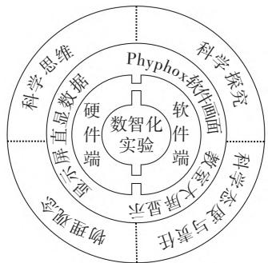
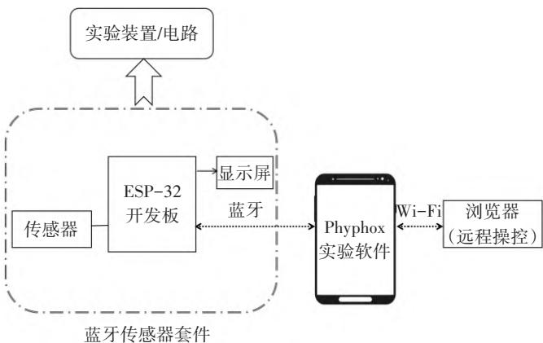
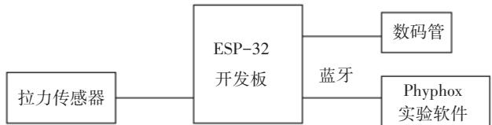
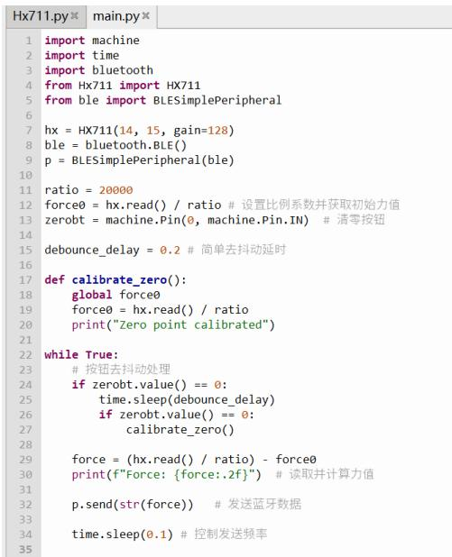
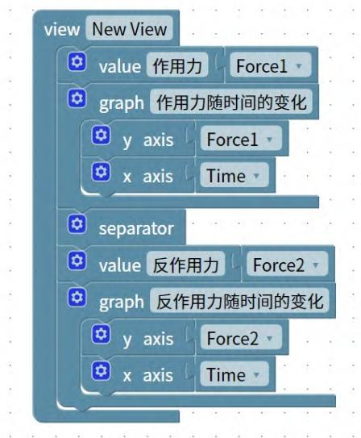
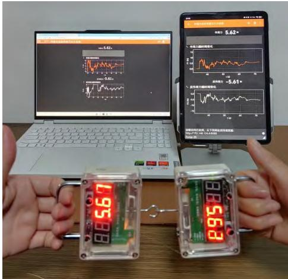

# 基于ESP32与Phyphox的中学物理实验开发与设计

何振浩1，2，桑芝芳1

（1.苏州大学物理科学与技术学院，江苏苏州 215006；2.太仓市明德高级中学，江苏苏州 215488）

摘 要：智能手机集成了多种传感器，通过蓝牙外接各类传感器，用于改进中学传统物理实验，有着很大的创新实验开发潜力。基于ESP32与Phyphox设计的中学物理实验装置以“一核两端三画面四素养”为设计理念，搭建了硬件设备与软件平台交互的桥梁，能够定量探究物理量之间的关系，直观显示物理量变化曲线，引导学生进行深度学习，同时拓展了 Phyphox软件的使用范围，实现物理传感器的无线突破，适用于各种教学场景。

关键词：物理实验教学；智能手机；实验开发与设计；牛顿第三定律

DOI：10.19935/j.cnki.1004-2326.2026.02.039

引用格式：何振浩，桑芝芳.基于ESP32与Phyphox的中学物理实验开发与设计［J］.实验教学与仪器，2026，43（02）：126-129.

《普通高中物理课程标准（ 年版 年修订）》明确提出，要注重课程的时代性，关注科技进步和社会发展的需求，推动学生的自主探究，强调要学会利用现代信息技术手段，引导学生理解物理的本质，进而提升学生的科学素养和信息技术获取能力［1］。在实验教学方面，信息技术的有效应用能够突破传统教学中的难点，为学生提供更加直观和高效的学习体验。智能手机作为一种普及且易于获取的设备，内置的传感器（如加速度传感器、频率传感器等）已成为物理实验中的重要工具，能够在加深学生对物理概念理解的同时，为教学提供丰富的实验数据支持。ESP32可外接各类传感器，通过蓝牙传输数据到智能手机，将其用于中学物理实验，有着很大的创新实验开发潜力。笔者以探究作用力和反作用力的关系实验为例，展示基于ESP32与Phyphox的中学物理实验开发与设计的具体过程，挖掘信息技术在物理实验教学中的潜力。

## 1　技术基础

ESP32是一款由乐鑫科技推出的高性能、低功耗系统级芯片，集成了双核处理器、Wi-Fi和蓝牙通信模块，支持多种开发平台和操作系统，可广泛应用于物联网设备、智能家居、传感器网络等领域。ESP32具有灵活的接口、强大的计算能力和丰富的外围功能，适合用于需要无线通信和低功耗运行的嵌入式系统应用，其开发资源丰富，具备高度的可扩展性和开发便捷性。

Phyphox（Physical Phone Experiments）是一款开源移动应用程序，支持多种实验模式，提供实时数据分析和图形可视化功能，适用于实验室、课堂以及自主实验。由于其操作简便和强大的数据处理能力，Phyphox已成为物理学和工程学教学中的重要辅助手段，其开源特性也为学术界提供了丰富的定制和扩展空间，推动了智能手机在教育与科学实验中的应用。

由于智能手机的传感器功能有限，可测量的物理量不能涵盖中学物理的所有范围。本项目将 ESP32 与Phyphox 结合应用于中学物理实验的设计，扩展了Phyphox软件的使用范围，有效提升了实验的互动性与数据分析能力。此结合不仅能使实验过程更加生动和互动，同时也能为学生提供了更为直观的数据处理和分析平台，扩展了物理学教学的深度与广度，尤其在理解物理概念和规律时具有显著的教学优势。

## 2　物理实验开发与设计

## 2.1　实验装置设计

基于 ESP32 与 Phyphox 设计的中学物理实验装置以“一核两端三画面四素养”为设计理念，如图 1 所示，其中一核指的是以数智化实验为核心；两端指的是硬件端与软件端交互；三画面指的是物理实验数据呈现的三种方式，包括显示屏直接显示采集的实验数据、Phyphox 软件中显示的画面以及教室大屏同步显示的画面；四素养指的是中学物理学科核心素养。

通过利用ESP32的传感器接口，如力、电压和光传感器，实时采集物理实验中的数据，并通过蓝牙模块将数据传输至安装了Phyphox的智能手机，也可以通过电路直接传输到显示屏。ESP32可通过编程控制传感器的采样频率及实验过程中的设备状态，增强实验的自动化和精确性；Phyphox软件则提供了实时数据可视化和图表分析功能，使学生能够直观地观察实验结果并理解物理规律。

ESP32开发板、传感器和显示屏构成的蓝牙传感器套件，可以按需求接入物理实验装置或者实验电路中，用于测量和传输数据。Phyphox软件支持网络远程操控，师生可以在教室一体机大屏上观察实验界面，操控实验软件。整体实验装置设计如图2所示。

图1　实验设计理念  
  
图2　实验装置设计图

## 2.2 Phyphox 软件实验设计

使用 Phyphox 软件的很多测量实验需要专门设计。首先在浏览器中输入网址 https://phyphox.org/editor/，直接点击打开 Phyphox Editor 编辑器，在菜单“Main”模块中可以添加实验信息，包含实验名称、实验类型、显示颜色以及备注；其次在输入“Input”模块新建所需物理量的数据容器，将其添加到蓝牙部分，并设置好对应的蓝牙特征值、转换函数类型、数据偏移量和长度，如果是有交互的实验，可以在输出“Output”模块添加音频输出或者蓝牙输出；最后在界面“View”模块选取在软件中展示的实验物理量数值以及物理量之间关系的图表，拖动对应的数据容器至数值或者图表中，即可形成自定义物理实验界面，在 Phyphox 软件中观察相应的实验数值和实验图像。设置完毕后，点击右上角“GENERATE”生成按钮，会生成专用实验的代码或者二维码，智能手机导入代码文件或者扫描二维码即可添加进入 Phyphox 软件使用。

## 2.3　实验数据分析及处理

Phyphox软件可以展示实时物理量数据供教学记录，软件也自带线性拟合的数据分析功能，当然也可以导出实验数据的EXCEL文件供后续数据分析。

## 3　物理实验设计示例：探究作用力与反作用力的关系实验

以探究作用力与反作用力的关系实验为例，演示基于 ESP32 与 Phyphox 设计的中学物理实验装置的设计、制作以及实验过程。人教版高中物理教材（2019 年版）必修第 1 册第 3 章第 3 节的“牛顿第三定律”介绍了作用力和反作用力、牛顿第三定律的相关知识，涉及的物理实验为探究作用力和反作用力的关系。设计一套连接蓝牙的拉力传感器装置，可以快速精准地采集实验数据，无线传输实验数据至 Phyphox 软件端，直观形象地展示作用力和反作用力的大小关系。在 Phyphox 软件端，实验数据的处理也更加科学便捷。

## 3.1　实验装置的设计与制作

（1）实验材料。ESP-WROOM-32 模块、5 kg 压力传感器、HX711 AD 模块、安装 Phyphox 的智能手机/平板、5631AS-1型数码管两块、KDY 502540锂电池（550 mAh）、定制装置外壳、螺丝及导线等配件。

（2）蓝牙传感器装置的搭建。基于 ESP32 搭建的数据采集系统，利用 ESP WROOM 32 模块记录时间，利用拉力传感器采集拉力数据并传输至 ESP32 端。蓝牙传感器装置的搭建如图 3 所示，ESP-32 开发板负责数据采集和控制，数码管将实验数据即时显示，Phyphox 实验软件综合展示处理实验数据。

  
图3　蓝牙传感器装置的搭建图

（3）实验装置的制作。将拉力传感器的红黑白绿四线焊接到 HX711 AD 模块，通过 HX711 AD 模块连接到ESP WROOM 32 模块；将 KDY 502540 锂电池（550 mAh）连接到电路板电源接口，并固定在电路板背面；将两块5631AS-1 型数码管焊接到 ESP WROOM 32 模块，最后整体装进装置外壳。

（4）ESP32 执行程序的编写。采用 MicroPython 来编写 ESP32 的执行程序，使用的编程软件为 Thonny。编写代码前需要将 ESP32 通过 Type-C 口接入电脑，在 Thonny 软件中选择 ESP32 对应的解释器，写入支持 MicroPython 的固件，搭建好 Python 的开发环境。另外，因为要将数据通过蓝牙传输给手机中的 Phyphox 软件，因此还要借助 Phyphox 官方提供的库——PhyphoxBLE［2］。代码首先编写 HX711 的部分，通过配置数据输出（DO）和时钟（CK）引脚，并设置增益和读取数据，实现数据通信。在读取数据时，通过循环控制时钟引脚，获取 24 位的数字信号并转换为力的数值。通过 read() 方法处理数据的高位和负值，确保返回正确的传感器读数。HX711 的相关代码如图 4-a 所示。接着通过 HX711 获取传感器的力值数据，并通过蓝牙发送到外部设备。程序初始化时设置比例系数，并通过读取传感器数据来获取力的初始值，用作清零基准。使用 GPIO 按钮触发清零功能，并添加去抖动延时，避免因按钮抖动引起误操作，在主循环中，每 0.1 s 读取一次数据并通过蓝牙发送。主程序如图 4-b 所示。

（5）Phyphox 软件实验设计。Phyphox 软件没有自带力的测量实验，所以需要专门设计。在浏览器中输入网址 https://phyphox.org/editor/ 打开 Phyphox 编辑器。在编辑器中首先添加实验信息：实验名称为作用力与反作用力大小关系，实验类型为力学试验，显示颜色选择蓝色区别于 Phyphox 软件自带的橙色实验。其次在输入部分新建力和时间的数据容器，将其拖动到蓝牙模块，并设置好对应的蓝牙特征值、转换函数类型、数据偏移量和数据长度。最后在界面部分显示力的数值，将力和时间的数据容器拖进图表模块。以力为 y 轴、时间为 x 轴构建线性图，搭建相关联系如图 5 所示，创建自定义的作用力与反作用力关系实验。

## 3.2　实验过程和数据处理

## （1）实验步骤。

①组装好蓝牙拉力传感器，调试，打开开关。

②打开智能手机/平板的蓝牙，打开Phyphox软件里对应的自定义实验，连接两个拉力传感器；电脑和手机/平板接入同一局域网，点击Phyphox自定义实验中的“允许远程控制”功能，在电脑浏览器中访问给出的网址，完成同屏传输。

③两个拉力传感器调零，点击开始实验，实时采集实验数据。

④将两个蓝牙拉力传感器的钩码连接，两位实验人员开始各向一边水平拉伸，尽量保持在同一直线上，如图6所示，不断改变拉力大小采集多组数据。

  
<!-- 存疑：图 4 中的 Python 代码为图片截图，OCR 转写会破坏缩进和符号，代码内容以图中原文为准。 -->

图 4 ESP32 的参考 Python 程序（a：HX711 相关代码；b：主程序）

（2）Phyphox 软件实验数据及数据处理。

Phyphox 软件内自带线性拟合功能，因此可以在 Phyphox Editor 中设计作用力与反作用力的关系图，直接在软件内进行线性拟合。拟合结果为 $F_1=1.00131F_2+0.0181294$，直线斜率为 1.00131，纵截距为 0.0181294，可近似为 $F_1=F_2$。

（3）误差分析。

①设备质量和灵敏度：拉力传感器的质量影响拉力数据测量的准确度，ESP32蓝牙模块和智能机的蓝牙传输速率也有限制，可能存在数据传输掉包的现象。

②软件处理限制：Phyphox软件的分辨率限制有时导

图 5 Phyphox Editor“View”界面设置  
  
图6　实验过程

致相邻时刻拉力数据相同，需剔除这些错误的数据。

③实验设置误差：牛顿第三定律的内容是两个物体之间的作用力和反作用力总是大小相等，方向相反，作用在同一直线上。在实验中，人为拉伸传感器很难做到一直位于一条直线上，导致力的大小测量存在误差。

（4）实验结论。

由Phyphox专用实验的现象可知，一对相互作用的拉力方向时刻相反，根据Phyphox软件内置线性拟合结果可知，一对相互作用的拉力大小时刻相等。

## 4　总结与反思

基于 ESP32 与 Phyphox 的中学物理实验装置开发与设计有以下的优点。

（1）拓展了Phyphox软件的使用范围，使其不仅限于智能手机内置传感器的数据采集，通过结合ESP32的多种外部传感器接口，学生可分析更丰富的物理实验数据。此创新应用为中学物理实验提供了更加灵活、精确的数据采集手段，同时也提升了Phyphox在教育领域的适用性，为物理学教学提供了更多的实验形式和互动体验。

（2）搭建了硬件设备与软件平台交互的桥梁，促进中学物理实验数智化进步。通过硬件编程以及软件设计，实验装置将物理传感器数据传输到 Phyphox 软件平台，实验数据测量快速且实时显示，能定量探究物理量之间的关系，直观展示实验数据变化曲线，并即时拟合数据。

（3）实现物理传感器的无线突破，移动端开发了更多实验的可能性。实验设备内置蓝牙模块，无线连接软件，无须另接数据采集器，操作简单。设备不绑定电脑，手机移动端可以随时随地使用，实验地点不局限于教室，可以是任何教学发生的场景。

现代信息技术正对中学物理实验教学产生深远影响，将数字化信息系统等先进技术融入自制教具的应用，已经成为新课程教学的重要手段。智能手机集成了多种传感器，并且可以通过蓝牙连接外部设备，为物理实验的创新提供了更多的可能性［3］。基于ESP32和Phyphox平台开发新的物理实验教具和实验设计，可丰富物理课程资源，激发学生学习兴趣，促进他们积极参与实验，培养动手能力和科学思维，从而提高其物理素养和创新能力。

基金项目：教育部人文社会科学研究青年项目“‘国优计划’科学教师培育现状与实践路径的实证研究”，编号：24YJC880090；2023年度江苏省教育科学规划重点课题“综合性大学基于‘国优计划’多元协同共育科学教师的实践路径研究”，编号：B/2023/01/136。

作者简介：何振浩（1999—），男，二级教师，研究方向：中学物理教学与实验，E-mail：1067243758@qq.com。

通信作者：桑芝芳（1971—），女，教授，研究方向：物理课程与教学论、基础物理教学和研究，E-mail：sangzf@suda.edu.cn。

## 参考文献

［1］ 杨桂芳.运用现代信息技术突破高中物理实验教学难点的实践［D］.呼和浩特：内蒙古师范大学，2018.

［2］ 顾振兴 . 利用 ESP32 和 Phyphox 软件实现电源电动势和内阻的无线测量［J］.物理教学，2024，46（01）：26-28.

［3］ 陈剑峰.基于ESP32与Phyphox的多功能振动实验装置的设计与实验［J］.物理教师，2022，43（08）：49-51.
