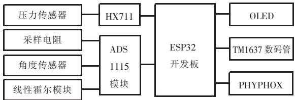
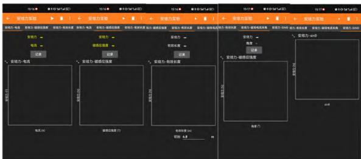
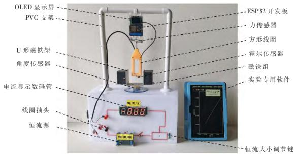
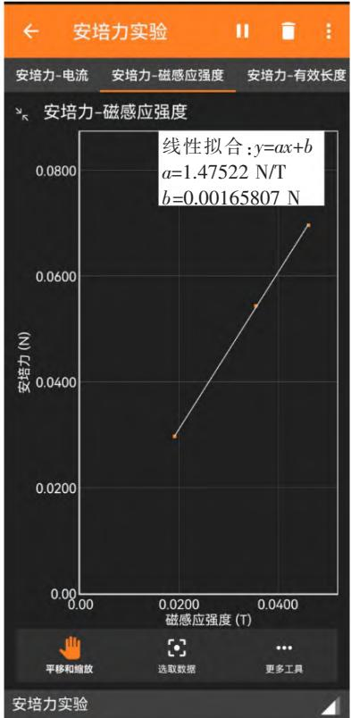
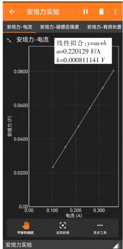
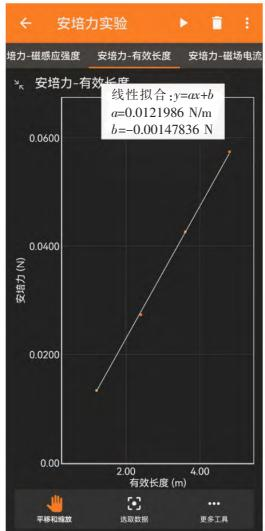
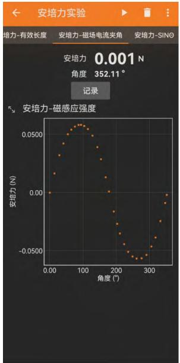
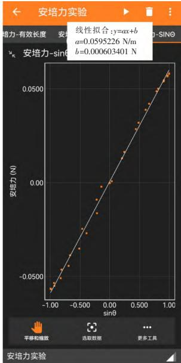

# 基于 ESP32 与 Phyphox 的安培力定量探究仪的新设计

郑远平，陈剑峰

莆田第二中学 福建 莆田 351131

摘 要 ：实验是物理学的重要组成部分 基于 ESP32 与 Phyphox 平台 创新性地设计了安培力定量探究仪 通过自制微力传感器 电流传感器 角度传感器及磁感应强度传感器 全面定量探究安培力大小的各影响因素 提升了实验的精度与效率。

关键词 ： 安培力 ； ESP32 ； Phyphox ； 定量探究 ； 实验

中图分类号 ： G633 7

文献标识码 ：A

文章编号：1003-6148（2025）9-0058-4

（收稿日期：2025-03-26）

基金项目：福建省教育科学规划 2024 年度常规课题“基于大单元视角的高中物理实验设计与实践研究”（FJJKZX24-178）。

作者简介：郑远平（1987—），男，中学一级教师，主要从事高中物理教学工作。

《普通高中物理课程标准（2017 年版 2020年修订）》指出 教师需积极整合优质教育资源 并借助现代信息技术创新教学资源开发 以帮助学生深入理解物理学科本质 构建对自然界的系统性认知 培养科学思维与实践能力［1］ 当前教育改革背景下 数字化赋能教师发展已成为重要趋势 其不仅推动教师适应技术革新 也为实验教学提供了新路径 数字化技术通过精准的定量分析与直观的可视化呈现 显著提升了实验数据的可靠性与可理解性 有效弥补了传统实验在操作效率和理论验证上的不足 然而 现有商用数字化传感器多为封装式设计 虽简化了操作流程 却限制了实验设计的灵活性与创造性［2］ 在此背景下 开源软件 硬件 （如 Phyphox 和单片机等）与多样化传感器的结合为物理实验的开发注入了新的活力 扩展性地为师生自主创新实验提供了技术支撑

安培力作为高中物理的核心概念 探究安培力大小实验长期面临定量分析的挑战 现行教材常以“分析了很多实验事实后”“精确实验表明”“上述实验的定量结果表明”等表述替代具体操作过程 导致学生难以建立直观认知 现有的改进方案仍存在诸多局限 例如 通过增减线圈匝数改变导体有效长度时 电阻变化导致电路的电流发生变化 必须增加额外的电流调节手段 通过调节磁铁间距或电磁铁电流改变磁感应强度时非线性关系与复杂叠加效应使得磁感应强度的测量误差偏大 角度测量依赖手动录入 数据采集效率低下 针对这些问题 本研究基于 ESP32微控制器与 Phyphox 平台对实验装置进行优化通过集成高精度传感器实现多变量实时同步测量（如安培力 磁感应强度 电流 角度等） 并结合自动化数据处理功能 大幅缩短实验周期 为安培力定量探究教学提供高效解决方案

## 1 实验装置的制作

## 1．1 制作材料

压力传感器（500 g）、HX711 高精度 A/D 转换模块、定值电阻（1 Ω、5 W）、ADS1115 模块、GT0-360 旋转式霍尔传感器、线性霍尔模块（1.4 mV/G）、ESP32 开发板、OLED、四位 TM1637 数码管、3.2 V 磷酸铁锂电池、MSK-12D19 拨动开关、4.5×4.5×7 按键开关、2P 和 4P 端子、激光切割的力传感器透明外壳、3D 打印的方形线圈、直径 0.33 mm 的漆包线、26 AWG 5 芯导线、PVC 组装的支架、5 mm 厚亚克力板制作的无底盒子（正面 UV 电路）、接线柱、恒流源、直流电源（12 V、1 A）、U 形铝架、法兰联轴器、50 mm×50 mm 不同厚度的铁氧体磁铁（厚度 10 mm、20 mm、25 mm），

导线，螺丝等。

## 1 ．2 制作过程

## 1．2．1 传感器制作

基于 ESP32 搭建的数据采集系统 利用应变式压力传感器和 HX711 芯片制作微力传感器 通过采样电阻和旋转式霍尔传感器分别设计电流传感器和角度传感器 利用线性霍尔模块设计磁感应强度传感器 设计流程如图 1 所示

  
图 1 自制传感器搭建流程图

## 1．2．2 软件设计

Phyphox 是一款由德国亚琛工业大学开发的开源物理实验和数据采集应用程序，支持通过蓝牙外接传感器，为物理实验带来了诸多便利与创新［3］。利用 Phyphox Editor 软件编辑器，运用模块化编程构建连接，创建安培力实验的专用软件，实验界面如图 2 所示。

  
图 2 实验专用软件

## 1．2．3 器械制作

利用白色亚克力板制作 350 mm\*200 mm 的无底盒子 盒子正面 UV 电路做成实验电路板实验电路板装有电流显示模块 接线柱 开关等元件 在盒子上板上安装 n 形 PVC 支架 制成安培力实验装置的整体支架结构 利用 3D 打印制作一个 3 cm\*7 cm 的方形线框 线框紧密缠绕漆包线 并在 40 80 120 160 匝位置引出抽头 通过改变匝数来改变导线在磁场中的有效长度 线圈与力传感器的应力片用长螺丝锁紧 力传感器的另一端设计 U 形卡座 将线圈与传感器整体固定在PVC管支架上 将长方形铝片弯成 U 形支架 在其外侧下方安装 4 根长螺杆 用来支撑方形磁铁块 在线圈底部嵌入线性霍尔模块探头用来实时测量磁感应强度大小 旋转式霍尔传感器的金属外壳固定在安培力亚克力盒子的顶板上 转轴与 U 形磁铁架的底部用法兰联轴器连接 可以实时测量磁场方向与电流方向的夹角大小 为解决不同匝数线圈接入时因电阻变化导致电路中电流发生变化的问题 电路板电源采用恒流源 恒流大小可通过按键调节 操作更加方便

## 1 ．3 装置整体结构

实验装置如图 3 所示

  
图 3 实验装置整体实物图

## 2 实验过程

## 2．1 探究安培力大小 F 与磁感应强度大小 B 的关系

保持电路电流 接入电路线圈匝数不变 旋转 U 形磁铁架让磁场与电流垂直 通过搭配不同的磁铁来获得不同磁感应强度的磁场 观察线框受力情况 记录不同磁感应强度值及对应的安培力大小的实验数据 如图 4 所示

  
图 4 F与 B 关系的实验数据

实验结论 ：其他条件不变 安培力大小与磁感应强度大小成正比

## 2．2 探究安培力大小 F 与电流大小 I 的关系

保持磁感应强度 接入电路线圈匝数不变旋转 U 形磁铁架让磁场与电流垂直 通过恒流源上的按键调节电路的电流 观察线框受力情况 记录不同电流值及对应的安培力大小的实验数据 如图 5 所示

  
图 5 F 与 I 关系的实验数据

实验结论 ：其他条件不变 安培力大小与电流大小成正比

## 2．3 探究安培力大小 F 与导线有效长度 L 的关系

保持电路电流 磁感应强度大小不变 旋转U 形磁铁架让磁场与电流垂直 通过改变接入电路线圈的匝数来改变导线的有效长度 观察线框受力情况 记录不同导线有效长度值及对应的安培力大小的实验数据 如图 6 所示

  
图 6 F 与 L 关系的实验数据

实验结论 ：其他条件不变 安培力大小与通电导线的有效长度成正比

## 2．4 探究安培力大小 F 与电流、磁场之间夹角 θ 的关系

保持电路电流 接入电路线圈匝数 磁感应强度大小不变 通过旋转 U 形磁铁架改变磁场方向和电流方向的夹角 观察不同磁场方向与电流方向夹角下线圈的受力情况 记录磁场方向与电流方向夹角及对应的安培力大小的实验数据 如图 7 所示 数据处理如图 8 所示

图 7 F 与 θ 关系的实验数据  
  
图 8 F 与 sinθ 关系的实验数据

实验结论 其他条件不变 安培力大小与磁场方向和电流方向夹角的正弦值成正比

综合上述四个实验可以得出 F 与 B、I、L、sinθ 成正比的结论，即 F＝kBILsinθ。进一步处理数据：将采集的 F、B、I、L、sinθ（下转第 64 页）

（上接第 60 页）代入 F＝kBILsinθ，得到 k 的平均值约为 1，即 F＝BILsinθ，巧妙解决从探究结论到公式的比例系数过渡问题。

## 3 结束语

本实验基于 ESP32 与 Phyphox 平台，创新性地设计了安培力定量探究仪。通过自制微力传感器、电流传感器、角度传感器及磁感应强度传感器，实现了安培力大小与磁感应强度、电流、导线有效长度及磁场和电流夹角的多因素实时测量与动态分析。实验结果表明，安培力大小与各变量满足公式 F＝BILsinθ，有效解决了传统实验中变量控制难、数据采集效率低、定量分析不足等问题。

新装置通过数字化手段优化了实验流程，将复杂的数据处理自动化、可视化，显著提升了实验精度与教学效率（4 个完整实验全程用时 4 分钟），为中学物理实验教学提供了直观、可靠的探究工具。同时，该设计通过模块化硬件与开源软件的结合，为师生自主创新实验资源开辟了新路径，有助于培养学生的科学思维与实践能力。未来可进一步拓展装置的兼容性，如结合云平台实现实验数据的远程共享与协作分析，为物理实验教学注入更多智能化元素。

## 参考文献 ：

［1］中华人民共和国教育部．普通高中物理课程标准（2017 年版 2020 年修订）［S］．北京：人民教育出版社，2020：53．

［2］刘冰．基于单片机的中学物理实验设计与开发［D］．昆明：云南师范大学，2024．

［3］陈剑峰．基于 ESP32 与 Phyphox 的多功能振动实验装置的设计与实验［J］．物理教师，2022，43（8）：49－51．

（栏目编辑 刘 荣）
