> 来源：MinerU 3.4.4 二次 OCR 转换并依据本地 PDF 逐页精校（2026-08-12）。

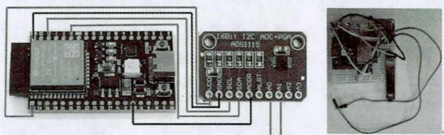

# 基于 ESP32 和 Phyphox 的物理 DIS 实验实践研究

## ——以“自制电压传感器”为例

何武刚¹  张晓春²

¹兴平市陕柴中学，陕西咸阳 713105；²岐山高级中学，陕西宝鸡 722400

文章编号：1002-218X（2023）08-0035-03

中图分类号：G632.4

文献标识码：B

摘要：基于县域数字化实验投资不足的现状，通过 ESP32 和 Phyphox 制作电压传感器，实现用手机进行 DIS 实验，不仅成本低廉，而且数据采集实时化、可视化。并分享用自制电压传感器进行电磁感应实验、电容充放电实验等多个案例，实现信息化技术与物理实验深度融合，提升师生的实验数字化素养，培养学生的创新能力。

关键词：自制电压传感器；ESP32；Phyphox；DIS 实验

## 一、引言

DIS 实验系统长期以来都是中学实验仪器中的贵族，笔者所处的西部县域学校很难接触到，教学时经常只能口头讲解。随着信息技术的不断发展，一款名为 Phyphox 的 APP 出现，为自制 DIS 物理实验器材带来了希望。笔者通过多年的学习和实践，基于 ESP32 和 Phyphox 自制了电压传感器，完成了中学电路部分实验的教学。相较购置成套的 DIS 实验设备，自制电压传感器所需硬件成本低，且软件程序开源，为普及 DIS 物理实验提供了可能。通过师生动手制作，不仅可以深入理解实验原理，感受数字化实验的便捷，实现数据采集和处理的自由，还可将信息技术与物理实验深度融合，提升师生的实验数字化素养和综合创新能力[2]。本文分享自制电压传感器的实践案例，感受自制 DIS 实验的魅力。

## 二、电压传感器的制作

### 1. 所需器材

一块 8.5 cm × 5.5 cm、400 孔的面包板，杜邦线若干，带串口蓝牙模块的 ESP-WROOM-32E 一块，一个 ADS1115 模数转换器，一块 0.91 寸的 OLED 模块显示屏。

### 2. 硬件连接

如图 1 所示，将 ADS1115 的供电端 VDD、GND 连接于 ESP32 的 3V3、GND；ADS1115 的数据采集端 SCL、SDA 分别连接 ESP32 的 21、22 端；ADS1115 的辅助端 ADDR 连接 ESP32 的 GND；ADS1115 的 A0、A1 和 A2、A3 为两组电压测量端，选取其中任一组即可，笔者选取的是 A0、A1 为电压测量端。实时显示电压测量数据的 OLED 屏的管脚 GND、VCC 分别接 ESP32 的 GND 和 3V3；OLED 显示信号管脚 SCK、SDA 分别接 ESP32 的 14 和 13。最终连接完成的电压传感器实物如图 2 所示。

图 1

图 2

### 3. 相关程序

#### （1）ESP32 端的程序

ESP32 端程序的编写是制作电压传感器的关键，可通过 Arduino 的可视化编程完成，也可通过 Thonny 对 ESP32 编写程序。笔者以 Thonny 为例，ESP32 中上传的程序文件主要有：`ads1x15.py`、`ble.py`、`boot.py`、`main.py`。其中，`ads1x15.py` 是 ADS1115 芯片厂家提供的用于驱动 ADS1115 的库函数，`ble.py` 是 ESP32 的蓝牙库函数，`boot.py` 是 ESP32 的驱动程序，以上几个程序不需修改。读者只需要编写 `main.py` 程序，对 ADS1115 的管脚进行驱动，并对采集的数据做简单处理即可。安装 OLED 屏幕后，还要在 ESP32 中上传相关的驱动程序 `ASC16`、`ASC24`、`ASC32`、`font.py`、`ssd1306.py`，这些均为固定程序，不需要编写。

#### （2）手机端 Phyphox 程序

Phyphox 端程序用于可视化设置和编写。例如，编写电压传感器采集的电压随时间变化的函数程序，读者可进入官网（<https://phyphox.org/editor/>），先进入 `main` 设置实验名称，然后进入 `input` 中对蓝牙数据接收进行设置，再进入 `views` 对接收数据的图像进行设置，最后进入 `analysis` 进行数据的函数对应关系设置，如图 3 所示。如果读者想直接使用这套程序，可利用 Phyphox 扫描如图 4 所示的二维码，获取笔者编写的相关程序。

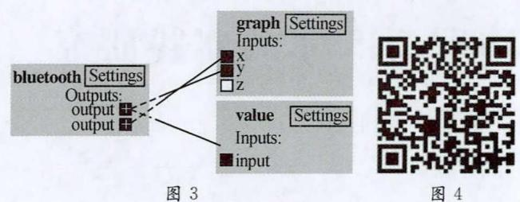

### 4. 电压传感器的校正

制作好的电压传感器还需进行检测校正。笔者通过传统电压表与自制传感器对比进行校正，如图 5 所示，在 `main.py` 中对 `data = str(value * 2 / 1000)[0:5]` 进行系数修正即可，直到电压传感器示数与标准电压表读数一致。校正完成后，测量电池两端电压如图 6 所示，传感器测得的电压为 1.392 V，与电压表的示数比较，读数更精准，Phyphox 图像中生成的数据与电压表读数一致。笔者制作的电压传感器的量程为 0～3.3 V，基本可以满足高中物理实验的需要。

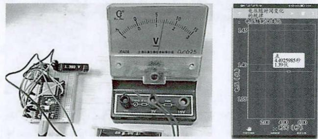  
图 5  
图 6

## 三、电压传感器实验实践案例

自制电压传感器的程序是开源的，通过硬件自制和程序编写，读者可全面理解传感器的工作原理。运用传感器既可对传统实验进行数字化改进，也可进行更多的实验创新。电压传感器的灵敏度高，数据采集的实时性及数据处理的图像化使实验效果更加明显。

### 1. 实现电磁感应实验的可视化

用传统器材做电磁感应实验时，向磁铁插入线圈的过程中，学生通过观察灵敏电流计示数的变化来感知感应电流的产生，但电流计示数变化快，学生难以观察感应电流的具体数值。如图 7 所示，增加电压传感器，不仅可以观察磁铁在线圈中的运动变化和传统电流计的指针示数变化，还能通过电压传感器和 Phyphox 将采集的数据生成实时图像，如图 8 所示。学生可以感受将磁铁插入和拔出线圈的过程中，电压的正负、大小跟磁铁 N、S 极插入的方向及速度的关系，整个物理过程图像化、定量化[3]。通过传统实验与数字化实验的双向实时感知，二者相互补充、相互印证，共同促进学生电磁感应观念的理解与形成。

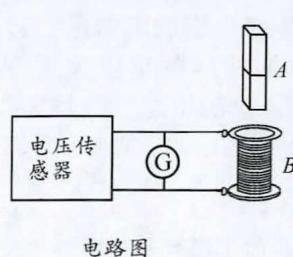

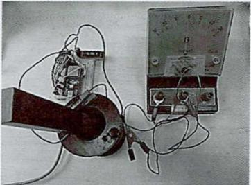  
图 7  实物连接图

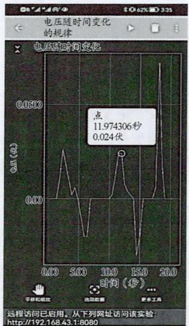  
图 8

实验时还可建立手机热点，实现 Phyphox 远程操作，生成网址，通过电子大屏访问。笔者实验时生成的网址为 `http://192.168.43.1:8080`。通过远程访问，将如图 9 所示的图像展示到大屏幕上，可以让更多学生实时看到实验数据和结果，真切感知电磁感应中感应电流的变化及变化规律，提高课堂教学效果。

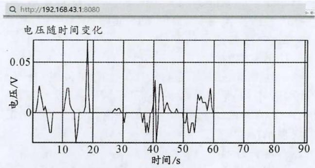  
图 9

### 2. 让电容器充放电实验变得可观察、可感知

新课标将电容器的充放电实验列为必做实验，电容器的充电、放电过程是很短暂的，电压、电流的变化在瞬间结束，传统教学仪器最大的缺陷是很难直观显示物理现象，即使有数字电流表、电压表也很难记录下数据，实验者无法准确感知物理变化过程。但采用电压传感器就可以通过 Phyphox 轻松实现记录实验数据，改进的实验电路图和实物连接图如图 10 所示。

为了更好地展示充放电过程，可给电容串联一个 1000 Ω 的电阻，有效延缓充电、放电时间；同时，电压传感器 2 的测量值除以 1000 Ω 就可以充当电流表，得到充放电过程中的电流变化。Phyphox 将采集的数据直接生成图像，使充放电实验可感知，突破了传统实验器材的局限。还可将实验数据导出，让读者对数据进行多样化的处理，笔者对本实验数据的处理如图 11、图 12 所示。

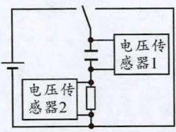  
电路图

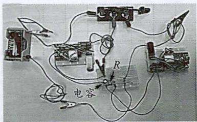  
实物连接图  
图 10

图 11  
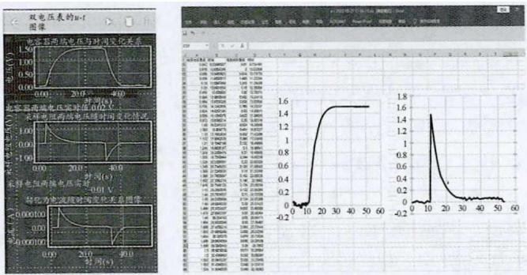

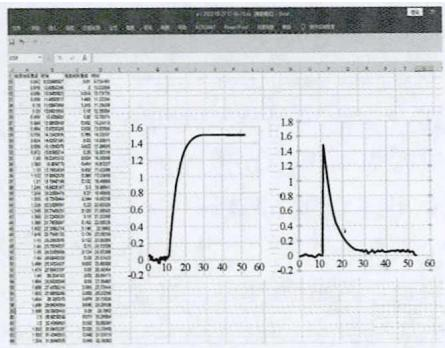  
图 12

### 3. 改装成电流传感器用于测电源电动势及内阻

测电源电动势及内阻是高中物理的重要实验，传统实验方法费时费力，数据处理过程繁琐，而通过电压传感器，让这个实验变得简单易行。本实验所需的电流表是通过为电压传感器并联一个定值电阻，将其改装为电流传感器。在测电源电动势实验中，滑动变阻器触头接触不稳定，直接生成的图像数据跳动大，可通过 Phyphox 对数据进行选点输入生成图像，流程如图 13 所示。读者可利用 Phyphox 扫描如图 14 所示的二维码直接获取程序。

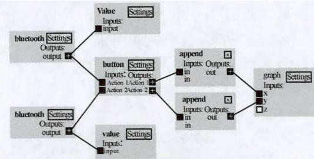  
图 13

  
图 14

为了尽可能减小改装后的电流传感器的内阻，笔者经过多次尝试，最后将与电压传感器并联的定值电阻确定为 1 Ω，并改装成电流传感器。实验电路图和实物连接图如图 15 所示，实验数据及处理结果如图 16 所示。该实验通过 Phyphox 采集数据及线性拟合处理，最终得出电源电动势为 1.247 V，电源内阻为 1.6 Ω。作为演示实验省时省力，实验效果可视化强，便于操作。

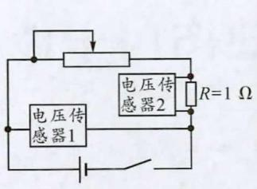  
电路图

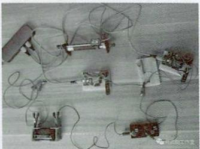  
实物连接图  
图 15

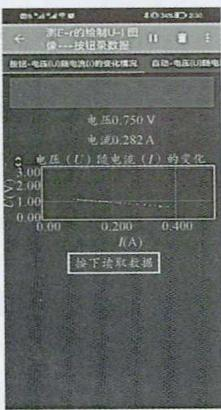

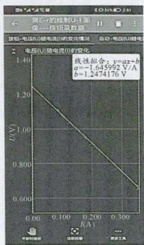  
图 16

## 四、小结

基于 ESP32 和 Phyphox 自制的电压传感器灵敏度高，可以捕获短暂的、不易观察的物理过程中的相关数据，实现实验数据实时采集和图像可视化，对新课程下的教育教学有着重要的价值。首先，自制传感器便于学生通过实验数据和图像直观感知物理规律、观察物理实验过程，教学效果显著，有利于激发学生学习兴趣，促进学生物理观念的形成。其次，利用 ESP32、Phyphox 和手机进行 DIS 实验研究，成本低、便于携带和展示，实现了高中物理实验数字化，解决了普通学校资金不足的问题，为教育资源共享、公平和缩小教育差距提供了可供借鉴的途径。最后，自制电压传感器所用 ESP32、Phyphox 的程序开源，师生可以自由地进行实验设计和数据处理，在制作过程中，学生可深刻理解物理原理并进行程序修改，实现信息技术与物理实验的深度融合，通过“学中做和做中学”，提高学生学习兴趣，培养学生的实践意识[4]。

## 参考文献

[1] 李锡均，程敏熙，江敏丽. 数字传感器新载体：智能手机在物理实验中的应用综述[J]. 大学物理，2018，37(2)：53-59，63.

[2] 中华人民共和国教育部. 普通高中物理课程标准（2017 年版 2020 年修订）[M]. 北京：人民教育出版社，2020.

[3] 伍科，张旺. 基于 Phyphox 程序的“电磁感应定律”定量探究实验改进[J]. 物理通报，2021(3)：108-110.

[4] 何武刚. 流水法模拟平抛运动实验的改进[J]. 物理教学探讨，2020，38(4)：48-50.

(本文编辑：付杰)
