单 位 代 码 10602

学 号 2021012307

分 类 号 G633.7

密 级 公开


硕士专业学位论文

# 基于ESP32的高中物理自制教具开发——以部分电磁学实验为例

## Development of Self-made Teaching Aids for Senior High School Physics Based on ESP32

## ——Taking Some Electromagnetism Experiments as Examples

学 院 ( 部 )：物理科学与技术学院

学 科 专 业： 学 科 教 学 （ 物 理 ）

研 究 方 向：中学物理教学

年 级：2021级

研 究 生：黄旭坚

指 导 教 师：张妙静 教授

完 成 日 期： 2025 年6月

# 基于 ESP32的高中物理自制教具开发——以部分电磁学实验为例

专业名称：学科教学（物理）

申 请 人：黄旭坚

指导教师：张妙静

论文答辩委员会

主席：

委员：

# 基于 ESP32 的高中物理自制教具开发——以部分电磁学实验为例

研究生姓名：黄旭坚

导师姓名：张妙静

学科：学科教学（物理）

研究方向：中学物理教学

年级：2021 级

## 中文摘要

物理学是一门以实验为基础的自然学科，物理实验对学生学习理解物理定律、认识世界、发展创新思维有重要意义。物理实验教学的开展依赖于物理实验教具，物理实验教具的来源广泛，而当实验教具无法满足实验教学需求时，自制教具便成为补充课程资源、提升实验教学效果的重要手段。

考虑到当前部分高中物理电磁学实验教具存在停留在定性探究水平、探究维度有限的不足，本研究融合信息技术，将应用范围广、普遍搭配传感器、测量精度高ESP32 微控制器用于高中物理自制教具开发，这对于丰富高中物理课程资源、提升高中电磁学实验教学水平有重要意义。同时，学习利用ESP32结合信息技术开发数字化教具，对于教师提升实验开发水平有重要意义。本研究创新性地将ESP32 微控制器与传感器及其他元件结合，制作了电压信号数据采集器、光电传感器&数据采集器、简易高斯计、压力&电流一体测量装置、波形发生器5 个通用测量仪器。这些仪器可实现电压信号采集、速度测量、磁感应强度测量、压力测量、电流测量等功能。

在这些通用测量仪器的基础上，本研究通过分析教材，针对部分电磁学实验存在的不足，设计了法拉第电磁感应定律实验、探究影响线圈切割磁感线的感应电动势大小因素实验、探究感应电动势与磁通量变化率的关系实验、安培力演示实验、互感现象演示实验5个实验案例。通过实验验证，本研究制作的基于 ESP32 的自制教具有较好的完成度，能够帮助上述部分电磁学实验从原本的定性实验升级为定量探究实验，且实验效果良好。

本论文全方位展示了5个通用测量仪器的原理、电路、代码、资源、制作过程以及5 个电磁学实验案例的制作过程、实验过程和实验结果，希望能为一线物理教师在教具设计制作方面提供思路与借鉴案例，帮助一线教师提升的实验开发能力。

关键词：自制教具；ESP32；微控制器；高中；电磁学

# Development of Self-made Teaching Aids for Senior High School Physics Based on ESP32 ——Taking Some Electromagnetism Experiments as Examples

Graduate student: Huang Xujian   
Supervisor:Zhang Miaojing   
Major：Subject teaching (physics)   
Research direction: Physics teaching in middle school   
Grade:2021

## Abstract

Physics is an experiment-based natural science discipline, where experimental activities play a vital role in helping students comprehend physical laws, understand the world, and develop innovative thinking. The implementation of physics experimental teaching relies heavily on specialized apparatus. While physics teaching aids can be sourced through various channels, when existing equipment fails to meet experimental education demands, self-developed teaching aids emerge as a critical solution to supplement curriculum resources and improve instructional effectiveness.

Considering the current limitations of high school physics electromagnetic experiment teaching aids, which predominantly focus on qualitative exploration with restricted investigative dimensions, this study integrates information technology by employing the ESP32 microcontroller – characterized by its wide applicability, compatibility with sensors, and high measurement accuracy – for developing self-made teaching aids in high school physics. This research holds significant importance for enriching physics curriculum resources and elevating the teaching standards of electromagnetic experiments in secondary education. Additionally, learning to utilize ESP32 combined with information technology to develop digital teaching aids is crucial for enhancing teachers' experimental development capabilities.In this study, we innovatively integrated the ESP32 microcontroller with sensors and other components to create five general-purpose measurement instruments:Voltage signal data acquisition device、Photoelectric sensor & data acquisition device、Simplified Gauss meter 、 Integrated pressure & current measurement device 、 Waveform generator.These instruments can achieve functions including voltage signal acquisition, speed measurement, magnetic flux density measurement, pressure measurement, and current measurement.

Building upon these general-purpose measurement instruments, this study designed five experimental cases by analyzing textbook content and addressing deficiencies in existing

electromagnetic experiments:Faraday's Law of Electromagnetic Induction experiment、 Experiment investigating factors affecting induced electromotive force (EMF) in coil-cutting magnetic field lines、Experiment exploring the relationship between induced EMF and the rate of magnetic flux change 、 Ampere Force demonstration experiment 、 Mutual inductance phenomenon demonstration experiment.Experimental verification confirmed that the ESP32-based self-developed teaching apparatus demonstrates satisfactory functionality. It enables the upgrade of selected electromagnetic experiments from qualitative demonstrations to quantitative investigations, moreover achieving favorable experimental outcomes.

This thesis comprehensively details the principles, circuitry, code, resources, and fabrication processes of the five measurement devices, along with the development procedures, experimental workflows, and results of the five electromagnetic experiment cases. It aims to provide frontline physics teachers with conceptual frameworks and reference examples for teaching aid design, thereby supporting educators in advancing their experimental development capabilities.

Keywords: Self-made teaching aids; ESP32; Microcontroller; High school; Electromagnetism

## 目 录

一、 绪论..  
(一) 研究背景.  
1. 新时代教育的发展趋势的要求.  
2. 物理教学改革的趋势要求.  
3. 高中物理电磁学实验需要改进提升.  
4. 教师实验开发能力需要提升. .2  
(二) 微控制器或单片机用于物理实验教具制作研究现状. ..2  
1. 物理量测量与验证类教具开发. ..2  
2. 实验教学效果增强类教具开发. .3  
(三) 研究目的与意义. .4  
1. 研究目的.. .4  
2. 研究意义. .4  
(四) 研究内容和方法. ..5  
1. 研究内容.. ..5  
2. 研究方法. ..5  
二、 概念界定与理论基础 ..7  
(一) 概念界定. .7  
1. 教具. ..7  
2. 微控制器与 ESP32.. .7  
(二) 理论基础. ..7  
1. 终身学习理论. ..7  
2. 信息技术与课程整合理论. ..8  
3. 技术赋能原则 ..8  
三、 基于ESP32 的实验教具开发技术与步骤 .9  
(一) 开发技术简介. .9  
1. ESP32 DEV Module 简介 ..9  
2. Arduino IDE 简介. .10  
3. VOFA+简介. .11  
(二) 测量型教具开发思路. .12  
1. 确定教具所要测量的物理量. .12  
2. 选用合适的 ADC(Analog-to-Digital Converter)或传感器.........12  
3. 为元器件安装第三方库.. ..13  
4. 将ESP32 与元器件进行电路连接. .13  
5. 进行程序调试. ..13  
6. 选用合适的数据呈现方式. ..13  
(三) 基于ESP32 进行实验教具开发的优势 ..14  
1. 高性价比,开发成本较低.. ..14  
2. 高自由度,满足个性化开发需求. ..14  
3. 高兼容性,满足可视化需求. ..14  
四、 基于ESP32 的通用测量仪器制作 ..15  
(一) 电压信号数据采集器. ..15  
1. 测量原理. ..15  
2. 硬件设计.. ..15  
3. 程序设计.. ..17  
(二) 光电传感器&数据采集器.. ..22  
1. 测量原理. ..22  
2. 硬件设计.. ..22  
3. 程序设计. ..23  
(三) 简易高斯计. ..25  
1. 测量原理. .25  
2. 硬件设计.. ..26  
3. 程序设计.. .27  
(四) 压力&电流一体测量装置 .30  
1. 测量原理. ..30  
2. 硬件设计.. ..30  
3. 程序设计. ..31  
(五) 波形发生器装置. ..34  
1. 工作原理. ..34  
2. 硬件设计. ..34  
3. 程序设计. ..36  
五、 自制教具在高中物理电磁学实验中的应用 ..39  
(一) 法拉第电磁感应定律实验. ..39  
1. 实验背景. ..39  
2. 教具制作. ..41  
3. 实验操作与实验结果. ..43  
4. 实验教具的优点与不足 .45  
(二) 探究影响线圈切割磁感线的感应电动势大小因素实验...........45  
1. 实验背景.. ..45  
2. 教具制作. ..47  
3. 实验操作与实验结果. ..49  
4. 实验教具的优点与不足 ..52  
(三) 探究感应电动势与磁通量变化率的关系实验. ..52  
1. 实验背景. ..52  
2. 教具制作. ..54  
3. 实验操作与实验结果. ..55  
4. 实验教具的优点与不足 ..56  
(四) 安培力演示实验. ..57  
1. 实验背景. ..57  
2. 教具制作. .59  
3. 实验操作与实验结果. ..60  
4. 实验教具的优点与不足 ..62  
(五) 互感现象演示实验.. ..63  
1. 实验背景. ..63  
2. 装置原理. ..64  
3. 教具制作. ..64  
4. 实验操作与实验结果. ..65  
5. 实验教具的优点与不足 ..67  
六、 总结.. ..68  
(一) 研究总结.. ...68  
(二) 反思与建议. ...68  
(三) 研究不足. ...69  
参考文献.. ..71  
附录... ..74  
附录 Ⅰ 电压数据采集器 Arduino 代码.. ..74  
附录 Ⅱ 光电传感器&数据采集器 Arduino 代码. ..77  
附录 Ⅲ 简易高斯计 Arduino 代码. ..79  
附录 Ⅳ 压力&电流一体测量装置 Arduino 代码.. ..81  
附录 Ⅴ 波形发生器 Arduino 代码. ..83  
附录 Ⅵ 8002b 功放模块电路. ..86

## 一、绪论

## （一）研究背景

## 1.新时代教育的发展趋势的要求

2003年经济合作与发展组织（OECD）在《核心素养促进成功的生活和健全的社会》中首次提出 “核心素养” 的概念，明确21世纪学生应具备的关键知识、能力和情感态度<sup>[1]</sup>。在世界教育改革的趋势中，核心素养越来越成为各国教育改革关注的焦点。习近平总书记指出“要把人才资源开发放在科技创新最优先的位置<sup>[2]</sup>”，我们必须深刻认识，当今世界，综合国力的竞争实质上是人才的竞争。因此，我们必须将培养创新型人才作为教育发展重点。

物理课程作为自然科学的基础课程，物理实验探究在培养创新型人才中起着重要作用。然而，在应试教育的影响下，许多一线教师的物理实验课程聚焦于考试重点，用实验视频替代探究过程，虽然提升了教学的效率，但没有起到提升学生创新意识的效果。此外，教育经费的限制使得一些学校的物理实验条件难以满足现代化教学需求。因此本文研究的目的之一就是为一线物理教师学习、掌握教具开发新技能提供参考，从而提升实验教学效果。

## 2.物理教学改革的趋势要求

近年来的人工智能技术迅速发展为教师提升信息技术能力提供了强而有力的工具。2017年版《普通高中物理课程标准》（以下称《标准》）提出核心素养的培养目标替代了三维目标，《标准》里明确指出：学生物理学科核心素养的培养离不开信息技术与物理学习的融合，要利用信息技术提升学生的物理学习能力<sup>[3]</sup>。2019年教育部发布的《关于实施全国中小学教师信息技术应用能力提升工程 2.0 的意见》提出：支持有条件的学校主动应用互联网、大数据、虚拟现实、人工智能等现代信息技术，探索跨学科教学、智能化教育等教育教学新模式，充分利用人工智能等新技术成果助推教师教育<sup>[4]</sup>。因此教师作为学生学习的引导者，要跟上时代步伐，拥抱仍智能技术，积极主动学习信息技术，改变自身教学方式，积极探索将新技术融入物理教学、提升教学效果的途径和方法。

## 3.高中物理电磁学实验需要改进提升

电磁学是高中物理的重要组成部分，然而传统的电磁学实验教学因为实验设备和教学资源的限制，实验效果往往不尽人意。笔者在教学实践与翻阅教材中发现存在点值得改进之处：1.有待上升至定量实验。例如，依赖于传统的指针式电流表和电压表，传统的电磁感应实验只能得到定性的实验结论。2.探究维度有限。例如教材里探究通电导线在磁场中受力的大小因素实验的装置，只能半定量探究出受力与电流、导线长度的关系，无法探究受力与磁感应强度的关系。

而《标准》也指出：有条件的学校要专门配备数字化实验室。运用数字化技术可以使很多传统方法难以实现的物理实验获得成功。信息技术也使物理实验变得更加便捷、可靠，实验现象的可视化程度也大大提升<sup>[3]</sup>。因此本文选择将ESP32用于电磁学教具开发，配合各类传感器，制作数字化实验教具，以提升电磁学实验精度，拓宽探究维度，并且为物理实验教具开发制作拓宽思路与方法。

## 4.教师实验开发能力需要提升

当前基础教育改革对教师实验创新能力提出更高要求，《标准》里指出学校要重视引导教师研究数字实验系统对传统实验的改进方法，研究数字实验系统的教学方式，促进教学手段与方式的现代化<sup>[3]</sup>。但目前物理教师普遍存在实验开发能力不足的问题。具体表现为以下三方面：

第一，传统实验改造能力较弱。多数教师仅能按教材既定方案开展实验教学，缺乏根据学情调整实验方案、改进实验装置的能力。面对较为复杂的实验教学场景，不少教师选择播放实验视频进行教学，虽然提升了教学效率，但无法提供真实的实验情境，无法满足学生真实的实验需求。

第二，数字化实验开发能力较弱。由于数字化实验系统的价格昂贵，导致数字化实验系统总体普及率较低。且部分教师存在“重软件操作，轻硬件开发”的认知偏差，仅停留在使用现成传感器与实验软件的水平，难以自主开发适配教学需求的教具。

其三，跨学科整合能力亟待提升。现代实验开发需要融合物理、电子工程、编程等多领域知识，但大多数师范院校培养体系中缺乏相应课程支撑，使得教师在缺乏数字化实验系统而又有数字化实验需求时束手无策。

相比于价格昂贵的数字化实验系统，廉价易得的ESP32 开发板与传感器以及各类电子元件为教师开发数字化实验提供了新选择。利用ESP32开发数字化实验教具的能力提升不仅符合《标准》提出的“教师要成为课程开发者”的要求<sup>[3]</sup>，更是落实教育部“推动教师主动适应信息化、人工智能等新技术变革<sup>[4]</sup>”的具体实践。

## （二）微控制器或单片机用于物理实验教具制作研究现状

近年来，微控制器技术在物理实验教具开发领域广受欢迎，国内外众多研究者通过创新设计，开发出一系列功能丰富、性能优良的教具，显著提升了物理实验教学效果。而国内外学者开发的教具主要可以分为以下两类：

## 1.物理量测量与验证类教具开发

在国外方面。Calin Galeriu 利用 Arduino 微控制器在物理实验教具开发方面取得了显著成果。一方面，他制作了用于数据收集的光电门系统，该系统成本低廉，但性能与商用系统相当，是集成 STEM 项目的理想工具，已广泛应用于物理实验室<sup>[5]</sup>。另一方面，他将 Arduino Uno 微控制器板与 DS18B20 数字温度传感器相结合，自制实验教具，验证了牛顿冷却定律中温度变化速率与温差成正比的关系<sup>[6]</sup>。Yulkifli 和 Yohandri 开发了基于微控制器的数字阿基米德实验系统，该系统利用微控制器接收来自接近传感器 HC - SR04 的数据，并将数据处理后在数字显示屏上准确显示液体的浮力和质量密度，取得了良好的教学效果<sup>[7]</sup>。Yakob M 和 Wahyuni A 等人共同开发了一种基于微控制器的物理实验室测量仪器。该仪器利用 LM35 温度传感器、LDR 光传感器、UGN3503 磁场传感器，实现了对温度、光强度和磁感应强度的测量<sup>[8]</sup>。W P N dos Reis 和 Rodrigues D P 等人使用 Arduino 微控制器结合传感器采集镍铬合金电阻器的温度数据，开发了相应的实验方案，实现了对镍铬合金电阻器热容的计算<sup>[9]</sup>。Subali Bambang 和 Wibowo Agung 等人开发的基于微控制器的实验集，可用于探究自由落体运动和弹射运动的规律<sup>[10]</sup>。

在国内方面。胡彬利用 89C51 单片机结合数字温度传感 DS18B20 设计的测温系统，能够对自制"热传递过程"教具中液体的温度实现精确测量<sup>[15]</sup>。丛伟和张伟光等人以 AT89C52 单片机作为主控，控制"布朗运动"演示教具的电路，实现温度控制、温度测量、加热冷却等功能，使实验装置能直观显示温度对"布朗运动"的影响<sup>[16]</sup>。吴琎用 STC12C5A60S2 单片机的四路 ADC 测量并联电路中各支路的电流和灯泡电压，实现功率测量功能<sup>[17]</sup>。杨杰和穆婕在进行验证向心力公式实验的研究中，创新性地用STC12C5A60S2单片机结合光电二极管模块自制计数计时器，实现了自动计算小球做圆周运动的周期功能<sup>[18]</sup>。秦彩营和雷靖娴等人利用arduino微控制器结合HC - SR04的连体式位移传感器测量振动时振子位移大小，实现了受迫振动中频率与振幅的关系定量探究<sup>[19]</sup>。刘冰在他的硕士论文中介绍了他用Arduino UNO 记录超声波传感器发射与接收信号的时间差，利用速度计算公式实现在液体中声音的传播速度的测量；用ESP32结合光强传感器测量不同偏振片夹角下的光强大小，实现了透振光光强与透振方向夹角的关系的探究<sup>[20]</sup>。

## 2.实验教学效果增强类教具开发

在国外方面。Mike McCaughey 用 Arduino 自带的三轴磁力计在纸上绘制出磁铁周围的磁场的磁感应强度和方向<sup>[11]</sup>。Calin Galeriu 等人利用 Arduino 微控制器对电容器的充放电过程进行研究，通过设计程序控制 Arduino 对电容器的充放电过程的电流、电压大小进行数字测量记录，并在计算机中显示出绘制的图像<sup>[12]</sup>。Paulo Simeão Carvalho 利用 Arduino Uno 用于研究不同光强的红色(R)、绿色(G)和蓝色(B)光混合成的颜色，并制作成游戏装置，提高学生对混色概念的理解<sup>[13]</sup>。Valesca Taciele O Silva 等人用 Arduino 微控制器开发一款名为行星尺的教育设备，帮助学生直观理解质量重量和重力加速度的关系，通过模拟太阳系中不同行星的重力环境，增强物理教学的趣味性和互动性<sup>[14]</sup>。

在国内方面。张绍能设计了利用串联电阻的分压原理组成触电类型自动检测电路，利用 STC89C51RC 单片机检测触电类型的低电平信号，通过控制 LED 流水灯信号显示通过人体电流方向，形象直观地展示触电原因，制作成触电类型模拟演示教具<sup>[21]</sup>。侯伟杰和陈善珂等人利用 STC89C52 单片机控制 20 珠全彩 LED 灯珠组成光源发射脉冲波，通过调节红光、绿光、蓝光的比例实现不同比例色光的混合，制作成色光三原色演示仪<sup>[22]</sup>。张习祥用 STM32 单片机作为主控核心，控制 16x16 LED 点阵屏显示图像，使其替代小孔成像实验中的蜡烛，使在光屏上的成像更清晰易于观察<sup>[23]</sup>。

通过梳理国内外关于将微控制器用于教具制作的文献，笔者发现：1.微控制器适用范围广，涉及电学、热力学、力学、运动学等。2.研究者普遍搭配传感器的来实现物理量的测量，如利用传感器可实现光强度、力、温度等物理量的数值测量。3.在将微控制器用于验证定律的实验中，研究者都表示实验精度和实验效率得到了提升。

综上，微控制器技术凭借其出色的计算性能、可编程性、低功耗等特性，被广泛应用于消费电子、工业自动化、航空航天等领域。在教育领域，微控制器技术在实验教学方面展示的巨大潜力也得到了越来越多老师的认可。凭借微控制器技术，教师可以开发出实验现象明显、数据采集准确和高自由度的新型实验教具，将新型实验教具用于教学实践中能提升学生的学习兴趣与教学效果。因此，本研究将微控制器用于电磁学的教具开发制作，进一步显示微控制器在物理实验教具制作的优势。

## （三）研究目的与意义

## 1.研究目的

本研究将详细介绍用ESP32开发板和各种元器件制作教具的过程，展示制作所用的的材料、电路、代码、实现的功能，为一线物理教师提供利用微控制器制作高中电磁学实验教具的参考案例，帮助一线教师在开发实践中提升创新能力。

## 2.研究意义

## 2.1 理论意义

首先，本研究能实现物理实验教具制作方法的创新。本研究基于ESP32制作的教具具备一定的通用性，并非只能完成某个单一实验。利用 ESP32 制作物理实验教具能突破传统制作方法的局限，可以使物理量的采集更准确高效，可根据需求实现丰富多样的功能。

其次，本研究能够丰富物理实验教学资源。实验教具是物理课程资源的重要部分。本研究制作了多个基于ESP32的物理实验教具，并且将这些教具用于完成多个电磁学实验。这些新型教具的制作能够丰富物理课程资源，为物理实验教学注入新活力。

## 2.2 实践意义

首先，本研究将促进教师的实验教具开发能力的提升。本文的案例可以为有需求的教师移植、学习提供清晰且明确的参考，使他们能快速开发满足需求的个性化教具，有助于他们更好地理解和应用新的技术手段，促进其电磁学实验教学效果的提升。

其次，本研究能促进物理教学与信息技术融合。基于ESP32开发物理实验教具离不开传感器、编程语言、计算机技术的使用，信息技术的融合能帮助学生更直观理解物理定律，拓宽信息技术在物理教学中的应用场景。

最后，本研究将有助于笔者的教具开发水平和创新能力。在进行基于ESP32教具开发的过程中，笔者的开发能力得到锻炼，从而提升解决了实际问题的能力，加速向研究型教师身份的转变。

## （四）研究内容和方法

## 1.研究内容

笔者通过查阅大量资料，确定本研究的选题、研究思路和重难点。笔者首先对教材内出现的电磁学实验进行分析研究，选择出适合用ESP32 进行改进的实验，并着手进行开发工作。

本研究的内容包括以下方面：

（1）学习 ESP32 的开发知识，搭建 ESP32 的开发环境，掌握开发 ESP32 所必备的编程、调试硬件设计等技能，为开发基于ESP32的物理实验教具奠定基础。

（2）针对选定的电磁学物理实验，确定实验原理，确定需要测定的物理量，根据选定的物理量选用对应的传感器以及元器件，将ESP32与传感器以及元器件根据所需实现的功能进行编程开发调试，完成各个功能的基于 ESP32的教具。

（3）根据实验原理制作实验所需的其他器材，与基于 ESP32的教具进行安装组合进行实验，对实验数据结果进行分析，最后对物理教师就如何利用信息技术提升实验教学水平提出建议。

## 2.研究方法

## 2.1 文献研究法

文献研究法是一种通过系统收集、整理、分析现有文献资料，探索问题本质、总结规律或支撑研究结论的学术研究方法<sup>[43]</sup>。本研究将借助知网数据库搜集有关用微控制器制作教具方面的学位论文和期刊文章，对前人研究进行分析总结，分析当前利用微控制器制作教具的方法思路，学习如何利用微控制器进行教具制作，为本研究的开展奠定

基础。

## 2.2 案例研究法

案例研究法是一种深入探究现实情境中复杂现象的研究方法<sup>[44]</sup>，强调通过详细分析一个或多个案例，揭示其背景、过程及内在机制。本研究通过制作多个基于ESP32 制作的测量仪器具体案例，介绍用ESP32制作教具的思路和方法，介绍如何用ESP32 结合各类型传感器实现速度、压力、瞬时电压、电流、磁感应强度这些物理量的数字化测量。本研究还用这些测量仪器完成了数个电磁学实验，通过具体实验案例展示出了基于ESP32制作的测量仪器用于物理实验的的优势。

## 2.3 行动研究法

行动研究法是由社会心理学家库尔特·勒温（Kurt Lewin）在20世纪40年代提出一种以解决实际问题为导向的研究方法<sup>[45]</sup>，库尔勒 ·勒温认为解决某一科学问题需要将科学研究者与实际工作者的智慧与能力进行结合。教育研究者可采用行动研究法，按照一定的操作程序，综合运用多种研究方法与技术，以解决教育实际问题。行动研究法的基本步骤包括问题识别、制定计划、实施行动、观察与反思、再循环。笔者在本研究遵循行动研究法基本步骤，基于ESP32 开发教具，提升了自身的教具制作开发、实验方法创新等能力。

## 二、概念界定与理论基础

## （一）概念界定

## 1.教具

教育学家福禄贝尔将其为儿童设计的一些列玩具称为“恩物”，这是教具最早的起源。在《中国大百科全书》中，“直观教具”被定义为“教学中为学生提供感知材料的实物、模型、图标等教学用具<sup>[24]</sup>”。而在《中国教育百科全书》中，“教具”被定义为“教学过程中可借以辅助教学活动的用具 <sup>[25]</sup>”。以上两种定义都从教具的辅助教学活动功能角度对教具作了定义，也就是说能够起到辅助教学的用具都能称之为教具，这就意味着教具的范围是相当广泛的。在教学实践中不难发现，教具的来源是多种多样的，既可以从专业生产教学设备的厂家购买，也可以从市场中购买，也可由教师或学生依据一定的原理自行制作。而由教师或学生自行制作的教具则可以成为自制教具。

本研究基于ESP32开发板编程技术，结合传感器及其他外围器件，设计并制作适用于高中电磁学实验的专用教具，旨在通过数字化测量提升实验精度与操作便捷性。

## 2.微控制器与 ESP32

微控制器（Microcontroller）是一种集成了 CPU、内存、I/O 接口及其他外设模块的单芯片计算机系统<sup>[45]</sup>。微控制器由单片机（Single-Chip Microcomputer）发展而来，单片机通常只包含基本的外围设备，如定时器、计数器和 UART。而微控制器外围则通常会集成 ADC、DAC、USB、以太网等功能模块，拥有更强的处理能力、更高的灵活性和扩展性。在消费学习领域常见的微控制器有 ESP32、STM32、Raspberry Pi Pico 等。

ESP32 是由乐鑫科技（Espressif Systems）开发制造的一款低功耗、高性能的 32位微控制器，ESP32拥有丰富外设接口，方便连接各种传感器和外设，ESP32因低功耗高性能等特性，被广泛应用于物联网领域。许多厂商依据市场需求基于ESP32推出了各种型号的开发板，本研究采用的是乐鑫科技推出的 ESP32 DEV Module型号开发板。

## （二）理论基础

## 1.终身学习理论

终身学习理论是一种强调个体在一生中持续学习的教育理念<sup>[46]</sup>，其核心主张认为：个体需要通过系统化的知识迭代与技能更新，将学习行为延伸至职业发展、社会交往等全生活领域，以此应对社会变革并实现可持续发展。该理论的价值取向不仅关注职业能力提升，更着眼于构建持续成长的生活范式，最终指向人的自我实现。

教师践行终身学习理论，能使自身知识结构与时俱进，提升专业实践效能。这种持续精进的职业状态，既能塑造研究型教师形象，又能通过示范效应激发学生的自主学习意识。 本研究通过引导物理教师掌握 ESP32 等信息技术，促进其开发融合数字技术的实验教具，既是对终身学习理念的实践验证，更是提升实验教学有效性的可行路径。笔者在本课题实施过程中，通过系统学习微控制器技术并完成教具开发，切实提升了自身专业能力，印证了该理论的实践价值。

## 2.信息技术与课程整合理论

信息技术与课程整合理论旨在研究如何将信息技术有效地融入课程教学<sup>[47]</sup>，打造信息化教学环境，在维护学生主体地位同时又更好发挥教师的主导作用，达到促进教育改革与提升教学效果的目的。信息技术与课程整合又分为大整合论和小整合论。前者关注在课程目标设置、内容选择、实施过程、评价体系等教育各个环节如何将信息技术融入，后者则着重关注如何在学科教学内部将信息技术融入。

推动信息技术与课程整合的重要路径在于促进教师角色转型并提升其信息素养。教师需主动开展课程资源开发实践，例如通过制作多媒体课件、研制数字化教具等方式拓展教学手段。本研究在电磁学实验教具改良中，通过系统集成微控制器技术、传感器技术与计算机技术，成功开发系列数字化实验教具，有效实现了信息技术与物理课程的深度整合。

## 3.技术赋能原则

技术赋能原则来源可追溯至管理学领域的授权赋能理论<sup>[48]</sup>，其核心是通过技术手段增强个体、组织或社会的综合能力，使其突破传统限制，实现更高效率、更优质量的目标。技术赋能原则认为技术不仅仅是工具，更是推动系统性变革的驱动力。

教育技术赋能理论在教育领域的实践价值主要体现：促进教学资源集约化共享、推动精准化与个性化教学实施、助力教师专业能力迭代升级、优化教育公平与质量协同发展机制。一线教师应主动运用技术赋能策略实现专业素养与教学效能的双重提升，例如本研究中通过微控制器技术开发新型实验教具的实践。需特别强调的是，技术赋能的核心逻辑在于“能力增强”而非“人工替代”，教师需审慎评估技术应用场景，实现技术工具与教学需求的精准适配，实现更高效、更具创造力的应用效果。

## 三、基于 ESP32的实验教具开发技术与步骤

## （一）开发技术简介

## 1.ESP32 DEV Module 简介

ESP32 DEV Module 是乐鑫科技（Espressif Systems）推出的高性能 Wi-Fi/蓝牙双模微控制器开发模块，专为物联网及嵌入式系统设计。该模块采用ESP32-S3 系列芯片，其核心架构基于 Xtensa 32 位双核 RISC 处理器，主频可达 240MHz，配备 384KB SRAM与4MB Flash 存储器，支持外接PSRAM 扩展。硬件层面集成丰富外设接口，包括16 通道电容触摸传感器、SPI/I2C/UART/CAN 总线、12 位 SAR ADC（18 通道）、8 位 DAC（2通道）等，可满足物理实验教具开发中的多维度信号采集与控制需求。ESP32 DEV Module开发板的实物图如图 3-1所示，开发板两侧引出共 38pin 引脚，方便插入拓展版或面包板进行电路连接，管脚示意图如图 3-2所示，micro USB口可用于供电或与电脑进行串口通信。

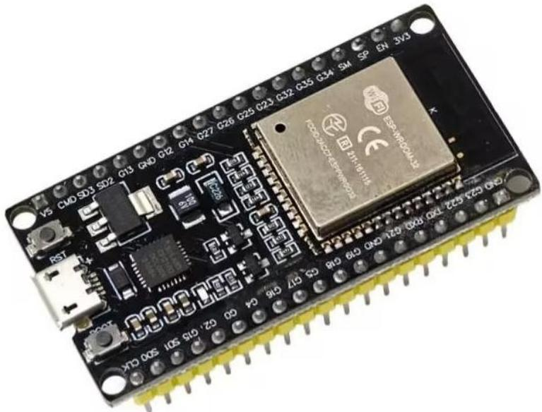  
图 3-1 ESP32 DEV Module 开发板实物图

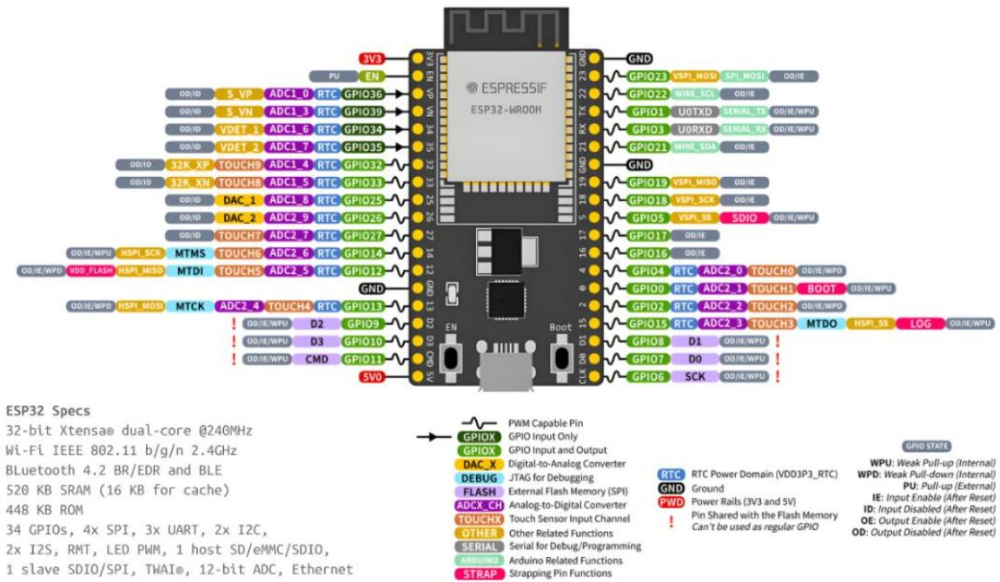  
图 3-2 ESP32 DEV Module 管脚示意图

## 2.Arduino IDE 简介

Arduino 是一个开源电子原型平台,由意大利伊夫雷亚交互设计学院的 Massimo Banzi 团队创建，旨在为非电子专业的学生提供一种快速开发交互式硬件项目的工具。简化硬件开发流程是 Arduino 的核心理念，Arduino 通过标准化的硬件接口（如 Uno、Mega等开发板）和易用的编程语言使得开发门槛大幅降低。目前，Arduino的体系已形涵盖硬件（开发板、扩展模块）、软件（IDE、库函数）和社区生态，是许多创客、学生、工业原型进行项目开发的首选平台。Arduino IDE（Integrated Development Environment）是 Arduino 官方推出的集成开发环境，利用 Arduino IDE 开发 ESP32 项目主要有以下优势：

## （1）对ESP32的全面支持

Arduino IDE可以对 ESP32实现开发环境适配、硬件抽象化编程、无线功能集成、多核与低功耗管理、库生态系统等多个层面的支持。Arduino IDE 通过安装 Espressif官方插件可以全面适配 ESP32 系列芯片，具体步骤教程可通过在 Bilibili 视频网站通过搜索“Arduino安装 ESP32”进行学习，在此不作赘述。

## （2）语法简单

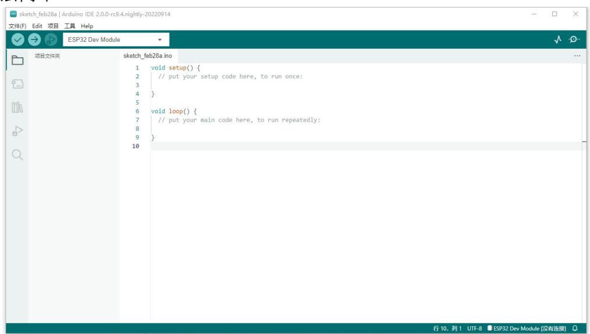  
图 3-3 Arduino IDE 初始界面

我们在Arduino IDE使用C/C++语言对ESP32进行开发，但通过封装底层硬件操作，开发的复杂性被显著降低。Arduino IDE 的程序采用 setup()和 loop()函数结构：setup()

是程序的初始化函数，用于配置硬件参数、初始化外设等，setup()只会在开发板上电后运行一次；loop()是程序的主循环函数，在 setup()执行完成后无限重复运行，用于实现实时数据采集、通信控制、状态监测等核心逻辑。setup()和loop()函数体如图 3-3所示。

## （3）丰富的库生态系统

首先 Arduino IDE 内置有 Wire、SPI、WiFi、BluetoothSerial 等标准库，可用于实现基础硬件操作和通信。其次Arduino IDE还覆盖了大量的第三方库，如本研究用到的 ADS1256、Adafruit\_SSD1306、Adafruit\_ADS1X15 库，能够针对特定硬件进行驱动、实现特定功能。使用核心库仅需在setup()函数前通过预处理器指令#include引入即可在后续代码中使用库内的函数。而第三方库的安装也十分便捷，如图 3-4所示，只需进入库管理系统，在输入栏里输入库名称，找到所需版本点击安装即可。通过在 setup()函数前引入第三方库，我们即可在后续的函数中使用库的功能函数，实现相应的硬件操作。

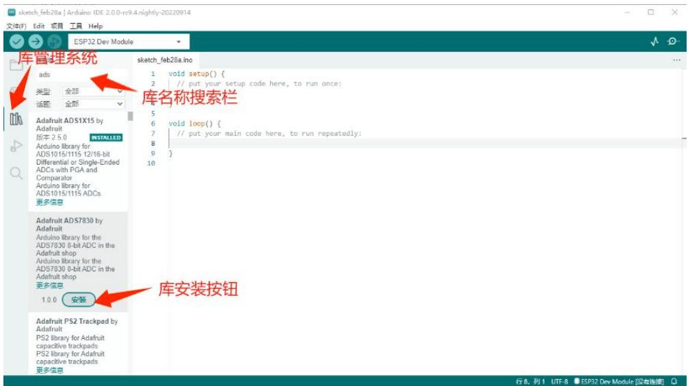  
图 3-4 Arduino IDE 第三方库管理图

## 3.VOFA+简介

VOFA+是一款专为嵌入式开发设计的、开源跨平台数据可视化工具，广泛应用于实时数据监控、调试和可视化分析场景。其核心优势有灵活的数据协议支持、低延迟的实时渲染和高度可定制的界面，支持串口通信、Wi-Fi通信等多种通信方式，适合与 ESP32等微控制器结合，可用于物理实验数据的动态展示与交互等。

VOFA+的使用十分简单。本研究选用的通信方式是串口通信，只需将 ESP32 用数据线与电脑连接，在 VOFA+的协议与连接栏进行如下设置：选择数据引擎为 FireWater；数据接口选择串口；端口号选择与ESP32相连接的端口号；波特率设置与ESP32程序中串口初始化的的波特率一致，完成以上设置，再点击左上角的圆点即可实现 ESP32 与

VOFA+的串口通信。在ESP32中程序的数据传输格式符合FireWater协议的情况下，VOFA+下方的控制台将会打印出 ESP32 发送来的数据，波形图上将会显示出波形（如图 3-5所示）。

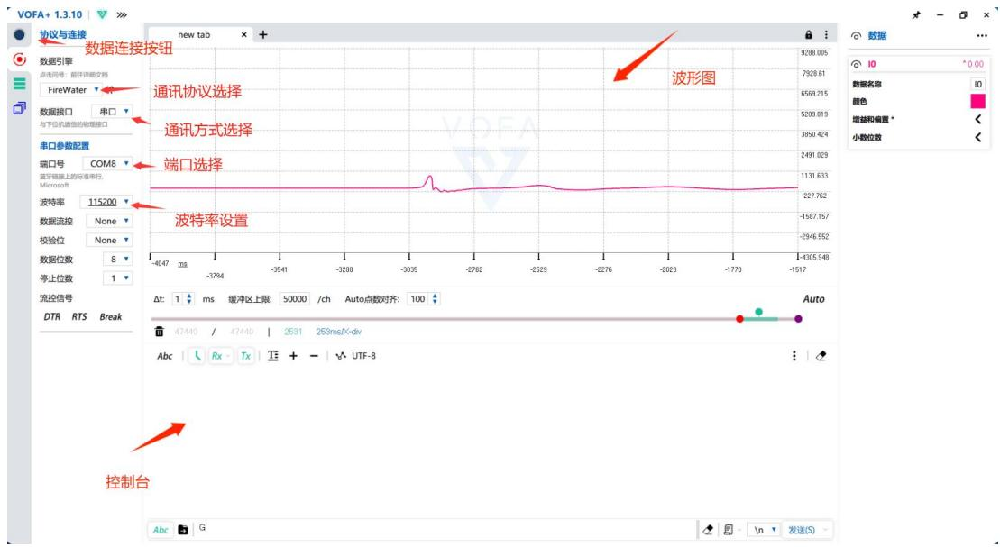  
图 3-5 VOFA+软件界面图

## （二）测量型教具开发思路

ESP32 功能强大，可以结合传感器被制作成各种类型的教具。本研究开发的物理教具功能主要是数字化测定各种物理量，从而定量完成各种电磁学实验。虽然每个教具实现的功能不同，但开发过程所用的方法存在一定共性，因此本研究将测量型教具的基本开发思路总结如下：

## 1.确定教具所要测量的物理量

首先，我们要根据进行的物理实验确定教具所要测量的物理量，比如的法拉第电磁感应定律实验就涉及到的速度与电压的测量。其次，我们要确定量程与精度，这可以根据实验的参数、前人研究的数据预估。

## 2.选用合适的 ADC(Analog-to-Digital Converter)或传感器

ADC(Analog-to-Digital Converter)模数转换器是能将连续模拟信号（如电压、电流）转换为离散数字信号（二进制数值），供数字系统（如微控制器）处理的元器件。如果所要测量的物理量是电压或者电流，选用合适精度、量程的ADC模块即可实现，如本研究的电压信号采集器使用 ADS1256进行电压信号测量，还有为安培力制作的压力&电流一体测量装置则是利用ADS1115进行电流测量。

如果物理量并非电信号，则要按需求选用传感器。比如本研究为了测量速度而制作的的光电传感器&数据采集器选用了光电传感器配合 ESP32 内部集成的 ADC，通过 ADC测量光电传感器输出的低电平持续时间，从而测量光电传感器中间红外线被遮挡的时间。再比如本研究制作的简易高斯计则使用线性霍尔磁力传感器与 ADS1115，通过 ADS1115测量线性霍尔磁力传感器输出端的电压反推出磁感应强度。

## 3.为元器件安装第三方库

安装第三方库的方法很多，本研究所用的第三方库均是通过 Arduino IDE库管理系统在线安装，在Arduino IDE库管理系统里搜索模块名即可找到大量的第三方库。如本研究为驱动 ADS1256 和 ADS1115 以及 HX711 所安装的 ADS1256.h、Adafruit\_ADS1X15.h、HX711.h这三个库。第三方库能提供驱动模块的构造函数、初始化函数以及各功能实现的方法。使用第三方库能极大提升开发效率。

## 4.将ESP32与元器件进行电路连接

ESP32 与元器件进行电路连接是开发的一个难点，需要依据元器件的通信协议结合第三方库的构造函数的引脚设定，将元器件的引脚与ESP32的引脚进行连接。我们可以通过查看第三方库的示例程序来获取元器件引脚的连接方式，第三方库作者通常会编写详细的示例程序供开发者参考，其中通常包含市面常见的开发板的引脚设定方法。参照第三方库的示例程序我们可以快速将 ESP32与元器件进行建立通信链路，以便进行下一步的开发。

## 5.进行程序调试

程序调试是实现教具功能的关键步骤。在正确完成电路连接后，我们可以使用第三方库的构造方法、初始化方法、以及各类功能的实现方法对模块编写程序调试。我们通常结合Arduino的控制窗口进行调试，利用串口通信将数据在Arduino 控制窗口进行打印，通过观察Arduino 控制窗口输出的数据推测程序是否正确运行、元器件是否正常工作，进而修改程序直至功能实现。

## 6.选用合适的数据呈现方式

教具的功能实现后，我们要选用合适的数据呈现方式。本研究的数据呈现方式有两种，一种是实时显示的波形呈现方式，即电压信号采集器采集波形发送到到 VOFA+上位机软件的呈现方式。另一种是将测量数据在 OLED 显示屏模块显示的呈现方式，如光电传感器&数据采集器、简易高斯计、压力&电流一体测量装置都是将测量结果输出至 OLED显示屏模块显示。

以上是本研究测量型教具的基本开发思路，包含六大基本步骤。这仅作为帮助读者建立基于ESP32测量型教具开发的初步感性认识。实际开发过程并非严格按照上述的顺序进行，实际开发往往是不断优化实验装置、程序，通常是上述步骤的循环。

## （三）基于ESP32进行实验教具开发的优势

## 1.高性价比，开发成本较低

相比于市面上传统数字化实验系统动辄数千元的售价，利用ESP32 进行数字化教具开发凭借极低的成本显露出极高的性价比。从硬件看，例如本研究使用的ESP32的开发板售价仅为20-30元，ads1115 模数转换器模块仅为8-15 元，光电传感器仅为3 元左右，OLED显示屏模块也仅为 12 元，其余的面包板、杜邦线的价格也十分低廉。从软件看，开发平台ArduinoIDE是完全免费使用的开发工具，下载使用第三方库也是完全免费的。因此，开发者仅需花费较少的资金购买所需的硬件材料，在电脑上部署开发平台即可进行ESP32的教具开发。

## 2.高自由度，满足个性化开发需求

基于ESP32的实验教具开发打破了传统封闭式实验系统的限制，在硬件设计、软件功能上提供极高的自由度。硬件方面，ESP32提供了丰富的GPIO引脚，适配市面上绝大多数芯片模块、传感器，开发者可以根据需求结合各类传感器、元件开发自己所需的教具。软件层面，ESP32的开发资源相当丰富，广受欢迎的Arduino IDE 对ESP32 全面支持，除提供Arduino官方核心库支持外，还汇集了数以千计的第三方库。开发者能根据需求使用第三方库设计实现各种功能。

## 3.高兼容性，满足可视化需求

ESP32 集成了 Wi-Fi、蓝牙、串口通信等多种通信方式，方便 ESP32 与 VOFA+、matlab、phyphox等软件进行通信。当开发者有绘制曲线需求时，可以利用 ESP32的通信功能，将传感器采集到的实验数据发送至上述具有曲线绘制功能的软件上，进行实时的曲线绘制，实现波形的可视化。例如本研究制作的电压信号数据采集器能以1000hz或是7500hz的采样率采集电压信号，将数据通过串口通信的方式发送至 VOFA+软件，将电磁感应实验中感应电动势的波形进行可视化的显示。

## 四、基于 ESP32的通用测量仪器制作

本章节主要介绍笔者基于ESP32制作的一系列实验教具，包括电压信号数据采集器、光电传感器数据采集器、简易高斯计、压力&电流一体测量装置，以及介绍各装置的硬件电路、实现原理。

## （一）电压信号数据采集器

常规的电压表只能对恒定电压进行测量，而万用表对于交变电压也只能测量其有效值。为了能捕捉电磁学实验中稍纵即逝的电压信号，能够测量和记录瞬时电压信号的数据采集器是必不可少的。ESP32集成了两个12位ADC，但经过笔者的测试发现，在使用ESP32集成的ADC测量毫伏级别的电压信号时，它存在噪声干扰严重、有效测量范围不足的问题。因此我们选用ADS1256 这款低噪声、高分辨率、高采样率的24位模数转换器作为电压测量的模块，而ESP32 则作为数据接收、计算、发送使用。

## 1.测量原理

ADS1256 模块集成有8个模拟输入通道，支持差分或伪差分输入，并且 ADS1256 还支持通过分压电路进行衰减，以匹配不同幅度的信号。对于输入的信号，ADS1256采用24位Sigma-Delta（E-V）模数转换器，能够将模拟信号转换为数字信号,在转换过程中，ADS1256利用内部的 Delta-Sigma调制器对输入信号进行采样和量化，生成高分辨率的数字输出。转换完成后，ADS1256通过SPI串行接口将数字数据传输到ESP32,ESP32 在接收到数据后，再将数据发送到电脑进行显示。

## 2.硬件设计

电压信号数据采集器制作材料有：ESP32开发板一块、ESP32扩展版一块、ADS1256模块一个、SSD1315 四针OLED 显示屏一块、微动开关模块一个、面包板一块、200mm\*200mm厚3mm的亚克力板一块、4mm香蕉插头插座红色黑色各 4个、杜邦线和导线若干。

电压信号数据采集器的接线电路图如图 4-1所示，整个装置的供电依靠ESP32的micro USB 口用数据线连接电脑供电，同时数据线还起着数据传输的功能。本装置所用到的ESP32引脚与各模块相连接的引脚及功能如表 4-1 所示。ADS1256的供电和GND由 ESP32用杜邦线直接连接提供，SSD1315 四针 OLED 显示屏和微动开关的 VCC 和 GND由ESP32引出接到面包板上提供。将 ESP32开发板插入扩展版，利用拓展版的接口将ESP32与各模块和面包板按照电路图连接好；将 ADS1256的8 个通道的GND都接到面包板的 GND 上，将 AIN0 和 AIN1、AIN2 和 AIN3、AIN4 和 AIN5、AIN6 和 AIN7 组合成 4 个差分通道，用杜邦线一头接ADS1256的通道引脚，另一头焊接在4mm香蕉插头插座，便于插入鳄鱼夹导线；最后将连接好的模块以及4mm香蕉插头插座全都固定在亚克力板上，最终制作完成的电压信号数据采集器如图 4-2所示。

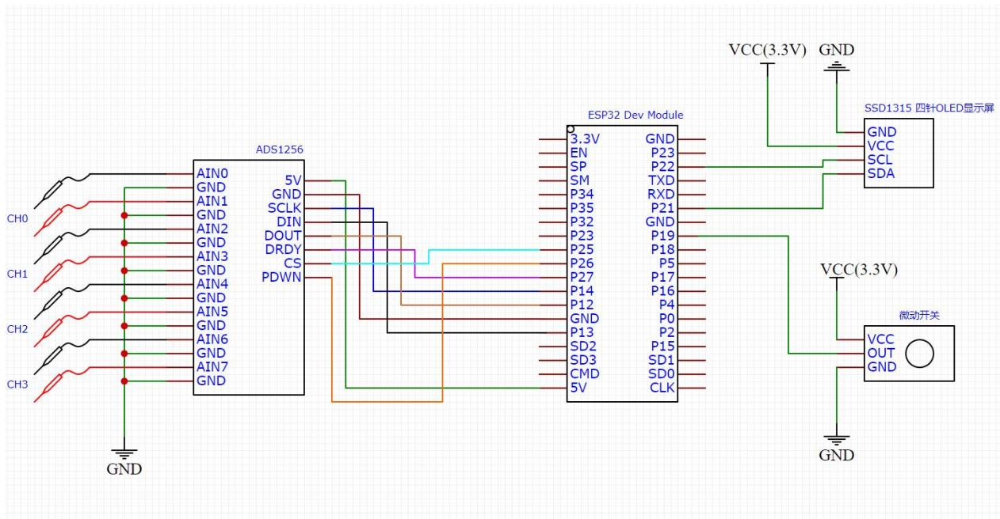

图 4-1 电压信号数据采集器的接线电路图  
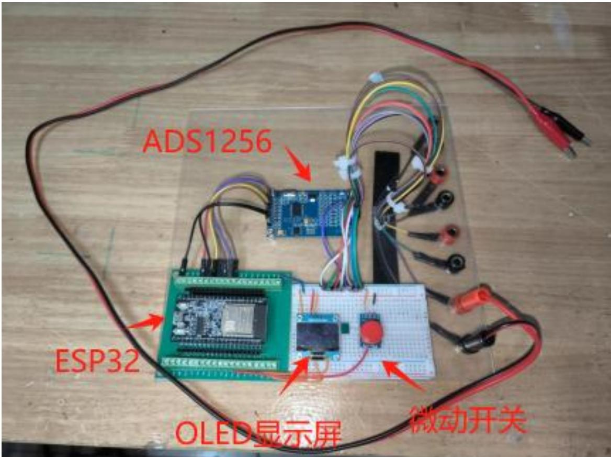  
图 4-2 电压信号数据采集器实物图

表 4-1 电压信号数据采集器的 ESP32 引脚与各模块相连接的引脚及功能表
<table><tr><td>序号</td><td>名称</td><td>功能说明</td></tr><tr><td>1</td><td>P25</td><td>接 ADS1256 的 CS 引脚，低电平选中芯片实现数据交互。</td></tr><tr><td>2</td><td>P26</td><td>接 ADS1256 的 PDWN 引脚，控制功耗与复位，输入低电平时进入休眠模式，输入高电平时恢复工作模式，通过先低后高电平变换实现复位。</td></tr><tr><td>3</td><td>P27</td><td>接 ADS1256 的 CS 引脚，切换功能模块或通道以选采集源。</td></tr><tr><td>4</td><td>P14</td><td>接 ADS1256 的 SCLK 引脚，提供时钟确保数据交互同步准确。</td></tr><tr><td>5</td><td>P12</td><td>接 ADS1256 的 DOUT 引脚，接收转换后的数字信号供 ESP32 读取。</td></tr><tr><td>6</td><td>GND</td><td>接 ADS1256 的 GND 引脚，提供参考地保证电路正常工作。</td></tr><tr><td>7</td><td>P13</td><td>接 ADS1256 的 DIN 引脚，发送控制指令设定工作模式等操作。</td></tr><tr><td>8</td><td>5V</td><td>接 ADS1256 的 5V 引脚，为 ADS1256 提供工作电压。</td></tr><tr><td>9</td><td>P22</td><td>接 SSD1315 的 SCL 引脚，为 OLED 显示屏提供时钟信号，控制数据传输节奏。</td></tr><tr><td>10</td><td>P21</td><td>接 SSD1315 的 SDA 引脚，用于传输数据信号，在 ESP32 与 OLED 显示屏间交互信息。</td></tr><tr><td>11</td><td>P19</td><td>接微动开关的 OUT 引脚，当微动开关按下，OUT 引脚输出高电平，ESP32 控制 ADS1256 切换工作模式。</td></tr></table>

## 3.程序设计

为了实现电压信号数据采集器的功能，我们还必须进行程序设计。ADS1256 最高支持30000Hz的采样频率，但30000hz采样频率仅在连续模式下才可实现。采样频率，通常也被称为采样速度或采样率，它指的是单位时间内从连续信号中提取并组成离散信号的采样个数，单位一般为赫兹（Hz）。若采样频率为 30000Hz，那么在一秒内，仪器将对信号进行30000次采样并记录数据。通常采样频率越高，对信号的还原越好，但高采样也对硬件的性能提出了更高的要求，因此需根据实际需求选择合适的采样频率。ADS1256 的连续模式指的是，ADSl256 连续采样，将数据存储在缓存区，当缓存区数据存满后再将数据发送出去，这样虽实现高采样率，但存在一定的延迟和数据丢失。实时模式指的是，ADS1256采样一次发送一次数据，不在缓存区中存储数据，因此实时模式具有低延迟、无数据丢失特性。在实时模式下，通过代码的优化，ADS1256也可达到1000hz的采样率。1000hz的采样率对于一些低频信号也能较好还原。因此笔者在电路中接入一个微动开关用于切换工作模式，用于匹配不同实验的信号测量需求。主要程序流程图如图 4-3 所示，程序所用到的库、库的版本及功能作用说明如表 4-3所示。

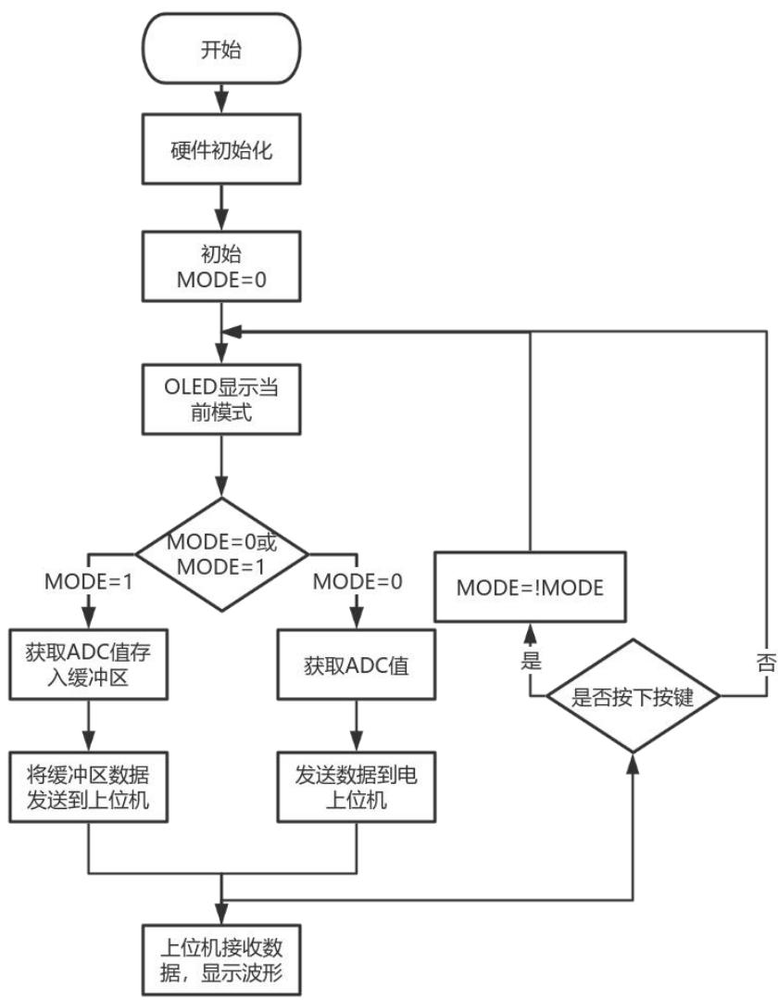

图 4-3 电压信号数据采集器程序流程图  
表 4-2 电压信号数据采集器使用的库功能说明表
<table><tr><td>库名称</td><td>库版本</td><td>功能作用</td></tr><tr><td>ADS1256.h</td><td>1.3.0</td><td>作者是 Curious Scientist，用于对 ADS1256 芯片的支持，它提供了对 ADS1256 的初始化各种各种功能实现方法。</td></tr><tr><td>SPI.h</td><td></td><td>由 Arduino 团队编写，是 Arduino 核心库的一部分，让 ESP32 能利用 SPI 协议与 ADS1256 进行通信。</td></tr><tr><td>Adafruit_SSD1306</td><td>2.5.13</td><td>作者是 Adafruit，针对 SSD1306 芯片控制的 OLED 显示屏驱动。</td></tr><tr><td>Wire.h</td><td></td><td>由 Arduino 团队编写，是 Arduino 核心库的一部分，让 ESP32 能利用 I2C 协议于 OLED 显示屏进行通信。</td></tr></table>

## 3.1 初始化程序

在 arduino 中串口的初始化十分简单，只需一条简单的语句 Serial.begin(115200);即可实现。上述的代码即为串口的初始化语句，其中115200表示设置串口的波特率。串口初始化完成后，将ESP32用micro USB数据线连接电脑，电脑上的上位机软件在参数设置里选择相同的波特率并选择正确的端口后，上位机就能接收到程序中使用Serial.print()、Serial.println()等函数来发送数据，接着绘制出相应的曲线。

```c
（1）OLED 显示屏初始化
#define SCREEN_WIDTH 128
#define SCREEN_HEIGHT 64
#define OLED_RESET -1
Adafruit_SSD1306 display(SCREEN_WIDTH, SCREEN_HEIGHT, &Wire, OLED_RESET);
display.begin(SSD1306_SWITCHCAPVCC, 0x3C);
```

上述代码片段是OLED显示屏初始化主要代码。第四句代码表示创建了名为display的 Adafruit\_SSD1306 类型的对象，SCREEN\_WIDTH 和 SCREEN\_HEIGHT 表示水平方向有 128个像素，在垂直方向有64个像素；&Wire表示OLED 将用I2C 协议与ESP32 通信；OLED\_RESET表示 OLED显示屏不需要外部复位电路。最后一句是真正的初始化，SSD1306\_SWITCHCAPVCC 指定了 OLED 将从外部电源获取电压；0x3C 是 OLED 显示屏在 I2C总线上的设备地址。初始化完成后，我们就可以在程序中使用display.clearDisplay()、display.println()等函数对 OLED 进行清屏、显示文字内容等一些列操作。

（2）ADS1256 的初始化

ADS1256 A(27, 0, 26, 25, 2.500);

SPI.begin(14, 12, 13, 25);

A.InitializeADC();

A.setPGA(PGA\_1);

A.setMUX(DIFF\_0\_1);

A.setDRATE(DRATE\_7500SPS);

上述代码片段第一行表示创建了的ADS1256类的对象A，27、26、25表示ADS1256的 DRDY、PDWN、CS 分别与 ESP32 的 27、26、25 引脚连接；0 表示所用的 ADS1256 芯片无RESET引脚，不使用RESET引脚功能；2.500为内部参考电压。第二行用于初始化 SPI（Serial Peripheral Interface）总线，14 表示 SPI 的时钟线（SCLK）引脚，12 代表SPI的主设备输入从设备输出（MISO）引脚，13指的是主设备输出从设备输入（MOSI）引脚，25是SPI的片选（CS）引脚连接的微控制器引脚。这样便建立了ESP32 与ADS1256之间通过SPI 接口进行通信的基础。第三行便是ADS1256 类对象 A的真正初始化。第四行设置衰减，参数PGA\_1表示增益为一倍，即在参考电压 2.500v的情况下，差分测量将获得±2.500V的量程。第五行设置通道，表示在单通道差分测量的通道为AINO和AIN1组成的CH0通道。最后一行为设置采样率，表示连续模式下最高能达到7500hz 采样率。虽然ADS1256 最高支持30000hz采样，但考虑到实验所测量的信号基本在300hz以下及高采样率下的噪声表现，本装置将采样率设定在7500hz。ADS1256初始化完成后即可使用 A.readSingle()或是 readSingleContinuous()函数进行 ADC 量的采集。

## （3）测量模式切换程序

int MODE = 0;   
#define SWITCH\_PIN 19   
pinMode(SWITCH\_PIN, INPUT\_PULLUP);   
if (digitalRead(SWITCH\_PIN) == HIGH) {   
delay(200);   
if (digitalRead(SWITCH\_PIN) == HIGH) {   
MODE = !MODE;   
if (MODE ==0) {   
A.setMUX(DIFF\_0\_1);   
}   
display.clearDisplay();   
display.setTextSize(2);   
display.setTextColor(SSD1306\_WHITE);   
display.setCursor(0, 0);   
display.println("MODE:" + String(MODE));   
display.display();   
}

这是切换测量模式的主要代码：首先定义了一个 int类型变量 MODE来表示测量模式，定义19引脚为检测微动开关是否按下的输入引脚，当 19 引脚检测到高电平信号，也就是微动开关被按下后，将对 MODE取反，并且如果 MODE变为 0，也就是单通道实时模式，则用 A.setMUX(DIFF\_0\_1)方法将通道改为 CH0 通道，最后再更改 OLED 显示屏上的模式显示信息。

## 3.2 测量电压程序

（1）单通道实时测量程序

```c
if (MODE == 0) {
static uint32_t lastTime = 0;
uint32_t now = millis();
if (now - lastTime >= 1)
{
lastTime = now;
Serial.printf("%.2f\n",A.convertToVoltage(A.readSingle())*1000);
```

当MODE等于 0时进入此测量方法，这里利用了定时重复执行逻辑，使得程序能每毫秒都测量一次CH0通道的ADC值并转化为电压值，并通过串口发送到上位机软件里，也就是每秒完成 1000 次的测量、转化、发送。A.readSingle()和 A.convertToVoltage()都是ADS1256.h库里提供的方法，功能分别是单次读取设定好的通道的ADC值和将 ADC值转化为电压值，将转化好的电压值进行\*1000的计算是为了将电压的单位转化为毫伏。

## （2）多通道连续测量程序

if (MODE == 1) {   
A.setMUX(DIFF\_0\_1);   
for (int i = 0; i < numReadings; i++) {   
readingsChannel0[i] = A.convertToVoltage(A.readSingleContinuous()) \* 1000;   
A.stopConversion();   
}   
A.setMUX(DIFF\_2\_3);   
for (int i = 0; i < numReadings; i++) {   
readingsChannel1[i] = A.convertToVoltage(A.readSingleContinuous()) \* 1000;   
}   
A.setMUX(DIFF\_4\_5);   
for (int i = 0; i < numReadings; i++) {   
readingsChannel2[i] = A.convertToVoltage(A.readSingleContinuous()) \* 1000;   
A.stopConversion();   
}   
A.setMUX(DIFF\_6\_7);   
for (int i = 0; i < numReadings; i++) {   
readingsChannel3[i] = A.convertToVoltage(A.readSingleContinuous()) \* 1000;   
A.stopConversion();   
}   
for (int j = 0; j < numReadings; j++) {   
Serial.print(readingsChannel0[j]);   
Serial.print(",");   
Serial.print(readingsChannel1[j]);   
Serial.print(",");   
Serial.print(readingsChannel2[j]);   
Serial.print(",");   
Serial.println(readingsChannel3[j]);   
}   
}   
当MODE等于 1时程序进入此测量方法：首先用A.setMUX()设定好通道，再进入 for   
循环中使用 A.readSingleContinuous()和 A.convertToVoltage()并\*1000 得到以毫伏为

单位电压值，连续测量、转化2000 次并存入对应的通道浮点型数组缓冲区中；当一个通道测量完2000次后，再使用A.setMUX()函数更换通道进行测量；当四个通道都测量完2000次后，再进入末尾的数据发送循环。该发送循环是依据 FireWater协议风格写的，即每一行四个通道数据用“,”进行分隔，上位机软件才能识别出每行相应的数据属于哪个通道，因此在通道间的数据用“,”分隔，而最后一个通道时再用Serial.println()进行换行发送。

## （二）光电传感器&数据采集器

## 1.测量原理

在笔者改进的实验中，有两个实验需要对速度测量，于是笔者利用ESP32结合光电传感器，制作了了简易的光电传感器&数据采集器。装置采用槽型对射光电传感器，它由一个红外发光二极管和一个NPN 光电三极管组成，槽宽度为 5.9MM，只要非透明物体通过槽间即可触发，当槽中无遮挡挡时，OUT脚输出高电平，当槽中红外线被遮挡时，OUT口输出低电平并且指示灯发光。因此我们将光电传感器的 OUT脚与ESP32相连接，利用ESP32集成的ADC检测OUT脚输出低电平持续时间，再结合遮光片的宽度，即可计算出物体通过光电传感器的瞬时速度。

## 2.硬件设计

光电传感器&数据采集器制作材料有：ESP32 开发板一块、ESP32扩展版一块、光电传感器一个、SSD1315四针OLED显示屏一块、微动开关模块一个、面包板一块、纸板一块、木棒、固定器一个、磁铁座和铁板、杜邦线和导线若干。

光电传感器&数据采集器的电路接线图如图 4-4所示。整个装置由ESP32的microUSB口供电，将ESP32的 3.3V和 GND接到面包板给模块供电。所用到的ESP32引脚与各模块相连接的引脚及功能如表 4-3 所示。OLED 显示屏用来显示测量状态和槽中红外线被遮挡的时间。微动开关的作用是改变测量状态，即当光电传感器槽中红外线被遮挡后，OLED显示屏将显示被遮挡的时间，而此时再次遮挡是无法测量的，需要按下微动开关复位，OLED显示屏显示“Ready”才可以再次测量。将各模块用杜邦线和导线连接并固定在纸板上，而光电传感器固定在用木棒、固定器、磁铁坐和铁板制作的可调节高度支架上，再用长杜邦线与装置相连接。制作完成的整个装置如图 4-5所示。

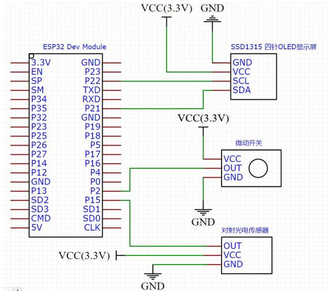  
图 4-4 光电传感器&数据采集器的电路接线图

表 4-3 数据采集器的 ESP32 引脚与各模块相连接的引脚及功能表
<table><tr><td>序号</td><td>名称</td><td>功能说明</td></tr><tr><td>1</td><td>P22</td><td>接 SSD1315 的 SCL 引脚，为 OLED 显示屏提供时钟信号，控制数据传输节奏。</td></tr><tr><td>2</td><td>P21</td><td>接 SSD1315 的 SDA 引脚，用于传输数据信号，在 ESP32 与 OLED 显示屏间交互信息。</td></tr><tr><td>3</td><td>P2</td><td>接微动开关的 OUT 引脚，当微动开关按下，OUT 引脚输出高电平，ESP32 控制改变测量状态。</td></tr><tr><td>4</td><td>P15</td><td>接对射光电传感器的 OUT 引脚，用于测量槽间红外线被遮挡的时间。</td></tr></table>

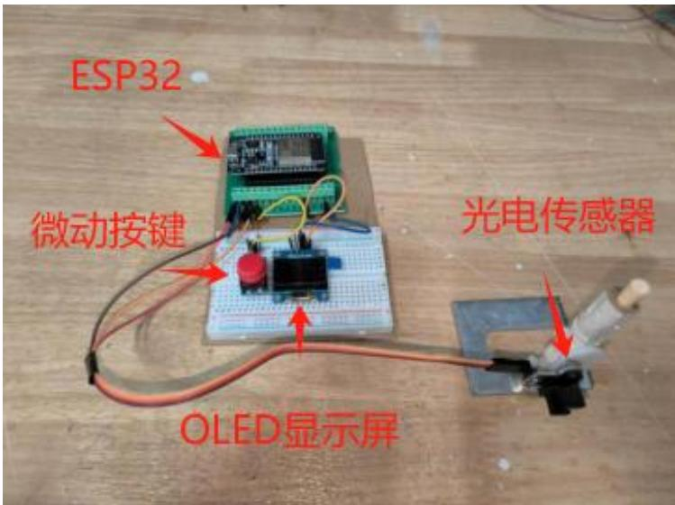  
图 4-5 光电传感器&数据采集器实物图

## 3.程序设计

光电传感器&数据采集器的程序比较简单，主要程序流程图如图 4-6 所示。程序所用到的库也不多，都是用于OLED显示屏的通信与控制，如表 4-5所示。程序中最关键的部分是 ESP32记录光电传感器被遮挡时间的代码，程序使用了pulseIn(IN\_PIN, LOW,1000000)函数记录IN\_PIN引脚接收到低电平的持续时间来电传感器被遮挡时间，进而再通过I2C协议将时间发送至OLED 显示屏上完成显示。

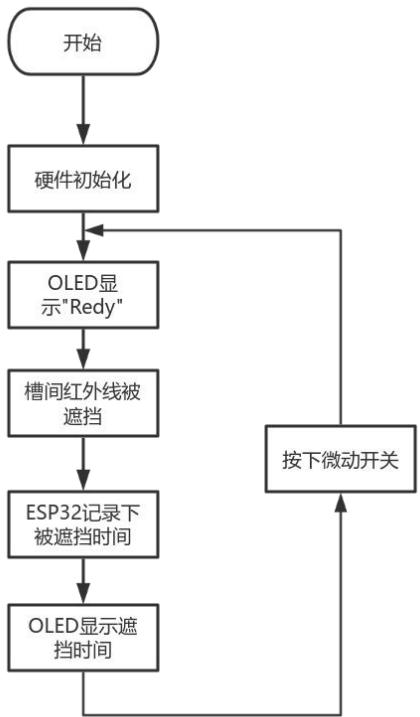

图 4-6 光电传感器&数据采集器程序流程图  
表 4-4 光电传感器&数据采集器程序使用的库功能说明表
<table><tr><td>库名称</td><td>库版本</td><td>功能作用</td></tr><tr><td>Wire.h</td><td></td><td>由 Arduino 团队编写，是 Arduino 核心库的一部分，让 ESP32 能利用 I2C 协议于 OLED 显示屏进行通信。</td></tr><tr><td>Adafruit_SSD1306</td><td>2.5.13</td><td>作者是 Adafruit，针对 SSD1306 芯片控制的 OLED 显示屏驱动。</td></tr></table>

## 1）初始化程序

光电传感器&数据采集器的程序涉及到初始化的模块只有 OLED显示屏模块，ESP32连接OLED 显示屏的引脚与本章介绍的电压信号数据采集器的一致，其初始化的代码也是一致的，这里不再复述。

## 2）测量状态切换程序

```c
#define SWITCH_PIN 2
bool measuring = true;
pinMode(SWITCH_PIN, INPUT_PULLUP);
if (digitalRead(SWITCH_PIN) == HIGH) {
delay(200);
if (digitalRead(SWITCH_PIN) == HIGH) {
measuring = true;
display.clearDisplay();
```

display.setCursor(0, 0);   
display.setTextSize(2);   
display.print("Ready");   
display.display();   
}   
}

这是切换测量状态的主要代码，首先定义了一个bool 类型变量 measuring 来表示测量状态，只有当measuring为true时，才可以进行测量。2 引脚为检测微动开关是否按下的输入引脚，当2 引脚检测到输入高电平，也就是微动开关被按下后，进行复位，将 measuring 取 ture，在 OLED 显示屏显示“Ready”，表示现在可以进行测量。

## 3）测量光电传感器被遮挡时间程序

if (measuring) {   
unsigned long duration = pulseIn(IN\_PIN, LOW, 1000000);   
if (duration > 0) {   
measuring = false;   
float duration\_ms = duration / 1000.0;   
Serial.print("t: ");   
Serial.print(duration\_ms);   
Serial.println(" ms");   
display.clearDisplay();   
display.setCursor(0, 0);   
display.setTextSize(2);   
display.print("t: ");   
display.print(duration\_ms);   
display.println(" ms");   
display.display();   
}   
}

当 measuring 为 true 时，程序才能进入 if 判断后的语句。unsigned long duration= pulseIn(IN\_PIN, LOW, 1000000)为测量的关键语句，duration 是一个无符号长整型数，pulseIn函数的主要作用是测量在一个数字引脚上特定电平的脉冲持续时间，这里是测量低电平LOW，1000000是超时时间，以微秒为单位。测量完成后将measuring 改为false，将 duration 除以 1000.0 是将微秒转化为毫秒存在浮点型 duration\_ms 中，最后在 OLED显示屏将测量得到的时间以t：xxx ms的格式显示出来，完成一次测量。

## （三）简易高斯计

## 1.测量原理

在安培力演示实验和探究影响线圈切割磁感线的感应电动势大小因素实验中，我们需要能改变磁感应强度的U型磁铁装置。除此之外还需要对U 型磁铁装置中心的磁感应强度大小进行测定，以此研究安培力大小和线圈切割磁感线的感应电动势大小与磁感应强度的关系。因此，笔者选用线性霍尔传感器模块配合 16 位模数转换器ADS1115测量磁感应强度，再通过ESP32进行数据采集，然后在OLED 显示屏模块上显示磁感应强度。

线性霍尔传感器模块的测量原理是：当给提供 5V电压时，若无磁感线穿过霍尔传感器探头，其 OUT引脚输出电压为5V的一半2.5V，当磁感线从霍尔传感器探头印字面（上面）穿过时，AO引脚的输出电压将随磁场强度增加而线性升高；相反，当磁感线从霍尔传感器探头无字面（下面）穿过，OUT引脚的输出电压将随磁场强度增加而线性升降低。此线性霍尔传感器模块的灵敏度为1.4mV/GS（GS 为磁感应强度单位高斯，转换关系为：1T=10000GS),该传感器AO 引脚输出电压在磁感应强度在±1000GS范围内有较好的线性度，因此再配合ADS1115 对线性霍尔传感器AO 引脚电压进行测量，根据所测量的电压反推计算出磁感应强度，再将磁感应强度在 OLED 显示屏上显示。

## 2.硬件设计

简易高斯计的制作材料有：ESP32开发板一块、ESP32扩展版一块、线性磁力霍尔传感器一个、ADS1115模块一个、SSD1315四针OLED显示屏一块、面包板一块、纸板一块、木棒、固定器两个、铁板、杜邦线和导线若干。

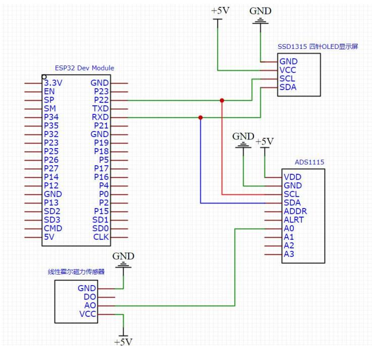  
图 4-7 简易高斯计的电路接线图

简易高斯计的电路接线图如图 4-7所示。所用到的 ESP32 引脚与各模块相连接的引脚及功能如表 4-5 所示。整个装置由 ESP32 的 micro USB 口供电，再将 ESP32 的 5V 引脚与GND引脚与面包板连接，为线性磁力霍尔传感器、ADS1115 模块、OLED显示屏进行供电。线性磁力霍尔传感器与ADS1115模块是共地的，因此将线性磁力霍尔传感器的 AO引脚与 ADS1115 的 A0 通道连接，只需单通道 A0 即可完成对线性磁力霍尔传感器的 AO引脚的电压进行测量。制作完成的整个装置如图 4-8 所示。

表 4-5 简易高斯计 ESP32 引脚与各模块相连接的引脚及功能表
<table><tr><td>序号</td><td>名称</td><td>功能说明</td></tr><tr><td>1</td><td>P22</td><td>接 SSD1315 的 SCL 引脚和 ADS1115 的 SCL 引脚，为 OLED 显示屏和 ADS1115 提供时钟信号，控制数据传输节奏。</td></tr><tr><td>2</td><td>P21</td><td>接 SSD1315 的 SDA 引脚和 ADS1115 的 SDA 引脚，用于传输数据信号，ESP32 与 OLED 显示屏、ADS1115 间交互信息。</td></tr></table>

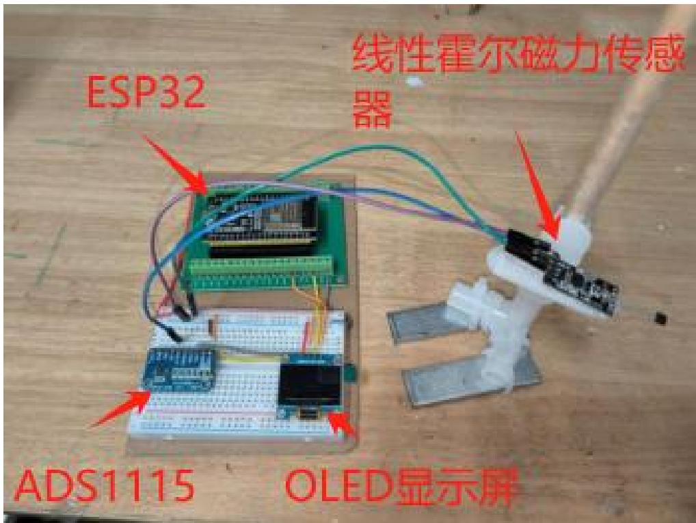  
图 4-8 简易高斯计实物图

## 3.程序设计

简易高斯计的程序比较简单，主要程序流程图如图 4-9 所示，所用到的库如表 4-6所示。程序中最关键的部分是 ADS1115 测量 AO 引脚电压，并转化为磁感应强度代码，程序采用了多次测量累加求平均值的的方法测量磁感应强度，最后再通过I2C协议将磁感应强度在OLED显示屏上完成显示。

表 4-6 简易高斯计使用的库功能说明表
<table><tr><td>库名称</td><td>库版本</td><td>功能作用</td></tr><tr><td>Wire.h</td><td></td><td>由 Arduino 团队编写，是 Arduino 核心库的一部分，让 ESP32 能利用 I2C 协议于 OLED 显示屏和 ADS1115 进行通信。</td></tr><tr><td>Adafruit_SSD1306</td><td>2.5.13</td><td>作者是 Adafruit，针对 SSD1306 芯片控制的 OLED 显示屏驱动。</td></tr><tr><td>Adafruit_ADS1X15.h</td><td>2.4.2</td><td>作者是 Adafruit，用于对 ADS1115 芯片的支持，它提供了对 ADS1115 的初始化、配置、数据采集等功能实现方法。</td></tr></table>

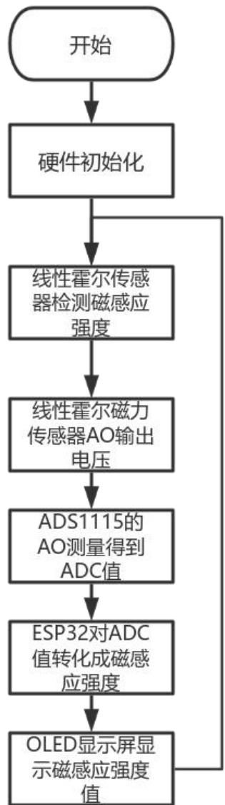  
图 4-9 简易高斯计程序流程图

## 3.1 初始化程序

## 1）OLED显示屏初始化

ESP32 连接OLED显示屏的引脚与本章介绍的电压信号数据采集器的一致，其初始化的代码也是一致的，这里不再复述。

## 2）ADS1115 初始化

Adafruit\_ADS1115 ads;   
ads.begin();   
ads.setGain(GAIN\_ONE);   
ads.setDataRate(RATE\_ADS1115\_860SPS);

以上是 ADS1115 初始化的主要代码，先创建了一个 Adafruit\_ADS1115 类对象 ads，再调用 ads.begin()函数初始化 ADS1115 设备。ads.setGain()为设置增益函数，增益设为 GAIN\_ONE，ADS1115在单通道下将获得 0 到+4.096V 的量程，而线性霍尔传感器模块在±1000GS 磁感应强度范围内，输出电压范围为 1.100V 到 3.900V，因此在此增益下ADS1115 的量程能覆盖线性霍尔传感器模块 AO 引脚在±1000GS 磁感应强度下的电压输出范围。ads.setDataRate()是设定ADS1115采样率的函数，在本程序里设定为最高采样率 860Hz。

## 3.2 电压测量及转化程序

const int sampleCount = 30;   
float totalGauss = 0;   
for (int i = 0; i < sampleCount; i++) {   
int16\_t adc\_value = ads.readADC\_SingleEnded(0);   
float voltage = adc\_value \* (4.096 / 32768.0) \* 1000;   
float GAUSS = (voltage - 2320)/ 1.4;   
totalGauss += GAUSS;   
delay(100);   
}   
float averageGauss = totalGauss / sampleCount;

以上是电压测量及转化为磁感应强度的代码，在 for 循环里每 100 毫秒用ads.readADC\_SingleEnded(0)测量得到一次 ADS1115 的 A0 通道的 ADC 值赋值到 adc\_value里，再用语句 voltage = adc\_value \* (4.096 / 32768.0) \* 1000 将 adc\_value 转化为电压值 voltage 单位是毫伏，再将 voltage 用 GAUSS = (voltage - 2320)/ 1.4 语句转化为磁感应强度值 GAUSS，再累加到 totalGauss里，在 3 秒内累加得到 30 次的磁感应强度和后，再用 averageGauss = totalGauss / sampleCoun 语句计算平均磁感应强度。最后将测量得到的平均磁感应强度用 display.print()函数在 OLED 显示屏以 B：xxx Gauss

的格式显示出来，完成一次测量。

## （四）压力&电流一体测量装置

## 1.测量原理

压力&电流一体测量装置是为了安培力演示实验专门制作的。测量压力是利用HX711模块+压力传感器套件实现的：给压力传感器加 5-10V 驱动电压，压力传感器受压力会输出电压信号，HX711 采集压力传感器输出的电信号转化为数字信号输出给 ESP32。本装置使用的压力传感器受力范围为0-1KG，分辨率为1g，即可以测量最大的压力为9.8N，测量到分辨率为0.0098N。

电流的测量是利用ADS1115实现的，实现方法是：利用ADS1115的A0和A1两个通道组成差分测量通道，在A0和A1间接入1欧姆的电阻R1，将电阻串联接入电路，ADS1115测量A0和 A1 两端的电压差，再用电压差除以R1 的阻值计算出通过R1的电流。ADS1115是 16 位的模数转换器，在 GAIN\_ONE 增益设定下，理论上可以获得 4.096 /32768.0=0.0000125V的电压分辨率，即0.125毫伏的分辨率，能满足测量毫安级别的电流需求。

## 2.硬件设计

压力&电流一体测量装置的制作材料有：ESP32开发板一块、ESP32扩展版一块、HX711模块+压力传感器套件、ADS1115 模块一个、SSD1315 四针 OLED 显示屏一块、微动开关一个、面包板一块、纸板一块、固定压力传感器的架子一个、杜邦线和导线若干。

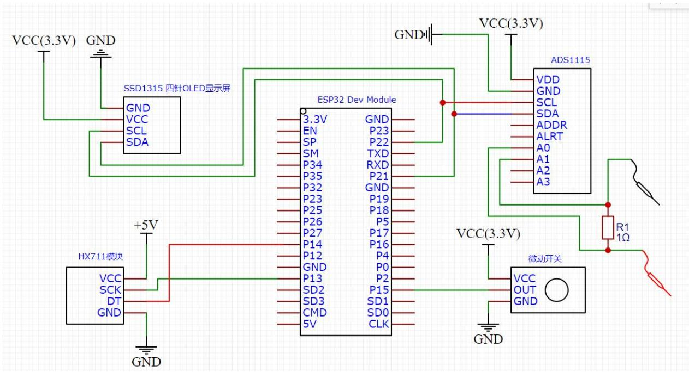  
图 4-10 压力&电流一体测量装置的电路接线图

表 4-7 压力&电流一体测量装置 ESP32 引脚与各模块相连接的引脚及功能表
<table><tr><td>序号</td><td>名称</td><td>功能说明</td></tr><tr><td>1</td><td>P14</td><td>接 HX711 的 SCK 引脚，为 HX711 提供时钟信号，用于控制数据传输节奏。</td></tr><tr><td>2</td><td>P13</td><td>接 HX711 的 DT 引脚，作为 SPI 通信中的数据输入引脚，用于接收 HX711 发送过来的数据。</td></tr><tr><td>3</td><td>P22</td><td>接 SSD1315 的 SCL 引脚，为 OLED 显示屏提供时钟信号，用于控制数据传输节奏。</td></tr><tr><td>4</td><td>P21</td><td>接 SSD1315 的 SDA 引脚，用于传输数据信号，在 ESP32 与 OLED 显示屏间交互信息。</td></tr><tr><td>5</td><td>P15</td><td>接微动开关的 OUT 引脚，当微动开关按下，OUT 引脚输出高电平，ESP32 对 HX711 校正零点。</td></tr></table>

压力&电流一体测量装置的电路接线图如图 4-10 所示。所用到的ESP32引脚与各模块相连接的引脚及功能如表 4-7 所示。整个装置由 ESP32 的 micro USB 口供电，再将ESP32的 3.3V 引脚与 GND 引脚与面包板连接，为 ADS1115 模块、OLED显示屏进行供电。HX711 模块则由 ESP32 扩展版上的 5V 和 GND 供电。在 ADS1115 的 A0 和 A1 之间插入一个1 欧姆的电阻 R1，再从 A0 和 A1 各引出一条导线用于将 R1 串联入需要测量的电路。制作完成的整个装置如图 4-11所示。

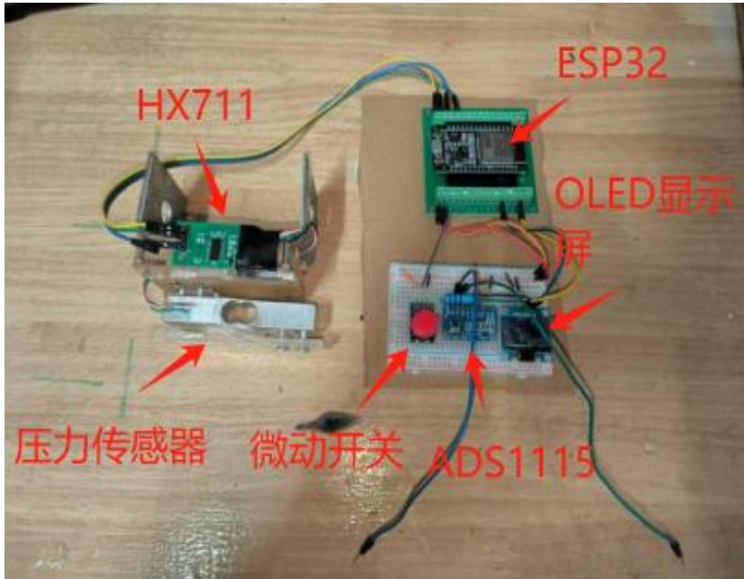  
图 4-11 压力&电流一体测量装置实物图

## 3.程序设计

压力&电流一体测量装置的主要程序流程图如图 4-12 所示，所用到的库如表 4-8所示。程序中关键的部分是ADS1115测量AO和 A1 组成差分通道的电压差并

表 4-8 压力&电流一体测量装置使用库功能说明表
<table><tr><td>库名称</td><td>库版本</td><td>功能作用</td></tr><tr><td>Wire.h</td><td></td><td>由 Arduino 团队编写，是 Arduino 核心库的一部分，让 ESP32 能利用 I2C 协议于 OLED 显示屏和 ADS1115 进行通信。</td></tr><tr><td>Adafruit_SSD1306</td><td>2.5.13</td><td>作者是 Adafruit，针对 SSD1306 芯片控制的 OLED 显示屏驱动。</td></tr><tr><td>Adafruit_ADS1X15.h</td><td>2.4.2</td><td>作者是 Adafruit，用于对 ADS1115 芯片的支持，提供了对 ADS1115 的初始化、配置、数据采集等功能实现方法。</td></tr><tr><td>HX711.h</td><td>0.7.4</td><td>作者是 Bogdan Necula，用于对 HX711 芯片的支持，提供了初始化、零点校正、数据采集等功能实现方法。</td></tr><tr><td>SPI.h</td><td></td><td>由 Arduino 团队编写，是 Arduino 核心库的一部分，让 ESP32 能利用 SPI 协议与 ADS1256 进行通信。</td></tr></table>

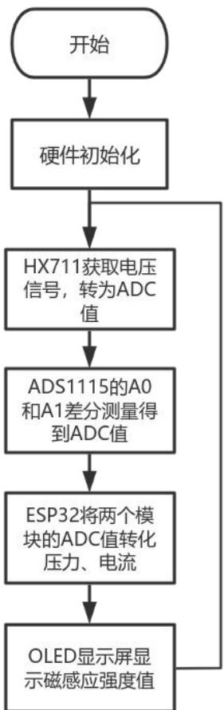  
图 4-12 压力&电流一体测量装置程序流程图

计算通过 R1 电流的代码和 ESP32 获取 HX711 传送来的数据并转化为压力值的大小的代码。最后将计算得到的电流值和压力值在OLED 显示屏上完成显示。

## 3.1 初始化程序

## （1）OLED 显示屏初始化

ESP32 连接OLED显示屏的引脚与本章介绍的电压信号数据采集器的一致，其初始化的代码也是一致的，这里不再复述。

## （2）ADS1115 初始化

ESP32 连接ADS1115的引脚与本章介绍的简易高斯计的一致，其初始化的代码也是一致的，这里不再复述。

（3）HX711 初始化  
const int LOADCELL\_DOUT\_PIN = 13;  
const int LOADCELL\_SCK\_PIN = 14;  
HX711 scale;  
scale.begin(LOADCELL\_DOUT\_PIN, LOADCELL\_SCK\_PIN);  
scale.tare();  
scale.set\_scale(713.f);

以上是 HX711 的初始化代码，先定义了 13 和 14 引脚作为连接 HX711 的 DT 和 SCK引脚。然后创建HX711类的对象scale，用调用scale.begin()初始化函数，初始化成功后调用 scale.tare()执行零点校正，最后调用 scale.set\_scale(713.f)函数设置比例系数。

比例系数 k 的确定方法：先填将 1000.f 填入 scale.set\_scale()里，启动程序，将已知质量的m g的物体放在传感器上，调用scale.get\_units(10)函数得到数值n。比例系数k和m以及测量值n存在关系：km=n。为了能让测量值等于m，可将关系式变换为1000\*（m/n）\*m=m，因此可以通过已知 m g物体和测量值 n获得正确比例系数为 1000\*（m/n）。

## 3.2 电流测量程序

int16\_t adc\_diff = ads.readADC\_Differential\_0\_1();   
float voltage = adc\_diff \*4.096 / 32768.0 \* 1000;   
float R = 1;   
float I = voltage / R;

以上是电流测量程序的语句，用 ads 对象调用 ads.readADC\_Differential\_0\_1()函数得到通道 A0 和 A1 的差分 ADC 值赋值给 adc\_dif，再将 adc\_dif 经过 adc\_diff \*4.096

/ 32768.0 \* 1000 计算得到电压值 voltage，最后将 voltage 除以 R1 阻值 R 得到电流 I，之后便可以在 OLED 显示屏中显示电流值。

## 3.3 压力测量程序

float weight = scale.get\_units(10) \* 9.8 / 1000;

在经过校准后，HX711能将压力传感器受到的压力以 g为单位的进行数字输出。通过 scale 对象调用执行 scale.get\_units(10)函数返回得到以 g 为单位的压力，10 表示测量10次取平均值，再通过\*9.8/1000变换得到以N为单位的压力，之后便可以在 OLED显示屏上显示出压力值。

## 3.4 微动开关零点校正程序

const int BUTTON\_PIN = 15;   
if (digitalRead(BUTTON\_PIN) == HIGH) {   
scale.tare();   
delay(100); }

因为在测量线圈的安培力时，需要测量到0.01N 这一尺度的压力，压力传感器在受力后因为结构原因会残留0.01N的压力。因此为了能随时进行零点校正，笔者在装置内增加一个微动开关。定义15引脚为检测微动开关是否按下的输入引脚，当15引脚检测到高电平，也就是微动开关被按下后，程序执行scale.tare()函数，进行压力清零。

## （五）波形发生器装置

## 1.工作原理

波形发生器装置是为了完成探究感应电动势与磁通量变化率的关系实验和互感现象演示实验制作的。本装置的关键模块是AD9833波形发生器芯片和8002b功放模块：AD9833 是一款可编程波形发生器，可通过SPI通信控制AD9833 输出几赫兹到几十兆赫的正弦波、三角波、方波信号；8002b 功放模块（本装置的8002b功放模块由8002b 贴片焊接至在嘉立创平台定制的pcb 板制作而成，模块的电路详见附录）能将信号的功率放大，放大后的信号可用来驱动线圈，线圈便能在空间中能激发出相应波形变化的磁场，以此进行相应的实验。

## 2.硬件设计

波形发生器装置的制作材料有：ESP32开发板一块、AD9833波形发生器芯片一块、SSD1315四针OLED显示屏一块、四位独立键模块一个、面包板 2块、纸板一块、8002b功放模块、杜邦线和导线若干。

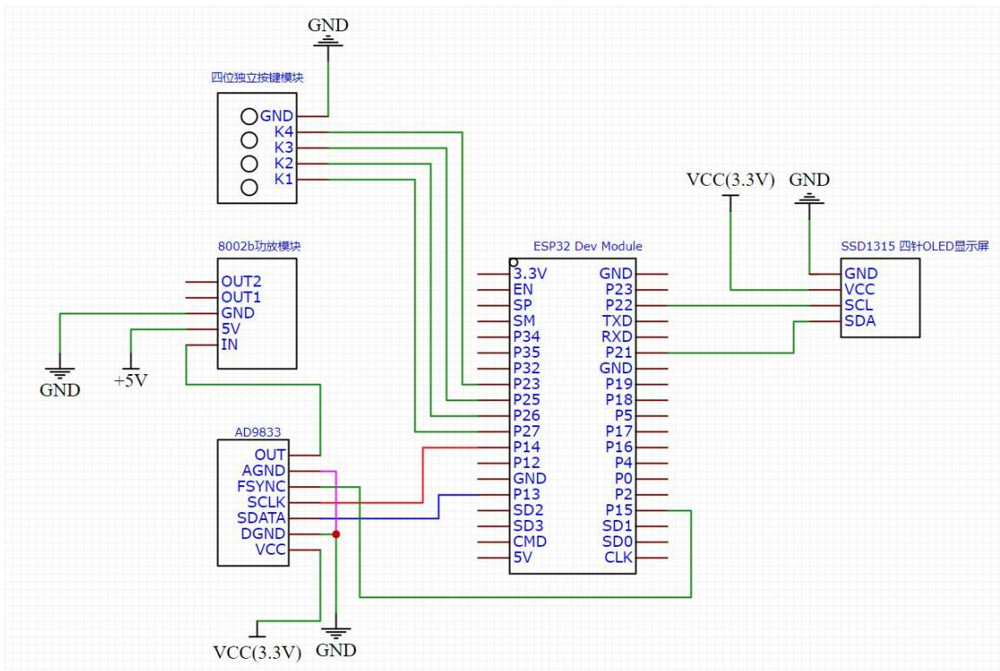  
图 4-13 波形发生器装置的电路接线图

表 4-9 波形发生器装置 ESP32 引脚与各模块相连接的引脚及功能表
<table><tr><td>序号</td><td>名称</td><td>功能说明</td></tr><tr><td>1</td><td>P23、P25、P26、P27</td><td>接四位独立键模块的 K4、K3、K2、K1 引脚，ESP32 通过检测引脚电平变化，改变 AD9833 的输出波形、频率。</td></tr><tr><td>2</td><td>P14</td><td>接 AD9833 的 SCLK 引脚，作为 SPI 通信中的时钟引脚，提供时钟信号，为数据传输提供了同步的节奏。</td></tr><tr><td>3</td><td>P13</td><td>接 AD9833 的 SDATA 引脚，用于传输数据信号，用于 ESP32 输出波形、频率调整的数据。</td></tr><tr><td>4</td><td>P15</td><td>接 AD9833 的 FSYNC 引脚，在 SPI 通信中起到选择片的作用。</td></tr><tr><td>5</td><td>P22</td><td>接 SSD1315 的 SCL 引脚，为 OLED 显示屏提供时钟信号，控制数据传输节奏。</td></tr><tr><td>6</td><td>P21</td><td>接 SSD1315 的 SDA 引脚，用于传输数据信号，在 ESP32 与 OLED 显示屏间交互信息。</td></tr></table>

波形发生器装置的电路接线图如图 4-13所示，所用到的 ESP32 引脚与各模块相连接的引脚及功能如表 4-9 所示。整个装置由 ESP32 的 micro USB 口供电，再将 ESP32 的 3.3V引脚和5V 引脚与GND引脚引出，为AD9833模块、OLED 显示屏、8002b 功放模块进行供电。接入四位独立键模块是为了方便我们通过按键更改 AD9833 输出的波形和频率，以完成不同实验。制作完成的整个装置如图 4-14 所示。

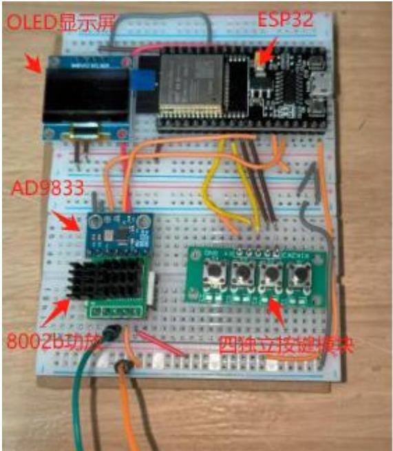  
图 4-14 波形发生器装置实物图

## 3.程序设计

波形发生器装置的主要程序流程图如图 4-15 所示，所用到的库如表 4-10 所示。程序中关键的部分是AD9833的初始化和四位独立键模块修改波形和频率部分代码，OLED显示屏用来显示当前波形和频率信息。

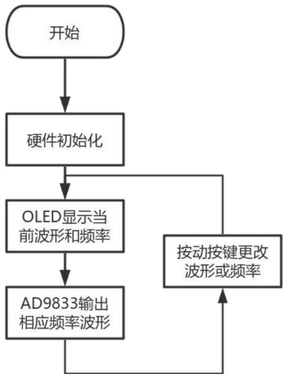  
图 4-15 波形发生器装置程序流程图

表 4-10 波形发生器装置使用库功能说明表
<table><tr><td>库名称</td><td>库版本</td><td>功能作用</td></tr><tr><td>Adafruit_SSD1306.h</td><td>2.5.13</td><td>作者是 Adafruit，针对 SSD1306 芯片控制的 OLED 显示屏驱动。</td></tr><tr><td>SPI.h</td><td></td><td>由 Arduino 团队编写，是 Arduino 核心库的一部分，使 ESP32 能利用 SPI 协议与 AD9833 进行通信。</td></tr><tr><td>Wire.h</td><td></td><td>由 Arduino 团队编写，是 Arduino 核心库的一部分，使 ESP32 能利用 I2C 协议于 OLED 显示屏进行通信。</td></tr><tr><td>AD9833.h</td><td>0.4.3</td><td>由 Rob Tillaart 编写，用于对 AD9833 芯片的支持，它提供了对 AD9833 的初始化、波形频率产生和更改的方法。</td></tr></table>

## 3.1 初始化程序

## （1）OLED 显示屏初始化

ESP32 连接OLED显示屏的引脚与本章介绍的电压信号数据采集器的一致，其初始化的代码也是一致的，这里不再复述。

## （2）AD9833 初始化

```c
#define AD9833_PIN_SEL 15
#define AD9833_PIN_SCK 14
#define AD9833_PIN_MISO -1
#define AD9833_PIN_MOSI 13
#define AD9833_PIN_SS -1
AD9833 AD(AD9833_PIN_SEL);
int currentWaveform = AD9833_SINE;
int currentFrequency = 0;
SPI.begin(AD9833_PIN_SCK,AD9833_PIN_MISO,AD9833_PIN_MOSI,AD9833_PIN_SS);
AD.begin();
AD.setWave(currentWaveform);
AD.setFrequency(currentFrequency, 0);
```

以上是AD9833 初始化的代码，先定义了15、14、13引脚为选片、时钟、数据发送引脚，然后创建 AD9833 类对象 AD，构造参数中传入 AD9833\_PIN\_SEL 表示 ESP32 将能从15引脚选中AD9833。调用SPI.begin()函数，传入之前定义的SPI相关引脚作为参数，建立起主设备（ESP32）和AD9833芯片之间的 SPI通信链路，再调用AD.begin()初始化函数，真正实现 AD9833 初始化。AD.setWave()和 AD.setFrequency()是设定波形和频率的函数，初始设定为0Hz的正弦波。

## 3.2 更改波形&频率程序

```cpp
const int buttonPins[] = {BUTTON_PIN_1, BUTTON_PIN_2, BUTTON_PIN_3, BUTTON_PIN_4};
for (int i = 0; i < buttonCount; i++) {
int buttonState = digitalRead(buttonPins[i]);
if (buttonState == LOW) { // Button is pressed
handleButtonPress(i);
while (digitalRead(buttonPins[i]) == LOW);
}
}
```

程序先定义了四个按键引脚编号，存入 buttonPins[]数组中，在for循环里不断检测引脚电平状态，当按下某个按键时，该按键的引脚将会和 GND连接，ESP32可以通过digitalRead(buttonPins[i])函数检测到该引脚的电平为低电平，此时将程序将会执行handleButtonPress(i)去执行对应按键的事件。笔者设定 K4 为更改波形，K3 为频率+10Hz，K2 为频率+50Hz，K1 为频率清零。在 handleButtonPresssetWave()函数中也是通过调用AD.setFrequency()和 AD.setFrequency()对波形和频率进行更改，完成更改后程序再调用Adafruit\_SSD1306.h库内的函数更改OLED显示屏上显示的波形和频率的信息，具体代码详见附录。

## 五、自制教具在高中物理电磁学实验中的应用

本章节主要展示笔者将基于ESP32制作的一系列实验教具应用于电磁学实验的五个案例，每个实验案例的实验背景、实验装置制作、基于 ESP32 制作的教具在实验中的作用、实验操作、实验结果都会被详细的展示。本研究各实验所用的ESP32 教具作用说明如表 5-1所示。

表 5-1 各实验使用到的 ESP32 教具作用说明表
<table><tr><td rowspan=1 colspan=1>实验</td><td rowspan=1 colspan=1>使用到的 ESP32 教具</td><td rowspan=1 colspan=1>作用</td></tr><tr><td rowspan=2 colspan=1>法拉第电磁感应定律实验</td><td rowspan=1 colspan=1>电压信号数据采集器</td><td rowspan=1 colspan=1>采集线圈的电压信号。</td></tr><tr><td rowspan=1 colspan=1>光电传感器&amp;数据采集器</td><td rowspan=1 colspan=1>测量强磁体穿过线圈时的速度。</td></tr><tr><td rowspan=2 colspan=1>探究影响线圈切割磁感线的感应电动势大小因素实验</td><td rowspan=1 colspan=1>电压信号数据采集器</td><td rowspan=1 colspan=1>采集线圈的电压信号。</td></tr><tr><td rowspan=1 colspan=1>光电传感器&amp;数据采集器</td><td rowspan=1 colspan=1>测量线圈切割磁感线时的速度。</td></tr><tr><td rowspan=2 colspan=1>探究感应电动势与磁通量变化率的关系实验</td><td rowspan=1 colspan=1>波形发生器装置</td><td rowspan=1 colspan=1>为线圈A提供可变频率的三角波。</td></tr><tr><td rowspan=1 colspan=1>光电传感器&amp;数据采集器</td><td rowspan=1 colspan=1>采集线圈A、线圈B的电压信号，采集显示磁感应强度变化的电压信号。</td></tr><tr><td rowspan=1 colspan=1>安培力演示实验</td><td rowspan=1 colspan=1>压力&amp;电流一体测量装置</td><td rowspan=1 colspan=1>测量通过线圈的电流以及通电线圈受到的安培力。</td></tr><tr><td rowspan=2 colspan=1>互感现象演示实验</td><td rowspan=1 colspan=1>波形发生器装置</td><td rowspan=1 colspan=1>为初级线圈提供150hz的正弦波。</td></tr><tr><td rowspan=1 colspan=1>电压信号数据采集器</td><td rowspan=1 colspan=1>采集初级线圈、次级线圈的电压信号。</td></tr><tr><td rowspan=1 colspan=1>U型磁铁与强度测定</td><td rowspan=1 colspan=1>简易高斯计</td><td rowspan=1 colspan=1>测定不同数量方形磁铁下U型磁铁内的磁感应强度。</td></tr></table>

## （一）法拉第电磁感应定律实验

## 1.实验背景

## 1.1 教材背景

法拉第电磁感应定律在 2019 年人教版高中物理选择性必修二的表述为：闭合电路中感应电动势的大小，跟穿过这一电路的磁通量变化率成正比，用公式表所示为$E = n { \frac { \Delta \phi } { \Delta t } }$ ，其中n表示闭合电路线圈匝数， $\frac { \Delta \phi } { \Delta t }$ 表示在极短的时间t内线圈的磁通量变化量为 $\Delta \phi$ ，则 $\Delta \phi$ 与t之比 $\frac { \Delta \phi } { \Delta t }$ 为磁通量变化率。法拉第电磁感应定律是高中物理的重要定律，但教材对于法拉第电磁感应定律这仅在做一做栏目（如图 5-1所示）提供了一个简单的定性实验后，就直接给出此定律的内容和相关公式。

笔者研究发现，此方案存在以下不足：电压表指针摆动较快不易观察；磁体下落经过线圈时的感应电动势是瞬时量，而物理实验所用的学生电压表适合测量恒定电压，用于测量瞬时量误差较大。本研究改进的目的是：在不改变实验原理的前提下，将此实验从定性实验改进为定量实验，提升实验的说服力。笔者参考教材提供的实验原型，结合基于ESP32制作的电压信号数据采集器和光电传感器数据采集器，制作完成了基于法拉第电磁感应定律定量探究实验教具。

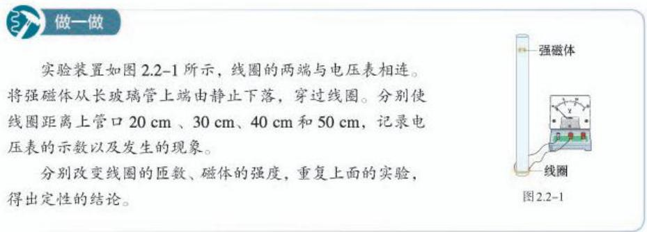  
图 5-1 选择性必修二法拉第电磁感应定律做一做栏目

## 1.2 相关研究

前人对法拉第电磁感应定律实验改进做了许多研究，取得了不错的成果，比较有代表性的方案有如下方案：杨婕将教材原方案进行改进，结合朗威DIS系统进行实验，利用朗威DIS的电压采集模块对透明管上不同高度线圈的感应电动势进行采集，实现了法拉第电磁感应定律定量探究<sup>[26]</sup>，装置如图 5-2 所示。杜苛等人的方案是基于气垫导轨结合数字实验系统对实验进行改进，他们将装载了磁铁的小车用不同的穿过螺线圈，利用光电门模块和微电流模块对小车速度与螺线圈的电流进行测量，实现了法拉第电磁感应更为准确的定量验证<sup>[27]</sup>，其实验装置设计图如图 5-3 所示。张应帅等人创新性地使用调速电机结合曲柄滑杆机构控制磁铁穿过线圈的速度，而线圈的电动势则是用朗威DIS系统是的电压采集模块测量<sup>[28]</sup>，其实验装置如图 5-4 所示。卢佳妮等人则将原实验的“落体法”改为“旋转法”，用调速电机改变磁铁扫过线圈的速度，用 ESP32 结合ADS1115模块对线圈的感应电动势进行采集并发送至手机上的Phyphox 软件显示<sup>[29]</sup>，其实验装置如图 5-5所示。

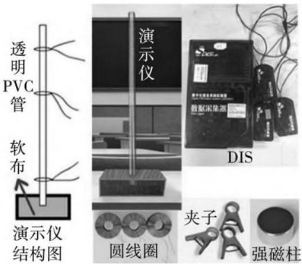  
图 5-2 杨婕的实验装置图

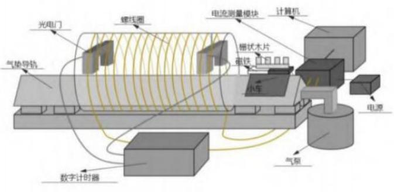  
图 5-3 杜苛的实验装置图

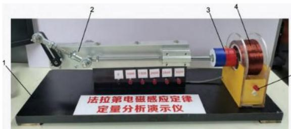  
图 5-4 张应帅实验装置图

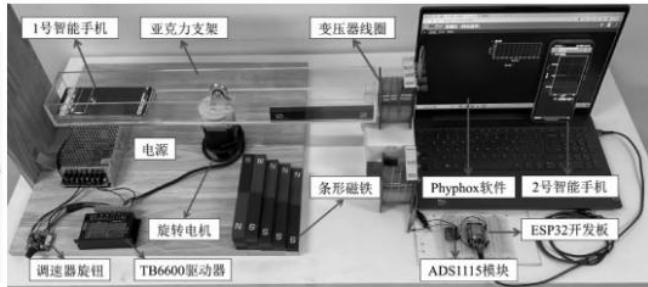  
图 5-5 卢佳妮实验装置图

这些实验方案都能将原实验提升至定量探究水平，能够较为准确验证感应电动势与磁通量变化率的关系，但从一线教师学习与推广的角度出发有以下不足：1.普遍依赖数字实验系统。2.部分方案的实验装置复杂，制作成本较高。3.卢佳妮的方案使用“旋转法”替代“落体法”，若将实验装置用于教学实践，需额外向学生解释实验原理，易给学生增加认知负担。

## 2.教具制作

笔者在分析教材的实验原理后，明确改进后的方案需要测量的物理量为强磁体通过线圈时的瞬时速度以及线圈中被激发出的感应电动势，因此笔者想到了利用光电传感器来测量瞬时速度，利用数字采集电压的方法对电压进行采集的方案。

为了能测量强磁体穿过线圈时的速度，笔者想了很多方案，最终确定的方案如图所示<!-- 存疑：PDF 原文此处"如图所示"未标图号，据上下文应为图 5-8 电磁感应装置改进图，但 PDF 亦未写明，不臆补 -->。用窗帘轨道替代原方案的透明圆筒，利用热熔胶和木条将其固竖直固定在铁架上；

再利用塑料瓶裁剪成合适形状，在其外圈用0.4mm 直径的漆包线缠绕30圈制作成线圈，线圈两头分别接上带U型头的导线；在内圈粘贴一个光电传感器，用于测量强磁体通过线圈时的瞬时速度。光电传感器安装位置如图 5-6所示。

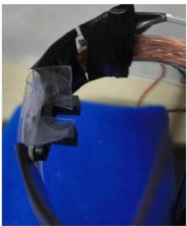  
图 5-6 光电传感器安装位置图

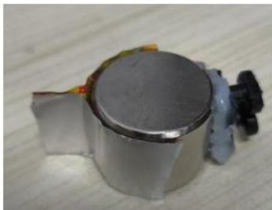  
图 5-7 改装后的强磁体图

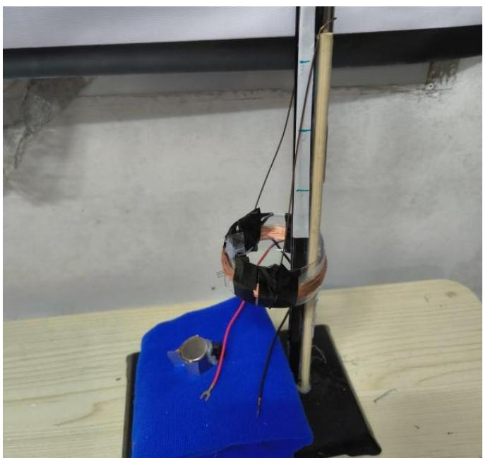  
图 5-8 电磁感应装置改进图

强磁体是一个直径25mm高度20mm的铷汝钕铁硼圆柱形磁铁，具有强磁性和硬度高的特性，非常适合用于此实验。将原本用于两个挂帘子工字形配件用热熔胶粘贴在强磁体后侧，再将易拉罐将其剪成合适尺寸，用纳米胶粘在强磁铁前侧，制作成高 18mm的遮光板，改装后的强磁体图如图 5-7所示。改造后的强磁体便可以沿着轨道从线圈上方竖直下落，通过线圈的瞬间遮光板遮挡光电传感器槽间红外线，使得强磁体通过线圈的速度得到测量。完整的装置如图 5-8 所示。

感应电动势是利用第四章介绍的电压信号数据采集器进行测量的：将电压信号数据采集器与电脑相连，将其的采样的模式定为单次实时模式，将CH0的两导线的鳄鱼夹夹住线圈两端连接，电压信号数据采集器即可测量线圈两端电压。速度的则是用第四章介绍的光电传感器&数据采集器测量：只需将光电传感器的三个引脚与数据采集器引出的导线正确对接好即可用于测量。

## 3.实验操作与实验结果

## 3.1 实验操作

## 3.1.1 连接设备

(1)用 USB数据线将电压信号数据采集器与电脑相连接，打开VOFA+上位机软件点击左上方圆形按钮进行连接。

(2)将充电器的 micro USB 线与光电传感器数据采集器连接进行供电，将光电传感器数据采集器与光电传感器连接。

(3)将电压信号数据采集器 CH0 的红黑线与线圈的两端导线按红与红，黑与黑相连接。

连接完成的装置如图 5-9所示。  
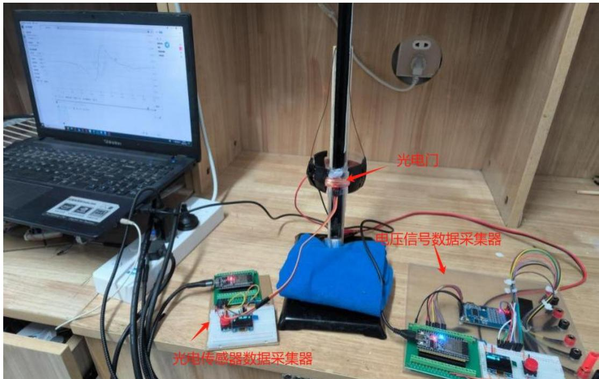  
图 5-9 连接完成的电磁感应实验装置图

## 3.1.2 进行实验

(1)按下光电传感器数据采集器的微动按键，屏幕出现 Ready，进入测量模式。

(2)按下VOFA+上位机软件的连接按钮，开始数据传输。

(3)将强磁体从轨道上方卡入轨道，将磁体下平面移动至最低刻度处，释放强磁体。

(3)按下VOFA+上位机软件的连接按钮，暂停数据传输。

(4)记录下 VOFA+上位机波形图曲线中波峰值，如图 5-10 所示。

(5)记录下光电传感器数据采集器屏幕的时间，如图 5-11所示。

(6)重复以上（1）-（5）实验操作，改变强磁体下落的位置，记录下每次的时间和波峰值。

  
图 5-10 VOFA+上位机波形图曲线中波峰值图

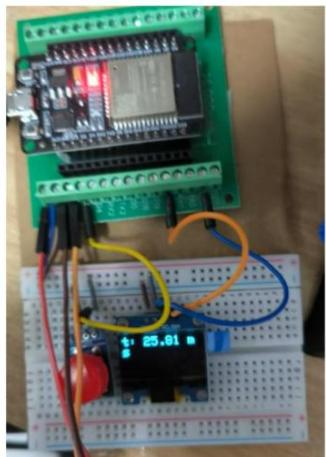  
图 5-11光电传感器数据采集器屏幕的时间图

## 3.1.3 实验结果

将记录得到的时间和电动势数据导入 Excel得到数据如图 5-12 所示。由于光电传感器槽间红外线发射和接收的缝隙为 1mm 宽，且缝隙必须完全遮挡，光电传感器的OUT引脚才输出低电平，因此在Excel中计算速度时，需将遮光片18mm的宽度减去1mm，将计算得到的速度与线圈电动势分别作为 x 轴和 y轴进行描点拟合，拟合结果如图 5-13所示。

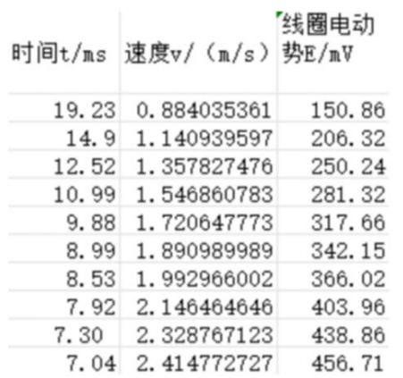  
图 5-12 Excel中时间和感应电动势数据图

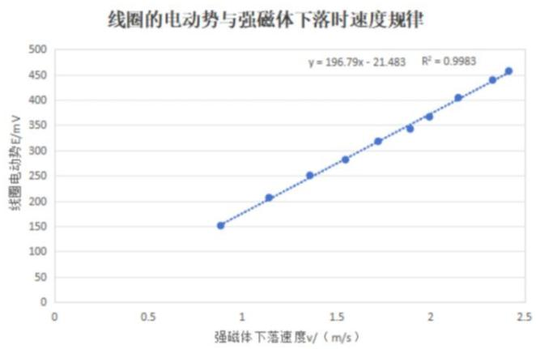  
图 5-13 速度与感应电动势拟合结果图

由拟合结果可得到线圈的电动势E与强磁体下落速度v成正比，而强磁体在通过线圈时，磁通量变化率 $\frac { \Delta \phi } { \Delta t } \propto$ 强磁体磁体速度v，即推出线圈的电动势E与磁通量变化率

$\frac { \Delta \phi } { \Delta t }$ 是成正比的关系。

## 4.实验教具的优点与不足

本实验教具的优点：1.实现了法拉第电磁感应定律实验从定性探究到定量探究的升级。2.实验装置简单，成本较低，易于制作。3.沿袭了教材原实验的实验原理，易于学生理解。

本实验教具的不足：1.强磁体遮光片与工字形配件存在优化空间，强磁体多次下落后遮光片易发生变形。2.线圈的匝数无法改变，不能改变匝数以探究匝数对感应电动势的影响。

## （二）探究影响线圈切割磁感线的感应电动势大小因素实验

## 1.实验背景

## 1.1 教材背景

导线切割磁感线时的感应电动势公式 $E = B l \nu$ 是在给出法拉第电磁感应定律的表达式表示 $E = n { \frac { \Delta \phi } { \Delta t } }$ 后，结合如图 5-14的抽象模型，使导体棒以速度v向右运动，在t内闭合回路面积变化量为 $\Delta S = l \nu \Delta t$ ，则磁通量变化量为 $\Delta \phi = B l \nu \Delta t$ ,再根据法拉第电磁感应定律 $E = \frac { \Delta \phi } { \Delta t }$ 求得 $E = B l \nu$ 。这个推导过程十分简洁且严密，从理论上得到了导线切割磁感线时的感应电动势公式 $E = B l \nu$ 。但教材没有提供实验证明的方法，因此本研究目的是设计实验，通过实验设计实验以探究导线在切割磁感线时，感应电动势大小与速度v、磁感应强度B、长度l的关系。笔者在设计制作装置时参考了法拉第电磁感应定律小节标题下的问题栏目的实验模型，如图 5-15 所示的模型图，将导体棒改为线圈，将磁铁用自制的 U型磁铁替代，测量装置使用基于ESP32制作的测量仪器替代。

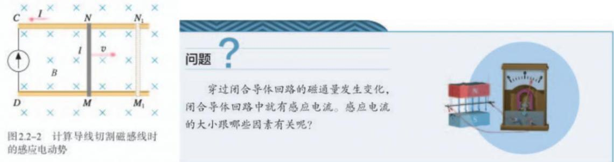  
图 5-14 教材导线切割磁感线模型图  
图 5-15 法例第电磁感应定律问题栏目图

## 1.2 相关研究

前人对本实验改进做了许多研究，取得了不错的成果，比较有代表性的方案有如下方案：胡优良对原实验改进，使用钕磁铁提供磁场，实现了仅用一根铜棒切割磁感线就能让灵敏电流计有明显示数变化的实验效果<sup>[30]</sup>，但没有将实验上升至定量实验，其装置图 5-16所示。李涛则采用放大法的思路对原装置改进，主要是将切割的导体改为多匝线圈，使得在导体切割磁感线时灵敏电流计偏转更为明显<sup>[31]</sup>，但其方案同样仍停留在定性实验阶段，其装置如图 5-17 所示。丁洪良则设计了全新的实验装置，结合 PASCO 数字系统，其装置通过改变电流大小改变环形磁场强度，通过改变线圈匝数等效改变导线长度，通过改变下落高度改变导线运动速度，并验证这些物理量与感应电动势成正比<sup>[32]</sup>，其装置如图 5-18所示。张海芳利用数字化实验设备并自制实验装置进行实验，通过步进电机控制线圈运动速度，通过可调电源改变匀强磁场发生器的磁感应强度，用不同匝数的线圈等效不同长度的导线，验证了磁感应强度、速度、导线长度与感应电动势成正比<sup>[33]</sup>，其装置如图 5-19所示。

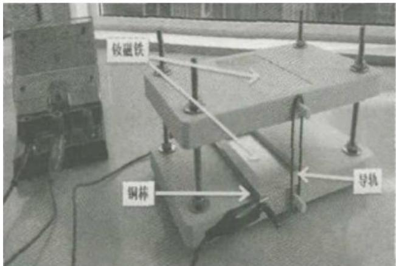  
图 5-16 胡优良的实验装置图

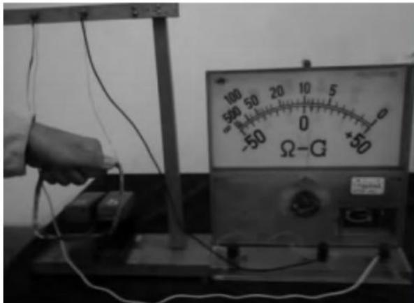  
图 5-17 李涛的实验装置图

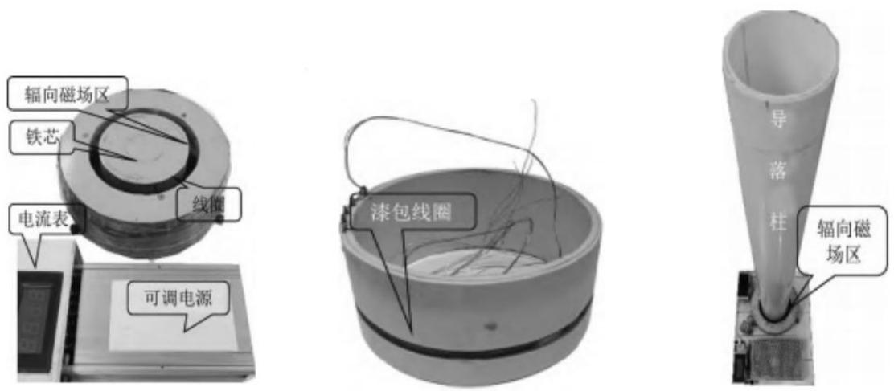  
图 5-18 丁洪良的实验装置图

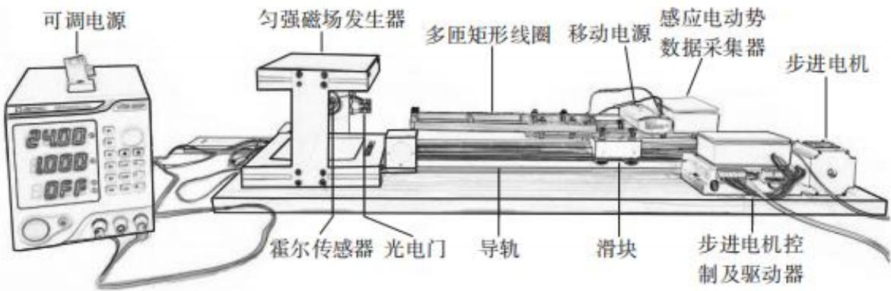  
图 5-19 张海芳的实验装置图

前人研究者均从自身的教学需求出发，对教材中导线切割磁感线产生感应电动势这一实验进行了改进。胡优良和李涛的装置虽未能将实验进行升级至定量探究实验，但也以较低的成本增强了实验现象。丁洪良和张海芳则能将实验提升至定量探究实验，从一线教师学习与推广的角度出发有以下不足：1.依赖数字化实验系统与专业实验器材。2.实验装置较为复杂，制作有一定的难度和成本压力。

## 2.教具制作

笔者在参考了教材问题栏目的演示实验原型，对其升级改造，将磁铁改成笔者自制的可改变有效长度、磁感应强度可变的U型磁铁；将指针式电流表改为电压信号数据采集器；将导体棒改为可该变切割速度的线圈，并安装遮光片用于测量速度。笔者制作的线圈切割磁感线教具利用控制变量法，可以通过改变切割速度v、磁感应强度B、有效长度l对线圈切割磁感线的感应电动势研究。由于笔者在实验中使用单根导体棒时切割磁感线时的感应电动势过小，难以测量，因此改为100 匝的线圈，将矩形线圈下方的所有导线等效替代为一根导体棒，研究其切割磁感线时的感应电动势。

## 2.1 U 型磁铁与强度测定

为了能研究磁感应强度B、有效长度l对感应电动势的影响，笔者自制了两个 U 型磁铁如图 5-20所示。单个磁铁主体用两个L型角铁做成，用螺栓连接固定。中间的磁可以通过改变磁铁对数量改变有效长度l，单对磁铁宽10mm，因此有效长度得到10mm、20mm、30mm、40mm、50mm、60mm的6个有效长度l数据。再通过改变磁铁对的上下方形磁铁数量，再用简易高斯计对U型磁铁中心的磁感应强度进行测定，测量方法如图 5-21所示，可得到 9种不同的磁感应强度如表 5-2所示。

表 5-2 U 型磁铁上下磁铁数与中间磁感应强度对照表
<table><tr><td>上磁铁数/下磁铁数</td><td>5/5</td><td>5/4</td><td>4/4</td><td>4/3</td><td>3/3</td><td>3/2</td><td>2/2</td><td>2/1</td><td>1/1</td></tr><tr><td>中间磁感应强度B/Gs</td><td>701.32</td><td>586.67</td><td>495.53</td><td>408.02</td><td>336.42</td><td>269.30</td><td>215.86</td><td>156.27</td><td>108.72</td></tr></table>

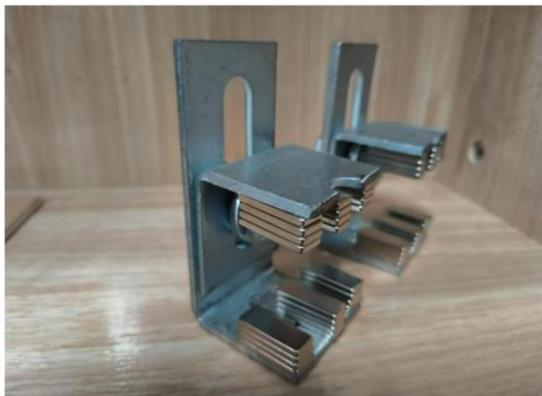  
图 5-20 自制 U 型磁铁图

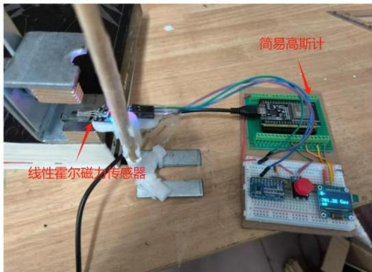  
图 5-21 U 型磁铁中部磁感应强度测定图

## 2.2 线圈与铁架制作

制作所需材料有：实验铁架一个、玩具小车底盘与轮子一对、方形线圈架两个、漆包线、木棒若干、其他材料。制作完成的装置如图 5-22所示。将玩具车的底盘用铁丝固定在实验铁架上。为了使线圈能穿过两个U型磁铁，笔者用了两个方形线圈架和木棒加宽绕制出了 100匝线圈，并将线圈两头焊接上两根带U 型头的导线，固定在玩具车底

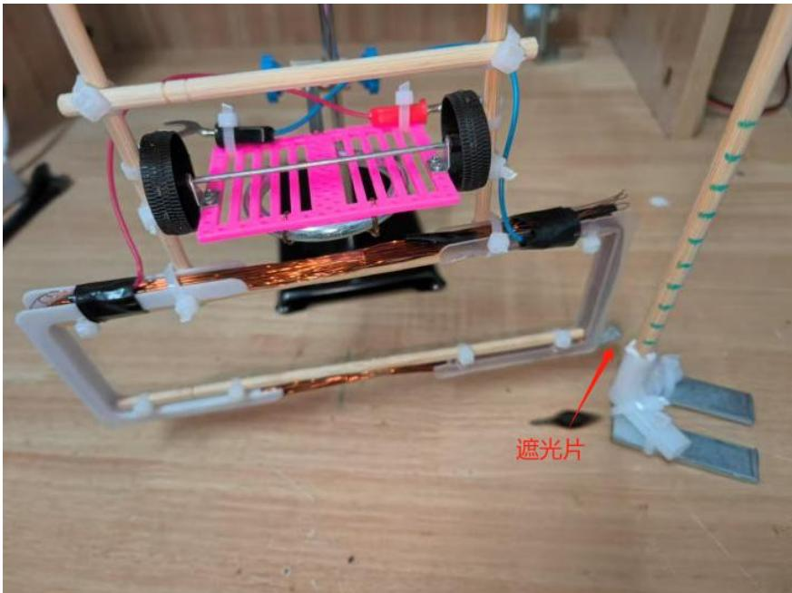  
图 5-22 线圈与铁架实物图

盘上。再用木棒制作成的骨架固定住线圈，左右两端的木棒再与玩具车轮子固定。为了能测量线圈摆至最低处速度，笔者还在线圈右下方安装了一块 7mm宽的遮光片。图片中右侧的带刻度的竖直木棒是为了改变线圈摆下落高度制作的，将线圈下方抵住刻度线，即改变制线圈摆下落高度进而改变切割磁感线的速度。

## 2.3 测量装置

本实验的自变量有磁感应强度B、有效长度l、线圈切割磁感线的速度v，因变量只有切割时的线圈的感应电动势E。磁感应强度B可通过改变磁铁个数改变，具体数值在表 5-2 中已经得出；有效长度则通过改变磁铁对数改变；切割磁感线的速度则是通过遮光片结合光电传感器&数据采集器测量；感应电动势是利用电压信号数据采集器用单次实时模式进行测量获得。

## 3.实验操作与实验结果

## 3.1 实验操作

## 3.1.1 连接设备

(1)用 USB数据线将电压信号数据采集器与电脑相连接，打开VOFA+上位机软件点击左上方圆形按钮进行连接。

(2)将充电器用 USB 数据线与光电传感器数据采集器连接进行供电，将光电传感器数据采集器与光电传感器连接，并放置好光电传感器位置。

(3)将电压信号数据采集器CH0 的红黑线与线圈的两端导线U型头相连接。

(4)将 U 型磁铁放置在线圈下方，使线圈静止时位置正好在 U 型磁铁中间位置，并用记号笔在桌面上划线记下U型磁铁位置。

连接完成装置如图 5-23所示。

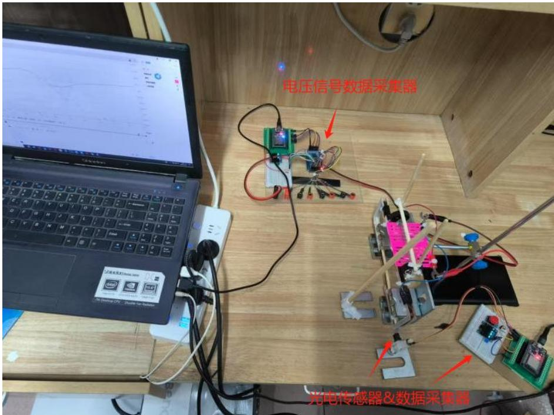  
图 5-23 探究影响线圈切割磁感线的感应电动势大小因素实验连接装置图

## 3.1.2 探究感应感应电动势E与线圈切割磁感线速度v的关系

(1)保持 U 型磁铁的磁场不变，两个 U 型磁铁中间磁铁都是三对并且是上下各 4块磁铁。

(2)按下光电传感器数据采集器的微动按键，屏幕出现 Ready，进入测量模式。

(3)按下VOFA+上位机软件的连接按钮，开始数据传输。

(4)将线圈抬起，将线圈下方抵住竖直木棒的最低刻度线，松手释放。

(5)按下VOFA+上位机软件的连接按钮，暂停数据传输，记录下 VOFA+上位机波形图曲线中第波峰的峰值。

(6)记录下光电传感器数据采集器屏幕的时间。

(7)重复以上(1)-(6)实验操作，改变线圈下落高度，记录下每次的时间和波峰值。

## 3.1.3 探究感应电动势E与磁感应强度B的关系

(1)将每个 U型磁铁的磁铁组数改为两组，上下各5 块磁铁。

(2)按下VOFA+上位机软件的连接按钮，开始数据传输。

(3)将线圈抬起至最高处，松手释放。

(4)按下VOFA+上位机软件的连接按钮，暂停数据传输，记录下 VOFA+上位机波形图曲线中第波峰的峰值。

(5)按照表 5-2里磁铁数量与磁感应强度对应表格依次减少磁铁，保持磁铁组数不变，重复上述(2)-(4)实验操作。

## 3.1.4 探究感应电动势E与有效长度l的关系

(1)将每个 U型磁铁安装三对磁铁，每对磁铁都是上下各 4块磁铁。

(2)按下VOFA+上位机软件的连接按钮，开始数据传输。

(3)将线圈抬起至最高处，松手释放。

(4)按下VOFA+上位机软件的连接按钮，暂停数据传输，记录下 VOFA+上位机波形图曲线中第波峰的峰值。

(5)将磁铁对数从6对每次减少一对，重复上述(2)-(4)实验操作，直至磁铁对数为 一对时结束实验。

## 3.2 实验结果

## 3.2.1 探究感应电动势E与线圈切割磁感线速度v的关系

将记录得到的实验数据导入 Excel，如图 5-24 所示，根据光电传感器数据采集器记录的时间与遮光片宽度7mm减去1mm，Excel计算出每次切割的速度v，将计算得到的速度与线圈电动势分别作为 x轴和y轴进行描点拟合，拟合结果如图 5-25所示。由拟

合结果可得到线圈的电动势E与切割磁感线速度v成正比的结论。

<table><tr><td rowspan=1 colspan=1>时间t/ms</td><td rowspan=1 colspan=1>速度v/（m/s）</td><td rowspan=1 colspan=1>感应电动势E/mV</td></tr><tr><td rowspan=1 colspan=1>10.58</td><td rowspan=1 colspan=1>0.56710775</td><td rowspan=1 colspan=1>490.72</td></tr><tr><td rowspan=1 colspan=1>9.09</td><td rowspan=1 colspan=1>0.660066007</td><td rowspan=1 colspan=1>574.15</td></tr><tr><td rowspan=1 colspan=1>7.83</td><td rowspan=1 colspan=1>0.766283525</td><td rowspan=1 colspan=1>663.53</td></tr><tr><td rowspan=1 colspan=1>7.1</td><td rowspan=1 colspan=1>0.845070423</td><td rowspan=1 colspan=1>784.16</td></tr><tr><td rowspan=1 colspan=1>6.6</td><td rowspan=1 colspan=1>0.909090909</td><td rowspan=1 colspan=1>834.25</td></tr><tr><td rowspan=1 colspan=1>6.02</td><td rowspan=1 colspan=1>0.996677741</td><td rowspan=1 colspan=1>853.56</td></tr><tr><td rowspan=1 colspan=1>5.82</td><td rowspan=1 colspan=1>1.030927835</td><td rowspan=1 colspan=1>885.59</td></tr><tr><td rowspan=1 colspan=1>5.41</td><td rowspan=1 colspan=1>1.109057301</td><td rowspan=1 colspan=1>953.55</td></tr><tr><td rowspan=1 colspan=1>5.06</td><td rowspan=1 colspan=1>1.185770751</td><td rowspan=1 colspan=1>1020.46</td></tr><tr><td rowspan=1 colspan=1>4.84</td><td rowspan=1 colspan=1>1.239669421</td><td rowspan=1 colspan=1>1073.46</td></tr></table>

图 5-24 Excel中时间和感应电动势数据图

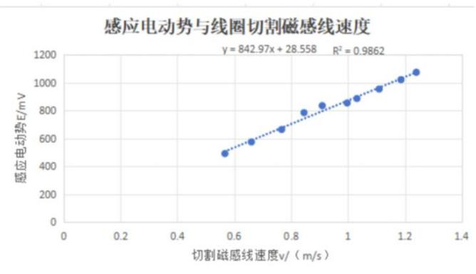  
图 5-25 速度与感应电动势拟合结果图

## 3.2.2 探究感应电动势E与磁感应强度B的关系

将记录得到的实验数据导入 Excel，如图 5-26 所示，将磁感应强度B与感应电动势E分别作为 x 轴和y 轴进行描点拟合，拟合结果如图 5-27 所示。由拟合结果可得到线圈的电动势E与磁感应强度B成正比的结论。

<table><tr><td rowspan=1 colspan=1>上磁铁个数/下磁铁个数</td><td rowspan=1 colspan=1>磁感应强度B/(Gauss)</td><td rowspan=1 colspan=1>感应电动势E/mV</td></tr><tr><td rowspan=1 colspan=1>上5下5</td><td rowspan=1 colspan=1>701.32</td><td rowspan=1 colspan=1>1013.65</td></tr><tr><td rowspan=1 colspan=1>上5下4</td><td rowspan=1 colspan=1>586.67</td><td rowspan=1 colspan=1>890.8</td></tr><tr><td rowspan=1 colspan=1>上4下4</td><td rowspan=1 colspan=1>495.53</td><td rowspan=1 colspan=1>740.56</td></tr><tr><td rowspan=1 colspan=1>上4下3</td><td rowspan=1 colspan=1>408.02</td><td rowspan=1 colspan=1>674.32</td></tr><tr><td rowspan=1 colspan=1>上3下3</td><td rowspan=1 colspan=1>336.42</td><td rowspan=1 colspan=1>594.58</td></tr><tr><td rowspan=1 colspan=1>上3下2</td><td rowspan=1 colspan=1>269.30</td><td rowspan=1 colspan=1>497.42</td></tr><tr><td rowspan=1 colspan=1>上2下2</td><td rowspan=1 colspan=1>215.86</td><td rowspan=1 colspan=1>400.40</td></tr><tr><td rowspan=1 colspan=1>上2下1</td><td rowspan=1 colspan=1>156.27</td><td rowspan=1 colspan=1>295.17</td></tr><tr><td rowspan=1 colspan=1>上1下1</td><td rowspan=1 colspan=1>108.72</td><td rowspan=1 colspan=1>210.18</td></tr></table>

图 5-26 Excel 中磁感应强度和感应电动势数据图

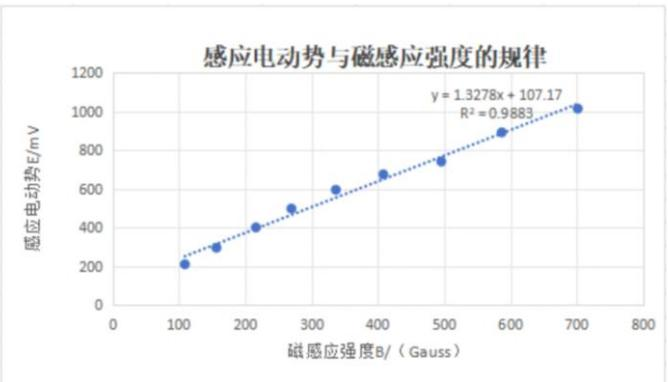  
图 5-27 磁感应强度与感应电动势拟合结果图

## 3.2.3 探究感应电动势E与有效长度l的关系

<table><tr><td rowspan=1 colspan=1>磁铁组数</td><td rowspan=1 colspan=1>有效长度l/mm</td><td rowspan=1 colspan=1>感应电动势E/mV</td></tr><tr><td rowspan=1 colspan=1>1</td><td rowspan=1 colspan=1>9</td><td rowspan=1 colspan=1>237.04</td></tr><tr><td rowspan=1 colspan=1>2</td><td rowspan=1 colspan=1>18</td><td rowspan=1 colspan=1>441.1</td></tr><tr><td rowspan=1 colspan=1>3</td><td rowspan=1 colspan=1>27</td><td rowspan=1 colspan=1>608.08</td></tr><tr><td rowspan=1 colspan=1>4</td><td rowspan=1 colspan=1>36</td><td rowspan=1 colspan=1>729.23</td></tr><tr><td rowspan=1 colspan=1>5</td><td rowspan=1 colspan=1>45</td><td rowspan=1 colspan=1>835.54</td></tr><tr><td rowspan=1 colspan=1>6</td><td rowspan=1 colspan=1>54</td><td rowspan=1 colspan=1>1075.62</td></tr></table>

图 5-28 Excel中有效长度和感应电动势数据图

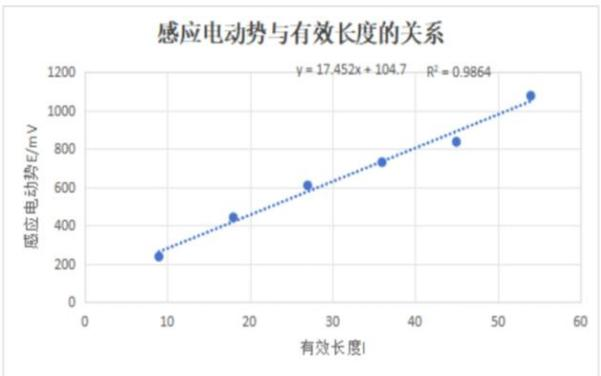  
图 5-29 有效长度与感应电动势拟合结果图

将记录得到的实验数据导入Excel，如图 5-28 所示，将有效长度l与感应电动势E分别作为 x轴和 y 轴进行描点拟合，拟合结果如图 5-29所示。由拟合结果可得到线圈的电动势E与线圈切割的磁感线有效长度l成正比的结论。

## 3.2.4 总结

根据上述实验结果可得到当线圈切割磁感线时，感应电动势E与磁感应强度B、有效长度l、速度v成正比，即 $E \propto B l \nu$ ，用等式表示为 $E = k B l \nu$ ，当磁感应强度B、有效长度l、速度v都取国际单位制时， $k = 1$ ，从实验的角度得到了导线切割磁感线时的感应电动势公式 $E = B l \nu$

## 4.实验教具的优点与不足

本实验装置的优点：1.实现了导线切割磁感线时的感应电动势公式 $E = B l \nu$ 的定量验证。2.自制的U型磁铁以较低成本且直观实现了磁感应强度与有效长度的改变。3.实验装置以教材的物理模型为基础制作，易于学生理解，且成本较低易于制作。

本实验装置的不足：1.不能探究导线切割磁感线时导线的速度方向与磁感线方向夹角θ对感应电动势的影响。2.装置的刚性不足，在线圈下落时会撞击 U 型磁铁，造成磁铁、铁架的震动甚至位移。

## （三）探究感应电动势与磁通量变化率的关系实验

## 1.实验背景

## 1.1 教材背景

在人教版高中物理必修三的第十三章电磁感应与电磁波初步的第三小节电磁感应现象及应用中，为了探究产生感应电流的条件，教材提供了一个实验如图 5-31 所示。这个实验原理十分简单，且实验效果明显。其中线圈和滑动变阻器、开关、学生电源组成一个回路，线圈B与灵敏电流表组成一个回路。当线圈A的回路中电流发生变化，线圈A 中激发出变化的磁场，导致线圈B 中的磁通量发生变化，从而产生感应电流。再结合本节的练习与应用栏目的第 6小题，如图 5-30 所示，笔者萌生了以此实验为原型，设计制作利用波形发生器探究法拉第电磁感应定律实验。例如，在A线圈中加载频率为20Hz 的三角波，A 线圈会在空间激发出 20Hz 按三角波形变化的磁场，在磁感应强度变化的三角波型中的上升半周期和下降半周期中，在B线圈内会感应出大小相等方向相反的感应电动势，对感应电动势进行测量，研究B线圈的磁通量变化率与感应电压的关系。如图 5-32 所示蓝色波形为 A线圈的电压变化波形，黄色波形为磁感应强度大小变化波形，红色波形即为B线圈的感应电动势波形。本实验设计的目的是利用教材提供的实验原理设计新的实验，结合基于ESP32制作的波形发生器和电压信号采集器，定量探究感

# 应电动势与磁通量变化率的关系。

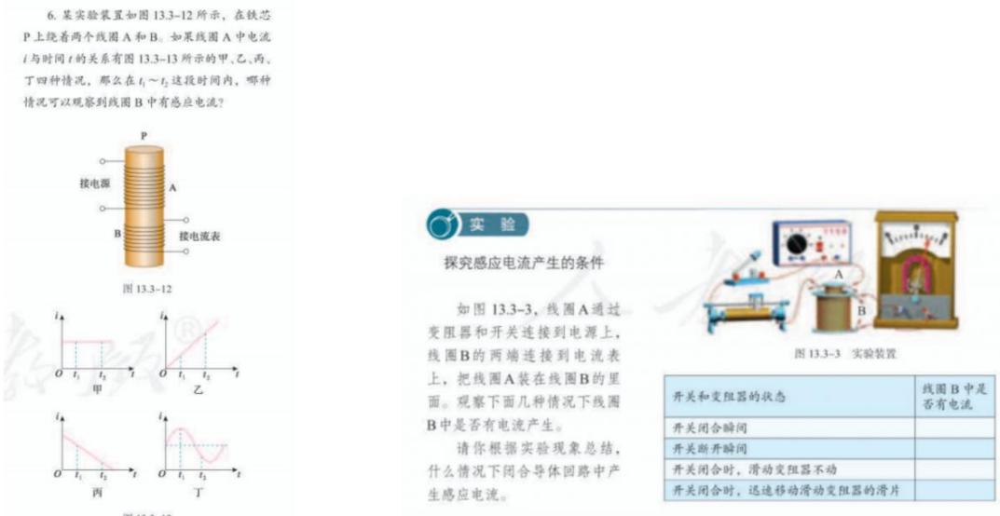

图 5-30 练习与应用栏目的第 6 小题图  
图 5-31 探究产生感应电流的条件实验图  
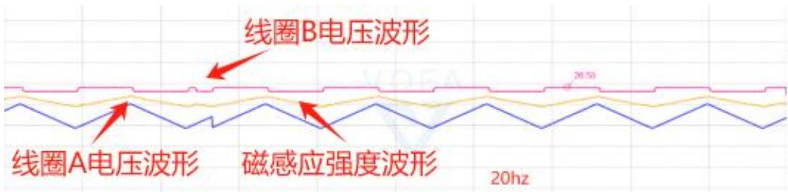  
图 5-32 VOFA+内线圈 A波形、磁感应强度波形、线圈 B 波形图

## 1.2 相关研究

李鼎所在的开发团队开发了一套实验系统，该装置能给初级线圈加载特定波形电压，使初级线圈能产生如图上所示的磁场，在计算机上能实现对磁感应强度均匀增加与减少时的磁通量变化率测定，并且对次级线圈正反电动势的测定（如图 5-34的图像所示），能够实现对感生电动势公式的定量验证<sup>[39]</sup>，其实验装置如图 5-33所示。伍科等人设计了一套实验教具，用 SG1641A 型函数信号发生器为初级线圈提供可变频率三角波，KJ9208B+ 型数字万能表对次级线圈电压进行测定，用智能手机软件 Phyphox 使用手机的霍尔传感器对磁场强度进行测定并显示出 B-t图像，实现了感生电动势公式的定量验证<sup>[34]</sup>，其实验装置如图 5-35所示。

这两个方案都较好地实现了感生电动势与磁通量变化率的定量实验探究，特别是李鼎团队的实验装置完成度非常高，实验探究过程非常高效，但从一线教师学习与推广的角度出发有以下不足：1.李鼎团队的实验装置获取难度较高，需学校进行采购，教师难以进行学习模仿制作。2.伍科的实验方案对专业设备需求高，在缺乏专业的信号发生器与数字万能表的情况下，实验方案难以复现。

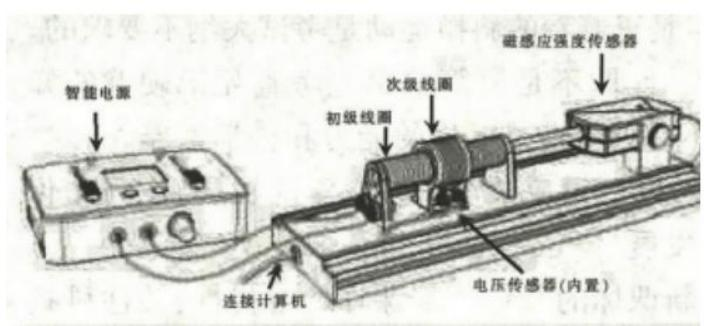  
图 5-33 李鼎团队的实验装置图

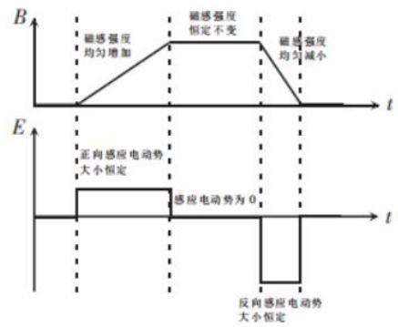  
图 5-34 李鼎装置的 B-t 和 E-t 图像

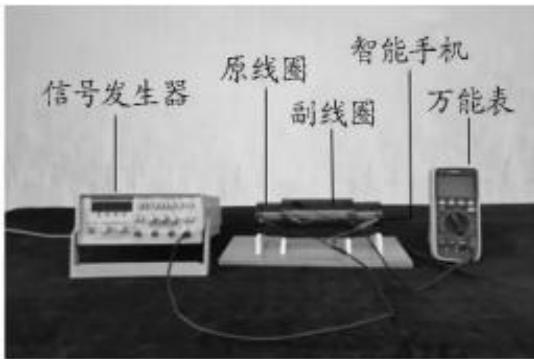  
图 5-35 伍科的实验装置图

## 2.教具制作

线圈&底座制作材料有外径35mm硬纸筒、外径26mm 硬纸筒、单刀开关、接线柱、硬纸板、线性霍尔磁力传感器。由于笔者制作的波形发生器功率限制，线圈的尺寸不能做的很大，因此初级线圈用外径35mm硬纸筒在外圈用漆包线密绕100匝线圈、次级线

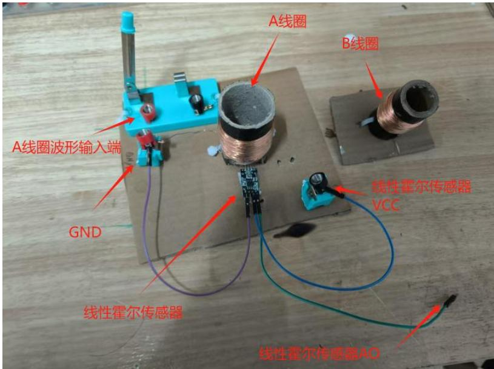  
图 5-36 线圈&底座实物图  
圈则用外径 26mm 硬纸筒做成 100 匝的线圈，将初级线圈固定在大硬纸板上，线圈一头

接开关，另一头接GND接线柱。线性霍尔磁力传感器则将探头放置在初级线圈内部，AO口单独接一个接线柱，GND 与初级线圈共接一个 GND 接线柱。线圈&底座制作完成如图5-36 所示。

本实验使用的第四章介绍的波形发生器装置为初级线圈提供可调节频率的三角波，使初级线圈能在内部产生的磁感应强度大小呈三角波形变化。

本实验需要对初级线圈电压、线性霍尔磁力传感器 AO 口输出电压、次级线圈电压进行测量，因此使用笔者制作的电压信号数据采集器的多通道连续模式对三个电压信号进行测量，并传送到电脑上的VOFA+软件上显示。

## 3.实验操作与实验结果

## 3.1 实验操作

## 3.1.1 连接设备

(1)用 USB数据线将电压信号数据采集器与电脑相连接，打开VOFA+上位机软件点击左上方圆形按钮进行连接。

(2)将充电器的USB数据线与波形发生器进行连接供电，将功放输出口与线圈&底座的开关连接，将GND 连接，将线性霍尔磁力传感器 VCC接入5V。

(3)将电压信号数据采集器CH0 黑线接GND 接线柱，CHO红线接开关的接线柱。

(4)将电压信号数据采集器CH1 黑线接GND 接线柱，CH1 的红线接线性霍尔磁力传感器的AO接线柱。

(5)将电压信号数据采集器CH2 的红黑线分别接次级线圈的两个U型头。

连接完成装置如图 5-37所示。

  
图 5-37 探究感应电动势与磁通量变化率的关系实验装置连接图

## 3.1.2 进行实验

(1)调节波形发生器，使其输出20Hz 的三角波

(2)按下VOFA+上位机软件的连接按钮，开始数据传输。

(3)关闭开关，待VOFA+上位机的波形稳定后，按下 VOFA+上位机软件的连接按钮，暂停数据传输，断开开关。

(4)按下VOFA+上位机软件的连接按钮，暂停数据传输。

(5)记录下 VOFA+上位机波形图次级线圈的感应电压值。

(6)调节波形发生器，使其输出频率增加20Hz，重复上述（2）-（5）步骤，直至输出频率为200Hz结束实验。

## 3.2 实验结果

将实验记录的数据导入 Excel 进行分析，如图 5-38 所示，Excel 将频率换算成周期，再算出半周期，半周期的倒数即为磁通量变化率与最大磁通量之比，即磁通量变化率 $/ \phi$<!-- 存疑：此处及下文"$/ \phi$"为 PDF 原文数学符号损坏所致，据上下文应为 Δφ/Δt（磁通量变化率与最大磁通量之比）的简写，PDF 亦模糊，不臆改 --> ，将磁通量变化率 $/ \phi$ 与电动势E分别作为x轴和y轴进行拟合，拟合结果如图 5-39所示，由拟合结果可推出与感应电动势E与磁通量变化率 $/ \phi$ 成正比，而磁通量变化率 $\propto$ 磁通量变化率 $/ \phi$ ，即感应电动势E与磁通量变化率成正比。

  
图 5-38 Excel 中频率和感应电动势数据图

  
图 5-39 磁通量变化率/φ与感应电动势拟合结果图

## 4.实验教具的优点与不足

本实验教具的优点：1.实现了感生的感应电动势E与磁通量变化率成正比的定量探究。2.实验装置以教材的物理模型为基础制作，易于学生理解。3.实现了A线圈电压波形、磁感应强度波形、B线圈电压波形的可视化，易于学生观察。

本实验教具的不足：1.实验装置接线较为复杂，电压信号数据采集器需要接三个通道进行测量。2.实验原理较复杂，为何改变三角波频率能改变磁通量变化率以及当中频率与磁通量变化率 $/ \phi$ 的换算的讲解需要教师精准地解释。

## （四） 安培力演示实验

## 1.实验背景

## 1.1 教材背景

在人教版高中物理必修三第十三章第二节磁感应强度与磁通量第一次出现安培力公式 $F = I l B$ ，为了能找出描述磁场强弱和方向的物理量，教材参照了通过分析检验电荷在电场中的受力情况引入了电场强度的方法，通过分析通电导线在磁场中的受力，引入磁感应强度。为此给出如图 5-40所示的实验方案，研究磁场垂直于通电导线时，通电导线受力F大小与电流I大小和导线长度l的关系，常见以此方案制作的指针式式安培力实验仪如图 5-41所示。该装置用指针的偏转大小与方向把通电导线的受力大小与方向直观的展现出来，利用此实验装置能以半定量的实验方法得到通电导线在磁场中的受力F分别与电流I和导线长度l成正比，即与电流I和导线长度l的乘积Il成正比，用公式表示为 $F = I l B$ ，而公式中的B即为表征磁场强弱的物理量，由此得到磁感应强度的定义式 $B = { \frac { F } { I l } }$ 。而在选择性必修二第一章第一节安培力与洛伦兹力小节则直接给出安培力的的公式 $F = I l B$ 。因此本研究的目的是在教材的实验方案基础上进行改进，利用基于ESP32制作的实验仪器对安培力F、磁感应强度B、电流I 进行测量，通过定量实验验证通电导线在磁场中的受力F与电流I、长度l和磁感应强度B成正比，进而得到安培力的的公式 $F = I l B$

  
图 5-40 探究影响通电导线受力的因素实验原理

  
图 5-41 指针式式安培力实验仪图

## 1.2 相关研究

蒋达国等人设计了一套全新的实验装置，用亥姆霍兹线圈产生强度可变的匀强磁场，用电子天平显示安培力，用线圈的匝数等效导线的长度，可定量验证安培力公式<sup>[35]</sup>，其实验装置如图 5-42所示。黄运米等人将 Arduino 单片机与霍尔传感器结合，用亥姆霍兹线圈产生强度可变的匀强磁场，依据杠杆原理结合电子秤测量通电线圈所受安培力，可定量验证安培力公式<sup>[36]</sup>，其装置如图 5-43所示。程凌飞等人也重新设计了实验装置，通过改变片状磁铁距离获得不同数值的磁感应强度，通过改变线圈接入的匝数改变导线等效长度，利用电子秤测量线圈所受安培力，最终也实现了安培力公示的定量验证<sup>[37]</sup>，装置如图 5-44所示。于淼的实验装置则是基于3D打印制作，也是通过改变片状磁铁距离获得不同数值的磁感应强度，通过改变线圈接入的匝数改变导线等效长度，使用朗威DIS系统的模块对安培力、磁感应强度、电流测定，实现了安培力公式的定量验证<sup>[38]</sup>，实验装置如图 5-45所示。

  
图 5-42 蒋达国的实验装置图

  
图 5-43 黄运米的实验装置图

  
图 5-44 程凌飞的实验装置图

  
图 5-45 于淼的实验装置图

以上四个方案都能够实现影响安培力大小的多个维度因素的定量验证，实验装置的可靠度也比较高，但从一线教师学习与推广的角度出发有以下不足：1.普遍依赖专业实验装置，需要恒流源、数字化实验系统才能完成实验。2.部分实验装置较为复杂，有一定的制作难度，成本较高。3.安培力测定方法略微复杂。黄运米的方案结合了杠杆原理，需要学生额外了解安培力测定方法。其余方案线圈下端受到的安培力方向沿着竖直方向，在进行实验时不如水平的方向的安培力会使得线圈摆动直观。

## 2.教具制作

线圈架台的制作材料有铁架台一个、接线座一个、漆包线、木棒一根、带U型头的导线两根。由于单根通电导线在磁场中的受力过小，因此笔者采用线圈替代单根导线，以便测量其在通电时所受的总安培力。笔者将漆包线绕制成宽 15cm高12cm的100匝

  
图 5-46 线圈架台与实验电路图

矩形线圈，线圈两端再焊接上带U型头的导线，接入接线柱，将线圈用木棒固定在铁架台上，即制作完成。

此实验电路使用了一个最大电阻 10 欧姆的滑动变阻器，电源是一个用 8 节干电池制作的12V的电池盒。滑动变阻器两个下接线柱接电池盒的正负极，将线圈一头接滑动变阻器的左下接线柱，另一头接上接线柱，形成分压电路，这样能使通过线圈的电流的能从零开始调节且调节范围较大。电池盒自带开关，无需再外接开关。线圈架台与实验电路如图 5-46所示。

本实验用笔者自制的两个U型磁铁提供磁场，通过改变磁铁对内的磁铁数量来改变磁感应强度，其磁铁数量与磁感应强度B的对应关系在表 5-2进行了说明，以此研究磁感应强度B与安培力大小关系；通过改变磁铁对数改变有效长度l，研究有效长度l与安培力大小的关系。

本实验的安培力与电流的测量使用第四章介绍的压力&电流一体测量装置进行测量，将ads1115的 A0和A1引出的两根导线与线圈进行串联以测量通过线圈的电流，用力传感器对通电线圈在磁场中受到的安培力进行测量。

3.实验操作与实验结果

## 3.1 实验操作

## 3.1.1 连接设备

  
图 5-47 安培力演示实验装置连接图

(1)将 ADS1115 的A0和A1的引出的两根导线按照串联接法与线圈连接。

(2)将力传感器放到测量线圈安培力的位置，并与数据测量装置连接。

(3)将 U型磁铁放置好，使线圈下边部分正好在U型磁铁中间。

(4)将滑动变阻器滑片调制最左边，使线圈的电压为零。

(5)将手机充电器的 USB 线为 ESP32 供电。

连接完成的设备如图 5-47所示。

## 3.1.2 探究通电线圈受力F与线圈通过的电流I大小的关系

(1)保持 U 型磁铁的磁场不变，两个 U 型磁铁中间磁铁都是三对并且是上下各 4块磁铁。

(2)将滑动变阻器的滑块向右移动一定距离。

(3)接通电池盒的开关。

(4)待数据稳定后，记录下此时OLED 显示屏显示的电流I 和力F。

(5)断开电池盒的开关。

(6)重复以上(1)-(5)实验操作，改变线圈的电压，记录下每次电流I 和力F。

## 3.1.3 探究通电线圈受力F与磁感应强度B的关系

(1)将每个 U型磁铁的磁铁组数改为两组，上下各5 块磁铁。

(2)保持滑动变阻器滑片在距离最右边约1/3处，使得通过线圈的电流保持720mA。

(3)接通电池盒的开关，记录下此时OLED显示屏显示的力F。

(4)按照表 5-2里磁铁数量与磁感应强度对应表格依次减少磁铁，保持磁铁组数不变，重复上述(2)-(3)实验操作。

## 3.1.4 探究通电线圈受力F与有效长度l的关系

(1)将每个 U型磁铁安装三对磁铁，每对磁铁都是上下各 4块磁铁。

(2)保持滑动变阻器滑片在距离最右边约1/3 处，使得通过线圈的电流保持720mA。

(3)接通电池组的开关，记录下此时OLED显示屏显示的力F。

(4)将磁铁对数从6对每次减少一对，重复上述(2)-(3)实验操作，直至磁铁对数为 一对，结束实验。

## 3.2 实验结果

## 3.2.1 探究通电线圈受力F与线圈通过的电流I大小的关系

将记录得到的实验数据导入Excel，如图 5-48 所示，将电流I 的和力F分别作为 x轴和y轴进行描点拟合，拟合结果如图 5-49所示。由拟合结果可得通电线圈在磁场中受到的力F与电流I正比的结论。

<table><tr><td rowspan=1 colspan=1>电流I/mA</td><td rowspan=1 colspan=1>通电线圈受力F/N</td></tr><tr><td rowspan=1 colspan=1>122.01</td><td rowspan=1 colspan=1>0.08</td></tr><tr><td rowspan=1 colspan=1>183.19</td><td rowspan=1 colspan=1>0.13</td></tr><tr><td rowspan=1 colspan=1>251.25</td><td rowspan=1 colspan=1>0.18</td></tr><tr><td rowspan=1 colspan=1>297.19</td><td rowspan=1 colspan=1>0.21</td></tr><tr><td rowspan=1 colspan=1>351.94</td><td rowspan=1 colspan=1>0.25</td></tr><tr><td rowspan=1 colspan=1>412.29</td><td rowspan=1 colspan=1>0.29</td></tr><tr><td rowspan=1 colspan=1>465.00</td><td rowspan=1 colspan=1>0.33</td></tr><tr><td rowspan=1 colspan=1>527.65</td><td rowspan=1 colspan=1>0.37</td></tr><tr><td rowspan=1 colspan=1>584.69</td><td rowspan=1 colspan=1>0.42</td></tr><tr><td rowspan=1 colspan=1>684.37</td><td rowspan=1 colspan=1>0.50</td></tr></table>

图 5-48 Excel中电流有与通电线圈受力数据图

  
图 5-49 电流与通电线圈受力拟合结果图

## 3.2.2 探究通电线圈受力F与磁感应强度B的关系

将记录得到的实验数据导入 Excel，如图 5-50 所示，将磁感应强度B与力F分别作为x轴和 y轴进行描点拟合，拟合结果如图 5-51 所示。由拟合结果可得到通电线圈

受力F与磁感应强度B成正比的结论。

<table><tr><td rowspan=1 colspan=1>上磁铁个数</td><td rowspan=1 colspan=1>磁感应强度B/G</td><td rowspan=1 colspan=1>通电线圈受力/N</td></tr><tr><td rowspan=1 colspan=1>上5下5</td><td rowspan=1 colspan=1>701.32</td><td rowspan=1 colspan=1>0.43</td></tr><tr><td rowspan=1 colspan=1>上5下4</td><td rowspan=1 colspan=1>586.67</td><td rowspan=1 colspan=1>0.39</td></tr><tr><td rowspan=1 colspan=1>上4下4</td><td rowspan=1 colspan=1>495.53</td><td rowspan=1 colspan=1>0.34</td></tr><tr><td rowspan=1 colspan=1>上4下3</td><td rowspan=1 colspan=1>408.02</td><td rowspan=1 colspan=1>0.3</td></tr><tr><td rowspan=1 colspan=1>上3下3</td><td rowspan=1 colspan=1>336.42</td><td rowspan=1 colspan=1>0.25</td></tr><tr><td rowspan=1 colspan=1>上3下2</td><td rowspan=1 colspan=1>269.30</td><td rowspan=1 colspan=1>0.21</td></tr><tr><td rowspan=1 colspan=1>上2下2</td><td rowspan=1 colspan=1>215.86</td><td rowspan=1 colspan=1>0.16</td></tr><tr><td rowspan=1 colspan=1>上2下1</td><td rowspan=1 colspan=1>156.27</td><td rowspan=1 colspan=1>0.13</td></tr><tr><td rowspan=1 colspan=1>上1下1</td><td rowspan=1 colspan=1>108.72</td><td rowspan=1 colspan=1>0.08</td></tr></table>

图 5-50 Excel 中磁感应强度与通电线圈受力数据图

  
图 5-51 磁感应强度与通电线圈受力拟合结果图

## 3.2.3 探究通电线圈受力F与有效长度l的关系

<table><tr><td rowspan=1 colspan=1>磁铁组数</td><td rowspan=1 colspan=1>有效长度l/mm</td><td rowspan=1 colspan=1>通电线圈受力F/N</td></tr><tr><td rowspan=1 colspan=1>1</td><td rowspan=1 colspan=1>10</td><td rowspan=1 colspan=1>0.08</td></tr><tr><td rowspan=1 colspan=1>2</td><td rowspan=1 colspan=1>20</td><td rowspan=1 colspan=1>0.18</td></tr><tr><td rowspan=1 colspan=1>3</td><td rowspan=1 colspan=1>30</td><td rowspan=1 colspan=1>0.25</td></tr><tr><td rowspan=1 colspan=1>4</td><td rowspan=1 colspan=1>40</td><td rowspan=1 colspan=1>0.34</td></tr><tr><td rowspan=1 colspan=1>5</td><td rowspan=1 colspan=1>50</td><td rowspan=1 colspan=1>0.41</td></tr><tr><td rowspan=1 colspan=1>6</td><td rowspan=1 colspan=1>60</td><td rowspan=1 colspan=1>0.51</td></tr></table>

图 5-52 Excel中有效长度与通电线圈受力数据图

  
图 5-53 有效长度与通电线圈受力拟合结果图

将记录得到的实验数据导入Excel，如图 5-52 所示，将有效长度l与力F分别作为x 轴和y轴进行描点拟合，拟合结果如图 5-53所示。由拟合结果可得到通电线圈受力F与有效长度l成正比的结论。

## 3.2.4 总结

根据上述实验结果可得到当磁感线垂直于通电线圈的导线时，线圈所受的安培力F与电流I 、磁感应强度B、有效长度l成正比，即 $F \propto B I l$ ，用等式表示为公式 $F = k B I l$ 当电流I 、磁感应强度B、有效长度l都取国际单位制时，k 1，从实验的角度得到了当磁场垂直于通电导线时，导线所受安培力公式为 $F = B I l$ 。

## 4.实验教具的优点与不足

本实验教具的优点：1.实现了培力公式为 $F = B I l$ 定量探究。2.自制的 U 型磁铁以较低成本且直观实现了磁感应强度与有效长度的改变。3.实验装置以教材的物理模型为基础制作，易于学生理解，且成本较低易于制作。

本实验教具的不足：1.线圈供电由干电池制作的电池盒提供，虽然电池盒总电压为

12V，但由于电池内阻的原因，线圈通过滑动变阻器分压后能得到的最大电压约为4.5-5v，这也限制了探究电流的区间。2.不能探究电流方向与磁感线方向夹角对导线受到的安培力的影响。

## （五）互感现象演示实验

## 1.实验背景

## 1.1 教材背景

互感现象：两个并没有连接的线圈，当其中一个电流发生变化时，它所产生的变化的磁场会在另一个线圈中产生感应电动势。互感现象是变压器工作的基础。在人教版高中物理选择性必修三中第二章第四节中教材中的问题栏目提供了的互感演示实验方案（如图 5-54 所示）。该实验方案原理是将通过手机耳机孔输出变化的电压加载到线圈A，而线圈 A 再激发出变化的磁场使得线圈 B 产生感应电动势，线圈 B 与音响的扬声器连接，音响的扬声器再将音乐播放出来。此方案能将互感现象通形象生动进行展示。笔者受此启发，结合笔者已经完成的实验装置，设计制作了一个基于互感现象制作的金属探测器，目的是能够从以趣味性的角度对互感现象进行演示，帮助学生更好理解互感现象，并且对下一章节的变压器内容能起到承上启下的作用。

  
图 5-54 互感和自感小节问题栏目

## 1.2 相关研究

蒋雪茹等人基于如图 5-55 所示的原理图设计了实验装置，可用于直观演示发生互感现象时感应电流的方向：在N1线圈通入交流信号时，连接N2的两个反向的二极管灯能交替发光<sup>[40]</sup>。钟晓青等将线圈A接入利用扩音机的输出端，而线圈B接喇叭，将教材的实验用现有设备进行了复现<sup>[41]</sup>，其实验装置如图 5-56 所示。肖慧使用互感实验盒用于教学，演示“隔空取电”实验，帮助学生更好理解电磁感应现象的本质<sup>[42]</sup>，互感实验盒如图 5-57 所示。

这三个实验装置都能很好地演示了互感现象，实验原理较为简单，装置设计简易，对于教师学习制作也较为简单。但从互感现象是变压器的工作原理角度看，这些实验没有将互感与变压器建立联系，在教学实践中无法对变压器内容教学起到承上启下作用。

  
图 5-55 蒋雪茹的装置原理图


图 5-56 钟晓青的实验装置图  
  
图 5-57 互感实验盒图

## 2.装置原理

笔者制作了两个环形线圈，两线圈同心放置，给初级线圈通入150Hz的正弦波，初级线圈产生的磁场使得次级线圈产生正弦变化的感应电动势，AD620 模块对次级线圈产生的波形进行放大使得波形的最大值为1900mV。将放大后的波形再接入LM393电压比较器，调节LM393的阈值电压为1950mV，若此时将金属靠近两线圈，由于金属的导磁性，使得次级线圈的最大磁通量增大，经过放大AD620模块放大的波形最大值将超过1950mV,大于LM393的阈值电压1950mV，LM393的输出端将输出脉冲波，使得与之相连的无源蜂鸣器模块发出声音。线圈与放大检测电路电路接线如图 5-59 所示。

## 3.教具制作

线圈与放大检测电路使用的材料有：漆包线、AD620 模块一个、LM393 模块一个、无源蜂鸣器模块一个、面包板一块、纸板、杜邦线若干。笔者用漆包线绕制了两个直径6cm的30圈线圈作为主副线圈，固定在纸板上，再将各模块按照如下电路图用杜邦线连接，制作完成的装置如图 5-58所示。


图 5-58 线圈与放大检测电路实物图  
  
图 5-59 线圈与放大检测电路电路接线图

本实验使用的第四章介绍的波形发生器装置，使用此波形发生器能产生可150Hz 正弦波加载到初级线圈。

本实验需要对初级线圈和次级线圈电压进行测量，因此使用笔者制作的电压信号数据采集器的多通道连续模式对此两线圈的电压信号进行测量。

## 4.实验操作与实验结果

## 4.1 连接设备

(1)波形发生器的波形输出端与初级线圈连接。

(2)从波形发生器引出5V与GND与面包板相连，给各模块供电。

(3)用 USB数据线将电压信号数据采集器与电脑相连接，打开VOFA+上位机软件点击左上方圆形按钮进行连接。

(4)将电压信号数据采集器的 CH0 和 CH1 的导线分别与初级线圈和放大后的次级线圈信号连接。

(5)将手机充电器的 USB线为波形发生器供电，调节其输出为 150Hz正弦波。

连接完成的实验装置如图 5-60所示。

  
图 5-60 互感现象演示实验装置连接图

## 4.2 实验操作

将不含金属的的物品放置在在线圈旁边时，蜂鸣器不发出声音。将铁块、老虎钳等金属制品放在线圈上，如图 5-61所示，蜂鸣器将发出声音。在VOFA+上位机观察波形，

  
图 5-61 将金属块放置在线圈上方

  
图 5-62 未放置金属块时次级线圈波峰值图

  
图 5-63 放置金属块时次级线圈波峰值图

在未放置金属块时次级线圈经过放大后的波形最大值如图所示<!-- 存疑：PDF 原文此处"如图所示"未标图号，据后文应为图 5-62，但 PDF 亦未写明，不臆补 -->是为 1901mV,如图 5-62所示。而放置金属块后的波形最大值变为了2202mV，如图 5-63 所示，说明金属铁的导磁性使得互感现象得到了加强。

## 5.实验教具的优点与不足

本实验教具的优点：1.实现了互感现象中初级线圈和次级线圈的波形可视化。2.能够通过次级线圈波峰值的变化展示出金属对互感现象的增强作用，能将互感现象与变压器进行联系，通过说明金属对互感的增强作用引出变压器的铁芯的重要作用，增强学生的理解。

本实验教具的不足：1.实验装置较为复杂，特别是副线圈的放大检测电路，搭建电路需要教师对 AD620、LM393、无源蜂鸣器的接线与工作模式有一定的理解。2.无源蜂鸣器的声音较小，若在课堂中进行实验可能需要搭配扩音器才能达到较好实验效果。

## 六、总结

## （一）研究总结

笔者研读了国内和国外有关将微控制器技术应用于制作中学物理实验教具的文献，对微控制器用于物理实验教具制作的研究现状进行了梳理与总结，指出制作类型主要分为物理量测量与验证类，以及教学效果增强类。主要特点有适用范围广、普遍搭配传感器、测量精度高等。基于文献分析的结果，结合目前ESP32 微控制器在物理实验教具制作广受欢迎的现状，笔者将研究内容确定为基于ESP32 的高中物理自制教具的开发，并以部分电磁学实验为案例进行教具的设计制作。

论文第二章对“教具”、“微控制器”、“ESP32”几个关键概念进行界定后，对本研究涉及到的终身学习理论、技术赋能原则、信息技术与课程整合理论进行简单介绍。这为本研究进行ESP32的高中物理自制教具开发奠定基础。

在论文第三章中，笔者对基于ESP32教具开发技术进行了简单介绍，包括ESP32 开发板、开发平台Arduino IDE、VOFA+上位机软件。笔者还将本研究的测量型教具开发思路总结为6大步骤，并对基于ESP32进行实验教具开发的优势进行了介绍。本章内容能帮助读者对基于ESP32进行实验教具开发建立初步认识。

在论文第四章中，笔者详细介绍了基于ESP32开发的5个物理实验教具：电压信号采集器、压力与电流一体测量装置、简易高斯计、光电传感器与数据采集器、波形发生器，这些教具具备一定通用性，可根据实验需求用于不同实验。本章系统阐述了各教具的工作原理、材料选型、元器件配置及程序设计，为一线教师学习ESP32 教具开发提供了可操作的参考范例。

在论文第五章中，笔者先是总结了前人对相关实验改进成果的优点与不足，进而详细展示了结合基于ESP32的物理实验教具完成的：法拉第电磁感应定律实验、探究影响线圈切割磁感线的感应电动势大小因素实验、探究感应电动势与磁通量变化率的关系实验、安培力演示实验、互感现象演示实验5个实验。笔者对实验的背景、实验装置制作、基于ESP32的物理实验教具在实验中的作用、实验操作过程都进行了详细介绍，并对实验得到的数据进行分析，实验结果显示实验数据符合相关物理定律预期。

本研究开发的教具丰富了高中物理实验教学资源，而且，文中文中详实的制作流程解析，为一线教师提升实验开发能力提供了可复现的参考范例，有效促进其开展实践；此外，笔者在整个研究过程中充分体验了实验开发的历程，提升了自身的实验教具制作和创新能力。

## （二）反思与建议

笔者从亲身参与教具设计与制作的经历中，深刻体会到实验教学能力对高中物理教

师专业发展的重要性，教具制作的过程对教师实验教学能力的提升价值主要体现在以下方面：

（1）深化教师对物理概念的理解。例如笔者在设计法拉第电磁感应定律装置时，需要深入理解强磁体速度与磁通量变化率的关系，通过动手实践，能突破教材描述的层面，精准把握实验核心逻辑。

（2）培养教师实验设计能力。在经过本研究的教具制作过程后，笔者已经掌握了电压、电流、压力、速度等物理量通过传感器测量的方法，能快速进行新的实验装置开发。

（3）帮助教师提升实验能力。教师参与教具设计与制作，能锻炼教师的开发能力，增强教师实验操作、计算机使用、数据处理等技能，帮助教师在课堂上实现更好的实验教学效果。

教具设计与实验教学能力的提升，本质是教师从“知识传授者”向“学习设计师”的转型。通过持续实践、反思与创新，教师不仅能提高课堂实效，更能培养教师自身的科学探究精神与创新能力。因此本研究提出建议如下：

（1）拥抱教育数字化工具。教师应学习使用Phyphox手机物理工具包或是Labster在线实验平台等，增加物理实验教学手段。

（2）学习编程技术，尝试进行开发。目前的微控制器、传感器、各类芯片元件的价格便宜、相关教学资源丰富，教师可以尝试跟着教程进行一些简单项目开发，提升开发制作能力。

（3）合理使用AI工具。在开发过程中教师遇到会遇到各种困难，我们可以将困难或是需求详细描述给 AI 工具，AI工具往往能提供行之有效的解决思路或是示例程序，帮助解决困难。

本研究的实践证明ESP32微控制器在物理实验教具制作领域有其独特优势，笔者将会在日后继续学习并开发制作新的教具，将基于ESP32制作的物理教具用于教学实践中，开阔学生视野，提升物理实验教学效果。

## （三）研究不足

本研究由于个人精力、研究条件、个人开发水平等条件限制，存在一定的研究不足，主要在以下方面：

（1）没有结合3D 打印技术完善实验装置。本研究的实验装置均一些生活用品或是网上购买的的材料，用铁丝、热熔胶等组装完成，还有较大完善空间。

（2）基于 ESP32 制作的物理教具集成度不够高。由于个人的开发水平限制，没能将各种物理量测量的功能集成到一起，并将各类元件电路集成到一块电路板上，而是将各个功能制作成一个装置并在拓展板和面包板用导线将原件与 ESP32连接。

（3）由于笔者实习的学校教学进度安排限制，本研究制作的实验教具仅自行进行实验检验实验教具的效果，未能用于教学实践。

## 参考文献

[1] 晋蓉.综合学习赋能核心素养形成机制研究[J].科教文汇,2025,(01):38-42.

[2]习近平.习近平谈治国理政：第4 卷[M].北京：外文出版社，2022.

[3]普通高中物理课程标准[M]. 中华人民共和国教育部. 人民教育出版社. 2020

[4]中华人民共和国教育部．教育部关于实施全国中小学教师信息技术应用能力提升工程 2.0 的意见.(2019-03-20)[2024-01-01] https://www.gov.cn/xinwen/2019-04/03/content\_5379203.html

[5] Galeriu C .An Arduino-Controlled Photogate[J].The Physics Teacher,2013,51(3):156-158.

[6] Galeriu C .An Arduino Investigation of Newton’s Law of Cooling[J].The Physics Teacher,2018,56(9):618-620.

[7] Yulkifli ,Yohandri ,Murtiani , et al.Development of Digital Archimedes Experiment System Based on Microcontroller for Physics Education[J].Journal of Physics: Conference Series,2018,1120(1):012093-012093.

[8] M Y ,A W ,Sofyan , et al.Development of measuring instrument based on microcontroller for physics laboratory[J].Journal of Physics: Conference Series,2020,1521(2):022028.

[9] Reis D N P W ,N P W R D ,P D R , et al.An Arduino-based experiment designed to estimate the heat capacity of a nichrome resistor[J].Physics Education,2021,56(1):013005-.

[10]Bambang S ,Agung W ,Sunarno S , et al.DEVELOPING MICROCONTROLLERBASED KINEMATICAL EXPERIMENT SET[J].Jurnal Kependidikan: Penelitian Inovasi Pembelajaran,2018,2(2):372-381.

[11] Mike McCaughey; An Arduino-Based Magnetometer[J]. Phys. Teach. 1 May 2017; 55 (5): 274–275.

[12]Calin Galeriu, Cheryl Letson, Geoffrey Esper; An Arduino Investigation of the RC Circuit[J]. Phys. Teach. 1 May 2015; 53 (5): 285–288.

[13]Paulo Simeão Carvalho, Marcelo Hahn; A Simple Experimental Setup for Teaching Additive Colors with Arduino[J]. Phys. Teach. 1 April 2016; 54 (4): 244–245.

[14]Taciele V S O ,Nonato R J M D ,Willemberg S O , et al.Using an Arduino microcontroller to build a Planetary Scale for study of weight force[J].Physics Education,2020,55(4):045016.

[15]胡彬.轻松观察“热传递过程”自制教具的设计与制作[J].电子制作,2016,(13):45-47.

[16]丛伟.深度探究“布朗运动”演示教具的设计与实现[D].哈尔滨师范大学,2020.

[17]吴琎.基于初中物理电功率测量自制教具的设计与制作[D].江西科技师范大学,2019.

[18]杨杰,穆婕.验证向心力公式实验的改进与创新[J].文理导航(中旬),2020,(02):24+27.

[19]秦彩营,雷靖娴,何力,等.多功能受迫振动演示仪的创新制作与应用[J].湖南中学物理,2022,37(06):69-71.

[20]刘冰.基于单片机的中学物理实验设计与开发[D].云南师范学,2024.

[21]张绍能,肖春梅,谢帮友.触电类型模拟演示教具的创新设计与制作[J].实验教学与仪器,2015,32(10):48-50.

[22]侯伟杰,陈善珂,邵渭泉.基于单片机自制色光三原色演示仪[J].实验教学与器,2023,40(10):71-74.

[23]张习祥.基于物联网交互技术开发的小孔成像实验教具[J].中学物理,2023,41(22):35-38.

[24]杨牧之主编. 中国大百科全书[M]. 北京: 中国大百科全书出版社, 2009, 24 卷: 471-472.

[25]张念宏主编. 中国教育百科全书[M]. 北京: 海洋出版社, 1991.张来洪,鲁兴,易江文.国产化 FMQL 扩展 WiFi 功能的方法[J].电子制作,2024,32(16):31-34.
<!-- 存疑：此处 PDF 原文将"中国教育百科全书(1991)"与"国产化FMQL扩展WiFi功能的方法(电子制作,2024)"两条文献粘连为一条，疑为原文排版或 PDF 提取错误，[25] 应只含前者；后者与本文 ESP32 主题无关，疑似误入。保留原貌待人工核实 -->

[26]杨婕,潘江洪.法拉第电磁感应定律定量实验的改进和创新[J].中学物理,2023,41(17):42-45.

[27]杜苛,赵洪祎,胡祺波,等.基于气垫导轨的法拉第电磁感应实验装置设计[J].实验室科学,2023,26(03):164-166+171.

[28]张应帅,雷洁红,黎蕊,等.法拉第电磁感应定律定量探究实验教具创新[J].物理教学探讨,2024,42(07):60-63.

[29]卢佳妮,刘丰榕,李秀燕,等.巧用旋转法的“法拉第电磁感应定律”实验创新——基于Phyphox 的定量探究实验设计[J].物理教师,2025,46(03):51-54.

[30]胡优良,涂嘉洋,苏攀,等.“感应电流产生的条件”实验仪器的制作与改进[J].湖南中学物理,2020,35(08):57-58.

[31]李涛.导体切割磁感线产生感应电流实验的改进[J].实验教学与仪器,2016,(S1):53-54.

[32]丁洪良.一种创新型法拉第电磁感应定律实验探究装置[J].物理教师,2023,44(04):57-58+61.

[33]张海芳.导体垂直切割磁感线感应电动势的定量探究[J].实验教学与仪器,2021,38(09):33-35.

[34]伍科,张旺.基于 Phyphox 程序的“电磁感应定律”定量探究实验改进[J].物理通报,2021,(03):108-110.

[35]蒋达国,孙豪杰,郑鹏辉,等.验证安培力公式实验装置的创新设计与制作[J].湖南中学物理,2024,39(09):85-86.

[36]黄运米,蔡建秋,罗海军.磁场安培力综合实验仪的研制[J].大学物理,2021,40(11):21-25+30.

[37]程凌飞,何恩阳.探究安培力大小影响因素实验装置改进[J].中学物理教学参考,2023,52(17):53-55.

[38]于淼.基于 3D 打印技术自制安培力演示仪[J].湖南中学物理,2023,38(07):68-70+29.

[39]李鼎,冯容士,赵进.定量验证法拉第电磁感应定律的实验[J].物理教学探讨,2019,37(08):13-15+18.

[40]蒋雪茹,陈博文.自制互感现象演示仪[J].物理教学探讨,2019,37(06):53-54.

[41]钟晓青,朱向阳.用音响器材做几个有趣的互感实验[J].物理教学,2012,34(04):33+36.

[42]肖慧.互感实验盒在电磁感应教学中的应用[J].中学教学参考,2018,(32):55.

[43]李泽琦.初中物理智慧课堂教学设计与实践研究[D].山东师范大学,2023.田之娇.社会性科学议题教学中学生决策能力的发展研究[D].福建师范大学,2023.
<!-- 存疑：此处 PDF 原文将"李泽琦(山东师范大学,2023)"与"田之娇(福建师范大学,2023)"两条学位论文粘连为一条，疑为原文排版或 PDF 提取错误，[43] 应只含前者；后者疑似误入。保留原貌待人工核实 -->

[44]莫昆辉.新课标视域下小学篮球大单元教学设计研究[D].武汉体育学院,2024.

[45]潘浩.基于嵌入式系统的双开关磁阻电机同步控制系统设计[D].天津大学,2008.

[46]段海芹.初中学校家庭教育指导的问题及对策研究[D].山东师范大学,2024.

[47]刘瑶.基于NOBOOK 虚拟实验辅助下的化学教学实践研究[D].闽南师范大学,2024.

[48]刘浚扬.数字技术赋能涉农企业生态创新的组态路径与绩效研究[D].扬州大学,2024.

## 附录

## 附录Ⅰ电压数据采集器 Arduino代码

#include <ADS1256.h>   
#include <Wire.h>   
#include <SPI.h>   
#include <Adafruit\_SSD1306.h>   
#define SCREEN\_WIDTH 128   
#define SCREEN\_HEIGHT 64   
#define OLED\_RESET -1   
Adafruit\_SSD1306 display(SCREEN\_WIDTH, SCREEN\_HEIGHT, &Wire, OLED\_RESET);   
ADS1256 A(27, 0, 26, 25, 2.500);//DRDY, RESET, SYNC(PDWN), CS,   
float voltageValue = 0;   
int MODE = 1;//模式切换   
#define SWITCH\_PIN 19 // 触动开关引脚   
const int numReadings = 2000; // 读取次数   
float readingsChannel0[numReadings];   
float readingsChannel1[numReadings];   
float readingsChannel2[numReadings];   
float readingsChannel3[numReadings];   
void setup()   
{ SPI.begin(14, 12, 13, 25);//SCLK = 14, MISOdout = 12, MOSIdin = 13, CS = 25   
Serial.begin(115200); //设置波特率   
A.InitializeADC();   
A.setPGA(PGA\_1); //设置衰减   
A.setMUX(DIFF\_0\_1); //设置通道   
A.setDRATE(DRATE\_7500SPS); //设置采样率   
Serial.print("PGA: ");   
Serial.println(A.readRegister(IO\_REG));   
delay(100);   
Serial.print("MUX: ");   
Serial.println(A.readRegister(MUX\_REG));   
delay(100);   
Serial.print("DRATE: ");   
Serial.println(A.readRegister(DRATE\_REG));   
delay(100);   
display.begin(SSD1306\_SWITCHCAPVCC, 0x3C);//初始化 OLED   
display.clearDisplay();   
display.setTextSize(2);   
display.setTextColor(SSD1306\_WHITE);   
display.setCursor(0, 0);

```c
display.println("MODE:" + String(MODE));
display.display();
delay(3000);
}
void loop(){
if (digitalRead(SWITCH_PIN) == HIGH) { // 检测开关是否被按下（假设按下时为高电平）
delay(200); // 去抖动延迟，防止因开关机械抖动引起的多次触发
if (digitalRead(SWITCH_PIN) == HIGH) {
MODE = (MODE + 1) % 2;
}
if (MODE ==0) {
A.setMUX(DIFF_0_1);
}
display.clearDisplay();
display.setTextSize(2);
display.setTextColor(SSD1306_WHITE);
display.setCursor(0, 0);
display.println("MODE:" + String(MODE));
display.display();
}
if (MODE == 0) {
static uint32_t lastTime = 0;
uint32_t now = millis();
if (now - lastTime >= 1)
{
lastTime = now;
Serial.printf("%.2f\n",A.convertToVoltage(A.readSingle())*1000);//单通道 CH0
1khz 模式
}
}
if (MODE == 1) { //4 通道 7500khz 模式
A.setMUX(DIFF_0_1);
for (int i = 0; i < numReadings; i++) {
readingsChannel0[i] = A.convertToVoltage(A.readSingleContinuous()) * 1000;
A.stopConversion();
}
A.setMUX(DIFF_2_3);
for (int i = 0; i < numReadings; i++) {
readingsChannel1[i] = A.convertToVoltage(A.readSingleContinuous()) * 1000;
}
A.setMUX(DIFF_4_5);
for (int i = 0; i < numReadings; i++) {
readingsChannel2[i] = A.convertToVoltage(A.readSingleContinuous()) * 1000;
```

```javascript
A.stopConversion();
}
A.setMUX(DIFF_6_7);
for (int i = 0; i < numReadings; i++) {
readingsChannel3[i] = A.convertToVoltage(A.readSingleContinuous()) * 1000;
A.stopConversion();
}
for (int j = 0; j < numReadings; j++) {
Serial.print(readingsChannel0[j]);
Serial.print(",");
Serial.print(readingsChannel1[j]);
Serial.print(",");
Serial.print(readingsChannel2[j]);
Serial.print(",");
Serial.println(readingsChannel3[j]);
}
}
```

## 附录Ⅱ 光电传感器&数据采集器Arduino代码

```c
#include <Wire.h>
#include <Adafruit_SSD1306.h>
#define IN_PIN 15 // 输入引脚
#define SWITCH_PIN 2 // 触动开关引脚
#define SCREEN_WIDTH 128
#define SCREEN_HEIGHT 64
#define OLED_RESET -1
Adafruit_SSD1306 display(SCREEN_WIDTH, SCREEN_HEIGHT, &Wire, OLED_RESET);
bool measuring = true; // 测量状态标志
void setup() {
pinMode(IN_PIN, INPUT);
pinMode(SWITCH_PIN, INPUT_PULLUP); // 设置触动开关引脚为输入模式，并启用内部上
电阻
display.begin(SSD1306_SWITCHCAPVCC, 0x3C);
display.clearDisplay();
display.setTextSize(2);
display.setTextColor(SSD1306_WHITE);
display.setCursor(0, 0);
display.println("Ready");
display.display();
}
void loop() {
// 检测触动开关状态
if (digitalRead(SWITCH_PIN) == HIGH) { // 按下开关
delay(200); // 去抖动
if (digitalRead(SWITCH_PIN) == HIGH) { // 确认按下
measuring = true; // 重置测量状态
display.clearDisplay();
display.setCursor(0, 0);
display.setTextSize(2);
display.print("Ready");
display.display();
}
}
if (measuring) {
unsigned long duration = pulseIn(IN_PIN, LOW, 1000000);
if (duration > 0) {
measuring = false; // 测量完成后停止测量
float duration_ms = duration / 1000.0;
Serial.print("t: ");
```

```javascript
Serial.print(duration_ms);
Serial.println(" ms");
display.clearDisplay();
display.setCursor(0, 0);
display.setTextSize(2);
display.print("t: ");
display.print(duration_ms);
display.println(" ms");
display.display();
}
}
}
```

```c
附录Ⅲ 简易高斯计Arduino 代码
#include <Wire.h>
#include <Adafruit_ADS1X15.h>
#include <Adafruit_SSD1306.h>
#define SCREEN_WIDTH 128
#define SCREEN_HEIGHT 64
#define OLED_RESET -1
Adafruit_SSD1306 display(SCREEN_WIDTH, SCREEN_HEIGHT, &Wire, OLED_RESET);
Adafruit_ADS1115 ads;
float ZEROGS=2450;
void setup() {
Serial.begin(115200);
// 初始化 ADS
if (!ads.begin()) {
Serial.println("Failed to initialize ADS.");
while (1);
}
// 设置增益为 ±4.096V
ads.setGain(GAIN_ONE);
ads.setDataRate(RATE_ADS1115_860SPS);
// 初始化 OLED
if (!display.begin(SSD1306_SWITCHCAPVCC, 0x3C)) {
Serial.println(F("SSD1306 allocation failed"));
while (1);
}
display.clearDisplay();
display.setTextSize(1);
display.setTextColor(SSD1306_WHITE);
}
void loop() {
const int sampleCount = 30; // 每秒计算 10 次计算 3s 内平均值
float totalGauss = 0;
// 收集 10 个样本
for (int i = 0; i < sampleCount; i++) {
// 使用单端测量
int16_t adc_value = ads.readADC_SingleEnded(0);
// 将 ADC 值转换为电压（单位：mV）
float voltage = adc_value * (4.096 / 32768.0) * 1000;
float GAUSS = (voltage - ZEROGS)/ 1.4;//计算磁感应强度
// 累加 GAUSS 值
```

totalGauss += GAUSS;  
delay(100); // 等待 0.1 秒  
}  
// 计算平均值  
float averageGauss = totalGauss / sampleCount;  
// 在 OLED 上显示平均磁场强度  
display.clearDisplay();  
display.setCursor(0, 0);  
display.setTextSize(2);  
display.print("B:");  
display.setCursor(0, 30);  
display.print(averageGauss);  
display.print(" Gauss");  
display.display();  
}

```c
附录Ⅳ 压力&电流一体测量装置Arduino代码
#include <Wire.h>
#include <SPI.h>
#include <Adafruit_ADS1X15.h>
#include <Adafruit_SSD1306.h>
#include "HX711.h"
// OLED 显示屏的设置
#define SCREEN_WIDTH 128
#define SCREEN_HEIGHT 64
#define OLED_RESET -1
Adafruit_SSD1306 display(SCREEN_WIDTH, SCREEN_HEIGHT, &Wire, OLED_RESET);
Adafruit_ADS1115 ads;
// 定义 HX711 引脚
const int LOADCELL_DOUT_PIN = 13; // 数据输出引脚
const int LOADCELL_SCK_PIN = 14; // 时钟引脚
// 定义轻触开关引脚
const int BUTTON_PIN = 15; // 轻触开关连接到 ESP32 的 GPI15
HX711 scale;//创建 HX711 对象
void setup() {
Serial.begin(115200);
ads.begin();
ads.setGain(GAIN_ONE);
scale.begin(LOADCELL_DOUT_PIN, LOADCELL_SCK_PIN);
// 进行零点校准
scale.tare(); // 校准零点
Serial.println("Tare done. Add weight now.");
// 设置比例系数
scale.set_scale(713.f); // 根据实际情况调整
// 初始化 OLED
display.begin(SSD1306_SWITCHCAPVCC, 0x3C);
display.clearDisplay();
display.setTextSize(1);
display.setTextColor(SSD1306_WHITE);
// 设置轻触开关引脚为输入模式，并启用内部上拉电阻
pinMode(BUTTON_PIN, INPUT_PULLUP);
}
void loop() {
int16_t adc_diff = ads.readADC_Differential_0_1();
float voltage = adc_diff *4.096 / 32768.0 * 1000; // 变为毫伏
float R = 1;
float I = voltage / R; // 计算电流
```

```javascript
float weight = scale.get_units(10) * 9.8 / 1000; // 转换为牛
// 在 OLED 上显示电流和力
display.clearDisplay();
display.setCursor(0, 0);
display.setTextSize(2); // 设置字体大小为 2
display.print("I: ");
display.print(voltage);
display.println(" mA");
display.print("F: ");
display.print(weight);
display.println(" N");
// 刷新显示
display.display();
// 检测轻触开关状态
if (digitalRead(BUTTON_PIN) == HIGH) {
// 按钮按下，执行零点校准
scale.tare(); // 校准零点
delay(100); // 延时以避免重复触发
}
delay(1000);
```

## 附录Ⅴ 波形发生器Arduino 代码

```c
#include <Wire.h>
#include <Adafruit_SSD1306.h>
#include <AD9833.h>
#include <SPI.h>
#define SCREEN_WIDTH 128
#define SCREEN_HEIGHT 64
#define OLED_RESET -1
#define BUTTON_PIN_1 27
#define BUTTON_PIN_2 26
#define BUTTON_PIN_3 25
#define BUTTON_PIN_4 33
#define AD9833_PIN_SEL 15
#define AD9833_PIN_SCK 14
#define AD9833_PIN_MISO -1
#define AD9833_PIN_MOSI 13
#define AD9833_PIN_SS -1
Adafruit_SSD1306 display(SCREEN_WIDTH, SCREEN_HEIGHT, &Wire, OLED_RESET);
AD9833 AD(AD9833_PIN_SEL);
const int buttonPins[] = {BUTTON_PIN_1, BUTTON_PIN_2, BUTTON_PIN_3, BUTTON_PIN_4};
const int buttonCount = sizeof(buttonPins) / sizeof(buttonPins[0]);
int currentWaveform = AD9833_SINE; // 初始正弦波
int currentFrequency = 0; // 初始 0Hz
void setup() {
Serial.begin(9600);
SPI.begin(AD9833_PIN_SCK, AD9833_PIN_MISO, AD9833_PIN_MOSI, AD9833_PIN_SS);
AD.begin();
AD.setWave(currentWaveform);
AD.setFrequency(currentFrequency, 0);
for (int i = 0; i < buttonCount; i++) {
pinMode(buttonPins[i], INPUT_PULLUP);
}
display.begin(SSD1306_SWITCHCAPVCC, 0x3C);
display.clearDisplay();
display.setTextSize(1);
display.setTextColor(SSD1306_WHITE);
display.setCursor(0,0);
display.println("Wave: ");
display.setCursor(35,0);
display.print("Sine");
```

```javascript
display.setCursor(0,20);
display.print("Freq: 0Hz");
display.display();
}
void loop() {
for (int i = 0; i < buttonCount; i++) {
int buttonState = digitalRead(buttonPins[i]);
if (buttonState == LOW) { // 按键按下
handleButtonPress(i);
while (digitalRead(buttonPins[i]) == LOW); // 等待释放
}
}
}
void updateDisplay() {
display.clearDisplay();
display.setCursor(0,0);
display.print("Wave: ");
display.println(currentWaveform == AD9833_SINE ? "Sine" : "Triangle");
display.setCursor(0,20);
display.print("Freq: ");
display.print(currentFrequency);
display.print("Hz");
display.display();
}
void handleButtonPress(int buttonIndex) {
switch (buttonIndex) {
case 0: // 切换波形
currentWaveform = (currentWaveform == AD9833_SINE) ? AD9833_TRIANGLE :
AD9833_SINE;
AD.setWave(currentWaveform);
updateDisplay();
break;
case 1: // 增加 10Hz
currentFrequency += 10;
if (currentFrequency > 5000) currentFrequency = 5000;
AD.setFrequency(currentFrequency, 0);
updateDisplay();
break;
case 2: // 增加 50Hz
currentFrequency += 50;
if (currentFrequency > 5000) currentFrequency = 5000;
AD.setFrequency(currentFrequency, 0);
```

updateDisplay();   
break;   
case 3: // 设定 0Hz   
currentFrequency = 0;   
AD.setFrequency(currentFrequency, 0);   
updateDisplay();   
break;   
}   
}

## 附录Ⅵ 8002b功放模块电路

  
8002b 功放模块电路图

说明：1 引脚无作用；2 引脚为功率放大后波形输出引脚；3 引脚为 GND 引脚；4 引脚接 5V 电源；5 引脚为输入引脚，用于输入需要功率放大的波形。

说明：1 引脚无作用；2 引脚为功率放大后波形输出引脚；3 引脚为GND 引脚；4引脚接5V电源；5引脚为输入引脚，用于输入需要功率放大的波形。