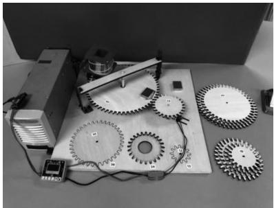
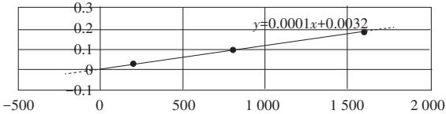
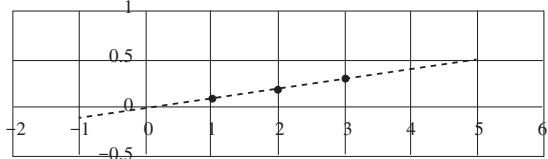
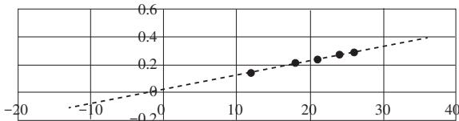

# 基于掌控板的高中物理实验创新

——以探究法拉第电磁感应定律为例

管佩磊1，2，王 硕2，房继珍2

（1. 南山区教育科学研究院，广东深圳 518052；2. 深圳市育才中学，广东深圳 518067）

摘 要：通过mPython编写程序输入掌控板，连接电压传感器元件，可以精确测量微小感应电动势。接入不同接线柱改变线圈匝数；使用不同个数的强磁体改变磁通量；更换小齿轮改变大齿轮转速，从而改变磁通量变化率，精确测量随3个变量变化的感应电动势，可以定量探究法拉第电磁感应定律。基于STEAM项目式学习教育理念，引导学生合作与实践，以综合创新的方式解决问题，有利于培养学生的综合素养。

关键词：掌控板；齿轮传动；法拉第电磁感应定律；创新实验

DOI：10.19935/j.cnki.1004-2326.2021.07.013

新教材、新高考的同步推进实施，带来了新的教学方式变革，给每一位青年教师带来了极大的挑战。在新人教版高中物理教科书选择性必修2第二章第2节“法拉第电磁感应定律”中，安排了以强磁体在场玻璃桶中下落的定性演示实验。

如果在极短的时间$\Delta t$内，磁通量的变化量为$\Delta \phi$，磁通量的变化率就是$\frac { \Delta \phi } { \Delta t }$。用E表示闭合电路中的感应电动势，那么，电磁感应定律就可以表示为$E = k { \frac { \Delta \phi } { \Delta t } }$。教材根据上面的实验，得出定性的结论，由定性实验给出定量结论，这给学生造成一定的认知冲突。学生产生疑问，能否采用定量探究的方法得出该结论呢？

掌控板是一种普及STEAM创客教育、编程教育的开源智能硬件，能够结合拓展板支持多路数据采集，比如连接电压传感器、电流传感器、力传感器等物理实验元件，便于数据的采集、展示和分析。笔者利用掌控版，设计制作了更为完善、科学的实验装置，用于定量探究法拉第电磁感应定律。

## 1 创新实验方案

通过不断分析研究、测试改进，笔者设计了由齿轮传动、掌控板测量的定量探究法拉第电磁感应定律装置，装置如图1所示。该装置通过齿轮传动带动磁铁转动，使固定的可拆卸变压器闭合线圈内的磁通量发生变化，产生微小感应电动势。将掌控板与电压传感器元件组装成实验测量装置，运用mPython软件编写程序输入掌控板，掌控板脱机运行进行微电压数据的测量，通过控制变量法定量探究法拉第电磁感应定律。

  
图1 定量探究法拉第电磁感应定律实验装置

## 1.1 分组实验，重视体验

在学生已经基本了解实验原理的基础上，开展分组实验，教师正确引导学生，把学生天马行空的想法转变为脚踏实地的做法，在亲身体验中锻炼学生的实践能力。

## 1.2 运用机械工艺，创新改进实验装置

（1）装置组成。

将固定的可拆卸变压器闭合线圈，连接掌控板测量装置。固定位置的大齿轮a（从动轮）两侧放置相同数量的强磁铁，使齿轮平衡转动，在相同时间内可以测量多组数据。电动机配有5 V的学生电源，在电动机上方安装小齿轮b（主动轮），电动机采用可滑动的设置便于更换主动轮。齿轮运用激光切割机进行切割，大齿轮a与小齿轮b可精准进行啮合传动。

（2）装置特点。

整个装置美观大方，器材元件在物理实验室和创客实验室均易找到。实验操作简单方便，可精确测量多组数据。

## 1.3 运用所学知识，改变磁通量变化率

（1）装置运行。

由工作电压为5 V的电动机带动小齿轮b转动，通过大齿轮a和小齿轮b啮合传动，使放置有磁铁的大齿轮a在可拆卸的变压器线圈下方匀速率转动。通过改变电动机上方的小齿轮b的齿数 $Z _ { \mathrm { { b } } }$，可以改变放置有磁铁的齿轮a的转速，从而改变通过闭合线圈的磁通量变化率。

（2）原理推导。

从法拉第电磁感应定律原理可知，$E \propto N \frac { \Delta \phi } { \Delta t }$，若保持线圈匝数N、通过闭合线圈磁通量 $\Delta \phi$ 相同，则 $E \propto { \frac { 1 } { \Delta t } }$。闭合线圈位置固定，磁铁随大齿轮a转动，匀速经过宽度不变的闭合线圈，则 $v _ { a } \propto \frac { 1 } { \Delta t }$。大齿轮a与小齿轮b的轮齿啮合传动，若齿轮啮合传动的传动比 $i = \frac { Z _ { a } } { Z _ { b } } = \frac { n _ { b } } { n _ { a } }$，即 $\frac { \text{从动轮齿数} } { \text{主动轮齿数} } = \frac { \text{主动轮转速} } { \text{从动轮转速} }$，则 $n _ { a } \propto Z _ { b }$。由 $v _ { a } \propto n _ { a }$，可知 $v _ { a } \propto Z _ { b }$，因此，$Z _ { \textit { b } } \propto { \frac { 1 } { \Delta t } }$，得出 $E \propto Z _ { b }$。也就是将研究E与 $\frac { \Delta \phi } { \Delta t }$ 的关系，转化为研究E与 $Z _ { b }$ 之间的关系，通过更换小齿轮b，改变主动轮的齿数，从而改变闭合线圈的感应电动势大小。

## 1.4 用控制变量法，定量探究实验

由定性实验可知，E的大小与线圈匝数N、磁通量变化率有关，因此，可以采用控制变量法进行探究。实验方案分为以下3组进行探究。

探究1：保证磁铁个数不变（磁通量变化量不变），齿轮传动比不变（大齿轮a转速不变），通过连接不同可拆卸变压器线圈匝数接线柱，从而改变闭合线圈匝数，探究E与N的关系。

探究2：保证齿轮传动比不变（大齿轮a转速不变），可拆卸变压器闭合线圈接线柱不变（闭合线圈匝数不变），通过改变长方形强磁铁的个数，从而改变磁通量的变化量，通过探究E与n的关系间接探究E与 $\Delta \phi$ 的关系。

探究3：保证磁铁个数不变（磁通量变化量不变），可拆卸变压器闭合线圈接线柱不变（闭合线圈匝数不变），通过更换不同的小齿轮b，改变大齿轮a的转速，从而改变磁通量的变化率，即通过探究E与$Z _ { \mathrm { a } }$的关系间接探究E与 $\frac { \Delta \phi } { \Delta t }$ 的关系。

## 1.5 编写代码并输入掌控板，测量微小电压

运用mPython图形化编程软件编写测量微小电压程序，将编程代码输入掌控板中。掌控板连接电压传感器元件，测量装置不仅可以脱机运行，而且可以通过屏幕显示微电压数值大小。重复测量50次，取5个最大值计算平均值，保证得到的数据更为精确，解决因在磁铁不断转动过程中通过闭合线圈磁通量变化略有不同的困扰，实验结果更具说服力。

## 2 定量探究的实验过程

## 2.1 探究感应电动势E与匝数N的关系

取2块38 mm×28 mm×4 mm的长方形强磁铁，闭合线圈大小位置不变，匝数为1 600匝，直流电动机工作电压为5 V，小齿轮24齿，大齿轮60齿，探究N与电磁线圈产生的感应电动势E关系。当线圈匝数为200，800，1 600匝时，测得的实验数据如表1所示。

表1 E与线圈匝数N的关系
<table><tr><td>线圈匝数N/匝</td><td>E/V</td></tr><tr><td>200</td><td>0.020</td></tr><tr><td>800</td><td>0.104</td></tr><tr><td>1 600</td><td>0.180</td></tr></table>

用Excel表格的数据分析功能拟合画图，得到如图2所示图象。

  
图2 E与线圈匝数N的图象

通过图象分析得出结论1：在实验误差允许范围内，感应电动势的大小与线圈匝数呈正比，即$E \propto N$。

## 2.2 探究感应电动势E与相同时间内 $\Delta \phi$ 的关系

闭合线圈大小位置不变，匝数为1 600匝，直流电动机工作电压为5 V，小齿轮24齿，大齿轮60齿。通过改变强磁体的个数，改变 $\Delta \phi$，当38 mm×28 mm×4 mm的磁铁块数分别为1，2，3时，改变 $\Delta \phi$ 测得的感应电动势E如表2所示。

表2 E与磁铁个数的关系
<table><tr><td>磁铁块数n/块</td><td>E/V</td></tr><tr><td>1</td><td>0.088</td></tr><tr><td>2</td><td>0.180</td></tr><tr><td>3</td><td>0.288</td></tr></table>

用Excel表格的数据分析功能拟合画图，得到如图3所示图象。

  
图3 E与磁体个数n的图象

通过图象分析得出结论2：在实验误差允许范围内，感应电动势的大小与相同时间内闭合线圈内的磁通量变化量呈正比，即 $E \propto \Delta \phi$。

## 2.3 探究感应电动势E与 $\frac { \Delta \phi } { \Delta t }$ 的关系

保持线圈的匝数、截面、位置不变，N为1 600匝，电机电压为5 V，38 mm×28 mm×4 mm的磁铁块数为2，大齿轮数60齿，更换电动机上方小齿轮，改变齿数，通过齿轮传动改变大齿轮转速，从而改变磁铁通过线圈的时间，探究磁通量变化率 $\frac { \Delta \phi } { \Delta t }$ 与电磁线圈产生的感应电动势E的变化规律。测得的感应电动势E如表3所示。

表3 E与小齿轮齿数之间的关系
<table><tr><td>小齿轮齿数$Z _ { b }$/齿</td><td>E/V</td></tr><tr><td>12</td><td>0.134</td></tr><tr><td>18</td><td>0.210</td></tr><tr><td>21</td><td>0.234</td></tr><tr><td>24</td><td>0.260</td></tr><tr><td>26</td><td>0.280</td></tr></table>

用Excel表格中数据分析功能拟合画图，得到如图4所示图象。

  
图4 E与小齿轮齿数$Z _ { b }$的图象

通过图象分析得出结论3：在实验误差允许范围内，感应电动势的大小与闭合线圈内磁通量变化率呈正比，即 $E \propto { \frac { \Delta { \phi } } { \Delta t } }$ 。

综上3个定量探究实验，得出结论：闭合电路中感应电动势的大小，跟穿过这一电路的磁通量的变化率成正比，与线圈匝数成正比。即 $E \propto N \frac { \Delta \phi } { \Delta t }$［1］。

## 3 实验创新分析

## 3.1 创新点分析

（1）师生共同参与，提升物理核心素养。

本实验利用各种器材、积极创新实验方式，尽可能开发出可视性强、证据性强、能引起学生浓厚兴趣的演示实验［2］，引导学生合作与实践，以综合创新的方式解决问题，培养学生综合素养，从而落实立德树人根本任务要求，体现物理课程的育人功能。

（2）创新实验装置，锻炼学生实践能力。

本实验不局限于物理实验室现有的传统设备，将日常用品、创客装备作为重要的实验资源，创新实验装置，积极为学生创造平台，将课堂所学知识应用于日常的探究中。学生通过动手实践、亲身经历创新物理实验的过程，更好地锻炼其实验技能和创新实践能力。

（3）融合信息技术，提升学生探究能力。

本实验将创客教室常用设备用于物理实验探究，加强学科间的融合创新。掌控板、激光切割机等设备的应用，不仅激发了学生对物理学科的兴趣，而且有利于学生深度学习。将STEAM教育的项目学习和问题解决导向融入物理实验创新中，从“做中学”“玩中创”，有利于学生科学思维的发展，提升科学探究能力［3］。

## 3.2 误差分析

磁铁个数增多，厚度增加，磁铁距离闭合线圈距离缩短，磁通量变化量并不成倍增加。

齿轮传动之间相互有摩擦，电动势和转速的关系会有误差，这也是该实验继续创新改进的方向。

## 4 结语

新课程、新教材对于培养学生物理核心素养，提高学生创新、探究的能力提出了很高的要求，融合现代科学技术，激发学生学习物理的兴趣，开发更多有趣、可行、精确度高的物理实验，可以充分体现物理学科全程育人、全方位育人的功能，培养学生的物理核心素养。

## 参考文献

［1］人民教育出版社，课程教材研究所，物理课程教材研发中心. 普通高中教科书物理必修第三册［M］. 北京：人民教育出版社，2019.

［2］中华人民共和国教育部. 普通高中物理课程标准（2017年版2020年修订）［S］. 北京：人民教育出版社，2020.

［3］许文龙. STEAM教育理念下高中物理实验设计——以“基于Tracker探究平抛运动规律”为例［J］. 中学物理，2021（3）：45-47.