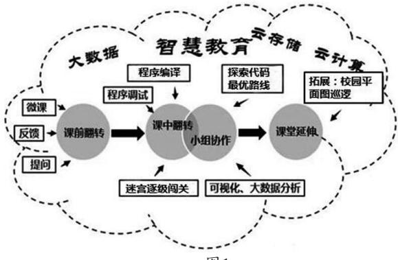
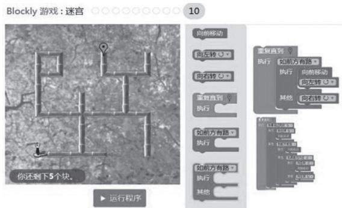

# 基于智慧课堂下实践Blockly编程教学的研究—以中学信息技术课程Blockly迷宫闯关编程为例

杨 简

摘　要：学生应用智能移动终端和智慧教育 APP，通过无线网络无缝接入智慧教育云，智慧教育云通过云计算和大数据技术分析学生的在线反馈数据和线上资源的应用数据，为教师的智慧课堂架构和师生互动提供智能建议。凸显教师教学行为和学生学习方式的变革，体现学生在智慧课堂下的多元化学习方式，提高学生差异化、个性化、自适应学习能力。关键词：信息技术；智慧教育；Blockly编程

DOI:10.13492/j.cnki.cmee.2019.14.007

## 一、研究背景

传统的信息技术课堂教学是以教师讲解为主的传统教学模式，学生缺乏自主学习的行为，而智慧课堂致力于改变学生的学习方式，引导学生投入更多的兴趣和精力到实验性、探索性课程中，提高信息技术课堂教学的实效性。

笔者提出：应用智能移动终端有效开展中学信息技术Blockly编程课程智慧教育，培养学生依托智能移动终端学习Blockly编程课程，通过网络环境无缝对接智慧教育云，借助大数据分析处理、云存储技术，利用翻转课堂和云平台各项功能实时处理反馈学生端数据指导学生自主探索课程内容。这是学生学习Blockly编程以及今后嫁接到其他语言环境学习高效有力的手段，对学生计算思维的启迪、培养，对中学信息技术学科智慧教育课程的开发、应用、完善，具有非常重要的作用。

## 二、实践中学信息技术智慧教育课堂建模

笔者构建的智慧学习模型是指：学生应用智能学习移动终端和智慧教育APP，通过无线网络无缝接入智慧教育云，智慧教育云通过云计算综合学生学前诊断、学习目标、原有知识储备和学习表现，主动向学生推送相对应的课程内容、课程资源和课程应用，帮助学生适配和链接智慧教育云，智能调节学生的在线学习情景，智慧教育云通过云计算和大数据技术分析学生的在线反馈数据和线上资源的应用数据，为教师的智慧课堂架构和师生互动提供智能建议，帮助教师适配和链接智慧教育云。

## 三、案例分析：应用智能移动终端有效实践中学信息技术课程—Blockly迷宫编程课程

本案例的教学实践按照“课前网上微课翻转，初步了解Blockly编程架构(如图1所示)，提出学习问题；课中微课翻转，探索Blockly程序编译；组内组间协同学习，大数据反馈可视化探索迷宫任务；课堂教学延伸，课后拓展处处能学、时时可学。”

  
图1

教学设计理念新颖，注重引导学生探究过程，学生小组协作学习、分工细化、明确到位，大数据背景下利用智慧教育云即时收集、整理、对比、分析，实现数据共建共享，探究虚拟Blockly编程及迷宫任务。

## 1.课前网上微课翻转

初步了解Blockly编程如何架构，提出学习问题。笔者课前在智慧教育云发布网络课程—Blockly编程动起来视频，学生课前通过智慧教育APP登入课程，利用智慧教育云的开放式问题，自主学习完成课前反馈，提出想进一步学习的问题，发布到智慧教育云。利用网络和智能移动终端，智慧教育APP适配智慧教育云支持学生课前学习、反馈与评价，实现课外课内智慧学习的无缝对接。

## 2.课中微课翻转　探索Blockly程序编译

学习掌握完成编程的流程：搭建Blockly模块→运行程序→不断优化、调试。笔者应用智慧教育云添加了附有3个思考问题的微课，要求学生在智慧教育APP端一边带着问题观看微课，一边根据问题思考理解掌握Blockly编程技巧，完成熊猫闯迷宫1～6关卡。问题1：如何在迷宫关卡1，2达成熊猫直线行走顺序结构代码？问题2：如何在迷宫关卡3，4，5达成熊猫行走穿过障碍选择结构代码？问题3：如何在迷宫关卡6达成熊猫行走条件、循环结构代码？

顺利完成“Blockly迷宫1～6关卡”活动的学生，数据会通过智慧教育云显示到黑板大屏幕一体机上，以帮助教师及时根据学生完成的速度和进度调整授课的策略，有针对性地帮助有需要的学生。微课的精髓在于恰到好处地帮助学生自学解决知识点。笔者再质疑，通过微课学生自学了什么知识？Blockly编程实现了行走，那如何实现转向呢？指引学生继续小组合作探究，探究Blockly编程不同环境下进行转向的不同方法。在具体的教学过程中，智慧教育云向教师及时反馈学生的学习情况，教师按不同的学生需求，动态地提供学习干预，准确地进行学习诊断和评价。

## 3.组内组间协同学生学习

大数据反馈可视化探索Blockly迷宫7～10关卡高阶编程(如图2所示)。

  
图2

笔者认为自主探究、动手操作、小组合作是学生学习Blockly编程课程非常重要而有效的方式，笔者应用智慧教育云为学生布置探索步骤，引导学生组内组间协同学习。学生登入智慧教育APP根据迷宫1～10关卡探究步骤，一边调试，一边记录，一边交流，面对复杂迷宫的行走路径探索多重结构组合模式。利用智慧教育云APP的录屏功能，支持学生记录探究过程；小组云数据同步汇报、展示不同模拟环境下学生的实验进程，利用云终端大数据技术，实现探究大数据共建共享，学生不只看到自己小组的熊猫行走视频、代码，也可以观察、对比全班所有小组闯关的大数据。各小组上传到智慧教育云自动存储的探究视频，既可以本组回看拍摄的视频，分析实验中失败的原因；同样可以看到别的小组在迷宫7～10关卡每一关卡中熊猫行走路径的优秀案例，是学生解决问题、练习有困难时的微视助手，利用智慧教育云可视化技术实现教学过程可视化，能兼顾不同层次的学生，满足学生学习的个性化需求。

## 4.课堂教学延伸　课后应用拓展

一个课程的参与者可以是一个学生、一个小组、一个班级、一个年级。时间可以是规定授课时间、校内课余时间、校外时间。地点可以是学校计算机教室、班级、校外，只要是有网络可以连接到智慧教育云的地方。这种组织形式打破了传统课堂原有的界定，满足不同层次学生对原有课堂学习时间、地点的延伸的需求。

科技源自于生活，科技回归至生活，课后可在智慧教育云布置学生一系列的生活问题，例如导入学校平面图如何实现保安最优校园巡逻路线。笔者利用智慧教育云的网络功能，添加了“校园巡逻”实际问题，在仿真环境下既形象又有趣味性。学生登录APP在课堂外完成深化练习，并通过APP发布自己编写的仿真环境下的程序，拓展、延伸、深化知识，支持学生实时线上提问留言，再次体现智慧教育课内课外的无缝学习。

## 四、结语

笔者构建的智慧教育模型以翻转课堂理念、探究性学习理念、小组协作理念为指导，在智能移动终端、智慧教育云、智慧教育APP支持下，中学信息技术课堂教学以其独特的优势给个性化学习和差异化教学带来了新的探索。

智慧教育资源的开发与智慧教育云是整个智慧教育体系的核心竞争力和载体，是教育智慧的源泉，智能移动终端为中学信息技术课堂智慧教育提供了良好的智能学习环境。笔者构建的智慧教育课堂模型还需要接受进一步的实践和广泛深入的检验，展望未来，智慧教育作为新技术进入校园将会成为一种常态，实现人人皆学、处处能学、时时可学。
