# 基于智能平台的高中物理实验教学策略

——以"电容器与电容"教学为例

刘佳 袁杰（广东外语外贸大学实验中学，广东 510540）

摘 要 以"电容器与电容"教学为例，提出了三个基于智能平台的物理实验教学策略：实验知识的有效建构策略、实验器材的择优策略和实验结论的定量化策略。通过PhET虚拟实验和Phyphox软件的开发利用，展示了这些工具如何帮助克服传统实验教学的局限，提升学生的实验能力和科学探究能力。同时还讨论了智能平台在教学中的应用，并提出了教师、学生和学校在融合信息技术与教学时的建议。

关键词 智能平台；高中物理；实验教学策略；PhET虚拟实验；Phyphox软件

文章编号 1002－0748（2024）11－0025

中图分类号 G633.7

文献标识码 B

## 1 问题提出

在实际的高中物理教学中，由于受到学校实验设备、场地和资金的限制，导致一些复杂的实验无法进行或者实验条件不够理想。从教学时间来看，高中物理课通常安排得比较紧凑，留给学生实验的时间有限，这可能导致学生无法充分参与实验过程，或者教师无法深入讲解实验原理。在教学方法上，传统的高中物理实验教学往往采用"教师讲解、学生模仿"的方式，这种"程式化"的教学模式弱化了学生的主体性和创新能力的培养。有的学校，由于课时紧张和教学质量评价的压力，学生可能没有足够的机会亲自动手进行实验，这限制了他们通过实验学习物理概念和原理的机会。

为了解决这些问题，我们需要创新教学策略，比如采用PhET虚拟实验和Phyphox软件等现代工具。这些工具不仅能够提供丰富的实验资源，还能在安全的环境中模拟复杂的物理现象，从而激发学生的学习兴趣，培养学生的科学探究能力。

## 2 智能平台在高中物理实验教学中的应用

在当今教育领域，信息技术的融合与应用已成为提升教学质量的关键因素。特别是在物理实验教学中，PhET虚拟实验和Phyphox软件的开发利用，为解决传统实验教学的局限性提供了新思路、新途径。

PhET虚拟实验，由诺贝尔奖得主卡尔·维曼创立，是一个互动仿真模拟程序。它通过Java语言和HTML5语言编写，能够在电脑、手机、平板上模拟物理实验，学生在安全环境下探究物理现象。张帆和张世姣的研究表明，PhET虚拟实验不仅提升了学生的学习兴趣，还促进了学生对物理概念的深入理解，尤其在动量守恒定律和电路实验的教学中，效果显著［1］［2］。

Phyphox软件利用智能手机的内置传感器，可开展声速测量、向心加速度与角速度关系验证以及单摆周期与摆长关系的定量探究等实验。惠宇洁的研究表明，Phyphox软件的引入打破了实验的空间限制，激发了学生的创新思维，促进了学生的自主探究［3］。伍科和张旺基于Phyphox程序设计的高中物理实验仪器，实现了电磁感应定律的定量探究，克服了传统实验的缺点。这种实验方式不仅降低了实验成本，而且提供了更直观和准确的实验结果，有助于培养学生的科学思维和探究素养，便于学生理解物理知识［4］。

可见，PhET虚拟实验和Phyphox软件在物理实验教学中的应用，有效克服了传统实验教学的局限性，提高了教学效率和安全性，同时激发了学生的学习兴趣和创新能力，为物理实验教学的发展注入了新活力。随着技术的不断进步，这些工具有望在未来发挥更大的作用。

普通高中物理课程标准（2017年版2020年修订）提出，高中物理课程要通过多样化的教学方式利用现代信息技术，引导学生理解物理学的本质，整体认识自然界，形成科学思维习惯，增强科学探究能力和解决实际问题的能力［5］。在教学实践中，通过对智能平台和教学软件的研究，笔者提出了基于智能平台引导学生进行深度学习的三个物理实验教学策略，并以"电容器与电容"为例展开说明。

## 3 基于智能平台的物理实验教学策略

### 3.1 实验知识的有效建构策略

实验知识的有效建构策略是指学生基于所学的科学实验思想、实验方法进行实验设计，从而得出实验结论的教学策略。通过智能平台上提供的虚拟实验器材，学生可以基于科学实验思想和方法，自主设计实验，从而构建实验知识体系，实现从被动接受到主动探究的转变。

**案例1：定量探究电容器所带电荷量Q与电容器两端电压U的关系**

实验器材：两只相同的电解电容器、一只数字式电压表、电池组、单刀双掷开关、开关、导线若干。

实验设计（实验建构）：如何改变电容器所带的电荷量？

旧知：探究库仑定律，用不带电的相同小球接触另一带电小球使电荷量减半。

新知：将充电后的电容器1与另一只相同的电容器2并联，使电容器1电量减半；然后将电容器2放电后再与电容器1并联，使电容器1电量成倍减少，如图1所示。

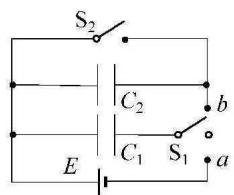
（a）

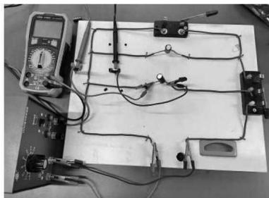
（b）
图1 探究电容器电荷量与电压的关系电路图与实物图

实验数据记录见表1。

表1 电容器电压与所带电荷量的关系

<table><tr><td rowspan=1 colspan=1>Q/q</td><td rowspan=1 colspan=1>0</td><td rowspan=1 colspan=1>1</td><td rowspan=1 colspan=1>1/2</td><td rowspan=1 colspan=1>1/4</td><td rowspan=1 colspan=1>1/8</td><td rowspan=1 colspan=1>1/16</td></tr><tr><td rowspan=1 colspan=1>U/V</td><td rowspan=1 colspan=1>0</td><td rowspan=1 colspan=1>10.30</td><td rowspan=1 colspan=1>5.20</td><td rowspan=1 colspan=1>2.68</td><td rowspan=1 colspan=1>1.38</td><td rowspan=1 colspan=1>0.72</td></tr></table>

实验结论：一个电容器所带电荷量Q与电容器两端的电压U成正比，如图2所示，即

$$
C = \frac{Q}{U}
$$

实验思考：能否改变电容两端的电压，测量电容器所带电荷量？电荷量是很难直接测量的物理量，可以考虑用虚拟实验（PhET仿真实验）。

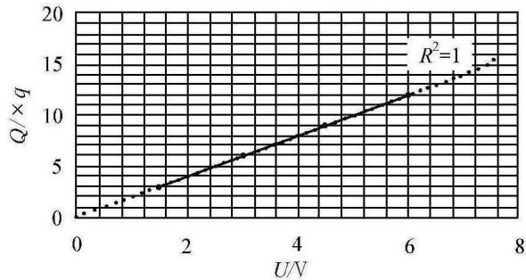
图2 Q-U关系图线

虚拟实验操作界面如图3所示，将一个电容器与电源相连，电压表并联在电容器两端，闭合开关，分别得到电容器两端的电压为0.400V、0.800V、1.200V、1.500V时对应的电荷量。

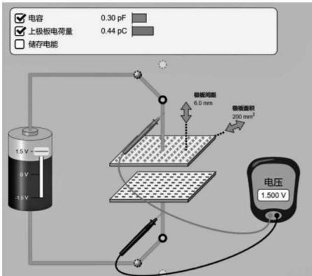
图3 电容器电荷量与U的关系（PhET界面）

实验数据记录见表2。

表2 电容器电压与所带电荷量的关系（PhET仿真实验）

<table><tr><td rowspan=1 colspan=1>U/V</td><td rowspan=1 colspan=1>0</td><td rowspan=1 colspan=1>0.400</td><td rowspan=1 colspan=1>0.800</td><td rowspan=1 colspan=1>1.200</td><td rowspan=1 colspan=1>1.500</td></tr><tr><td rowspan=1 colspan=1>Q/pC</td><td rowspan=1 colspan=1>0</td><td rowspan=1 colspan=1>0.12</td><td rowspan=1 colspan=1>0.24</td><td rowspan=1 colspan=1>0.35</td><td rowspan=1 colspan=1>0.44</td></tr></table>

不难看出，该实验设计的核心是利用两个相同的电容器使电荷量平分。该思想方法在探究库仑定律时也曾出现过。通过这种知识建构的方式，有助于培养学生的知识迁移能力，提升科学思维和科学探究的能力。通过PhET仿真实验，让学生从改变电容器两端电压的角度再次验证实验结论（见图4），提前让学生熟悉该仿真实验的操作，为后续探究电容的决定式奠定基础。

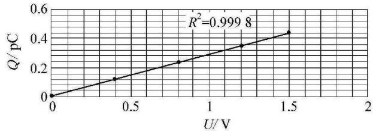
图4 Q-U关系图

### 3.2 实验器材的择优策略

实验器材的择优策略是指在实验设计的过程中，选择能更精准反映实验现象、减小实验误差且容易获取的实验器材，从而得出实验结论的策略。智能平台使得学生能够在实验设计中选择更精准、易获取的虚拟器材，以更小的实验误差和更高的真实性进行实验。

**案例2：探究电容器充电、放电过程中两极板电压U、电路中的电流I与时间t的关系（学生实验）**

实验器材：电容器、朗威DIS传感器、电流传感器、电压传感器、电脑（安装DISlab）、手机（安装Phyphox）、电池组、单刀双掷开关、导线若干。

实验器材选择：本实验为新增的学生必做实验，意在让学生体会传感器在物理实验中的重要作用。此处有两套传感器设备可供选择。朗威DIS传感器更适合作为演示实验的器材；作为学生实验，选择电压、电流传感器，再在手机上安装Phyphox，即时显示U-t、I-t图象更合适。电容器充、放电电路图与实物图如图5（a）、（b）所示。

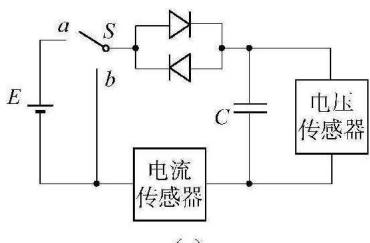
（a）

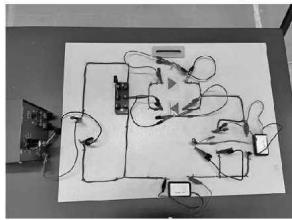
（b）
图5 探究电容器充电、放电过程中两极板电压U、电路中的电流I与t的关系电路图与实物图

实验数据图象如图6（a）、（b）所示。

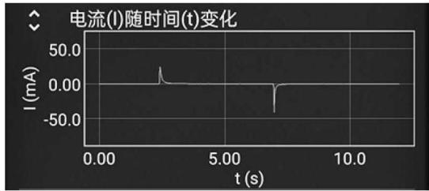
（a）

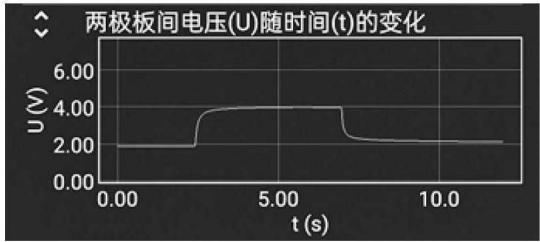
（b）
图6 探究电容器充电、放电过程中两极板电压U、电路中的电流I与t的关系

实验现象：当单刀双掷开关接1时，电容器充电，正电荷聚集在电容器上极板，负电荷聚集在电容器下极板，在极短的时间内达到稳定，即电压达到一定值；当单刀双掷开关接2时，电容器放电，两极板的正负电荷中和，电压迅速降为0，如图6（b）所示。

当单刀双掷开关接1时，电容器充电，电荷在聚集到电容器上极板的过程中，电荷定向移动，形成电流，瞬间达到峰值；当单刀双掷开关接2时，电容器放电，电荷中和的过程中，电荷定向移动形成电流；当电荷中和完毕，电路中没有电荷移动，电流为0。图线"所围面积"表示电荷量的多少。

Phyphox对于定量探究该实验有着非常重要的作用。在高中物理实验中，我们要尽可能地通过定量探究得到相应的物理规律，让学生能够追寻科学探索的步伐，利用现代信息技术探究物理规律。

### 3.3 实验结论的定量化策略

实验结论的定量化策略是指在实验设计的过程中，充分运用定量测量的工具进行实验探究，从而得出定量的物理规律。智能平台的定量工具能够帮助学生在实验设计中进行精确的物理规律探究，即使是难以直接测量的物理量也能通过虚拟仿真实验进行定量化研究。

**案例3：利用PhET定量探究平行板电容器的决定因素**

实验猜想：学生观察如图7所示演示实验并提出猜想：平行板电容器的电容可能与极板间距离d、两极板的正对面积S以及极板间的电介质有关。

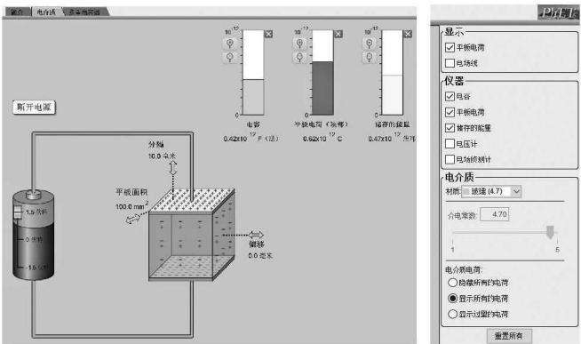
图7 演示实验装置

实验设计：给平行板电容器充电后断开电源，利用控制变量法探究平行板电容器的电容与电介质、极板间距离、正对面积的关系。

PhET仿真实验：接通电源，电压为1.5V。

**实验一**：控制极板间距离 $d=0.01\mathrm{m}$、正对面积 $S=1.0\times10^{-4}\mathrm{m}^{2}$ 不变，介质依次改为铁氟龙（ $\varepsilon_{\mathrm{r}}=2.1$ ）、纸张（ $\varepsilon_{\mathrm{r}}=3.5$ ）、玻璃（ $\varepsilon_{\mathrm{r}}=4.7$ ）。

实验数据记录见表3。

经过线性拟合，相关系数 $R^{2}=0.9998$，充分说明当S一定时，平行板电容器的电容C与相对介电常数 $\varepsilon_{\mathrm{r}}$ 成正比（见图8）。

表3 电容C与电介质 $\varepsilon_{\mathrm{r}}$ 的定量关系（PhET仿真实验）

<table><tr><td rowspan=1 colspan=1>εr</td><td rowspan=1 colspan=1>1.0</td><td rowspan=1 colspan=1>2.1</td><td rowspan=1 colspan=1>3.5</td><td rowspan=1 colspan=1>4.7</td></tr><tr><td rowspan=1 colspan=1>C/×10⁻¹² F</td><td rowspan=1 colspan=1>0.09</td><td rowspan=1 colspan=1>0.19</td><td rowspan=1 colspan=1>0.31</td><td rowspan=1 colspan=1>0.42</td></tr></table>

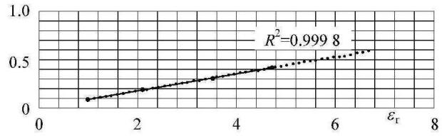
图8 $C-\varepsilon_{\mathrm{r}}$ 关系图

**实验二**：控制相对介电常数 $\varepsilon_{\mathrm{r}}=1.0$、极板间距离 $d=0.01\mathrm{m}$ 不变，正对面积S依次为图4中的 $S_{1}=1.00\times10^{-4}\mathrm{m}^{2}$，$S_{2}=2.02\times10^{-4}\mathrm{m}^{2}$，$S_{3}=3.30\times10^{-4}\mathrm{m}^{2}$，$S_{4}=4.00\times10^{-4}\mathrm{m}^{2}$。

实验数据记录见表4。

经过线性拟合，相关系数 $R^{2}=1$，充分说明当 $d$、$\varepsilon_{\mathrm{r}}$ 一定时，平行板电容器的电容C与正对面积S成正比（见图9）。

表4 电容C与正对面积S的定量关系（PhET仿真实验）

<table><tr><td rowspan=1 colspan=1>S/×10⁻⁴ m²</td><td rowspan=1 colspan=1>1.00</td><td rowspan=1 colspan=1>2.02</td><td rowspan=1 colspan=1>3.30</td><td rowspan=1 colspan=1>4.00</td></tr><tr><td rowspan=1 colspan=1>C/×10⁻¹² F</td><td rowspan=1 colspan=1>0.09</td><td rowspan=1 colspan=1>0.18</td><td rowspan=1 colspan=1>0.29</td><td rowspan=1 colspan=1>0.35</td></tr></table>

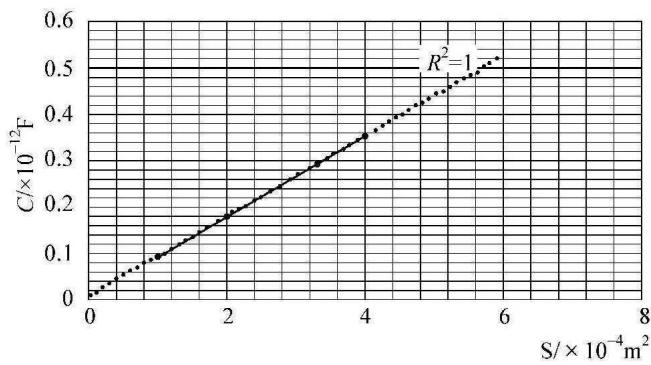
图9 C-S关系曲线

**实验三**：控制相对介电常数 $\varepsilon_{\mathrm{r}}=1.0$、正对面积 $S=1.00\times10^{-4}\mathrm{m}^{2}$ 不变，板间距离d依次为 $d_{1}=5.0\times10^{-3}\mathrm{m}$，$d_{2}=6.0\times10^{-3}\mathrm{m}$，$d_{3}=8.0\times10^{-3}\mathrm{m}$，$d_{4}=10.0\times10^{-3}\mathrm{m}$，实验数据如表5所示。

表5 电容C与板间距离d的定量关系（PhET仿真实验）

<table><tr><td rowspan=1 colspan=1>d/×10⁻³ m</td><td rowspan=1 colspan=1>5.0</td><td rowspan=1 colspan=1>6.0</td><td rowspan=1 colspan=1>8.0</td><td rowspan=1 colspan=1>10.0</td></tr><tr><td rowspan=1 colspan=1>1/d / m⁻¹</td><td rowspan=1 colspan=1>200</td><td rowspan=1 colspan=1>167</td><td rowspan=1 colspan=1>125</td><td rowspan=1 colspan=1>100</td></tr><tr><td rowspan=1 colspan=1>C/×10⁻¹² F</td><td rowspan=1 colspan=1>0.18</td><td rowspan=1 colspan=1>0.15</td><td rowspan=1 colspan=1>0.11</td><td rowspan=1 colspan=1>0.09</td></tr></table>

实验数据记录见表5。

经幂函数拟合以及 $C-\frac{1}{d}$ 线性拟合，相关系数均大于0.99，充分说明当S、$\varepsilon_{\mathrm{r}}$ 一定时，平行板电容器的电容C与板间距离d成反比（见图10）。

通过PhET仿真实验得到实验数据，再用EXCEL进行数据处理以及线性拟合，可得

$$
C \propto \varepsilon_{\mathrm{r}}, \quad C \propto S, \quad C \propto \frac{1}{d}
$$

相比教材中的实验，实现了定性研究向定量研究的转化，进一步促进了学生的深度学习，也体现了科学探究的核心素养。

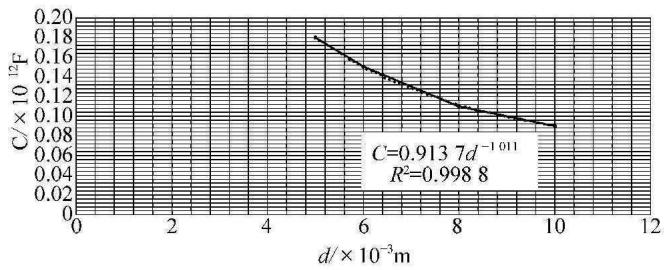
（a）

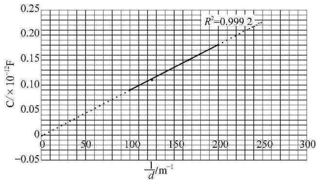
（b）
图10 C-1/d关系曲线

## 4 应用智能平台促进高中物理实验教学的思考

<!-- 注：本文PDF第4页末"（下转第21页）"处，第5页接排的是同期刊物另一篇关于"光电效应"的文章（含"实验电路及操作说明""优点分析""结语"等小节），与本文（刘佳·电容器与电容）无关。本文第4节剩余内容、第5节结语及参考文献在所提供的PDF中缺失，已删除混入的光电效应文章内容。 -->

### （1）教师的角色转变

在人工智能时代，教师需要积极拥抱技术，学习和掌握各种软件，如Algodoo、GeoGebra等，以促进学生对物理实验现象本质的理解［6］。

<!-- 存疑：本文第4节其余部分（学生主动学习、学校策略布局）、第5节结语及参考文献[1]-[6]的完整信息在所提供的PDF中缺失（PDF第5页混入了他文），无法从PDF补全。请引用前查对原始期刊。 -->

## 参 考 文 献

<!-- 存疑：本文参考文献在PDF中与他文（光电效应）混排，无法可靠区分。根据正文引用，本文应含6条参考文献，涉及：[1]张帆/张世姣（PhET）、[2]（PhET电路）、[3]惠宇洁（Phyphox）、[4]伍科/张旺（Phyphox电磁感应）、[5]普通高中物理课程标准、[6]（Algodoo/GeoGebra）。具体著录信息请查对原始期刊《物理教学》2024年第46卷第11期。 -->
