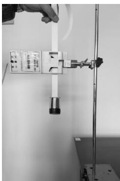
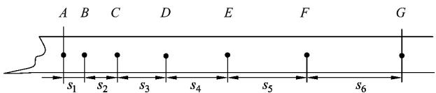
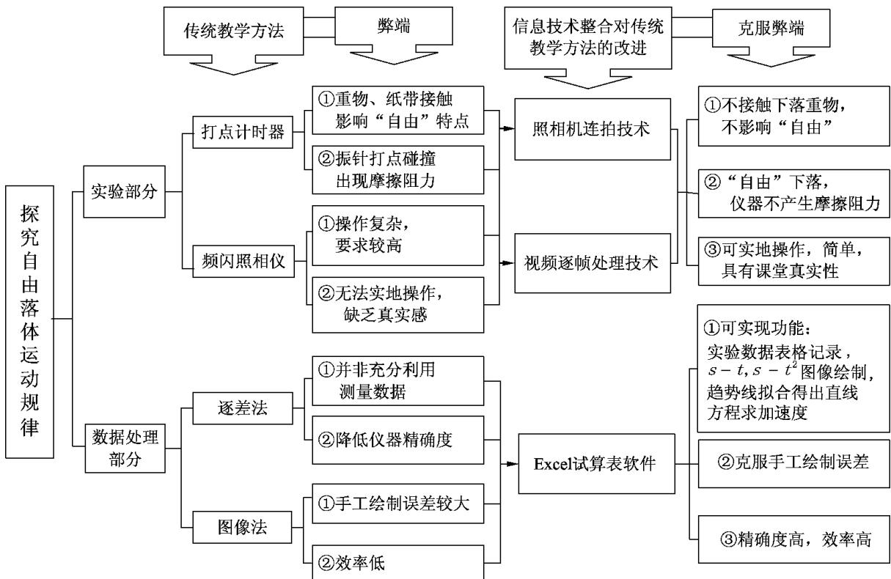
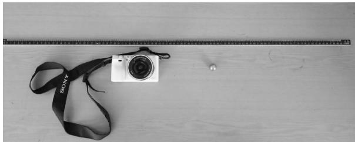
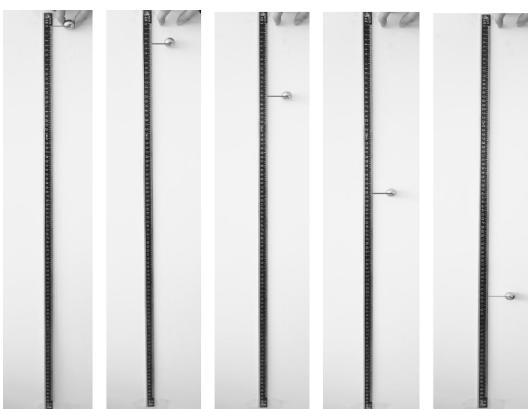
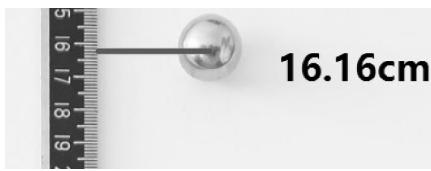
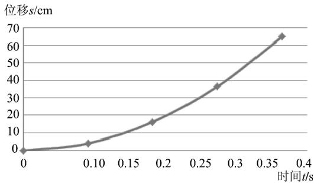
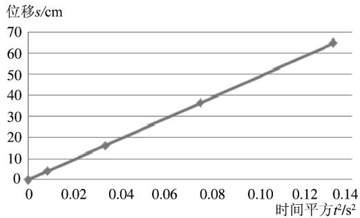
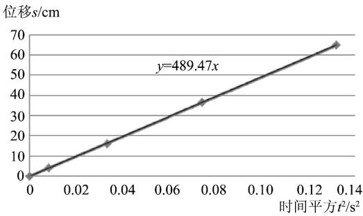

> 来源：MinerU 转换（stem-exact rebuild 2026-08-08）

· 现代教学技术 ·

# 基于现代信息技术的中学物理实验改进

———以“探究自由落体运动规律”为例

郑宇晴 马文婧 张轶炳＊（宁夏大学物理与电子电气工程学院 ，宁夏 银川 750021）

摘 要 “探究自由落体运动规律”一节实验中 传统教学以打点计时器为媒介的处理效果一直不够理想 利用照相机连拍的现代数码产品拍摄技术并整合 Excel 等软件分析处理 ， 可将其动态下落过程转变为静态暂留状态 克服传统教学弊端 从而方便下落位置的观察 处理 达到直观 形象 准确的实验效果

关键词 ： 信息技术与物理实验整合 ；物理实验改进 ；自由落体运动规律

2012 年 3 月 教育部颁布《教育信息化十年发展规划（2011—2020 年） 》 其中提出“以教育信息化带动教育现代化” ，并在文件中多次提到教育教学发展与信息技术深度融合的与时俱进性．［1］

近年来 信息技术融入中学物理实验教学的重要性得到广泛重视．在中学物理实验教学的基础上借助信息技术高效 精准 新颖及个性化需要的特点 对于改进传统物理教学的实验设备和方法具有启发效果 可以提高学生学习兴趣 从而帮助推进物理实验过程 促使实验结论的得出．本文以高中物理“探究自由落体运动规律”的实验教学为例 在客观分析传统教学设备及方法的缺点和问题的基础上 从信息技术改进物理实验角度出发 利用现代数码产品拍摄技术及软件的整合使用 以期改进传统实验教学方法 更好促进“自由落体运动规律”探究实验过程的科学展开

## 1 研究背景

## 1 1 教材分析

落体运动是生活中的常见现象．“自由落体运动”在高中物理教学中占有重要地位．“探究自由落体运动规律”是既学生理解自由落体运动概念特点及下落影响因素后安排的 符合学生学习需求及其认知结构的实验探究部分的教学内容 ， 是匀变速直线运动的特例．横观各版本的高中物理教材 该实验的探究和意义在后续知识的学习中都扮演着重要角色．［2］

“探究自由落体运动规律”的实验教学主要围绕两方面进行 ： （1）通过实验分析得出运动性质 ：自由落体运动是匀加速直线运动 （2）通过数据计算得到结论 ： 自由落体运动的加速度大小约为 9.8 m／s2．换言之 “探究自由落体运动规律”教学可分为实验探究和数据处理两个过程 是定性与定量分析兼具 且以定量分析为主的物理探究实验

1． 2 “探究自由落体运动规律”的传统教学方法分析

## 1． 2． 1 传统教学—实验部分分析

传统实验教学在“探究自由落体运动规律”上主要借助打点计时器或频闪照相仪两种实验仪器进行

（1） 打点计时器记录自由下落重物运动轨迹

  
图 1 打点计时器研究“自由落体运动规律”实验

利用打点计时器研究自由落体运动规律是最常见的传统实验教学方法 如图 1．它是通过与纸带相连的重物穿过打点计时器后的自由下落，根据纸带上的打点点迹反映其运动轨迹的实验方法．但该方法的缺点是，自由下落重物与纸带相连结会一定程度影响“自由”释放的特点 且振针与纸带打点时会因打点碰撞产生摩擦阻力 从而导致实验数据往往不够稳定．笔者曾在课堂教学中引导学生采取分组方式进行该实验 ， 然而全班 6 组学生在多次正确规范操作下 得到的打点数据计算结果与理想实验数值相差较大．因此 有教师甚至不得不违背实验科学性 ： 通过课下数次实验找到其中一条较理想的下落纸带 再采取与课堂演示实验得到纸带进行“掉包”的方法 “促使”实验结论得出，［3］很显然这种违背科学性的实验教学方法是不可取的

## （2） 频闪照相仪等时间间隔曝光记录运动位置

该方法通过频闪照相仪等时间间隔对正在自由下落重物进行频闪感光拍照于同一底片上来记录其运动轨迹．但通常 中学物理教师无法实际操作这一实验．一则因为频闪照相仪价格昂贵 中学物理实验室通常不予配备此设备； 二则频闪照相仪感光拍照需要绝对的暗室条件进行 对周围环境要求较高 且需冲洗放大照片的过程较为复杂因此这种方法的教学通常是教师直接向学生展示网络搜集到的频闪照片 无法让学生切身体会其频闪拍照实验过程 而使课堂缺乏真实感

## 1 2 2 传统教学—数据处理分析

传统教学在“探究自由落体运动规律”实验对数据的处理分析主要以逐差法和图像法为主

## （1） 逐差法———公式计算得出结论

逐差法是传统教学在处理匀变速直线运动的判断及求解加速度时最常用的数据处理方法

然而 很多学者对逐差法求解匀变速直线运动加速度的科学准确性提出质疑．在逐差法处理纸带数据计算加速度时 （以相邻点迹间 6个 位 移 数 值 的 纸 带 模 型 为 例 ， 如 图 2） $a = \frac { ( s _ { 4 } + s _ { 5 } + s _ { 6 } ) - ( s _ { 1 } + s _ { 2 } + s _ { 3 } ) } { 9 t ^ { 2 } }$ ， 我们发现 $( s _ { 1 } + s _ { 2 } + s _ { 3 } )$ 为 A、D 两点间的位移 $s _ { A D }$， $( s _ { 4 } + s _ { 5 } + s _ { 6 } )$ 为 D、G两点间的位移 $s _ { D G }$ 而两段加和位移实际上可直接测量．因此逐差法处理过程并非充分利用所打点迹的测量数据 反而却相当于 $a = \frac { s _ { D G } - s _ { A D } } { ( 3 t ) ^ { 2 } }$ ，即相当于将其变成了周期为 3t 的打点计时器所得到数据进行求解加速度的过程．换言之，逐差法处理纸带数据的方法增大了打点计时器的打点周期 调小了打点的频率，使所利用的打点数据变少，进而一定程度上降低了实验仪器精确度，增加了实验误差．［4］

  
图 2 相邻点迹间为 6 个位移数值的纸带模型

## （2） 图像法———坐标纸描点 连线绘制图像

图像法处理“探究自由落体运动规律”实验数据 是通过所测数据———“位移”及“时间”等相关量的函数关系曲线来判断其运动性质的方法．通过猜想 分析运动性质所对应的相关函数曲线 并以此作为通过图像法绘出函数曲线后所对应运动性质的依据

在对自由落体运动定性认识下 学生对其猜想主要包括两种情况 ： ① 匀加速直线运动 ； ② 变加速直线运动．我们假设自由落体运动是匀加速直线运动 并根据其初速度为 0 知其位移 －时间满足关系 $s { = } \frac { 1 } { 2 } a t ^ { 2 }$ 据此结合数学函数关系可知其s－t图像为过原点的抛物线 $s ^ { - } t ^ { 2 }$ 图像应为一过原点的倾斜直线．故若根据实验数据所绘图像符合上述形状 则可判断自由落体运动规律为匀加速直线运动 ；否则 ，其必为变加速直线运动．较之逐差法 ，图像法可充分运用测量数据 ， 有效剔除误差较大的实验点迹 ， 提高精确度．但坐标纸描点绘图中 坐标分度的个性化选取 手工误差以及曲线拟合是否标准均是不容忽视的误差问题

综合以上分析 传统教学方法在“探究自由落体运动规律”实验中存在着一定科学性及严谨性的教学弊端

## 2 整合现代信息技术 改进“探究自由落体运动规律”实验

为克服传统教学方法弊端 改进“探究自由落体运动规律”实验，以框架图分析现代信息技术引入对改进实验的帮助及优势 ，如图 3

## 2． 1 实验部分改进

采用现代信息技术———照相机连拍 视频逐帧处理技术可克服传统实验方法教学弊端 有效完成该实验教学

## （1） 照相机连拍技术记录自由落体运动轨迹

信息技术媒体 ：数码照相机；计算机“画图”等图像处理软件

连拍功能是对物体运动过程的快速连续拍摄．利用照相机连拍可得到运动物体等时间间隔点的运动位置 达到跟踪物体运动时间和对应位置情况的效果．在“探究自由落体运动规律”教学中（实验仪器如图 4） ，利用照相机连拍技术拍摄重物自由下落运动过程 可快速捕捉其下落过程中等时间间隔点的对应位置情况 得到相应连拍照片，有效记录重物自由下落过程的运动轨迹

图 3 改进实验的信息技术引入框架图  
  
图 4 “照相机连拍技术记录自由落体轨迹”实验仪器

同时 采取计算机“画图”软件对连拍照片“放大”处理 清晰读出重物下落紧靠的刻度尺上所对应的位置数值

以索尼 ILCE－6000L 微 单 数 码 相 机 （ 索 尼 α－6000）的“连拍－hi”功能下所拍摄到小钢球的自由下落过程实验照片及数据为例 对上述内容辅助解释．

介绍 ：此款数码照相机（索尼 α－6000）在“连拍－hi”功能下， 每秒可连拍 11 张照片，即某动态运动在此功能下可被拍摄成等时间间隔为 $\frac { 1 } { 1 1 } \mathrm { s }$ 的 前 后变化的静态连续照片

利用索尼 α－6000 连拍技术拍摄小钢球的自由下落过程 快速捕捉其下落过程的运动位置 记录运动轨迹 实验得到如图 5 所示的连拍照片有效截图．

  
图 5 索尼 α－6000 连拍技术拍摄到的  
小钢球自由下落过程有效照片

采用“画图”软件对上述照片“放大”处理 可以清晰读出小钢球所对应刻度尺的位置数值．以图 5 连拍照片第 3 张“放大”处理后的读数截图为例 如图 6 对应刻度数值为 16.16 cm．其他“放大”后所读数值记录，如表 1 所示

  
图 6 “画图”软件的放大照片读数效果

表 1 连拍照片经“放大”后读数记录
<table><tr><td rowspan=1 colspan=1>连拍位置</td><td rowspan=1 colspan=1>1</td><td rowspan=1 colspan=1>2</td><td rowspan=1 colspan=1>3</td><td rowspan=1 colspan=1>4</td><td rowspan=1 colspan=1>5</td></tr><tr><td rowspan=1 colspan=1>时刻 $t / \mathrm { s }$ </td><td rowspan=1 colspan=1>0</td><td rowspan=1 colspan=1>1/11</td><td rowspan=1 colspan=1>2/11</td><td rowspan=1 colspan=1>3/11</td><td rowspan=1 colspan=1>4/11</td></tr><tr><td rowspan=1 colspan=1>读数s/cm</td><td rowspan=1 colspan=1>0.00</td><td rowspan=1 colspan=1>4.05</td><td rowspan=1 colspan=1>16.16</td><td rowspan=1 colspan=1>36.35</td><td rowspan=1 colspan=1>64.76</td></tr></table>

（2） 视频逐帧处理技术记录自由落体运动轨迹

信息技术媒体 数码摄像机 计算机“暴风影音”等视频处理软件及“画图”软件

帧是视频中最小的单幅影像 视频片段正是由一帧帧单幅影像前后快速连接在一起形成的动态过程．逐帧处理就是将视频片段重新分解为“帧”静态暂留画面的过程．实验中 只需通过数码摄像机拍摄重物自由下落过程 并利用“暴风影音”等视频处理软件实现逐帧处理 即可得到运动过程的逐帧静态图片．［5］ 根据视频处理软件中所处理视频属性———帧率（单位 ： fps 即每秒所显示的帧数） 计算逐帧处理后相邻两照片的时间间隔 $t = \frac { 1 } { \text { 帧率 } }$ 从而得到相应照片对应的下落时刻 t最后通过“画图”软件 对有价值的帧静态暂留照片“放大”处理 清晰读出重物下落紧靠刻度尺所对应的位置数值 s．从而 通过运动时间及对应位置关系 实现对自由下落重物运动轨迹的记录

## 2 2 数据处理分析———Excel 图像法

为克服传统手工绘图粗糙 效率低及不够准确的弊端 可采用现代信息技术 Excel 软件图像法实现对测量数据表格记录 图像绘制及曲线拟合功能 完成实验数据处理 达到高效 准确的效果

## （1） 对实验数据进行表格记录

由举例中 “照相机连拍技术记录自由落体运动轨迹”实验数据 采用 Excel 可完成表格绘制 记录并实现函数公式计算 t2 数值记录 表格截图如图 7

<table><!-- PDF亦模糊：Excel 截图首行单元格 OCR 为 "I16 - f"，无法还原原始内容 --><tr><td rowspan=1 colspan=4>　</td></tr><tr><td rowspan=1 colspan=1></td><td rowspan=1 colspan=1>A</td><td rowspan=1 colspan=1>B</td><td rowspan=1 colspan=1>C</td></tr><tr><td rowspan=1 colspan=1>1</td><td rowspan=1 colspan=1>时间t(s）</td><td rowspan=1 colspan=1>时间平方t2(s²)</td><td rowspan=1 colspan=1>位移s（cm）</td></tr><tr><td rowspan=1 colspan=1>2</td><td rowspan=1 colspan=1>0</td><td rowspan=1 colspan=1>0</td><td rowspan=1 colspan=1>0</td></tr><tr><td rowspan=1 colspan=1>3</td><td rowspan=1 colspan=1>1/11</td><td rowspan=1 colspan=1>0.008264463</td><td rowspan=1 colspan=1>4.05</td></tr><tr><td rowspan=1 colspan=1>4</td><td rowspan=1 colspan=1>2/11</td><td rowspan=1 colspan=1>0.033057851</td><td rowspan=1 colspan=1>16.16</td></tr><tr><td rowspan=1 colspan=1>5</td><td rowspan=1 colspan=1>3/11</td><td rowspan=1 colspan=1>0.074380165</td><td rowspan=1 colspan=1>36.35</td></tr><tr><td rowspan=1 colspan=1>6</td><td rowspan=1 colspan=1>4/11</td><td rowspan=1 colspan=1>0.132231405</td><td rowspan=1 colspan=1>64.76</td></tr></table>

图 7 Excel 表格记录实验数据截图

## （ 2 ） 绘制 s－t 及 s－t 2 图像 ， 得出运动性质

表格选中时间 t 及位移 s 相应数据， “插入”—“图表—散点图”可绘制出 s－t 图像 如图 8 所示同样方法 选中时间平方 t2 及位移 s 数据 插入“散点图”即可得到 $\mathbf { \boldsymbol { s } } ^ { - } t ^ { 2 }$ 图像 如图 9．对应函数曲线类型，由图 8 图 9 中绘出的 s－t 图像的抛物线形状及 $s ^ { - } t ^ { 2 }$ 图像的倾斜直线形状均符合匀加速直线运动的规律 $s { = } \frac { 1 } { 2 } a t ^ { 2 }$ 据此可判断 ： 自由落体运动规律是初速度为 0 的匀加速直线运动

图 8 由 Excel 绘成的 s－t 图像  
  
图 9 由 Excel 绘成的 s－t2 图像

（3） 线性拟合求出加速度大小

由初速度为 0 的匀加速直线运动位移 －时间关系 $s { = } \frac { 1 } { 2 } a t ^ { 2 }$ ，可知 ${ \frac { 1 } { 2 } } a$ 即为其 $s ^ { - } t ^ { 2 }$ 图像的直线斜率．对图 9 中直线采取“添加趋势线 －显示公式”可实现直线拟合 得到直线方程 显示结果如图10．故直线斜率 $489.47 \ \mathrm { cm/s ^ { 2 } } = \frac { 1 } { 2 } a$ ， 计算得出加速度 $a \approx 9.79 \ \mathrm { m/s } ^ { 2 }$ ．多次测量实验数据后 得出结论 ： 自由落体运动加速度大小均围绕在 9.8 m／s2

  
图 10 由 Excel 绘成的 s－t2 直线方程拟合图像

## 3 结语

利用照相机连拍及视频逐帧处理技术 整合后期”画图”及 Excel 软件功能探究实验 ，克服了传统教学方法在”探究自由落体运动规律”实验的缺点弊端 使实验更加精准 高效 从而合理改进传统实验设备及方法， 提高实验科学 严谨性， 有效促进了”探究自由落体运动规律”实验的进行．信息技术与改进中学物理实验进行整合 可以在尊重学生认知结构的同时， 锻炼学生的科学探究能力和创新精神 激发学生学习的好奇心 求知欲推动信息技术与物理课程整合的进一步发展 从而在改进传统教学方法中， 更好促进了中学物理实验教学

## 参考文献 ：

［1］ 教育部． 教育信息化十年发展规划（2011—2020 年）［DB/OL］． http://www.moe.gov.cn/ewebeditor/uploadfile/2012/03/29/20120329140800968.doc， 2012-04-01．

［2］ 教育部． 普通初中物理课程标准［M］． 北京： 人民教育出版社， 2011．

［3］ 吴存华． 向虚假的科学探究说”不”———以”自由落体运动”的教学为例［J］． 全球教育展望， 2008， 37（8）： 90-93．

［4］ 杨严辉． 用逐差法计算纸带的加速度准确吗？［J］． 物理教师， 2014， 35（3）： 58-58．

［5］ 张杰， 牟其善． 多媒体技术在频闪照像法实验中的应用［J］． 物理实验， 2003， 23（12）： 40-41．

（收稿日期： 2018-04-18）

<!-- 以下为同 PDF 中收录的另一篇论文（高春丽，福州四中桔园洲中学），非 LIT-0064 内容，仅附于此供参考 -->

# 智能手机辅助中考物理复习的课堂教学探讨

———以”温度与物态变化”为例

高春丽

（福州四中桔园洲中学 ，福建 福州 350000）

摘 要 通过以”温度与物态变化”中考复习课为例 提出基于网络环境利用智能手机辅助中考物理复习 设计有利于培养学生分析问题与解决问题的能力 有利于学生科学素养的提升 有利于激发教师的教学责任感 有利于提高课堂教学效率为主要目的课堂教学模式

关键词 ： 网络环境 ；智能手机 ；中考 ；课堂教学模式

网络环境下利用智能手机辅助教学的中考物理复习课堂教学该如何进行 以更能切合中学生的心智水平 更能使学生利用较短的时间对物理基本知识与基本技能有更加深入的理解和掌握提高中考物理复习课堂教学效率呢？下面就以”温度与物态变化”中考复习课堂教学为例进行阐述．

课堂教学包含有 3 个部分 不是单纯的上课的 45 min 时间 所以下面就从课前 课中及课后 3个环节来阐述基于网络环境利用智能手机的中考物理复习课堂教学模式

## 1 课前

## 1． 1 学生活动

（1） 依据个人学习过程存在的问题 ，利用智能手机在 “智学网”上有选择地观看微课

基于设定的教学思路 选定一个网络环境非常关键，由于作者所处学校已与 “智学网”有多年的合作 所有学生 教师及家长都有一个自己的账号，已经习惯应用 “智学网”做为网络学习及教师与学生 教师与家长沟通的一个平台 所以课前教师在 “智学网”的课前作业栏中布置两项作业 微课视频包含有 ： “温度计的使用” “温度计的原理” “温度估测” “温度的概念” “3 种温标” “熔化与凝固” “影响蒸发的因素” “影响沸点的因素” “液化的两种方式” “白气现象” “升华与凝华” “物态变化综述”等 这些微课视频有的是”智学网”自带的 也有是教师依据所教学生的学习情况自制的．

（2） 完成”温度与物态变化”思维导图，并利用智能手机上传到”智学网”