> 来源：MinerU 二次 OCR 精校（2026-08-12；按本地 PDF 页序重组，删除同页邻文）

# 数字化赋能初中物理实验的应用与思考

付国富 （东营市教育科学研究院 山东 257091)吴卫锋（广饶县英才中学山东 257300)

摘 要凭借“实时数形转换功能”“构建物理模型与物理图景”以及“以动觉效应促进学生认知”等功能，数字化实验手段能够在提升初中物理实验的教学效能方面发挥显著作用。文章阐述了借助数字化实验为初中物理实验教学赋能的必要性，并结合笔者的亲身实践给出了合理路径和实践反思。

关键词初中物理数字化实验

文章编号 1002-0748(2023)12-0025

中图分类号 G633·7

文献标识码 B

初中物理教学，肩负着知识传授与能力培养的双重使命。所谓知识传授，主要指物理概念、规律的学习和应用，对应着课堂教学。所谓能力培养，则对应着各种基于真实场景的实验教学[1]。《义务教育物理课程标准(2022年版)》中提出：“当有些物理实验无法通过传统实验器材完成，或很难达到预期的效果时，可借助信息技术手段，通过数字实验设备等完成。”[2]本文为我们呈现出了一种新的解决方案数字化实验。

## 1 应用即赋能——数字化实验用于初中物理实验教学的必要性

数字化实验，特指以传感器为测量工具，以计算机为数据处理平台的真实实验。相比于传统实验，数字化实验的数据采集能力显著提升，数据采集差错率大幅降低，实验数据呈现能力空前丰富，多模显示、智能坐标、图象拟合以及数据与视频同步等功能令教师们耳目一新[3]。经过十余年的跟踪，笔者结合教学实践和教学心理学理论，逐步认识到了数字化实验上述表层功能之下的深层价值。

其一，数字化实验的数形转换功能，也就是过程性的图象记录功能。教师们常说，理解了图象，才算学好了物理。尽管传统实验往往也需要学生根据测量数据绘制图形图线，但是由于传统实验所获得的数据太少，且学生从获得数据到绘制图线之间有较长的时间间隔，所以学生对图形图线所展示的变化规律缺乏深入的认识。数字化实验则不然，“传感器十计算机”可以将大量数据实时转化成图形图线，学生在操作实验的同时就可以对物理现象的变化规律产生总体把握，尤其方便建立针对“条件一变化”的关系认知。就像图形计算器能够让学生在数学学习中开窍一样，数字化实验的数形转化功能同样可以促进学生认识图象、理解规律。

其二，数字化实验的辅助建模功能。我们反复强调物理模型的重要性，并提出要以物理图景为目标开展物理教学[4]，但物理模型和物理图景到底是什么？笔者认为物理图景和物理建模其实是一回事儿，都是当学生完成对物理研究对象的抽象认识之后，在其头脑中对该对象的形象化再现。在这方面，数字化实验的多模显示功能有助于学生完成物理模型和物理图景的构建，这也与建构主义的认知支架理论相符。

其三，数字化实验带给学生的动觉效应。动觉(kinesthetic sense)，原意是针对自身运动的感觉，是建立自我认知、自我控制的起点和关键[5]。数字化实验的创始人Robert Tinker教授在上世纪 90年代初，即提出数字化实验在教学效果上显著超越传统实验的原因，就在于实时、动态的图象结果，能够与学生针对实验的操作、处于运动变化中的被测量物体、不断变化的实验数据共同构成对学生知觉系统的动态连续的刺激，并能对学生科学认知产生极大促进。《人是如何学习的》一书中就记载了使用数字化实验系统，让6年级学生对加速度概念的掌握水平超过使用传统实验装置的12年级学生的惊人案例[6]。

笔者继而认识到，以上三点揭示了数字化实验的内在机理，同时说明了用数字化实验为初中物理实验教学赋能的必要性。

## 2 数字化实验赋能初中物理实验教学的主要路径

基于长期实践，笔者总结出了在初中物理实验

教学中应用数字化实验的几条合理化路径。

## （1）理解课标，活用教材。

课标和教材是教师教学的依据，但大部分教师尚不知在理解课标和教材要求的基础上，完全可以根据教情和学情适当拓展自己的教学空间。尽管目前看来初中课标把数字化实验定位在了一个辅助层面，但课标随后指出：“有条件的学校可配备数字化实验仪器，增强实验现象的可视化和实验数据采集的实时化。”这不仅肯定了数字化实验的价值，而且指出了数字化实验就是实验教学改革的方向。理解了这一点，教师就可提高自己的教学目标，顺理成章地把数字化实验纳入常态化应用。

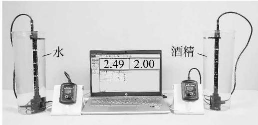  
图1 不同密度液体内部压强与深度关系实验装置图

比如，针对“液体压强”的教学，课标要求“探究并了解液体压强与哪些因素有关”“利用液体压强计测量不同密度的液体内部不同深度处的压强”。上述定性与定量相结合的教学要求必然需要实验予以支撑，但传统液体压强计一方面由于忽略了大气压强这一因素，导致了很多教师和学生对其设计的不满意；另一方面该仪器精度较差，教师在实际演示或指导学生实验的过程中会强行忽略一些误差，让实验变得不伦不类，即定性不完整、定量不精确。引入数字化技术则可以在排除仪器干扰的基础上实现精密测量。如图1所示，学生使用计算机、DIS液体内部压强实验器，可直接测量水、酒精等不同密度的液体中不同深度的压强数据，绘制出不同液体内部的“压强-深度”关系图线并形成比较(见图2)。学生可以清晰地认识到，由于酒精的密度低于水，所以当传感器测量端处于同样深度的时候，酒精内部的压强低于水的压强。在此数字化实验中，由于不需要再操作传统压强计并观察记录其示数，故平均每次实验，从开始实验到得到如图2所示的图线所用的时间仅为传统实验的1/10。实验效率提升、操作难度降低使得几乎每个学生都获得操作的机会，大家对液体压强的认知效果都得到了显著提高，而且从根本上消除了因为对于传统压强计原理的质疑而产生的教学干扰。

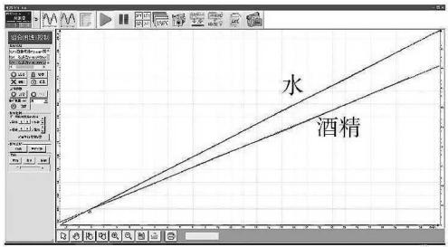  
图2 不同密度液体内部压强与深度关系曲线

再比如，针对电路实验，课标中要求：“会看、会画简单的电路图。会连接简单的串联电路和并联电路。能说出生产生活中采用简单串联电路或并联电路的实例。探究并了解串联电路和并联电路中电流、电压的特点。”一般老师会认为上述要求偏定性，但其实该要求已经将教学要求导向了学生的高阶思维，即在头脑中对电路进行建模，或构建针对电路的物理图景，从而具备在如图3所示的电路图与实物电路之间自如转换的能力。笔者的教学经验证明，学生针对电路的建模水平，与其测验和考试的得分情况呈现强正相关。而恰恰在这个关键点上，很多原来成绩还不错的学生会被复杂的实物电路困扰，甚至形成难以消除的心理阴影，从喜欢物理转为惧怕物理。认识到这一点，教师可以在完成传统导线式电路搭建之后，引入DIS方块电路(见图4)开展电学实验，借助上述两种实验工具的认知支架功能，帮助学生越过这个“坎”。DIS方块电路则将电路分解成独立模块，学生可根据需要自行搭建相应的电路，而搭建完成的电路自然对应了教材中的电路图。笔者的经验显示，使用了DIS方块电路之后，学生们普遍顺利完成了头脑中的电路建模，这也在一定程度上验证了Tinker教授关于数字化实验引发动觉效应、改善学生认知的研究结果。

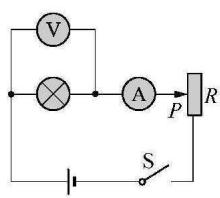

(a)  
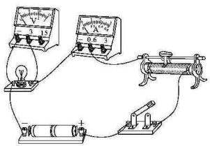  
(b)

图3 传统电学实验要求学生完成从实物电路到电路图的转换  
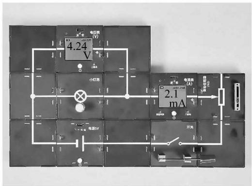  
图4 DIS方块电路搭建起的测小灯泡伏安特性曲线实验电路

## （2）解决痛点，以点带面。

学校的内部环境，即校长、教务主任、科组长、其他同事、实验员等针对数字化实验的观点和看法，在教师探索数字化实验教学应用的过程中起着重要的影响作用。笔者认为可以通过痛点分析法，聚焦某几个长期以来困扰广大教师的传统实验，借助数字化实验解决原来“做不了、做不好、看不清、讲不明”的问题，以事实说话，通过转变领导和同事们对数字化实验的态度改善校内微环境，以点带面地鼓励更多教师参与到数字化实验的教学应用中来。

比如，弹簧测力计具有单向性——只能测拉力、不能测压力，而且只适合测量静止状态下的力，不适合测量运动过程中的力。因此，涉及测量运动过程中的力的几个实验就成了传统实验中的痛点。笔者首先尝试了在摩擦力研究实验中引入DIS

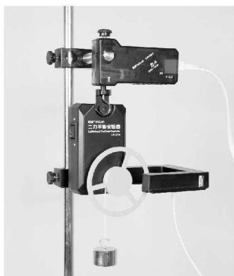  
图5 DIS二力平衡实验器

力传感器和摩擦力实验器，获得成功后又在涉及“二力平衡”的教学过程引入了DIS二力平衡实验器（见图5)，一举填补了传统实验的空白——获得了证实物体在匀速直线运动时仍保持二力平衡状态的关键性实验数据(见图6)。弹簧测力计的痛点解决后，校领导和同事们对数字化实验的认可度大为提高，笔者开展数字化实验的内部环境也得到了进一步改善。

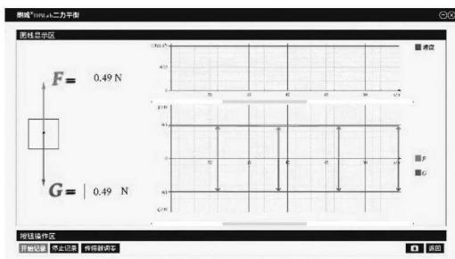  
图6 二力平衡实验结果

## （3）演示实验为先，分组和随堂实验跟进。

演示实验是课堂教学的灵魂，深受学生的喜爱。研究显示，数字化实验凭借与电教设备的良好融合，可以充分发挥其数形转换、过程展示、瞬态捕捉等优势，大幅度提升教师演示实验的可视化效果，有效地促进学生透过现象看本质，从而完成对物理规律的认知[7]。因此，教师应首先增加数字化实验在演示实验中的应用比例，一方面提高演示实验效率，改善课堂教学效果，同时为各级各类公开课积累经验；另一方面借助演示实验完成对学生使用数字化实验设备的普及教育，为其分组实验和随堂演示实验打下基础。

比如，在振动与发声实验中，要引入“共振”内容。笔者的经验是：先按照传统实验程序敲击主音叉，再让学生尽可能地去听副音叉共振后发出的声响。在上述实验大概率不成功的基础上，引入数字化实验(见图7)：使用两只DIS声传感器，分别对准DIS低频信号发生器和音叉的共鸣腔，开启DIS低频信号发生器并将其频率调整为音叉的振动频率之后，可得到两只DIS声传感器采集到的声波波形。传感器A采集到的声波振幅大于传感器B采集到的声波振幅，说明低频信号发生器发出的声波引发了音叉的共振，但音叉发声的响度低于低频信号发生器的响度。关闭DIS低频信号发生器，可见声传感器A所采集到的声波图线瞬间消失，而声传感器B采集到的声波图线则逐步减弱并消失(见图8)。借助数字化实验的数形转换和图线描述功能，该实验近乎完美地记录了共振从无到有又从有到无的整个过程，将课堂演示实验的教学效果提升到了空前的高度，并且通过现场操作，完成了学生分组实验的预习。

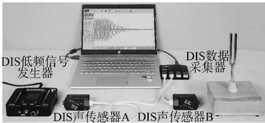  
图7 使用数字化实验开展声音的共振实验

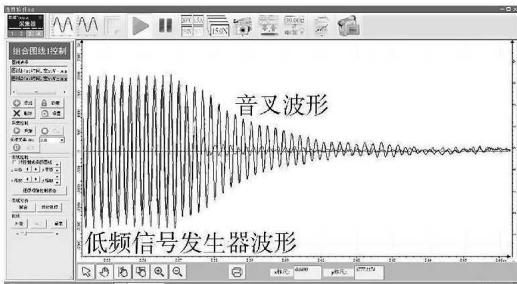  
图8 数字化实验得到的共振发声声波图象

在“熔化和凝固”的教学中，一般会安排以酒精灯加热蜡和海波的分组实验。由于酒精灯加热升温较快速，学生往往忙中出错，对相关规律的把握也因此失准。针对这个实验，笔者的经验是先由教师在课堂上借助数字化实验方式，使用“DIS温度传感器十远红外加热器”（见图9，采用辐射加温，升温过程相对柔和)做一次演示实验，把操作过程和实验结果通过大屏或

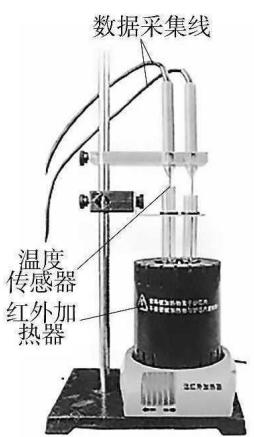  
图9 使用 DIS 温度传感器开展晶体融化和凝固实验

投影展示给全班同学，再安排他们开展分组实验。有了演示实验的基础，还可以向学生们传授相关技巧，让他们基于DIS温度传感器的数据绘制出海波“肩状曲线”，对比同时获得的石蜡“尖峰曲线”，便可凸显海波作为晶体在熔化和凝固时温度保持不变的特性(见图10)。

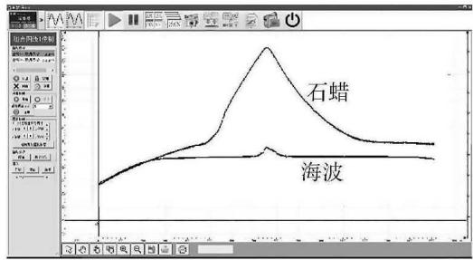  
图10 石蜡与海波的融化和凝固曲线

（4）新老融汇，殊途同归。

初中阶段的传统实验仪器，往往是经典物理模型。比如:托盘天平杠杆模型；弹簧测力计胡克定律模型；温度计热胀冷缩模型；等等。因此，笔者认为传统实验仪器在初中物理实验课堂上的最佳用途是原理展示，而不是实验测量。此外，传统实验仪器虽然相对落后，但实验过程中包含的控制变量法、排除法、类比法等都是物理思维的精髓。因此，笔者认为应该在充分理解和认识传统的实验手段、方法基础上，首先将传统实验的原理讲透，再通过“先传统、后数字”，或同时使用传统实验和数字化实验的方式开展实验，让学生形成体验和比较，进而获得殊途同归的探究乐趣。

比如验证阿基米德原理实验，各教材普遍使用的是排水法，即在钩码排开水之后根据弹簧测力计示数进行加减，得出浮力大小。由于实验室常见的钩码体积不大，所以排水后所受的浮力也相应较小。尤其针对不同密度的液体如纯水和盐水的浮力比较中，所形成的浮力差

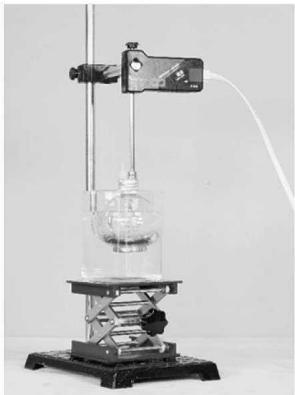  
图 11 DIS浮力研究实验装置

也很微小。笔者首先改造了传统实验方式，让学生将钩码浸入满水的烧杯中，再让学生收集起钩码排开的水，通过浮力与排开水的质量两者的比较，完成了对阿基米德重大发现的再现和反演。随后，笔者又引入了数字化实验方式，使用DIS力传感器完成了对浸泡在水中的物体所受浮力的直接测量(见图11)，获得同一物体在纯水、盐水中的“浮力-排水量”曲线并建立比较(见图12，横坐标为排水量，纵坐标为浮力）。如果再将图12与图2加以比较，还会让学生进一步在液体密度、液体压强和浮力之间建立更深刻的关联性认识。

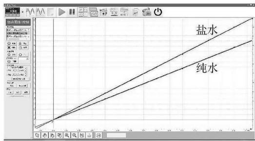  
图12 纯水(下)、盐水(上)的排水量-浮力曲线比较

## 3 数字化技术赋能初中物理教学的实践反思

要做好数字化实验的赋能工作，笔者认为还应该注意以下几点。

（1）教研不能缺席。

在教育改革的进程中，教研机构的重要性是无可替代的。教研部门要发挥“以研促教、以教助研”的基本职能，积极地向教师们传授相关赋能经验，并通过组织公开课、优质课评选，配合课例和论文征集等方式，鼓励教师们开展教学实践探索。同时，教研部门应该大力开展针对数字化实验赋能初中物理实验教学的教育测量工作，以实证研究的数据来为教

育改革形成有力支持。

## （2) 评价务必跟上。

目前，各省市已经普遍将实验操作考试纳入了初中学业水平考试。如果将数字化实验加入操作考试，可进一步提升广大教师对数字化实验的重视程度，加速数字化实验赋能初中物理实验教学的进程。

## （3）教师需要动员。

实验教学的主体是教师，而教师普遍存在思维的惯性和行为的惰性。教育部门应该从针对教师的评价机制出发，巧用杠杆效应，形成促使教师主动接受并应用数字化实验的良好局面。

## （4）校长应该“换脑”。

前文已述，学校领导和同事们对于数字化实验的观念和态度，构成了影响教师教学实践的内部环境，其中一校之长的影响往往具有决定性作用。因此，转变校长的观念，可以起到牵一发而动全身的效果，让整个学校从课堂教学、装备更新、教学研究和学生活动等多方面向数字化实验倾斜。各级各类教育行政部门，特别是教育督导部门要依托教研成果，通过校长培训、公开课观摩等方式，结合对学校评价机制的调整，促使校长们跟教师站在一起，共同推动数字化实验赋能工作。

## 参考文献
[1]艾伦.实验教学论[M].北京.首都师范大学出版社，2018:4.

[2]教育部.义务教育物理课程标准(2022年版)[S].北京：北京师范大学出版社，2022:26.

[3]冯容士，李鼎.DIS，上海创造数字化实验系统研发纪实[M].上海：上海教育出版社，2018.

[4]项华，李永艳.物理图景的培养:模型、问题与对策[J].课程·教材·教法，2008(3)：5962.

[5]杨清.简明心理学辞典M.长春：吉林人民出版社，1985：95

[6]（美)约翰·D·布兰思福特，等.人是如何学习的[M].程可拉，等译.上海：华东师范大学出版社，2013:194.

[7]李鼎，艾伦.教师对数字化实验实施效果影响因素的评价研究[J].中国现代教育装备，2020(8):1 4.
