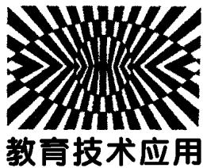

# 无线DIS实验系统及其在物理教学中的应用

谢 添 翁浩峰

（浙江省宁波中学 浙江 宁波 315100）

（收稿日期：2015－03－23）

摘 要 ：DIS实验在高中物理课堂中开始流行 但是传感器与数据采集器间的有线连接大大限制了 DIS实验的使用．用无线传输来取代之前的有线连接 可以更大地扩展DIS实验的使用 新的测量工具的产生也必定带来新的实验方法

关键词 ：DIS实验系统 无线力传感器 物理教学

力的测量在高中物理实验中非常重要 传统的实验中会用到弹簧测力计来测量力 在DIS实验流行后有了力传感器来测量力．使用力传感器可以近似连续地记录所受到的力 已经可以做到力的动态测量了．但是 现有的力传感器几乎都是以有线的方式连接数据采集器的 ，这样测量的方式大受限制 ，例如物理实验中经常会遇到的运动物体的受力测量实验等等都无法用有线力传感器来测量．虽然市面上也出现了无线的力传感器 但是无论在稳定性还是精确性上都存在问题．笔者针对这些问题 开发了一种无线力传感器

## 1 无线 DIS系统的设计

无线力传感器与传统力传感器的最大差别在于传感器与数据采集器之间的数据传输 传统力传感器一般都采用有线连接方式．无线力传感器的最关键问题是无线数据传输方式的选择．现有无线数据传输方式有很多 蓝牙和WIFI都能满足无线DIS的需求 考虑到 WIFI的技术难度更大一些 这里选择了蓝牙作为无线DIS系统的数据传输方式

蓝牙 是一种支持设备短距离通信 （一般10m内） 的无线电技术．利用“蓝牙” 技术 能够有效地简化移动通信终端设备之间的通信 从而使数据传输变得更加迅速高效 ，为无线通信拓宽道路

## 1．1 传感器端设计

由于要在传感器端加入蓝牙模块 ， 所以需要有Arduino（一种单片机） 来进行控制， 基本的结构如图1所示

  
图1 传感器端设计

利用 Arduino处理来自传感器的数据 然后再由蓝牙模块发射

## 1．2 数据采集器端设计

数据采集器端主要用来接收来自传感器端的数据，并且将这些数据进行处理后发送到电脑端。数据采集器与电脑端的连接利用 USB 线连接。基本的结构如图 2 所示。

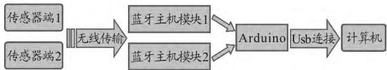  
图2 数据采集器端设计

蓝牙主机模块1会自动连接传感器端1中的蓝牙从机模块 蓝牙主机模块2会自动连接传感器端2中的蓝牙从机模块， 并且数据采集器端的 Arduino能自动识别来自哪个传感器端的数据．因为大多数计算机已经集成了蓝牙模块 所以这个结构可以简化为图3所示结构

  
图3 简化结构

## 1．3 计算机端软件的设计

由于不管是Arduino通过Usb连接电脑还是直接利用蓝牙连接电脑 ，都采用了串口数据传输 ，可以让数据来控制Flash动画界面上的某些元素 实现

实时模拟的DIS实验 并且当实验结束后可以让已经记录下来的数据来实现模拟实验的回放或者慢放，来增加演示实验的可视性

## 2 无线力传感器结构设计

## 2．1 第一版无线力传感器的设计和制作

由于高中物理实验中测量的力普遍较小 所以采用了应变梁式力传感器．这种传感器的结构如图4所示

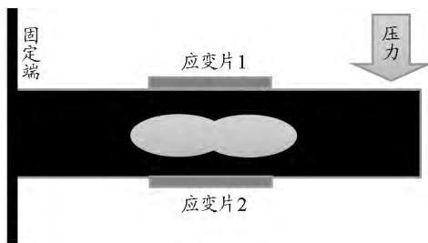  
图4 应变梁式力传感器结构

应变片1和应变片2为两个电阻应变片 将这两个应变片和两个定值电阻一起组成一个桥式电路 当在传感器右端施加压力时 应变片1和应变片2由于发生形变导致电阻值的变化 从而使桥式电路出现不平衡 通过对桥式电路电压的测量就可以得到传感器上的压力值．应变梁式传感器的具体实物图如图5所示

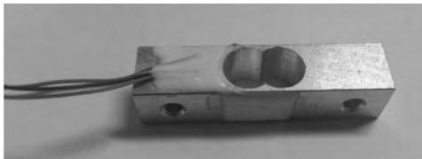  
图5 应变梁式传感器实物图

由于应变梁式传感器受压时形变很小 即应变片的电阻变化很小 所以桥式电路的电压变化也非常小．虽然 Arduino可以直接采集模拟电压值 但是精度很低，无法识别来自力传感器的电压变化 ，所以必须对这个电压进行处理．一般的处理方法有两种一是将其模拟线性放大 然后再测量；另一种直接利用模数转换芯片 ，将微小电压直接转换成数字信号最终确定了利用 HX711模数转换芯片来进行测量图6中A－，A＋端用来接传感器的电压输出端 ，RX和TX端用来连接Arduino，输出经过模数转换后的数字信号

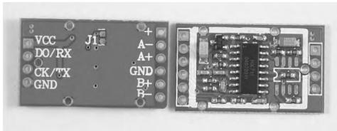  
图 6 HX711 模数转换芯片

通过 对 Arduino 编 写 程 序， 让 其 接 受 来 自HX711的数据， 进行处理后通过蓝牙发射出去．由于无线力传感器需要工作在运动的物体上 所以还必须为其提供单独的电源 ， 这里使用了9V可充电方形锂电池来供电 图7为最终制作出来的实物图

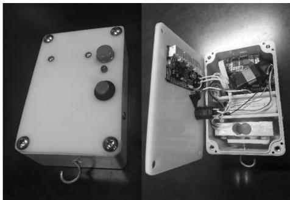  
图7 应变梁式力传感器实物图

虽然成功地设计并制作了无线力传感器 也成功地利用其采集到了数据 但是在使用过程中却发现了一个缺陷．那就是如果静态的使用这个传感器它没有任何问题 但是一旦利用它来测量运动物体的受力时 传感器上用来连接物体的钩子本身由于存在质量 在变速运动时会产生力的变化 从而导致力测量的误差

## 2．2 改进版无线力传感器的设计与制作

为了抵消钩子在变速运动时产生的力 笔者设计了双应变梁式力传感器 成功地解决了这个问题基本原理是在一个传感器中放入两个相同的应变梁式力传感器 其中一个连接钩子用来连接外部物体另外一个只连接一个配重．这样当传感器在运动中有加速度时 利用连接配重的力传感器的数据来计算出连接外部物体钩子的力的变化 从而抵消掉由于钩子引起的力的变化．在没有连接外部物体时 如果晃动第一版无线力传感器或者传统的力传感器就会发现读数会发生改变 ； 但是如果晃动双应变梁式无线力传感器 这个数据始终是不变的．也就是说它成功地抵消了在变速运动时钩子产生的力的变化．双应变梁式无线力传感器的实物如图8所示

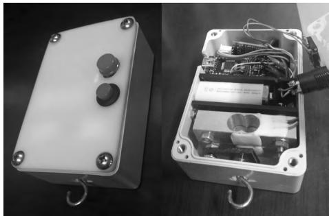  
图8 双应变梁式无线力传感器实物图

## 2．3 无线DIS系统的具体实现 ——— 数据采集器端的具体制作

由于需要连接两个或者两个以上的蓝牙模块，而每个蓝牙模块都要占用一路串口，所以选择了 Arduino Mega 2560 作为数据采集器端的控制器。笔者在设计的时候只使用了两路蓝牙数据接收，具体的硬件连接如图 9 所示。Arduino 端的代码这里不再提供。

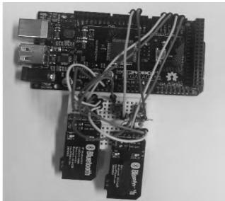  
图9 数据采集器端硬件连接

## 3 计算机端软件的制作

由于Flash动画可以接受来自串口的数据 所以本套DIS系统使用Flash动画来代替传统DIS系统的软件．Flash动画的优点是可以针对每个具体的实验制作不同的动画界面．图10为针对单个无线力传感器数据采集的软件界面 具体的软件代码不再提供

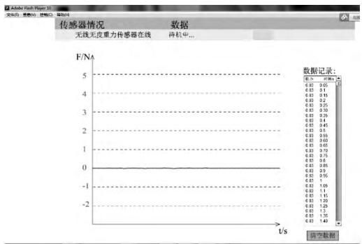  
图10 软件界面

当打开无线传感器时 软件会自动识别传感器并会显示传感器此刻的状态．当开始读取数据时 会有实时的数据显示．传感器的清零按钮设计在传感器上面 软件中没有再设．这个软件只是完成了一个最基础的功能 图像的绘制与数据记录．当然针对具体不同的实验 软件的界面可以进行单独设计

## 4 利用无线传感器进行实验

下面就利用这套无线DIS系统来完成一个具体的实验 ——— 牛顿第二定律实验中小车受力的测量

在传统实验中 是用重物的重力来代替小车的受力 为了控制误差 在实验中小车的加速度不能很大．现在可以直接在小车上安装无线力传感器 直接测量小车受到的拉力．具体的装置如图11所示

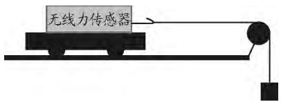  
图11 无线传感器测量小车的受力

在小车和无线力传感器质量大约为450g，重物质量为50g的情况下 得到如图12的实验数据 可以看到小车静止时和加速运动时的受力大约有10％ 的差距

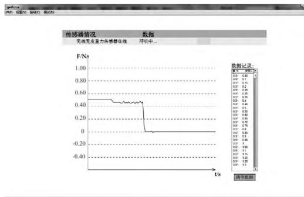  
图12 实验数据

## 5 无线 DIS 实验展望

随着科技的发展 无线 DIS实验取代有线 DIS实验是必然的趋势．无线DIS实验有着很多的优势一是实验器材间没有了数据线的束缚 ， 使实验更加简洁方便；二是可以使用无线传感器测量很多之前无法测量的量 例如动态物体的受力等等 三是由于无线DIS实验的特点，可以开发很多新的实验
