# 法拉第电磁感应定律直接定量验证实验

翁浩峰

(浙江省宁波中学  浙江 宁波  315100)

(收稿日期:2024-12-12)

摘 要:借助任意波形发生器与压控恒流源为亥姆霍兹线圈供电,成功生成可控的匀强磁场.利用手机 Phyphox 软件中的磁力计对磁场进行测量,实现了磁感应强度变化率的精准测定.在已知线圈匝数和面积的条件下,依据法拉第电磁感应定律得出感应电动势的计算值.同时,运用基于 Ads1120 和 ESP32 的自制 DIS 主板所制作的微电压传感器,得到待测线圈感应电动势的测量值.最终发现,计算值与测量值近乎一致,从而实现了对感生电动势的法拉第电磁感应定律的直接、精确验证.

关键词:电磁感应定律;DIS实验;Phyphox;亥姆霍兹线圈

## 1 问题的来源

在人教版高中物理选择性必修第二册中,法拉第电磁感应定律的表述为:闭合电路中感应电动势的大小,跟穿过这一电路的磁通量的变化率成正比,其公式为

$$
E = \frac { \Delta \Phi } { \Delta t }
$$

对于匝数为 n 的线圈

$$
E = n \frac { \Delta \Phi } { \Delta t }
$$

虽然该定律在电磁学中占据重要地位,但教材中仅提供了定性实验,缺乏定量验证.尽管已有相关研究尝试定量验证[1],但大多未能直接测量磁通量变化率.因此,本文旨在设计一套通过直接测量磁通量变化率来验证法拉第电磁感应定律的实验装置.

## 2 法拉第电磁感应定律直接定量验证实验设计

为了精确测量线圈磁通量的变化率,可以让线圈处于匀强磁场中,在线圈平面垂直磁场并且面积不变的情况下,通过改变磁感应强度来改变磁通量.在线圈匝数、面积已知的情况下,通过对磁感应强度的测量来实现磁通量变化率的测量[2].

本实验使用亥姆霍兹线圈来产生匀强磁场,使用任意波形发生器与压控恒流源为亥姆霍兹线圈供电,生成可控的匀强磁场;利用手机 Phyphox 软件中的磁力计对磁场进行测量,实现磁感应强度变化率的精准测定;运用基于 Ads1120 和 ESP32 的自制 DIS 主板制作的微电压传感器,测量待测线圈的感应电动势;最后使用基于 Phyphox 的 DIS 实验系统对数据进行处理并得出结论[3].

### 2.1 可控匀强磁场的产生

亥姆霍兹线圈由一对平行且共轴的圆形线圈组成,两线圈间距等于线圈半径.将两个线圈串联后通上电流就可以在其公共轴线中点附近产生匀强磁场.

本实验使用的是自制的匝数为 20 匝、半径为 10 cm 的亥姆霍兹线圈,如图 1 所示.

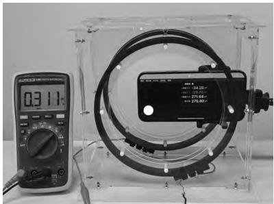  
图 1 使用手机测量亥姆霍兹线圈内部磁场

给线圈通电后,理论上亥姆霍兹线圈内部会产生匀强磁场.为验证这一点,可使用磁力计测量线圈内部各个位置的磁感应强度.智能手机内部自带磁力计,借助软件 Phyphox(手机物理工坊)能够调用磁力计进行测量.

打开 Phyphox 自带的磁力计页面,将条形磁铁放置在手机上方的不同位置进行测量,数据最大时磁铁所在位置正下方即为手机内磁力计的位置(图 1 手机上白色的标记点).

在确定手机上磁力计的位置后,将手机(屏幕与线圈平行)放置在线圈内部的各个位置进行测量(图 1).最终发现,线圈中间的很大一部分区域,沿线圈轴线方向的磁感应强度几乎相同,可近似看作匀强磁场.

匀强磁场的磁感应强度大小在理论上应与线圈中的电流大小成正比.可使用电流表(图 1 中与线圈串联的电流表)测量通过线圈的电流大小,同时利用 Phyphox 测量磁感应强度大小,来验证这一关系.由于线圈产生的磁场较弱,为避免地磁场的干扰,需将线圈平面南北放置,这样在垂直线圈平面方向的地磁场分量为零.

将测量得到的数据记录在 Excel 表格中,如表 1 所示,并进行绘图,如图 2 所示.

表1 测量数据
<table><tr><td rowspan=1 colspan=1>电流 I/A</td><td rowspan=1 colspan=1>磁感应强度 $B / \mu \mathrm { T }$ </td></tr><tr><td rowspan=1 colspan=1>0</td><td rowspan=1 colspan=1>0</td></tr><tr><td rowspan=1 colspan=1>0.1</td><td rowspan=1 colspan=1>89</td></tr><tr><td rowspan=1 colspan=1>0.2</td><td rowspan=1 colspan=1>178</td></tr><tr><td rowspan=1 colspan=1>0.3</td><td rowspan=1 colspan=1>267</td></tr><tr><td rowspan=1 colspan=1>0.4</td><td rowspan=1 colspan=1>356</td></tr></table>

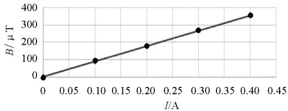  
图2 电流与磁感应强度的关系

从上面的数据可得,线圈产生的磁感应强度与通过线圈的电流成正比.

为了产生均匀变化的磁场,实验中采用了任意波形发生器,型号为优利德 UTG962E.任意波形发生器能够产生随时间呈各种关系变化的电压信号.实验中,通过设置任意波形发生器输出随时间均匀增加的电压信号,输入亥姆霍兹线圈,产生均匀变化的电流,进而生成均匀变化的磁场.

用手机上的 Phyphox 测得的线圈中的磁感应强度随时间的变化图像如图 3(a)所示.由图可见,两线圈中间区域的最大磁感应强度不到 150 μT,虽然任意波形发生器已经调到了最大电压,但是由于最大电流有限,所以产生的磁感应强度仍旧较小.为了解决这个问题,实验时使用了压控恒流源(型号为 OPA547),将任意波形发生器输出的电压信号转换为可控电流,最大输出电流为 0.5 A.根据上面电流和磁感应强度的关系,大约能产生最大 450 μT 的磁场,如图 3(b)所示.

将任意波形发生器输出的电压信号经过压控恒流源后接到线圈上,就可以在线圈中产生更大的可控电流了.用手机上的磁力计测量线圈中的磁感应强度后发现线圈内部的磁场明显增强了.

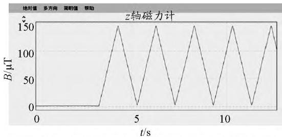

(a)用任意波形发生器直接连接线圈时内部磁场变化  
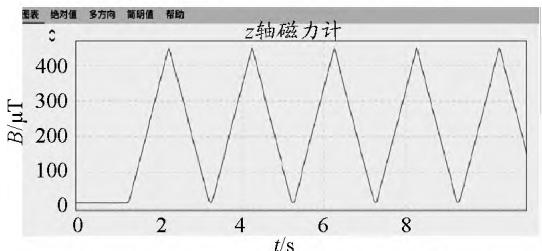  
(b)增加了压控恒流源后线圈内部磁场变化  
图 3 线圈内部磁感应强度随时间变化图像

### 2.2 微电压传感器的设计与实现

在已知磁感应强度随时间变化的关系、线圈匝数、面积后,就可以使用法拉第电磁感应定律来计算线圈上产生的感应电动势.本实验采用的线圈(图 4)是匝数为 250 匝、边长为 7 cm 的正方形线框(面积 $49 \times 10^{-4}\ \mathrm{m}^{2}$),假设磁感应强度在 1 s 内从零均匀增加 0.4 mT,可以计算得到产生的感应电动势约为 0.5 mV.

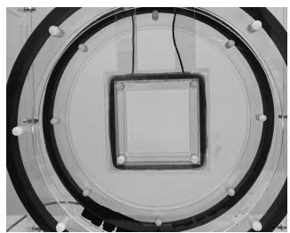  
图 4 中间的方形线圈为待测线圈

为了测量线圈中产生的感应电动势,笔者使用集成了 Ads1120 和 ESP32 的自制 DIS 实验主板(图 5)制作了微电压传感器.

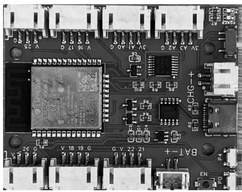  
图 5 集成了 Ads1120 和 ESP32 的  
自制 DIS实验主板

Ads1120 是一块 16 位的高精度 ADC 芯片,已经集成在了主板上.它拥有最大 128 倍的增益,在使用 3 V 基准电压源且处于最大增益的条件下,电压测量分辨率可以达到 0.36 μV,能满足本实验的精度要求.

为主板上的 ESP32 写入程序后,该主板便可以制作成无线微电压传感器,从而实现数据采集和发送的功能,图 6 为主程序部分代码.

```python
while True:
    Vnum = readV() * vref * 2000 / res / 128   # 读取数据并转换成mV单位
    tmn = time.ticks_ms() / 1000               # 读取此时时刻
    time.sleep(0.01)                            # 暂停0.01s
    print(Vnum)                                 # 通过串口发送电压数据
    if p.is_connected():                        # 如果蓝牙连上时
        if ti == 0:
            f.text("sending..", 0, 16, 32)
            f.show()
            ti = 1
        p.write(Vnum, tmn)                      # 通过蓝牙发送数据
    else:
        if Vnum < 0.001 and Vnum > -0.001:      # 为了在液晶屏上显示0.000
            Vnum = 0.0001
        data = str(Vnum)[0:5]                   # 截取五个数字显示
        data += " mV"                           # 显示单位
        f.text(data, 0, 0, 32)                  # 显示位置以及字体大小
        f.show()
```
图 6 对自制 DIS 实验主板编程实现微电压传感器功能

### 2.3 基于 ESP32 与 Phyphox 的 DIS 实验系统

本实验使用手机上的磁力计来测量磁场的磁感应强度,借助自制的无线微电压传感器来测量感应电动势,最后通过手机端的 Phyphox 同时采集测量到的磁感应强度和感应电动势,并将这两组数据实时地绘制在同一个图像中.

要实现这个功能,需要先在 Phyphox 官网上进行编辑,然后再使用手机上的 Phyphox 打开.本实验的 Phyphox 编辑界面如图 7 所示,其中包含两个数据源:"bluetooth" 对应微电压传感器的数据,"sensor" 来自手机自带的磁力计.

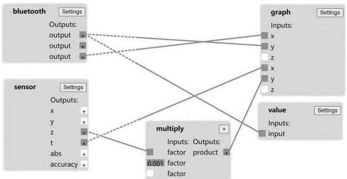  
图 7 在 Phyphox 官网上进行编辑

## 3 实验过程和数据处理

### 3.1 实验器材组装与实验步骤

实验器材主要包括亥姆霍兹线圈、任意波形发生器、压控恒流源、微电压传感器,数据采集及处理工具为手机 Phyphox 软件.先将亥姆霍兹线圈与任意波形发生器、压控恒流源连接,再使用亚克力板搭建支撑框架,最后将待测线圈与自制的微电压传感器相连接(图 8).

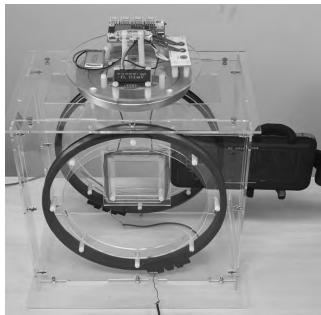  
图 8 实验器材的组装

将手机放置在亥姆霍兹线圈中间使手机屏幕与线圈平面平行,使用 Phyphox 软件实时采集磁感应强度和来自微电压传感器的感应电动势,并将它们绘制在同一个图像中,之后打开任意波形发生器,让它产生锯齿波信号.图 9 是实验结果.

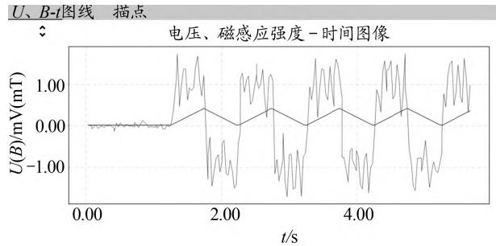  
图 9 初次实验数据(锯齿波为磁感应强度,波浪线为感应电动势)

### 3.2 实验中的问题与解决

显然,实验结果并不理想.经过分析,推测原因如下:任意波形发生器产生的电压实际上是由 DAC(数模转换)生成的,看似均匀增加的电压,实际上呈类似阶梯状变化,导致感应电动势波动较大.因此,尝试通过添加一个电容器进行低通滤波,在线圈输入端并联一个 $1000\ \mu\mathrm{F}$ 的电容器后(图 10),再次进行实验,得到的结果如图 11 所示.

经过滤波后,磁场变化更加平滑,实验数据得到了显著改善.

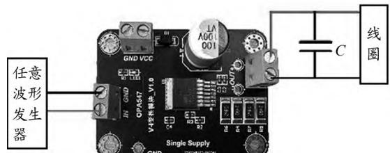  
图 10 添加电容器进行滤波

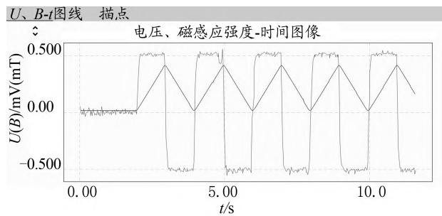  
图 11 滤波后的实验数据

### 3.3 数据采集与分析

通过改变任意波形发生器的锯齿波周期来调节磁场变化率.每隔一段时间调节一次,得到了如图 12 所示的图像.

Phyphox 可以将实验数据发送到电脑上,在 Excel(图 13)里进一步处理.

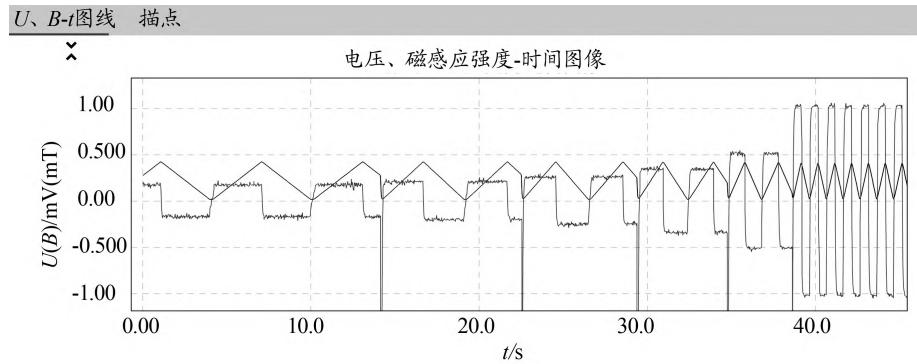

图 12 通过改变磁感应强度变化率进行多次实验后的数据  
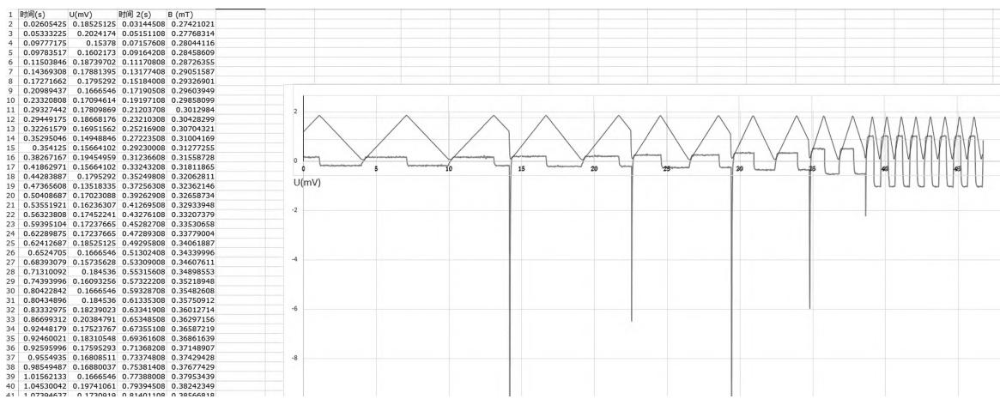  
图 13 在 Excel 里进行数据处理

从数据中可以得到每个周期内磁感应强度的最小值与最大值之差为 0.42 mT,实验中锯齿波的周期从 6 s 逐渐减小到 1 s.如果周期为 6 s,那么每半个周期也就是 3 s,磁感应强度就会从最小变到最大,由此可以计算得到磁感应强度变化率为 0.14 mT/s,同理可以计算出不同周期下的磁感应强度变化率.再根据线圈的匝数 250 匝和线圈的面积 $49\ \mathrm{cm}^{2}$,就可以通过法拉第电磁感应定律计算出感应电动势的计算值.

对每半个周期的感应电动势求平均后,可以得到感应电动势测量值.表 2 是线圈匝数为 250 匝的实验结果.

表 2 实验结果
<table><tr><td rowspan=1 colspan=1>周期 $T / \mathrm { s }$ </td><td rowspan=1 colspan=1>6</td><td rowspan=1 colspan=1>5</td><td rowspan=1 colspan=1>4</td><td rowspan=1 colspan=1>3</td><td rowspan=1 colspan=1>2</td><td rowspan=1 colspan=1>1</td></tr><tr><td rowspan=1 colspan=1>磁感应强度变化率 $\frac { \Delta B } { \Delta t } / ( \mathrm { mT } \cdot \mathrm { s } ^ { - 1 } )$ </td><td rowspan=1 colspan=1>0.140</td><td rowspan=1 colspan=1>0.172</td><td rowspan=1 colspan=1>0.210</td><td rowspan=1 colspan=1>0.280</td><td rowspan=1 colspan=1>0.420</td><td rowspan=1 colspan=1>0.840</td></tr><tr><td rowspan=1 colspan=1>感应电动势计算值 $E _ { \text {计} } / \mathrm { mV }$ </td><td rowspan=1 colspan=1>0.1715</td><td rowspan=1 colspan=1>0.2107</td><td rowspan=1 colspan=1>0.2573</td><td rowspan=1 colspan=1>0.3430</td><td rowspan=1 colspan=1>0.5145</td><td rowspan=1 colspan=1>1.0290</td></tr><tr><td rowspan=1 colspan=1>感应电动势测量值 $E _ { \text {测} } / \mathrm { mV }$ </td><td rowspan=1 colspan=1>0.17457010</td><td rowspan=1 colspan=1>0.20544672</td><td rowspan=1 colspan=1>0.25704251</td><td rowspan=1 colspan=1>0.34135246</td><td rowspan=1 colspan=1>0.51084438</td><td rowspan=1 colspan=1>1.01761830</td></tr></table>

可以看到,感应电动势的计算值和测量值几乎相同,由此,便直接验证了法拉第电磁感应定律.

## 4 总结

该实验不仅弥补了以往相关研究中未能直接测量磁通量变化率的不足,成功实现了对法拉第电磁感应定律的直接、精确验证,还为高中物理电磁感应部分的教学与研究提供了一种创新的实验思路与方法.此实验方法操作相对简便,且利用了常见的电子元件与手机软件,具有较强的可重复性与推广性,有助于学生更深入地理解电磁感应现象及其内在规律.

## 参 考 文 献

[1]李鼎,冯容士,赵进.定量验证法拉第电磁感应定律的实验[J].物理教学探讨,2019,37(8):13-15+18.

[2]郝立宇,王啸天,谭明,等.直接定量验证法拉第电磁感应定律的实验构思[J].大学物理实验,2018,31(2):31-34. DOI:10.14139/j.cnki.cn22-1228.2018.02.009.

[3]翁浩峰.自制 DIS 探究电容器电压与电荷量的关系:基于 ESP32 与 Phyphox 的 DIS 实验[J].物理教学探讨,2023,41(10):49-53.