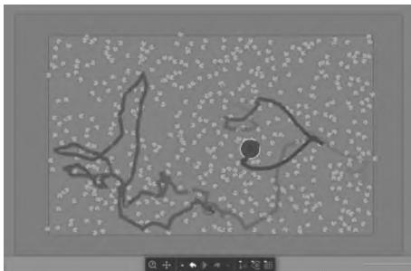
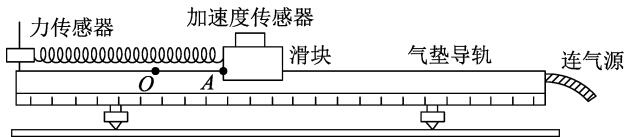
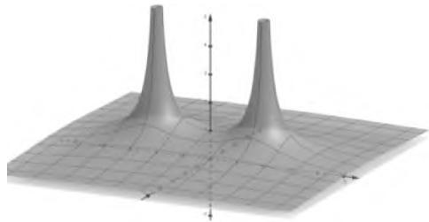
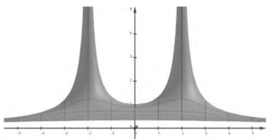
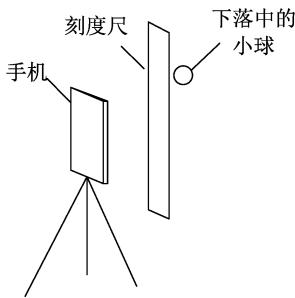
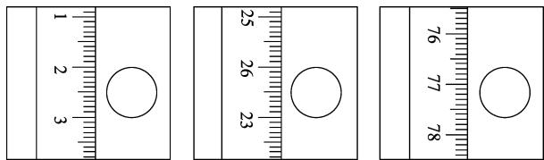

> 来源：MinerU 转换（stem-exact rebuild 2026-08-08）

# 现代信息技术与高中物理实验教学的融合应用

卢海春1 尹白顺2

（1．江苏凤凰科学技术出版社 江苏 南京 210009； 2．江苏省溧水高级中学 江苏 南京 211200）

摘 要 ： 信息技术的发展突破了传统课堂实验教学的时空 提供了更清晰的实验过程．将信息技术与中学物理实验有机结合 对于学生理解复杂抽象的物理概念 深化物理思维具有重要的辅助作用．本文探讨了高中物理实验中实验教学与信息技术有机融合的途径 应用及其意义 提出了努力的方向

关键词 ： 高中物理 ； 实验 ； 信息技术

实验室操作实验和课堂演示实验是中学物理实验教学的主要模式。在这些实验过程中，有些现象是瞬间发生的，有些实验时间较长，导致学生难以细致观察完整实验过程，影响物理概念的理解。另外，受实验室课程安排、实验场所相对固定等限制，学生的实验时间、空间受到约束，降低了学生的实验学习效率。因此，如何提高学生的实验学习效率，增强学生对物理概念的理解，从而达到学习目标，是中学物理实验教学需要探索的课题。信息技术的发展可以实现实验过程的分解、细化，让实验更直观、更形象，并且扩展了学生实验学习的时间、空间。将信息技术与中学物理实验有机结合，可以有效地解决实验教学中遇到的问题，对于学生理解物理概念、深化物理思维具有重要的辅助作用。本文通过一些实际案例，分析了高中物理实验中实验教学与信息技术有机融合的途径、应用及其意义。

## 1．信息技术与物理实验教学融合的途径

信息技术与物理实验教学的融合途径是中学物理实验教学首先需要考虑的问题.多媒体实验教学 在线实验教学 信息数字化实验室的发展为信息技术引入中学物理实验教学提供了可能性.

## 1.1 多媒体实验教学

多媒体实验教学是基于多媒体播放设备和网络信息平台建立的教学手段.学生可以在课前或课后通过观看实验视频 学习PPT课件完成实验的预习和复习， 教师也可以在课堂上通过此方式和学生共同探讨实验过程中的现象与问题.

例如，在实验前，教师通过平台发布实验预习准备事项 让学生提前知晓实验的原理 熟悉实验的器材.在实验学习完成后 通过实验的标准过程播放让学生自行比对 找出自己的不足与错误 在原有实验操作的基础上进行实验改进 增强学生的实践能力与创新能力.

## 1.2 在线实验教学

物理实验的学习探究可以增强学生的物理知识 提高学生提出问题 解决问题的能力.但是 中学实验室专业化水平有限 ， 很多实验并不能够很清楚地展示过程 无法提供学生清晰明了的实验过程.因此 借助在线教学资源或者通过仿真软件模拟实验过程是解决问题的重要途径.

例如 在研究自由落体运动时 由于实验过程非常短暂 瞬间的中间运动过程不容易观察 因此 利用现有的教学资源或录制视频 通过播放软件逐帧处理 读取数据并找出规律 可以让学生充分认识到自由落体过程中的速度变化特点.

## 1.3 信息数字化实验室

数字化实验室是基于终端 软件的半模拟化实验装备 其优势主要体现在实验操作简单 采集数据便捷 数据处理迅速 可视化程度高等方面在学生对物理知识的理解方面发挥着巨大的作用.

例如 在研究物体碰撞的动量变化时 传感器发挥着重要的作用 它们不仅能够采集相应时间速度的数据 而且能通过计算机运算将动量变化关系显示在电脑上 让人一目了然.

## 2．信息技术在高中物理实验教学中的融合应用

信息技术与物理实验教学的融合应用实践为拓展学生物理实验学习的时空 提高学生的实验学习效率提供了可能.

## 2.1 网络信息平台

在信息技术时代 网络资源的快速发展 极大地丰富了在线实验教学资源.学生通过自主选择时间观看优质的线上资源 可以查漏补缺 促进自主学习.教师利用教学资源 可以为学生进行课前辅导 课后复习 做好各个学段不同知识点之间的串联.

例如 探究平抛运动的特点时 课堂教学时一般采用频闪照片显示2个小球同时平抛和自由下落的情况 让学生比较 发现它们的运动差异.由于这一方法未能具体表现平抛小球在各个点的分运动状态 学生在理解频闪照片所揭示的规律 把握公式的物理意义时仍感到比较困难.如果我们借助在线资源中平抛运动的动态模拟演示 视频演示 就能使学生更好地理解这一知识 从而培养学生自主模拟实验 观察实验 并归纳 总结 抽象成知识的能力.

## 2.2 新媒体技术应用

新媒体技术的应用对实验课程起到辅助作用能直接提升学生在物理学习中的主体地位.通过PPTFLASH动画等方式对实验原理 过程 结果等进行展示与比较 并对微观及宏观物理现象的有效模拟 可以增强学生对物理原理的理解与感受.

例如 Algodoo软件是一种仿真实验平台 提供了刚体 流体 链条 齿轮 弹簧等元素．这些元素可以在重力 摩擦力 弹力及空气阻力等作用下 实现高精度的仿真物理过程 尤其适用于力学 几何光学的探究．在对分子热运动的理解中常规观察难度很大 但通过 Algodoo软件创设模拟情境 通过构建液体分子 微粒 并设定它们的质量 速度 碰撞系数等属性 可对分子的热运动进行模拟 切实观察微粒的运动轨迹 （如图1所示） ，归纳出布朗运动的特点及实质.这种教学模式直观地帮助学生理解物理原理.

  
图1

## 2.3 现代物理实验器材

物理实验器材正在发生翻天覆地的变化 如传统的测力计 电流表 电压表 压强计等正在被传感器所取代 传感器的数据实时获取 实时处理 实时展示功能 形成了数字化实验室的重要基础 在物理实验中发挥着巨大作用.

例如 在2022年山东高考题中就有多种传感器的应用实例.

在天宫课堂中 我国航天员演示了利用牛顿第二定律测量物体质量的实验.受此启发 某同学利用气垫导轨 力传感器 无线加速度传感器 轻弹簧和待测物体等器材设计了测量物体质量的实验 如图2所示.主要步骤如下

① 将力传感器固定在气垫导轨左端支架上加速度传感器固定在滑块上 ； ② 接通气源，放上滑块 调平气垫导轨； ③ 将弹簧左端连接力传感器右端连接滑块.弹簧处于原长时滑块左端位于 O点.A点到O 点的距离为5.00cm 拉动滑块使其左端处于 A 点 由静止释放并开始计时 ④ 计算机采集获取数据 得到滑块所受弹力 F 加速度 a随时间t 变化的图像.

  
图2

## 2.4 实验模拟

物理实验是物理学理论知识的验证与还原.学生通过自主操作去切实感受物理规律 可以深入理解与掌握相应知识.但由于实验过程中很多现象背后的本质无法直接观察 使学生对实验原理的理解不能很到位.通过实验模拟 展示物理现象背后的本质 增强学生的学习质量与效果 也是数字化实验室的重要功能.

例如 GeoGebra软件是一种综合了几何 代数和微积分等工具的动态数学软件 其计算智能操作方便.在关于点电荷的电势的学习中 ，对于电势空间分布的理解只能根据带电粒子的运动结合公式凭想象进行，但是如果通过 GeoGebra软件对点电荷的电势进行模拟 利用功能强大的软件的数学计算功能 通过输入公式进行立体或平面展示两个点电荷的电势分布 如图3及图4所示 可以让学生更直观地感受到现象背后的本质.

图3  
  
图4

## 3．信息技术与物理实验教学融合的实践意义

信息技术与物理实验教学的融合应用 ， 对中学物理实验教学具有重要的意义.

## 3.1 提升学生实验操作能力

信息技术与实验教学融合可以实现物理实验向信息化 可视化 简单化转变.突破传统观念 让学生以自主的态度进入到物理实验的具体操作中.

例如 利用双缝干涉测量光的波长实验中 光传感器的使用使得条纹间距可以通过计算机上显示的图像直接读出 相比传统实验更便捷 更准确.在此基础上 学生展现出测量多种色光的波长的兴趣.

## 3.2 提升学生自主创新能力

高中物理实验教学一般是采用较为单一的演示与操作方式进行.通过现代器材与实验教学的融合 再利用信息技术以直观形象的操作 数据及处理展示 能够让学生自主创新实验场景 提升学生自主创新能力.

例如 在2020年江苏高考题中就有关于此类试题.

疫情期间“停课不停学” 小明同学在家自主开展实验探究.用手机拍摄物体自由下落的视频 得到分帧图片 利用图片中小球的位置来测量当地的重力加速度， 实验装置如图5所示.

停止摄像， 从视频

  
图5

中截取3帧图片 图片中的小球和刻度如图6所示.已知所截取的图片相邻两帧之间的时间间隔为1／6s 刻度尺的分度值是1mm 由此测得重力加速度为 m／s2.

在某次实验中 小明释放小球时手稍有晃动视频显示小球下落时偏离了竖直方向.从该视频中截取图片， （选填“仍能”或“不能”） 用前面的方法测出重力加速度.

  
图6

## 4．信息技术与物理实验教学融合的努力方向

虽然信息技术与物理实验教学的融合应用已展现出重要作用， 但许多方面仍需要进一步完善努力.

（1） 教师方面.由于教师对以往教学方式思维的定式 总是不由自主地占据课堂的主导地位 实验教学模式的改革给大量教师带来不适.因此 自觉地开展信息技术与物理实验教学的融合是一线教师需要克服的障碍.

（2） 学校方面.学校对于信息技术应用的宣传力度不够 相关设备采购不到位 导致教师无法充分重视信息化教学手段的重要意义.因此 鼓励支持信息技术与物理实验教学的融合是学校需要努力的方向.

（3） 学生方面.学生在自主学习时容易被复杂问题所困扰 如果不能第一时间得到解决 会导致其物理学习欲望降低.因此 将信息技术与物理实验教学有机融合 才能更有效地调动学生的学习兴趣.

总之 要实现信息技术与物理实验的完美融合 学校 教师和学生要共同发力 克服困难 从学生的兴趣培养出发 有针对性地制订对应的方案让信息技术服务于教学 最终让学生获得自主创新的能力.

物理学的发展离不开物理实验 但是现有的物理教学条件下并不能做到所有规律都能够直接通过实验进行测量 探究或者验证 现代技术手段能有效解决部分问题.信息技术与实验教学的有效融合给学生开启了新的实验形态 能在一定程度上提升物理教学的质量与效率.但是 过于方便的操作模式不利于学生动手能力的提高 而过于虚拟化的动画场景会让学生对真实的物理过程产生误解.所以我们不仅要“做真实验” 而且要“真做实验”.

## 参考文献 ：

1 李荣国．信息技术环境下的高中物理实验教学［J］．中国多 媒 体 与 网 络 教 学 学 报 （ 下 旬 刊 ） 2021（01） ：93－94

2 吕春景．信息技术环境下的高中物理实验教学［J］．西部素质教育 ，2020（09） ：131－132

3 尹力坤．“互联网＋”背景下智慧课堂的构建与应用研究［J］．物理教师 ，2017（11） ：68－70，73

4 赵飞．高中物理探究式实验教学策略分析 ［J］．高考2021（34） 57－58

5 马富强．借助探究实验 发展思维特质———略论高中物理探 究 式 实 验 教 学 的 优 化 策 略 ［J］．新 课 程 ，2020（52） ：107

（收稿日期 ：2022－12－01）
