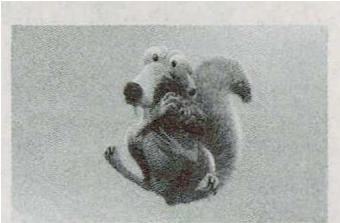
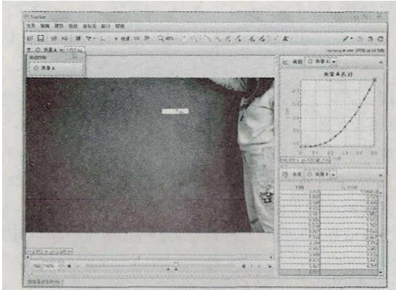
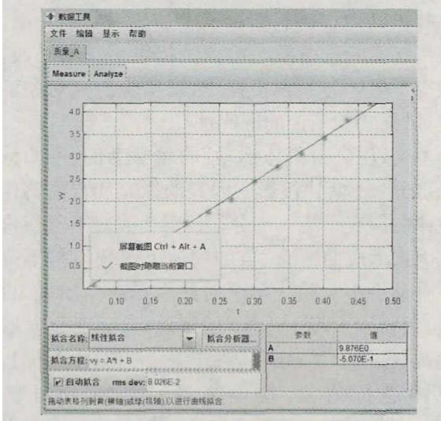

> 来源：MinerU 3.4.4 二次 OCR 转换并依据本地 PDF 逐页精校（2026-08-12）。

# 现代信息技术对高中物理课堂教学的改进

## ——以“自由落体运动”教学为例

闫彩霞，邢洪明（山东省青岛第二中学物理学生发展与研究室，山东 266061）

摘要：对于探究自由落体运动规律的教学，教师多借助打点计时器、频闪照片、照相机连拍技术等进行，实验器材较为专业、操作及数据处理较为复杂。利用视频分析软件 Tracker，可以直接对生活中的各种自由落体运动进行追踪分析，记录物体运动过程中速度随时间变化情况，拟合出物体速度—时间图象，求出加速度，使实验过程简单易操作，同时实验效果更加直观形象、定量准确。

关键词：信息技术与物理教学；Tracker；视频分析；自由落体规律；速度—时间图象

文章编号：1002-0748（2019）7-0019

中图分类号：G633.7

文献标识码：B

将信息技术应用于物理课堂教学在近几年受到了广泛重视。特别是在中学物理实验教学中，借助信息技术高效、准确、新颖及个性化的特点，为改进传统实验设备及实验方法提供了新的手段，可以提高学生学习的积极性，拓展实验研究对象的广泛性，增强实验结论的准确性。

本文以“自由落体运动”的教学为例，主要分为两个部分：下落快慢影响因素的探究和自由落体运动规律的探究。第一部分是让学生先对下落快慢的影响因素形成前概念“重的物体下落快”，接下来通过各种动手小实验让学生对此观点产生质疑，再建立“轻重物体下落一样快”的猜想，最后通过实验验证此观点。第二部分则是先让学生对自由落体运动的规律进行猜测，接下来通过视频分析软件 Tracker 做出频闪图片，对自由落体运动规律做定性了解。最后通过视频分析软件 Tracker 做出速度—时间图象，通过拟合直线的斜率求出加速度进行定量探究，从而建立起自由落体运动规律。

## 1 创设情景、引入新课

学生观看《冰河时代》电影中的节选视频，视频内容为松鼠在下落过程中追上了先下落的榛子，让学生对电影中的现象是否具有科学性错误进行分析。

  
图 1 松鼠追上下落的榛子

设计意图：通过生活中的电影片段引入，激发学生学习的兴趣与思考。通过该视频让学生先形成“重的物体下落快”的前概念，为接下来的教学做好铺垫。

## 2 问题串引导、形成认识

### 2.1 提出问题，引发学生质疑

通过学生实验“质量不同的纸团下落一样快”，让学生对“重的物体下落快”的前概念产生质疑。

### 2.2 提出问题，引导学生猜想

通过质量相同的纸团和纸片下落不一样快，引导学生思考：有时重的物体下落快，有时不同轻重的物体下落一样快，有时轻重相同的物体下落不一样快，这说明了什么问题？从而建立猜想“物体下落的快慢可能与质量大小无关”。

### 2.3 引导学生设计实验验证

首先要引导学生思考：根据他们的猜想“物体下落的快慢与物体质量的大小无关”，那生活中为什么还会看到物体下落不一样快呢？让学生意识到空气阻力对物体下落快慢的影响，进而想出需要在没有空气的环境中释放轻重不同的物体进行验证的方法。之后教师介绍实验仪器牛顿管，其内部抽走空气之后几近真空，然后教师演示轻重不同的羽毛和铁片在牛顿管中的下落情况以验证学生猜想。最后播放 NASA 最大的真空实验室所做的小球与羽毛下落情况的视频，让学生观看在完全真空情况下的下落现象。

设计意图：通过小实验，让学生对“重的物体下落快”的前概念产生怀疑，再通过实验让学生产生“物体下落的快慢与物体的质量大小无关”的猜想，最后通过实验验证学生的猜想。通过亚里士多德和伽利略的故事让学生理解反证法，明白否定并不是没有用的，否定的意义大于肯定的意义。通过该过程让学生明白物理规律的认识来源于科学的猜想、科学的实验与探究，培养学生实事求是、尊重客观规律的科学态度，促进学生掌握自主学习的途径和方法，加深理解物理现象的本质与内在联系。

## 3 学生自主探究、发现规律

### 3.1 建立自由落体运动的概念

教师说明刚才同学们看到的 NASA 实验室中羽毛和小球的下落就称之为自由落体运动，并让学生总结出自由落体运动的条件，对自由落体运动下定义。

### 3.2 定性研究自由落体运动规律

学习了自由落体的概念之后，引导学生探究自由落体这种新运动形式的规律特点。在课堂上学生分小组拍摄一个物体做自由落体运动的视频并将视频导入 Tracker 中，利用视频分析软件 Tracker 一键生成该物体下落过程中的频闪照片，通过频闪照片对物体的运动情况做定性分析，得出自由落体运动是加速直线运动。但由于是定性分析，通过频闪照片无法看出物体是匀加速还是变加速直线运动，接下来再引导学生做进一步探究。

### 3.3 定量探究自由落体运动的规律

为探究小球速度的定量变化情况，学生通过视频分析软件 Tracker 对刚才视频中下落的物体进行实时追踪，生成该物体自由落体运动过程中的速度—时间图象，可以发现该图象为一条过原点的倾斜直线，即为匀加速直线运动。再利用软件中的数据处理功能拟合出该图象的斜率约为 9.8 m/s²。换用其他物体进行实验，发现所拟合出的加速度值与 9.8 m/s² 相近，为一固定值（同一地点）。进而引导学生总结出自由落体运动是初速度为零、加速度为 9.8 m/s² 的匀加速直线运动，并根据匀加速直线运动的规律关系式推导出自由落体运动的规律关系式。

设计意图：在该部分先由学生总结出自由落体运动的条件，根据条件对自由落体运动下定义。再由学生自己拍摄身边的自由落体运动视频，通过视频分析软件 Tracker 对自由落体运动进行研究分析，得出自由落体运动的规律。通过引导学生独立地运用探索、实践、分析、总结等方法来实现学习目标，帮助学生自主地形成物理观念，获得独立思考和学习的能力。当下越来越注重培养学生的信息意识，重点是能自觉、有效地获取、评估、鉴别、适用信息，具有数字化生存能力，主动适应“互联网”等社会信息化趋势。运用现代化教育技术是当下课堂教学的大趋势。

  
图 2 视频分析软件 Tracker 追踪小球运动

  
图 3 自由落体运动速度—时间图象

## 4 学以致用，拓展延伸

完成自由落体运动规律教学之后，教师展示一个实际应用问题，要求同学借助今天所学知识，想办法测量一口枯井的深度，小组讨论交流后进行展示。

设计意图：培养学生的科学思维、模型建构能力是核心素养中重点强调的内容。教学与生活实际的结合可以让学生将学到的简单模型知识运用到生活中的复杂情景中，提升学生应用所学知识解决现实问题的意识和能力，让学生经历“是什么、为什么、怎么用”的过程，提升学生知识迁移的能力。

<!-- 存疑：本地 PDF 正文在此标注“下转第 38 页”，但所附第 38 页实际属于另一篇电磁感应教学文章，未包含本文的续页、结语和参考文献；已删除该相邻文章内容。 -->
