# 自制 DIS 实验主板

文\_翁浩峰/浙江省宁波中学

## ⊙DIS 实验系统简介

DIS（Digital InformationSystem）即数字化信息系统，是由“传感器 + 数据采集器 + 计算机软件”构成的实验系统。在物理学中绝大多数的物理量，如位移、力、温度、电压、电流等，均可用 DIS进行测量。高中《物理》教材中也有很多关于 DIS 实验的案例。一般来讲，DIS 实验使用的都是商用DIS实验系统，价格较为昂贵。

DIS 实验系统主要由传感器、数据采集器，以及计算机或手机端软件组成。早期的DIS实验系统中，传感器和数据采集器间、数据采集器与计算机间都是有线连接，现在也有将传感器与数据采集器合二为一，并使用蓝牙等无线方式与计算机软件通讯的。

## ⊙ 基于 ESP32 的自制 DIS 实验系统简介

物联网的不断发展，涌现了一批便宜好用的物联网硬件和传感器，加之近几年创客教育的普及，让物联网硬件和传感器的使用越发简单，原来遥不可及的自制 DIS 实验有了实现的可能。

## → 基 于 ESP32 和 phyphox 的 自 制DIS实验系统

基 于 ESP32 与 phyphox（ 手机物理工坊）的自制 DIS 实验系统近期较为流行，它通过对 ESP32 进行编程，实现采集各种传感器数据并通过无线蓝牙方式发送，在手机端可使用 phyphox 软件接收数据并绘图。

ESP32 是一款集成了 Wi-Fi、蓝牙功能的微控制器，性能优异、价格低廉，在线资源非常丰富，不仅可以用专业的 C 语言编写程序，还支持 micropython 语言。

Phyphox 是一款十分流行的物理实验应用程序，除了可以采集手机自带传感器的数据外，还可通过蓝牙接收来自外接传感器的数据，不仅可以对采集到的数据进行显示并绘制成图像，还能对数据进行简单处理，或者通过即时通讯软件将数据以 excel 表格的形式发送到电脑端进行进一步处理。此外，它还支持自定义显示界面，在官网上编辑个性化的实验界面后，可通过扫码或直接下载文件等方式在手机端打开。

在 计 算 机 端， 可 以 通 过phyphox 的远程访问功能，启用服务器功能，同一个局域网内的计算机就可通过网页打开 phyphox 上的实验界面。还可以直接编写支持 Web Bluetooth API 的 html 网页，可以在本地直接用浏览器打开，或者将其放到网站上用浏览器远程访问，即可在网页上显示数据和绘图，还能实现更多的功能，比如数据驱动下的动画等。笔者开发了一个网页版的 DIS 实验系统，可以通过浏览器访问 https://www.makemaker.net 进行测试。这种网页版 DIS 实验的方式，只需要浏览器支持 Web Bluetooth API 即可，计算机或手机上的浏览器均可。

## ⊙ 实验系统硬件制作上的困境与突破

自制 DIS 实验系统中的 ESP32一般使用开发版。为了能与传感器连接，通常需要使用面包板，图 1为自制的使用 ADS1220 的力传感器。使用面包板的不足之处包括：复杂的连线足以劝退大多数对自制DIS 感兴趣的教师；连线经常出现接触不良等问题，且很难在短时间内排除故障，在课堂上使用风险极高；这样的 DIS 实验只适用于实验开发阶段，无法批量制作让更多的教师使用。

物理实验中的各种传感器，多数是先将物理量转换为电学量，再通过对电学量的测量实现。虽然ESP32 上自带了一个 12 位的 ADC（模拟数字转换器），但其测量精度和分辨率均不高，无法满足物理实验中的电压测量，针对力传感器输出的最大只有几毫伏的电压更加

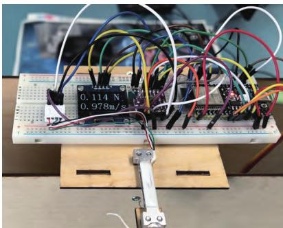  
图 1  使用 ADS1220 的力传感器

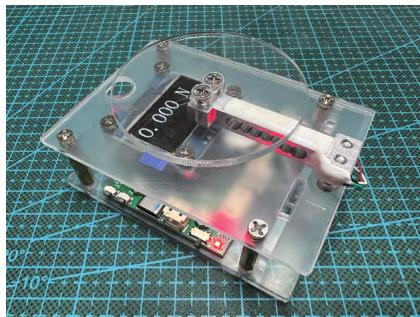

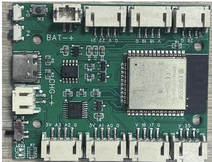  
图 4  压力传感器

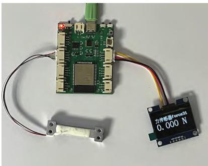  
图3  力传感器结构

图2  自制DIS 实验主板  
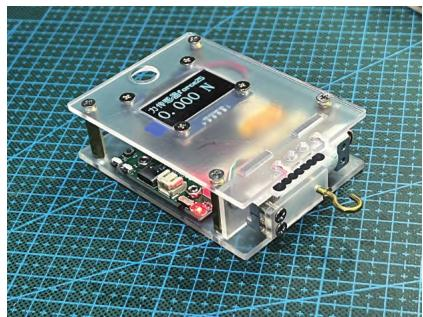  
图5  拉力传感器

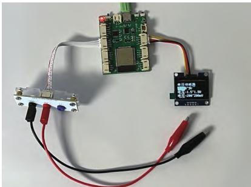  
图6  电压（电流）传感器结构

无能为力。

因此，开发一块自制DIS主板，将 ESP32 与高精度 ADC 集成在一起，并使用一些接插件方便的连接传感器，不仅可将自制 DIS 实验难度降低，还能保证使用过程中的稳定性，让自制 DIS 实验真正具有使用价值。

## ⊙ 自制 DIS 实验主板

DIS 实验主板经历了长达 3 年的开发与制作。整块主板的设计主要包括 5 个部分，为了方便后期批量制作，全部使用了贴片元件，如图2所示。

## → ESP32 主控板

自制主板使用的是 ESP32 的邮票版，可以方便地贴在 PCB 板上，其价格仅为 ESP32 开发板的一半。

## → ADS1120 高速 ADC 芯片

ADS1120 是一种精密的 16 位模数转换器（ADC）。该器件具有

2 个差分或 4 个单端输入，1 个灵活的输入多路复用器（mux），1 个低噪声、可编程增益放大器（PGA），2 个可编程励磁电流源，1 个基准电压源等。虽然 ADC 芯片有很多型号可供选择，但 ADS1120 拥有的PGA 最大倍率可达到 128 倍，使其可以直接测量力传感器上的微小差分电压。另外，ADS1120 还具有 1个电流源，可以被设计成恒流源，能产生很多实验创意。ADS1120 与ESP32 间采用 SPI 通讯，硬件部分的连接已经设计在主板上。

## → 基准电压源

主板上还设计了一个基准电压源芯片，芯片型号为 REF3030，能提供 3 V 基准电压，精度达到了0.05%。虽然 ADS1120 中也内置了2.048 V的基准电压源，但无法供外部电路使用。在一些实验中，比如电压传感器，就需要有高精度的电压源给桥式电路供电，因此在主板上增加了这个芯片，这个电压源同时也连接到 ADS1120 上，可作为外接基准电压源使用。

## → CH340 串口电路

要给 ESP32 写入程序，需设计单独的串口电路，使用了 CH340K串口芯片，并用 2 个三极管设计了自动上传电路。与电脑连接的接口选择了当前流行的 TypeC 接口，不过由于主板未设计充电电路，这个接口仅限于连接ESP32并给它供电，无法给电池充电。

## → 电源管理电路

ESP32 的供电电压为 3.3 V，但来自 TypeC 的电压为 5 V，来自锂电池的电压为 3.7 V，需要将这些电压降压到 3.3 V 后给 ESP32 供电。由于 3.7 V 降压到 3.3 V 的压差太小，导致常见的降压芯片，比如 LM1117-3.3 无法正常使用，查阅很多资料后，找到了一款降压芯片 RT9013-33GB：250 mV 压 差，

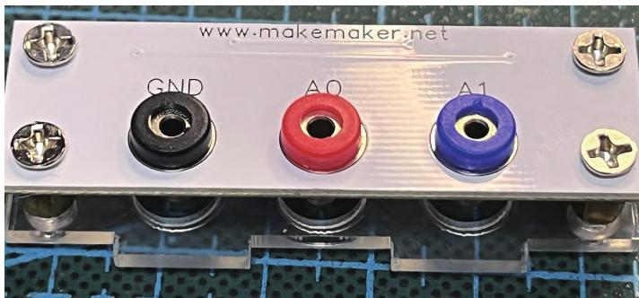  
图7  电学转接板

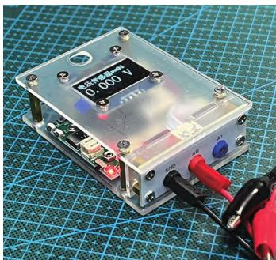  
图8  电压（电流）传感器

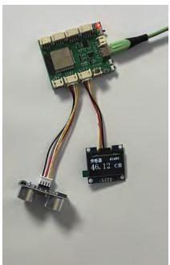  
图 9  位移传感器结构

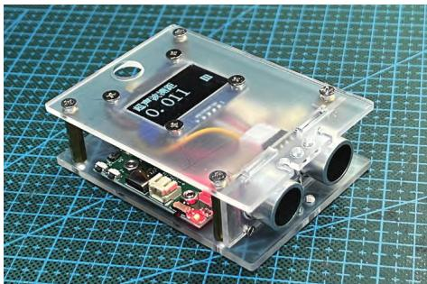  
图10  位移传感器

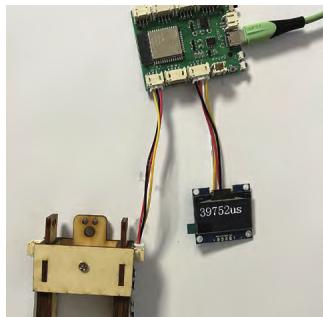  
图11  光电传感器结构

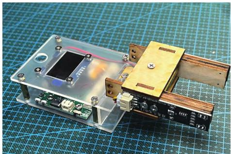  
图12  光电传感器

3.3 V 输出，500 mA 输出。

最后，在主板上设计了 3 个按钮、2 个指示灯和一些 PH2.0 的输出接插口。

## ⊙ 基于 DIS 主板的传感器设计案例

制作 DIS 主板的目的是简化硬件连接，并增强 DIS 的可靠性和耐用性，让自制 DIS 实验也能出现在日常的课堂演示实验甚至学生实验中。基于这块 DIS 主板，可以开发设计各种各样的自制DIS实验。

## → 力传感器

借助 DIS 主板，原本复杂的无线力传感器变得非常简洁，只需插上屏幕和应变梁，再写入对应的程序就可轻松制作一个力传感器，搭配亚克力板的结构件，即可变成无线力传感器（图3—图5）。

基于无线力传感器，可以开发出一系列力学实验，比如弹簧振子受力实验、单摆受力实验、超重失重实验、作用力反作用力实验、摩擦力研究实验等。

## → 电压、电流传感器

集成了 ADS1120 的 DIS 主板，本身就是一个电压传感器，还可通过改变增益实现不同量程，图 6 是多量程的电压（或电流）传感器，能通过主板上的按钮实现量程切换，在电压传感器基础上，给输出端并联 1 个已知阻值的采样电阻，就可以改装成电流传感器。为了方便实验，专门设计了一块转接板(图7)，通过转接板上的拨码开关，实现采样电阻的并联等操作。配合亚克力板，就可以组装成一台无线电压（电流）传感器（图8）。

电压电流传感器可以完成绝大多数高中电学实验，比如电源电动势和内阻测量实验、电容器充放电实验、利用恒流源研究电容器实验、电磁感应实验、LC振荡电路实验等。

## → 超声波位移传感器

配合创客常用的超声波测距模块，就可组装成一台超声波位移传感器（图9、图10）。

## → 光电传感器

配合自制的双光头光电门，就可以完成很多运动学的实验（图11、图 12）。

基于 DIS 实验主板制作的实验教具越来越多地应用于真实的课堂中，如何利用 DIS 主板开发物理创新实验也可成为一门融合信息技术与物理实验的选修课程。这种新的DIS 实验方式，最终会带来教学工具的改革，其便宜的价格，使偏远山区的孩子也有机会接触到最新的实验教具。

该项目获得第 38 届全国青少年科技创新大赛科技辅导员科技教育创新成果竞赛一等奖■
