# 自制 DIS 探究电容器电压与电荷量的关系——基于 ESP32 与 Phyphox 的 DIS 实验

翁浩峰

浙江省宁波中学 浙江 宁波 315100

摘 要 设计制作了集成高速 ADC 芯片的 DIS 实验主板 通过写入程序制作了电压 电流传感器和恒流源 并通过这套基于 ESP32 与 Phyphox 的 DIS 实验设备 观察了电容器充 放电过程 定量探究了电容器电压跟所带电荷量的关系 。

关键词 ： ESP32 ； Phyphox ； 自制 DIS ； 电容器 ； 恒流源

中图分类号 ： G633 . 7

文献标识码 ：A

电容器是电学中的重要元件 对电容器的定量探究一直是高中物理教学中的重难点 在人教版教材中提供了三个实验案例来进行探究 分别是“观察电容器的充 放电现象”“用传感器观察电容器的放电过程”和“探究电容器两极板间电势差跟所带电荷量的关系”

笔者利用一套自制的 DIS 实验装置完成了“用传感器观察电容器充 放电过程”和“用可编程恒流源探究电容器电压跟所带电荷量的关系”两个实验 完成了教材中三个实验的教学任务

## 1 基于 ESP32 与 Phyphox 的 DIS 实验简介

ESP32 是一款集成 WiFi 蓝牙功能的微控制器 性能强 价格低廉 ESP32 在线资源非常丰富 不仅可以用专业的 C 语言来编写程序 而且还支持近期十分流行的 Python 语言 ESP32是一块芯片 为了方便使用 可以选择ESP32 的开发板本实验采用的开发板如图 1 所示

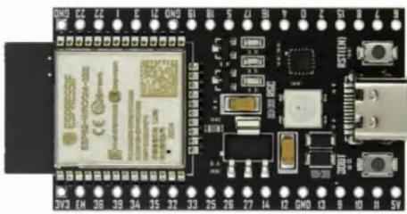  
图 1 实验采用的开发板

Phyphox（手机物理工坊 ）是一款物理实验

文章编号 ： 1 003 - 6 1 48 （ 2023 ） 1 0 -0049 - 5

软件 除了可以采集手机自带传感器的数据外还可以通过蓝牙接收来自外接传感器的数据 它可以显示采集到的数据并绘制图像 还能对数据进行简单处理 或者将数据以 Excel 表格的形式发送到电脑端进行进一步处理 更重要的是它还支持显示界面的自定义 在它的官网上编辑个性化的实验界面后可以通过扫码或者直接下载文件等方式在手机端的 Phyphox 中打开

使用 ESP32 采集各种传感器的数据并通过蓝牙发送给手机 在 Phyphox 里记录并显示数据绘制图像 然后再将数据发送到电脑进行进一步处理 ， 组成了基于 ESP32 与 Phyphox 的 DIS 实验系统。

## 2 高速电压 电流传感器和可编程恒流源的设计与制作

用于测量电压的电子模块叫作“ADC（模数转换）” 它可以将待测的模拟电压转换成一串二进制数字 在本实验中使用了名为 ADS1120 的16位 ADC 芯片 在 3 V 量程下可以分辨的最小电压约为 0 046 mV 它同时还拥有高达 2 000 Hz 的采样频率 最大 128 倍的增益和恒流输出功能由于 ESP32 与 ADS1120 的连接较为复杂 为了使装置尽量的简洁 设计了一块集成了 ADS1120的 DIS 主板（图 2） 可以方便地将 ESP32 开发板安装在上面进行实验

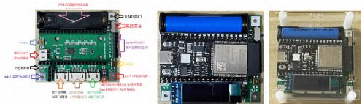  
图 2 集成了 ADS1 1 20 的 DIS 主板

将 ESP32 液晶屏和电池安装到主板上后 对ESP32 进行编程就可以分别实现电压传感器 电流传感器和恒流源的功能

## 2.1 电压传感器

由于本实验中待测的电压都是正的 所以电压传感器使用主板上的 A2 端口和 GND 端口作为正极和负极 可以使用鳄鱼夹或者 2 mm 莲花插头进行连接 使用 MicroPython 对 ESP32 进行编程 主要程序如图 3 所示

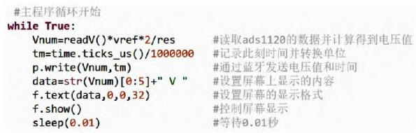  
图 3 程序编写

使用 MicroPython 编程可以调用现成的函数 通过一两句代码实现复杂的功能 主程序是循环运行的 每个循环中先读取 ADS1120 的数据并计算出电压值 然后再记录时刻 随后通过蓝牙发送并在屏幕上显示 每次测量后等待 0.01 s再次测量 最后实现大约每秒 50 次的采样频率

## 2.2 电流传感器

由于 ADC 只能实现电压的测量 所以电流传感器实际上是通过电压传感器改装而来的 在DIS 主板上内置了一个 0.1 Ω 的采样电阻 通过测量采样电阻上的电压就可以计算出所通过的电流。

本实验中给电容器充电的电压约为 1.5 V与电容器串联的电阻为 200 Ω 所以最大电流约为 7.5 mA 流过采样电阻后 采样电阻两端电压约为 0.75 mV 由于电压较小 需要使用ADS1120的增益来放大待测电压 本实验使用 128 倍增益 放大后的电压约为96 mV 因为需要测量双向电流 所以使用差分电压测量 最后 在设置增益128 倍并且并联 0.1 Ω 采样电阻的情况下 此电流传感器的量程为-0.1 A\~0.1 A 分辨率为 3.6 μA满足实验精度要求 由于采样电阻值存在误差和线路存在电阻 电流传感器设置好后需要使用高精度多用电表进行校准 并修改程序中的参数

电流传感器使用主板上的 A2 A3 端口 主程序与电压传感器类似 不再提供

## 2.3 可编程恒流源

ADS1120 拥有恒流输出功能 使用代码控制恒流开启和关闭 就可以实现可编程恒流源 图4 所示代码实现了输出 5 段大小为 1 mA 时长为 0.5 s 的恒流 每两段间隔 0.1 s

i=0   
while i<5:   
i=i+1   
adc.idac\_current(Im)   
sleep(0.5)   
adc.idac\_current(0)   
sleep(0.1)  
图 4 代码示意图

恒流输出使用主板上的 A2 和 GND 端口

## 2.4 Phyphox 端界面的制作

Phyphox 的显示界面可以通过它的官网进行编辑 编辑完后的代码可以通过手机扫描二维码或者直接将代码发送给手机的方式在 Phyphox中打开 Phyphox 界面编辑中使用了连线的方式对数据进行处理 本实验的 Phyphox 数据连线图如图 5 所示

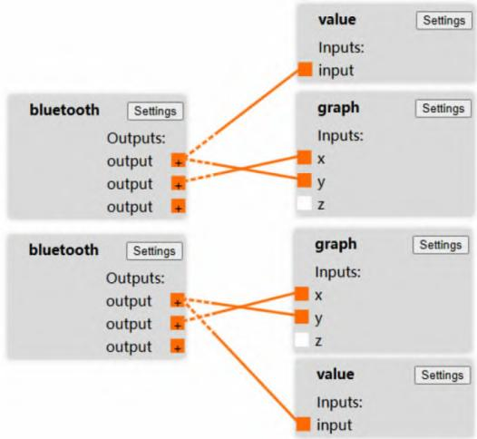  
图 5 Phyphox 教程连线图

Phyphox 可以连接多个蓝牙设备 图 5 中两个 bluetooth 分别是电压传感器和电流传感器

## 3 使用自制 DIS 探究电容器的电压与电荷量的关系

## 3.1 用传感器观察电容器充放电过程

使用教材中“观察电容器充 放电现象”实验中的电路图（图 6） 并将里面的电压表和电流表换成自制的电压传感器和电流传感器 就可以同时绘制电容器充放电时的电压 电流随时间变化的图像。

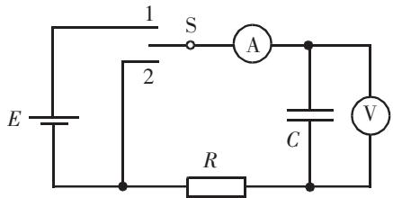  
图 6 教材中的电路图

为了更清晰地展示实验过程 所有的元件全部采用磁贴的方式固定在黑板上（图 7） 这样就可以根据电路图非常直观地进行连线

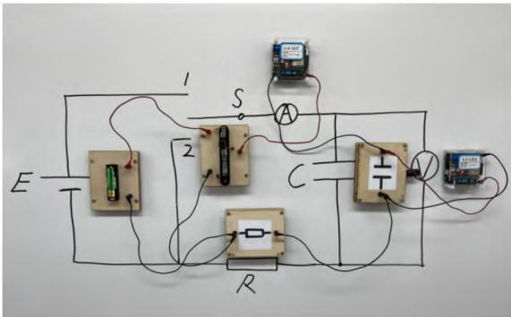  
图 7 实验元件

电路连接完后 先打开电压传感器和电流传感器的电源 再打开手机端 Phyphox 中对应的实验并连接传感器后就可以开始实验了 先使开关S 与 1 相连 进行电容器的充电 在 Phyphox 中会实时地显示充电时电压和电流随时间的变化图像 待充电完成后 再将开关 S 与 2 相连 电容器会进行放电 同样可以在 Phyphox 中查看放电时的图像 图 8 是某次实验的图像

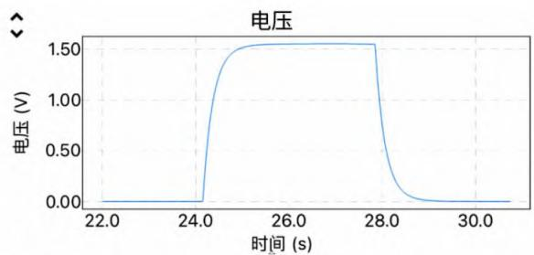

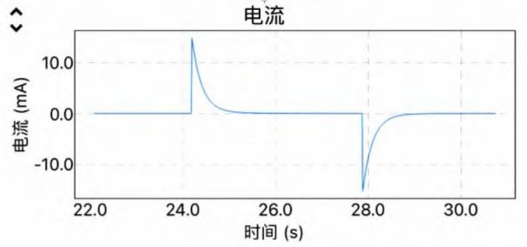  
图 8 实验图像

Phyphox 还可以将数据以 Excel 的格式发送给电脑 在电脑端可以对接收到的数据进行处理 图 9 所示是针对充电过程电流的处理

先求出每两个时刻之间的时间间隔 然后再将时间间隔乘以电流得到电量 最后将所有充电过程的电量累加得到电容器充电后的电量 ：$3 . 3 8 2 { \times } 1 0 ^ { - 3 } \mathrm { ~ C ~ }$ 。

为了检验实验的准确性 可以根据充电后电容器的电压 1 552 V 计算得到电容器的电容为$2 1 7 9 ~ \mu \mathrm { F }$ 与标称的 $2 2 0 0 ~ \mu \mathrm { F }$ 相差 1%

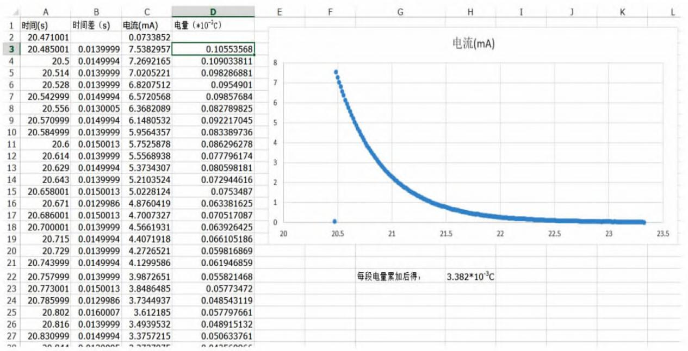  
图 9 充电过程数据处理

可以使用不同电压的电源对电容器进行充电 然后与电量进行对比得到电容器电量与电压的关系 但是这种方式过于繁琐 为了更加方便地进行研究 下面使用可编程恒流源对电容器进行充电。

## 3 2 用可编程恒流源探究电容器电压与所带电荷量的关系

在使用电池对电容器进行充电时电流是不恒定的 所以需要对电流进行积分得到电容器充入的电荷量 但是 如果电流是恒定的话 就可以方便地通过电流和时间的乘积来计算电量了

首先 使用可编程恒流源替换原有电路中的电池 （ 图 1 0 ）

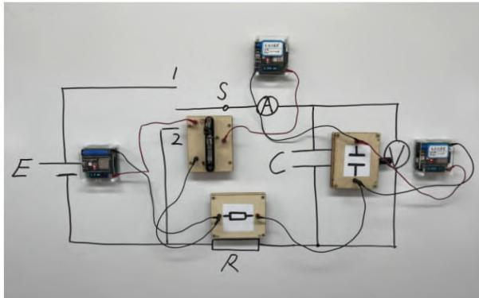  
图 10 实验元件

通过程序设置恒流源 让其输出一段时长为2 s 大小为 1 mA 的电流 同样使用电压传感器与电流传感器测量得到图 11 所示的实验图像

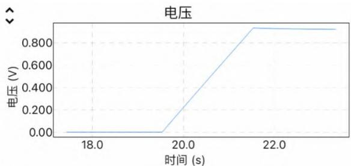

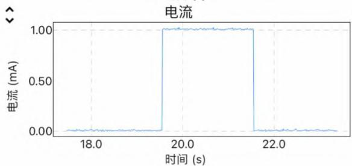  
图 1 1 实验图像

可以看到电压-时间图像为一条直线 也就是电压随时间均匀增加 因为电流恒定 所以可以得到电压与电荷量成正比

为了检验实验的准确性 ，可以在 Phyphox 中测量直线的 斜率 k =0 464 68 1 V/s （ 图 1 2 ） 由 于电流大小恒为 1 mA 可以计算出 $C { = } \frac { Q } { U } { = } \frac { I t } { U } { = } \frac { I } { k } { = }$ $2 1 5 2 ~ \mu \mathrm { F } _ { \mathrm { c } }$

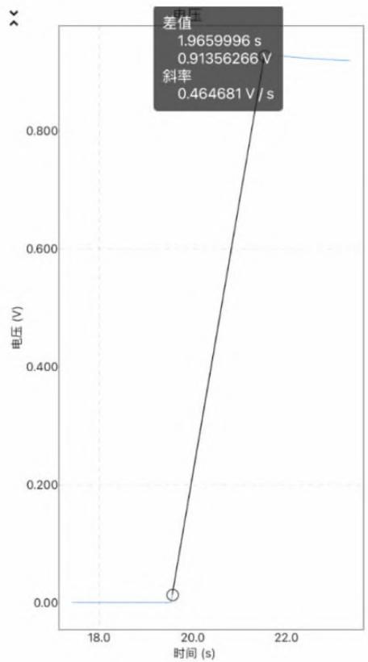  
图 12 电压-时间图像

也可以通过程序设置让恒流源输出 5 段大小为 1 mA 时长为 0.5 s 的恒流 每两段间隔 0.1 s 通过电压传感器和电流传感器测量得到图13 所示的实验图像

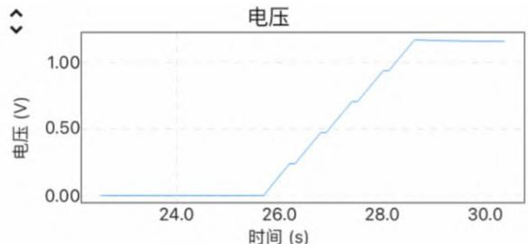

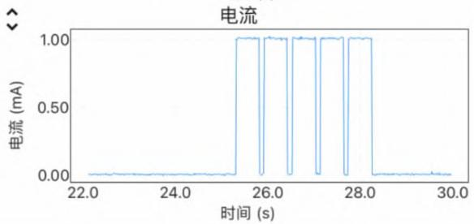  
图 13 实验图像

单独打开电压-时间图像 获取每段充电结束时的电压值（图 14）

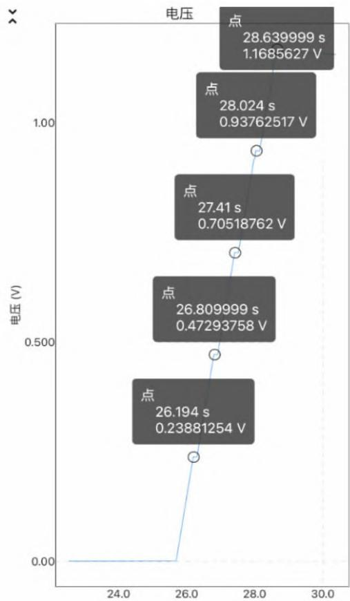  
图 14 电压-时间图像

由于每次充电电流和时间都一样 所以每次充入的电荷量相等 测得的 5 个电压值分别对应的电容器电荷量为 Q、2Q、3Q、4Q、5Q 通过计算可得电容器电压和所带电荷量的关系（表 1）

使用可编程的恒流源可以非常方便地研究电容器的电压和电荷量的关系 当然也不仅仅局限于以上的实验方法 例如还可以设置不同的恒流充电时间来充入不同的电荷量 并结合每次充电完成后的电压值进行研究等

表 1 电容器电压与所带电荷量的关系
<table><tr><td rowspan=1 colspan=1>电荷量</td><td rowspan=1 colspan=1>电压/V</td><td rowspan=1 colspan=1>与第一次电压比值</td></tr><tr><td rowspan=1 colspan=1>Q</td><td rowspan=1 colspan=1>0.238 8</td><td rowspan=1 colspan=1>1.000 0</td></tr><tr><td rowspan=1 colspan=1>2Q</td><td rowspan=1 colspan=1>0.472 9</td><td rowspan=1 colspan=1>1.980 3</td></tr><tr><td rowspan=1 colspan=1>3Q</td><td rowspan=1 colspan=1>0.705 2</td><td rowspan=1 colspan=1>2.953 1</td></tr><tr><td rowspan=1 colspan=1>4Q</td><td rowspan=1 colspan=1>0.937 6</td><td rowspan=1 colspan=1>3.926 3</td></tr><tr><td rowspan=1 colspan=1>5Q</td><td rowspan=1 colspan=1>1.168 6</td><td rowspan=1 colspan=1>4.893 6</td></tr></table>

## 4 基于 ESP32 与 Phyphox 的自制 DIS实验展望

有了集成 ADS1120 的 DIS 主板后 自制 DIS实验的难度大大降低 除了可以制作本文介绍的电压 电流传感器和恒流源外 还可以连接应变量 轻松制作力传感器 ；甚至可以连接电子体重计 将其改造成可以测量体重的力传感器 另外 ESP32 高达 240 MHz 的主频在连接光电门后可以精确地测量时间 ；ESP32 还拥有 I²C、SPI、TTL 等丰富的数据接口 使其可以方便地连接各种传感器

使用 MicroPython 可以让编程变得更加简单 通过程序便可以真正地控制 DIS 实验中的数据。

## 参考文献 ：

［ 1 ］ 万军 ．基于 Lab Studio 的电容器定量实验研究 ［J ］ ．中学物理 ， 20 1 8 ， 36 （ 1 1 ） ： 4 1 － 43 ．

［ 2 ］ 翁浩峰 利用 Arduino 和 Flash 开发 DISLab ［J ］ 物理教师 20 1 0 3 1 （ 3 ） ： 45 － 47 ．

［3］翁浩峰．DISLab 在法拉第电磁感应定律定量实验中的应用 ［J ］ 物理通报 20 1 2 （ 8 ） ： 83 － 85

（栏目编辑 刘 荣）
