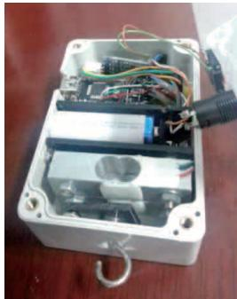
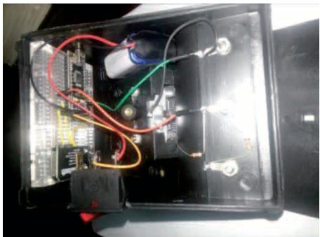
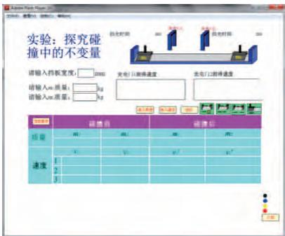

# 虚实结合的无线 DISLab 系统

翁浩峰　浙江省宁波市宁波中学

##  无线 DISLab 系统简介

DISLab（数字化信息系统）是一种将传感器、数据采集器和计算机组合起来，共同完成对物理量测量的装置。在实验过程中应用此装置，可以直接在电脑上得到实验数据，并通过图表、图线等具体分析出实验结果，十分直观与简便，大大简化了以往实验课上繁琐的计算过程，既节约了时间又让学生感到直观易懂。

本套 DISLab 系统由若干无线传感器、数据采集器和计算机端软件3部分组成。相比于现有 DISLab系统，本套系统的优点如下。

” 用无线的方式连接传感器和数据采集器，传感器可单独安装在运动物体上，可以完成有线传感器无法完成的实验数据采集，带来了新的实验测量方式。

” 用无线的方式接收来自传感器的数据，没有了线的束缚，可以使实验装置更加简洁。

” 本系统数据采集器可同时连接 3 路无线传感器，以及多达 30路有线模拟或数字传感器，可以完成更复杂的实验。

” 计算机端的软件用 Flash动画软件开发，可用动画实时模拟真实实验，实现虚拟实验与真实实验相结合，使实验过程更清晰地得以展现。

” 可以用以前记录的实验数据驱动软件，实现实验过程的虚拟再现。

##  无线 DISLab 系统原理设计

实现无线 DISLab 系统设计最关键的问题是无线数据传输方式的选择。现有无线数据传输方式有很多，可供使用的有无线电、红外、蓝牙、射频、WiFi及短距离激光通讯等。经比较，我选择了蓝牙作为无线DISLab系统的数据传输方式。

用 于 制 作 传 感 器 的 单 片 机Arduino 可以使用的蓝牙模块有很多，这里采用了HC-05主从一体蓝牙模块。在选择完了无线方式后，就可以进行具体的无线DISLab设计了。

##  传感器端设计

由于要在传感器端加入蓝牙模块，所以需要利用 Arduino 处理来自传感器的数据，然后再由蓝牙模块发射。

##  数据采集器端设计

数据采集器端主要用来接收来自传感器端的数据，并且将这些数据进行处理后发送到电脑端。数据采集器与电脑端的连接利用 usb 线连接。

同组的模块间通过设置不同的连接密码进行区别，连接密码初始化在蓝牙模块中。也就是说蓝牙主机模块 1 会自动连接传感器端1 中的蓝牙从机模块，蓝牙主机模块 2 会自动连接传感器端 2 中的蓝牙从机模块，并且数据采集器端的Arduino 能自动识别来自哪个传感器端的数据。如果只使用一个无线传感器进行实验时，因为大多数计算机已经集成了蓝牙模块，所以这个结构可以简化为：传感器→无线传输→带蓝牙功能的计算机。

##  计算机端软件的设计

由于不管是 Arduino 通过 usb连接电脑还是直接利用蓝牙连接电脑，都采用了串口数据传输，所以可以使用一个叫 Serproxy 的串口代理程序将来自串口的数据转化成Flash 动画可以读取的数据。最后的数据呈现和绘图都由 Flash 动画实现。

##  部分无线传感器简介

##  无线力传感器

由于高中物理中存在很多测量动态力的难点，所以必须应用无线力传感器。经多次设计修改，最终制成双应变梁式力传感器。此传感器基本原理是在一个传感器模块中放入2个相同的应变梁式力传感器，其中一个连接钩子用来连接外部物体，另外一个只连接一个配重。这样当传感器在运动中有加速度时，利用连接配重的力传感器的数据计算出连接外部物体钩子的力的变化，从而抵消了由于钩子引起的力的变化。双应变梁式无线力传感器的实物见图 1。

  
图1　双应变梁式无线力传感器

在进行牛顿第二定律实验中小车受力的测量实验时，如果使用传统实验方法，就只能用重物的重力代替小车的受力，为了控制误差，在实验中小车的加速度就不能很大，因而实验现象就不很明显。有了现在的实验装置，就可以直接在小车上安装无线力传感器，直接测量小车受到的拉力，所以小车加速度可以比较大，实验现象也更明显。

##  无线速度传感器

无线速度传感器利用了光电门测速的原理。将光电门放置在轨道车上，然后将多个相同宽度的挡光片放置在轨道上，就可以利用光电门完成多次测速。现有光电门必须用有线方式连接到数据采集器，无法使用。所以必须对现有光电门进行改进，让其与数据采集器之间采用无线数据传输。

  
图2　无线电压、电流传感器

##  无线电压、电流传感器

Arduino 模拟电压输入端的可测量的最大电压为 5 伏，10 位精度（即大概可以精确到 0.005 伏），如果直接将模拟电压输入端作为电压传感器，也足以满足高中物理电学测量的精度要求，所以可以直接将传统的电压表直接改装成电压传感器，直接将 Arduino 的模拟电压输入端并联到电压表两个接线柱上，由于 Arduino 模拟电压输入端的输入阻抗在 1 兆欧姆以上，并联在电压表上后基本不改变电压表的内阻。图 2 为电压表改装后的实物图，电源可以内置在电压表内部。

##  虚实结合的软件端

本套无线 DISLab 系统的软件端用 Flash 动画软件开发而成，因此具有动画课件的特点，可以用动画表现实验过程。因为动画的运动数据来自于真实的实验，所以可以实现虚实结合的 DIS 实验。而且每种实验都既拥有 DIS 实验的方便、准确、快速和可自动保存数据的特点，又拥有虚拟实验的可视性和对动态过程的展示。图 3 是碰撞实验的界面截图。

  
图 3　碰撞实验的界面

该项目获得第 30 届全国青少年科技创新大赛科技辅导员创新成果科技发明类一等奖。

## 专家评语

该项目制作的无线 DISLab 系统由若干无线传感器、数据采集口和计算机方面软件3部分组成。其中传感器采用了模块化设计。相比于现有系统的优点：用无线方式代替有线传输，带来了新的实验测试方式，且实验装置更加简洁；数据采集器可同时连接 3路无线传感器，可完成较复杂的实验；使用 Flash 计算机动画软件使显示过程更加清晰，实现虚实结合；模块化设计，实现多样化测量。建议利用此思想多开发实用项目，并开发外壳使其更加实用，不断改进软件使其更加适应课堂教学。■