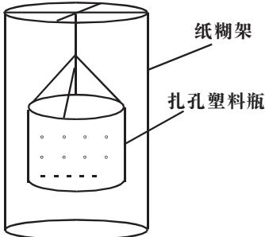
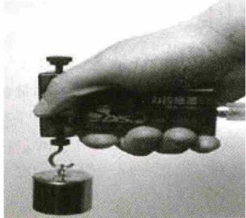
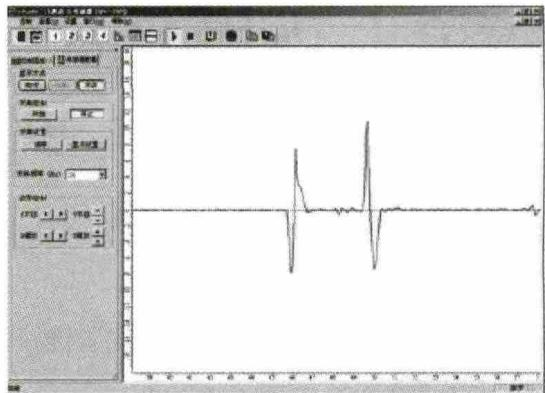

# 巧用DIS实验 助力物理课堂——以“超重与失重”和“验证机械能守恒定律”为例

高岱亮，田春凤

曲阜师范大学 物理工程学院，山东 曲阜 273165

摘 要：以“超重与失重”和“验证机械能守恒定律”的传统实验与 DIS 实验为例进行对比分析，改进传统实验存在的过程和结果的显示不够直观、过程实施和数据处理存在偏差的问题。

关键词：DIS 实验；实验过程；实验结果；数据处理

中图分类号：G633.7

文献标识码：A

文章编号：1003-6148（2016）9-0057-3

## 1 问题的提出

物理实验教学是中学物理教学的重要组成部分，对物理知识的学习起到了举足轻重的作用。首先，实验能为学生学习物理概念和规律提供符合认知的环境，促进学生对概念和规律的理解。其次，实验能提高学生的科学探究能力，掌握科学研究方法[1]。

DISLab（Digital Information System Laboratory，下文均简称 DIS）是“数字化信息系统实验室”的简称，是国内众多高中学校普遍使用的信息化物理实验教学系统，包含传感器、数据采集器、计算机软件、DIS 专用小车、轨道、数据线等。

运用 DIS 实验系统对传统物理实验进行改进和优化，能在一定程度上改进传统物理实验在操作过程中存在的上述问题。

## 2 DIS 实验——助力高效物理课堂

### 2.1 直观展示实验过程和结果，促进对物理概念本质的理解

部分传统物理实验在过程和结果的显示上不够形象直观，很难揭示物理概念或规律产生的原因，影响学生的学习效果。DIS 信息化物理实验能够借助传感器和计算机软件形象地模拟出变量之间关系的图线，使得一些传统实验不容易实现的过程或现象展示给学生，为学生对物理概念的深入理解和灵活运用提供了基础。

【案例：超重与失重】

人教版高中物理必修 1 教材“用牛顿运动定律解决问题（二）”中的“超重与失重”部分，教师在进行该部分教学时会遇到以下 2 个问题：

（1）“超重与失重”的传统实验，过程的显示不够清晰直观且时间极短，不容易让学生捕捉到所要描述的信息。例如，有的老师在进行教学时设计过这样一个实验：一装满水的扎孔塑料瓶（图 1），让其从高处自由下落，现象是水不会从塑料瓶的孔中流出。该实验因为塑料瓶落地时间很短，学生观察的效果不是很理想。因此，有教师对该实验进行了简单的改进，在瓶外做个纸糊架，通过看水喷出后在纸上是否留下痕迹来说明实验结果。架子上糊的纸在改进的实验中起到了对实验结果的“保存”功能，但是对实验过程和结果显示的“短暂性”没有改进。

  
图1 超重与失重的“扎孔塑料瓶”实验装置

（2）学生在学习本部分之前，由于对生活经验的感性认识，会存在错误的前概念：认为“超重”就是重力变大，“失重”就是重力变小甚至趋近于 0。

针对上述问题，教师在教学过程中要合理、巧妙地创设实验情境，直观地展示出“超重”与“失重”概念的本质。学生在理解其本质后，通过与之前的认知进行对比，能够促进对错误前概念的转变。因此，在设计“超重与失重”实验教学片段时，教师可以运用 DIS 实验教学系统进行实验设计。具体实验设计如下：

（一）实验目的：观察超重与失重现象，探究产生超重与失重的原因。

（二）实验原理：物体在向上或向下做加速运动时，对支持物的作用力大于或小于重力，这种现象称为超重或失重。

（三）实验器材：DIS 拉力传感器、数据采集器、不同质量的钩码若干、DIS 专用软件、部分连接线。

（四）实验过程[2]：

过程 1：将拉力传感器接入数据采集器，选择“示波”显示方式。

过程 2：手握传感器的手柄，使其侧钩竖直向下，点击“调零”。

【说明】由于 DIS 传感器的精密程度较高，在使用之前需要有“调零”的过程，以免后续实验过程中出现误差。

过程 3：引导学生在实验之前猜想超重与失重对应的“F-t”图线可能出现的形状。

【说明】在教学过程中引导学生对预期实验结果的显示进行猜想，激发学生的学习思维，同时也能使学生领悟到信息化实验在教学中的重要意义。

过程 4：将钩码悬挂在拉力的侧钩上，然后手持传感器（如图 2 所示）沿垂直于地面的方向以下面四种状态加速升降：①加速下降；②加速上升；③过了几秒后再加速上升；④加速下降。

  
图2 超重与失重 DIS 实验装置图

过程 5：观察波形的变化，然后点击计算机屏幕上的“停止”，回放“F-t”图线（如图 3 所示）。

  
图3 屏幕投影现象

过程 6：根据实验获得的“F-t”图线，引导学生分析推断该图线在不同区段所对应的运动状态，验证之前的猜想与假设。

过程 7：改变重物上升、下降的加速度或重物的质量，重复实验，观察此时的“F-t”图线与图 3 之间的差别，分析讨论其原因。

【说明】实验过程创设的情境通俗易懂，结果的显示形式还是传统实验不容易达到的。由于拉力传感器中的“力信号”和“电信号”之间的转换，因此“F-t”图线能够实时地把钩码在升降过程中受到的拉力大小完整地“保存”下来，实验过程和结果显示形象直观，教师和学生通过观察图 3 以及改变加速度和物块质量进行重复实验所显示的图线，引导学生分析这些图线中物块在每一时刻的受力情况，不难得出超重与失重概念的本质：即“超重”与“失重”不是物体的重力发生了变化，而是受到拉力的改变。同时，该实验能够巧妙地弥补传统实验“过程和结果瞬间变化”的不足，纠正学生对物理概念产生的错误认识，实现概念的转变。

### 2.2 优化实验过程和结果的处理，提高探究兴趣

传统物理实验能培养学生的科学探究能力，但是存在着以下 2 个问题：

（1）实验在实施的过程中，由于外部环境的影响，容易产生偏差。

（2）实验数据在处理的过程中存在误差。

上述案例生动地表明：信息化实验教学能在传统实验教学的基础上，借助现代信息技术，利用高科技手段进行实验。学生在信息化实验的过程中会勤于思考、乐于探究。DIS 信息化实验设备的传感器、数据采集器和计算机软件的精密程度高，能对传统物理实验过程进行优化，减少由于外部环境影响而带来的偏差，提高了实验实施过程的准确性。在数据处理的过程中借助计算机软件，能进一步减小传统实验在数据处理时带来的误差。学生在实验的过程中能从数据记录、公式计算、图线描绘等繁琐的劳动中解脱出来，提高探究的兴趣，更加乐于学习物理。

关于验证机械能守恒定律的案例，可参阅本文参考文献[3]。

## 3 总结与反思

在教学过程中，我们应该充分发挥信息化实验的教学功能。将 DIS 实验教学系统运用到中学物理实验教学中，实验过程和结果的显示上形象直观，有助于学生快速、准确地理解物理概念；同时，能优化实验过程和对结果的处理，增强学生的探究兴趣，对提高学生的信息化实验探究能力具有重要的意义。一线教师在教学过程中，要积极开发 DIS 实验资源，将其运用到物理实验教学上去，构筑信息化、高效化的物理课堂。

## 参考文献：

[1] 李新乡，张军朋．物理教学论[M]．北京：科学出版社，2009：254—255.

[2] 王民华．数字化信息系统在物理教学中的应用——“超重和失重”的教学设计片段与体会[J]．物理教学探讨，2012，30（9）：79—81．

[3] 孟小兵．DIS 技术与传统实验的结合——机械能守恒定律的实验教学[J]．物理教学探讨，2011，29（9）：53—55．

[4] 张金权．DIS 数字实验系统与物理探究教学整合的策略[J]．物理教学探讨，2013，31（11）：56—59．

收稿日期：2015-10-09

作者简介：高岱亮（1991-），男，曲阜师范大学物理工程学院在读硕士研究生；田春凤（1978-），曲阜师范大学物理工程学院讲师。
