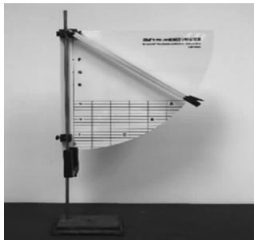
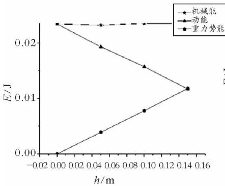
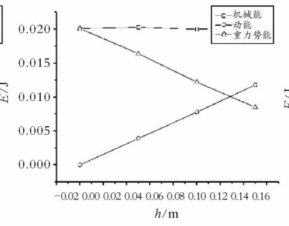
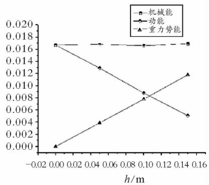

# DIS实验验证机械能守恒定律 采用通用软件进行创新与改进

陈蕾卉 刘爱云 涂 泓

（上海师范大学数理学院 上海 200234）

（收稿日期 ：2021 04 22）

摘 要 ：传统DIS验证机械能守恒定律的实验 往往采用专用软件给定初速度及表格 此种实验方式容易造成实验过于简单 且误差较大．对实验各步骤进行创新与改进 改用通用软件自行设计实验表格 改进实验步骤 并对两种实验方式的结果进行对比 ，具体阐述改进的原因及优势

关键词 ：DIS实验 机械能守恒定律 通用软件

## 1 引言

机械能守恒定律是运动学中的基本定律 同时也是中学物理课程学习的重点内容．它反映了在只有重力或弹力做功的物体系统内 物体系统的动能和势能之间可以发生相互转化 但机械能的总能量保持不变这一理论．在传统的验证机械能守恒定律的DIS实验中，通常采用专用软件进行测量 ，初速度为零是给定的默认实验条件 并不是实际测量出来的．在实际实验中 有可能由于初始释放的位置 人手释放的不确定性等因素 导致其实验结果与初速度为零的实验计算结果相差较大．并且 这种初速度及实验表格都提前为学生预备好的做法 并不能锻炼学生的物理科学思维 创造力及思辨能力．本文采用通用软件的测量方式来进行实验 让学生自行设计实验表格， 并改进了关于初速度的测量方式．因此 本文中的以通用软件来进行实验相较于传统的使用专用软件来说 更加准确和全面［1，2］

## 2 实验装置简介

实验器材：朗威DISLab数据采集器、计算机、朗威光电门传感器、摆锤、细线、铁架台、带刻度的高度板．

实验装置如图1所示．其中光电门传感器固定在带刻度的高度板上，接入数据采集器中，当摆锤经过光电门传感器时，光电门传感器会实时记录摆锤经过光电门传感器的时间，计算出此时摆锤的速度［3］．

  
图1 实验装置

## 3 实验原理

把一个摆锤由细线悬挂起来 并拉到一定高度当摆锤由静止开始释放时 如果忽略空气阻力 此时摆锤只受到绳子给的拉力和本身所受的重力．根据摆锤的运动状态及受力分析 绳子给摆锤的拉力不做功，此时系统中只有重力做功 ，动能和势能之间可以相互转化 符合机械能守恒定律的条件［4］

根据机械能的定义可知，无论势能和动能如何变化，两者之和都等于机械能．则将摆锤经过A，B，C，D 4点的动能值和势能值分别对应相加，如果得到的4个机械能值，在误差允许的范围以内基本一致，则可以证明机械能守恒定律成立．

## 4 实验过程及实验结果

（1） 进入朗威通用软件，设计表格如表1所示

表1 验证机械能守恒定律设计表格
<table><tr><td rowspan=1 colspan=1>摆锤位置</td><td rowspan=1 colspan=1> $t _ { 1 }$ </td><td rowspan=1 colspan=1> $s$ </td><td rowspan=1 colspan=1> ${ \boldsymbol { v } } = { \frac { s } { t _ { 1 } } }$ </td><td rowspan=1 colspan=1> $m$ </td><td rowspan=1 colspan=1> $E _ { \mathrm { k } } = { \frac { 1 } { 2 } } m v ^ { 2 }$ </td><td rowspan=1 colspan=1> $h$ </td><td rowspan=1 colspan=1> $E _ { \mathrm { p } } = 9 . 8 m h$ </td><td rowspan=1 colspan=1> $E = E _ { \mathrm { k } } + E _ { \mathrm { p } }$ </td><td rowspan=1 colspan=1>误差/%</td></tr><tr><td rowspan=1 colspan=1>A</td><td rowspan=1 colspan=1></td><td rowspan=1 colspan=1></td><td rowspan=1 colspan=1></td><td rowspan=1 colspan=1></td><td rowspan=1 colspan=1></td><td rowspan=1 colspan=1></td><td rowspan=1 colspan=1></td><td rowspan=1 colspan=1></td><td rowspan=1 colspan=1></td></tr><tr><td rowspan=1 colspan=1>B</td><td rowspan=1 colspan=1></td><td rowspan=1 colspan=1></td><td rowspan=1 colspan=1></td><td rowspan=1 colspan=1></td><td rowspan=1 colspan=1></td><td rowspan=1 colspan=1></td><td rowspan=1 colspan=1></td><td rowspan=1 colspan=1></td><td rowspan=1 colspan=1></td></tr><tr><td rowspan=1 colspan=1>C</td><td rowspan=1 colspan=1></td><td rowspan=1 colspan=1></td><td rowspan=1 colspan=1></td><td rowspan=1 colspan=1></td><td rowspan=1 colspan=1></td><td rowspan=1 colspan=1></td><td rowspan=1 colspan=1></td><td rowspan=1 colspan=1></td><td rowspan=1 colspan=1></td></tr><tr><td rowspan=1 colspan=1>D</td><td rowspan=1 colspan=1></td><td rowspan=1 colspan=1></td><td rowspan=1 colspan=1></td><td rowspan=1 colspan=1></td><td rowspan=1 colspan=1></td><td rowspan=1 colspan=1></td><td rowspan=1 colspan=1></td><td rowspan=1 colspan=1></td><td rowspan=1 colspan=1></td></tr></table>

（2） 测量摆锤直径 s 及其质量m ，以及高度板上P，Q，R点的高度（假定 D 点高度为零 D 点所在水平面为零势能面） 填写到表格中．

（3） 利用测平器精准完成实验装置定位 将摆锤释放装置固定到实验器上的 P 点 光电门的挡光孔固定在实验器的 A点上．

（4） 点击"开始" 在 P 点释放摆锤 摆锤通过光电门传感器的时间将被记录在表格中 通过公式计算出摆锤通过 A点的速度．

（5） 调整光电门位置分别到 B C D3点 重复上述实验步骤 测得摆锤在3点通过光电门传感器的时间 通过公式计算出摆锤通过 B C D3点的速度．

（6） 根据公式计算出 A，B，C，D 4点上的动能和重力势能，进而求出A，B，C，D这4点上各自的机械能值，得到结果如表2所示．

表2 以 P 点为初始释放点 验证机械能守恒定律的测量数据
<table><tr><td rowspan=1 colspan=1>摆锤位置</td><td rowspan=1 colspan=1> $t _ { 1 } / \mathrm { s }$ </td><td rowspan=1 colspan=1> $s / \mathrm { m }$ </td><td rowspan=1 colspan=1> $\begin{array} { r } { \boxed { v = \frac { s } { t _ { 1 } } / ( \mathrm { m } \cdot \mathrm { s } ^ { - 1 } ) } } \end{array}$ </td><td rowspan=1 colspan=1> $m / \mathrm { k g }$ </td><td rowspan=1 colspan=1> $E _ { \mathrm { k } } = \frac { 1 } { 2 } m v ^ { 2 } / \mathrm { J }$ </td><td rowspan=1 colspan=1> $h / \mathrm { m }$ </td><td rowspan=1 colspan=1> $E _ { \mathrm { p } } = 9 . 8 m h / \mathrm { J }$ </td><td rowspan=1 colspan=1> $\left| E = ( E _ { \mathrm { k } } + E _ { \mathrm { p } } ) / \mathrm { J } \right.$ </td><td rowspan=1 colspan=1>误差/%</td></tr><tr><td rowspan=1 colspan=1>A</td><td rowspan=1 colspan=1>0.0047</td><td rowspan=1 colspan=1>0.0080</td><td rowspan=1 colspan=1>1.7094</td><td rowspan=1 colspan=1>0.0080</td><td rowspan=1 colspan=1>0.0117</td><td rowspan=1 colspan=1>0.1500</td><td rowspan=1 colspan=1>0.0118</td><td rowspan=1 colspan=1>0.0235</td><td rowspan=1 colspan=1>3.5242</td></tr><tr><td rowspan=1 colspan=1>B</td><td rowspan=1 colspan=1>0.0040</td><td rowspan=1 colspan=1>0.0080</td><td rowspan=1 colspan=1>1.9812</td><td rowspan=1 colspan=1>0.0080</td><td rowspan=1 colspan=1>0.0157</td><td rowspan=1 colspan=1>0.1000</td><td rowspan=1 colspan=1>0.0078</td><td rowspan=1 colspan=1>0.0235</td><td rowspan=1 colspan=1>3.5242</td></tr><tr><td rowspan=1 colspan=1>C</td><td rowspan=1 colspan=1>0.0036</td><td rowspan=1 colspan=1>0.0080</td><td rowspan=1 colspan=1>2.1966</td><td rowspan=1 colspan=1>0.0080</td><td rowspan=1 colspan=1>0.0193</td><td rowspan=1 colspan=1>0.0500</td><td rowspan=1 colspan=1>0.0039</td><td rowspan=1 colspan=1>0.0232</td><td rowspan=1 colspan=1>2.2026</td></tr><tr><td rowspan=1 colspan=1>D</td><td rowspan=1 colspan=1>0.0033</td><td rowspan=1 colspan=1>0.0080</td><td rowspan=1 colspan=1>2.4169</td><td rowspan=1 colspan=1>0.0080</td><td rowspan=1 colspan=1>0.0234</td><td rowspan=1 colspan=1>0.0000</td><td rowspan=1 colspan=1>0.0000</td><td rowspan=1 colspan=1>0.0234</td><td rowspan=1 colspan=1>3.0837</td></tr></table>

（7） 再利用测平器 将摆锤释放装置分别固定在 Q和 R点 重复上述实验 得到结果如表3、4所示．

表3 以 Q点为初始释放点 验证机械能守恒定律的测量数据
<table><tr><td rowspan=1 colspan=1>摆锤位置</td><td rowspan=1 colspan=1> $t _ { 1 } / \mathrm { s }$ </td><td rowspan=1 colspan=1> $s / \mathrm { m }$ </td><td rowspan=1 colspan=1> $\begin{array} { r } { \boxed { v = \frac { s } { t _ { 1 } } / ( \mathrm { m } \cdot \mathrm { s } ^ { - 1 } ) } } \end{array}$ </td><td rowspan=1 colspan=1> $m / \mathrm { k g }$ </td><td rowspan=1 colspan=1> $E _ { \mathrm { k } } = \frac { 1 } { 2 } m v ^ { 2 } / \mathrm { J }$ </td><td rowspan=1 colspan=1> $h / \mathrm { m }$ </td><td rowspan=1 colspan=1> $E _ { \mathrm { p } } = 9 . 8 m h / \mathrm { J }$ </td><td rowspan=1 colspan=1> $E = ( E _ { \mathrm { k } } + E _ { \mathrm { p } } ) / \mathrm { J }$ </td><td rowspan=1 colspan=1>误差/%</td></tr><tr><td rowspan=1 colspan=1> $A$ </td><td rowspan=1 colspan=1>0.005474</td><td rowspan=1 colspan=1>0.0080</td><td rowspan=1 colspan=1>1.4615</td><td rowspan=1 colspan=1>0.0080</td><td rowspan=1 colspan=1>0.0085</td><td rowspan=1 colspan=1>0.1500</td><td rowspan=1 colspan=1>0.0118</td><td rowspan=1 colspan=1>0.0203</td><td rowspan=1 colspan=1>3.5714</td></tr><tr><td rowspan=1 colspan=1>B</td><td rowspan=1 colspan=1>0.004576</td><td rowspan=1 colspan=1>0.0080</td><td rowspan=1 colspan=1>1.7483</td><td rowspan=1 colspan=1>0.0080</td><td rowspan=1 colspan=1>0.0122</td><td rowspan=1 colspan=1>0.1000</td><td rowspan=1 colspan=1>0.0078</td><td rowspan=1 colspan=1>0.0200</td><td rowspan=1 colspan=1>2.0408</td></tr><tr><td rowspan=1 colspan=1>C</td><td rowspan=1 colspan=1>0.003950</td><td rowspan=1 colspan=1>0.0080</td><td rowspan=1 colspan=1>2.0253</td><td rowspan=1 colspan=1>0.0080</td><td rowspan=1 colspan=1>0.0164</td><td rowspan=1 colspan=1>0.0500</td><td rowspan=1 colspan=1>0.0039</td><td rowspan=1 colspan=1>0.0203</td><td rowspan=1 colspan=1>3.5714</td></tr><tr><td rowspan=1 colspan=1>D</td><td rowspan=1 colspan=1>0.003566</td><td rowspan=1 colspan=1>0.0080</td><td rowspan=1 colspan=1>2.2434</td><td rowspan=1 colspan=1>0.0080</td><td rowspan=1 colspan=1>0.0201</td><td rowspan=1 colspan=1>0.0000</td><td rowspan=1 colspan=1>0.0000</td><td rowspan=1 colspan=1>0.0201</td><td rowspan=1 colspan=1>2.5510</td></tr></table>

表4 以 R 点为初始释放点 验证机械能守恒定律的测量数据
<table><tr><td rowspan=1 colspan=1>摆锤位置</td><td rowspan=1 colspan=1> $t _ { 1 } / \mathrm { s }$ </td><td rowspan=1 colspan=1> $s / \mathrm { m }$ </td><td rowspan=1 colspan=1> $\begin{array} { r } { \boxed { v = \frac { s } { t _ { 1 } } / ( \mathrm { m } \cdot \mathrm { s } ^ { - 1 } ) } } \end{array}$ </td><td rowspan=1 colspan=1> $m / \mathrm { k g }$ </td><td rowspan=1 colspan=1> $E _ { \mathrm { k } } = \frac { 1 } { 2 } m v ^ { 2 } / \mathrm { J }$ </td><td rowspan=1 colspan=1> $h / \mathrm { m }$ </td><td rowspan=1 colspan=1> $E _ { \mathrm { p } } = 9 . 8 m h / \mathrm { J }$ </td><td rowspan=1 colspan=1> $E = ( E _ { \mathrm { k } } + E _ { \mathrm { p } } ) / \mathrm { J }$ </td><td rowspan=1 colspan=1>误差/%</td></tr><tr><td rowspan=1 colspan=1>A</td><td rowspan=1 colspan=1>0.007092</td><td rowspan=1 colspan=1>0.0080</td><td rowspan=1 colspan=1>1.1280</td><td rowspan=1 colspan=1>0.0080</td><td rowspan=1 colspan=1>0.0051</td><td rowspan=1 colspan=1>0.1500</td><td rowspan=1 colspan=1>0.0118</td><td rowspan=1 colspan=1>0.0169</td><td rowspan=1 colspan=1>3.0488</td></tr><tr><td rowspan=1 colspan=1>B</td><td rowspan=1 colspan=1>0.005394</td><td rowspan=1 colspan=1>0.0080</td><td rowspan=1 colspan=1>1.4831</td><td rowspan=1 colspan=1>0.0080</td><td rowspan=1 colspan=1>0.0088</td><td rowspan=1 colspan=1>0.1000</td><td rowspan=1 colspan=1>0.0078</td><td rowspan=1 colspan=1>0.0166</td><td rowspan=1 colspan=1>1.2195</td></tr><tr><td rowspan=1 colspan=1>C</td><td rowspan=1 colspan=1>0.004458</td><td rowspan=1 colspan=1>0.0080</td><td rowspan=1 colspan=1>1.7945</td><td rowspan=1 colspan=1>0.0080</td><td rowspan=1 colspan=1>0.0129</td><td rowspan=1 colspan=1>0.0500</td><td rowspan=1 colspan=1>0.0039</td><td rowspan=1 colspan=1>0.0168</td><td rowspan=1 colspan=1>2.4390</td></tr><tr><td rowspan=1 colspan=1>D</td><td rowspan=1 colspan=1>0.003920</td><td rowspan=1 colspan=1>0.0080</td><td rowspan=1 colspan=1>2.0408</td><td rowspan=1 colspan=1>0.0080</td><td rowspan=1 colspan=1>0.0167</td><td rowspan=1 colspan=1>0.0000</td><td rowspan=1 colspan=1>0.0000</td><td rowspan=1 colspan=1>0.0167</td><td rowspan=1 colspan=1>1.8293</td></tr></table>

（8） 将3组数据汇总，绘制成表格如表5所示．

表5 汇总 $P , Q , R$ 3点的测量数据
<table><tr><td rowspan=2 colspan=1>初始释放点摆锤高度h/m</td><td rowspan=1 colspan=3> $P$ </td><td rowspan=1 colspan=3> $Q$ </td><td rowspan=1 colspan=3>R</td></tr><tr><td rowspan=1 colspan=1>势能 $E _ { \mathrm { p } } / \mathrm { J }$ </td><td rowspan=1 colspan=1>动能 $E _ { \mathrm { k } } / \mathrm { J }$ </td><td rowspan=1 colspan=1>机械能 E/J</td><td rowspan=1 colspan=1>势能 $E _ { \mathrm { p } } / \mathrm { J }$ </td><td rowspan=1 colspan=1>动能 $E _ { \mathrm { k } } / \mathrm { J }$ </td><td rowspan=1 colspan=1>机械能 E/J</td><td rowspan=1 colspan=1>势能 $E _ { \mathrm { p } } / \mathrm { J }$ </td><td rowspan=1 colspan=1>动能Ek/J</td><td rowspan=1 colspan=1>机械能E/J</td></tr><tr><td rowspan=1 colspan=1>0.0000</td><td rowspan=1 colspan=1>0.0000</td><td rowspan=1 colspan=1>0.0234</td><td rowspan=1 colspan=1>0.0234</td><td rowspan=1 colspan=1>0.0000</td><td rowspan=1 colspan=1>0.0201</td><td rowspan=1 colspan=1>0.0201</td><td rowspan=1 colspan=1>0.0000</td><td rowspan=1 colspan=1>0.0167</td><td rowspan=1 colspan=1>0.0167</td></tr><tr><td rowspan=1 colspan=1>0.0500</td><td rowspan=1 colspan=1>0.0039</td><td rowspan=1 colspan=1>0.0193</td><td rowspan=1 colspan=1>0.0232</td><td rowspan=1 colspan=1>0.0039</td><td rowspan=1 colspan=1>0.0164</td><td rowspan=1 colspan=1>0.0203</td><td rowspan=1 colspan=1>0.0039</td><td rowspan=1 colspan=1>0.0129</td><td rowspan=1 colspan=1>0.0168</td></tr><tr><td rowspan=1 colspan=1>0.1000</td><td rowspan=1 colspan=1>0.0078</td><td rowspan=1 colspan=1>0.0157</td><td rowspan=1 colspan=1>0.0235</td><td rowspan=1 colspan=1>0.0078</td><td rowspan=1 colspan=1>0.0122</td><td rowspan=1 colspan=1>0.0200</td><td rowspan=1 colspan=1>0.0078</td><td rowspan=1 colspan=1>0.0088</td><td rowspan=1 colspan=1>0.0166</td></tr><tr><td rowspan=1 colspan=1>0.1500</td><td rowspan=1 colspan=1>0.0118</td><td rowspan=1 colspan=1>0.0117</td><td rowspan=1 colspan=1>0.0235</td><td rowspan=1 colspan=1>0.0118</td><td rowspan=1 colspan=1>0.0085</td><td rowspan=1 colspan=1>0.0203</td><td rowspan=1 colspan=1>0.0118</td><td rowspan=1 colspan=1>0.0051</td><td rowspan=1 colspan=1>0.0169</td></tr></table>

（9） 将表5的数据进行对比，绘制成折线统计图，如图2所示．

  
(a)P点

  
(b)Q点

  
(c)R点

图2 P，Q，R3点的能值变化

## 5 专用软件的实验步骤

（1） 测量实验摆锤的直径 s 及其质量 m ，记录数据．

（2） 利用摆锤释放装置在 A 点静止释放摆锤，分别将光电门传感器固定在测量点 D，C，B，测量 D，C，B 3点上摆锤通过光电门传感器的速度．

（3） 通过"数据计算"功能，得到摆锤在A，B，C，D点的动能、势能和机械能值，如图3所示．

用DIS研究机械能守恒定律
<table><tr><td rowspan=1 colspan=1>次数</td><td rowspan=1 colspan=1>D</td><td rowspan=1 colspan=1>C</td><td rowspan=1 colspan=1>B</td><td rowspan=1 colspan=1>A</td></tr><tr><td rowspan=2 colspan=1>高度 h/m</td><td rowspan=2 colspan=1>0</td><td rowspan=1 colspan=1>0.050</td><td rowspan=1 colspan=1>0.100</td><td rowspan=1 colspan=1>0.150</td></tr><tr><td rowspan=1 colspan=1>1.450</td><td rowspan=1 colspan=1>1.057</td><td rowspan=1 colspan=1>0</td></tr><tr><td rowspan=1 colspan=1>速度 v / (m·s⁻¹)</td><td rowspan=1 colspan=1>1.748</td><td rowspan=1 colspan=1>1.450</td><td rowspan=1 colspan=1>1.057</td><td rowspan=1 colspan=1>0</td></tr><!-- PDF该表"高度/速度"行单元格在版面上错位（高度行:0/0.050/0.100/0.150；速度行:1.748/1.450/1.057/0），结构已按D→A列序还原 --><tr><td rowspan=1 colspan=1>势能 Ep/J</td><td rowspan=1 colspan=1>0</td><td rowspan=1 colspan=1>0.0039</td><td rowspan=1 colspan=1>0.0078</td><td rowspan=1 colspan=1>0.0118</td></tr><tr><td rowspan=1 colspan=1>动能 Ek/J</td><td rowspan=1 colspan=1>0.0122</td><td rowspan=1 colspan=1>0.0084</td><td rowspan=1 colspan=1>0.0045</td><td rowspan=1 colspan=1>0</td></tr><tr><td rowspan=1 colspan=1>机械能 E/J</td><td rowspan=1 colspan=1>0.0122</td><td rowspan=1 colspan=1>0.0123</td><td rowspan=1 colspan=1>0.0123</td><td rowspan=1 colspan=1>0.0118</td></tr></table>

图3 专用软件验证机械能守恒定律的测量数据

## 6 专用软件与通用软件的对比 改进原因及优势

## 6．1 两种实验结果分析

由上述实验表格可知， 利用通用软件进行实验测量，其实验数据汇总图像较为平稳 ，各实验数据结果均在朗威实验仪器的误差允许范围以内 ， 结果较为准确

从数据可以看出 利用专用软件进行测量 采用初速度为零的实验条件 则其他实验结果很容易与给定初速度的实验计算结果出现偏差 造成误差过大的情况

## 6．2 专用软件与通用软件的实验步骤对比

专用软件采用的实验方式是将 A 点作为起始点 并将A点速度为零作为默认的已知条件 直接填写在表格中．之后分别将光电门传感器放在 B C D3点 测量出摆锤在 B C D3点的瞬时速度 以此计算出摆锤在 A B C D4点的动能 势能 机械能之间的关系，从而验证机械能守恒定律

本文中所采用的使用通用软件设计实验表格的测量方法，与原始实验方式的不同点在于 ：将初始点分别改变为垂直高度高于 A点的P Q R3点 且分别在此3点处释放 使得摆锤在 A 点的瞬时速度是可被测量的．之后， 再分别测量出摆锤在 A，B，C，D4点的速度 以此计算4点动能 势能 机械能之间的关系

## 6．3 改进原因及优势

综上所述 两种实验方式主要的不同点在于 测量软件的选择 初始位置点的选择以及实验表格的使用上

在通用软件中 如果仍然照搬专用软件的实验步骤 将光电门传感器固定在A点 将摆锤由A点静止释放 则需要光电门传感器测量出摆锤在 A 点速度为零的实验结果 此点的数据才有意义．但是由于光电门传感器的工作原理 速度为零的物体实际上并不能引起光电门传感器进行工作．如果想引起光电门传感器工作 则必须存在摆锤经过光电门的时间 通过计算摆锤的宽度与摆锤经过光电门的时间得出摆锤经过此点的速度值 而此速度值并不符合实验假定的初速度为零这一条件 也同样不能作为点速度的计算用值．所以，摆锤在A点速度为零这一数值是不能被测量出来的

根据通用软件的工作原理 使得测量时并不能直接设定初始速度值为零．而舍弃测量摆锤在 A 点的瞬时速度会使得实验数据较少 ， 并不符合物理实验的严谨性．因此 在选择通用软件进行试验时 我们要进行实验改进 重新选择实验初始点的位置 挑选高于 A点的位置作为释放点 ，并且挑选 P，Q，R3点进行多次实验 保证了实验的准确性和严谨性

同时 指导学生采用通用软件进行测量 并要求学生自行设计实验表格的做法 符合物理的学科特点．标准的实验过程应该是 在实验前 指导学生选择合适的实验器材 设计实验方案 在实验过程中学生对实验现象进行观察和记录 对数据进行测量和读数；实验结束后 学生自主对数据进行处理和分析，并进行反思与评估

实验过程是一种培养学生综合能力的过程 是对学生进行创新意识和能力培养的有效途径．实验并不是一帆风顺 有可能出现各种问题和情况 它要求教师不仅要讲授学科基础知识 还要培养学生严谨的科学态度和完备的科学思维．因此，单纯采用实验过程简单 实验操作单一 实验表格直接给定的专用软件来进行物理教学 并不能达到物理实验的学科要求

本文采用的实验方式可以省略需测量A点速度为零的实验步骤 使得在实验中每一个观察点的测量值都是可以被真实地测量到的 ， 保证了实验结果的严谨性和准确性［5］

## 7 结束语

通过以上实验结果可知 运用的通用软件实验方法可以成功验证机械能守恒定律 其实验过程力求减少实验误差 实验结果真实可靠 均在物理实验所要求的实验误差范围以内．将传统的专用软件实验方法和通用软件实验方法进行比较分析 可以说明本文运用实验方法的严谨性和全面性 ， 使实验结果更具有说服力［6］．对于相同的实验目的 ，实验方法往往有几种 而从中选出最优实验方法 是实验教学的重要内容

## 参 考 文 献

1 陈鹏．对验证机械能守恒定律实验的思考［J］．教师通讯，2018（14）：164

2 马丽娜，倪敏，韩唯伟，等．DIS验证恒力做功的动能定理及其改进［J］．中学物理教学参考，2015（10）：95～96

3 徐小林，倪敏，韩唯伟，等．浅谈运用DIS结合针筒法验证阿基米德原理的优点［J］．中学物理教学参考，2016（8）：90～91

4 郑康，陆建隆．验证机械能守恒定律的实验改进［J］．物理通报，2016，35（6）：68～69

5 冯杰．中学物理课程与教学论［M］．北京：北京大学出版社，2011．99～119

6 倪敏，陈舟．重力加速度3种DIS实验设计方法比较研究［J］．物理教师，2019（3）：60～63，66