> 来源：MinerU 转换（stem-exact rebuild 2026-08-08）

文章编号:1005-4642(2025)02-0039-07

# 人工智能在大学物理实验教学中的应用——以激光测水深实验为例

  
AI+物理

刘升光1,李宏升1,刘雅新1,于 杰2(1.青岛理工大学 理学院,山东 青岛 266520;2.大连理工大学 物理学院,辽宁 大连 116024)

摘 要:激光测水深实验中,传统方法处理实验数据时难以充分考虑水面波动、悬浮颗粒、光照变化和噪声等复杂的环境因素,实验结果误差较大.利用人工智能深度学习方法,建立卷积神经网络模型处理水底回波信号,从大量数据中提取有用信息、消除噪声并优化测量结果,从而显著提高水深测量的精度.

关键词:人工智能;深度学习;卷积神经网络;脉冲激光;回波波形

中图分类号:O4-39;O435.1

文献标识码:A

DOI:10.19655/j.cnki.1005-4642.2025.02.006

人工智能(Artificialintelligence,AI)技术的飞速发展给教育领域带来了前所未有的机遇与挑战[1-2].在 AI时代,如何将 AI技术与大学物理实验教学有效结合,培养适应未来社会发展的创新人才,已经成为所有物理实验教育工作者面临的关键问题.在 AI背景下,数据的产生以前所未有的速度增长,成为推动 AI技术发展的重要基石和驱动力,而对于需要采集大量数据的实验项目,传统方法在数据处理速度和精度上面临诸多挑战,尤其在需要对大规模数据进行实时处理时,传统分析手段显得力不从心,为了解决这些难题,深度学习应运而生.深度学习通过构建深度神经网络,利用层次化的特征提取方式,能够有效处理复杂的非线性关系,从而在图像识别、自然语言处理等复杂任务中取得显著成果.深度学习的出现不仅为人工智能的发展提供了新的思路和方法,也为解决实际应用中的复杂问题开辟了新的道路,使得人工智能技术在更多领域得到了广泛应用.

激光测水深实验是进行水下目标探测和水下地形测量的探索研究性实验,它利用激光器发射大功率、窄脉冲激光束来探测水底深度和水下目标,通过确定激光在水面和水底的回波时间差来反演水深.水深、水质、水底反射率和系统噪声等环境因素都会影响激光的回波波形,从而使得波形的形状呈多样复杂性,因此准确提取水面和水底的回波信号是一项具有挑战性的课题[3-6].

本文将 AI深度学习方法与激光测水深实验相结合,通过对大量激光回波波形的机器学习,快速高效地利用激光回波数据演算出水深信息,解决了传统实验教学中数据测量和分析的瓶颈问题,可有效培养学生利用 AI解决实际问题的能力,为大学物理实验教学适应时代发展需求提供新的思路.

## 1 激光测水深的实验原理

根据不同波长的激光在水中的传输特性,选用532nm 的脉冲激光器作为光源,其在水中的穿透性强且方向性好[7].激光测水深的原理示意图如图1所示.当激光以一定的角度入射到水面时,假设水的折射率恒定,利用光电探测器测出激光从水面返回的时刻 $t _ { 1 }$ 和从水底返回的时刻 $t _ { 2 }$ ,根据光在水中的往返时间,可以计算出水的深度为

$$
h { = } \frac { c } { { 2 n } } ( t _ { 2 } { - } t _ { 1 } ) \cos \theta ,\tag{1}
$$

其中,c 为真空中的光速,n 为水的折射率,θ 为光在水中的折射角.

由式(1)可知,计算水的深度需要精确测量脉冲激光束在水中的往返时间.图 2 给出了探测器接收到的回波信号强度随时间的演化规律,从图 2 可以看出,激光回波波形主要由水面回波、水体散射和水底回波 3 部分组成.第 1 个波峰是脉冲激光束在水面的回波波形,其强度与激光的功率、入射角和水面的起伏程度有关;当脉冲激光束进入水中时,将发生散射,一部分散射光返回水面进入探测器,形成水体散射波形,水体散射波与水面回波和水底回波相互叠加,延展回波信号的时间宽度,使其偏离高斯形状;水底信号是探测器接收到的最后有效信号,其强度与水深、底质及水质等因素有关.在实验中,根据探测器接收到的波形,解析水面回波峰值和水底回波峰值对应的时间,得到水深值.

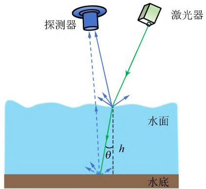  
图1 激光测水深原理示意图

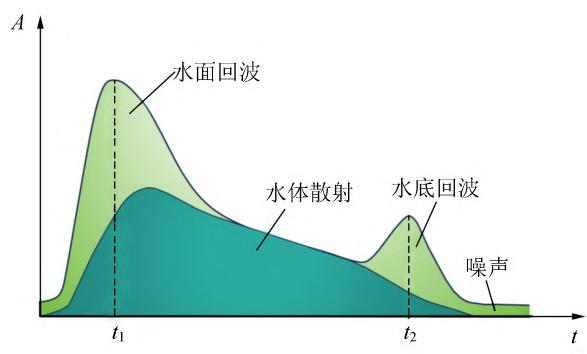  
图2 水体回波示意图

## 2 激光测水深的实验装置

激光测水深实验装置如图3所示,装置主体悬挂在高精度三维云台上,可以实现空间的三维运动.测深实验系统主要包括激光发射、光电探测和高速数据采集 3 个核心模块.激光开启后,光束依次进入水面、水体和水底,回波信号经过光电探测模块放大后由数据采集器传输到计算机进行存储.

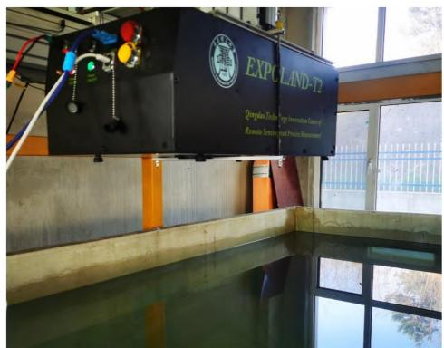  
图3 激光测水深实验装置

激光的脉冲能量、脉冲宽度以及脉冲频率是影响测量结果的重要参量.脉冲能量影响光束在水中的传输距离,脉冲宽度和脉冲频率直接影响测量的精度和速度.实验中采用二极管泵浦 WEDGE HF 532 nm 固态激光器,激光器最大输出功率为 1.5 W,脉冲宽度为 0.7~2.0ns,脉冲频率为 10~100kHz.光电探测模块采用日本滨松的 H13661 光电倍增管,其光谱响应范围为 300~650nm,最大响应频率为 1.16GHz.为避免水底回波信号太弱(探测器无法直接探测),实验采用放大器放大光电倍增管的脉冲信号,放大器的频率带宽为 50kHz~1.5GHz,上升沿时间为 0.23ns.数据采集器采用 PicoScope6404D 虚拟示波器,最大采样率为 $5 \times 1 0 ^ { 9 } \ \mathrm { ~ s ~ } ^ { - 1 }$ ,带宽为 500 MHz,存储深度为 $2 \mathrm { \ G p t s } .$ ,通过自主开发程序,可以对激光回波波形进行连续存储.

## 3 深度学习方法

AI涵盖了很多不同的技术和方法,目标是让机器具备智能行为.而深度学习是实现 AI 的方法之一,是机器学习的子领域,它使用多层神经网络模型来学习数据的复杂特征,适用于处理大规模数据和解决复杂任务,已成为许多场景的主流方法.深度学习中的神经网络模型很多,主要有前馈神经网络、卷积神经网络、循环神经网络和生成对抗神经网络等多种网络模型.图 4 是典型的人工神经网络架构,网络包含输入层、隐藏层和输出层.每层可以设置多个神经元,隐藏层可以根据具体的任务要求进行设置.人工神经网络的每层神经元都与下层的神经元连接,虽然这种设计通用性强,但参量规模大,难以处理高维数据[8].

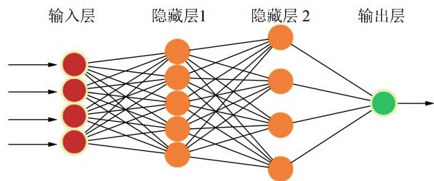  
图4 人工神经网络架构

卷积神经网络在人工神经网络的基础上,引入卷积层和池化层,如图5所示,输入层为原始激光回波信号,卷积层对其进行卷积运算,因为回波数据为离散的数据点,输出特征 y[t]可表示为

$$
y [ t ] = ( x \ast w ) [ t ] = \sum _ { k = 0 } ^ { n - 1 } x [ t + k ] \bullet w [ k ] ,\tag{2}
$$

其中 x[t]是激光回波信号,t 是采样时间间隔,w[k]为卷积核,n 为卷积核长度,* 表示卷积运算.卷积核相当于探测器,通过卷积运算对回波信号进行扫描,提取信号的局部特征,从而减少参数数量,降低计算成本.回波信号的强度随时间变化是非线性的,为使神经网络可以拟合复杂的函数,引入激活函数进行非线性映射,实验数据处理采用线性整流激活函数(Rectified Linear Unit,ReLU),其表达式为

$$
f ( x ) = \mathrm { { m a x } ( 0 , \ x ) , }\tag{3}
$$

激活函数可以控制信号的传递,当信号值小于 0 时,输出为 0,相当于屏蔽了负值信号,只保留正值信号.通过激活函数,神经网络可在不同输入下产生更显著的差异化输出.例如,同一卷积核处理 2 个相似的回波信号时,激活函数可以放大它们之间的微小差异,从而提高深度反演的精度.

池化层对卷积层的输出特征进行压缩实现降维,同时保留特征信息,可防止过拟合,进一步减少后续层的计算量,实验中采用最大池化操作,在窗口大小为 m 的范围内取最大值,其表达式为<!-- 存疑：原 OCR 把公式 (4) 拆成行内 $...$ + 单独成行的 (4)，且公式末尾 `[$` 应为 `)`；此处归一化为独立公式块，末尾方括号按 PDF 原文 y[t]=max(x[t],x[t+1],…,x[t+m-1]) 改为右括号 -->

$$
y [ t ] { = } \operatorname* { m a x } ( x [ t ] , x [ t { + } 1 ] , \cdots , x [ t { + } m { - } 1 ] ) \tag{4}
$$

最大池化可以增强局部信号的特征,例如可以捕捉到激光回波信号中的异常波峰信号.原始激光回波信号经过卷积层和池化层运算后进入全连接层,如图5所示,全连接层将池化后的特征整合起来,通过加权组合和非线性变换,映射出最终的水深值.

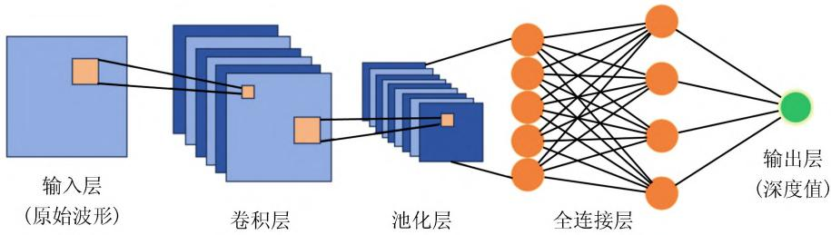  
图5 卷积神经网络

## 4 实验结果与分析

实验中的激光输出功率设置为 0.3 W,频率设置为 10kHz,激光器入射光束与水面法线的角度为 5°,采集系统的采样率设置为 $5 \times 1 0 ^ { 9 }$.图6给出了不同水深下的激光回波波形,为了便于分析,以水面回波信号作为基准,分别向前截取 20ns、向后截取 60ns 的有效数据作为样本.从图6中可以看出,水面回波的强度要明显大于水底回波强度,这是由于光在水中传播时被水体吸收散射,导致水底回波信号被明显削弱.随着水深增加,水底回波信号被削弱得越明显,由于水面激光回波的偏振特性要明显高于水底激光回波,因此在实际应用中进行更深的水体测量时,可在探测器前端安装偏振片抑制水面回波信号,从而避免激光功率增大时,水底回波信号被湮没.从图6中还可看出,随着水深的增加,水底回波信号峰值对应的时间逐渐增加,如果从激光回波波形反演出水深,需要精确测量水面回波和水底回波的峰值所对应的时间,然后根据式(1)计算出水深.

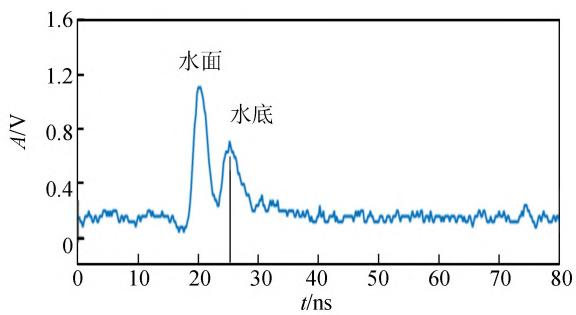

(a)水深0.6m  
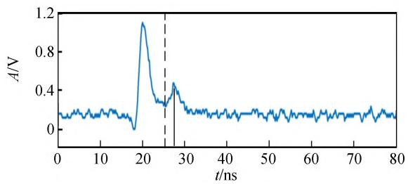

(b)水深0.8m  
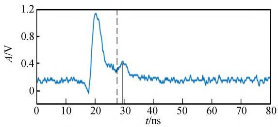  
(c)水深1.0m  
图6 不同水深下的激光回波波形

由于激光在传播和反射过程中受到大气、水面、水体和水底等多种因素的影响,回波波形往往比较复杂,无法直接从回波波形中提取准确的峰值.实验中的激光脉冲频率为 $1 0 ~ \mathrm { k H z }$ ,即系统每秒采集 $1 \times 1 0 ^ { 4 }$ 个激光回波波形,图7中给出了水深为 0.8m 时随机选取的 4 个波形,即使是同样的水深,在不同时刻采集的波形也有很大的差别,图 $7 ( \mathrm { a } )$ 中的水底回波波形没有出现尖锐的峰值,而图 $7 ( \mathrm { b } )$ 中的水底回波波形则出现了多个尖锐的峰值,图 $7 ( \mathrm { c } )$ 和图 $7 ( \mathrm { d } )$ 的水底回波波形中尽管出现了尖锐的峰值,但是波形不对称,无法确定其实际的峰值.因此,如何从多样复杂的波形中分离并精确提取水面和水底的回波峰值,是极具挑战性的工作.目前,已有的回波波形分析方法有波形分解法[9]、去卷积法[10]、回波探测法[11]以及多物理场方法[3],这些方法通过对波形进行复杂的数学物理运算,从而得出水面和水底回波信号的位置.但是由于波形的复杂性,这些分析方法很难适用于所有波形.另外,由于数学物理运算的波形分析方法运算时间长,无法实现端对端的数据处理,因此限制了激光测水深技术在大面积水域测量时的应用.

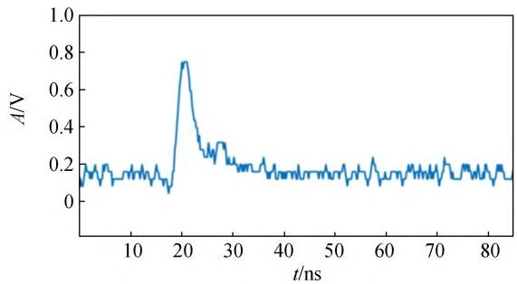

(a)  
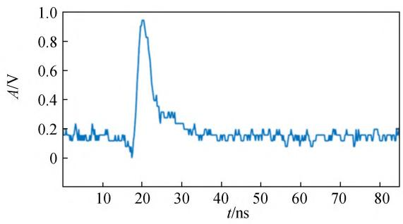  
(b)

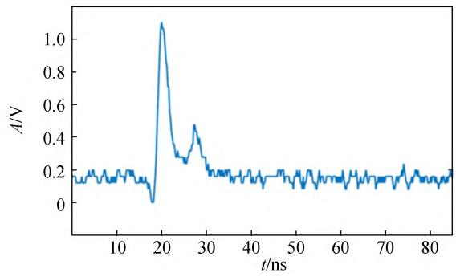

(c)  
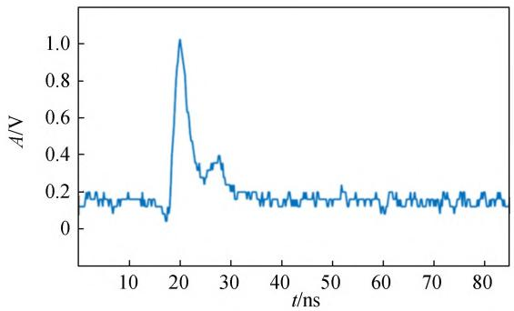  
(d)  
图7 水深为 0.8m 时随机选取的激光回波波形

实验激光脉冲频率为 10kHz,因此采集系统每秒可以采集上万个激光回波波形,随着采集时间的增加,将会生成大量的实验数据,这为深度学习提供了大量的数据样本.实验采用 Google 公司研发的 TensorFlow 深度学习框架,建立一维卷积神经网络来进行水深值的反演.网络共分为 8 层:第 1 层为输入层,包含 800 个神经元;第 2 层和第 3 层为卷积层,每层均包含了 8 个去噪器;第 4 层为最大池化层;第 5 层和第 6 层是卷积层,每层均包含了 16 个去噪器;第 7 层是最大池化层;第 8 层为全连接层,最后利用 1 个神经元输出深度值.为了评估卷积神经网络模型对水深值的预测效果,采用均方误差 $\delta _ { \mathrm { M S E } }$ 作为损失函数评定模型的优劣,其表达式为

$$
\delta _ { \mathrm { M S E } } = \frac { 1 } { n } \sum _ { i = 1 } ^ { n } ( y _ { i } - \hat { y } _ { i } ) ^ { 2 } \ ,\tag{5}
$$

式中,n 为样本数,$y _ { i }$ 为实际深度,$\hat { y } _ { i }$ 为模型预测深度<!-- 存疑：原 OCR 为 $\boldsymbol { \cdot } \boldsymbol { y } _ { i }$ 和 $\hat { \mathbf { \nabla } } _ { \hat { \mathbf { y } } _ { i } }$,按 PDF 原文 yi / ^yi 修复 -->. $\delta _ { \mathrm { M S E } }$ 可以反映模型预测值和实际值之间的偏差,偏差越小则预测精度越高.图8所示为随着迭代轮次 $n$ 的增加,模型预测值和实际值之间的损失值 $\delta _ { \mathrm { M S E } }$ ,为了防止训练过度,设置 $n { = } 1 0 0$ .从图8可以看出,训练损失值和验证损失值随着迭代轮次的增加逐渐减小,并在 30 个迭代轮次以后,基本趋于收敛,这表明卷积神经网络模型在训练数据和验证数据上均表现良好.

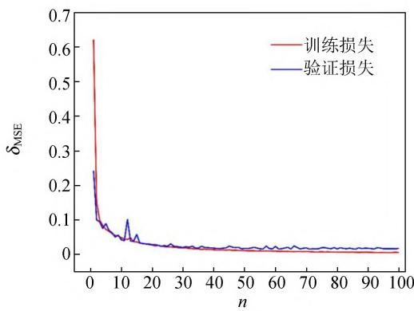  
图8 不同迭代轮次下的训练损失和验证损失

为了检验卷积神经网络模型反演回波波形的能力,图9给出了利用训练好的模型反演不同水深值的结果.从图9可以看出:预测的水深平均值和实际水深值比较接近,说明训练好的模型可以有效提取回波信号中的深度值.当水深比较浅(如水深为 0.2m 和 0.3 m)时,预测值的散点分布相对分散,出现误差较大的数据点,随着水深的增加,预测值的散点分布相对集中,其原因和脉冲激光器的脉宽有关,实验中所用激光器的脉宽为 0.7~2.0ns,光在水中的传播速度约为 2.26×$1 0 ^ { 8 } \ \mathrm { m / s }$ ,因此脉冲激光测量水深的最小精度为 15.8~45.2cm,当水的深度低于激光在水中测量的最小精度时,会导致水面回波和水底回波信号重叠,回波信号特征不明显,模型难以学习到真实模式,从而使预测值散点分布相对分散,预测误差较大.为了直观观察预测值的散点分布情况,图10中给出了水深为 0.2 m 时的预测值散点密度分布图.从图10可以看出:散点主要集中在 0.2m 附近,偏离实际水深越远,散点密度分布越小,散点密度分布呈高斯分布.因此,在反演水深数据时,为了获得更准确的反演结果,应增加采集数据的数量,以实现统计平均效应.

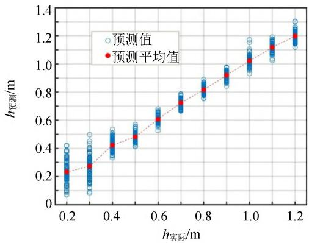  
图9 不同深度下的预测水深值

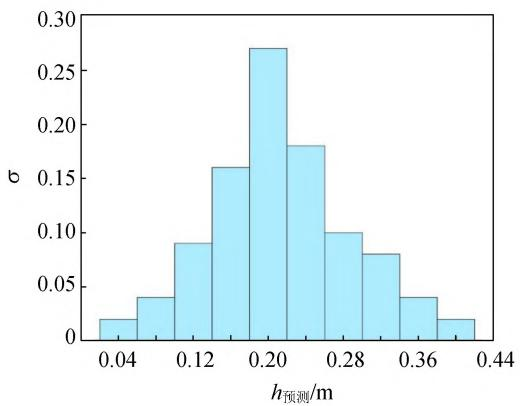  
图10 实际水深为 0.2m 时的预测水深值散点密度分布

卷积神经网络模型预测水深值和实际值造成偏差的原因与原始回波信号质量、训练样本数量和系统噪声等因素有关,在原始回波数据质量比较高时,水面回波和水底回波比较明显,具有更清晰的特征和类别分界,能够提供明确的训练信号,有助于卷积神经网络模型学习提升分类或回归任务的性能;卷积神经网络模型每一层会引入大量的权重和偏置参量,如果样本数量不足,网络可能无法学到泛化能力强的特征,也会造成预测值出现偏差[12-13];系统噪声较小时,卷积神经网络模型专注于学习有效的特征,而不会被噪声数据误导,可以减小预测误差.由此可见,实验中可通过进一步优化改进实验设备,获取高质量的数据,减小外界干扰信号,进而提升深度学习的效果;同时,优化深度学习模型,增加样本数量,在一定程度上可以弥补仪器设备性能带来的测量偏差.在实际应用中,将两者结合,可以有效提升数据的处理速度和精度.

## 5 结束语

激光测水深实验中的回波波形与水面波动、水质、水底反射率、激光特性和信号噪声等环境因素和设备因素有关,因此回波波形呈现出多样性和复杂性的特点,这导致很难通过物理分析的方法从回波波形中准确快速地提取出深度数据.水深与环境因素和设备因素之间存在复杂的非线性关系,通过引入 AI深度学习,建立多层神经网络结构,可以捕捉到这些复杂的映射,从大规模数据中学习特征,尤其是水面受到波动、设备受到干扰时,深度学习模型能够在训练过程中有效去除数据中的噪声,提升预测精度.AI是快速发展的领域,涉及到不断更新的理论、算法和应用,通过激光测水深实验,在大学物理实验教学中引入深度学习方法,能够提升学生的创新思维、科研能力和团队合作能力,有助于培养学生成为适应未来社会发展的创新人才.

## 参考文献:

[1] 黎明,徐政,葛力铭,等.“人工智能+”赋能高等教育:理论逻辑、现实困境与实践路径[J].科学管理研究,2024,42(5):57-65.

[2] 谷飞.认知增强 AI与教育共生:未来教育新生态[J].开放教育研究,2024,30(6):13-20.

[3] 滕晓杰,岳军,李宏升,等.一种机载激光测深回波信号的处理方法[J].海洋测绘,2019,39(6):29-33.

[4] SZAFARCZYK A, TOS C. The use of green laser in LiDAR bathymetry: State of the art and recent advancements[J].Sensors,2023,23(1):292.

[5] MADER D, RICHTER K, WESTFELD P, et al. Potential of a non-linear full-waveform stacking technique in airborne LiDAR bathymetry [J]. PFG-Journal of Photogrammetry, Remote Sensing and Geoinformation Science,2021,89:139-158.

[6] YANG F, QI C, SU D, et al. An airborne LiDAR bathymetric waveform decomposition method in very shallow water: A case study around Yuanzhi Island in the South China Sea[J]. International Journal of Applied Earth Observation and Geoinformation,2022,109:102788.

[7] 王鑫,潘华志,罗胜,等.机载激光雷达测深技术研究与进展[J].海洋测绘,2019,39(5):78-82.

[8] ABDOLRASOL M G M, HUSSAIN S M S, USTUN T S, et al. Artificial neural networks based optimization techniques: A review [J]. Electronics,2021,10(21):2689.

[9] 张鑫磊,邢帅,王丹菂,等.一种机载激光雷达海洋测深波形数据处理算法[J].海洋测绘,2018,38(1):35-38.

[10] WAGNER W, ULLRICH A, DUCIC V, et al. Gaussian decomposition and calibration of a novel small-footprintfull-waveform digitisingairborne laser scanner [J]. ISPRS Journal of PhotogrammetryandRemoteSensing,2006,60(2):100-112.

[11] WANG C, LI Q, LIU Y, et al. A comparison of waveform processing algorithms for single-wavelength LiDAR bathymetry [J]. ISPRS Journal of Photogrammetry and Remote Sensing,2015,101: 22-35.

[12] RADIUK P M. Impact of training set batch size on the performance of convolutional neural networks for diverse datasets[J]. Information Technology and Management Science, 2017,20(1):20-24.

[13] ALZUBAIDI L, ZHANG J, HUMAIDI AJ, et al. Review of deep learning: Concepts, CNN architectures, challenges, applications, future directions [J]. Journal of Big Data, 2021,8:1-74.

# Application of artificial intelligence in university physics experiment teaching

—— Taking LiDAR bathymetry experiment as an example

LIUShengguang1,LIHongsheng1,LIUYaxin1,YUJie2 (1.SchoolofScience,QingdaoUniversityofTechnology,Qingdao266520,China;2.SchoolofPhysics,DalianUniversityofTechnology,Dalian116024,China)

Abstract:InLiDARbathymetryexperiments,traditionalmethodsoftenstruggledtoaccountfullyforcomplexenvironmentalfactors,suchaswatersurfacefluctuations,suspendedparticles,changesinillumination,andsensornoise,leadingtosignificantmeasurementerrors.Byapplyingartificialintelligence deep learning techniques, a convolutional neural network model was developed to process underwater echo signals. This enabled efficient extraction of valuable information from large datasets, noisesuppression,andoptimizationofmeasurementoutcomes.Theproposedapproachsignificantly enhanced the accuracy and reliability of water depth measurements.

Keywords:artificialintelligence;deeplearning;convolutionalneuralnetwork;pulsedlaser;echo waveform

[编辑:郭 伟]

(上接38页)

# Fabrication and application of single spherical mirror coaxial reflection schlieren instrument

ZHAO Hejia, DUAN Xuesong, KONG Xiangxing, WU Jianhai (CollegeofScience,HebeiUniversityofTechnology,Tianjin300130,China)

Abstract: The schlieren apparatus converts the flow processes that are invisible to the naked eye into observable schlieren images. The single spherical mirror coaxial reflection schlieren apparatus was designedandfabricatedaccordingtotheprinciplesofschlierenimaging. Thisapparatuswasusedto observe phenomena such as ultrasonic standing waves and Mach rings. For the observation of liquid flowfield,acolorschlierenknife-edgewasdeveloped,andheatconvectionduringthewater-heating process was successfully visualized.

Keywords:schlierenapparatus;ultrasonicstandingwave;Machring;liquidflowfield

[编辑:郭 伟]