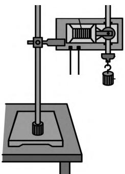
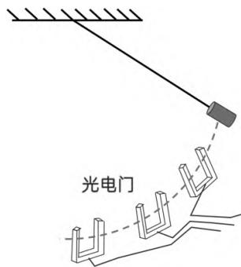
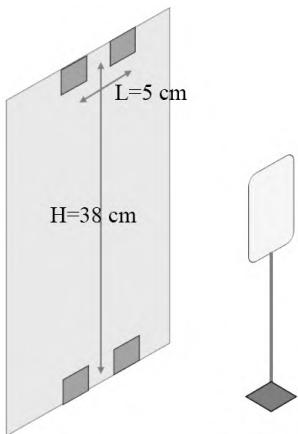
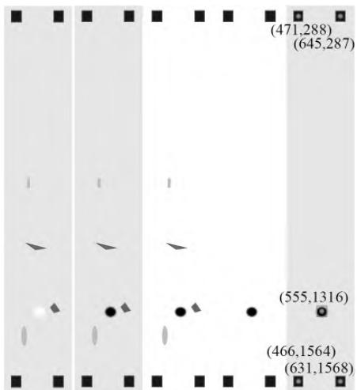
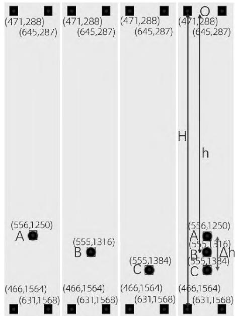

# 人工智能融合下的物理实验教学以应用人工智能技术验证机械能守恒定律为例

王贤灿 刘 平 邹书生 闫 娜

摘 要：研究创新性地将人工智能技术应用于物理实验、编写程序、调用人工智能技术计算物体的位置和速度等，从而快速、准确地验证机械能守恒定律；所涉及的改进实验既可用于向学生演示和验证物理学科的机械能守恒定律，也可用于开展高中信息技术学科的人工智能课程项目。

关键词：信息技术；机械能；速度；人工智能；慢动作

中图分类号：G633.7 文献标识码：A 文章编号：1672-1438(2025)10-0070-04

DOI:10.13492/j.cnki.cmee.2025.10.003

机械能守恒定律是物理学中非常基础和重要的规律之一，用于描述物体能量转换规律。为了更好地让学生理解该定律，人教版《高中物理(必修2)》第8章第5节特引入了验证机械能守恒定律的实验。实验旨在让学生观察、记录、分析数据，培养学生的实验技能和科学素养，通过实验来理解和掌握该定律。

人工智能是研究、开发、模拟、延伸人类智能的理论、方法、技术的一门技术科学，如今，人工智能技术已逐步引入教育教学。《普通高中信息技术课程标准(2017年版2020年修订)》明确要求将人工智能相关知识列入高中信息技术课程；人教版、苏教版通用技术教材也用了大量章节讲述人工智能技术的应用。人工智能技术应用于高中物理教学中，能更好地展现物理知识，让学生更直观、迅速地感受物理实验过程，丰富物理教学内容，用程序、动画等模拟物理实验中的某些情境，还便于学生与教师交流，让学生交互参与教学活动，促进学生的学习兴趣。

本研究结合人工智能技术在处理视频、图像等方面的优越功能，使用手机拍摄物体的自由落体运动，利用人工智能软件分析视频，自动求解下落的高度、速度等相关物理量，从而快速、准确地验证机械能守恒定律。

## 一、验证机械能守恒定律的常规方法

机械能守恒定律强调：物体在不受外力或所受外力合力为0的情况下，总的机械能不变[1]。进行实验验证时，通常通过物体下落时重力势能的减少量 $\Delta E_p=Mgh$ 等于动能的增加量 $\Delta E_k=\frac{1}{2}Mv_B^2$ 来验证。要验证 $Mgh=\frac{1}{2}Mv_B^2$，就需要精确测量物体下落高度 $h$ 和速度 $v$。中学阶段测量这两个物理量主要借助刻度尺和打点计时器或光电门来进行，一般该实验主要验证自由落体运动和单摆运动过程中的机械能守恒。

## 1.验证自由落体运动物体机械能守恒

如图1所示，实验时需要测量重物下落的高度h和对应该点速度v，高度h由刻度尺测量，v则通过打点计时器来进行。该实验的操作较为简单，器材也很常规，但是由于打点计时器墨盘和纸带间存在摩擦，会使实验结果产生较大误差。

  
图1 验证自由落体运动物体机械能守恒的实验装置

## 2.验证单摆运动物体机械能守恒

如图2所示，该实验重物主要受到重力和细线的拉力作用，而细线拉力与速度垂直不做功，故而机械能守恒。该实验同样需要测量重物下降高度h与运动速度，但是速度 只能通过光电门来测量，才能使该实验的误差较小，很多学校没有大规模配备光电门，所以通常验证机械能守恒定律都是使用图1的实验方案。

  
图2 验证单摆运动物体机械能守恒的实验装置

## 3.应用人工智能技术验证机械能守恒定律的优点

中学生通过信息技术课程已经初步学会了编程，对机械能守恒定律也有所掌握，教师为学生提供物体自由落体运动的视频，让学生结合人工智能知识，利用Python程序中的OpenCV模块将视频转化成帧，得到物体做自由落体运动时的许多照片，让程序计算多张静态照片中物体位置的变化[2]，结合《高中物理(必修1)》中对位移、时间、速度的定义，让学生感受人工智能技术进行实验数据分析的极速、直观特性，以让学生更好地认识物理学中距离、位移、时间、速度的意义及求解方法，同时也能提升学生的逻辑思维能力和信息技术应用能力。

## 二、改进实验原理

当一个较重的物体(本实验中使用小钢球)做自由落体运动时，其受到的空气阻力远小于自身重力，因此可以忽略空气阻力而认为其仅受到重力，满足机械能守恒的前提条件。

如图3所示，在一张A3白纸上用铅笔绘制4个小正方形(后面用于人工智能软件定位识别物体坐标)。以该白纸为背景，让小钢球从位于上面2个小正方形中心同一高度处开始做自由落体运动，用智能手机慢动作拍摄小钢球下落的视频，利用程序将视频按照顺序转换成一张张下落的图像，选取3张连续的图片，结合人教版《高中信息技术(选择性必修4)》第3章第2节《计算机视觉的应用》中的相关知识，用OpenCV模块标注出物体在每张图片上的相对坐标，根据实验初在白纸上标注的4个小正方形与程序测得其相对坐标差值的比例关系，即可得到照片中物体的实际坐标[2]。再根据图像的序号即可计算出任意2张图像间的时间差，从而计算下落速度，判断物体下落时的重力势能变化量与动能变化量，验证下落时机械能是否守恒。

  
图3 改进实验装置

## 三、改进实验器材及实验步骤

A3白纸(39 cm×27 cm)、智能手机、手机支架、小钢球(直径1.4 cm，涂黄便于拍摄)、卷尺或米尺、计算机。

第一步，如图3所示，在白纸上用铅笔绘制4个边长为1 cm的小正方形（确保4个正方形中心构成一个矩形，使小正方形的水平中心间距 $L=5\ \mathrm{cm}$，竖直间距 $H=38\ \mathrm{cm}$）。

第二步，将手机安装在手机支架上、白纸贴到墙面，使白纸的中心与手机等高。

第三步，将手机或相机设置为慢动作模式开始拍摄(120 fps，1080 p)，让小钢球中心位于上排2个小正方形中心连线处，让小钢球做自由落体运动。

第四步，重复上一步，直到拍摄到较为清晰、完整的自由落体运动为止。

第五步，停止拍摄，将拍摄的视频导入电脑，整理器材。

## 四、改进实验数据处理

拍摄到的慢动作视频记录了物体完整的自由落体运动，而视频是由一幅幅内容相近的图片(帧)组成，物体下落的数据信息就记录于这些帧当中，所以需要先将视频还原成帧，再提取帧上的数据信息[3]。

## 1.视频帧处理

第一步，将视频还原成图片帧，用Python程序或格式工厂软件将视频还原成帧，注意还原的帧要按照时间先后顺序命名。当小钢球下落38 cm时，由$h = { \frac { 1 } { 2 } } g t ^ { 2 }$ 可以求得下落时间大概为0.278 s，视频拍摄设置帧率为120 fps，即一秒钟拍摄120帧，则该次下落大概可以拍摄0.278×120≈33帧图片。

第二步，选取较为清晰的且编号靠后的连续3张图片。

第三步，对选取的3张图片使用人工智能软件进行坐标标注，对图片进行高斯滤波、灰度处理、二值化、开运算、轮廓外接并最终得到图片上的物体坐标值(见图4)。

  
图4 人工智能软件定位的坐标顺序

第四步，对选取的3张图片都进行上述操作后将其拼合在一起，得到图5。

  
图5 物体定位合成的坐标

## 2.计算小钢球下落的距离和运动速度

人工智能软件标注后的图5记录了小钢球在某一时刻的相对坐标(相对于拍摄图片的左上角)，并不是其下落高度的具体数值，需要根据白纸上的定位点(4个小正方形)来计算得出小钢球与自由落体起始点间的距离。

第一步，初始绘制定位点时，左侧最上和最下定位点中心间距 $H=38\ \mathrm{cm}$，图5中左侧最上定位点 $y$ 坐标为288，右侧最下定位点 $y$ 坐标为1 564。

第二步，钢球从最上排2个定位点的中心 $O$ 处自由落下，依次经过 $A$、$B$、$C$ 三点，$B$ 点位于 $A$、$C$ 的中间，$B$ 的速度对应 $A$、$C$ 段（距离为 $\Delta h$）的平均速度。根据比例可得：$(1564-288)/38=(1384-1250)/\Delta h$，$\Delta h=3.991\ \mathrm{cm}$。由于慢速拍摄帧率为120 fps，连续2帧的时间间隔 $\Delta T=\frac{1}{120}\ \mathrm{s}$，$B$ 点速度 $v_B=\frac{\Delta h}{2\Delta T}=2.395\ \mathrm{m/s}$。

第三步，同理按比例可得：$(1564-288)/38=(1316-288)/h$，因此小球下落对应的 $OB$ 段距离 $h=30.614\ \mathrm{cm}=0.30614\ \mathrm{m}$。

## 3.验证小钢球下落时机械能守恒

小钢球从 $O$ 点运动至 $B$ 点时，重力势能的减少量 $\Delta E_p=Mgh=3.00M$（$M$ 为小钢球质量，$g$ 取 $9.8\ \mathrm{m/s^2}$），动能的增加量 $\Delta E_k=\frac{1}{2}Mv_B^2=2.87M$（$M$ 为小钢球质量）。小钢球在做自由落体运动时，重力势能转化为动能，按照机械能守恒定律，理论上可得 $\Delta E_p=\Delta E_k$。本次实验时，重力势能的减少量略大于动能的增加量（$\Delta E_p>\Delta E_k$），误差率 $\eta=\frac{\Delta E_p-\Delta E_k}{\Delta E_p}=4.3\%$，误差率较小，因而验证了小钢球下落时机械能守恒。

## 五、产生误差的原因分析

第一，空气阻力影响，小钢球下落时必然会受到空气阻力，使得部分重力势能转化为内能。

第二，小钢球下落的初始位置偏低，操作时很难恰好让小钢球的中心与定位点中心高度一致，小钢球初始位置偏低，导致实际下落高度偏小，实际速度偏小。

第三，定位点绘制的不标准使得程序计算的坐标不准确，由于定位点都是铅笔手绘，因此可能误差较大，影响实验结果。

第四，手机拍摄时会受到“鱼眼”效应影响。由于纸张为一个平面，而手机拍摄时距离纸张上端、中间、下端位置不一样(类似刻度尺读数时视角可能不是平视)，因而拍摄的小钢球存在一定偏差。

## 六、结语

实验通过手机慢动作录制小钢球自由落体运动，录制的视频具有直观、可视性强、易于展现、可慢速播放反复观摩等优点，有利于学生对自由落体运动反复研究学习。

实验创新性地引入人工智能技术，利用人工智能软件对视频、图像、数据处理的优越功能，可实现瞬间判断实验结果。学生可通过将物理实验与信息技术相结合，利用高中所学的编程知识一步步地将实验拍摄视频转化为需要的数据，从而验证机械能守恒定律，这一过程增强了学生的逻辑思维能力、程序编写能力。用信息技术解决物理问题，将信息技术核心素养中的计算思维、数字化学习与创新能力与物理核心素养中的科学思维、科学探究能力相结合，有助于全面提升学生的综合素养。

## 参考文献

[1] 普通高中教科书 • 物理 ( 必修第二册 )[M]. 北京 : 人民教育出版社 ,2019:89-95.

[2] 普通高中教科书 • 信息技术 ( 选择性必修 4): 人工智能初步 [M]. 北京 : 人民教育出版社 ,2023:85-91.

[3] 刘平 , 闫娜 . 用智能手机慢动作测重力加速度 [J]. 物理教师 ,2023,44(2):58-60.
